# EConverter — System Architecture Documentation

**Document type:** C4 Architecture Specification
**System:** EConverter — self-hosted enterprise document conversion, management & intelligence platform
**Stack:** .NET / ASP.NET Core · Blazor Server · EF Core · RabbitMQ · SQL Server
**Layout:** Domain-Driven Design — Domain · Application · Contracts · Infrastructure · Web · Workers · BuildingBlocks

> **Evidence basis note.** This document is synthesized from five research inputs (system context, domain modules, architecture validation, workflow analysis, core-module insights). Where the architecture-validation report flags source-level facts as **UNVERIFIABLE** (the snapshot contains build/deployment artifacts only, no `.cs` sources), those items are marked as *documented assertion*. Structural facts corroborated by `.slnx`, `.csproj`, `Dockerfile` and `docker-compose.*.yml` are treated as **SOLID** and are carried without qualification.

---

## 1. Architecture Overview

### 1.1 Architecture Design Philosophy

EConverter is built on four load-bearing design principles. Everything else in the architecture is a consequence of these.

**1. Dependency direction is the constitution.**
`Domain` knows nothing. `Infrastructure` knows everything. The dependency arrow only ever points inward toward the domain model, never outward toward frameworks. This is the single invariant from which the entire project graph derives, and it is enforced as an executable fitness function by `DocumentConverter.Architecture.Tests` rather than as a wiki guideline.

**2. The database is authoritative; the broker is a delivery channel.**
Asynchronous conversion work is modelled as a **first-class domain aggregate** — `ProcessingJob` — carrying status, priority, progress, worker leases, attempts, and a user-safe error taxonomy. RabbitMQ transports a `JobMessage`, but it does not own the job. The consequence is deliberate: job state survives broker outage, and a broker-less deployment degrades gracefully to in-process execution via `NoOpQueuePublisher` + `JobProcessorWorker` rather than failing.

**3. Encryption lives at the storage boundary, not per feature.**
`AesGcmStorageEncryptionService` is the only place in the codebase where cipher, nonce, tag, and key-wrapping logic exists. Because every artifact — uploads, conversion outputs, edited PDFs, dossier exports — flows through the same `IDocumentStorage` seam, encryption is **structural** rather than something each feature must remember to do. Per-chunk authentication makes streamed, bounded-memory decryption possible, which is what makes large-file conversion viable at all.

**4. AI is two-tier, and the tiers are contractually separated.**
In-process intelligence (embedding, HNSW indexing, retrieval, ranking) never crosses the process boundary — this is mandated by the `IDocumentIntelligenceService` contract. Cloud LLM traffic is a *separate, explicitly-permitted* outbound path through `ExternalAiClient`. This is not a configuration toggle; it is an architectural posture that positions the product for regulated and air-gapped deployments.

Flowing from these: **non-destructive mutation** (edits create `DocumentVersion` records, never overwrite), **ownership-first authorization** (every content path passes `Document.IsOwnedBy`), and **user-safe error taxonomy** (`ProcessingErrorCode` never leaks internal exception detail).

### 1.2 Core Architecture Patterns

| Pattern | Application | Rationale |
|---|---|---|
| **Layered DDD** | 8 source projects across Domain / Application / Contracts / Infrastructure / Web / Workers / BuildingBlocks | Isolates business invariants from framework churn; enables the architecture test suite |
| **Aggregate Root** | `Document`, `ProcessingJob`, `BatchJob`, `User`, `CopilotChatSession`, `Folder` | Transactional consistency boundary per business concept |
| **State Machine** | `ProcessingJobLifecycle` — `Pending → Processing → Completed/Failed/Cancelled` | Illegal transitions rejected in the domain, not in the UI |
| **Ports & Adapters** | `IDocumentStorage`, `IStorageEncryptionService`, `IDocumentProcessor`, `IDocumentIntelligenceService`, `IMalwareScanner`, `IOcrEngine`, `IUserContext` | Provider-agnostic seams; the domain defines the port, infrastructure supplies the adapter |
| **Envelope Encryption** | Per-document DEK wrapped by a master KEK | Key rotation without re-encrypting the corpus; per-document blast radius |
| **Competing Consumers** | Multiple `DocumentWorker` instances consuming from one queue | Horizontal throughput scaling |
| **Lease-based Claiming** | `Claim` / `RenewLease` / `ProcessingAttempt` | At-least-once delivery made idempotent and observable |
| **Producer-Consumer with fallback** | `RabbitMqJobDispatcher` with `NoOpQueuePublisher` | Broker optionality — deploy with or without RabbitMQ |
| **Contract Separation** | Application contracts vs transport schemas | *(Registered as a drift finding — currently conflated, see §8)* |
| **ANN Vector Search** | Local HNSW index over `DocumentVectorChunk` | Zero-egress semantic retrieval without an external vector DB |

### 1.3 Technology Stack Overview

| Layer | Technology | Role |
|---|---|---|
| **Runtime** | .NET 10 / ASP.NET Core 10 | Host runtime (per `Dockerfile` / `global.json`) |
| **UI** | Blazor Server + Radzen component library | Interactive server-rendered workspace |
| **API** | ASP.NET Core Minimal API endpoint groups | Programmatic + client-driven routes |
| **Realtime** | SignalR (`ProcessingHub`) | Job progress / batch state push |
| **Persistence** | EF Core + SQL Server | Aggregates, Identity, vector provenance, chat |
| **Messaging** | RabbitMQ 4 (management image) | Async job transport |
| **Antivirus** | ClamAV | Upload malware scanning |
| **OCR** | Tesseract (via `IOcrEngine` adapter) | Scanned-PDF text extraction |
| **Document formats** | DocumentFormat.OpenXml · PdfSharp · PdfPig · SkiaSharp | OOXML read/write, PDF mutation, image downsampling |
| **AI plumbing** | Microsoft.Extensions.AI (`IChatClient`) · custom HNSW | Provider-agnostic chat client + local vector index |
| **Identity** | ASP.NET Core Identity + OpenID Connect | Local + Entra ID dual-mode auth |
| **Observability** | OpenTelemetry (traces, metrics, health checks) | Distributed tracing / ops |
| **Packaging** | Docker + Docker Compose (dev / prod variants) | Two-network, five-container topology |

---

## 2. System Context

### 2.1 System Positioning and Value

EConverter consolidates two enterprise needs that are usually bought separately: **high-fidelity document format conversion** and **AI-assisted document understanding over a private corpus** — in a single self-hosted platform.

The business model is defined by three hard constraints written into the domain model itself:

- **Private by default.** Every document is private to its `OwnerUserId`. Cross-user sharing, public links and external collaboration are *explicitly out of scope for the MVP*. This is a domain invariant, not a permissions setting.
- **Zero egress.** The `IDocumentIntelligenceService` contract mandates that no raw corpus content crosses the process boundary. Storage encryption (AES-256-GCM with per-document DEKs) is mandatory in production. This positions the product for regulated, privacy-sensitive and air-gapped deployments.
- **Monetizable end artifact.** The `CopilotDossierExporter` turns analysis output — financial graph topics, cross-document comparisons, clause diffs, grounded search results — into publication-ready XLSX, DOCX and Markdown deliverables. This is the artifact a finance, legal or compliance team actually pays for.

### 2.2 User Roles and Scenarios

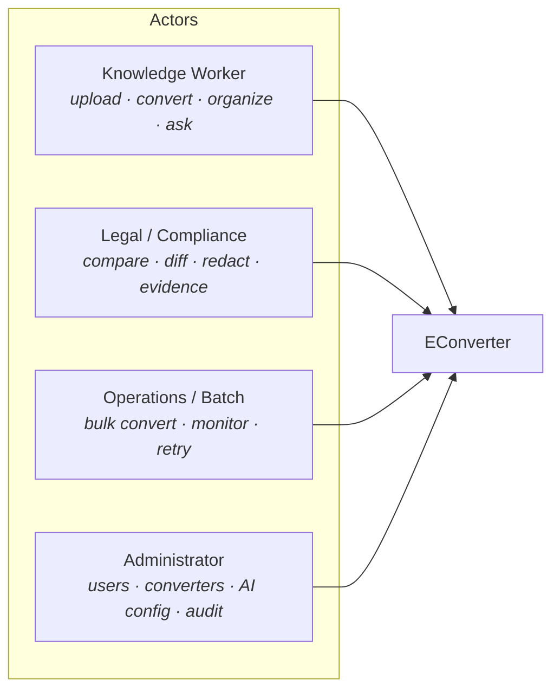

| Role | Primary needs | Surfaced through |
|---|---|---|
| **Knowledge Worker / End User** | Format conversion with layout fidelity; hierarchical folders; version recovery; in-browser PDF editing; grounded Q&A on their own corpus | `Documents.razor`, `PdfEditor.razor`, `AiChatPage.razor` |
| **Legal / Compliance Reviewer** | Cross-document comparison, clause diffing, grounded search; dossier exports as evidence; guaranteed no cloud egress; redaction & watermarking | Copilot UI, `CopilotDossierExporter`, editor redaction/watermark ops |
| **Operations / Batch User** | Submit and monitor batches; cancel/retry; per-attempt history; reliable job outputs | `BatchConversionDialog.razor`, `ProcessingJobs.razor` |
| **System / Platform Administrator** | User/role lifecycle (Local + Entra ID); converter catalog + limits; AI provider config; health & traces; security audit review | `Admin/*.razor`, `Tools.razor` |

### 2.3 External System Interactions

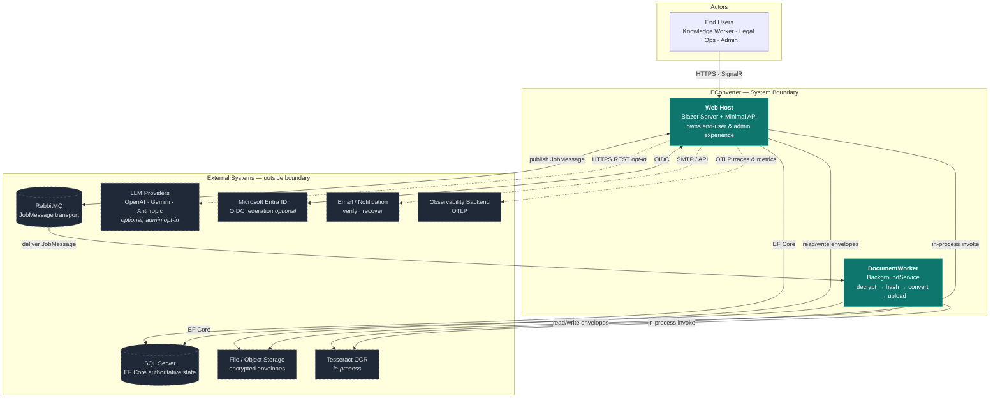

| External system | Interaction | Notes |
|---|---|---|
| **RabbitMQ** | AMQP publish/consume | Delivery only; `NoOpQueuePublisher` fallback exists |
| **Relational DB (SQL Server)** | TCP via EF Core | Authoritative for all aggregates + Identity (shared schema) |
| **File / Object Storage** | Provider SDK or filesystem | Addressed by `StorageProvider`/`StorageKey` on `Document` |
| **LLM Providers** | Outbound HTTPS REST, API key/bearer | **Opt-in.** Invoked by `ExternalAiClient`; `IChatClient` built by `EnterpriseAiChatService` |
| **Microsoft Entra ID** | OIDC federation | Optional. Authorization keys on internal `Entity.Id`, never the provider subject |
| **OCR Engine** | In-process native/libtool | Wrapped by `IOcrEngine` adapter |
| **Email / Notification** | SMTP or provider API *(inferred)* | Registration, verification, password recovery |
| **Observability Backend** | OTLP export | Traces + metrics configured at host startup |

### 2.4 System Boundary Definition

**Inside the boundary**

- `src/DocumentConverter.Web` — ASP.NET Core host: Minimal API endpoint groups, Blazor/Radzen pages (Account, Admin, Copilot, Documents, Editor, Jobs, Tools), SignalR hubs, middleware, hosted services, authentication, `wwwroot/lib/pdfjs`
- `src/Workers/DocumentWorker` — BackgroundService executing the decrypt → hash → convert → upload pipeline
- `src/DocumentConverter.Web/HostedServices/JobProcessorWorker.cs` — in-process worker path (dequeue, hash verification, streaming, batch aggregation)
- `src/DocumentConverter.Application` — AI, Admin, Common, Documents, Editor, Processing, Security, Storage contracts & services
- `src/DocumentConverter.Domain` — Documents, Processing, AI, Identity, Security, System aggregates and state machines
- `src/DocumentConverter.Contracts` — DTOs + message shapes
- `src/DocumentConverter.Infrastructure` — AI (incl. Hnsw), Admin, Documents, Editor, Identity, Messaging, Ocr, Persistence, Processing (incl. Office), Security/StorageEncryption, Storage adapters
- `src/BuildingBlocks/DocumentConverter.Processing.Abstractions` — processing seam contracts
- `src/BuildingBlocks/DocumentConverter.Security` — EICAR / ZipBomb / FileName sanitization

**Outside the boundary**

Broker runtime, DB server hosting/backup/tuning, object-storage backends, third-party LLM models/quotas/billing, the Entra ID tenant and its policies, OCR engine binaries beyond the adapter, observability collector/APM, end-user browsers, PDF.js library internals, third-party NuGet packages (OpenXml, PdfSharp, PdfPig, SkiaSharp, EF Core providers), **and — deliberately — cross-user sharing, external collaboration and public share links**, which are out of scope for the MVP.

---

## 3. Container View

### 3.1 Domain Module Division

Nine domains, five of them core business domains and four supporting/infrastructure domains.

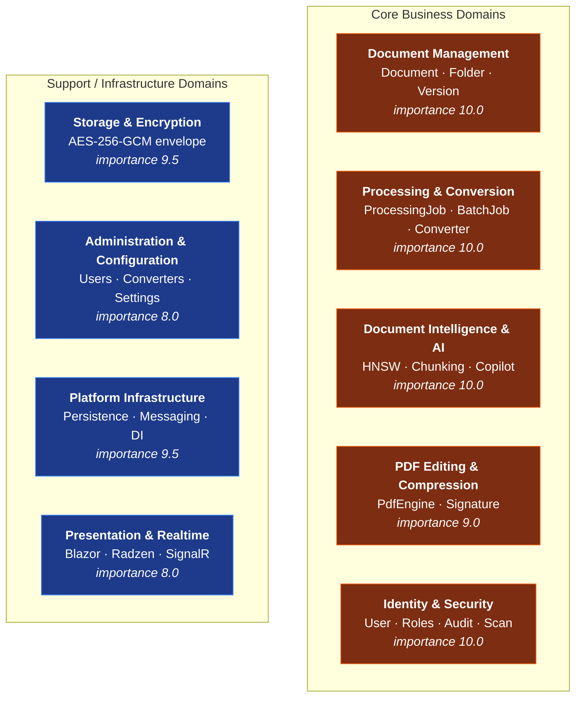

| Domain | Type | Complexity | Core responsibility |
|---|---|---|---|
| **Document Management** | Core Business | 8.5 | Owns the primary business asset: documents, folders, versions, recycle bin. Enforces the private-to-owner invariant. |
| **Processing & Conversion** | Core Business | 9.0 | Async transformation backbone. Job aggregate with leases/attempts/progress; format-specific processors. |
| **Document Intelligence & AI** | Core Business | 9.5 | Zero-egress understanding: embeddings, multilingual chunking, HNSW index, semantic retrieval, Copilot sessions, dossier export. |
| **PDF Editing & Compression** | Core Business | 8.5 | Server-side PDF mutation (annotations → redaction → forms) and two-dimensional compression. |
| **Identity & Security** | Core Business | 8.0 | Who the caller is and what they may touch: aggregates, dual auth, claim transformation, ownership checks, threat screening, audit. |
| **Storage & Encryption** | Infrastructure | 8.0 | Durable encrypted substrate. Envelope encryption + provider-agnostic storage seam. |
| **Administration & Configuration** | Support | 6.5 | Operator control surface: users, departments, converter catalog + limits, AI provider config, audit review. |
| **Platform Infrastructure** | Infrastructure | 7.5 | Technical substrate: EF Core boundary, migrations, messaging, composition root, observability. |
| **Presentation & Realtime Interaction** | Presentation | 7.0 | Blazor/Radzen UI, SignalR hubs, notification bridging. No business rules. |

### 3.2 Domain Module Architecture (Layered DDD)

The dependency direction is the architecture's central invariant. Arrow = *depends on*.

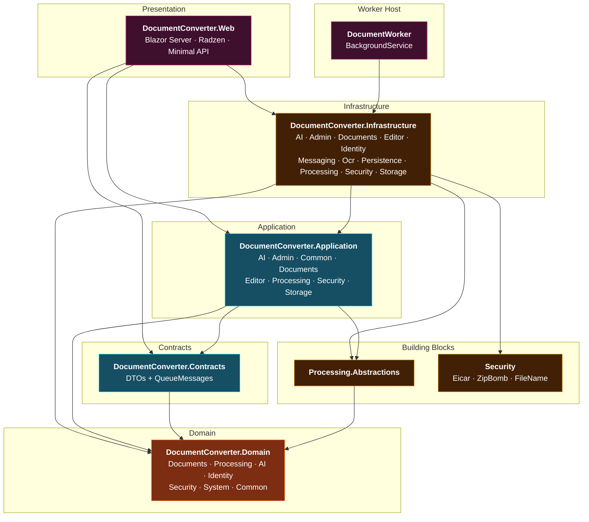

**Solution graph — exactly 8 source projects + 3 declared test projects:**

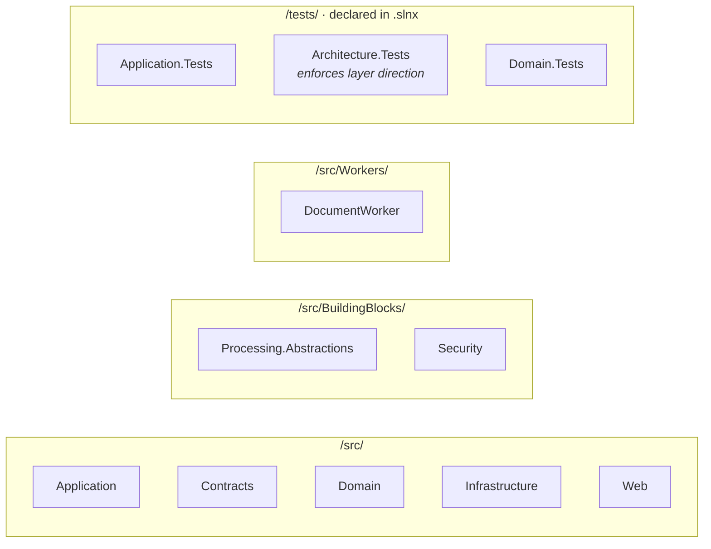

> **Architectural signal.** The existence of `DocumentConverter.Architecture.Tests` is the mechanism that turns the layer-direction rule from documentation into an executable assertion. Treat it as a first-class architectural artifact, not a test project.

### 3.3 Domain Relationship Map

Edge labels encode relationship type and coupling strength (0–10).

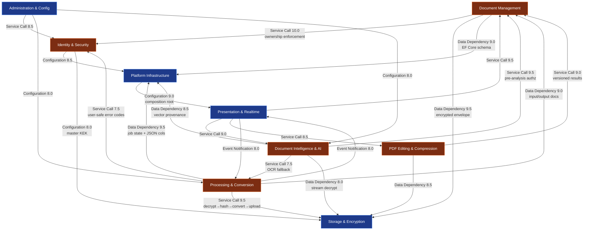

**The three load-bearing walls:**

1. **`Document Management ↔ Identity & Security` @ 10.0** — Ownership is not a check performed somewhere; it is *the* invariant. `Document.IsOwnedBy` + `GetCurrentUserId` gate every read, mutation and deletion, and AI retrieval is additionally folder-scoped on top of it.
2. **`Document Management ↔ Storage & Encryption` @ 9.5** and **`Processing ↔ Storage` @ 9.5** — Content is unreadable without the storage abstraction. `Document` carries the `StorageProvider`/`StorageKey` coordinates that only the storage domain can resolve.
3. **`Platform Infrastructure → Presentation` @ 9.0** — The composition root is a single point of total failure. Mis-register a module in `Program.cs` and nothing starts.

### 3.4 Storage Design

Storage is addressed through a two-level key and encrypted as a self-describing envelope.

**Addressing.** `IDocumentStorage` is keyed by `(StorageProvider, StorageKey)` — a pair stored directly on the `Document` aggregate. Business code never sees a filesystem path or a blob URI; it sees a logical address. Swapping filesystem → S3 → Azure Blob is an adapter substitution, not a business-logic change.

**Envelope format.** Each stored artifact is written as a chunked AES-256-GCM envelope:

```
┌───────────────────────────────────────────────────────────────┐
│ Envelope Header                                               │
│   · format version · algorithm id (AES-256-GCM)               │
│   · wrapped DEK  ← encrypted with master KEK                  │
│   · chunk size · original content length · SHA-256            │
├───────────────────────────────────────────────────────────────┤
│ Chunk 0   [ nonce ][ ciphertext ][ auth tag ]                 │
│ Chunk 1   [ nonce ][ ciphertext ][ auth tag ]                 │
│ ...                                                           │
│ Chunk N   [ nonce ][ ciphertext ][ auth tag ]                 │
└───────────────────────────────────────────────────────────────┘
```

**Why this shape.** Per-chunk authentication is what enables **streamed decryption with bounded memory** — the worker can process a multi-hundred-megabyte document without loading it into RAM, and a corrupted chunk fails at that chunk rather than silently poisoning the whole file. The DEK/KEK split means key rotation re-wraps DEKs without re-encrypting the corpus, and each document's blast radius is exactly one key.

**Database schema ownership.** All aggregates persist through a single `AppDbContext` that extends an Identity-enabled `DbContext`, so authentication entities live in the *same schema* as business data. `OnModelCreating` is the single declaration point, with one configuration file per bounded context (`DocumentConfigurations`, `ProcessingConfigurations`, `CopilotConfigurations`, `IdentityConfigurations`, `SystemConfigurations`). Processing payload columns use JSON value conversion.

### 3.5 Inter-Domain Module Communication

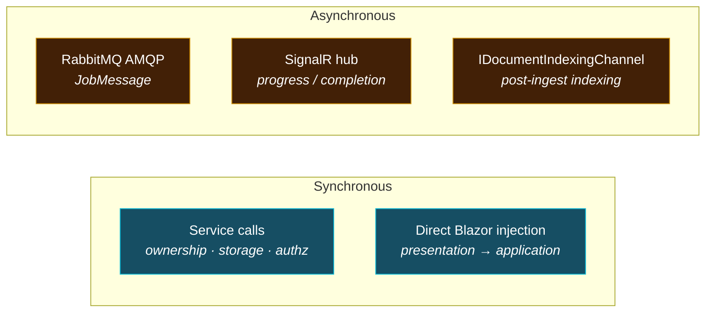

| Mechanism | Path | Purpose |
|---|---|---|
| **Service call** | Presentation → Application → Domain | Standard request handling; ownership enforcement at every entry |
| **Service call** | Processing/AI/Editor → Storage | Encrypted read/write envelope |
| **Service call** | AI → Processing | OCR fallback for scanned documents (reuse, not duplication) |
| **AMQP** | Web → RabbitMQ → Worker | Job delivery |
| **SignalR** | Worker/Processing → `ProcessingHub` → UI | Realtime progress, completion, batch state |
| **Channel** | Ingestion → `IDocumentIndexingChannel` → `DocumentIndexingWorker` | Decoupled post-availability indexing |
| **EF Core** | All domains → `AppDbContext` | Persistence |

---

## 4. Component View

### 4.1 Core Functional Components

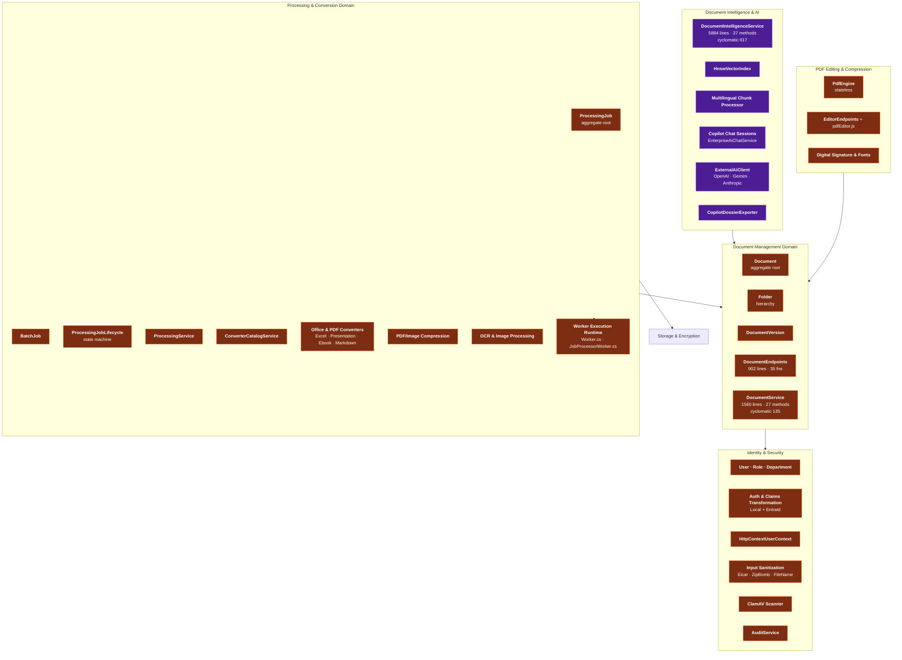

### 4.2 Technical Support Components

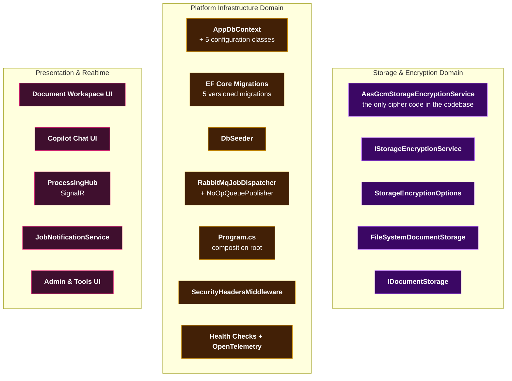

### 4.3 Component Responsibility Division

| Component | Layer | Responsibility | Notable characteristic |
|---|---|---|---|
| `Document` | Domain | Aggregate root: ownership, storage coordinates, hash, content type, size, status, deletion attempts. Factory `Create` enforces metadata invariants. | `IsOwnedBy` is the single most-called method in the system |
| `DocumentService` | Infrastructure | Full lifecycle orchestration from upload through purge; folder consistency; recycle-bin; DTO mapping; ownership verification | 1,560 lines / 27 methods / cyclomatic 135 |
| `DocumentEndpoints` | Web | Document + folder CRUD, rename, move, **inline DOCX→PDF stream conversion** (no queue round trip), streaming download | 902 lines / 35 functions — largest endpoint group |
| `ProcessingJob` | Domain | Aggregate: status, priority, progress, lease, attempts, inputs, outputs | Authoritative job state |
| `ProcessingJobLifecycle` | Domain | `CanTransition` / `EnsureCanTransition` / `IsRetryable` | Illegal transitions rejected in domain |
| `OfficeDocumentProcessor` (+ family) | Infrastructure | Highest-fidelity conversion: DOCX↔PDF with word-level layout emission; XLSX/CSV→paginated PDF; reverse export | Bidirectional |
| `PdfCompressProcessor` | Infrastructure | Two-dimensional reduction: PDFsharp structural compaction + SkiaSharp image downsampling | Driven by parsed `PdfCompressOptions` JSON |
| `Worker Execution Runtime` | Workers + Web | Consume → claim lease → stream to temp → verify SHA-256 → convert → upload → complete; batch aggregation | **Duplicated across two hosts** (see §8) |
| `DocumentIntelligenceService` | Infrastructure (`AI`) | Authorize → analyze → embed → hydrate index → rank → persist provider config | 5,884 lines / 37 methods / **cyclomatic 617** |
| `HnswVectorIndex` | Infrastructure | ANN construction, insertion, similarity search, folder-scoped filtering, hydration | Backed by persistent chunk/index rows |
| `MultilingualChunkProcessor` | Infrastructure | Overlapping chunk segmentation, language detection, enrichment, provenance annotation | Tri-language set |
| `EnterpriseAiChatService` | Web | Session resolve/create, concurrent cache, `IChatClient` construction | Cache is unbounded except by age (see §8) |
| `ExternalAiClient` | Infrastructure | Provider-specific HTTP construction, auth headers, JSON parsing, normalized errors | The only permitted outbound AI path |
| `CopilotDossierExporter` | Infrastructure | OpenXML XLSX/DOCX + Markdown briefing materialization | Produces the monetizable artifact |
| `PdfEngine` | Infrastructure | Stateless DTO → PDFsharp/PdfPig mutation across the full edit feature set | No state held between operations |
| `AesGcmStorageEncryptionService` | Infrastructure | DEK generation, KEK wrapping, chunked encrypt/decrypt | **The only cipher/nonce/tag/key-wrapping code in the repo** |
| `User` / `Role` / `Department` | Domain | Stable application identity, guarded role ops, normalized email, activation lifecycle | Authorization keys on internal `Entity.Id` |
| `AppClaimsTransformation` | Web | Provider claims → internal application roles | Bridges Local and EntraId |
| `BuildingBlocks.Security` | BuildingBlocks | EICAR detection, zip-bomb ratio guard, file-name sanitization, signature verification | Runs *before* persistence |
| `AppDbContext` | Infrastructure | All DbSets, entity configs, JSON conversions, Identity integration, seeding | Uses EF Core `DbContext` per Identity inheritance |

### 4.4 Component Interaction Relationships — The Processing Domain

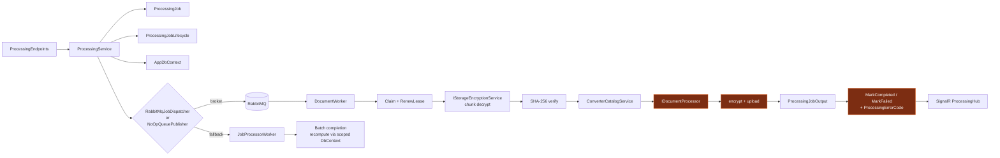

---

## 5. Key Processes

### 5.1 Asynchronous Document Conversion (Hot Path)

The revenue-facing core capability and the **only** workflow that legitimately crosses the process boundary (web host → RabbitMQ → worker).

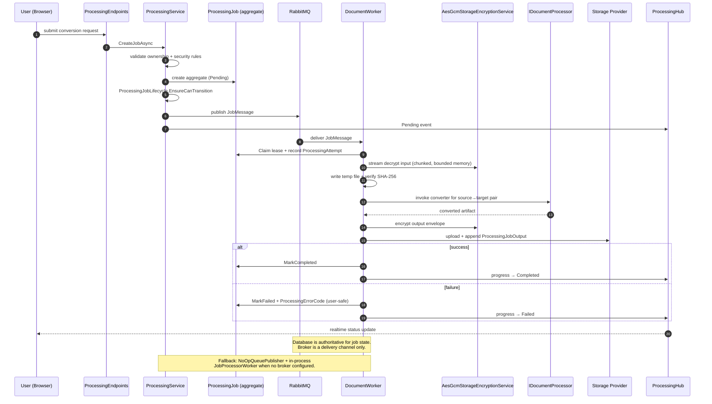

**Failure semantics.** `ProcessingJobLifecycle.IsRetryable` classifies errors. Retryable failures produce a **new `ProcessingAttempt` under the same aggregate** — not a new job. This keeps attempt history attached to the logical unit of work while preventing job-table explosion. `ProcessingErrorCode` is deliberately user-safe and never leaks internal exception detail; root-cause analysis happens in logs/telemetry.

**Integrity.** The SHA-256 verification step between decrypt and convert is the trust anchor for the whole pipeline: it proves the bytes the converter is about to process are the bytes that were ingested.

### 5.2 Document Ingestion & Storage

The ordering in this flow is architecturally deliberate: **no plaintext ever lands in storage, and no aggregate exists before its storage coordinates do.**

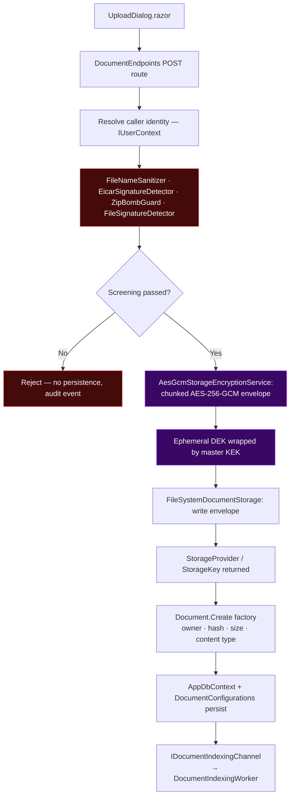

An optional ClamAV scan (`ClamAvScanner`) runs in the same screening stage, with the verdict reported into document lifecycle status via `DocumentStatus` / `BeginScan`.

### 5.3 Document Intelligence Indexing

All in-process. The `IDocumentIntelligenceService` contract forbids content egress.

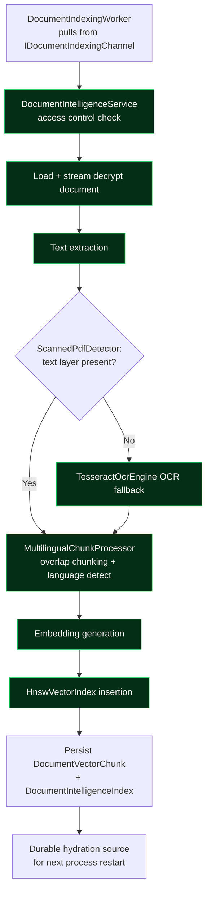

### 5.4 Grounded Copilot Question-Answering

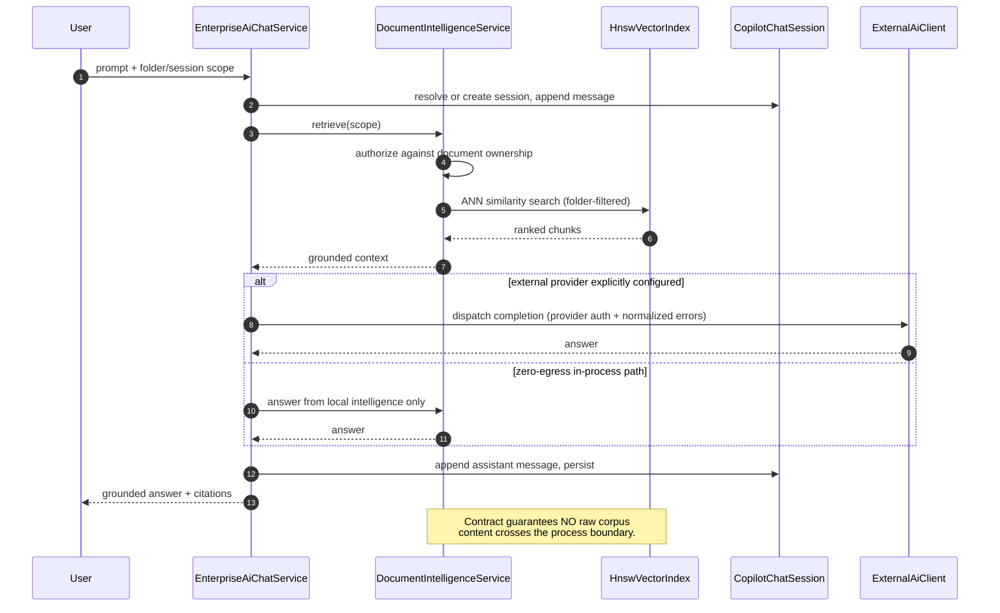

**Retrieval scoping is layered:** ownership authorization runs *first*, then HNSW search is filtered by folder scope. A Copilot session can only ever ground in documents the caller owns — this is not an additional check bolted on top, it is a filter applied inside the retrieval primitive.

### 5.5 Authentication, Authorization & Audit

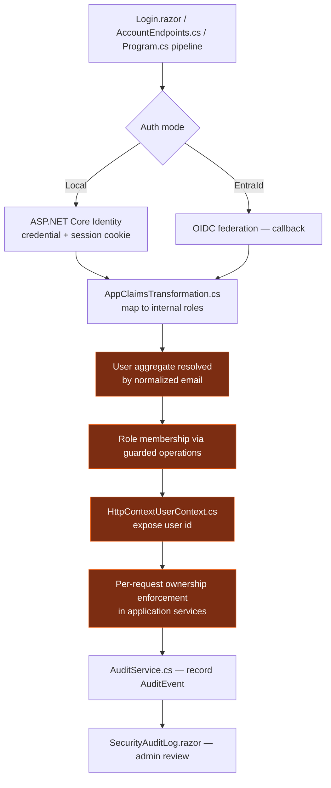

**Critical identity design decision.** Authorization keys on the **internal `Entity.Id`**, never on the identity-provider subject. This means an Entra ID subject change, a re-provisioning, or an identity-provider migration cannot silently transfer access to a different principal. Login timestamps are recorded; accounts are soft-deactivated rather than deleted.

### 5.6 PDF Editing & Manipulation

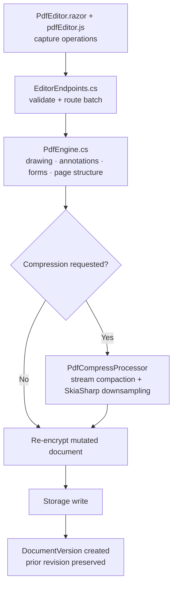

**Operation coverage:** text rendering, highlights, shapes, ink strokes, image/signature placement, stamps, sticky notes, strikethrough, underline, redaction, watermarking, form fields, page structure. Digital signing via `PdfDigitalSignatureService`; glyph consistency across server environments via `SystemFontResolver`.

### 5.7 Batch Conversion

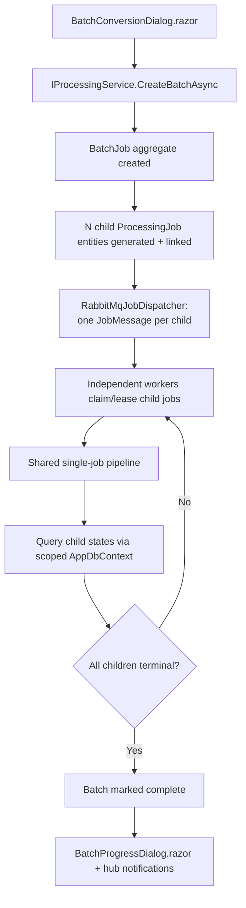

**Architectural note.** Batch closure is **not event-driven** — it is recomputed by querying child job states. The `BatchJob` is therefore a *derived, idempotent aggregate* rather than a separately tracked state machine. This is simpler and self-healing, at the cost of a polling-and-scan whose cost is proportional to batch size × poll frequency (see §8 and §6.4).

### 5.8 Dossier & Report Export

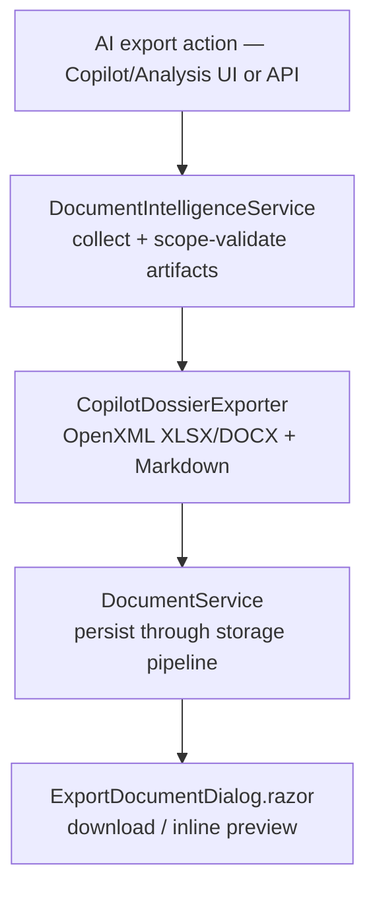

The generated artifact is persisted through the *same* document/storage pipeline — meaning **exports inherit the same encryption, ownership and versioning guarantees as any other document**. There is no privileged export path that bypasses the security model.

### 5.9 Data Flow Paths

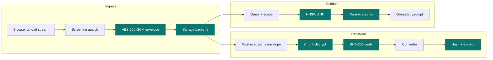

### 5.10 Exception Handling Mechanisms

| Failure class | Mechanism | User-visible behaviour |
|---|---|---|
| **Illegal job transition** | `ProcessingJobLifecycle.EnsureCanTransition` throws in the domain | Rejected before persistence |
| **Broker unavailable** | `NoOpQueuePublisher` fallback → in-process execution | Degraded, not failed |
| **Worker crash mid-job** | Lease expiry → reclaim path (`RenewLease` exists; reaper is a gap, see §8) | Job eventually reprocessed |
| **Retryable conversion failure** | `ProcessingJobLifecycle.IsRetryable` → new `ProcessingAttempt` | Attempt history shown; job stays alive |
| **Terminal conversion failure** | `MarkFailed` + `ProcessingErrorCode` | User-safe message, no internals leaked |
| **Content tampering / corruption** | Per-chunk AES-GCM auth tag + SHA-256 pre-convert verify | Hard failure, no partial output |
| **Malware / zip bomb / traversal** | `BuildingBlocks.Security` screening *before* persistence | Rejected at ingress, audit event written |
| **External LLM unavailable** | `ExternalAiClient` normalized error reporting | Provider error surfaced; in-process path unaffected |
| **Auth failure** | 401/403 at pipeline | No ownership information leaked |

---

## 6. Technical Implementation

### 6.1 Core Module Implementation

**Job orchestration.** `ProcessingService` is the gate: it validates the request, resolves ownership and security rules through the security abstractions, constructs the `ProcessingJob` aggregate in `Pending`, persists it, and *only then* dispatches. This ordering is what makes the database authoritative — if dispatch fails, the job still exists and can be picked up by a subsequent sweep or by the in-process worker. The lifecycle guards (`CanTransition` / `EnsureCanTransition`) live in the domain, so no endpoint or UI can drive an illegal state.

**Worker execution loop.** The runtime performs, in order: consume message → `Claim` lease → record `ProcessingAttempt` → stream encrypted input to a local temp file → chunk-decrypt with the unwrapped per-document DEK → verify SHA-256 → resolve the processor for the source/target pair from `ConverterCatalogService` → invoke `IDocumentProcessor` → hash + encrypt + upload the output → append `ProcessingJobOutput` → `MarkCompleted` / `MarkFailed` → publish notification → (in batch mode) recompute batch state via a scoped `AppDbContext`.

**PDF engine.** `PdfEngine` is **stateless**: it consumes a batch of `PdfEditOperationDto` and translates each into PDFsharp/PdfPig low-level calls. Statelessness is what allows the engine to be invoked from an endpoint, from a batch processor, or from a compression pre-step without session affinity.

**Converter catalog.** `ConverterCatalogService` maps `(source, target)` format pairs to processor implementations and resolves administrator-configured limits. This is the runtime enforcement point for admin policy: disabling a converter in `ConvertersCatalog.razor` directly governs which requests the processing domain accepts.

### 6.2 Key Algorithm Design

**Envelope encryption (chunked AES-256-GCM).** The algorithm is deliberately boring and standards-correct:

```
encrypt(plaintext_stream, master_kek):
    dek = random(32 bytes)                       # ephemeral, per document
    write_header(version, ALG_AES_256_GCM, wrap(dek, kek), chunk_size, sha256(plaintext))
    for chunk in read_bounded(plaintext_stream, chunk_size):
        nonce = random(12 bytes)                 # unique per chunk
        ct, tag = AES_GCM_encrypt(dek, nonce, chunk)
        write(nonce || ct || tag)

decrypt(envelope_stream, master_kek):
    header = read_header()
    dek = unwrap(header.wrapped_dek, kek)
    for (nonce, ct, tag) in iterate_chunks(envelope_stream):
        yield AES_GCM_decrypt(dek, nonce, ct, tag)   # per-chunk authenticated
```

The correctness properties: unique nonce per chunk, per-chunk authentication (corruption is detected at the chunk, not at EOF), bounded memory (chunk size is the memory ceiling), and key separation (compromise of one DEK affects exactly one document).

**HNSW approximate nearest neighbour.** Hierarchical Navigable Small World gives sub-linear ANN search with a tunable recall/latency tradeoff — essential because exact search over a growing corpus is O(n) per query. The index is backed by persistent `DocumentVectorChunk` + `DocumentIntelligenceIndex` rows, so **restart hydration is a database read rather than a full re-embedding pass**. That is the difference between a cold start measured in seconds and one measured in hours.

**Multilingual chunking.** Text is split into *overlapping* chunks with language detection applied before normalization. Overlap preserves semantic continuity across chunk boundaries — critical because a clause split across two chunks would otherwise be unretrievable as a unit. Language detection normalizes across the supported tri-language set so embeddings from different languages land in comparable regions.

**Two-dimensional compression.** `PdfCompressProcessor` attacks size on two independent axes: **structural** (PDFsharp stream compaction — removing redundant object streams, deduplicating fonts) and **visual** (SkiaSharp walk of embedded image XObjects, downsample and re-encode). `CompressionEstimatorService` estimates the gain *before* committing, so a user can make an informed quality/size tradeoff rather than discovering it after the fact.

### 6.3 Data Structure Design

| Structure | Shape | Design rationale |
|---|---|---|
| **`ProcessingJob`** | Aggregate root with status, priority, progress, lease holder + expiry, `ICollection<ProcessingAttempt>`, `ICollection<ProcessingJobInput>`, `ICollection<ProcessingJobOutput>` | Attempts as children keep retry history with the logical unit of work |
| **`ProcessingJobStatus`** | Enum + transition table (`ProcessingJobLifecycle`) | States are data; legal transitions are code |
| **`ProcessingErrorCode`** | Closed taxonomy enum | Deliberately maps internal failure modes to user-safe labels |
| **`BatchJob`** | Aggregate with `Status` + derived-from-children completion | Derived idempotent aggregate rather than a second state machine |
| **`Document`** | Aggregate with `OwnerUserId`, `StorageProvider`, `StorageKey`, `ContentHash`, `ContentType`, `Size`, `Status`, `DeletionAttempts` | Storage coordinates stored on the entity so content resolution requires no side table |
| **`DocumentVectorChunk`** | Row per chunk: embedding, text, provenance, language, chunk index, document FK | Provenance annotation enables citation and audit |
| **`DocumentIntelligenceIndex`** | Index metadata row | Durable hydration source |
| **`Folder`** | Self-referencing hierarchy | Nested traversal; scopes AI retrieval |
| **`CopilotChatSession`** | Aggregate with `ICollection<CopilotChatMessage>`, `ICollection<CopilotMemoryItem>`, folder scope, pinned flag | Memory items separate from messages — memory is curated, history is append-only |
| **`JobMessage`** | Transport DTO (in `Contracts/Messages`) | *(Currently co-located with application DTOs — see §8)* |
| **DB payload columns** | JSON value conversion via EF Core | Flexible job payload without a schema migration per shape change |

### 6.4 Performance Optimization Strategies

| Strategy | Where | Effect |
|---|---|---|
| **Streamed chunk decryption** | `AesGcmStorageEncryptionService` | Bounded memory; enables conversion of files larger than available RAM |
| **Database-authoritative job state** | `ProcessingJob` | Survives broker outage; enables broker-less deployment |
| **Competing consumers** | Multiple `DocumentWorker` instances | Horizontal throughput scaling without code change |
| **Independent batch fan-out** | One `JobMessage` per child job | Natural parallelisation; no head-of-line blocking within a batch |
| **NoOp fallback** | `NoOpQueuePublisher` | Removes RabbitMQ from the critical path for small deployments |
| **Inline DOCX→PDF** | `DocumentEndpoints` | Avoids a queue round trip for a latency-sensitive, small-input case |
| **Durable vector index** | `DocumentVectorChunk` rows | Restart hydration is a DB read, not a re-embedding |
| **Folder-scoped ANN filtering** | `HnswVectorIndex` | Narrows the search space before ranking |
| **Concurrent session cache** | `EnterpriseAiChatService` | Avoids per-turn session reconstruction |
| **Compression estimation** | `CompressionEstimatorService` | Avoids wasted expensive work when the gain is negligible |

**Known bottlenecks.** (1) `DocumentIntelligenceService` at cyclomatic complexity 617 is a single entry point for all AI operations — decomposition would parallelize independent paths. (2) Batch completion recomputation scans child states per poll — an event counter or a `(BatchJobId, Status)` composite index would remove the O(batch × poll) cost. (3) HNSW hydration cost grows with corpus size; lazy/incremental hydration or a persisted index snapshot is the mitigation path.

---

## 7. Deployment Architecture

### 7.1 Runtime Environment Requirements

| Requirement | Specification |
|---|---|
| **Runtime** | .NET 10 / ASP.NET Core 10 (`global.json` pinned) |
| **Database** | SQL Server — **version must be pinned across environments** (see §8) |
| **Broker** | RabbitMQ 4 (`rabbitmq:4-management`), optional if using `NoOpQueuePublisher` |
| **Container runtime** | Docker + Docker Compose |
| **Native dependency** | Tesseract OCR binaries/models available to the host process |
| **Storage** | Filesystem volume, or an object-store backend via adapter |
| **Secrets** | `SQLSERVER_SA_PASSWORD`, `RABBITMQ_USER`/`RABBITMQ_PASSWORD`, `STORAGE_ENCRYPTION_KEY` |
| **Network** | Two networks: `dc-public` (bridge) and `dc-internal` (bridge, `internal: true`) |

### 7.2 Deployment Topology Structure

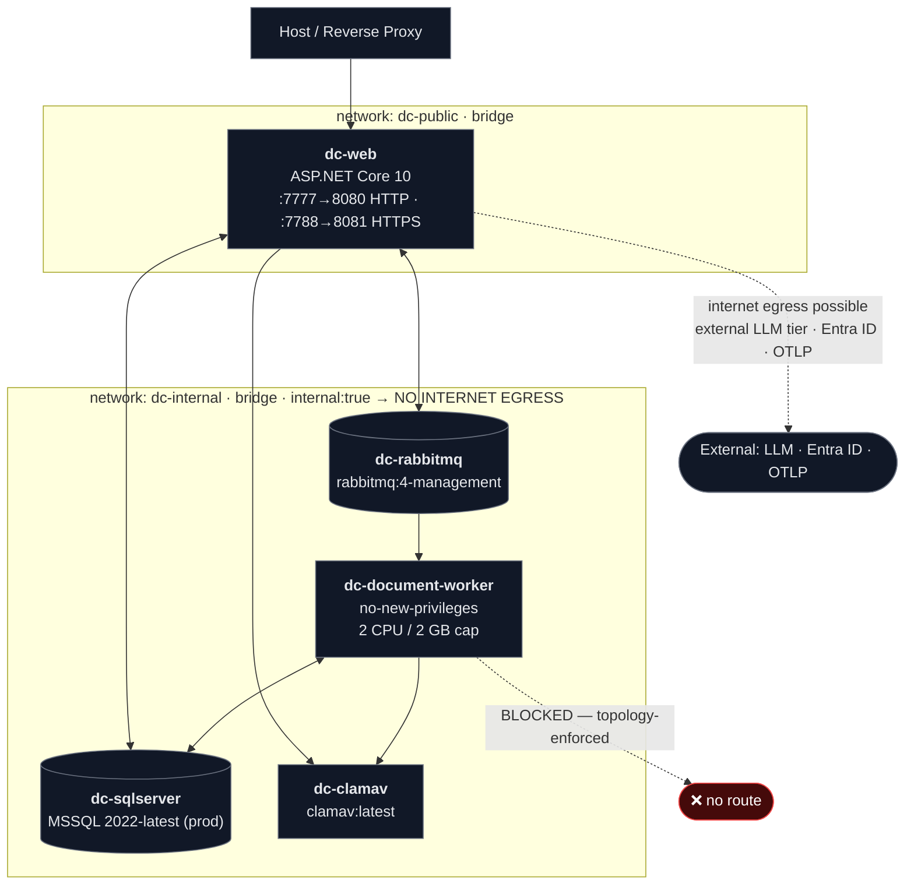

**The topology is the security control.** The zero-egress promise is not merely a contract in code — the `document-worker` is attached **only** to `dc-internal` (`internal: true`), which means the conversion, OCR and encryption path has **no internet route at all**. The web host sits on both networks because it owns the optional external-LLM tier and the OIDC/Observability integrations. This is defense-in-depth: even if the code-level zero-egress contract were violated, the network would block the exfiltration.

**Environment configuration matrix:**

| Facet | dev (`docker-compose.yml`) | prod (`docker-compose.prod.yml`) | Assessment |
|---|---|---|---|
| Environment | `Development` | `Production` | ✅ |
| SQL Server image | `2025-latest` | `2022-latest` | ⚠️ **version drift** |
| SA password | hardcoded | `${SQLSERVER_SA_PASSWORD}` | ⚠️ dev-only risk |
| RabbitMQ creds | `guest/guest` | env-driven | ⚠️ dev-only risk |
| Storage encryption | `Enabled=false` | `Enabled=${…:-true}` | ⚠️ dev disables the core control |
| `STORAGE_ENCRYPTION_KEY` | **not set** | set from env | ⚠️ dev never exercises KEK path |
| ClamAV | `Enabled=false` | `Enabled=${…:-true}` | ⚠️ dev disables AV |
| `Processing__RunWorkerInWeb` | `false` | `false` | ⚠️ in-process worker **dormant in both** |
| Port exposure | SQL `1433`, RMQ `15672` published | not published | ✅ prod hardened |
| Worker network | `dc-internal` only | `dc-internal` only | ✅ zero-egress enforced |
| Web healthcheck | absent | `curl /health` | ⚠️ dev lacks healthcheck |

### 7.3 Scalability Design

```mermaid
graph TB
    LB["Reverse Proxy / LB"]
    subgraph ScaleOut["Scale-out axes"]
        W1["dc-web #1"]
        W2["dc-web #2"]
        WN["dc-web #N<br/><i>⚠ SignalR affinity required</i>"]
        K1["dc-document-worker #1"]
        K2["dc-document-worker #2"]
        KN["dc-document-worker #N<br/><i>competing consumers</i>"]
    end
    LB --> W1 & W2 & WN
    RMQ[("RabbitMQ")] --> K1 & K2 & KN
    W1 & W2 & WN --> RMQ
```

| Axis | Scaling approach | Constraint |
|---|---|---|
| **Web tier** | Horizontal behind a proxy | **SignalR requires sticky sessions or a backplane**; Blazor Server holds per-circuit server state |
| **Worker tier** | Horizontal — competing consumers on one queue | Bounded by DB connection pool and CPU; `dc-document-worker` is capped at 2 CPU / 2 GB per instance |
| **Database** | Vertical + read replicas for AI query paths | Write path is single-primary |
| **Vector index** | Per-process in-memory, hydrated from DB | **Not shared across instances** — each web node maintains its own HNSW index; memory scales with corpus |
| **Object storage** | Transparent — swap adapter | None |
| **Broker** | RabbitMQ clustering | None specific |

**Scale-out caveat worth flagging.** The HNSW index is per-process and hydrated from `DocumentVectorChunk`. Scaling the web tier to N nodes means N independent in-memory indices. That's correct for read-heavy retrieval but it means index-hydration cost and RSS both scale linearly with node count. A shared vector service is the natural evolution if corpus size outgrows per-node memory.

**Extension points (deliberate seams):**

| Extension point | Interface | What you can swap in |
|---|---|---|
| Storage backend | `IDocumentStorage` | S3, Azure Blob, GCS, NFS |
| Encryption algorithm | `IStorageEncryptionService` | Alternate AEAD / KMS-backed KEK |
| Format converter | `IDocumentProcessor` | Any new source/target pair |
| OCR engine | `IOcrEngine` | Alternative OCR (ABBYY, cloud OCR in air-gapped variant) |
| Malware scanner | `IMalwareScanner` | Any AV engine, not just ClamAV |
| AI provider | `IExternalAiClient` / `IChatClient` | Any OpenAI-compatible endpoint |
| Queue transport | `RabbitMqJobDispatcher` seam | Kafka / SQS / Azure Service Bus |
| User identity | `IUserContext` | Any auth scheme |

### 7.4 Monitoring and Operations

```mermaid
graph LR
    subgraph App["EConverter Hosts"]
        OTL["OpenTelemetry<br/>traces + metrics"]
        HC["Health checks"]
        AUD["AuditService<br/>AuditEvent rows"]
    end
    OTL -->|OTLP| COL["Collector"]
    COL --> APM["APM / Dashboards"]
    HC --> PROBE["Orchestrator probes<br/>curl /health"]
    AUD --> ADMUI["SecurityAuditLog.razor"]

    classDef obs fill:#1e3a8a,stroke:#3b82f6,color:#fff
    class OTL,HC,AUD obs
```

| Concern | Mechanism |
|---|---|
| **Distributed tracing** | OpenTelemetry configured at host startup; spans cross the web→broker→worker boundary |
| **Metrics** | OTLP metric export |
| **Health** | `/health` endpoint (prod compose probes it; **dev compose does not**) |
| **Security audit** | `AuditEvent` rows written by `AuditService`, reviewed in `SecurityAuditLog.razor` |
| **Job observability** | `ProcessingJob` + `ProcessingAttempt` rows give per-job, per-attempt history |
| **Error diagnosis** | `ProcessingErrorCode` is intentionally opaque to users — **root cause lives in logs/traces** |
| **Real-time ops visibility** | `ProcessingHub` → `ProcessingJobs.razor` |

**Operational note.** Because the user-facing error taxonomy is deliberately sanitized, operators must treat structured logs and traces as the *primary* incident-diagnosis surface. This is a conscious tradeoff: security posture over operator convenience.

---

## 8. Architecture Insights, Gaps & Recommendations

### 8.1 Structural Drift Register

The architecture-validation pass identified fifteen findings against the documented design. These are **operational and structural drift, not conceptual drift** — the blueprint is coherent; the manifests and the code organization have not fully kept pace.

| ID | Finding | Severity | Status |
|---|---|---|---|
| **G-01** | Repository snapshot contains zero `.cs` source files — all source-level claims untestable in that snapshot | HIGH (scope) | SOLID |
| **G-02** | Both Dockerfiles `COPY` `Directory.Build.props` + `Directory.Packages.props`, which are absent — **Docker build fails at COPY** | **CRITICAL** | SOLID |
| **G-03** | Both Dockerfiles `COPY` two missing `.csproj` (`Processing.Abstractions`, `Security`) — 6 of 8 project files present | **CRITICAL** | SOLID |
| **G-04** | Job execution logic duplicated across `DocumentWorker/Worker.cs` and `Web/HostedServices/JobProcessorWorker.cs` — "the processing runtime" has no single location | HIGH | SOLID |
| **G-05** | `Processing__RunWorkerInWeb=false` in **both** compose files — the in-process worker is a **dormant** path, not the operating mode | MEDIUM | SOLID |
| **G-06** | Dev compose disables `Storage__Encryption__Enabled=false`, `ClamAV__Enabled=false`, and sets no `STORAGE_ENCRYPTION_KEY` — **development never exercises the flagship security control** | HIGH | SOLID |
| **G-07** | SQL Server version drift: dev `2025-latest` vs prod `2022-latest` — schema/feature parity unguaranteed | MEDIUM | SOLID |
| **G-08** | `DocumentIntelligenceService` documented as `Application.AI` but physically in `Infrastructure.AI` — Application layer holding a concrete infrastructure implementation inverts the dependency | MEDIUM | SOLID |
| **G-09** | "Security domain" spans three layers with unrelated responsibilities: `BuildingBlocks.Security`, `Domain/Security`, `Infrastructure/Security` | MEDIUM | SOLID |
| **G-10** | `Contracts` layer conflates cross-layer DTOs with transport schemas (`Contracts/Messages/QueueMessages.cs`) | MEDIUM | SOLID |
| **G-11** | `scratch_inspect.cs` committed at repository root — stray reflection dump artifact | LOW | SOLID |
| **G-12** | Naming drift: scratch file references `ConversationSession` while the domain aggregate is `CopilotChatSession` | LOW | PLAUSIBLE |
| **G-13** | Two empty top-level directories (`litho/`, `ta/`) with no declared role | INFO | SOLID |
| **G-14** | No CI workflow files present despite restore/publish dependency | INFO | UNVERIFIABLE |
| **G-15** | Test coverage asymmetry: `Application.Tests`, `Architecture.Tests`, `Domain.Tests` declared — **no Infrastructure/Web/Contracts test projects**. The two highest-risk layers are untested by declared projects | MEDIUM | SOLID |

### 8.2 Prioritized Remediation

| # | Priority | Action | From | Effort |
|---|---|---|---|---|
| 1 | **CRITICAL** | Restore missing props + `.csproj` files — **image build is currently impossible** | G-02, G-03 | minutes |
| 2 | **HIGH** | Consolidate duplicated job-execution path into one service consumed by both hosts | G-04 | days |
| 3 | **HIGH** | Enable storage encryption + ClamAV in dev profile with a throwaway KEK so the happy path is exercised locally | G-06 | hours |
| 4 | **HIGH** | Pin one SQL Server version across all environments | G-07 | minutes |
| 5 | **MEDIUM** | Relocate `DocumentIntelligenceService` behind an Application abstraction; implementation stays in Infrastructure | G-08 | hours |
| 6 | **MEDIUM** | Split `Contracts/Messages` into transport-only assembly/namespace | G-10 | hours |
| 7 | **MEDIUM** | Reconcile the three "security" locations into a documented layered responsibility map | G-09 | hours |
| 8 | **MEDIUM** | Add `Infrastructure.Tests` + endpoint integration tests | G-15 | days |
| 9 | **LOW** | Delete/relocate `scratch_inspect.cs`; reconcile `ConversationSession` vs `CopilotChatSession` | G-11, G-12 | minutes |
| 10 | **INFO** | Remove or document empty `litho/`, `ta/` | G-13 | minutes |

### 8.3 Additional Scalability & Performance Recommendations

| # | Recommendation | Motivation |
|---|---|---|
| 1 | **Decompose `DocumentIntelligenceService`** (5,884 lines / CC 617) into: access-control gate, analysis orchestration, embedding generation, index hydration, similarity ranking, provider config persistence | Highest-risk file in the system; the single entry point for all AI operations |
| 2 | **Add queue backpressure & admission control** — per-user / per-tenant concurrency cap and batch size ceiling | Nothing currently limits concurrent job creation; one operator can saturate the worker pool |
| 3 | **Make batch completion event-driven** or add a `(BatchJobId, Status)` composite index | Current approach is O(batch size × poll frequency) |
| 4 | **Add a lease-expiry reaper** | `RenewLease` exists, but a crashed worker holding a stale lease needs a deterministic reclaim path or jobs hang in `Processing` forever |
| 5 | **Bound the in-memory chat-session cache** | `EnterpriseAiChatService` caches by session id with age-based cleanup only — needs a hard cap and explicit eviction under many concurrent users |
| 6 | **Incremental / lazy HNSW hydration** or a persisted index snapshot | Durable hydration is a cold-start latency source proportional to corpus size |
| 7 | **SignalR backplane** for multi-node web deployment | Blazor Server holds per-circuit state; scale-out requires affinity or a backplane |

### 8.4 Security Design Summary

| Control | Implementation | Layer |
|---|---|---|
| **Encryption at rest** | AES-256-GCM chunked envelope; per-document DEK wrapped by master KEK | Storage |
| **Zero egress (code)** | `IDocumentIntelligenceService` contract forbids corpus content leaving the process | Application/Domain |
| **Zero egress (network)** | `dc-document-worker` on `internal: true` network — no internet route | Deployment |
| **Ownership enforcement** | `Document.IsOwnedBy` + `GetCurrentUserId` on every content path | Domain |
| **Retrieval scoping** | Ownership authz then folder-scope filter inside the ANN primitive | AI |
| **Identity stability** | Authorization keyed on internal `Entity.Id`, never provider subject | Identity |
| **Input screening** | EICAR detection, zip-bomb ratio guard, filename sanitization, format signature verification — **before persistence** | BuildingBlocks |
| **Malware scanning** | ClamAV adapter with verdict into lifecycle status | Infrastructure |
| **Integrity** | SHA-256 verified between decrypt and convert; per-chunk GCM tags | Processing/Storage |
| **Error hygiene** | `ProcessingErrorCode` taxonomy never leaks internal exceptions | Domain |
| **Audit trail** | `AuditEvent` rows via `AuditService`, admin-reviewable | Identity |
| **Security headers** | `SecurityHeadersMiddleware` | Web |
| **Secret hygiene** | Prod: env-driven passwords + KEK. Dev: hardcoded (accepted dev-only risk) | Deployment |
| **Container hardening** | `no-new-privileges`, CPU/memory caps on worker | Deployment |

### 8.5 Not Testable With the Current Evidence

Stated honestly, per evidence discipline:

- **All class-level behaviour** — method counts, complexity metrics, `ProcessingJobLifecycle` transition-guard correctness — requires the C# sources, which are absent from the reviewed snapshot. **UNVERIFIABLE.**
- **The code-level zero-egress guarantee** (that `IDocumentIntelligenceService` truly never forwards raw corpus content) is a *contract assertion*. The **network-topology side of it is SOLID** (worker on `internal: true`).
- **Encryption correctness** — nonce handling, key wrapping, chunk authentication — cannot be reviewed without `AesGcmStorageEncryptionService.cs`. The *existence* of the config switch is verifiable; the *implementation* is not.
- **`Architecture.Tests` contents** — whether the layer-direction rule is actually enforced by executable assertions is unknown, because `tests/` is absent despite being declared in the solution.

---

## 9. Development & Operations Guidance

### 9.1 For Development Teams

**Respect the dependency direction.** Domain knows nothing; Infrastructure knows everything. If you find yourself wanting to reference a framework type from `Domain`, you are modelling an infrastructure concern in the wrong layer. `Architecture.Tests` is there to catch this — treat a red architecture test as a design defect, not a test problem.

**Add a format converter, not a format branch.** New conversion capability goes in as an `IDocumentProcessor` implementation registered with `ConverterCatalogService`. Do not add format conditionals to the worker or the service.

**Never bypass the storage seam.** All content read/write goes through `IDocumentStorage` + `IStorageEncryptionService`. If you find plaintext on disk, you have found a bug.

**Ownership is checked once, at the seam.** `GetCurrentUserId` + `IsOwnedBy` at the application service boundary. Do not re-implement ownership checks in endpoints or UI — that path leads to drift.

**Job state changes go through the lifecycle.** `MarkCompleted` / `MarkFailed` / `UpdateProgress` — never set `Status` directly.

**Errors that reach the user come from the taxonomy.** Map internal failure to `ProcessingErrorCode`. Log the real exception with full context.

**Watch the two known hotspots.** `DocumentIntelligenceService` (CC 617) and `DocumentService` (CC 135). New work in these areas should extract collaborators rather than extend them.

### 9.2 For Operations Teams

**Pin the SQL Server version.** Dev/prod drift is an active finding. Pick one and standardize.

**Exercise the security controls in dev.** Storage encryption and ClamAV are disabled in the dev profile — meaning the happy path with encryption on is never tested locally. Provision a throwaway KEK for dev so that path gets exercised.

**Treat logs and traces as primary.** User-facing errors are intentionally sanitized. Correlation via OpenTelemetry traces is the diagnosis path; `ProcessingErrorCode` alone will not locate a root cause.

**Do not publish internal ports in production.** The prod compose correctly keeps SQL `1433` and RabbitMQ `15672` unpublished. Maintain that.

**Expect the worker to be network-isolated.** `dc-document-worker` has only `dc-internal`. If you need the worker to reach something, the answer is almost certainly "no" — route it through the web host or an adapter.

**Scale the worker horizontally; scale the web tier with affinity.** Competing consumers scale freely. The web tier holds SignalR circuits and per-node HNSW indices — scale-out needs sticky sessions or a backplane.

**Watch for stalled jobs.** There is no lease-expiry reaper. Until one exists, a crashed worker can leave jobs in `Processing` indefinitely — monitor for and manually reclaim stale leases.

### 9.3 Decision Support Summary

| Decision | Choice made | Why it holds |
|---|---|---|
| **Job state: domain aggregate vs broker** | Domain aggregate | Survives broker outage; enables broker-less deployment; retry/lease semantics enforceable |
| **Encryption: per-feature vs storage boundary** | Storage boundary | Structural guarantee; every artifact covered; single code location |
| **AI: cloud-only vs two-tier** | Two-tier, zero-egress default | Serves regulated/air-gapped deployments while permitting cloud LLM when explicitly configured |
| **Identity: provider subject vs internal ID** | Internal `Entity.Id` | Provider churn cannot leak authorization |
| **Mutation: in-place vs versioning** | Versioning + recycle bin | Recoverability as a first-class property |
| **Retrieval: external vector DB vs local HNSW** | Local HNSW with DB-backed persistence | Zero egress + durable hydration without an external dependency |
| **Broker: required vs optional** | Optional, with NoOp fallback | Lowers deployment floor; lets small installs run single-container |
| **Layer enforcement: convention vs test** | `Architecture.Tests` | Turns architecture from documentation into an executable invariant |

### 9.4 Knowledge Transfer — Reading Order for New Team Members

1. `DocumentConverter.Domain` — aggregates and state machines; this *is* the business
2. `DocumentConverter.Architecture.Tests` — the layer rules, stated as assertions
3. §5.1 (conversion flow) + §5.2 (ingestion flow) — the two hot paths
4. `AesGcmStorageEncryptionService` — the single security-critical primitive
5. `AppDbContext` + configuration classes — the data model
6. `Program.cs` — the composition root (everything is wired here)
7. §8 — drift findings; know what is intentionally deferred versus what is a defect

---

## 10. Closing Assessment

EConverter's static architecture is **sound and internally consistent**: a disciplined DDD layering corroborated project-for-project by the solution file, a genuinely well-designed async job model where the **database — not the broker — owns job state**, and a deployment topology that enforces the zero-egress promise **at the network layer rather than merely promising it in a README**.

The system's coherence comes from a small number of enforced seams:

- `IUserContext` — **who**
- `IDocumentStorage` + `IStorageEncryptionService` — **where, and how safely**
- `ProcessingJob` aggregate + `ProcessingJobLifecycle` — **what state is legal**
- `IDocumentIntelligenceService` — **what may leave the process**

Most of the identified risks are not architectural. They are **consolidation and scale** issues sitting on top of an otherwise disciplined design: duplicated job-execution logic across two hosts, a 617-cyclomatic-complexity AI service acting as a single entry point, unguaranteed batch-completion recomputation, an unreaped lease, a dev profile that disables every security control the product is sold on, and a build manifest that currently cannot produce an image.

One sentence: **the blueprint is coherent, the seams are real and enforced, the manifests have drifted, and the first order of business is making the thing build.**

```
LOCKED. EConverter architecture documented
      → 9 domains · 8 source projects · 8 workflows · 15 drift findings
      → 2 CRITICAL build blockers · 4 HIGH · 6 MEDIUM · 2 LOW · 1 INFO
      → evidence: .slnx project graph · Dockerfile COPY graph vs .csproj inventory
        · docker-compose env matrices · research confidence 8.8/10 (domain) · 0.90 (context)
```