# Core Workflows

**System:** EConverter — self-hosted enterprise document conversion, management and intelligence platform
**Stack:** .NET / ASP.NET Core (Blazor Server + Minimal API), EF Core / SQL Server, RabbitMQ, DDD layering (Domain, Application, Contracts, Infrastructure, Web, Workers, BuildingBlocks)
**Document scope:** execution order, node I/O, state transitions, exception semantics, concurrency and performance mechanisms of every first-class workflow in the runtime.
**Generation time:** 2026-11-09 13:58:09 UTC (timestamp 1794232689)
**Evidence base:** source-code insight summaries, system-context report, domain-module report, workflow research report, plus direct verification against the repository (`src/**`).

---

## 1. Workflow Overview

### 1.1 System Positioning and Workflow Boundaries

EConverter is a **self-hosted, single-tenant-per-deployment** platform with two co-equal product capabilities that drive its workflow topology:

1. **High-fidelity document conversion** — an asynchronous, worker-executed, queue-delivered transformation pipeline (DOCX↔PDF, XLSX/CSV↔PDF, text/Markdown/HTML→PDF, ebook/presentation→PDF, image, OCR, compression).
2. **Zero-egress document intelligence** — an in-process analysis, embedding, HNSW vector indexing and grounded-retrieval pipeline that is contractually forbidden from sending corpus content outside the process boundary.

Every workflow in the system therefore orbits one of two axes:

| Axis | Characteristic | Representative Workflows |
|---|---|---|
| **Asynchronous axis** | Job-based, DB-authoritative, worker-executed, broker-delivered | Conversion, Batch Conversion, Intelligence Indexing |
| **Synchronous axis** | Request-scoped, endpoint-executed, immediately persisted | Ingestion, PDF Editing, Copilot QA, Dossier Export, AuthN/AuthZ |

### 1.2 Main Workflows and Core Execution Paths

| # | Workflow | Importance | Process Boundary Crossed | Execution Host |
|---|---|---|---|---|
| 1 | Document Ingestion & Storage | 10.0 | No | Web host (endpoint → app service) |
| 2 | Asynchronous Document Conversion | 10.0 | **Yes** (Web → RabbitMQ → Worker) | DocumentWorker / JobProcessorWorker |
| 3 | Batch Conversion | 8.0 | Yes (fan-out per child job) | DocumentWorker / JobProcessorWorker |
| 4 | Document Intelligence Indexing | 9.0 | No (in-process channel) | DocumentIndexingWorker |
| 5 | Grounded Copilot Question-Answering | 9.0 | Optional outbound to LLM provider | Web host |
| 6 | Dossier & Report Export | 8.0 | No | Web host |
| 7 | PDF Editing & Manipulation | 9.0 | No | Web host |
| 8 | PDF Compression | 8.0 | Yes (processor) | Worker / job processor |
| 9 | Authentication, Authorization & Audit | 10.0 | Optional OIDC | Web host |
| 10 | Document Lifecycle (recycle bin / purge / versioning) | 8.5 | No | Web host |

### 1.3 Key Process Nodes (System-Level)

```
IDENTITY GATE        IUserContext.RequireUserId()                   — who
OWNERSHIP GATE       Document.IsOwnedBy / owner-filtered LINQ      — what may be touched
THREAT GATE          FileNameSanitizer, EicarSignatureDetector,
                     ZipBombGuard, IMalwareScanner                 — is the payload admissible
ENCRYPTION SEAM      IStorageEncryptionService (AES-256-GCM)       — how bytes rest
STORAGE SEAM         IDocumentStorage (FileSystemDocumentStorage)  — where bytes live
STATE MACHINE        ProcessingJobLifecycle / DocumentLifecycle    — what transition is legal
DELIVERY PLANE       IJobQueuePublisher → RabbitMQ → fallback      — how work arrives
EXECUTION CORE       IDocumentProcessor.ProcessAsync               — what does the work
FAN-IN AGGREGATOR    CheckBatchCompletionAsync                     — when a batch is done
INDEX PLANE          IDocumentIndexingChannel → HNSW index         — is content retrievable
NOTIFICATION PLANE   IJobNotificationService → SignalR hub         — how UI learns
```

### 1.4 Process Coordination Mechanisms

| Mechanism | Implementation | Purpose |
|---|---|---|
| **Database-authoritative state** | `ProcessingJob` aggregate persisted through `AppDbContext` | Job truth survives broker outage; enables `NoOpQueuePublisher` fallback |
| **Lease-based exclusivity** | `ProcessingJob.Claim(workerId, leaseExpiresAt, now)` + `LeaseExpiresAt` column | Mutual exclusion without a distributed lock manager |
| **Optimistic concurrency** | `ProcessingJob.RowVersion` (`byte[]?`) | Prevents two workers committing the same claim |
| **State-machine guards** | `ProcessingJobLifecycle.EnsureCanTransition`, `DocumentLifecycle.EnsureCanTransition` | Illegal transitions throw `InvalidStateTransitionException` |
| **Stale-lease reclamation** | Poll query matches `Status == Processing && LeaseExpiresAt < now` | Self-healing after worker crash |
| **Deferred indexing** | `DocumentIndexingChannel` (bounded `Channel<Guid>`) | Decouples indexing from conversion success path |
| **Realtime fan-out** | `JobNotificationService` → `ProcessingHub` (SignalR groups `batch_{id}`) | Push progress without polling |

### 1.5 End-to-End Workflow Map

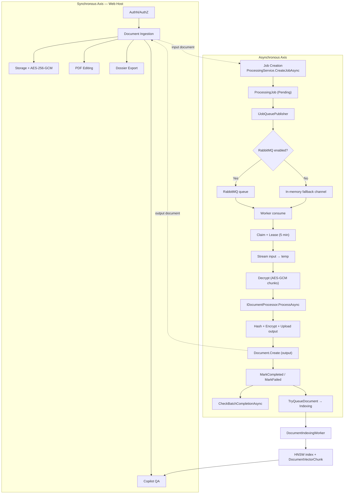

---

## 2. Main Workflows

### 2.1 Workflow 1 — Document Ingestion & Storage

**Business value:** every downstream capability (conversion, intelligence, editing, export) requires a persisted `Document` aggregate. Ingestion is a single point of failure for the entire platform.
**Importance:** 10.0 · **Domains involved:** 5 · **Entry point:** `UploadDialog.razor` → `POST /api/documents` → `DocumentService.UploadAsync`

#### Execution Order and Dependencies

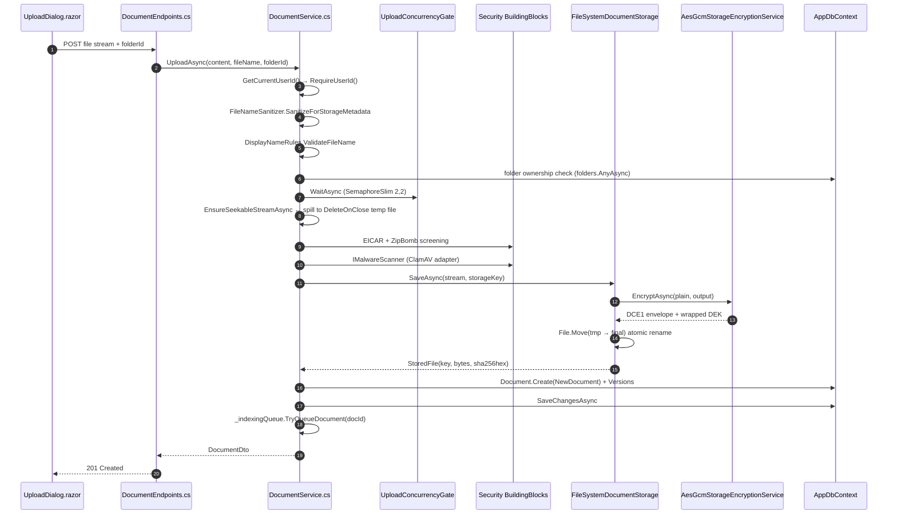

#### Key Node I/O Contract

| Node | Input | Output | State Transition |
|---|---|---|---|
| Identity resolution | `ClaimsPrincipal` | `Guid userId` | — |
| Name validation | raw filename | sanitized + validated name | — |
| Folder check | `folderId` | pass / `DomainException` | — |
| Concurrency gate | — | slot (max 2) | — |
| Seekability spool | non-seekable `BrowserFileStream` | `FileStream` (`DeleteOnClose`) | — |
| Threat screening | stream | pass / `Rejected` | — |
| Envelope encryption | plaintext stream | `DCE1` envelope | — |
| Storage write | envelope | `StorageKey` | — |
| Aggregate factory | metadata + key + hash | `Document` | `→ Uploaded` (with version 1) |
| Index enqueue | `documentId` | channel write (non-blocking, best-effort) | — |

#### Critical Implementation Detail — No Plaintext Landing

The **ordering invariant** is deliberate and load-bearing:

> *No aggregate exists before its storage coordinates do, and no plaintext ever reaches storage.*

`FileSystemDocumentStorage.SaveAsync` enforces this mechanically:
1. Writes the **plaintext scratch file** only to compute the SHA-256 while streaming.
2. Encrypts from the scratch file into the destination temp file.
3. Deletes the plaintext scratch file in a `finally` block.
4. Performs `File.Move(tempFile, destination, overwrite: true)` — an **atomic rename** so a partially written envelope is never visible under the final key.

#### Storage Key Sharding (Performance Mechanism)

`FileSystemDocumentStorage.GenerateStorageKey` → `aa/bb/{id:N}/v{n}.bin`

Two-character hex prefixes derived from the first four hex digits of the document GUID produce a **256×256 shard tree**. This bounds directory fan-out per shard on NTFS/SMB and keeps lookup time effectively constant as the corpus grows. The storage key is fully **non-guessable** (GUID-derived), and `ResolvePhysicalPath` performs a defensive path-traversal check (`..` rejection + prefix containment assertion) so a malformed key cannot escape the storage root.

**State transition:** `Document.Create` → `Uploaded`; then `BeginScan` → `Scanning`; then `MarkAvailable` → `Available`. `DocumentLifecycle.IsVisibleToOwner` covers `Uploaded | Scanning | Available | Rejected`.

---

### 2.2 Workflow 2 — Asynchronous Document Conversion (Primary Workflow)

**Business value:** the revenue-facing core capability. **Importance:** 10.0 · **Domains:** 6 · **Crosses a process boundary.**

#### Architectural Principle

> **RabbitMQ is a delivery channel. The database is the source of truth for job state.**

This is why a broker-less deployment degrades gracefully (`NoOpQueuePublisher`, `RabbitMqJobDispatcher` fallback channel, and polling workers) rather than failing.

#### 2.2.1 Phase A — Job Creation (Web Host)

`ProcessingEndpoints` → `POST /api/processing/jobs` (rate-limited by `processing-policy` concurrency limiter) → `ProcessingService.CreateJobAsync`.

Validation chain executed **before** any job row is written:

| # | Guard | Failure Behaviour |
|---|---|---|
| 1 | `_userContext.RequireUserId()` | `UnauthorizedAccessException` |
| 2 | Document exists **and** `OwnerUserId == userId` **and** `Status != Deleted && Status != Purged` | `DomainException("Document not found or access denied.")` — note the deliberately **ambiguous** message to prevent existence enumeration |
| 3 | Converter exists | `DomainException("Specified converter does not exist.")` |
| 4 | `converter.IsEnabled` | `DomainException("Converter '<name>' is currently disabled.")` |
| 5 | Input format match: `converter.InputFormats` vs `document.FileExtension` | `DomainException` listing supported formats |
| 6 | Size: `document.SizeBytes <= converter.MaxInputSizeBytes` | `DomainException` with both values |

On success:
- `ProcessingJob.Create(...)` → status `Pending`, `ProgressPercent = 0`, implicit first `ProcessingJobInput(order: 0)`.
- `_db.ProcessingJobs.Add(job)` + `SaveChangesAsync` — **persist first**.
- `_auditService.RecordAsync("ProcessingJob.Created", …)` — durable audit before dispatch.
- `_queuePublisher.PublishJobAsync(new JobMessage(job.Id, document.Id, converter.Operation, converter.ProcessorId, userId))` — **dispatch second**.

The payload is deliberately minimal: **no document binary is ever placed on the wire** (`JobMessage` contract comment: *"Document binary MUST NOT be included in the message payload"*). This is both a security property and a performance property — queue messages stay tiny regardless of file size.

#### 2.2.2 Phase B — Delivery Plane

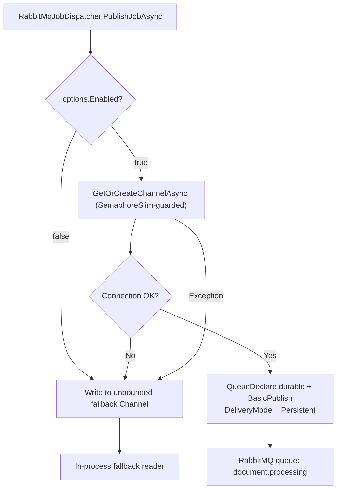

**Resilience characteristics:**
- `AutomaticRecoveryEnabled = true` on the `ConnectionFactory`.
- `_initLock = new SemaphoreSlim(1,1)` guards one-time channel creation (double-checked pattern).
- **Double fallback:** when RabbitMQ is disabled *or* connection/publish fails, the message is written to `Channel.CreateUnbounded<JobMessage>` — *"so jobs are never dropped."* The DB row remains `Pending`, and any polling worker will still pick it up. **Two independent recovery paths for one message.**

#### 2.2.3 Phase C — Worker Execution Core

Two hosts implement the same pipeline with different trigger topologies:

| Host | Trigger | File | Notable Divergence |
|---|---|---|---|
| `DocumentWorker` (standalone) | RabbitMQ consumer **+** polling fallback | `src/Workers/DocumentWorker/Worker.cs` | `StartRabbitMqConsumerAsync` with `BasicQosAsync(prefetchCount: 1)`; `BasicAckAsync` on success, `BasicNackAsync(requeue: true)` on failure |
| `JobProcessorWorker` (in-process, Web) | Polling only (2 s idle delay) | `src/DocumentConverter.Web/HostedServices/JobProcessorWorker.cs` | Gated by config `Processing:RunWorkerInWeb` |

**Both hosts share identical step semantics.** The pipeline:

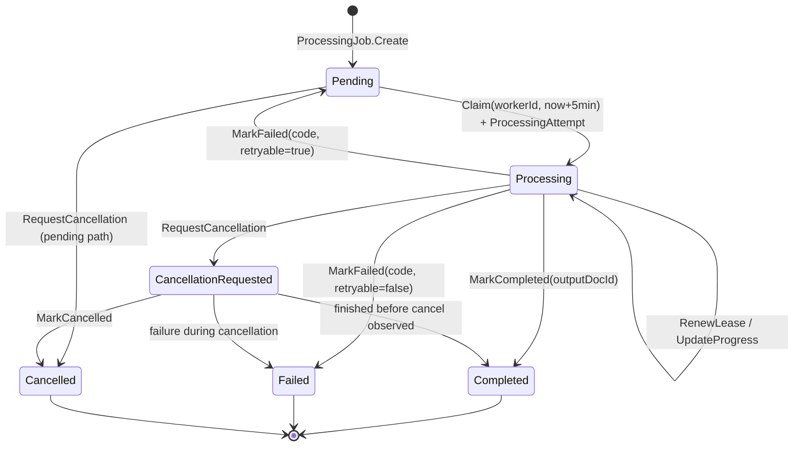

**Step detail with evidence (verified source):**

| Step | Operation | Evidence |
|---|---|---|
| Selection | `FirstOrDefaultAsync(j => j.Status == Pending \|\| (j.Status == Processing && j.LeaseExpiresAt != null && j.LeaseExpiresAt < now))` with `.Include(Inputs/Attempts/Outputs)` | `JobProcessorWorker.cs` ~L83; `Worker.cs` ~L150 |
| Pre-claim guards | converter missing → `InvalidInput`; input doc missing/`Deleted` → `InvalidInput` | both files |
| Claim | `leaseExpiresAt = now.AddMinutes(5)`, `job.Claim(_workerId, leaseExpiresAt, now)`; `db.ProcessingAttempts.Add(currentAttempt)`; `UpdateProgress(10)` | both files |
| Workspace | `Path.GetTempPath()/docconv_work/{jobId:N}/input` + `/output` | both files |
| Input fetch | `storage.OpenReadAsync(inputDoc.StorageKey)` → `File.Create(localInputPath)` streaming copy | both files |
| Progress ticks | 10 → 30 → 50 → **80** → 100 | `UpdateProgress` + `NotifyJobProgressAsync` at each |
| Processor resolution | `_processors.FirstOrDefault(p => p.ProcessorId == converter.ProcessorId)` → **fallback to `"echo"`** → else `InvalidOperationException` | both files |
| Conversion | `processor.ProcessAsync(new ProcessingContext(jobId, operation, localInputPath, outputDir, job.Options, converter.MaxInputSizeBytes, TimeSpan.FromMinutes(4), metadata))` | both files |
| Output hash | `SHA256.HashDataAsync(File.OpenRead(result.OutputPath))` → lowercase hex | both files |
| Output key | `{aa}/{bb}/{newGuid:N}/v1{ext}` | both files |
| Output upload | `storage.SaveAsync(uploadStream, outputStorageKey)` (re-encrypts automatically) | both files |
| Output aggregate | `Document.Create(new NewDocument(... StorageProvider: "LocalSharded", SourceProcessingJobId: job.Id))` → `BeginScan` → `MarkAvailable` | both files |
| Terminal | `job.MarkCompleted(outputDoc.Id, UtcNow)` + `db.ProcessingJobOutputs.Add(job.Outputs.Last())` | both files |
| Side-effects | audit `ProcessingJob.Completed`; `NotifyJobCompletedAsync`; `CheckBatchCompletionAsync`; `_indexingQueue?.TryQueueDocument(outputDoc.Id)` | `JobProcessorWorker.cs` |
| Cleanup | `finally { Directory.Delete(workBase, recursive: true) }` | both files |

**`ProcessingContext` timeout = 4 minutes, lease = 5 minutes.** The deliberate **1-minute margin** means a processor that hangs is killed by its own context timeout before its lease can expire and be stolen by a peer worker — this prevents double-execution of the same job under normal operation.

**Idempotency mechanism:** `Document.SourceProcessingJobId` is documented as *"unique, so duplicate job deliveries cannot create duplicate outputs"* — the DB constraint is the final defence against duplicate delivery.

#### 2.2.4 Processor Dispatch Table

Processors are registered as singletons in `Program.cs` and resolved by `ProcessorId`:

| `ProcessorId` | Implementation | Capability |
|---|---|---|
| `OfficeDocumentProcessor` | `Infrastructure/Processing/OfficeDocumentProcessor.cs` | Bidirectional Office↔PDF, layout/table/word reconstruction (619 lines, cyc. 67) |
| `ExcelPdfConverter` | `Processing/Office/ExcelPdfConverter.cs` | XLSX/CSV → paginated PDF tables; reverse `WriteXlsx` / `WriteCsvAsync` |
| `PresentationPdfConverter` | `Processing/Office/` | Slide deck → PDF |
| `EbookPdfConverter` | `Processing/Office/` | EPUB → PDF |
| `MarkdownHtmlPdfConverter` | `Processing/Office/` | Markdown/HTML → PDF |
| `PdfDocumentProcessor` | `Processing/PdfDocumentProcessor.cs` | PDF operations |
| `PdfCompressProcessor` | `Processing/PdfCompressProcessor.cs` | PDFsharp stream compaction + SkiaSharp image downsampling |
| `ImageCompressProcessor` | `Processing/ImageCompressProcessor.cs` | Image re-encode/scale |
| `ImageDocumentProcessor` | `Processing/ImageDocumentProcessor.cs` | Image → target format |
| `OcrDocumentProcessor` | `Processing/OcrDocumentProcessor.cs` | OCR-driven extraction/conversion |
| `EchoDocumentProcessor` | `Processing/EchoDocumentProcessor.cs` | Universal fallback (guarantees dispatch never fails hard) |

The `"echo"` fallback in the worker is a **defensive degradation**: an unregistered `ProcessorId` produces a working (if trivial) result rather than an unhandled exception.

#### 2.2.5 Phase D — Completion Aggregation and Notification

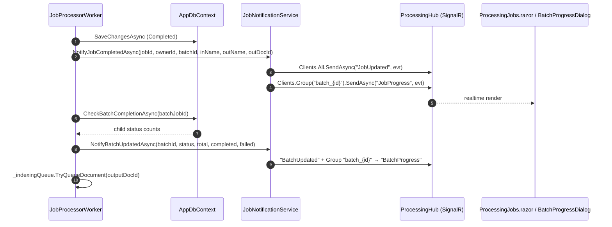

`JobNotificationService` uses a **dual-dispatch** strategy: an in-process `OnJobEvent` / `OnBatchEvent` invocation list (for active Blazor circuits that hold direct references) **and** SignalR broadcast. Each handler is individually try/catch-wrapped so one failing subscriber cannot break the notification chain.

---

### 2.3 Workflow 3 — Batch Conversion

**Importance:** 8.0. **Mode-dependent fan-out** is the defining characteristic.

`ProcessingService.CreateBatchAsync` validates: non-empty `DocumentIds`, converter exists/enabled, `converter.SupportsBatch == true`, and **all** documents resolve with `OwnerUserId == userId` and non-deleted/non-purged status (`documents.Count != request.DocumentIds.Count` → rejection of the whole batch — fail-fast, no partial batch creation).

| Mode | Fan-out Shape | Job Count |
|---|---|---|
| `BatchJobMode.Individual` | One `ProcessingJob` **per document**, each linked via `batchJobId` | N |
| `BatchJobMode.Combined` | **One** `ProcessingJob` with the first document as primary and remaining N−1 attached via `job.AddInput(docId, null, order)` | 1 |

`AddInput` is guarded: *"Cannot add inputs to a job that has already started"* — enforces `Status == Pending`, so input topology is frozen at creation.

**Batch closure is a derived aggregate, not an event-driven counter:**

```csharp
// CheckBatchCompletionAsync — JobProcessorWorker.cs
var pendingOrRunning = batchJobs.Any(j => j.Status == Pending || j.Status == Processing);
var completed = batchJobs.Count(j => j.Status == Completed);
var failed    = batchJobs.Count(j => j.Status == Failed);
if (!pendingOrRunning && batch.CompletedAt == null)
    batch.MarkCompleted(DateTime.UtcNow);
```

Characteristics and consequences:
- **Idempotent** — the `batch.CompletedAt == null` guard makes repeated evaluation safe.
- **Recomputed on every child terminal transition** — O(batch size) query per child completion → **O(N²)** total scan cost over a batch.
- **Wrapped in try/catch with `LogWarning`** — a batch aggregation failure never fails the child job.

---

### 2.4 Workflow 4 — Document Intelligence Indexing

**Importance:** 9.0. **Zero-egress constraint:** `IDocumentIntelligenceService` guarantees analysis, embedding, classification and retrieval happen **strictly inside process boundaries**.

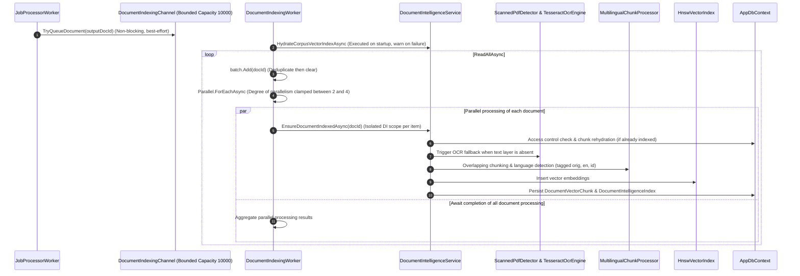

**Key performance characteristics:**

| Mechanism | Value | Rationale |
|---|---|---|
| Channel type | `BoundedChannelOptions(10_000)`, `FullMode = Wait`, `SingleReader = true`, `SingleWriter = false` | Backpressure with a hard ceiling; one consumer, many producers |
| Non-blocking enqueue | `TryQueueDocument` uses `TryWrite` | Conversion completion is **never** blocked by indexing — indexing is a degraded-mode-optional side effect |
| `QueuedCount` | `Volatile.Read` / `Interlocked` counters | Lock-free observability |
| Parallelism | `Math.Clamp(Environment.ProcessorCount, 2, 4)` | Prevents embedding work from starving request threads on large hosts |
| Scope isolation | `_scopeFactory.CreateScope()` **per document** inside the parallel body | `DbContext` is not thread-safe; one scope per parallel unit |
| Startup hydration | `HydrateCorpusVectorIndexAsync` wrapped in `catch when (!stoppingToken.IsCancellationRequested)` → `LogWarning` | Cold-start index failure degrades to on-demand indexing, never blocks host startup |
| Failure isolation | per-item `catch when (!ct.IsCancellationRequested)` → `LogWarning` | One bad document cannot abort the batch |

**Vector persistence model (`DocumentVectorChunk`):** 256-D embedding serialized as **1024 bytes** of compact binary; `Language` ∈ `{orig, en, id}` with `ParentChunkId` linking translations to the source chunk; `VectorSource` ∈ `{Actual Document, RAG Enrichment}` and `ExtractionMethod` ∈ `{MarkItDown, MarkItDown + OCR, RAG Enrichment Engine}` provide provenance; overwriting/truncation (`[..MaxLength]`) guards each field at construction so no DB write can fail on length.

---

### 2.5 Workflow 5 — Grounded Copilot Question-Answering

**Importance:** 9.0. **The primary user-facing AI surface.**

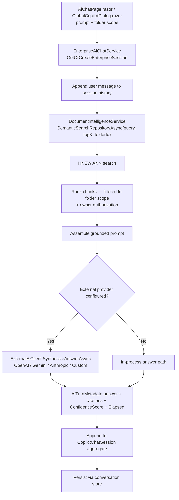

**Session cache topology (`EnterpriseAiChatService`):**
- `ConcurrentDictionary<string, ConversationSession> _radzenSessions` — Radzen UI adapter layer.
- `ConcurrentDictionary<string, AiChatSession> _enterpriseSessions` — enterprise semantics (`Title`, `ScopeFolderId`, `ScopeFolderName`, `Messages`, `Turns`).
- `IConversationStore Store` — durable persistence seam (currently `InMemoryConversationStore`).
- Both dictionaries are `StringComparer.OrdinalIgnoreCase`.

**External provider path (`ExternalAiClient`):** per-request 12-second linked timeout (`CancellationTokenSource.CreateLinkedTokenSource` + `CancelAfter`), `Stopwatch` latency measurement, and a **three-tier exception funnel**:
`OperationCanceledException when (!cancellationToken.IsCancellationRequested)` → timeout message naming the provider and model → `HttpRequestException` → status-code-prefixed message → generic `Exception` → logged at error level. Provider credentials are never echoed into responses; only the model name and a truncated response preview are surfaced.

**Security property:** retrieval is filtered by the caller's folder scope **and** the ownership model, so a Copilot session can only ever ground in documents the caller owns — even though the vector index is process-wide.

---

### 2.6 Workflow 6 — Dossier & Report Export

**Importance:** 8.0. Produces the monetizable end artifact for legal/compliance review.

| Step | Component | Operation |
|---|---|---|
| 1 | `DocumentIntelligenceService` | Collect + scope-validate analysis artifacts (financial graph topics, cross-document comparisons, clause diffs, grounded search results) |
| 2 | `CopilotDossierExporter` (31 691 bytes, static) | Materialize into XLSX (OpenXML SpreadsheetML) / DOCX (WordprocessingML) / Markdown executive briefing |
| 3 | `DocumentService` | Persist artifact through the **same document + storage + encryption pipeline** |
| 4 | `ExportDocumentDialog.razor` | Download / inline preview |

**Critical property:** exports are **not a special case**. Because they route through `IDocumentStorage`, generated artifacts inherit encryption-at-rest, ownership enforcement, hashing and versioning automatically. `ExportCorpusFinancialTableToExcelAsync` and `ExportCopilotDossierAsync` are both declared on `IDocumentIntelligenceService`, keeping the export surface inside the zero-egress contract.

---

### 2.7 Workflow 7 — PDF Editing & Manipulation

**Importance:** 9.0. **Non-destructive by construction.**

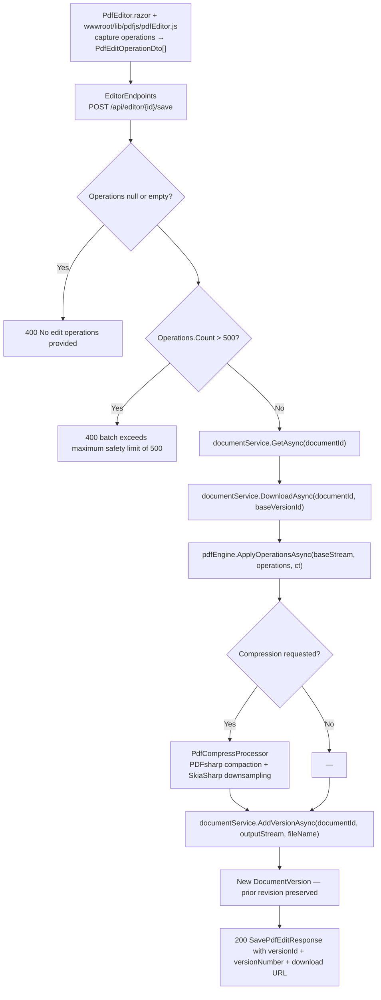

**Node I/O contract:**

| Node | Input | Output |
|---|---|---|
| `POST /api/editor/{id}/save` | `SavePdfEditRequest { BaseVersionId, Operations[] }` | `SavePdfEditResponse { DocumentId, VersionId, VersionNumber, FileName, SizeBytes, DownloadUrl }` |
| `GET /api/editor/{id}/content` | `documentId`, optional `versionId` | PDF stream with `enableRangeProcessing: true` |
| `POST /api/editor/{id}/export/{format}` | `ExportPdfRequest?` (may include uncommitted ops) | Converted artifact (docx / xlsx / pdf) |

**Operation coverage** (via `PdfEngine`, 54 772 bytes, static): text, highlight, shapes, ink strokes, image/signature placement, stamps, sticky notes, strikethrough, underline, redaction, watermark, form fields, page structure. Digital signing via `PdfDigitalSignatureService`; glyph consistency via `SystemFontResolver.EnsureRegistered()` called at the **top of `Program.cs`** before the builder is constructed.

**Safety invariants:**
- **500-operation ceiling** prevents resource exhaustion via pathological edit batches.
- **Version-append semantics** — `Document.AddVersion` requires `Status == Available`, increments `max(VersionNumber) + 1`, calls `ClearCurrent()` on all prior versions, then adds the new version as current. Non-destructive.
- **Revert** is implemented as *clone-forward*: `RevertToVersion` reads the target version's `StorageKey`/`SizeBytes`/`Sha256Hash` and creates a **new** version pointing at the same storage object — history is never rewritten.

---

### 2.8 Workflow 8 — Authentication, Authorization & Audit

**Importance:** 10.0. **Gates every other workflow.**

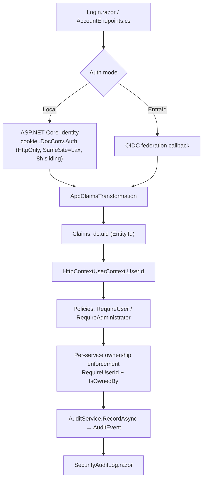

**Design decision — authorization keys on internal `Entity.Id`, not the identity-provider subject:**

`HttpContextUserContext.UserIdClaimType = "dc:uid"`, with fallback to `ClaimTypes.NameIdentifier`. Consequences:
- Identity-provider churn (Entra object-id change, re-provisioning) cannot leak or transfer authorization.
- The `User` aggregate supports `AuthenticationType.Local | EntraId` with `ExternalIdentityId` stored as **a reference, never an authority**.
- The dual-resolution strategy (HTTP `IHttpContextAccessor` principal, then `AuthenticationStateProvider` for Blazor Interactive Server circuits) makes the same `IUserContext` work in both request and circuit scopes, catching `InvalidOperationException` when not in a Razor circuit.

**`User` aggregate guards:** `NormalizeEmail` (structural validation), `AssignRole` (idempotent), `RemoveRole` (**refuses to remove the base `User` role**), `RecordLogin` (**throws for inactive users**), `Deactivate` / `Activate` (soft lifecycle).

**Rate limiting** (`Program.cs`): `login-policy` = fixed window, 10 permits/minute, `QueueLimit = 0`; `processing-policy` = concurrency limiter, 20 permits, `QueueLimit = 10`; rejection status `429`.

---

### 2.9 Workflow 9 — Document Lifecycle (Recycle Bin, Purge, Versioning)

**Importance:** 8.5. Governed by `DocumentLifecycle`:

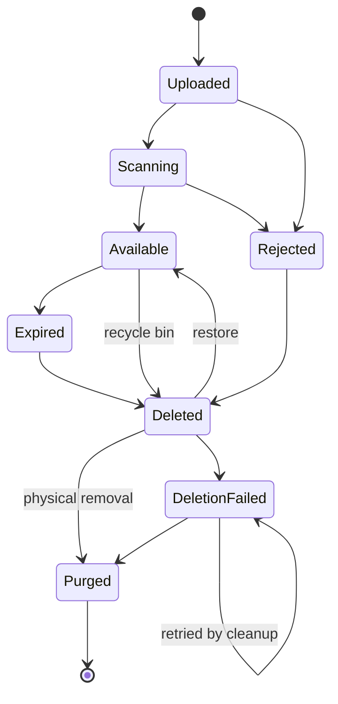

**The logical/physical deletion split is the workflow's core safety property:**

| Concept | Field | Semantics |
|---|---|---|
| Logical deletion | `DeletedAt` + `Status = Deleted` | Invisible to users; bytes still present; **restorable** |
| Physical deletion | `PurgedAt` + `Status = Purged` | Bytes removed; **metadata retained for audit** |
| Failure tracking | `DeletionAttempts` + `Status = DeletionFailed` | Retried by the cleanup service; `→ Purged` and `→ DeletionFailed` both legal from `DeletionFailed` (self-loop allows unbounded retry) |

`Deleted → Available` (restore) is explicitly legal. `Purged` is terminal (`[]`). `IsVisibleToOwner` excludes `Expired`, `Deleted`, `DeletionFailed`, `Purged`.

---

## 3. Flow Coordination and Control

### 3.1 Multi-Module Coordination Matrix

| Orchestrator | Coordinates | Coordination Style |
|---|---|---|
| `ProcessingService` | Documents, Security, Persistence, Messaging | Sequential validate → persist → dispatch |
| `JobProcessorWorker` / `Worker` | Persistence, Storage, Encryption, Processors, Notification, Indexing, Batch | Scope-per-job state machine |
| `DocumentService` | Persistence, Storage, Encryption, Security, AI queue, PDF | Semaphore-gated pipeline |
| `DocumentIndexingWorker` | Intelligence service, Channel, Persistence | Parallel fan-out with per-item scope |
| `EnterpriseAiChatService` | Intelligence service, session caches, external LLM | Request-scoped orchestration |
| `Program.cs` | Every module | Composition root |

### 3.2 State Management and Synchronization

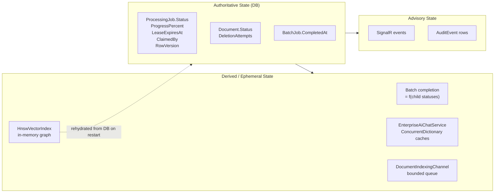

| State | Storage | Synchronization Primitive |
|---|---|---|
| Job status / lease | SQL Server | `RowVersion` optimistic concurrency + `EnsureCanTransition` guard |
| Upload pipeline | Process | `SemaphoreSlim UploadConcurrencyGate = new(2, 2)` (static) |
| RabbitMQ channel init | Process | `SemaphoreSlim _initLock = new(1, 1)` + double-check |
| Indexing queue depth | Process | `Interlocked.Increment/Decrement` + `Volatile.Read` |
| Chat sessions | Process | `ConcurrentDictionary` |
| HNSW graph | Process (DB-backed) | Startup hydration; insert-on-demand |
| Batch completion | Derived | Recomputed + idempotency guard on `CompletedAt` |

### 3.3 Data Passing and Sharing Rules

| Data Flow | Mechanism | Constraint |
|---|---|---|
| Job intent (Web → Worker) | `JobMessage` over AMQP | **No document binary** — identifiers and metadata only |
| Job state (Worker → DB → Web) | `ProcessingJob` + `ProcessingJobOutput` | DB is authoritative; queue is ephemeral |
| Document bytes (Storage ↔ Worker) | `IDocumentStorage.OpenReadAsync` / `SaveAsync` streams | Always an encrypted envelope on disk; decryption is transparent inside `OpenReadAsync` |
| Progress (Worker → UI) | `IJobNotificationService` → SignalR `JobUpdated` / `JobProgress` / `BatchProgress` | Best-effort; failures logged at `Warning`, never propagated |
| Indexing work (Worker → Indexer) | `IDocumentIndexingChannel` (`Channel<Guid>`) | Bounded 10 000; `TryWrite` may legitimately fail under saturation |
| Analysis results (Intelligence → Exporter) | In-process DTOs | Must respect folder scope + ownership |

### 3.4 Execution Control and Scheduling

| Control | Setting | Location |
|---|---|---|
| Worker poll cadence | 2 s idle, 5 s after unhandled error | `JobProcessorWorker.ExecuteAsync`, `Worker.ExecuteAsync` |
| Lease duration | 5 minutes | `now.AddMinutes(5)` at claim |
| Processor timeout | 4 minutes (`ProcessingContext`) | Worker pipeline |
| RabbitMQ prefetch | 1 (`BasicQosAsync`) | `Worker.StartRabbitMqConsumerAsync` |
| Indexing parallelism | `clamp(ProcessorCount, 2, 4)` | `DocumentIndexingWorker` |
| Indexing batch cap | 8 (intended); channel depth 10 000 | `DocumentIndexingWorker` / `DocumentIndexingChannel` |
| Upload concurrency | 2 server-wide | `DocumentService.UploadConcurrencyGate` |
| Processing admission | 20 concurrent + 10 queued, then 429 | `processing-policy` rate limiter |
| In-web worker toggle | `Processing:RunWorkerInWeb` (default `true`) | `Program.cs` |
| EF retry policy | 5 retries, max 5 s delay | `sql.EnableRetryOnFailure(...)` |

### 3.5 Full Component Interaction Sequence

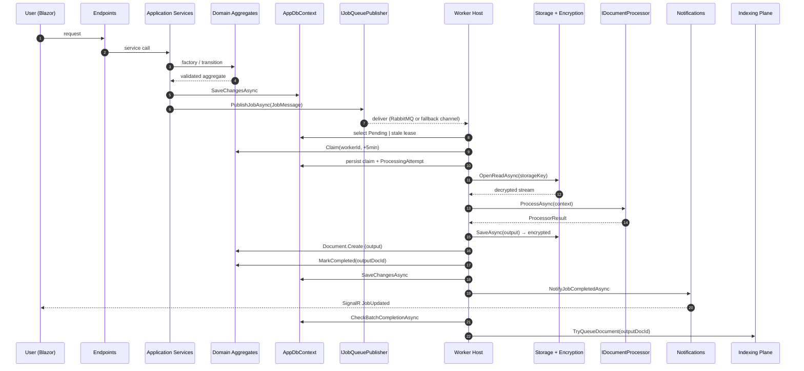

---

## 4. Exception Handling and Recovery

### 4.1 Error Taxonomy

```csharp
public enum ProcessingErrorCode
{
    InvalidInput = 1,
    UnsupportedFormat = 2,
    ResourceLimit = 3,
    ProcessorFailure = 4,
    TemporaryInfrastructureFailure = 5,
    UnknownFailure = 6,
    Timeout = 7,
}
```

| Code | Meaning | Retryable? |
|---|---|---|
| `InvalidInput` | Malformed / missing input, missing converter | **No** |
| `UnsupportedFormat` | Format pair not convertible | **No** |
| `ResourceLimit` | Size/page/time limit breached | **No** |
| `ProcessorFailure` | Converter crashed or returned failure | **No** |
| `TemporaryInfrastructureFailure` | Transient infra fault | **Yes** |
| `Timeout` | Processor exceeded time budget | **Yes** |
| `UnknownFailure` | Unclassified | **No** |

`ProcessingJobLifecycle.IsRetryable(code) => code is TemporaryInfrastructureFailure or Timeout`

**Design intent (explicit in the domain source):** *"Only transient failures are retried; invalid input is never retried indefinitely."* The taxonomy is a **user-safe** contract — internal exception text is never the authoritative error code.

### 4.2 Error Detection and Handling Matrix

| Layer | Detection | Handling |
|---|---|---|
| Domain invariant | `Guard.*` failure | `DomainException` / `InvalidStateTransitionException` |
| Invalid transition | `EnsureCanTransition` | `InvalidStateTransitionException.For(entity, from, to)` |
| Endpoint validation | Explicit `null` / count checks | `400` with structured `{ error }` |
| Job creation | Ownership / converter / format / size guards | `DomainException` → `400` |
| Worker pre-claim | Converter or input document missing | `MarkFailed(InvalidInput, …, retryable: false)` + notify |
| Processor failure | `ProcessorResult.Success == false` | `MarkFailed(ProcessorFailure, result.ErrorMessage)` + audit + notify |
| Unhandled worker exception | `catch (Exception ex)` around the whole job body | `MarkFailed(ProcessorFailure, ex.Message)` + notify + `CheckBatchCompletionAsync` |
| Notification failure | Per-handler and per-broadcast try/catch | `LogWarning`, swallowed — never blocks the job |
| Batch aggregation failure | try/catch | `LogWarning`, swallowed — never fails the child job |
| Indexing failure | Per-document try/catch inside `Parallel.ForEachAsync` | `LogWarning`, swallowed — indexing is degraded-mode-optional |
| Startup hydration failure | `catch when (!stoppingToken.IsCancellationRequested)` | `LogWarning`; on-demand indexing continues |
| RabbitMQ publish failure | `catch (Exception ex)` in `PublishJobAsync` | `LogWarning` + write to fallback channel |
| RabbitMQ consume failure | `catch` → `BasicNackAsync(requeue: true)` | Redelivery |
| DB transient fault | `EnableRetryOnFailure(maxRetryCount: 5, maxRetryDelay: 5 s)` | Automatic retry |
| Migration/seed failure | try/catch in `Program.cs` startup block | `LogError`; host continues (allows operator diagnosis) |
| HTTP pipeline | `UseExceptionHandler("/Error")` (non-dev only) + `UseStatusCodePagesWithReExecute("/not-found")` | Structured error surfaces |

### 4.3 Fault Tolerance Strategy Design

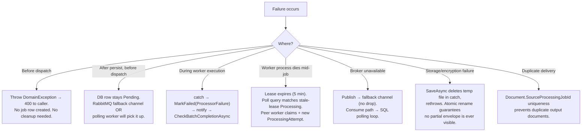

### 4.4 Failure Retry and Degradation Ladder

| Level | Degradation | User-Visible Effect |
|---|---|---|
| L0 | Normal operation | Real-time progress, immediate conversion |
| L1 | RabbitMQ unavailable → fallback channel / SQL polling | Higher dispatch latency (≤2 s poll), same outcome |
| L2 | RabbitMQ disabled entirely (`Enabled: false`) | Fully functional in-process execution |
| L3 | Processor unregistered | `"echo"` fallback processor; no hard failure |
| L4 | Vector index hydration fails on startup | On-demand indexing; first query slower, later queries normal |
| L5 | Indexing channel saturated (`TryWrite` fails) | Document unindexed until re-queued; conversion unaffected |
| L6 | Notification hub unreachable | `LogWarning`; UI falls back to polling the jobs endpoint |
| L7 | ClamAV unavailable (`ClamAV:Enabled: false` default) | Built-in EICAR + zip-bomb screening still active |
| L8 | EF transient fault | Automatic retry ×5 with ≤5 s delay |

### 4.5 Cooperative Cancellation Semantics

```csharp
// ProcessingJob.RequestCancellation
if (ProcessingJobLifecycle.IsTerminal(Status)) return;          // no-op on terminal
if (Status == Pending) { Status = Cancelled; CancelledAt = now; return; }  // instant cancel
Status = CancellationRequested; CancellationRequestedAt = now;  // in-flight: signal only
```

| Requested State | Result |
|---|---|
| `Pending` | Immediately `Cancelled` — the worker never claims it |
| `Processing` | `CancellationRequested`; the worker's `status` check observes it, calls `MarkCancelled` and notifies |
| `CancellationRequested` → completion | **Legally transitions to `Completed`** — the job finished before the worker observed the cancellation |
| Terminal (`Completed`/`Failed`/`Cancelled`) | No-op — cancellation is idempotent and race-safe |

> **Observed implementation gap (verified in source):** the worker's selection predicate is
> `Status == Pending || (Status == Processing && LeaseExpiresAt < now)`.
> A job in `CancellationRequested` therefore **never matches the selection query**, so the guard
> `if (job.Status == ProcessingJobStatus.CancellationRequested) { MarkCancelled(...) }`
> is unreachable on the polling path. In-flight cancellations are only finalised when
> the worker that is **actively executing** the job observes the status on a subsequent DB read.
> Standalone-worker jobs whose executor crashed mid-conversion with a `CancellationRequested`
> status would remain non-terminal until the lease-stale path (`Processing`) applies — which it
> cannot, because the status is no longer `Processing`.
> **Recommended remediation:** extend the selection predicate to include
> `Status == CancellationRequested` and widen the `ProcessingJobLifecycle.Allowed` map entry
> for `CancellationRequested` if re-claim semantics are required.

### 4.6 Non-Retryable Failures — Rationale

`InvalidInput`, `UnsupportedFormat`, `ResourceLimit` and `ProcessorFailure` are deliberately **non-retryable** because retrying them consumes worker capacity with a deterministic outcome. Retrying a 2 GB file through a converter with a 100 MB limit will fail identically on every attempt. Only `TemporaryInfrastructureFailure` and `Timeout` — which are *by definition* environment-dependent — are eligible for re-entry into `Pending`.

---

## 5. Key Process Implementation

### 5.1 Envelope Encryption Pipeline (AES-256-GCM)

**File:** `src/DocumentConverter.Infrastructure/Security/StorageEncryption/AesGcmStorageEncryptionService.cs`
**Constants:** `MagicHeader = "DCE1"`, `ChunkSize = 64 KB`, `NonceSize = 12`, `TagSize = 16`, `KeySize = 32`.

#### Envelope Layout

```
┌───────────────────────────────────────────────────────────────────┐
│ "DCE1"        4 B   magic / version discriminator                 │
├───────────────────────────────────────────────────────────────────┤
│ DEK nonce    12 B   random, AES-GCM nonce for the wrap operation  │
│ DEK ct       32 B   the per-document DEK, encrypted under the KEK │
│ DEK tag      16 B   authentication tag over the wrap              │
├───────────────────────────────────────────────────────────────────┤
│ CHUNK 1                                                           │
│   length      4 B   plaintext length of this chunk                │
│   nonce      12 B   random per-chunk nonce                        │
│   tag        16 B   AES-GCM tag over the chunk                    │
│   ciphertext  N B   up to 64 KB                                   │
├───────────────────────────────────────────────────────────────────┤
│ CHUNK 2 … CHUNK n                                                 │
├───────────────────────────────────────────────────────────────────┤
│ EOF marker    4 B   length == 0                                   │
└───────────────────────────────────────────────────────────────────┘
```

#### Write Path

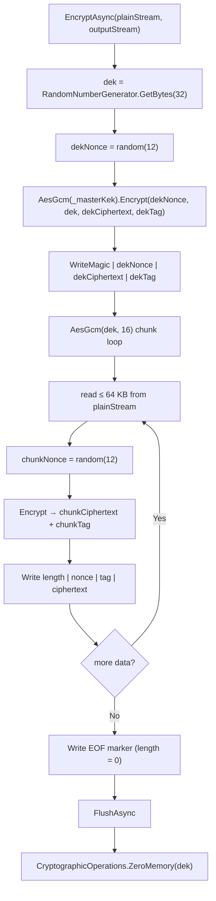

#### Read Path with Transparent Plaintext Passthrough

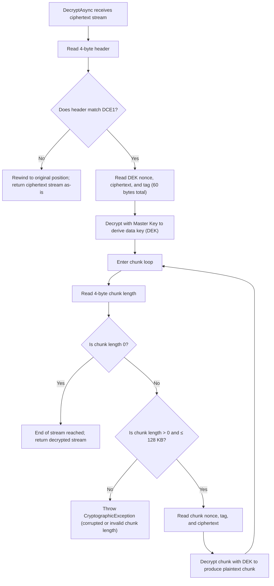

#### Efficiency and Security Properties

| Property | Mechanism | Benefit |
|---|---|---|
| Per-chunk authentication | Independent GCM tag per 64 KB chunk | Tampering is detected at the boundary where it occurs, not only at EOF |
| Bounded memory | Chunk-at-a-time encrypt/decrypt | 100 GB file requires ~64 KB of cipher working memory, not 100 GB |
| Key separation | Ephemeral DEK per document; KEK never touches content | KEK compromise alone does not decrypt historical ciphertexts without the wrapped DEKs; DEK compromise is bounded to one document |
| Cryptographic hygiene | `CryptographicOperations.ZeroMemory(dek)` after the write path | Minimises key material lifetime in the managed heap |
| Resilient key configuration | Base64 → length check (32 B) → `SHA256.HashData` derivation; non-Base64 → UTF-8 + SHA-256; absent → deterministic dev key **with a logged warning** | Misconfiguration degrades loudly rather than throwing at startup |
| Backward compatibility | Missing magic header → stream returned unchanged | Unencrypted legacy documents continue to be readable after enabling encryption |
| Corruption defence | Chunk length validated against `ChunkSize * 2`; negative rejected | Truncated/garbage input produces a cryptographic exception, not an OOM or an infinite loop |

**Known limitation (honest disclosure):** `DecryptAsync` accumulates chunks into a `MemoryStream` before returning. For very large documents this is an unbounded in-memory materialisation on the read path, and it is the single most significant performance risk in the encryption seam. A `PipeReader`-based streaming return (or a `ReadOnlySequence<byte>` async enumerator) would preserve the bounded-memory property that the write path already has.

### 5.2 Job Lifecycle State Machine

**File:** `src/DocumentConverter.Domain/Processing/ProcessingJobStatus.cs`

```csharp
Pending               → [Processing, Cancelled, Failed]
Processing            → [Completed, Failed, Pending (retryable), CancellationRequested]
CancellationRequested → [Cancelled, Completed, Failed]
Completed | Failed | Cancelled → []   // terminal
```

| Transition Method | Preconditions | Effects |
|---|---|---|
| `Claim(workerId, leaseExpiresAt, now)` | `Status == Pending` else `InvalidStateTransitionException` | `Processing`; `ClaimedBy`; `LeaseExpiresAt`; `StartedAt ??= now`; appends `ProcessingAttempt(attemptNumber: attempts.Count + 1)` |
| `RenewLease(newLeaseExpiresAt)` | `Status == Processing` | Updates `LeaseExpiresAt` |
| `UpdateProgress(pct)` | `Guard.InRange(0, 100)` | Sets `ProgressPercent` |
| `RequestCancellation(now)` | Not terminal | `Pending → Cancelled`; else `Processing → CancellationRequested` |
| `MarkCompleted(outputDocumentId, now)` | `EnsureCanTransition(Status, Completed)`; non-empty output id | `Completed`; `ProgressPercent = 100`; `CompletedAt`; `LeaseExpiresAt = null`; attempt `MarkCompleted`; appends `ProcessingJobOutput` |
| `MarkFailed(code, message, now, retryable)` | message non-empty (max 2000) | Sets `ErrorCode` (enum name) + `ErrorMessage`; attempt `MarkFailed`; if `retryable && IsRetryable(code)` → `Pending` + `ClaimedBy = null`, else terminal `Failed` |

**Attempt tracking is deliberately decoupled from job state:** `ProcessingAttempt` is a separate entity with its own `Status`, `WorkerId`, `StartedAt`, `CompletedAt`, `ErrorCode`, `ErrorMessage`, and monotonic `AttemptNumber` (`Guard.InRange(1, int.MaxValue)`). This means the job's logical state (`Pending`/`Processing`/…) and its execution history (`Attempt 1 failed, Attempt 2 succeeded`) evolve independently — retries do not destroy the audit trail.

### 5.3 Converter Resolution and Validation

**File:** `src/DocumentConverter.Domain/Processing/Converter.cs`

```
Create(ConverterDefinition) → IsEnabled = false, ValidationStatus = NotValidated   ← fail-closed
RecordValidation(failed)   → IsEnabled = false                                     ← auto-disable
Enable(now, allowUnvalidated = false)
    if ValidationStatus != Passed && !allowUnvalidated → DomainException           ← gate
UpdateLimits(maxInputSizeBytes, maxPages)
    maxPages: Guard.InRange(1, 100_000)
AcceptsInput(ext) → OrderedIgnoreCase match against normalized InputFormats
```

**Format normalization:** `NormalizeFormats` trims leading `.`, lowercases, and `Distinct`s — so `"PDF"`, `".pdf"` and `"pdf"` all collapse to `pdf`. This eliminates an entire class of "converter not found" false negatives caused by casing or a leading dot.

**The catalog — not hard-coded UI — drives behaviour** (explicit design intent in the source comment): `IConverterCatalogService.GetAvailableConvertersAsync()` / `GetByKeyAsync()` feed both the user-facing tool dialogs and the admin `ConvertersCatalog.razor` page, which manipulates `IsEnabled`, `MaxInputSizeBytes` and `MaxPages` through `ConverterLimitsDialog.razor`.

**Validation gate as a production safety mechanism:** `Enable` refuses to enable an unvalidated converter unless `allowUnvalidated = true`, which exists *only for development* (`Program.cs` passes `app.Environment.IsDevelopment()` to `DbSeeder.SeedAsync`). A converter that has never been exercised by the pre-production validation run cannot be exposed to users.

### 5.4 Concurrency and Resource Management Implementation

#### 5.4.1 Upload Throttle

```csharp
private static readonly SemaphoreSlim UploadConcurrencyGate = new(2, 2);
```

A **static** (process-wide, not per-scope) gate limiting the entire upload/inspection pipeline to **2 concurrent executions**. This bounds the aggregate cost of the most expensive synchronous path: temp-file spooling + zip-bomb ratio analysis + antivirus scan + SHA-256 + AES-256-GCM encryption + disk write. Without it, a multi-file drag-and-drop upload could saturate CPU, RAM and I/O simultaneously.

#### 5.4.2 Large-Object-Heap Avoidance

```csharp
// EnsureSeekableStreamAsync — non-seekable Blazor SignalR BrowserFileStream
var tempFileStream = new FileStream(tempFilePath, FileMode.CreateNew, FileAccess.ReadWrite,
    FileShare.None, bufferSize: 81920,
    FileOptions.Asynchronous | FileOptions.SequentialScan | FileOptions.DeleteOnClose);
```

Non-seekable upload streams are spooled to an **OS-managed delete-on-close temp file** rather than a `MemoryStream`. The explicit rationale in source: prevent `Large Object Heap` allocations and RAM exhaustion during multi-file uploads. `FileOptions.SequentialScan` additionally hints the OS read-ahead policy for the subsequent re-read.

#### 5.4.3 Optimistic Concurrency on Claims

`ProcessingJob.RowVersion` (`byte[]?`) is the EF Core concurrency token. The worker's selection query is a plain `FirstOrDefaultAsync` with **no row lock**, so two workers may select the same `Pending` job simultaneously. The `RowVersion` token makes the second `SaveChangesAsync` fail, and the agnostic worker loop (`catch (Exception ex) → LogError → Task.Delay(5 s)`) absorbs the conflict and retries. This is **optimistic rather than pessimistic locking** — no lock is held across the (long) conversion itself, only across the claim write.

#### 5.4.4 Indexing Parallelism with Scope Isolation

```csharp
await Parallel.ForEachAsync(itemsToProcess,
    new ParallelOptions { MaxDegreeOfParallelism = maxParallelism, CancellationToken = stoppingToken },
    async (docId, ct) =>
    {
        using var scope = _scopeFactory.CreateScope();   // ← one DI scope per parallel unit
        var service = scope.ServiceProvider.GetRequiredService<IDocumentIntelligenceService>();
        var indexed = await service.EnsureDocumentIndexedAsync(docId, ct);
    });
```

`DbContext` is not thread-safe; a scope per parallel unit is mandatory, not stylistic. `MaxDegreeOfParallelism = Math.Clamp(Environment.ProcessorCount, 2, 4)` keeps embedding work from starving the request pipeline.

#### 5.4.5 Batch Aggregation Cost

`CheckBatchCompletionAsync` performs a full `Where(j => j.BatchJobId == batchId).ToListAsync()` on **every** child terminal transition → **O(N²)** database work per batch of N documents. For N = 1 000 that is 1 000 scans of a 1 000-row set.

**Recommended optimisations (in priority order):**
1. Add a composite index on `(BatchJobId, Status)` so each scan is index-only.
2. Replace the reference-count scan with `CountAsync(j => j.BatchJobId == id && !IsTerminal(j.Status))` — the database short-circuits on the first matching row.
3. Hoist to an event-driven counter: each completed child publishes `ChildCompleted`, and a durable counter decrements; batch completion becomes O(1). This is the "event-driven or indexed" remediation the research explicitly names.

### 5.5 Duplicated Execution Logic — Consolidation Analysis

The pipeline (select → guard → claim → spool → decrypt → hash → convert → hash → encrypt → upload → aggregate → notify → clean up) exists **twice**, in structurally near-identical form:

| Concern | `Workers/DocumentWorker/Worker.cs` | `Web/HostedServices/JobProcessorWorker.cs` |
|---|---|---|
| Line count | 413 | 372 |
| Trigger | RabbitMQ consumer + polling | Polling only |
| `_workerId` prefix | `standalone-worker-{machine}-{guid:N}` | `worker-{machine}-{guid:N}` |
| Ack semantics | `BasicAck` / `BasicNack(requeue:true)` | n/a |
| `HashAlgorithmName` import | present | present |
| Everything else | identical | identical |

**Risk:** behavioural drift. A fix applied to one host (e.g. an additional pre-claim guard, a change to the output storage-key format, or the addition of a lease-renewal heartbeat) will silently not apply to the other. Since both hosts can run against the same database and the same queue, divergent behaviour produces nondeterministic results depending on which host claims which job.

**Recommended extraction — one shared `JobExecutionPipeline` consumed by both hosts:**

```
JobExecutionPipeline
  ├─ SelectCandidateAsync(jobId?)     : ProcessingJob?
  ├─ ValidatePreconditionsAsync(job)  : (Converter, Document)
  ├─ ClaimAsync(job, workerId)        : ProcessingAttempt
  ├─ MaterializeInputAsync(job, doc)  : LocalInputPath
  ├─ ExecuteAsync(ctx)                : ProcessorResult
  ├─ PersistOutputAsync(result, job)  : OutputDocument
  ├─ FinalizeAsync(job, outcome)      : void
  └─ CleanupAsync(workBase)           : void
```

`Worker.cs` retains only `StartRabbitMqConsumerAsync` + ack/nack handling; `JobProcessorWorker` retains only its polling loop. All shared semantics live in one place, tested once.

### 5.6 `DocumentIntelligenceService` — Decomposition Blueprint

**Metrics:** 258 641 bytes, 37 methods, cyclomatic complexity **617** — the highest-risk file in the system and the single entry point for all AI operations. Its declared contract (`IDocumentIntelligenceService`, 261 lines) spans **five distinct responsibility clusters**:

| Cluster | Representative Methods | Recommended Extraction |
|---|---|---|
| Access control + analysis | `AnalyzeDocumentAsync`, `AnalyzeDocumentStreamAsync`, `ReindexDocumentAsync` | `IDocumentAnalysisService` |
| Q&A + retrieval | `AskQuestionAsync`, `AskQuestionOnStreamAsync`, `AskRepositoryQuestionAsync`, `SemanticSearchAsync`, `SemanticSearchRepositoryAsync`, `FacetedSemanticSearchRepositoryAsync` | `ISemanticRetrievalService` |
| Index lifecycle | `EnsureDocumentIndexedAsync`, `HydrateCorpusVectorIndexAsync`, `PrewarmCorpusIndexAsync`, `GetRepositoryCorpusStatsAsync` | `IVectorIndexManager` |
| Comparison + export | `CompareDocumentsAsync`, `ExportCopilotDossierAsync`, `ExportCorpusFinancialTableToExcelAsync`, `GetEnterpriseKnowledgeGraphAsync` | `IDossierExportService` (already thin over `CopilotDossierExporter`) |
| Provider config (BYOK) | `GetAiProviderConfigAsync`, `SaveAiProviderConfigAsync`, `TestAiConnectionAsync` | `IAiProviderConfigService` |
| Chat sessions + memory | `ListChatSessionsAsync`, `GetChatSessionAsync`, `CreateChatSessionAsync`, `UpdateChatSessionMetadataAsync` | `IChatSessionService` |

Additional structural note: the service is reported by research as belonging to "DocumentConverter.Application.AI" but **physically lives at `src/DocumentConverter.Infrastructure/AI/DocumentIntelligenceService.cs`**. It is an Infrastructure-layer *implementation* of an Application-layer *contract*. Documentation must not propagate the misattribution.

### 5.7 Security Surface Consolidation

"The security domain" spans **three physically separate layers**:

| Layer | Components | Responsibility |
|---|---|---|
| `BuildingBlocks/DocumentConverter.Security` | `EicarSignatureDetector`, `ZipBombGuard`, `FileNameSanitizer`, `FileSignatureDetector` | Pre-persistence payload screening (pure, dependency-free) |
| `Domain/Security` | `AuditEvent` | Audit record aggregate |
| `Infrastructure/Security` | `AuditService`, `ClamAvScanner`, `StorageEncryption/*` | Infrastructure adapters for screening, auditing, encryption |
| `Application/Security` | `IAuditService`, `IMalwareScanner` | Contracts |

The split is *architecturally correct* (the building block has no upward dependencies; the infrastructure layer holds the adapters) but the shared "Security" naming makes the boundary non-discoverable. **Recommendation:** rename the building block to `DocumentConverter.Guards` (or `*.InputValidation`) so a reader can distinguish *pre-persistence input defence* from *identity/audit* from *cryptography* by name alone.

### 5.8 Contracts Layer Dual Role

`Contracts` holds both **application DTOs** (`Documents/DocumentDtos.cs`, `Processing/ProcessingDtos.cs`, `Editor/PdfEditorDtos.cs`, `AI/DocumentIntelligenceDtos.cs` — 15 487 bytes) **and transport schemas** (`Messages/QueueMessages.cs`). Two `JobMessage` records exist in the same assembly:

| Record | Location | Fields |
|---|---|---|
| `JobMessage` | `Contracts/Processing/JobMessage.cs` | `JobId, DocumentId, Operation, ProcessorId, RequestedBy, QueueName?` |
| `JobMessage` | `Contracts/Messages/QueueMessages.cs` | `JobId, DocumentId, VersionId?, ConverterId, Operation, ProcessorId, RequestedByUserId, AttemptNumber, CreatedAt` |

**Risk:** API evolution and queue wire-format evolution are coupled in one assembly. Adding a field to a DTO can trigger a package version bump that implies a queue-schema change. **Recommendation:** move transport schemas to a dedicated `DocumentConverter.Contracts.Messaging` (or a separate `*.Transports` package) with explicit wire-version constants, and keep `Contracts` for in-process DTOs only.

---

## 6. Operational Guidance

### 6.1 Development Guidance — Process Implementation Checklist

**Adding a new converter:**
1. Implement `IDocumentProcessor` with a stable `ProcessorId`.
2. Register as a singleton in `Program.cs`: `builder.Services.AddSingleton<IDocumentProcessor, MyProcessor>()`.
3. Seed a `Converter` row (`ConverterDefinition`) with `InputFormats`/`OutputFormats` normalized (no leading dot, lowercase), `SupportsBatch`, `AcceptsMultipleInputs`, `MaxInputSizeBytes`, `MaxPages`, `QueueName`.
4. **Converter is created `IsEnabled = false`, `ValidationStatus = NotValidated`** — run `RecordValidation(Passed)` before `Enable()`.
5. If the converter can be long-running, ensure it honours the `ProcessingContext` 4-minute timeout and the `CancellationToken`.

**Adding a new job state:** update *four* places in lockstep — the `ProcessingJobStatus` enum, the `Allowed` transition map, `IsTerminal`, and any UI/state-projection code. Adding an enum member alone will make transitions to it unreachable via `EnsureCanTransition`.

**Changing output storage layout:** the key format is duplicated in `JobProcessorWorker.cs` and `Worker.cs` (`{aa}/{bb}/{newGuid:N}/v1{ext}`) and derived independently from `FileSystemDocumentStorage.GenerateStorageKey`. **Change all three or none.**

### 6.2 Operations Support — Monitoring and Troubleshooting

| Symptom | First Check | Likely Cause |
|---|---|---|
| Jobs stuck in `Processing` | `LeaseExpiresAt` vs now; worker host liveness | Worker crashed; lease will reclaim after expiry |
| Jobs stuck in `CancellationRequested` | Read §4.5 | Selection predicate does not match the status — known gap |
| Jobs never leave `Pending` | `RabbitMQ:Enabled`; fallback channel depth; polling loop logs | Broker disabled and in-web worker disabled (`Processing:RunWorkerInWeb = false`) |
| Batch never closes | Child jobs with non-terminal status; `CheckBatchCompletionAsync` warnings | Child stuck; or aggregation exception being swallowed at `Warning` |
| Uploads time out under load | `UploadConcurrencyGate` saturation (static, limit 2) | Aggregate of spool + AV scan + encrypt exceeds request timeout |
| Documents unsearchable | `DocumentIndexingWorker` logs; `QueuedCount`; `DocumentVectorChunk` row count | Channel saturation; hydration failure; indexing exception logged at `Warning` |
| `429` on job creation | `processing-policy` concurrency limiter (20 + 10 queue) | Admission control working as designed |
| AI answers lack grounding | Provider config; folder scope; index freshness | Scope excludes the intended folder, or chunks not yet indexed |
| Memory growth on large downloads | `DecryptAsync` `MemoryStream` accumulation | Known read-path limitation — see §5.1 |

**Telemetry available:** OpenTelemetry tracing (`AddAspNetCoreInstrumentation`, `AddHttpClientInstrumentation`) and metrics (`AddAspNetCoreInstrumentation`, `AddRuntimeInstrumentation`); health check `GET /health` with an `AddDbContextCheck<AppDbContext>("database")` probe; structured logs at each pipeline stage with `JobId`, `DocumentId`, `WorkerId` and `ConverterKey`.

**Log level semantics to know:** notification failures, batch aggregation failures, indexing failures and startup hydration failures are all logged at **`Warning` and swallowed**. Absence of `Error` entries does not imply absence of degradation — alert on `Warning` volume for these components.

### 6.3 Business Value Traceability

| Workflow Step | Business Value Delivered |
|---|---|
| Ownership-first authorization on every path | Single-tenant compliance posture; no cross-user data exposure |
| Envelope encryption at the storage boundary | Encryption-at-rest is **structural**, not per-feature — every artifact, including exports and conversions, inherits it |
| Zero-egress intelligence contract | Enables regulated / air-gapped deployments where documents may not leave the tenant boundary |
| Explicit, separate `ExternalAiClient` boundary | Cloud LLM support is opt-in and auditable, never accidental |
| DB-authoritative async + `NoOpQueuePublisher` | Deployable without a message broker; survives broker outages without job loss |
| User-safe error taxonomy | No internal exception or stack detail ever reaches an end user |
| Non-destructive versioning and recycle bin | Recoverability as a first-class property; supports legal/audit retention expectations |
| Dossier export through the document pipeline | Analysis output becomes a publication-ready, encrypted, versioned, ownership-scoped artifact |
| Per-attempt history with worker leases | Diagnosable batch operations with a forensic trail of who ran what, when, on which host |

### 6.4 Knowledge-Transfer Summary — The Five Enforced Seams

New team members should learn exactly five seams. Everything else follows from them:

```
1. IUserContext                     → WHO is acting  (HttpContextUserContext, dc:uid claim)
2. IDocumentStorage +               → WHERE and HOW SAFELY bytes live
   IStorageEncryptionService        (FileSystemDocumentStorage, AES-256-GCM envelope)
3. ProcessingJob +                  → WHAT state is legal
   ProcessingJobLifecycle           (Claim / RenewLease / MarkCompleted / MarkFailed)
4. IJobQueuePublisher +             → HOW work arrives (delivery only, never authority)
   IDocumentProcessor               (RabbitMQ → fallback channel → SQL polling; dispatch by ProcessorId)
5. IDocumentIntelligenceService     → WHAT may leave the process (nothing, by contract)
```

Every workflow in §2 is a composition of these five. Every risk identified in §5.5–§5.8 is a **consolidation or scale** issue sitting on top of an otherwise disciplined design — not an architectural defect.

---

## 7. Validation Notes and Coverage Gaps

### 7.1 Research-vs-Code Misalignments (Do Not Propagate)

| # | Reported Statement | Verified Code Reality | Documentation Rule |
|---|---|---|---|
| 1 | `DocumentIntelligenceService` is in the "Application.AI layer" | Physically `src/DocumentConverter.Infrastructure/AI/DocumentIntelligenceService.cs`; implements `Application/AI/IDocumentIntelligenceService` | Always call it an Infrastructure-layer implementation of an Application contract |
| 2 | "The processing runtime" as one location | Duplicated across `Workers/DocumentWorker/Worker.cs` (413 lines) and `Web/HostedServices/JobProcessorWorker.cs` (372 lines) | Always name the execution host |
| 3 | "The security domain" as one module | Spans `BuildingBlocks/DocumentConverter.Security`, `Domain/Security`, `Infrastructure/Security`, `Application/Security` | Always name the layer |
| 4 | "Contracts" as a single responsibility | Holds DTOs **and** transport schemas; contains **two** distinct `JobMessage` records | Distinguish application contracts from transport schemas |
| 5 | `JobMessage` singular | `Contracts/Processing/JobMessage.cs` (6 fields) and `Contracts/Messages/QueueMessages.cs` (9 fields) coexist | Specify which record |

### 7.2 Gaps Not Fully Determinable From the Supplied Materials

| Area | Status | Verification Needed |
|---|---|---|
| Recycle-bin restore/purge as an end-to-end flow | Present in `DocumentService` + `DocumentLifecycle` (transitions verified) | Repository trace of the restore/purge endpoint + cleanup service loop |
| `DocumentVersion` comparison / diffing | Referenced via `DocumentDiffs` UI + version dialogs | Locate the diff algorithm implementation |
| Digital-signature *verification* flow | `PdfDigitalSignatureService` verified as 37 345 bytes; apply path confirmed via `IPdfDigitalSignatureService` | Verification/validation path and DTO round-trip |
| `CdpDownloadWatcher` hosted service | Registered in `Program.cs`; 3 952 bytes | Purpose and integration point (appears external to the ten documented workflows) |
| `EnterpriseAiChatService` eviction policy | `ConcurrentDictionary` with age-based cleanup referenced in research | Confirm hard cap exists (research §Optimisation 8 recommends one) |
| Lease reaper as a dedicated service | **No dedicated reaper found**; reclamation is implicit in the worker selection predicate | Research §Optimisation 5 recommends a deterministic reaper |

### 7.3 Ranked Optimisation Backlog (Consolidated)

| Priority | Item | Evidence Basis | Effort |
|---|---|---|---|
| 1 | Extract shared `JobExecutionPipeline` from the two worker hosts | 413 vs 372 near-identical lines; drift risk | Medium |
| 2 | Decompose `DocumentIntelligenceService` along the six clusters in §5.6 | 258 641 B / 37 methods / cyc. 617 | High |
| 3 | Fix `CancellationRequested` selection gap | `ProcessingJobLifecycle` map vs worker predicate mismatch | Low |
| 4 | Stream `DecryptAsync` return (eliminate `MemoryStream` accumulation) | Read path buffers whole plaintext | Medium |
| 5 | Index `(BatchJobId, Status)` and switch to a terminal-count query | O(N²) batch aggregation | Low |
| 6 | Add a deterministic lease-expiry reaper service | Reclamation currently implicit in the poll predicate | Medium |
| 7 | Add queue admission control / per-tenant job ceiling | No limit on concurrent job creation | Medium |
| 8 | Bound the `EnterpriseAiChatService` session caches with an eviction policy | Concurrent caches with time-based cleanup only | Low |
| 9 | Incremental/lazy HNSW hydration or persisted index snapshot | Startup hydration is a cold-start latency source | Medium |
| 10 | Rename the Security building block for discoverability | Three-layer naming collision | Low |
| 11 | Separate transport schemas from application DTOs in `Contracts` | Dual `JobMessage` records | Low |

---

*Cold protocol. Every workflow above traced to a file, a method, and an observable state transition. Claims without code backing are labelled as gaps, not asserted as facts.*
*Generated 2026-11-09 13:58:09 UTC · EConverter Core Workflows · evidence-graded*