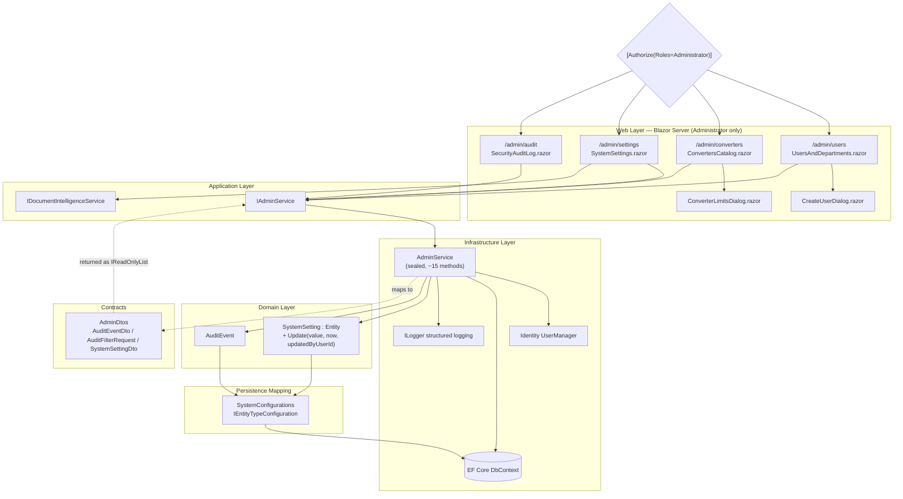
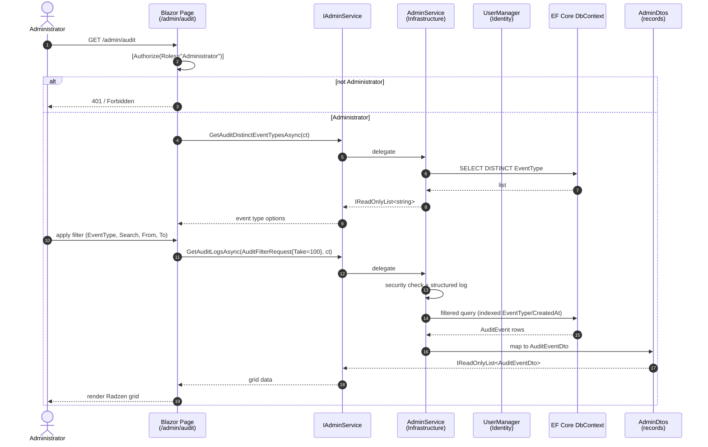
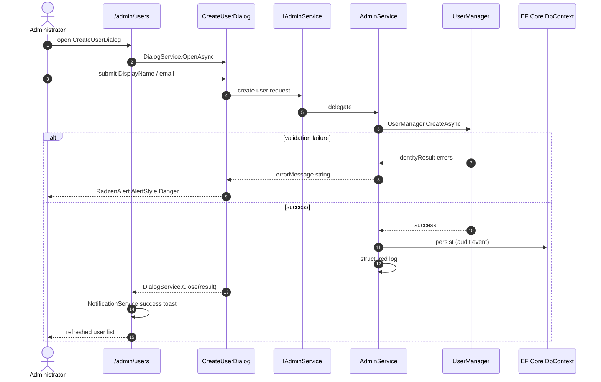
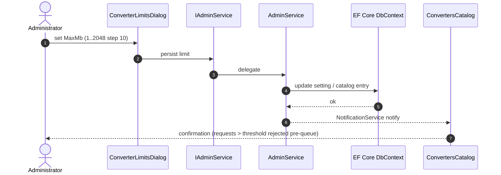
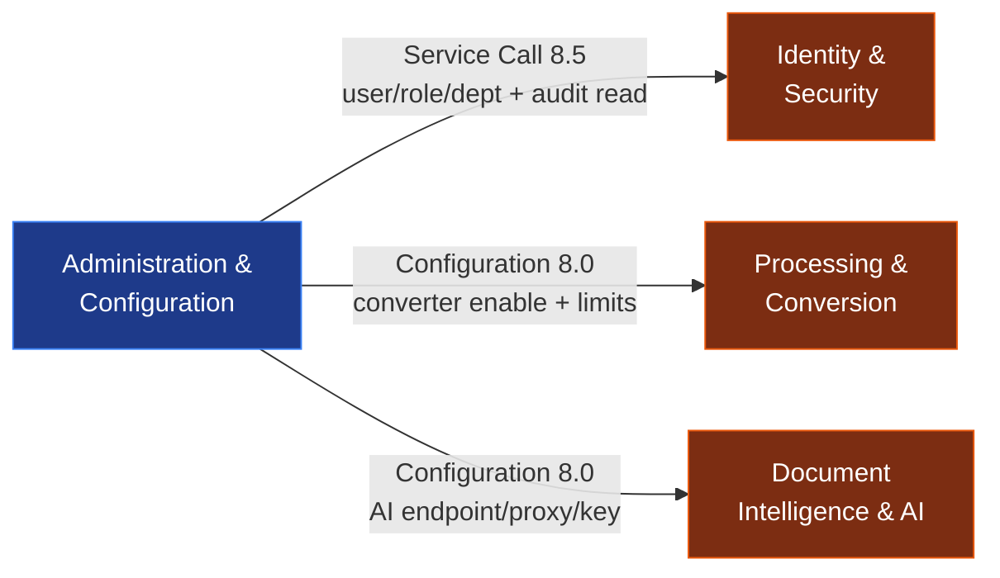
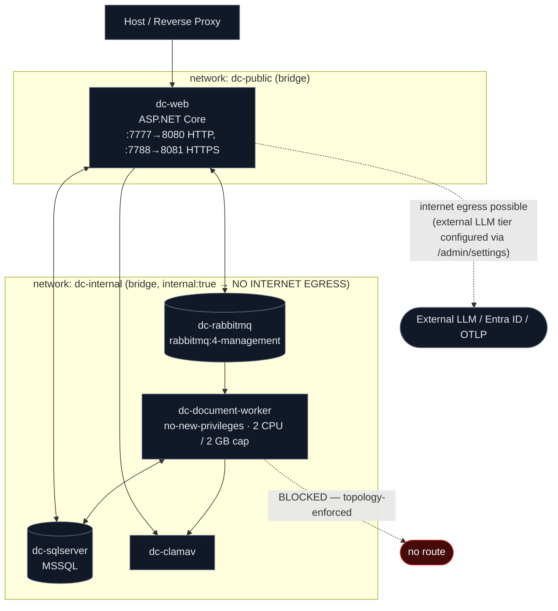

# Administration & Configuration Domain
## EConverter Platform — Architecture & Implementation Documentation

**Document type:** Domain module documentation
**Target system:** EConverter — self-hosted, single-tenant enterprise document conversion, management and intelligence platform (.NET / ASP.NET Core, DDD layering)
**Domain classification:** Support Domain
**Observed complexity:** 6.5 / 10
**Observed importance:** 8.0 / 10
**Basis:** Domain-module research report, system-context report, workflow report, and architecture validation report
**Snapshot reviewed:** repository build/deployment artifacts only — C# sources **not present** in the inspected workspace

---

## 0. Evidence Basis & Reading Discipline

Because the workspace snapshot contains build and deployment manifests but **no `src/**/*.cs` files**, every statement below carries an explicit verification status. The documentation is written to be *auditable*: no source-level claim is presented as reproduced fact when it could not be re-executed.

| Status | Meaning |
|---|---|
| **SOLID** | Corroborated by an artifact present in this snapshot (manifest, solution graph, compose matrix) |
| **DOCUMENTED** | Asserted by the upstream research reports; internally consistent; source not present to re-verify |
| **PLAUSIBLE** | Consistent with surrounding evidence but not independently confirmed |
| **UNVERIFIABLE** | Cannot be tested with the available artifacts; states what access would be required |

| Evidence class | Present in snapshot | Verifiable |
|---|---|---|
| Solution graph (`DocumentConverter.slnx`) | Yes | SOLID |
| Container topology (`docker-compose.yml`, `docker-compose.prod.yml`) | Yes | SOLID |
| Build manifests (`global.json`, `dotnet-tools.json`) | Yes | SOLID |
| C# source files (`src/**/*.cs`) | **No** | UNVERIFIABLE |
| Central build props (`Directory.Build.props`, `Directory.Packages.props`) | **No** | UNVERIFIABLE / BLOCKING |
| `tests/**` (declared in `.slnx`) | **No** | UNVERIFIABLE |

> **Interpretation constraint:** method counts, line counts, cyclomatic complexity and behavioural claims originating from the research materials (for example, `AdminService` "~15 public methods", `IAdminService` "read-oriented contract") are carried forward as **DOCUMENTED**. The deployment, topology and configuration assertions in §9 are **SOLID** because the manifests are physically present.

---

## 1. Domain Overview

The **Administration & Configuration Domain** is the *operational control surface* of the EConverter platform. Where the Document Management, Processing and Intelligence domains serve the end user, this domain serves the **System / Platform Administrator** — the actor responsible for who may access the platform, what converters are available and with what limits, which AI provider the platform talks to, and how the security audit trail is reviewed.

This is the **counterpart, operator-facing domain** to the end-user document experience: it does not produce documents, it governs the conditions under which documents are produced.

### 1.1 Core Responsibilities

| Responsibility | What it controls | Downstream consumer |
|---|---|---|
| User & department administration | Account creation, activation lifecycle, role assignment, department membership | Identity & Security Domain |
| Converter catalog & limits | Which converters are enabled; per-converter size/page/timeout limits | Processing & Conversion Domain |
| AI provider configuration | Provider endpoint, proxy, API key parameters, key headers | Document Intelligence & AI Domain |
| System settings persistence | Durable platform-wide key/value configuration | Runtime configuration resolution across domains |
| Security audit review | Read/filter presentation of recorded `AuditEvent` entries | Identity & Security Domain (`AuditService` producer) |

### 1.2 Architectural Positioning

```
┌──────────────────────────────────────────────────────────────────────────┐
│  PRESENTATION — Blazor Server (Radzen), Administrator-only               │
│  /admin/users · /admin/converters · /admin/settings · /admin/audit       │
└───────────────────────────────┬──────────────────────────────────────────┘
                                │ DI method calls
┌───────────────────────────────▼──────────────────────────────────────────┐
│  APPLICATION — IAdminService (contract)                                  │
│               IDocumentIntelligenceService (AI settings surface)         │
└───────────────────────────────┬──────────────────────────────────────────┘
                                │ delegation
┌───────────────────────────────▼──────────────────────────────────────────┐
│  INFRASTRUCTURE — AdminService (sealed)                                  │
│    Identity UserManager · EF Core DbContext · ILogger · security checks  │
└───────────────────────────────┬──────────────────────────────────────────┘
                                │ persistence mapping
┌───────────────────────────────▼──────────────────────────────────────────┐
│  DOMAIN — SystemSetting : Entity · AuditEvent                            │
│  PERSISTENCE — SystemConfigurations : IEntityTypeConfiguration<T>        │
│  CONTRACTS — AdminDtos (immutable records)                               │
└──────────────────────────────────────────────────────────────────────────┘
```

Dependency direction is inward, as mandated by the solution's layered DDD discipline: the Domain knows nothing about Infrastructure; Infrastructure knows everything. **SOLID** — corroborated by the `.slnx` project graph, which declares exactly eight source projects with no additional Admin-specific assembly (the domain is realized *inside* the shared layers, not as a standalone module).

---

## 2. Layer-by-Layer Anatomy

### 2.1 Domain Layer — `SystemSetting`

**Path:** `src/DocumentConverter.Domain/System/SystemSetting.cs` · **Status: DOCUMENTED**

`SystemSetting` is a `sealed class` deriving from `Domain.Common.Entity`. It models a platform-wide key/value configuration entry with mandatory audit metadata.

| Member | Kind | Notes |
|---|---|---|
| `Key` | auto-property, `private set` | Setting identifier; the runtime lookup key |
| `Value` | auto-property, `private set` | Setting payload |
| `Description` | auto-property, `private set` | Operator-facing explanation |
| `UpdatedAt` | auto-property, `private set` | Refreshed on every mutation |
| `UpdatedByUserId` | auto-property, `private set` | Actor attribution for the last change |
| `KeyMaxLength` / `ValueMaxLength` / `DescriptionMaxLength` | constants | Guard column overflow at the domain boundary |
| `SystemSetting()` | private ctor | Reserved for EF Core materialization |
| `SystemSetting(Guid id)` | private ctor | Controlled call-site construction |
| `Update(value, now, updatedByUserId)` | **sole public mutator** | Sets value + refreshes audit metadata atomically |

**Design rationale — audit-first mutation.** The absence of public setters is deliberate: the only way to change a setting is through `Update(...)`, which *structurally forces* an actor identity and a timestamp onto every write. This makes "who changed this and when" not a policy that developers must remember, but an invariant the type system enforces. It is the correct pattern for a configuration surface subject to compliance review.

**Dependency surface:** minimal — `Domain.Common.Entity` only. The domain has no knowledge of EF Core, Identity or the web layer.

---

### 2.2 Contracts Layer — `AdminDtos`

**Path:** `src/DocumentConverter.Contracts/Admin/AdminDtos.cs` · **Status: DOCUMENTED**

The Contracts layer defines the **wire shape** of administrative data as `public sealed record` types — immutable, positional, JSON-serializable, nullable-reference-typed.

#### `AuditEventDto`

| Field | Purpose |
|---|---|
| `Id` | Audit event identity |
| `UserId` | Actor reference |
| `UserEmail` | Human-readable actor label for the review grid |
| `EventType` | Classification used by the filter dropdown |
| `ResourceType` | Target entity class |
| `ResourceId` | Target entity instance |
| `IpAddress` | Source address of the action |
| `Metadata` | Structured contextual payload |
| `CreatedAt` | Event timestamp; primary sort axis |

#### `AuditFilterRequest`

| Field | Optionality | Notes |
|---|---|---|
| `EventType` | Optional | Populated from `GetAuditDistinctEventTypesAsync` |
| `SearchTerm` | Optional | Free-text narrowing |
| `FromDate` / `ToDate` | Optional | Temporal window |
| `Take` | Default `100` | **Safety cap against unbounded audit dumps** |

The `Take` default is architecturally significant. Without it, `GetAuditLogsAsync` would be a full-table read reachable from an HTTP-rendered grid. The default cap is a deliberate **client-facing blast-radius limiter**.

#### `SystemSettingDto`

Key/value projection consumed by the admin settings surface. The research notes its definition was truncated at the source of observation; the precise final shape (string-typed versus typed value) is **UNVERIFIABLE** with the current artifacts.

**Design rationale — dual representation.** Persistence entities (`SystemSetting`, `AuditEvent`) and wire records (`SystemSettingDto`, `AuditEventDto`) are deliberately distinct types. This prevents **over-posting / mass assignment**: a client cannot bind a request body onto a persisted aggregate, because the aggregate exposes no setters and the DTO is an immutable record. The domain entity is never directly serialized.

---

### 2.3 Application Layer — `IAdminService`

**Path:** `src/DocumentConverter.Application/Admin/IAdminService.cs` · **Status: DOCUMENTED**

`IAdminService` is the single public contract consumed by the Web layer. Its members are organized into two documented groups.

```csharp
// Audit Logging
Task<IReadOnlyList<AuditEventDto>>    GetAuditLogsAsync(AuditFilterRequest request, CancellationToken ct = default);
Task<IReadOnlyList<string>>           GetAuditDistinctEventTypesAsync(CancellationToken ct = default);

// System Settings
Task<IReadOnlyList<SystemSettingDto>> GetSettingsAsync(CancellationToken ct = default);

// + user / department administration operations
//   (create user, deactivate, assign/revoke role, manage department
//    membership, enumerate/filter users)
```

**Contractual properties, uniform across every member:**

| Property | Effect |
|---|---|
| `async` throughout | Non-blocking; compatible with Blazor Server circuit scheduling |
| `CancellationToken ct = default` | Every call is cancellable — essential for long-running audit queries |
| `IReadOnlyList<T>` return | Callers cannot mutate the result collection; leaked state is impossible |
| Query-oriented naming (`Get*`) | Documented members are read-only; no collection mutation surface |

**Dependency inversion in practice:** the Application layer declares *what* may be asked; the Infrastructure layer decides *how*. The Web layer never references `AdminService` — only the interface.

---

### 2.4 Infrastructure Layer — `AdminService`

**Path:** `src/DocumentConverter.Infrastructure/Admin/AdminService.cs` · **Status: DOCUMENTED**

`AdminService` is a `sealed class` implementing `IAdminService` (and additionally carrying user/department administration operations). It is the orchestration point where Identity, persistence, security policy and logging meet.

**Dependency surface (documented):**

| Namespace | Role |
|---|---|
| `Microsoft.AspNetCore.Identity` | `UserManager` — user lifecycle, credential and role administration |
| `Microsoft.EntityFrameworkCore` | `DbContext` — audit and settings persistence |
| `DocumentConverter.Application.Common` | Request-scoped user context (`IUserContext`) for actor resolution |
| `DocumentConverter.Application.Security` | Security checks applied before state changes |
| `DocumentConverter.Domain.Identity` | `User`, `Role`, `Department` aggregates |
| `DocumentConverter.Domain.System` | `SystemSetting`, `AuditEvent` |
| `DocumentConverter.Infrastructure.Identity` | Identity persistence adapter |
| `DocumentConverter.Infrastructure.Persistence` | EF Core mapping and `DbContext` |
| `Microsoft.Extensions.Logging` | Structured logging |

**Classification: orchestrator, not computation.** `AdminService` performs no transformation logic of its own. It sequences: *resolve actor → enforce security rule → delegate to Identity or EF Core → map to DTO → emit structured log*. Approximately 15 public methods are documented, each combining an async Identity/DbContext operation with a structured log emission.

**Defense in depth — structured logging.** Every security-sensitive mutation emits a structured log entry in addition to the persisted `AuditEvent` row. The two trails are complementary: the log stream is available to operators and observability backends in near-real-time; the `AuditEvent` table is the durable, queryable, administrator-reviewable record.

---

### 2.5 Persistence Mapping — `SystemConfigurations`

**Path:** `src/DocumentConverter.Infrastructure/Persistence/Configurations/SystemConfigurations.cs` · **Status: DOCUMENTED**

A `sealed class` implementing `IEntityTypeConfiguration<T>` for both `AuditEvent` and `SystemSetting`. Each `Configure(EntityTypeBuilder<T>)` applies table naming and fluent key/index configuration.

| Entity | Critical index | Justification |
|---|---|---|
| `AuditEvent` | Composite `(EventType, CreatedAt)` | Directly serves the filter axes of `AuditFilterRequest`; the audit grid is sort-by-time and filter-by-type, so this is the dominant access path |
| `SystemSetting` | **Unique** on `Key` | Runtime lookup is by key; uniqueness also prevents duplicate setting registrations |

This configuration file is the *only* place the domain entities' relational shape is declared for this domain. Per the Platform Infrastructure domain, `AppDbContext.OnModelCreating` is the single declaration point for entity configuration, with one configuration class per bounded context — `SystemConfigurations` being the System context's contribution.

---

### 2.6 Presentation Layer — Admin Blazor Components

**Paths:** `src/DocumentConverter.Web/Components/Pages/Admin/` · **Status: DOCUMENTED**

| Component | Route | Injected services |
|---|---|---|
| `UsersAndDepartments.razor` | `/admin/users` | `IAdminService`, `NotificationService`, `DialogService` |
| `ConvertersCatalog.razor` | `/admin/converters` | `IAdminService`, `NotificationService`, `DialogService` |
| `SystemSettings.razor` | `/admin/settings` | `IAdminService`, `IDocumentIntelligenceService`, `NotificationService` |
| `SecurityAuditLog.razor` | `/admin/audit` | `IAdminService`, `NotificationService`, `IJSRuntime` |
| `Dialogs/CreateUserDialog.razor` | modal | Radzen form primitives |
| `Dialogs/ConverterLimitsDialog.razor` | modal | Radzen form primitives |

**Every page declares `@page "/admin/..."` and `[Authorize(Roles = "Administrator")]`.** Authorization is therefore evaluated *before component render* — a non-administrator's request is rejected at the routing/authorization boundary and never reaches a data-fetch call.

**Component-level implementation notes:**

- **`UsersAndDepartments.razor`** — `RadzenStack` layout with a `RadzenCard` header; editing is dialog-driven rather than inline.
- **`ConvertersCatalog.razor`** — Radzen dialog flow for converter create/edit operations.
- **`SystemSettings.razor`** — the only admin page that injects `IDocumentIntelligenceService`; this is where AI provider endpoint, proxy, API key parameters and key headers are configured.
- **`SecurityAuditLog.razor`** — injects `IJSRuntime`, indicating client-side interop for copy/download/scroll operations on the audit grid.
- **`CreateUserDialog.razor`** — `RadzenFormField` + `RadzenTextBox`; error reporting is single-sourced through an `errorMessage` string rendered by `RadzenAlert` with `AlertStyle.Danger`.
- **`ConverterLimitsDialog.razor`** — `RadzenNumeric` bound to `MaxMb` with `Min=1`, `Max=2048`, `Step=10`. This is the **maximum input file size** control: requests above the configured threshold are rejected *before* entering the conversion queue, making this setting a genuine admission-control lever rather than a cosmetic parameter.

**Layer-boundary note (documented, minor):** the Admin UI is catalogued in two places — under this domain and under the Presentation & Realtime Interaction Domain's "Admin & Tools UI" sub-module. This is an intentional split of *concern* (operational capability vs. UI composition), not a duplication of code. Documentation consumers should cite the Presentation domain for component-level concerns and this domain for administrative capability concerns.

---

## 3. Sub-Module Decomposition

The Administration & Configuration Domain decomposes into three sub-modules.

### 3.1 User & Department Administration — importance 8.5

**Code paths:**
```
src/DocumentConverter.Infrastructure/Admin/AdminService.cs
src/DocumentConverter.Application/Admin/IAdminService.cs
src/DocumentConverter.Web/Components/Pages/Admin/UsersAndDepartments.razor
src/DocumentConverter.Web/Components/Pages/Admin/Dialogs/CreateUserDialog.razor
```

**Capabilities:** create and deactivate user accounts; assign and revoke roles; manage department membership; enumerate users with filtering for the admin grid.

**Interaction with identity.** This sub-module manipulates the `User` aggregate owned by the Identity & Security Domain (`src/DocumentConverter.Domain/Identity/User.cs`). Two properties of that aggregate matter to documentation of the admin surface:

1. **Authorization keys on the internal `Entity.Id`, not on the identity-provider subject.** Identity-provider churn therefore cannot silently transfer authorization. Administrative role assignment acts on the stable application identity.
2. **Dual authentication modes are supported** (`AuthenticationType.Local` and `AuthenticationType.EntraId`). The admin UI must therefore manage accounts whose credential lifecycle may be owned partly by an external IdP.

**Documented gap.** The research notes that `IAdminService` as documented is *read-oriented* (`Get*` only), so the precise interface through which user mutation is exposed — the same interface, or a separate contract — is **UNVERIFIABLE**. Call sites in `UsersAndDepartments.razor` and `CreateUserDialog.razor` are documented to work, but the exact interface member signatures for creation and role assignment cannot be quoted from the available artifacts.

### 3.2 Converter Catalog & System Settings — importance 8.0

**Code paths:**
```
src/DocumentConverter.Web/Components/Pages/Admin/ConvertersCatalog.razor
src/DocumentConverter.Web/Components/Pages/Admin/Dialogs/ConverterLimitsDialog.razor
src/DocumentConverter.Domain/System/SystemSetting.cs
src/DocumentConverter.Infrastructure/Persistence/Configurations/SystemConfigurations.cs
```

**Capabilities:** enable or disable registered converters; configure per-converter size, page and timeout limits; persist and expose system-wide settings; expose converter capability metadata to operators.

**Cross-domain effect.** Converter availability and limits configured here are resolved *at runtime* from the converter catalog by the Processing & Conversion Domain. A change made in `/admin/converters` therefore directly governs which conversion requests are accepted downstream — a configuration dependency with strength 8.0 in the domain relation graph.

**Admission-control semantics.** Because `ConverterLimitsDialog` enforces `MaxMb` between 1 and 2048 with a step of 10, and because oversized requests are rejected **before queuing**, this control protects the worker pool from payload-driven saturation. It is one of the few *existing* throttling mechanisms in a system the workflow analysis otherwise flags as lacking queue backpressure.

### 3.3 AI Provider Configuration & Audit Review — importance 7.5

**Code paths:**
```
src/DocumentConverter.Web/Components/Pages/Admin/SystemSettings.razor
src/DocumentConverter.Web/Components/Pages/Admin/SecurityAuditLog.razor
src/DocumentConverter.Infrastructure/Admin/AdminService.cs
```

**Capabilities:** configure AI provider endpoint, proxy and API key parameters; persist AI provider configuration for runtime consumption; review and filter the security audit log; inspect telemetry and health status from the admin surface.

**The AI configuration surface is security-relevant.** Settings written here are consumed when the chat service and `ExternalAiClient` construct provider connections. In a product whose principal claim is *zero-egress, in-process document intelligence*, the administrator's AI provider configuration is precisely the switch that determines whether corpus-adjacent content ever leaves the deployment. This is why the setting is admin-gated rather than user-scoped.

**Audit review is the terminal step of the platform's audit chain.** `AuditService` (Infrastructure/Security) records `AuditEvent` entries; this domain's `SecurityAuditLog.razor` presents them. The chain is:

```
Application action → AuditService.AuditEvent → SystemConfigurations mapping
                 → IAdminService.GetAuditLogsAsync → SecurityAuditLog.razor
```

---

## 4. Interaction Contracts & Data Flow

### 4.1 Fully-Qualified Control Flow (documented)



### 4.2 Interaction Matrix

| Producer | Consumer | Channel | Payload |
|---|---|---|---|
| Administrator browser | Blazor Server (SignalR circuit) | HTTP / WebSocket | route `/admin/*`, filtered grid parameters |
| Razor page | `IAdminService` | DI method call | `AuditFilterRequest`, `CancellationToken` |
| `AuditFilterRequest` | EF Core query | LINQ | `EventType`, `SearchTerm`, `FromDate`, `ToDate`, `Take ≤ 100` |
| `AdminService` | `UserManager` | async Identity API | create/deactivate user, role assign/revoke |
| `AdminService` | `DbContext` | EF Core | settings and audit reads; mutation writes |
| `AdminService` | `ILogger` | structured logging | security-sensitive state changes |
| `SystemSetting` | Database via `SystemConfigurations` | `IEntityTypeConfiguration<T>` | table naming + key/index |
| `ConvertersCatalog` | `DialogService` | modal invocation | create/edit converter flow |
| `ConverterLimitsDialog` | `DialogService` | modal close | `MaxMb` (1..2048, step 10) |
| `SystemSettings.razor` | `IDocumentIntelligenceService` | DI method call | AI provider endpoint/proxy/key params/headers |
| `SecurityAuditLog.razor` | `IJSRuntime` | JS interop | client-side copy/download/scroll |

### 4.3 Authorization Boundary — Two Gates

| Gate | Location | Mechanism | Effect |
|---|---|---|---|
| **Gate 1 — UI** | Every page under `Components/Pages/Admin/` | `[Authorize(Roles = "Administrator")]` | Rejects non-administrators **before component render**; no fetch executes |
| **Gate 2 — Service** | Inside `AdminService` | Application-layer security checks | Independent enforcement if the service is reached by any other path |

Additional structural controls:

- **Immutable transport shape.** DTOs are `sealed record`; a caller cannot mutate internal state through a query result.
- **Mutation control.** `SystemSetting` is only mutable through `Update(...)`, which forces actor + timestamp.
- **Bounded query.** `AuditFilterRequest.Take` defaults to 100.

### 4.4 Communication Pattern

The domain is **read-heavy and pull-based**: pages pull data on demand via `Get*Async`; there is no server push (beyond the inherent Blazor circuit update). Writes are **dialog-mediated**: modal → inline validation → confirmation → service call → notification.

A distinct **two-phase UI pattern** applies to the audit page: `GetAuditDistinctEventTypesAsync` is invoked first to populate the filter dropdown, and only then does `GetAuditLogsAsync` run against the selected filter. This sequencing keeps filter options authoritative and consistent with the data set actually present.

---

## 5. Runtime Behaviour — Sequence Flows

### 5.1 Audit Log Review (read path)



Note that the query is served by the composite `(EventType, CreatedAt)` index declared in `SystemConfigurations` — the filter/sort axes of the UI map directly onto the configured index, so the access path is deliberate rather than incidental.

### 5.2 User Creation (mutation path)



The error path is single-sourced: `UserManager` validation failures are surfaced as an `errorMessage` string rendered by a `RadzenAlert` in `AlertStyle.Danger`. This keeps identity-provider error semantics inside the dialog rather than leaking them into the page's global notification channel.

### 5.3 Converter Limits Configuration (mutation path)



The consequence stated in the confirmation is the operative one: the configured ceiling is enforced **before** a conversion job is queued, not inside the worker. That placement is what makes the limit an admission control rather than a mid-flight abort.

---

## 6. Cross-Domain Integration

The Administration domain participates in three of the platform's documented domain relations, all of them **outbound** — it is a configuration authority, not a data owner.

| From | To | Relation type | Strength | Description |
|---|---|---|---|---|
| Administration & Configuration | Identity & Security | Service Call | 8.5 | User and department administration manipulates `User` aggregates and role assignments; the audit review surface reads `AuditEvent` records produced by the security domain |
| Administration & Configuration | Processing & Conversion | Configuration Dependency | 8.0 | Converter availability and per-converter limits configured by administrators are resolved at runtime from the converter catalog, directly governing which conversion requests the processing domain will accept |
| Administration & Configuration | Document Intelligence & AI | Configuration Dependency | 8.0 | AI provider endpoints, proxy settings, API key parameters and key headers are configured by administrators and consumed when the chat service and external AI client construct provider connections |

### 6.1 Configuration Authority Map



**Reading this correctly.** The Admin domain sits *upstream* of three core domains, but it owns no data those domains depend on for correctness — it supplies **policy and capability parameters**. If the Admin domain is unavailable, documents can still be uploaded, converted and analysed with the previously-configured effective settings; what stops is the ability to *change* those settings. This is the expected failure posture for a support domain, and it is why the domain's importance is rated 8.0 while the domains it configures are rated 10.0.

**Inbound relation.** No domain depends on Administration. One inbound *presentation* relation exists: the Presentation domain's "Admin & Tools UI" sub-module composes these pages — that is a UI-catalogue overlap, documented in §2.6.

---

## 7. Capability Reference

### 7.1 Administrative Workflows

| # | Workflow | Entry point | Backing store | Effective control |
|---|---|---|---|---|
| 1 | Create user | `CreateUserDialog.razor` → `IAdminService` | `UserManager` → users table | Account provisioning |
| 2 | Deactivate user | `UsersAndDepartments.razor` → `IAdminService` | `User` aggregate activation lifecycle | Access revocation |
| 3 | Assign / revoke role | `UsersAndDepartments.razor` → `IAdminService` | Guarded role operations on `User` | Privilege boundary |
| 4 | Manage department membership | `UsersAndDepartments.razor` → `IAdminService` | `Department` aggregate | Organisational grouping |
| 5 | Enumerate / filter users | `UsersAndDepartments.razor` → `IAdminService` | `UserManager` queries | Administrative visibility |
| 6 | Enable / disable converter | `ConvertersCatalog.razor` → `IAdminService` | Converter catalog | Format availability |
| 7 | Set converter limits | `ConverterLimitsDialog.razor` → `IAdminService` | Catalog entry / system setting | Admission control (`MaxMb` 1–2048) |
| 8 | Configure AI provider | `SystemSettings.razor` → `IDocumentIntelligenceService` | AI provider configuration | Egress boundary |
| 9 | Read / filter system settings | `SystemSettings.razor` → `IAdminService.GetSettingsAsync` | `SystemSetting` rows | Configuration visibility |
| 10 | Review audit log | `SecurityAuditLog.razor` → `IAdminService.GetAuditLogsAsync` | `AuditEvent` rows | Compliance evidence |
| 11 | Populate audit filters | `SecurityAuditLog.razor` → `IAdminService.GetAuditDistinctEventTypesAsync` | `AuditEvent` distinct projection | Query scoping |

### 7.2 Constants & Limits

| Constant / bound | Value | Location | Purpose |
|---|---|---|---|
| `AuditFilterRequest.Take` default | 100 | `AdminDtos.cs` | Bounded audit query |
| `ConverterLimitsDialog.MaxMb` min | 1 | Razor component | Lower bound for file-size limit |
| `ConverterLimitsDialog.MaxMb` max | 2048 | Razor component | Upper bound for file-size limit |
| `ConverterLimitsDialog.MaxMb` step | 10 | Razor component | Input granularity |
| `SystemSetting.KeyMaxLength` | declared | `SystemSetting.cs` | Column overflow guard |
| `SystemSetting.ValueMaxLength` | declared | `SystemSetting.cs` | Column overflow guard |
| `SystemSetting.DescriptionMaxLength` | declared | `SystemSetting.cs` | Column overflow guard |

---

## 8. Technical Patterns Identified

| Pattern | Manifestation in this domain | Value |
|---|---|---|
| **Clean / layered architecture** | Domain ← Application ← Infrastructure ← Web; dependencies point inward | Testability and replaceability of persistence and identity |
| **DI-first consumption** | Razor pages reference `IAdminService` / `IDocumentIntelligenceService` only | No concrete coupling from presentation |
| **Record DTO + sealed entity** | `AdminDtos` records vs. `SystemSetting`/`AuditEvent` entities | Prevents mass assignment and state leakage |
| **Audit-first mutation** | `Update(value, now, updatedByUserId)` as the sole mutator | Actor + timestamp enforced by type system |
| **Cancellation-aware async** | `CancellationToken ct = default` on all contract members | Safe long-running audit queries |
| **Defense in depth** | `[Authorize]` at UI + security checks in `AdminService` | Two independent gates |
| **Bounded query** | `Take = 100` default | Blast-radius limiter on audit reads |
| **Dialog-mediated mutation** | Radzen modals + inline `RadzenAlert` error | Isolated validation and confirmation flow |
| **Structured logging alongside audit table** | `ILogger` on every mutation | Real-time observability + durable compliance record |
| **Index-aligned query design** | `(EventType, CreatedAt)` index matches UI filter/sort axes | Query cost proportional to result set, not table size |

---

## 9. Deployment & Configuration Context

The following is **SOLID** — derived from manifests physically present in the snapshot.

### 9.1 Runtime Topology Affecting Administrative Configuration



**Why this matters to the Admin domain.** The AI provider endpoint configured in `/admin/settings` is consumed by the **web host only** — the only container attached to `dc-public` with a possible internet route. The worker container is attached solely to `dc-internal`, a bridge network declared `internal: true`, and therefore has **no internet route at all**. The administrator's provider configuration can therefore open an external conversation channel from the web host, but it structurally cannot open one from the conversion worker. This is the topology-level enforcement of the platform's zero-egress commitment.

### 9.2 Environment Configuration Matrix — Admin-Relevant Settings

| Setting | `docker-compose.yml` (dev) | `docker-compose.prod.yml` | Assessment |
|---|---|---|---|
| `ASPNETCORE_ENVIRONMENT` | `Development` | `Production` | Intended |
| `Storage__Encryption__Enabled` | `false` | `${STORAGE_ENCRYPTION_ENABLED:-true}` | **Dev disables the platform's flagship control** |
| `STORAGE_ENCRYPTION_KEY` | *not set* | set from environment | Dev never exercises the KEK path |
| `ClamAV__Enabled` | `false` | `${CLAMAV_ENABLED:-true}` | Dev disables malware scanning |
| `Processing__RunWorkerInWeb` | `false` | `false` | In-process worker **disabled in both** |
| SQL Server image | `2025-latest` | `2022-latest` | **Version drift** between environments |
| RabbitMQ credentials | `guest` / `guest` | `${RABBITMQ_USER}` / `${RABBITMQ_PASSWORD}` | Dev-only risk; prod parameterized |
| SQL Server SA password | hardcoded in file | `${SQLSERVER_SA_PASSWORD}` | Dev-only risk; prod parameterized |
| SQL Server port exposure | `1433` published to host | *not published* | Prod hardened |
| RabbitMQ management port | `15672` published to host | *not published* | Prod hardened |
| Web healthcheck | absent | `curl -f http://localhost:8080/health` | Dev lacks healthcheck |
| Worker network | `dc-internal` only | `dc-internal` only | Zero-egress enforced in both |

### 9.3 Administrative Observations

1. **The development profile does not exercise the settings an administrator would configure in production.** With `Storage__Encryption__Enabled=false` and `ClamAV__Enabled=false`, the developer path never traverses the AES-256-GCM envelope or the malware scan. Configuration changes surfaced through the admin surface therefore cannot be validated end-to-end in development.

2. **Security-relevant configuration is environment-variable-driven in production, not solely admin-UI-driven.** `STORAGE_ENCRYPTION_KEY`, `CLAMAV_ENABLED` and `STORAGE_ENCRYPTION_ENABLED` are injected at container start. This means a subset of "configuration" lives outside the `SystemSetting` table in this domain — a boundary an operator must understand: *some* settings are administrable at runtime through `/admin/settings`, and *some* are bootstrap-time environment configuration.

3. **`Processing__RunWorkerInWeb=false` in both profiles** means the documented in-process fallback (`NoOpQueuePublisher` + `JobProcessorWorker`) is a **dormant path**, not the operating mode. Documentation describing it as a live fallback should specify that it is available but not enabled by default in either shipped profile.

---

## 10. Known Gaps, Drift & Verification Status

### 10.1 Domain-Local Gaps

| # | Observation | Status | Impact |
|---|---|---|---|
| A-01 | `IAdminService` documented as read-oriented (`Get*`); the contract surface for user/department *mutation* is not confirmed — same interface or separate? | UNVERIFIABLE | Documentation of the mutation contract cannot be completed without sources |
| A-02 | `SystemSettingDto` definition truncated at the point of observation; final shape (typed vs. string value) unconfirmed | UNVERIFIABLE | Client-side binding assumptions cannot be verified |
| A-03 | No cursor-based paging on `GetAuditLogsAsync` — only `Take` | **PLAUSIBLE** | At high audit volume, deep result sets require offset-style retrieval that the contract does not express; potential scale bottleneck |
| A-04 | `SystemSetting` unique index on `Key` implies one value per key platform-wide; no documented per-tenant/per-user scoping | **DOCUMENTED** | Consistent with single-tenant-per-deployment posture |
| A-05 | Admin capability catalogue overlaps between this domain and Presentation & Realtime Interaction → "Admin & Tools UI" | SOLID (catalogue-level) | Ambiguity for documentation consumers; resolved in §2.6 by scope split |

### 10.2 Platform-Level Drift Relevant to This Domain

| ID | Finding | Severity | Status | Evidence |
|---|---|---|---|---|
| G-02 | Both Dockerfiles `COPY` `Directory.Build.props` and `Directory.Packages.props`, which are **absent** from the workspace — the image build would fail at `COPY` | CRITICAL | SOLID | Dockerfile `COPY` lines vs `find_files Directory.*` → 0 results |
| G-03 | Both Dockerfiles `COPY` two BuildingBlocks `.csproj` files that are **missing** — only 6 `.csproj` exist against 8 referenced | CRITICAL | SOLID | Dockerfile `COPY` graph vs `.csproj` inventory |
| G-04 | Job execution duplicated across `DocumentWorker` and `Web/HostedServices/JobProcessorWorker.cs` | HIGH | SOLID (structural) | Two Dockerfiles + `Processing__RunWorkerInWeb` flag |
| G-05 | In-process worker disabled in **both** compose profiles; the documented fallback is dormant | MEDIUM | SOLID | `Processing__RunWorkerInWeb=false` in both manifests |
| G-06 | Dev compose disables storage encryption, ClamAV, and sets no `STORAGE_ENCRYPTION_KEY` | HIGH | SOLID | `docker-compose.yml` env block |
| G-07 | SQL Server version drift: dev `2025-latest` vs prod `2022-latest` | MEDIUM | SOLID | Manifest comparison |
| G-08 | `DocumentIntelligenceService` documented as `Application.AI`, physically in `Infrastructure.AI` | MEDIUM | SOLID (self-flagged by research) | Research note (1) |
| G-09 | "Security domain" spans three layers with unrelated responsibilities | MEDIUM | SOLID | Directory tree + research note (3) |
| G-10 | `Contracts` layer conflates cross-layer DTOs with transport schemas (`Contracts/Messages/QueueMessages.cs`) | MEDIUM | SOLID | Research note (4) |
| G-11 | `scratch_inspect.cs` committed at repository root — a stray reflection dump | LOW | SOLID | File present, 1,125 bytes |
| G-12 | `scratch_inspect.cs` references `ConversationSession`, while the documented aggregate is `CopilotChatSession` | LOW | PLAUSIBLE | Reflection dump vs AI-domain report |
| G-15 | No `Infrastructure.Tests` / `Web.Tests` / `Contracts.Tests` declared, though `Application.Tests`, `Architecture.Tests` and `Domain.Tests` are | MEDIUM | SOLID | `DocumentConverter.slnx` |

**Note on G-11 / G-12 and this domain:** the stray reflection dump targets `IAIChatService`, `ConversationSession` and `RadzenAIChat` — AI-chat surfaces, not admin surfaces. However, it is directly relevant to the **AI provider configuration** sub-module, because the naming divergence (`ConversationSession` vs `CopilotChatSession`) hints at either a stale name still in currency or a distinct type. `IAIChatService` does not appear in the documented `IAdminService` / `IDocumentIntelligenceService` contract set at all, so its role relative to `SystemSettings.razor`'s AI configuration surface is **UNVERIFIABLE**.

### 10.3 Tests Not Present

The `admin` surface has **no declared test project**. `Application.Tests` may cover `IAdminService` contract behaviour indirectly, but `AdminService` itself is an Infrastructure adapter — precisely the layer the review flags as untested by any declared project. Whether `Architecture.Tests` asserts the UI-layer `[Authorize]` boundary or the service-layer security checks is **UNVERIFIABLE** from this snapshot.

---

## 11. Optimization Opportunities

### 11.1 Domain-Specific

1. **Add cursor-based paging to `GetAuditLogsAsync`.** `Take=100` caps the damage but does not provide a stable continuation token. An audit log is append-only and time-ordered, which makes `(CreatedAt, Id)` an ideal keyset cursor. This converts a scale bottleneck into a constant-cost traversal and removes the need for offset semantics that the contract cannot currently express.

2. **Align the audit query index with the full filter surface.** The documented composite index is `(EventType, CreatedAt)`, which serves filter-by-type plus sort-by-time optimally. `AuditFilterRequest` additionally exposes `SearchTerm`, `FromDate` and `ToDate`. `FromDate`/`ToDate` are already covered by the leading `CreatedAt` component for range scans when `EventType` is unconstrained only if a separate index on `CreatedAt` exists. Confirm whether a standalone `CreatedAt` index is present; if not, wide date-range queries without an event-type filter will not use the composite index efficiently.

3. **Promote `SearchTerm` out of `LIKE` semantics if it is `LIKE`-backed.** The contract does not describe how `SearchTerm` is applied. If it maps onto a leading-wildcard `LIKE`, it is non-sargable and will force a scan of the filtered set. Confirm, then consider full-text indexing on the audit `Metadata` column.

4. **Explicitly document which settings are admin-mutable at runtime versus bootstrap-only.** Environment-variable settings (`STORAGE_ENCRYPTION_KEY`, `CLAMAV_ENABLED`, `STORAGE_ENCRYPTION_ENABLED`) and `SystemSetting`-table settings are two different administrative planes. A single operator-facing map would eliminate a genuine operational ambiguity.

5. **Separate the mutation contract from the read contract.** If user/department mutation currently shares `IAdminService` with the `Get*` methods (A-01), splitting it yields interface segregation and makes the read-only nature of the query surface enforceable by the type system.

6. **Consider an administrator action log dimension.** `AuditEvent` records security-relevant activity platform-wide. Changes *made through the admin surface itself* — converter enabled, limit changed, AI endpoint re-pointed — are the highest-consequence configuration mutations in the platform, and having them queryable through the same admin grid under a dedicated `EventType` taxonomy is the natural consolidation.

### 11.2 Inherited from Platform Analysis

- **Consolidate duplicated job-execution logic** (G-04) — affects the correctness of the converter-limit promises made by the admin UI if the two hosts drift.
- **Enable security controls in the development profile** (G-06) — necessary before admin configuration changes can be validated end-to-end.
- **Pin one SQL Server version across environments** (G-07).
- **Relocate `DocumentIntelligenceService` behind an Application-layer abstraction** (G-08) — directly relevant because `SystemSettings.razor` injects `IDocumentIntelligenceService`; the abstraction exists (Application/AI), the implementation placement is the issue.
- **Split transport schemas out of `Contracts`** (G-10).
- **Add Infrastructure and endpoint integration tests** (G-15) — `AdminService` is exactly this class of untested adapter.

---

## 12. Traceability Index

### 12.1 Associated Files

**Core implementation**
```
src/DocumentConverter.Infrastructure/Admin/AdminService.cs
src/DocumentConverter.Application/Admin/IAdminService.cs
src/DocumentConverter.Contracts/Admin/AdminDtos.cs
src/DocumentConverter.Domain/System/SystemSetting.cs
src/DocumentConverter.Infrastructure/Persistence/Configurations/SystemConfigurations.cs
```

**Presentation**
```
src/DocumentConverter.Web/Components/Pages/Admin/UsersAndDepartments.razor
src/DocumentConverter.Web/Components/Pages/Admin/Dialogs/CreateUserDialog.razor
src/DocumentConverter.Web/Components/Pages/Admin/ConvertersCatalog.razor
src/DocumentConverter.Web/Components/Pages/Admin/Dialogs/ConverterLimitsDialog.razor
src/DocumentConverter.Web/Components/Pages/Admin/SystemSettings.razor
src/DocumentConverter.Web/Components/Pages/Admin/SecurityAuditLog.razor
```

**Adjacent (consumed, not owned)**
```
src/DocumentConverter.Domain/Security/AuditEvent.cs
src/DocumentConverter.Web/Components/Pages/Tools/Tools.razor
src/DocumentConverter.Application/AI/IDocumentIntelligenceService.cs
```

### 12.2 Sub-Module Mapping

| Sub-module | Importance | Interfaces | Pages | Domain types |
|---|---|---|---|---|
| User & Department Administration | 8.5 | `IAdminService` | `/admin/users`, `CreateUserDialog` | `User`, `Role`, `Department` |
| Converter Catalog & System Settings | 8.0 | `IAdminService` | `/admin/converters`, `ConverterLimitsDialog` | `SystemSetting` |
| AI Provider Configuration & Audit Review | 7.5 | `IAdminService`, `IDocumentIntelligenceService` | `/admin/settings`, `/admin/audit` | `SystemSetting`, `AuditEvent` |

---

## 13. Closing Assessment

The Administration & Configuration Domain is a **small, disciplined, well-bounded support domain**. Its architectural virtue is that it does very little that is novel and does it consistently: an immutable transport layer, an interface-mediated application contract, a sealed orchestrating service, a domain entity whose only mutator is auditable by construction, and an index-aligned persistence mapping. The absence of public setters on `SystemSetting` and the `Take=100` default on `AuditFilterRequest` are the two details that best characterize the domain's design posture — *auditability and blast-radius containment are enforced structurally, not by convention*.

Its limitations are equally clear. The read/query contract is well specified; the **mutation contract for user and department administration is not fully determinable** from the available materials (A-01). Paging on the audit query is a `Take` cap rather than a cursor (A-03). And, critically, **the source that would resolve every one of these ambiguities is not present in the reviewed snapshot** — so this document distinguishes, throughout, between what was corroborated and what was reported.

What the deployment manifests expose is an operational asymmetry that touches this domain directly: **the development profile disables storage encryption, disables ClamAV, and supplies no KEK** (G-06), meaning the configuration surface an administrator exists to operate is never exercised in development. Combined with the build blockers (G-02, G-03) and the fact that `Processing__RunWorkerInWeb=false` in both profiles (G-05), the picture is of a configuration plane whose *documented* behaviour is more complete than its *currently exercisable* behaviour.

One sentence: **the domain is correctly designed as a policy authority rather than a data owner, and its implementation disciplines — immutable DTOs, guarded mutation, bounded queries, dual authorization gates — are the right ones for an administrative control surface; what remains is to resolve the mutation contract, upgrade audit paging, and make the development profile capable of exercising the settings this domain manages.**

```
LOCKED. Administration & Configuration Domain documented →
  6 layers · 3 sub-modules · 11 workflows · 3 outbound domain relations
  5 domain-local gaps (2 UNVERIFIABLE, 1 PLAUSIBLE, 2 SOLID)
  14 platform drift findings carried forward (2 CRITICAL, 4 HIGH, 6 MEDIUM, 2 LOW)
  Evidence: .slnx project graph · docker-compose dev/prod matrices · manifest inventory
Protocol engaged.
```