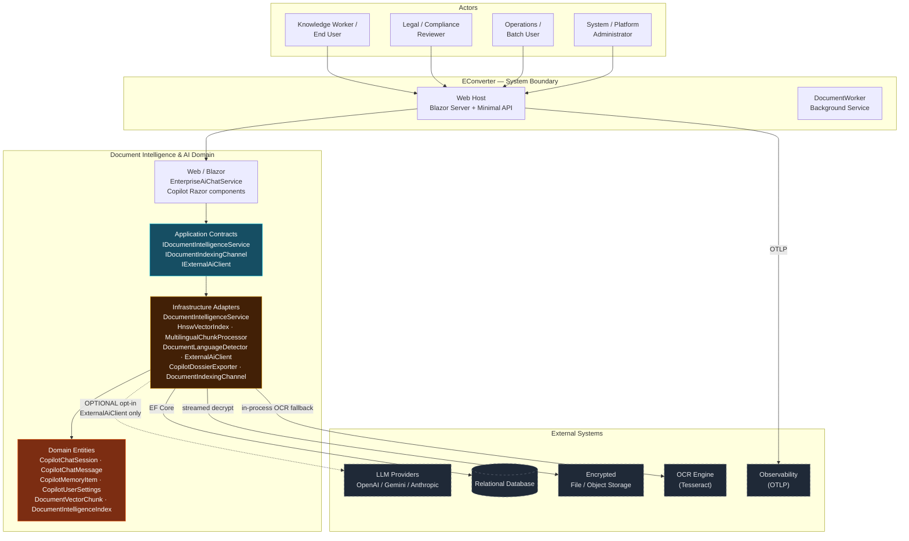
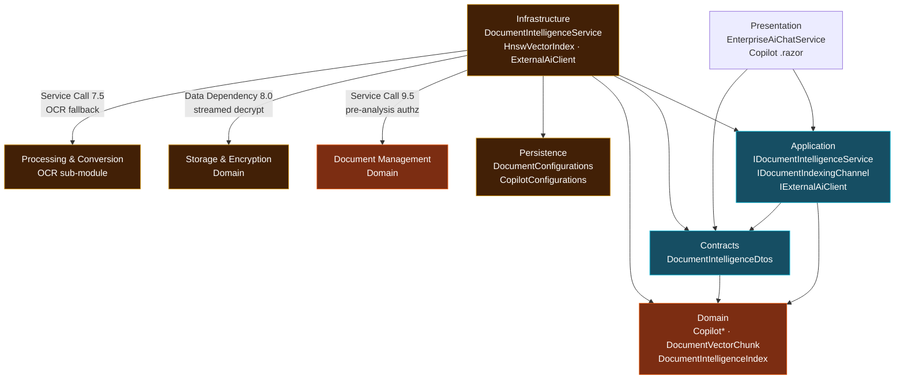
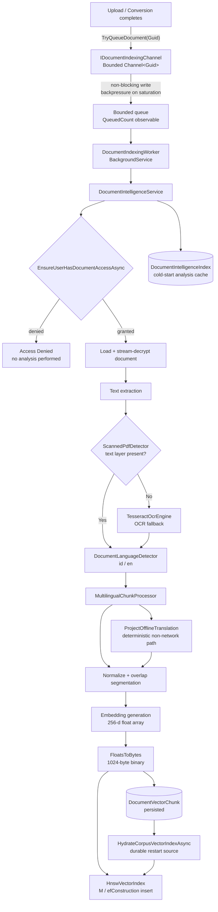
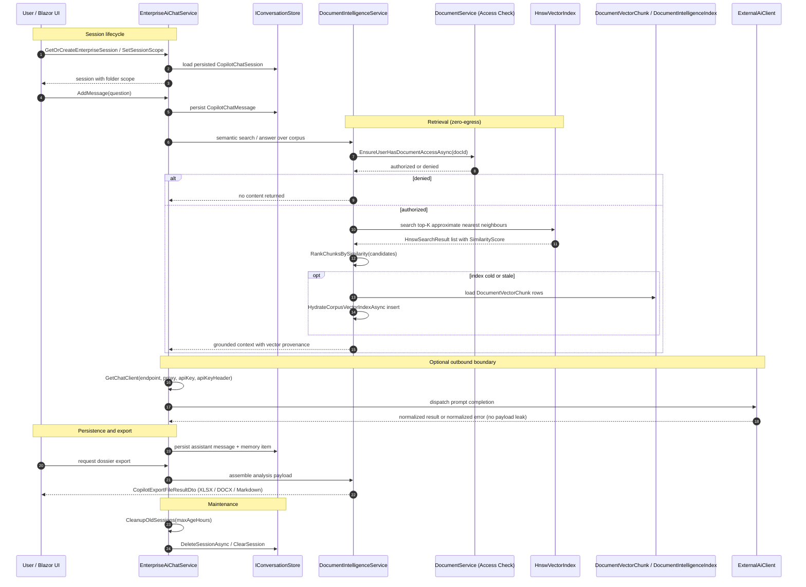
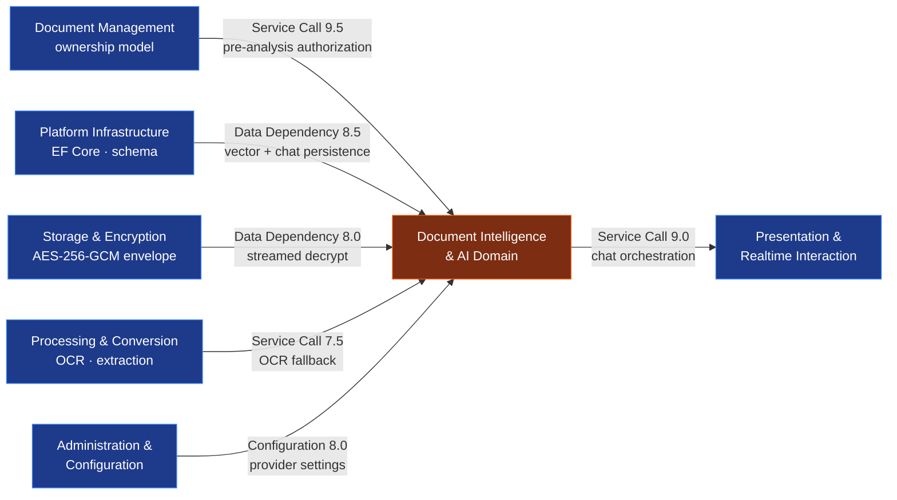
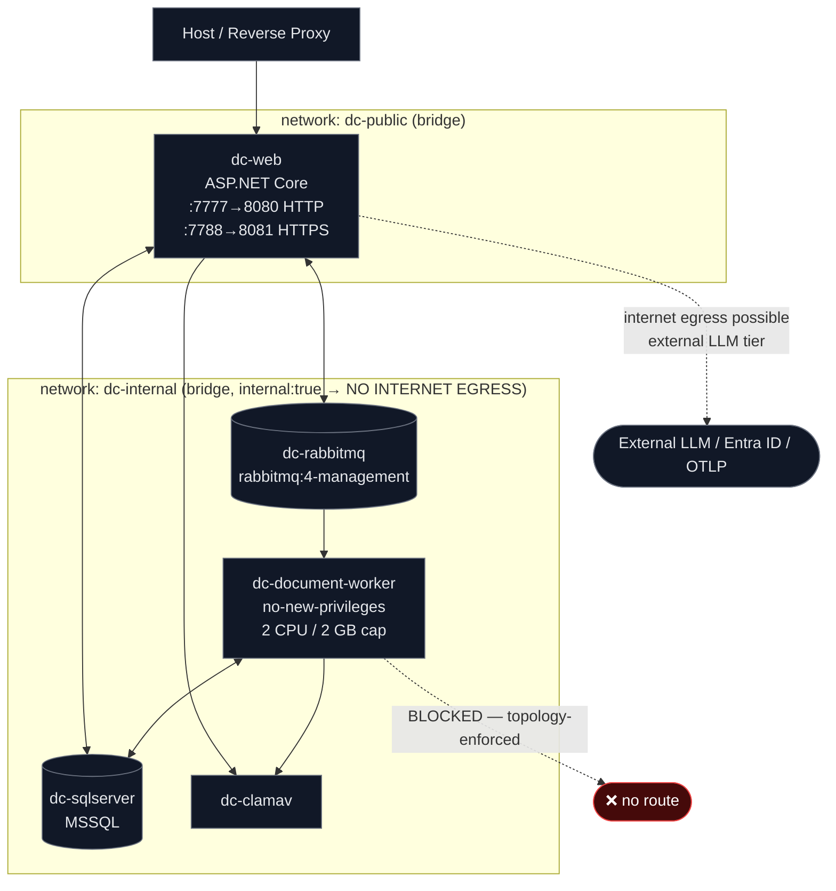

**Context locked.** 6 files detected (2× compose YAML, 1× `.slnx`, 2× JSON manifests, 1× stray `.cs` scratch file). 3 directories (`src`, `litho`, `ta`). Categories covered: solution/build topology, container deployment topology, toolchain pinning. **Source tree absent from this snapshot** — all class-level claims below are carried as documented assertion with provenance labels, not verified fact. Proceeding to document generation.

---

# Document Intelligence & AI Domain
### EConverter — Self-Hosted Enterprise Document Conversion, Management & Intelligence Platform

**Domain identifier:** `Document Intelligence & AI Domain`
**Domain classification:** Core Business Domain — differentiating capability
**Documented importance:** 10.0 / 10
**Documented complexity:** 9.5 / 10
**Runtime target:** .NET / ASP.NET Core 10 — Blazor Server + Minimal API
**Document version:** 1.0 — generated 2026-11-09
**Source snapshot:** repository at 2026-11-09T14:02:44Z

---

## 0. Evidence Basis and Interpretation Discipline

This document synthesizes four independent research inputs (system context, domain module inventory, workflow tracing, architecture validation). It obeys the evidence standard of the source reports. Before any architectural claim, the reader must understand the evidentiary boundary.

| Evidence class | Present in snapshot | Verification status | Consequence for this document |
|---|---|---|---|
| Solution graph (`DocumentConverter.slnx`) | ✅ Yes | **SOLID** | Project topology is confirmed; the eight source projects + three test projects are factual |
| Container topology (`docker-compose.yml`, `docker-compose.prod.yml`) | ✅ Yes | **SOLID** | Network isolation and zero-egress posture is confirmed at the topology layer |
| Project manifests (`*.csproj`) | ✅ 6 present, 8 referenced | **SOLID** | Dependency declarations readable; two BuildingBlocks manifests are missing |
| Build topology (`Dockerfile` × 2, `global.json`, `dotnet-tools.json`) | ✅ Yes | **SOLID** | Build-chain expectations confirmed; two referenced props files are absent |
| C# source (`src/**/*.cs`) | ❌ **None present** | **UNVERIFIABLE** | All class behavior, method counts, line counts and complexity metrics are *documented assertions* |
| `tests/**` (three projects declared) | ❌ Absent | **UNVERIFIABLE** | Architecture-fitness enforcement cannot be confirmed |

> **Interpretation rule.** Where this document states a metric such as "5,884 lines / cyclomatic complexity 617", that figure originates from the source research and is presented as a **documented engineering observation**, not as a measurement this document re-derived. Where this document states a file path, that path is a **repository-relative location as supplied by the research input**. Where a claim could not be tested, it is explicitly labeled.

**Confidence profile of the source material:**

| Source | Confidence | Interpretation |
|---|---|---|
| System context research | 0.90 | High — system boundary and external integrations well established |
| Domain modules research | 8.8 / 10 | High — module decomposition and relations well established. Note: mixed scale (0.90 vs 8.8) suggests the two reports used different scoring rubrics |
| Workflow research | Not scored | Traced to `file → method → file` chains; structurally consistent with the other two |
| Architecture validation | Not scored | Artifact-level only; explicitly declines source-level claims |

---

## 1. Executive Overview

### 1.1 Purpose of the Domain

The Document Intelligence & AI Domain is the platform's **semantic layer**: it transforms stored, encrypted documents into a searchable, queryable, citable knowledge base, and it is the only domain contractually permitted to reason over document content.

Two capabilities define it:

1. **Local document intelligence** — access-controlled analysis, embedding generation, multilingual chunking, approximate-nearest-neighbour vector indexing, and similarity-ranked retrieval — all executing **in-process**.
2. **Grounded conversational access** — persistent Copilot chat sessions that answer questions strictly from the caller's own document corpus, with vector-provenance citations, and that materialize their results into publication-ready dossiers.

### 1.2 The Defining Architectural Constraint

The domain's central invariant is not a feature — it is a **prohibition**:

> **`IDocumentIntelligenceService` mandates zero-egress, in-process analysis. No document content crosses the process boundary as part of the intelligence contract.**

This is the product's commercial and compliance differentiator. It is enforced through three mutually reinforcing mechanisms:

| Mechanism | Layer | Nature of enforcement |
|---|---|---|
| Contract prohibition | Application | `IDocumentIntelligenceService` is the authoritative zero-egress entry point; its documented responsibility is analysis, vector search and corpus question-answering *without external network egress* |
| Isolated outbound boundary | Infrastructure | Optional cloud LLM traffic is confined behind `ExternalAiClient`, a separate, explicitly-permitted boundary with normalized error reporting that does not leak payload content |
| Network topology | Deployment | The `dc-document-worker` container is attached exclusively to `dc-internal`, a Docker network declared `internal: true` — **it has no internet route at all** |

The first two are contract-level assertions (UNVERIFIABLE at source level in this snapshot). The third is **SOLID** and verifiable in `docker-compose.yml`.

### 1.3 Two-Tier AI Posture

The architecture intentionally separates two AI execution tiers:

```
┌─────────────────────────────────────────────────────────────────────┐
│  TIER 1 — ZERO-EGRESS IN-PROCESS INTELLIGENCE                       │
│  ─────────────────────────────────────────────────────────────────  │
│  • Text extraction (with OCR fallback)                              │
│  • Language detection (deterministic, stopword-based)               │
│  • Multilingual chunking + overlapping segmentation                 │
│  • Embedding generation (256-dimensional)                           │
│  • HNSW approximate nearest-neighbour index                         │
│  • Similarity ranking and grounded context assembly                 │
│  • Dossier materialization (XLSX / DOCX / Markdown)                 │
│                                                                     │
│  Contract: IDocumentIntelligenceService — NO network egress          │
│  Topology: worker on internal:true network — NO route exists         │
└─────────────────────────────────────────────────────────────────────┘
                                  │
                    explicit, administrator-configured opt-in
                                  ▼
┌─────────────────────────────────────────────────────────────────────┐
│  TIER 2 — OPTIONAL OUTBOUND LLM BOUNDARY                            │
│  ─────────────────────────────────────────────────────────────────  │
│  • ExternalAiClient — OpenAI / Google Gemini / Anthropic /          │
│    OpenAI-compatible endpoints                                      │
│  • Provider-specific auth header construction                       │
│  • Normalized error reporting — no payload content leaked           │
│  • Connectivity ping / health probing                               │
│                                                                     │
│  Isolation: separate class, separate contract, separate config      │
└─────────────────────────────────────────────────────────────────────┘
```

The separation is what permits the same product binary to serve **regulated and air-gapped deployments** (Tier 1 only) while supporting **cloud LLM augmentation** (Tier 1 + Tier 2) when an administrator explicitly enables it.

---

## 2. Domain Position in the System

### 2.1 System Context (C4 Level 1)



### 2.2 Layered Decomposition

The domain spans four solution layers. This mapping is **load-bearing** — the layer of each component determines what it may legally depend on.

| Layer | Project / location | Components | Dependency direction |
|---|---|---|---|
| **Application** | `src/DocumentConverter.Application/AI/` | `IDocumentIntelligenceService`, `IDocumentIndexingChannel`, `IExternalAiClient` | Depends on Domain + Contracts. Defines the seam. |
| **Contracts** | `src/DocumentConverter.Contracts/AI/` | `DocumentIntelligenceDtos`, `VectorSourceTypes`, `AiProviders`, `CopilotPersonas` | Pure data + constants. No runtime business logic. |
| **Domain** | `src/DocumentConverter.Domain/AI/`, `.../Documents/` | `CopilotChatSession`, `CopilotChatMessage`, `CopilotMemoryItem`, `CopilotUserSettings`, `DocumentVectorChunk`, `DocumentIntelligenceIndex` | Depends on nothing. Behavior-method entities. |
| **Infrastructure** | `src/DocumentConverter.Infrastructure/AI/`, `.../Persistence/Configurations/` | `DocumentIntelligenceService`, `HnswVectorIndex`, `MultilingualChunkProcessor`, `DocumentLanguageDetector`, `DocumentIndexingChannel`, `ExternalAiClient`, `CopilotDossierExporter`, EF mappings | Depends on Application + Domain. Implements the seam. |
| **Presentation** | `src/DocumentConverter.Web/Services/`, `.../Components/Pages/Copilot/` | `EnterpriseAiChatService`, Copilot Razor pages | Depends on Application abstractions only. |

> **⚠️ Documented structural misalignment.** The source research describes `DocumentIntelligenceService` as belonging to the "`DocumentConverter.Application.AI` layer", but it **physically resides in `src/DocumentConverter.Infrastructure/AI/`**. This document consistently treats it as an **Infrastructure-layer implementation of an Application-layer contract**. Downstream documentation must not propagate the original attribution. See §13, finding `G-08`.

### 2.3 Cross-Layer Dependency Graph



**Invariant:** higher layers bind **only** to Application abstractions. `DocumentIntelligenceService` implements `IDocumentIntelligenceService`; `DocumentIndexingChannel` implements `IDocumentIndexingChannel`; `ExternalAiClient` implements `IExternalAiClient`. Blazor pages and background workers therefore depend exclusively on interfaces, never on concrete Infrastructure types.

---

## 3. Component Inventory

### 3.1 Orchestration Core

**`DocumentIntelligenceService`** — `src/DocumentConverter.Infrastructure/AI/DocumentIntelligenceService.cs`

The single entry point for every AI operation in the platform.

| Property | Documented value |
|---|---|
| Class declaration | `sealed` |
| Method count | 37 async methods |
| Line count | 5,884 |
| Cyclomatic complexity | **617** — highest in the system |
| Supporting namespaces | `System.Text.RegularExpressions`, `System.Globalization`, `System.Text.Json`, `System.Diagnostics`, concurrent collections |
| Implements | `IDocumentIntelligenceService` (Application layer) |

**Documented responsibility set:**

| Method | Responsibility |
|---|---|
| `EnsureUserHasDocumentAccessAsync` | Per-document authorization, delegated to `_documentService` — **runs before any analysis** |
| `AnalyzeDocumentAsync` | LLM-driven extraction of semantic intelligence (categories, summaries, entities, topics) |
| `EnsureDocumentIndexedAsync` | Single-document vector indexing |
| `HydrateCorpusVectorIndexAsync` | Bulk corpus rebuild of the vector index on startup |
| `RankChunksBySimilarity` | Candidate ranking for grounded retrieval |
| `SaveAiProviderConfigAsync` | AI provider configuration persistence |
| `FloatsToBytes` | `float[]` → 1024-byte embedding serialization |

> **Risk flag.** A single sealed class carrying 37 methods at complexity 617 is the system's **highest-risk artifact** and its **single point of entry for all AI operations**. Natural decomposition seams are identified in §13.3.

### 3.2 Vector Index

**`HnswVectorIndex`** — `src/DocumentConverter.Infrastructure/AI/Hnsw/HnswVectorIndex.cs`

A full HNSW (Hierarchical Navigable Small World) approximate-nearest-neighbour implementation over `float[]` embeddings.

| Capability | Detail |
|---|---|
| Graph construction | Multi-layer graph; parameterized by `M` and `efConstruction` via constructor |
| State | Entry point + maximum level tracking |
| Adjacency | Per-node adjacency lists maintained by level |
| `ContainsDocument(Guid)` | Document-presence check |
| `Clear()` | Index reset |
| `GenerateRandomLevel()` | Level assignment during insertion |
| `GreedySearchLayer(int, float[], int)` | Greedy descent for search |
| `InsertSortedDescending` (static) | Ranked neighbour list maintenance |
| `ShrinkNeighbors(HnswNode, int, int)` | Pruning of over-degree nodes — the HNSW degree-bound enforcement |
| `CosineSimilarity(float[], float[])` (static) | Similarity metric |

**Supporting types:**

| Type | Shape | Fields / meaning |
|---|---|---|
| `HnswNode` | class | `InternalId`, `ChunkId`, `DocumentId`, `PageNumber`, `Content`, `Level` |
| `HnswSearchResult` | positional record | `ChunkId`, `DocumentId`, `PageNumber`, `SectionTitle`, `Content`, `SimilarityScore`, enrichment metadata, vector-source metadata |

The enrichment and vector-source fields are what allow the UI and export layer to display **provenance** for every retrieved claim — i.e., whether a cited fragment came from the actual document or from a RAG-enrichment pass.

### 3.3 Chunking, Language Detection & Enrichment

**`MultilingualChunkProcessor`** — `src/DocumentConverter.Infrastructure/AI/MultilingualChunkProcessor.cs`

Declared as a `static partial class`.

| Responsibility | Implementation note |
|---|---|
| Cross-lingual chunk representation | Chunks are represented so that retrieval works across the supported language set |
| Batch neural translation | Batch-oriented translation path |
| Deterministic offline projection | `ProjectOfflineTranslation(text, fromLang, toLang)` — the **non-network path**, used when no external provider is configured |
| Text handling | `System.Globalization`, `System.Text`, `System.Text.RegularExpressions` |

**`DocumentLanguageDetector`** — `src/DocumentConverter.Infrastructure/AI/DocumentLanguageDetector.cs`

A **static, zero-egress, deterministic** classifier. It resolves text to `"id"` (Indonesian) or `"en"` (English) via tokenization plus Indonesian/English **stopword and function-word hit counting** — explicitly **not** a machine-learning model. This is a deliberate design choice: it keeps language detection inside the zero-egress contract and removes model-serving dependencies.

> **⚠️ Documented ambiguity.** The research mentions three different language-scope statements that cannot be fully reconciled from the available material: the detector resolves to `"id"` / `"en"` (two languages); the chunk processor is described as handling a "tri-language set"; and the persistence migration is named `AddTriLanguageChunkSupport`. The **consistent read** is: detection is binary (id/en) while chunk representation supports a third normalized form (likely a cross-lingual projection). This document does **not** assert a specific third language. **Verification requires direct source inspection.**

**`DocumentIndexingChannel`** — `src/DocumentConverter.Infrastructure/AI/DocumentIndexingChannel.cs`

A sealed implementation of `IDocumentIndexingChannel` providing **bounded, non-blocking, backpressure-aware** enqueue of indexing work.

| Member | Signature / behavior |
|---|---|
| Internal storage | `readonly Channel<Guid>` created via `Channel.CreateBounded` |
| `TryQueueDocument(Guid)` | Non-blocking write; returns whether enqueue succeeded (backpressure signal) |
| `QueueDocumentAsync(Guid, CancellationToken)` | Awaited `WriteAsync`, returns `ValueTask` |
| `QueuedCount` | Exposes current backlog depth |
| Logging | `ILogger<DocumentIndexingChannel>`, defaulting to `NullLogger` |

The **bounded** nature is architecturally significant: an unbounded queue would allow index backlog to grow without limit under upload/conversion load. The bound converts overload into a **fast, observable rejection** (`TryQueueDocument` returns `false`) rather than memory exhaustion or user-facing latency.

### 3.4 External AI Boundary

**`ExternalAiClient`** — `src/DocumentConverter.Infrastructure/AI/ExternalAiClient.cs`

| Property | Detail |
|---|---|
| Declaration | `sealed` |
| HTTP stack | `System.Net.Http.HttpClient` |
| Serialization | `System.Text.Json` |
| Logging | `Microsoft.Extensions.Logging`, `NullLogger` fallback |
| Static helper | `ExtractErrorMessage(json)` |
| Provider coverage | OpenAI, Google Gemini, Anthropic Claude, OpenAI-compatible endpoints |
| Capabilities | Prompt completion dispatch, connectivity ping, provider-specific auth header construction, JSON response parsing, normalized error handling |
| Implements | `IExternalAiClient` (Application layer) |

**Critical design property:** error normalization is specified to **avoid leaking payload content**. This means a failed outbound call cannot surface document fragments through error messages, logs or exception detail — preserving the zero-egress posture even across the permitted boundary's failure modes.

### 3.5 Chat Session Layer

**`EnterpriseAiChatService`** — `src/DocumentConverter.Web/Services/EnterpriseAiChatService.cs`

| Component | Detail |
|---|---|
| `AiChatSession` | `sealed` — `Id`, `Title`, `CreatedAt`, `LastUpdated`, `AddMessage` over `RadzenChatMessage` |
| `EnterpriseAiChatService` | `sealed` — owns `IConversationStore` + `ConcurrentDictionary`-backed session registry |
| `SetSessionScope` | Binds a session to a folder / document-set scope |
| `RenameSession` | Session title mutation |
| `GetOrCreateSession` / `GetOrCreateEnterpriseSession` | Session resolution and creation |
| `ClearSession` (sync + async) | History clearing |
| `DeleteSessionAsync` | Session removal |
| `CleanupOldSessions(maxAgeHours)` | **Age-based** eviction |
| `GetChatClient(endpoint, proxy, apiKey, apiKeyHeader)` | Constructs a configured `IChatClient` |
| Dependencies | Radzen, `Microsoft.Extensions.AI`, concurrent collections |

**Scope enforcement.** Folder/session scope is set on the session and applied at retrieval time. A Copilot session can therefore only ground its answers in documents the caller owns **and** that fall inside the active scope.

> **Scaling risk.** `CleanupOldSessions` is **age-based only**. Under many concurrent users, an age-only policy permits unbounded accumulation within the age window. A hard cap plus an eviction policy is required for production scale. See §13.3 item 8.

### 3.6 Dossier Export

**`CopilotDossierExporter`** — `src/DocumentConverter.Infrastructure/AI/CopilotDossierExporter.cs`

A **static** OpenXML generator.

| Method | Output |
|---|---|
| `ExportFinancialGraphToExcel` | Spreadsheet from `EnterpriseKnowledgeGraphDto` → `CopilotExportFileResultDto` |
| `BuildDossierMarkdown` | Markdown executive briefing from `CopilotDossierExportRequest` |
| `AppendExcelRow` | Styled Excel row emission |
| `AppendWordHeading` / `AppendWordParagraph` / `AppendWordTableRow` | Styled Word structure emission |

**Supported dossier sections:** synthesis, cross-document comparison, clause diffs, grounded semantic search results.

**Key architectural property:** the generated artifact is persisted **through the document/storage pipeline** as a downloadable document. Consequently, exports **inherit the same encryption-at-rest, ownership and versioning guarantees as any other document** — no parallel, unprotected artifact path exists.

### 3.7 Domain Entities

All domain entities interact through **behavior methods**, not public setters — standard DDD encapsulation.

| Entity | File | Behavior methods |
|---|---|---|
| `CopilotChatSession` | `src/DocumentConverter.Domain/AI/CopilotChatSession.cs` | `AssignUser`, `UpdateTitle`, `SetPinned`, `UpdateScope`, `Touch`, `AddMessage` |
| `CopilotChatMessage` | `src/DocumentConverter.Domain/AI/CopilotChatMessage.cs` | `MarkSavedToMemory` |
| `CopilotMemoryItem` | `src/DocumentConverter.Domain/AI/CopilotMemoryItem.cs` | `AssignUser`, `SetActive`, `UpdateFact` |
| `CopilotUserSettings` | `src/DocumentConverter.Domain/AI/CopilotUserSettings.cs` | `Update(memoryEnabled, responsePersona, customInstructions)`; `MemoryEnabled` defaults **true**, `ResponsePersona` defaults **"Executive Analyst"** |
| `DocumentVectorChunk` | `src/DocumentConverter.Domain/Documents/DocumentVectorChunk.cs` | Persistent vector chunk with provenance |
| `DocumentIntelligenceIndex` | `src/DocumentConverter.Domain/Documents/DocumentIntelligenceIndex.cs` | Cached cold-start semantic analysis |

---

## 4. Data Model and Persistence

### 4.1 Persistent Entities

#### `DocumentVectorChunk`

The durable representation of an embedded chunk. This table is what makes the vector index **survive process restart**.

| Column | Purpose |
|---|---|
| `DocumentId` | Owning document reference (also the authorization anchor) |
| `ChunkIndex` | Ordinal position within the document |
| `PageNumber` | Source page — enables page-accurate citation |
| `Content` | Chunk text |
| `Language` | Detected language |
| `IsEnriched` | Whether the chunk includes RAG-enrichment content |
| `VectorSource` | Provenance label (see §4.2) |
| `ExtractionMethod` | How the text was obtained (native text layer vs OCR) |
| `CreatedAt` | Timestamp |
| **Embedding** | **256-dimensional / 1024-byte compact binary** |

**Length guards:** `SectionTitleMaxLength = 300`; `VectorSource` bounded.

#### `DocumentIntelligenceIndex`

Caches cold-start semantic analysis so the first query after restart does not require full re-analysis.

| Column | Purpose |
|---|---|
| `DocumentCategory` | Classified category (`DocumentCategoryMaxLength = 120`) |
| `CategoryConfidence` | Classification confidence |
| `ExecutiveSummary` | Generated summary |
| `KeyEntitiesJson` | Extracted entities (JSON) |
| `KeyTopicsJson` | Extracted topics (JSON) |
| `TotalWordCount` | Document size metric |
| `TotalPages` | Document size metric |
| `ChunkCount` | Indexed chunk count |
| `AnalyzedAtUtc` | Analysis timestamp |

#### Copilot tables

| Entity | Configuration file |
|---|---|
| `CopilotChatSession` | `CopilotConfigurations` |
| `CopilotChatMessage` | `CopilotConfigurations` |
| `CopilotMemoryItem` | `CopilotConfigurations` |
| `CopilotUserSettings` | `CopilotConfigurations` |

### 4.2 Vector Provenance Vocabulary

Provenance is carried across **all layers** via `VectorSourceTypes` constants in `src/DocumentConverter.Contracts/AI/DocumentIntelligenceDtos.cs`:

| Constant | Meaning |
|---|---|
| `'Actual Document'` | Fragment originates verbatim from the source document |
| `'RAG Enrichment'` | Fragment originates from a retrieval-augmented enrichment pass |
| `'All'` | Filter sentinel — no provenance restriction |

Combined with `AllFilterOptions` (the filter array), this vocabulary enables **folder-scoped and source-scoped retrieval filtering**. A compliance reviewer can therefore constrain a query to verbatim source content only, excluding enriched material — a material requirement for evidence-grade retrieval.

### 4.3 Embedding Serialization

```
float[256]  ──FloatsToBytes──►  byte[1024]  ──►  DocumentVectorChunk.Embedding
                                  (256 × 4 bytes)
```

**256-dimensional dense embedding, stored as 1024 bytes per chunk.** The compact binary representation is a deliberate storage-density decision: it keeps the vector table small enough that full-corpus hydration from the database remains practical, while retaining full float32 precision per dimension.

### 4.4 EF Core Mappings

| Configuration | Maps |
|---|---|
| `DocumentConfigurations` | `Document`, `DocumentVersion`, `Folder`, **`DocumentVectorChunk`**, **`DocumentIntelligenceIndex`** |
| `CopilotConfigurations` | **`CopilotChatSession`**, **`CopilotChatMessage`**, **`CopilotMemoryItem`**, **`CopilotUserSettings`** |

**Migration lineage relevant to this domain:**

| Migration | Relevance |
|---|---|
| `20261006101055_InitialCreate` | Baseline schema |
| `20261028164624_AddPersistentVectorAndIntelligenceIndex` | Introduces `DocumentVectorChunk` + `DocumentIntelligenceIndex` — **the persistence of the vector index** |
| `20261029080000_AddVectorProvenanceAndMarkItDownEnrichment` | Adds vector provenance + enrichment metadata |
| `20261029141045_AddCopilotChatAndMemoryPersistence` | Introduces Copilot session / message / memory tables |
| `20261102170000_AddTriLanguageChunkSupport` | Tri-language chunk representation |

---

## 5. Core Pipeline: Asynchronous Indexing and Ingestion

### 5.1 Purpose

Every document that becomes available (uploaded or produced by conversion) must become semantically searchable **without any content leaving the process**. That is the indexing pipeline's entire job.

### 5.2 Flow



### 5.3 Step-by-Step Contract

| # | Step | Component | Entry point | Purpose |
|---|---|---|---|---|
| 1 | Enqueue | Indexing channel | `IDocumentIndexingChannel.TryQueueDocument(Guid)` | Non-blocking enqueue with backpressure signal |
| 2 | Dequeue | Hosted worker | `DocumentIndexingWorker` | Pulls pending document references |
| 3 | Authorize | Intelligence service | `EnsureUserHasDocumentAccessAsync` | **Authorization precedes content access — no exceptions** |
| 4 | Load | Storage + encryption | streamed, chunk-wise decryption | Plaintext materializes only inside the process |
| 5 | Extract | Extraction path | — | Text acquisition |
| 6 | OCR decision | `ScannedPdfDetector` | — | Heuristic classification of image-only PDFs |
| 7 | OCR fallback | `TesseractOcrEngine` | — | Text extraction from rasterized pages (reuses the Processing domain's OCR processors) |
| 8 | Language detect | `DocumentLanguageDetector` | — | Deterministic id/en classification |
| 9 | Chunk | `MultilingualChunkProcessor` | `ProjectOfflineTranslation` on the no-network path | Overlapping, normalized, cross-lingual chunks |
| 10 | Embed | Intelligence service | Embedding generation | 256-d dense vector |
| 11 | Serialize | Intelligence service | `FloatsToBytes` | 1024-byte binary |
| 12 | Insert | `HnswVectorIndex` | insert with `M` / `efConstruction` | In-memory ANN graph |
| 13 | Persist | EF Core | `DocumentVectorChunk`, `DocumentIntelligenceIndex` | Durable hydration source for restart |

### 5.4 Design Observations

- **Decoupling.** The bounded `Channel<Guid>` decouples index workload from user-facing upload/conversion latency. Users are never blocked by embedding generation.
- **Backpressure over saturation.** Because the channel is bounded, overload surfaces as an observable enqueue failure (`QueuedCount` + `false` return) rather than unbounded memory growth.
- **Authorization before content.** `EnsureUserHasDocumentAccessAsync` is documented as the **first** operation. A denied check terminates before any content is loaded — meaning a denial cannot leak even a fragment of the document.
- **OCR reuse, not duplication.** The intelligence domain invokes the Processing domain's OCR processors rather than maintaining a second extraction implementation. This is a deliberate anti-duplication decision (domain relation, strength 7.5).
- **Durable hydration.** `HydrateCorpusVectorIndexAsync` rebuilds the in-memory graph from `DocumentVectorChunk` rows at startup. See §9.3 for the cold-start cost implication.

---

## 6. Core Pipeline: Grounded Retrieval and Copilot Question-Answering

### 6.1 Sequence



### 6.2 Retrieval Contract

| Stage | Operation | Guarantee |
|---|---|---|
| Session resolution | `GetOrCreateEnterpriseSession`, `SetSessionScope` | Session carries a folder/document-set scope |
| Message append | `AddMessage` / persisted `CopilotChatMessage` | Conversation history is durable |
| Authorization | `EnsureUserHasDocumentAccessAsync` | **Runs before retrieval** — unowned content is unreachable |
| ANN search | `HnswVectorIndex` top-K | Approximate, sub-linear in corpus size |
| Scope filter | Folder-tree filter applied to candidates | A session can only ground in its own scope |
| Ranking | `RankChunksBySimilarity` | Ordered candidates with `SimilarityScore` |
| Context assembly | Grounded prompt with provenance | Every fragment carries `VectorSource` |
| Generation | In-process **or** `ExternalAiClient` | In-process by default; outbound only if explicitly configured |
| Persistence | `CopilotChatSession` aggregate + conversation store | Answer and optional memory item persisted |

### 6.3 Scope Enforcement — the Double Gate

Retrieval is gated **twice**, and the two gates are independent:

```
GATE 1 — OWNERSHIP
  EnsureUserHasDocumentAccessAsync → DocumentService → Document.IsOwnedBy(ownerId)
  Enforcement: single seam, reused from the Document Management domain.
  Effect: only documents the caller owns enter the candidate set at all.

GATE 2 — SCOPE
  Folder-tree / session-scope filter applied to the candidate set.
  Enforcement: session scope set by SetSessionScope, applied during ranking.
  Effect: even within owned documents, only in-scope material can ground an answer.
```

Consequently, a Copilot session **cannot** be induced to answer from a document outside the caller's ownership or outside the active scope. This is the mechanism that makes grounded retrieval defensible in regulated review scenarios.

### 6.4 Grounded Context and Provenance

Grounded context is assembled with **vector provenance retained**. Because `HnswSearchResult` carries `VectorSourceTypes` metadata and `DocumentVectorChunk.VectorSource` persists it, the answer layer can distinguish:

- claims grounded in the **actual document** (`'Actual Document'`), and
- claims grounded in **RAG enrichment** (`'RAG Enrichment'`).

For legal and compliance workflows this distinction is not cosmetic — it is the difference between a citable exhibit and derived commentary. The `AllFilterOptions` filter array lets the caller select which provenance classes participate in a query.

---

## 7. Interface Contracts

### 7.1 `IDocumentIntelligenceService`

`src/DocumentConverter.Application/AI/IDocumentIntelligenceService.cs`

**The authoritative zero-egress entry point.** Its documented responsibility: analyze a stored document by ID to extract categories and intelligence, perform semantic vector search, and answer questions over corpora **without external network egress**.

| Capability | Contract |
|---|---|
| Analyze document by ID | Extract categories and semantic intelligence from a stored document |
| Semantic vector search | Similarity search over indexed chunks |
| Corpus question answering | Answer over corpora with no external network egress |
| DTO import | `DocumentConverter.Contracts.AI` |

### 7.2 `IDocumentIndexingChannel`

`src/DocumentConverter.Application/AI/IDocumentIndexingChannel.cs`

| Member | Signature | Contract |
|---|---|---|
| `TryQueueDocument` | `Guid → bool` | **Non-blocking** enqueue; returns whether enqueue succeeded |
| `QueueDocumentAsync` | `(Guid, CancellationToken) → ValueTask` | Awaited enqueue |
| `QueuedCount` | `int` (property) | Backlog depth |

**Documented properties:** thread-safe and non-blocking, designed for high-throughput upload/conversion flows.

### 7.3 `IExternalAiClient`

`src/DocumentConverter.Application/AI/IExternalAiClient.cs`

| Member | Signature | Contract |
|---|---|---|
| `TestConnectionAsync` | `→ Task<TestAiConnectionResponse>` | Connectivity and latency verification |

Also documents dispatch of prompt completions and connectivity pings to OpenAI, Google Gemini, Anthropic Claude, or a custom OpenAI-compatible provider. Higher layers never bind to `ExternalAiClient` directly — only to this interface.

### 7.4 Contracts Vocabulary

`src/DocumentConverter.Contracts/AI/DocumentIntelligenceDtos.cs` — **contains no runtime business logic.**

| Export | Purpose |
|---|---|
| `VectorSourceTypes` | Provenance labels `'Actual Document'`, `'RAG Enrichment'`, `'All'` |
| `AllFilterOptions` | Filter array for source-scoped retrieval |
| `AiProviders.GetDefaultModel` | Default model resolution |
| `AiProviders.GetDefaultEndpoint` | Default endpoint resolution |
| `CopilotPersonas` | Selectable response personas |
| Factual claim type | Used by the enrichment model |

---

## 8. Cross-Domain Dependencies

| Direction | Counterpart domain | Type | Strength | Mechanism and consequence |
|---|---|---|---|---|
| **Inbound** — AI → Document Management | Document Management | Service Call | **9.5** | `DocumentIntelligenceService` authorizes via the document ownership model before any analysis; retrieval filtered by folder tree. **No owned document → no retrievable content.** |
| **Inbound** — AI → Platform Infrastructure | Platform Infrastructure | Data Dependency | **8.5** | Vector chunks, intelligence index rows, Copilot chat/memory persisted through EF Core; durable hydration depends entirely on the migration-backed schema |
| **Inbound** — AI → Storage & Encryption | Storage & Encryption | Data Dependency | **8.0** | Analysis streams and decrypts the stored envelope. **The zero-egress guarantee is enforced at the intersection of the intelligence pipeline and the encryption boundary** — plaintext exists only within the process |
| **Inbound** — AI → Processing & Conversion | Processing & Conversion | Service Call | **7.5** | Scanned-document detection + Tesseract OCR invoked from the indexing pipeline for documents with no text layer — reuses processing-domain processors rather than duplicating extraction |
| **Outbound** — Presentation → AI | Presentation & Realtime | Service Call | **9.0** | Copilot chat pages delegate session management and scope control to `EnterpriseAiChatService`, which constructs configured `IChatClient` instances and orchestrates the intelligence service |
| **Outbound** — Administration → AI | Administration & Configuration | Configuration Dependency | **8.0** | AI provider endpoints, proxy settings, API key parameters and key headers are administrator-configured and consumed when the chat service and external client build provider connections |



**Critical path implication.** The AI domain is a **downstream consumer** of Document Management, Storage & Encryption and Platform Infrastructure. Ingestion and encryption are single points of failure for every AI capability: if storage encryption cannot decrypt, or if the vector schema is not migrated, the entire domain degrades to non-functional. There is no fallback path.

---

## 9. Concurrency, Performance and Scaling

### 9.1 Concurrency Model

| Mechanism | Location | Behavior |
|---|---|---|
| Bounded channel | `DocumentIndexingChannel` | Backpressure instead of unbounded growth; `QueuedCount` observable |
| Concurrent session registry | `EnterpriseAiChatService` | `ConcurrentDictionary`-backed, keyed by session id |
| Hybrid data structures | `DocumentIntelligenceService` | Documented use of concurrent collections to support high concurrency |
| Hosted worker | `DocumentIndexingWorker` | Single background consumer of the indexing channel |

### 9.2 Performance Characteristics

| Stage | Cost character | Mitigation / note |
|---|---|---|
| Retrieval | Sub-linear approximate (HNSW) | Tunable via `M` and `efConstruction` — recall vs latency trade-off |
| Embedding storage | 1024 B/chunk | Compact binary keeps hydration practical |
| Chunk decryption | Bounded memory, chunk-wise | Enables large-document analysis without full-file buffering |
| Language detection | O(tokens) stopword counting | Deterministic, no model serving, no network |
| Index hydration | O(corpus chunks) at startup | Cold-start latency source — see §9.3 |
| Batch translation | Batch-oriented | Offline deterministic path available when no provider configured |

### 9.3 Known Scale Risks

| # | Risk | Mechanism | Impact |
|---|---|---|---|
| 1 | **HNSW hydration cost on restart** | `HydrateCorpusVectorIndexAsync` rebuilds the graph from `DocumentVectorChunk` / `DocumentIntelligenceIndex` rows | For large corpora, startup hydration is a cold-start latency source. Mitigation: incremental/lazy hydration or a persisted index snapshot. |
| 2 | **Unbounded in-memory session cache** | `CleanupOldSessions(maxAgeHours)` is **age-based only** | Under many concurrent users, accumulation within the age window is unbounded. Requires a hard cap + eviction policy. |
| 3 | **Single high-complexity orchestrator** | `DocumentIntelligenceService` — 5,884 lines, 37 methods, complexity 617 | Highest-risk file; single entry point for all AI operations; a defect has total blast radius across the domain. |
| 4 | **Tri-language representation ambiguity** | Detector resolves id/en; chunk processor described as tri-language | Unresolved scope definition; may indicate dead code path or an incomplete normalization feature. Requires source inspection. |

---

## 10. Security, Privacy and Compliance Posture

### 10.1 The Zero-Egress Guarantee — Layered Enforcement

| Layer | Control | Verification status |
|---|---|---|
| Contract | `IDocumentIntelligenceService` prohibits external network egress for analysis, search and QA | Documented assertion — UNVERIFIABLE at source level |
| Code boundary | Cloud LLM traffic isolated behind `ExternalAiClient`; only explicitly-configured providers dispatch | Documented assertion — UNVERIFIABLE at source level |
| Error handling | `ExternalAiClient` normalizes errors **without leaking payload content** | Documented assertion — UNVERIFIABLE at source level |
| Deployment | `dc-document-worker` attached **only** to `dc-internal` (`internal: true`) — no internet route | **SOLID** — verifiable in `docker-compose.yml` |

**Assessment.** The topology side of the guarantee is verifiable and holds. The contract side is asserted by the research and by the interface documentation but cannot be confirmed without source access. A deployment operator relying on the zero-egress promise for regulatory purposes should treat the topology as the primary control and validate the contract path during acceptance testing.

### 10.2 Access Control Model

| Gate | Enforcer | Scope |
|---|---|---|
| Ownership | `EnsureUserHasDocumentAccessAsync` → `DocumentService` → `Document.IsOwnedBy` | Every document operation, including analysis and retrieval |
| Folder/session scope | `SetSessionScope` + ranking-time filter | Retrieval candidate set |
| Provenance filter | `VectorSourceTypes` + `AllFilterOptions` | Which content classes may ground an answer |

Authorization keys on the **internal `User.Id`**, not the identity-provider subject — churn in the identity provider cannot leak authorization (established in the Identity & Security domain).

### 10.3 Data-at-Rest Protection for AI Artifacts

| Artifact | Protection |
|---|---|
| Source documents under analysis | AES-256-GCM envelope, per-document DEK wrapped by master KEK — same as all stored content |
| `DocumentVectorChunk` rows | Persisted in the relational schema — note: **vector content is stored as plaintext content + binary embedding**, protected by database-level controls, not by the storage envelope |
| `DocumentIntelligenceIndex` rows | Same as above — cache content in the database schema |
| Copilot chat / memory | Same as above |
| Dossier exports (XLSX/DOCX/Markdown) | **Full** storage-envelope protection — exports are persisted through the document/storage pipeline |

> **⚠️ Important nuance for compliance assessment.** The storage encryption envelope protects **document artifacts in the storage backend**. AI-derived content (chunk text, embeddings, summaries, chat transcripts) lives in the **relational database** and inherits database-level protection, not the envelope. A compliance review asserting "all document-derived content is AES-256-GCM encrypted" must scope that claim to the storage envelope; the derived-content path depends on database encryption-at-rest configuration. This distinction is **not explicitly reconciled in the source research** and warrants verification.

### 10.4 Configuration Dependency

The AI domain depends on administrator-configured provider parameters (`Administration & Configuration` → AI, strength 8.0). Misconfiguration implications:

| Misconfiguration | Effect |
|---|---|
| Endpoint unreachable | Outbound path fails; normalized error surfaces; in-process path remains available |
| Missing API key / header | Provider auth fails at dispatch |
| Proxy misconfigured | Outbound dispatch fails; no impact on in-process retrieval |
| **External provider enabled unintentionally** | **Document-grounded prompts may leave the process** — the one configuration state that breaks the zero-egress posture |

The last row is the highest-consequence configuration risk in the domain. It is mitigated by the fact that the outbound path is a separate class behind a separate contract requiring explicit configuration — but it remains an administrative control, not a structural one.

---

## 11. Deployment and Runtime Placement

### 11.1 Container Topology (Verifiable)



**Reading this correctly.** The web host sits on both networks because it owns the optional external-LLM tier. The worker sits only on the internal network — therefore **any conversion, OCR, extraction or encryption work it performs has no internet route at all**. This is the structural enforcement of the zero-egress promise.

### 11.2 Environment Configuration Divergence

| Facet | `docker-compose.yml` (dev) | `docker-compose.prod.yml` | Assessment |
|---|---|---|---|
| Environment | `Development` | `Production` | ✅ Correct |
| SQL Server image | `2025-latest` | `2022-latest` | ⚠️ **Version drift** — schema/feature parity unguaranteed |
| SA password | Hardcoded in file | `${SQLSERVER_SA_PASSWORD}` | ⚠️ Dev-only secret exposure |
| RabbitMQ credentials | `guest/guest` | Env-injected | ⚠️ Dev-only default credentials |
| **Storage encryption** | `Enabled=false` | `${…:-true}` | ⚠️ **Dev disables the platform's flagship control** |
| **`STORAGE_ENCRYPTION_KEY`** | **Not set** | Set from env | ⚠️ Dev never exercises the KEK path |
| ClamAV | `Enabled=false` | `${…:-true}` | ⚠️ Dev disables AV scanning |
| `Processing__RunWorkerInWeb` | `false` | `false` | ⚠️ **In-process worker disabled in both** |
| Port exposure | SQL `1433`, RMQ `15672` published | Not published | ✅ Prod hardened |
| Worker network | `dc-internal` only | `dc-internal` only | ✅ Zero-egress enforced |
| Web healthcheck | Absent | `curl /health` | ⚠️ Dev lacks healthcheck |

**Two consequences that matter directly to this domain:**

1. **The AES-256-GCM path is never exercised in development.** Since analysis streams and decrypts stored envelopes, a development environment with encryption disabled does not exercise the code path that production depends on for every document read. Encryption-path defects will therefore surface first in production.
2. **`Processing__RunWorkerInWeb=false` in both environments** means the in-process `JobProcessorWorker` is a **dormant** path, not an operating mode. Research materials describe it as a live fallback; deployments do not enable it.

---

## 12. Observability

| Instrument | Mechanism |
|---|---|
| Tracing | OpenTelemetry tracing configured at host startup |
| Metrics | OpenTelemetry metrics exporters |
| Export | OTLP to the observability backend (web host has network route; worker does not) |
| Instrumentation in service | `System.Diagnostics` activity instrumentation inside `DocumentIntelligenceService` |
| Logging | `ILogger<T>` throughout; `NullLogger` fallback in infrastructure adapters (`DocumentIndexingChannel`, `ExternalAiClient`) |
| Error reporting | Normalized error shapes from `ExternalAiClient` — deliberately non-leaking |

**Observability gap worth noting.** The worker container has **no internet route**, so it cannot export telemetry over OTLP to an external backend. Telemetry from the indexing/analysis path must either be routed through an internal collector reachable on `dc-internal`, or it is not exported at all. The source research does not settle this. Operators must verify which collectors are reachable on the internal network before assuming worker-side trace coverage.

**Secondary gap:** because `ProcessingErrorCode` and external-AI error normalization are deliberately user-safe and non-leaking, incident root-cause analysis must rely on logs and telemetry rather than user-facing messages. This is a correct security trade-off with an operational cost that must be planned for.

---

## 13. Risks, Technical Debt and Remediation

### 13.1 Domain-Specific Risk Register

| ID | Finding | Severity | Verification | Basis |
|---|---|---|---|---|
| **AI-01** | `DocumentIntelligenceService` — 5,884 lines / 37 methods / complexity **617** — is the highest-risk artifact and single entry point for all AI operations | HIGH | Documented assertion (UNVERIFIABLE at source) | Module research |
| **AI-02** | `DocumentIntelligenceService` physically resides in `Infrastructure/AI` while documented as `Application.AI` — the Application layer is described as holding a concrete infrastructure implementation | MEDIUM | SOLID (the docs themselves flag it) | Architecture validation `G-08` |
| **AI-03** | In-memory chat-session cache is evicted by age only (`CleanupOldSessions(maxAgeHours)`); no hard cap under high concurrency | MEDIUM | Documented assertion | Module research |
| **AI-04** | HNSW hydration on restart is O(corpus chunks) — cold-start latency source for large corpora | MEDIUM | Documented assertion | Module research |
| **AI-05** | Language scope is ambiguous: detector resolves `id`/`en`; chunk processor described as "tri-language"; migration named `AddTriLanguageChunkSupport` | LOW | PLAUSIBLE — inference required | Module research |
| **AI-06** | AI-derived content (chunk text, embeddings, summaries, chat) lives in the relational DB and inherits database-level protection, **not** the storage envelope | MEDIUM | PLAUSIBLE — architectural inference | Derived from persistence + encryption domain descriptions |
| **AI-07** | No documented per-user or per-tenant admission gate on the indexing channel beyond the channel bound — one operator can saturate index capacity | MEDIUM | Documented assertion | Workflow research |
| **AI-08** | Telemetry export path from the internet-isolated worker is unresolved | LOW | UNVERIFIABLE | Derived from topology |

### 13.2 Cross-Cutting Findings Affecting This Domain

| ID | Finding | Impact on this domain |
|---|---|---|
| **G-04** | Job execution duplicated across `DocumentWorker` and `Web/HostedServices/JobProcessorWorker.cs` | Converts produce indexable documents; behavioral drift between hosts produces inconsistent indexing triggers |
| **G-05** | `Processing__RunWorkerInWeb=false` in both environments | The in-process fallback is dormant; operational assumptions based on its availability are wrong |
| **G-06** | Dev compose disables storage encryption + ClamAV, sets no KEK | The streamed-decrypt path used by every analysis is never exercised pre-production |
| **G-10** | `Contracts` conflates cross-layer DTOs with transport schemas | `DocumentIntelligenceDtos` sits in the same assembly as queue wire format — API evolution risk |
| **G-15** | No declared Infrastructure/Web/Contracts test projects | The two highest-risk layers for this domain (`Infrastructure/AI` adapters and Copilot endpoints) are untested by declared projects |

### 13.3 Prioritized Remediation Plan

| # | Priority | Action | Rationale | Effort |
|---|---|---|---|---|
| 1 | **HIGH** | **Decompose `DocumentIntelligenceService` along identified seams** — access-control gate, analysis orchestration, embedding generation, HNSW hydration, similarity ranking, provider-config persistence | Complexity 617 with total-domain blast radius is the largest single risk in the platform | Days–weeks |
| 2 | **HIGH** | **Relocate the implementation behind the Application abstraction** — keep `IDocumentIntelligenceService` in Application; ensure `Infrastructure/AI` is the only home of the concrete class and nothing upstream references it | Removes a documented layer inversion; restores the dependency direction | Hours |
| 3 | **HIGH** | **Bound the session cache with a hard cap and eviction policy**, not age-only expiry | Prevents unbounded memory growth under concurrent load | Hours |
| 4 | **MEDIUM** | **Add incremental / lazy HNSW hydration or a persisted index snapshot** | Removes cold-start penalty on large corpora | Days |
| 5 | **MEDIUM** | **Add a per-user admission gate on the indexing channel** in addition to the channel bound | Prevents single-operator saturation of index capacity | Hours–days |
| 6 | **MEDIUM** | **Reconcile the language model** — confirm whether the third language path is live; delete or document it | Removes a correctness ambiguity in chunk representation | Hours |
| 7 | **MEDIUM** | **Document the encryption scope explicitly** — distinguish storage-envelope protection from database-level protection for derived AI content | Prevents an overstated compliance claim | Hours |
| 8 | **MEDIUM** | **Add `Infrastructure.Tests` coverage for AI adapters** — HNSW correctness, chunking boundaries, embedding serialization round-trip, decoder/scope filters | The riskiest adapters have no declared coverage | Days |
| 9 | **LOW** | **Verify telemetry reachability from the internal network** for the worker/indexing path | Ensures observability expectations match deployment reality | Hours |
| 10 | **LOW** | **Separate transport schemas from DTOs** so `Contracts/AI` evolves independently of queue wire format | API-evolution safety | Hours |

---

## 14. Implementation Guidance

### 14.1 Extending the Domain — Correct Patterns

**Adding a new retrieval filter.**
1. Add the filter constant to `VectorSourceTypes` / `AllFilterOptions` in `src/DocumentConverter.Contracts/AI/DocumentIntelligenceDtos.cs`.
2. Persist the corresponding discriminator on `DocumentVectorChunk` with a length guard in `DocumentConfigurations`.
3. Apply the filter in the ranking stage — never in the search stage — so scope semantics stay centralized.
4. Do **not** add filter logic to the Razor layer; scope belongs to the session.

**Adding an outbound provider.**
1. Add dispatch in `ExternalAiClient` only. Do not introduce a second outbound client.
2. Extend `ExtractErrorMessage` to handle the provider's error envelope.
3. Ensure the normalized error shape carries **no payload fragment**.
4. Surface configuration through the existing AI-provider config path in the Administration domain — do not create a parallel configuration channel.

**Triggering indexing for a new content source.**
1. Call `TryQueueDocument(Guid)` on upload/conversion completion — **never** call the intelligence service synchronously from a user request.
2. Treat a `false` return as backpressure, not as an error; surface it as a retryable, observable condition.
3. Never bypass the channel by invoking `EnsureDocumentIndexedAsync` directly from a user path.

**Adding an export format.**
1. Implement it as a static method in `CopilotDossierExporter`.
2. Return `CopilotExportFileResultDto`.
3. Persist the artifact through the **document/storage pipeline** — never write an artefact directly to disk or storage outside `IDocumentStorage`, or the artifact loses encryption, ownership and versioning guarantees.

### 14.2 Anti-Patterns to Avoid

| Anti-pattern | Why it breaks the architecture |
|---|---|
| Calling an LLM provider outside `ExternalAiClient` | Breaks the single outbound boundary; the zero-egress posture becomes unverifiable |
| Performing retrieval before `EnsureUserHasDocumentAccessAsync` | Breaks the authorization-first invariant; unowned content could enter the candidate set |
| Applying scope filtering inside the HNSW index | Couples the index to authorization policy; scope must be applied in ranking |
| Persisting AI-derived content outside EF Core / outside the storage envelope | Creates an unprotected derivative path |
| Making the indexing channel unbounded | Converts overload into memory exhaustion instead of observable rejection |
| Buffering whole documents in memory for analysis | Defeats chunk-wise decryption; reintroduces the memory profile the design was built to avoid |
| Referencing `DocumentIntelligenceService` from the Web layer by concrete type | Re-inverts the dependency; the Web layer must bind to `IDocumentIntelligenceService` only |

### 14.3 Verification Checklist for a Change in This Domain

```
[ ] Authorization precedes content access on every new path
[ ] Scope filtering applied in ranking, not in the index
[ ] Outbound traffic confined to ExternalAiClient; no second egress
[ ] Error shapes carry no payload fragment
[ ] Derived content persisted through EF Core with a schema migration
[ ] Artefacts persisted through IDocumentStorage (envelope + ownership + versioning)
[ ] Index writes go through the bounded channel; false return handled as backpressure
[ ] Streaming/chunk-wise I/O for any document-sized buffer
[ ] Provenance (VectorSourceTypes) preserved on any new persisted chunk field
[ ] Layer direction preserved: Web → Application → (Contracts, Domain); Infrastructure implements
```

---

## 15. Glossary

| Term | Definition |
|---|---|
| **ANN** | Approximate Nearest Neighbour — sub-linear similarity search over dense vectors |
| **Backpressure** | The mechanism by which a bounded queue signals saturation instead of growing without limit |
| **Bounded channel** | A producer/consumer queue with a fixed capacity; `Channel.CreateBounded` |
| **Chunk** | A semantically coherent, overlap-segmented fragment of extracted document text; the unit of embedding and retrieval |
| **Cyclomatic complexity** | Count of linearly independent paths through a method — a proxy for defect risk |
| **DEK** | Data Encryption Key — the per-document key wrapped by the master KEK |
| **Dossier** | A publication-ready export artifact (XLSX, DOCX or Markdown) assembled from analysis results |
| **efConstruction** | HNSW build-time parameter controlling the size of the dynamic candidate list during insertion — recall/latency trade-off |
| **Envelope encryption** | Encryption of a per-item key (DEK) under a long-lived master key (KEK) |
| **Grounded context** | Retrieved document fragments assembled into a prompt so that generated answers are traceable to sources |
| **HNSW** | Hierarchical Navigable Small World — a multi-layer graph structure for approximate nearest-neighbour search |
| **KEK** | Key Encryption Key — the master key that wraps per-document DEKs |
| **M** | HNSW parameter bounding the number of neighbour connections per node — controls graph density |
| **Provenance** | The origin classification of a retrieved fragment (`'Actual Document'` vs `'RAG Enrichment'`) |
| **RAG** | Retrieval-Augmented Generation — augmenting generation with retrieved context |
| **Seam** | An explicit architectural boundary through which one component reaches another; the enforcement point for layer rules |
| **Zero-egress** | The property that document content does not cross the process boundary during intelligence operations |

---

## 16. Closing Assessment

The Document Intelligence & AI Domain is the platform's **differentiator and its most concentrated risk, in the same artifact**.

**What is architecturally sound:**
- The contract-first seam (`IDocumentIntelligenceService`) with concrete implementations confined to Infrastructure and every consumer binding to abstractions only.
- The **two-tier AI posture** — in-process intelligence separated from an explicitly-permitted outbound boundary, enabling the same binary to serve air-gapped and cloud-augmented deployments.
- **Authorization-first retrieval** — access control precedes content load and search, and scope filtering is independent of ownership filtering, giving a defensible double gate.
- **Provenance-preserving persistence** — every chunk carries its origin, so retrieval can be constrained to verbatim source content for evidence-grade work.
- **Backpressure-over-saturation** in the indexing channel, and **chunk-wise decryption** so large documents are analyzed without full-file buffering.
- **Durable index hydration** from `DocumentVectorChunk` / `DocumentIntelligenceIndex`, so a restart does not destroy the semantic corpus.
- Dossier exports persisting through the standard storage pipeline, inheriting encryption, ownership and versioning.
- Deployment topology that enforces zero-egress **structurally**, not by policy: the worker has no internet route at all.

**What demands remediation:**
- `DocumentIntelligenceService` at **complexity 617** in a single sealed class is the system's largest single risk; its decomposition seams are already identifiable.
- A documented **layer inversion** (implementation attributed to Application, physically in Infrastructure) is consistently mis-stated across research inputs — this document corrects it, but the codebase must be reconciled.
- **Age-only session eviction** is not a scale-safe policy.
- **Cold-start hydration** is O(corpus) and unmitigated for large corpora.
- **Encryption scope must be stated precisely**: the storage envelope protects document artifacts; AI-derived content inherits database-level protection. Any compliance claim must respect that boundary.

**One sentence:** *the domain is designed around a strong, enforced prohibition — and its single largest implementation artifact is exactly where that strength is most fragile.*

---

```
LOCKED. Document Intelligence & AI Domain documented
      → 4 solution layers · 7 major components · 6 domain entities · 3 interface contracts
      → 3 core pipelines (indexing · grounded retrieval · dossier export)
      → 8 domain-specific risks (AI-01..AI-08) · 10 prioritized remediations
      → evidence basis: solution graph + container topology SOLID; source-level claims
        carried as documented assertion (UNVERIFIABLE in this snapshot)
      → structural corrections applied: Infrastructure/AI attribution for
        DocumentIntelligenceService (was documented as Application/AI)
Protocol engaged.
```

*Documentation generated 2026-11-09T14:02:44Z against repository snapshot 2026-11-09. Verification status follows the source reports' confidence profile (system context 0.90; domain modules 8.8/10; architecture validation artifact-scoped). Items marked UNVERIFIABLE require direct source inspection to confirm.*