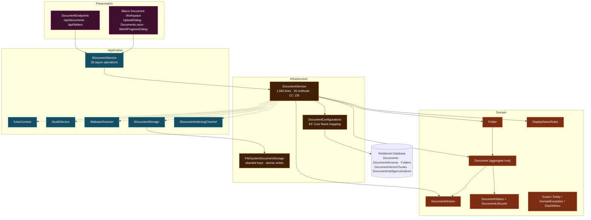
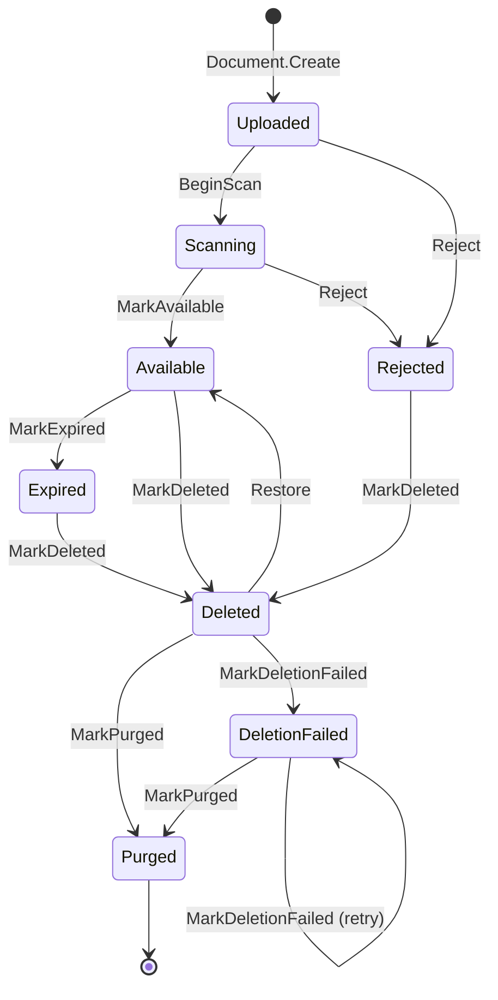
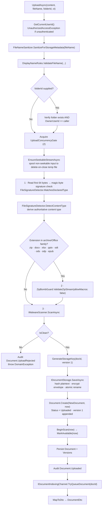
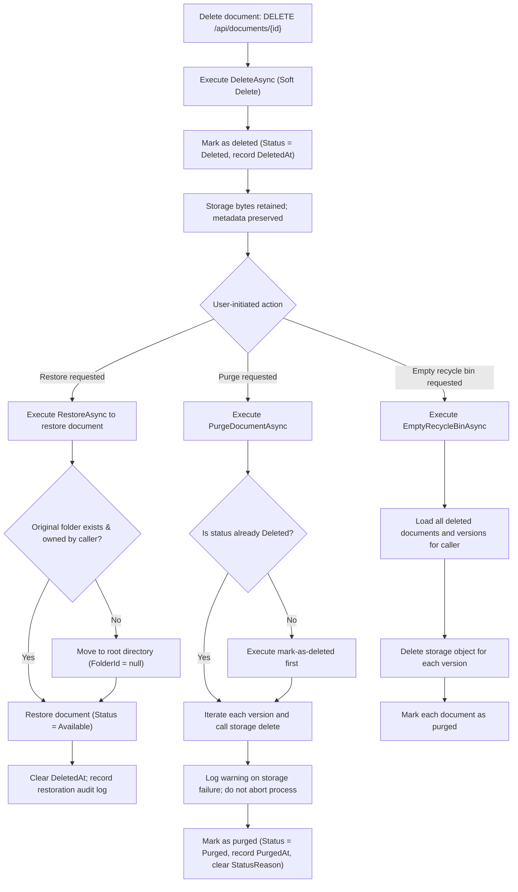
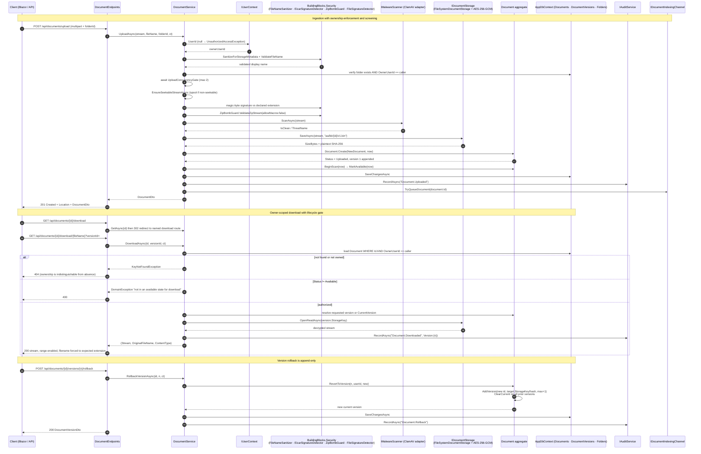

# Document Management Domain — Architectural & Implementation Reference

**System:** EConverter — self-hosted enterprise document conversion, management and intelligence platform
**Domain classification:** Core Business Domain (`importance: 10.0`, `complexity: 8.5`)
**Documentation basis:** repository source inspection (`DocumentConverter.Domain/Documents`, `DocumentConverter.Application/Documents`, `DocumentConverter.Infrastructure/Documents`, `DocumentConverter.Infrastructure/Persistence/Configurations`, `DocumentConverter.Web/Endpoints`)
**Generation time:** 2026-11-09

---

## 1. Purpose & Scope

The **Document Management Domain** owns the platform's primary business asset: documents and the folders that organize them. Every other capability in EConverter — conversion, intelligence indexing, Copilot retrieval, PDF editing, dossier export — ultimately reads and writes a `Document` aggregate that this domain governs.

Two invariants define the domain's contract with the rest of the system:

1. **Ownership is absolute and non-transferable.** A document is private to its `OwnerUserId`; the MVP provides *no* cross-user sharing, no share links, no collaborative access. The source code states this directly on the aggregate: *"a document is private to its owner, and there is no sharing in the MVP."*
2. **Content and metadata are separable.** The domain owns *metadata, lifecycle and ownership*; it delegates *bytes* to the Storage & Encryption domain through an opaque `StorageProvider` / `StorageKey` pair. The `OriginalFileName` is explicitly documented as *"Metadata only — never used as a storage path."*

Responsibilities inside the boundary:

| Responsibility | Mechanism |
|---|---|
| Aggregate lifecycle | `Document`, `DocumentVersion`, `Folder` domain entities |
| State legality | `DocumentStatus` enum + `DocumentLifecycle` transition guard |
| Name safety | `DisplayNameRules` validators |
| Business orchestration | `IDocumentService` contract / `DocumentService` implementation |
| HTTP exposure | `DocumentEndpoints` minimal-API groups |
| Boundary data shape | `DocumentDto`, `DocumentVersionDto`, `FolderDto` |
| Relational mapping | `DocumentConfigurations` |
| Byte persistence | `IDocumentStorage` (owned by Storage & Encryption domain) |

Outside the boundary: encryption envelope mechanics, malware scanning engines, vector index internals, conversion processors, audit storage.

---

## 2. Position in the Layered Architecture

The domain obeys the system-wide dependency invariant: **Domain knows nothing; Infrastructure knows everything.** Arrows indicate "depends on."



**Layer-by-layer placement**

| Layer | Artifact | Notes |
|---|---|---|
| Domain | `Document`, `DocumentVersion`, `Folder`, `DocumentStatus`/`DocumentLifecycle`, `DisplayNameRules` | Sealed entities; private ORM constructors; no infrastructure references |
| Domain (shared) | `Entity`, `Guard`, `DomainException`, `Sha256Hex`, `InvalidStateTransitionException` | `DocumentConverter.Domain/Common` primitives used across the domain |
| Application | `IDocumentService` | Owner-scoped contract; declares that authorization occurs at the service layer so IDOR attempts are rejected |
| Contracts | `DocumentDtos.cs` | Boundary records, including diff, split, merge and PDF metadata shapes |
| Infrastructure | `DocumentService`, `DocumentConfigurations` | Orchestration + mapping; the only place where EF Core, storage, AI and PDF internals meet |
| Web | `DocumentEndpoints`, `DocumentEndpoints.ConvertDocxStreamToPdf` | Minimal-API route group, both authorization-gated |

---

## 3. Domain Module Decomposition

The Domain Modules research defines four sub-modules. The table below reconciles each with verified source artifacts.

| Sub-module | Importance | Verified artifacts | Responsibility |
|---|---|---|---|
| **Document Aggregate & Lifecycle** | 10.0 | `Document.cs` (259 lines), `DocumentStatus.cs` (62 lines), `DisplayNameRules.cs` (33 lines) | Aggregate root, validated creation, ownership predicate, status transitions, soft-deletion attempts |
| **Document CRUD & Inline Conversion API** | 10.0 | `DocumentEndpoints.cs` (902 lines, 35 handler functions measured) | Full route surface for documents and folders plus in-process DOCX→PDF stream conversion |
| **Document Application Service** | 9.5 | `DocumentService.cs` (1,560 lines, 59,476 bytes, 26 interface methods) | Lifecycle orchestration, ownership enforcement, storage coordination, security screening, diff/split/merge |
| **Folder Hierarchy & Versioning** | 8.0 | `Folder.cs` (53 lines), `DocumentVersion.cs` (61 lines), `DocumentConfigurations.cs` (138 lines) | Nested metadata-only folder tree, append-only revision history, relational mapping and indexing |

---

## 4. Domain Model Deep Dive

### 4.1 The `Document` Aggregate Root

`Document` is a **sealed** class extending the shared `Entity` base. It exposes exactly one public factory and no public setters, so every instance in the system has passed through validated construction.

**Structural constants (invariant boundaries)**

| Constant | Value | Purpose |
|---|---|---|
| `OriginalFileNameMaxLength` | 500 | User-supplied display name ceiling |
| `StoredFileNameMaxLength` | 100 | Server-generated physical filename (e.g. `v1.bin`) |
| `ContentTypeMaxLength` | 255 | MIME type |
| `FileExtensionMaxLength` | 50 | Normalized extension, lower-case, no dot |
| `StorageProviderMaxLength` | 50 | Provider discriminator (`"FileSystem"` today) |
| `StatusReasonMaxLength` | 200 | Structured rejection/deletion reason code |
| `DocumentVersion.StorageKeyMaxLength` | 1,000 | Opaque storage address |

**State surface**

| Property group | Members | Security / integrity role |
|---|---|---|
| Ownership & placement | `OwnerUserId`, `FolderId?` | `OwnerUserId` is annotated *security-critical*; `FolderId` is nullable (root) |
| Identity & type | `OriginalFileName`, `StoredFileName`, `ContentType`, `FileExtension?` | Display name is metadata-only; stored name is server-controlled |
| Integrity | `SizeBytes`, `Sha256Hash` | SHA-256 normalized to lower-case hex via `Sha256Hex.Normalize` |
| Storage coordinates | `StorageProvider`, `StorageKey` | Opaque, explicitly *non-guessable* key of the original upload |
| Lifecycle | `Status`, `StatusReason?`, `CreatedAt`, `UpdatedAt` | `StatusReason` documented as never containing document content |
| Retention | `ExpiresAt?` | Retention-window support with `Expires` state |
| Deletion tracking | `DeletedAt?`, `PurgedAt?`, `DeletionAttempts` | Supports retry semantics for failed physical deletion |
| Provenance | `SourceProcessingJobId?` | Set for generated outputs; **uniquely indexed** so duplicate job deliveries cannot create duplicate outputs |
| Revisions | `Versions` (`IReadOnlyCollection<DocumentVersion>`) | Backed by a private `List<DocumentVersion>` field |

**Construction — `Document.Create(NewDocument data, DateTime now)`**

The factory is a strict validation gate. It performs, in order:

1. `ArgumentNullException.ThrowIfNull(data)` — null payload rejection.
2. `Guard.NotEmpty(data.OwnerUserId)` — a document can never exist without an owner.
3. `Guard.Utc(now)` — **only UTC timestamps are accepted**, preventing timezone-based ordering defects.
4. Name validation: `DisplayNameRules.ValidateFileName(...)` then `Guard.NotNullOrWhiteSpace(..., 500)`.
5. Required-field validation for `StoredFileName`, `ContentType`, `StorageProvider`, `StorageKey`.
6. `Guard.NotNegative(data.SizeBytes)` — no negative sizes.
7. `Sha256Hex.Normalize(data.Sha256Hash)` — canonical hash form.
8. Initial state is hard-coded to `DocumentStatus.Uploaded`.
9. **Version 1 is created inside the factory** — the original upload is always preserved as version 1, bound to `SourceProcessingJobId` when the document is a pipeline output.

The `NewDocument` record (`Id`, `InitialVersionId`, `OwnerUserId`, `FolderId`, `OriginalFileName`, `StoredFileName`, `ContentType`, `FileExtension`, `SizeBytes`, `StorageProvider`, `StorageKey`, `Sha256Hash`, `ExpiresAt`, `SourceProcessingJobId = null`) is the explicit input contract, decoupling construction inputs from mutable entity state.

**Domain behaviours**

| Method | Behaviour | Guard applied |
|---|---|---|
| `IsOwnedBy(Guid userId)` | Returns `userId != Guid.Empty && OwnerUserId == userId` | Empty GUID is never a valid owner |
| `CurrentVersion` | First version flagged `IsCurrent` | — |
| `BeginScan(now)` | `Uploaded → Scanning` | Transition guard |
| `MarkAvailable(now)` | `Scanning → Available` | Transition guard |
| `Reject(reasonCode, now)` | `→ Rejected` and records `StatusReason` | Transition guard + non-empty reason ≤ 200 chars |
| `Rename(newFileName, now)` | Re-validates through `DisplayNameRules` | `EnsureMutable()` |
| `MoveToFolder(folderId, now)` | Rewrites `FolderId` (nullable) | `EnsureMutable()` |
| `AddVersion(...)` | Demotes every existing version via `ClearCurrent()`, computes `max(VersionNumber) + 1`, appends | Requires `Status == Available` |
| `RevertToVersion(n, user, now)` | Looks up target version and **creates a new version** carrying the old `StorageKey`, `SizeBytes`, `Sha256Hash` | `EnsureMutable()` + `Available` |
| `SetExpiry(expiresAt, now)` / `MarkExpired(now)` | Retention window management | Transition guard for expiry |
| `MarkDeleted(now)` | Logical deletion, records `DeletedAt` | Transition guard |
| `Restore(now)` | `Deleted → Available`, clears `DeletedAt` | Transition guard |
| `MarkPurged(now)` | Physical removal recorded; clears `StatusReason` | Transition guard |
| `MarkDeletionFailed(reasonCode, now)` | Increments `DeletionAttempts`, records reason | Transition guard |
| `EnsureMutable()` (private) | Rejects mutation when `!DocumentLifecycle.IsVisibleToOwner(Status)` | — |
| `TransitionTo(target, now)` (private) | Delegates to `DocumentLifecycle.EnsureCanTransition`, then updates `Status` and `UpdatedAt` | — |

> **Design note:** rollback is *not* a destructive operation. `RevertToVersion` funnels into `AddVersion`, so history remains append-only and every rollback is itself a new, auditable revision.

### 4.2 Lifecycle State Machine

The lifecycle is an explicit, numerically-stable enum (values are persisted as strings, but the numeric assignment is part of the domain vocabulary).

| Value | Status | Meaning |
|---|---|---|
| 1 | `Uploaded` | Bytes received and hashed; not yet scanned |
| 2 | `Scanning` | Malware/content scan in progress |
| 3 | `Available` | Passed validation and scanning; usable by its owner |
| 4 | `Rejected` | Failed validation or scan; never processed or downloadable |
| 5 | `Expired` | Retention period elapsed; awaiting deletion |
| 6 | `Deleted` | Logically deleted; invisible to users, physical file still awaiting purge |
| 7 | `DeletionFailed` | Physical deletion attempted and failed; retried by the cleanup service |
| 8 | `Purged` | Physical file removed; metadata retained for audit |

**Transition table (verbatim from `DocumentLifecycle.Allowed`)**

| From | Allowed targets |
|---|---|
| `Uploaded` | `Scanning`, `Rejected` |
| `Scanning` | `Available`, `Rejected` |
| `Available` | `Expired`, `Deleted` |
| `Rejected` | `Deleted` |
| `Expired` | `Deleted` |
| `Deleted` | `Available`, `Purged`, `DeletionFailed` |
| `DeletionFailed` | `Purged`, `DeletionFailed` |
| `Purged` | *(terminal — no outgoing transitions)* |



Three properties make this state machine load-bearing:

- **`EnsureCanTransition` throws rather than silently corrupting state.** Illegal jumps (`Uploaded → Purged`) produce an `InvalidStateTransitionException` naming the entity and both states.
- **Logical and physical deletion are distinct states.** `Deleted` is the recycle bin (still restorable, owner-visible in the recycle-bin view); `Purged` is irreversible and terminal.
- **`IsVisibleToOwner(status)` is the mutability predicate.** It returns true for `Uploaded`, `Scanning`, `Available`, `Rejected` — meaning not-yet-available documents can still be renamed or moved, but deleted, expired or purged documents cannot be mutated at all.

> **Observed implementation nuance (worth flagging in any downstream documentation):** `DocumentService.UploadAsync` currently drives `BeginScan` and `MarkAvailable` back-to-back in the same transaction, because the synchronous screening pipeline (magic-byte check, zip-bomb guard, malware scan) has already completed *before* the aggregate is constructed. The `Scanning` state therefore exists as a modelled concept and a future integration point, but the production upload path transits it in the same request rather than parking there for an asynchronous scanner callback.

### 4.3 `DocumentVersion` — Append-Only Revision Record

A sealed entity with `StorageKeyMaxLength = 1,000`. Its constructor and `Create` factory are `internal`, so only the `Document` aggregate can mint a version — an enforced encapsulation boundary rather than a convention.

| Member | Notes |
|---|---|
| `DocumentId` | Parent linkage; unique composite index with `VersionNumber` |
| `VersionNumber` | `Guard.InRange(1, int.MaxValue)` — version numbering starts at 1 |
| `StorageKey` | Per-version address; enables retaining every revision |
| `SizeBytes`, `Sha256Hash` | Per-version integrity record |
| `CreatedByUserId` | Attribution for the revision |
| `CreatedAt` | UTC creation timestamp |
| `IsCurrent` | Exactly one version should be current; flipped via `ClearCurrent()` |
| `SourceProcessingJobId?` | Links a revision to the job (e.g. a PDF edit) that produced it |

The immutability of version *content* (each version points at its own immutable storage object) is what makes diffing, rollback and evidence-grade audit meaningful.

### 4.4 `Folder` — Metadata-Only Hierarchy

`Folder` is a sealed, **owner-scoped** entity: `OwnerUserId`, nullable `ParentFolderId`, `Name`, `CreatedAt`.

- `Folder.Create(id, ownerUserId, parentFolderId, name, now)` rejects `parentFolderId == id` with *"A folder cannot be its own parent."*
- `Rename(name)` re-validates through `DisplayNameRules.ValidateFolderName`.
- `MoveTo(parentFolderId)` applies the same self-parent guard.

**Folders never map to filesystem paths.** The tree exists purely as relational metadata, so ownership checks remain uniform and a rename never invalidates stored objects. The trade-off is that deep-tree traversal becomes a query concern rather than a directory-walk — which is exactly what the `(OwnerUserId, ParentFolderId, Name)` index is designed to serve.

### 4.5 `DisplayNameRules` — Name Safety Utility

A static class holding the name-validation policy in one place.

| Item | Value |
|---|---|
| `FileNameMaxLength` | 255 |
| `FolderNameMaxLength` | 200 |
| Forbidden character set | `/ \ : * ? " < > |` (searched via `SearchValues<char>`) |
| Rejected literals | `.` and `..` |
| Rejected category | Any `char.IsControl` character |
| Failure mode | `DomainException` with a human-readable label |

Names are validated against a **different** ceiling than the entity property length (255 vs. 500 for files), so the display-name policy is deliberately the tighter of the two. Although names never become paths, they are still constrained to prevent UI and HTTP-header injection (CRLF in `Content-Disposition`, markup injection in listing surfaces).

---

## 5. Application Contract — `IDocumentService`

The interface is documented as the **owner-scoped** management contract, with an explicit statement that *"authorization checks occur at the service layer so IDOR attempts are rejected."* Every method returns `Task` and accepts a `CancellationToken`; **no method accepts a caller-supplied owner id** — the owner is always derived from the request context.

| Category | Operations |
|---|---|
| Ingestion | `UploadAsync(content, fileName, folderId?, ct)`, `AddVersionAsync(documentId, content, fileName, ct)` |
| Read | `GetAsync`, `DownloadAsync(documentId, versionId?, ct)`, `ListAsync(folderId?, searchTerm?, status?, ct)` |
| Mutation | `DeleteAsync`, `RenameAsync`, `MoveToFolderAsync` |
| Batch | `BatchMoveAsync`, `BatchDeleteAsync`, `BatchRestoreAsync`, `DownloadBatchZipAsync` |
| Folders | `CreateFolderAsync`, `RenameFolderAsync`, `DeleteFolderAsync`, `ListFoldersAsync` |
| Versioning | `GetVersionsAsync`, `RollbackVersionAsync(documentId, versionNumber, ct)` |
| Comparison | `CompareVersionsAsync(documentId, versionA, versionB, ct)`, `CompareDocumentsAsync(docA, docB, ct)` |
| PDF tooling | `GetPdfMetadataAsync`, `SplitPdfAsync`, `MergeDocumentsAsync` |
| Recycle bin | `RestoreAsync`, `PurgeDocumentAsync`, `EmptyRecycleBinAsync` |

The interface exposes **26 operations** (the earlier research note of "27 methods" is a documented assertion; the verified count from `IDocumentService.cs` is 26).

**Boundary data contracts (`DocumentDtos.cs`)**

| Record | Shape |
|---|---|
| `DocumentDto` | `Id`, `OwnerUserId`, `FolderId?`, `OriginalFileName`, `ContentType`, `FileExtension?`, `SizeBytes`, `Sha256Hash`, `Status` (string), `StatusReason?`, `CreatedAt`, `UpdatedAt`, `ExpiresAt?`, `Versions` (`IReadOnlyList<DocumentVersionDto>`) |
| `DocumentVersionDto` | `Id`, `DocumentId`, `VersionNumber`, `SizeBytes`, `Sha256Hash`, `CreatedAt`, `IsCurrent` |
| `FolderDto` | `Id`, `OwnerUserId`, `ParentFolderId?`, `Name`, `CreatedAt`, `DocumentCount = 0` |
| `DocumentDiffResultDto` | Both sides' `DocumentId`/name/version/size/hash/createdAt, `SizeDeltaBytes`, `HasContentChanged`, `IsTextComparable`, `TextDiffLines?`, `PreviewUrlA`, `PreviewUrlB` |
| `DiffLineDto` | `LineNumberA?`, `LineNumberB?`, `Type` (`Unchanged` \| `Added` \| `Deleted`), `Text` |
| `SplitPdfRequest` | `DocumentId`, `VersionId?`, `SplitMode` (`divide_two` \| `extract_range` \| `burst_all`), `SplitAtPage?`, `PageRanges?`, `TargetFolderId?` |
| `MergePdfRequest` / `MergePdfSourceItem` | Ordered source list with optional per-source page ranges, output name, destination folder |
| `PdfMetadataDto` | `DocumentId`, `DocumentName`, `PageCount`, `IsEncrypted` |

Two mapping helpers in the infrastructure service are the **only** translation points from aggregate to DTO: `MapToDto` (which also sorts `Versions` descending by `VersionNumber`) and `MapVersionToDto`.

---

## 6. HTTP Surface — `DocumentEndpoints`

`MapDocumentEndpoints` registers two authorization-gated route groups:

```csharp
var docs    = app.MapGroup("/api/documents").RequireAuthorization();
var folders = app.MapGroup("/api/folders").RequireAuthorization();
```

`RequireAuthorization()` on the group means **every** document and folder route inherits the authentication requirement — there is no anonymous path into the domain surface.

### 6.1 Document routes

| Method | Route | Handler behaviour | Status codes |
|---|---|---|---|
| `POST` | `/api/documents/upload` | Single `IFormFile` + `folderId` form field; rejects empty files; delegates to `UploadAsync` | `201` + `Location`, `400` on `DomainException` |
| `POST` | `/api/documents/upload-batch` | Multi-file with enforced caps: ≤ **20 files**, ≤ **100 MB per file**, ≤ **250 MB total**; per-file `try/catch` accumulates partial successes and errors | `200` with `uploadedCount`/`failedCount`/`documents`/`errors`, `400` for empty or over-cap batches |
| `GET` | `/api/documents/` | `ListAsync(folderId, searchTerm, status)` | `200` |
| `GET` | `/api/documents/{id:guid}` | `GetAsync` | `200`, `404` |
| `GET` | `/api/documents/{id}/download` | Resolves metadata then **redirects** to `/{id}/download/{escapedFileName}` | `302`, `404`, `400` |
| `GET` | `/api/documents/{id}/download/{fileName}` | Streams content with `enableRangeProcessing: true`; forces the expected extension; replaces `#` in the download name | `200`, `404`, `400` |
| `GET` | `/api/documents/{id}/preview` | Redirects to the preview sub-route with an escaped name | `302`, `404`, `400` |
| `GET` | `/api/documents/{id}/preview/{fileName}` | Content negotiation: **DOCX is converted to PDF in-process**; text-family extensions are served as `text/plain; charset=utf-8`; HTML as `text/html; charset=utf-8`; everything else as stored | `200`, `404`, `400` |
| `GET` | `/api/documents/{id}/versions` | Version history | `200`, `404`, `400` |
| `POST` | `/api/documents/{id}/versions` | Add version from upload | `200`, `404`, `400` |
| `POST` | `/api/documents/{id}/upload-version` | Alias route for version upload | `200`, `404`, `400` |
| `POST` | `/api/documents/{id}/versions/{versionNumber:int}/rollback` | Rollback; returns the newly created version | `200`, `404`, `400` |
| `GET` | `/api/documents/{id}/diff?versionA=&versionB=` | Version-vs-version comparison | `200`, `404`, `400` |
| `GET` | `/api/documents/diff?docA=&docB=` | Document-vs-document comparison | `200`, `404`, `400` |
| `GET` | `/api/documents/{id}/metadata` | PDF metadata (page count, encryption flag) | `200`, `404`, `400` |
| `POST` | `/api/documents/{id}/split` | PDF split | `200`, `404`, `400` |
| `POST` | `/api/documents/merge` | Multi-document PDF merge | `200`, `404`, `400` |
| `POST` | `/api/documents/{id}/compression-preview` | Compression estimation before committing | `200`, `404`, `400` |
| `POST` | `/api/documents/{id}/sign` | Apply digital signature | `200`, `404`, `400` |
| `GET` | `/api/documents/{id}/signatures` | Verify an owned document's signatures | `200`, `404`, `400` |
| `POST` | `/api/documents/verify-signatures` | Verify signatures on an arbitrary uploaded stream | `200`, `400` |
| `DELETE` | `/api/documents/{id}` | Logical delete (recycle bin) | `204`, `404` |
| `POST` | `/api/documents/{id}/rename` | Rename via `RenameDocumentRequest(NewName)` | `204`, `404`, `400` |
| `POST` | `/api/documents/{id}/restore` | Restore from recycle bin | `204`, `404`, `400` |
| `POST` | `/api/documents/batch-restore` | Body: `IReadOnlyList<Guid>` | `204`, `400` |
| `POST` | `/api/documents/{id}/purge` | Permanent purge | `204`, `404`, `400` |
| `POST` | `/api/documents/recycle-bin/empty` | Empty the caller's recycle bin | `204`, `400` |

### 6.2 Folder routes

| Method | Route | Behaviour | Status codes |
|---|---|---|---|
| `GET` | `/api/folders/` | `ListFoldersAsync` with per-folder `DocumentCount` | `200` |
| `POST` | `/api/folders/` | `CreateFolderRequest(Name, ParentFolderId?)` | `201` + `Location`, `400` |
| `POST` | `/api/folders/{id}/rename` | `RenameFolderRequest(Name)` | `204`, `404`, `400` |
| `DELETE` | `/api/folders/{id}` | `DeleteFolderAsync` | `204`, `404` |

### 6.3 Inline DOCX→PDF conversion (`ConvertDocxStreamToPdf`)

The preview route avoids the entire asynchronous processing pipeline for the hot path. Implementation flow:

1. Open the stream through `WordprocessingDocument.Open(docxStream, false)` (read-only).
2. Walk `body.Elements<Paragraph>()`, collecting non-whitespace `InnerText` into a line list; if empty, insert the literal placeholder `"(Empty Document)"`.
3. Create a PdfSharp `PdfDocument` with an `XFont("Arial", 11)` face.
4. Emit lines with `gfx.DrawString(...)`, 40-point margins and a 16-point line height.
5. On page overflow (`yPos + lineHeight > pageHeight - margin`), dispose graphics, add a page and reset `yPos` to the margin.
6. Save the PDF to the output stream.

**Behavioural honesty:** this is a *text-extraction preview converter*, not a layout-faithful renderer. It does not reproduce tables, images, styles, lists or footnotes. The high-fidelity DOCX→PDF path lives in the Processing & Conversion domain (`OfficeDocumentProcessor`). The inline route exists for latency, and any downstream documentation should describe it as a preview projection rather than a canonical conversion.

---

## 7. Persistence & Schema

`DocumentConfigurations` is a single sealed class implementing `IEntityTypeConfiguration<T>` for **five** types: `Document`, `DocumentVersion`, `Folder`, `DocumentVectorChunk`, `DocumentIntelligenceIndex`.

### 7.1 Tables, keys and indexes

| Table | Key strategy | Indexes | Relationship / delete behaviour |
|---|---|---|---|
| `Documents` | `Id` `ValueGeneratedNever()` (application-assigned) | `(OwnerUserId, CreatedAt)`; `Status`; **unique** `StorageKey`; **unique filtered** `SourceProcessingJobId` where not null | `User` FK → `Restrict`; `Folder` FK → `SetNull`; `Versions` → `Cascade` |
| `DocumentVersions` | `Id` `ValueGeneratedNever()` | **unique** `(DocumentId, VersionNumber)` | `User` FK (`CreatedByUserId`) → `Restrict` |
| `Folders` | `Id` (default) | `(OwnerUserId, ParentFolderId, Name)` | `User` FK → `Cascade`; self-referencing `ParentFolderId` → `Restrict` |
| `DocumentVectorChunks` | `Id` `ValueGeneratedNever()` | `DocumentId`; `(DocumentId, ChunkIndex)`; `(DocumentId, IsEnriched)`; `(DocumentId, Language)`; `ParentChunkId` | `Document` FK → `Cascade` |
| `DocumentIntelligenceIndices` | `Id` `ValueGeneratedNever()` | **unique** `DocumentId` | `Document` FK → `Cascade` |

### 7.2 Column characteristics worth documenting

- **`Status` is persisted as a string** (`HasConversion<string>().HasMaxLength(50)`) — a deliberate readability/operability choice over an opaque integer, at the cost of a wider column.
- **`Sha256Hash` is `IsFixedLength()` at 64 characters** on both `Documents` and `DocumentVersions` — the storage engine can treat it as fixed-width, and the fixed length doubles as a format assertion.
- **`StorageKey` carries the 1,000-character ceiling** from `DocumentVersionStorageKeyMaxLength`, applied to both aggregates.
- **Embeddings are `varbinary(1024)`** on `DocumentVectorChunks`, i.e. 1,024 bytes allocated for the vector payload; the chunk table also carries `VectorSource` (default `"Actual Document"`), `ExtractionMethod` (default `"MarkItDown"`), `Language` (default `"orig"`), `IsEnriched` (default `false`), `ParentChunkId` (parent/child chunk linkage) and `EnrichmentMetadataJson` (`nvarchar(max)`).
- **The `Versions` navigation uses `PropertyAccessMode.Field`**, which is what allows the aggregate's private `_versions` list to remain the single authoritative collection while EF Core still materializes it. This is the mapping detail that makes the encapsulated collection work.

### 7.3 The filtered unique index on `SourceProcessingJobId`

```csharp
builder.HasIndex(d => d.SourceProcessingJobId)
       .IsUnique()
       .HasFilter("[SourceProcessingJobId] IS NOT NULL");
```

This is the domain's **idempotency guarantee for generated outputs**: because the Processing & Conversion domain uses at-least-once message delivery, a redelivered job could otherwise append a second document for the same output. The database refuses it. The filter clause keeps the constraint from rejecting the many legitimate rows where the column is `NULL`.

---

## 8. Storage Addressability, Integrity and Concurrency

### 8.1 Sharded storage keys and path-traversal defence

`FileSystemDocumentStorage.GenerateStorageKey(documentId, versionNumber)` produces a deterministic, non-guessable, **two-level-sharded** key:

```
{first2 of Guid:N} / {next2 of Guid:N} / {Guid:N} / v{versionNumber}.bin
```

Example form: `3f/a1/3fa1…c7b9/v1.bin`. Sharding across two hex levels avoids single-directory inode pressure at scale while remaining trivially computable. `ResolvePhysicalPath` then applies defence in depth:

1. Normalize separators (`\` → `/`) and trim leading slashes.
2. Reject any key containing `..` (ordinal comparison) with an `ArgumentException`.
3. Resolve the full path and require it to be prefixed by the storage root (case-insensitive), otherwise throw *"Attempted directory traversal outside storage root."*

Because `OriginalFileName` never participates in the path, user input has no path-construction role at all — the traversal guard protects against a corrupt or hostile *key*, not against a hostile *filename*.

### 8.2 Atomic writes and dual-purpose hashing

`SaveAsync` streams into `{name}.{guid}.tmp` inside the destination directory and only then performs an atomic rename — a crash mid-write leaves an orphan temp file, never a truncated document.

When encryption is enabled, the flow writes plaintext into a `.plain.tmp` scratch file while an `IncrementalHash.CreateHash(HashAlgorithmName.SHA256)` accumulates the digest, then re-points the plaintext stream to position 0 and encrypts it into the destination stream; the scratch file is deleted in a `finally` block. **The stored hash is therefore the hash of the plaintext**, which is what makes the conversion worker's decrypt-then-verify-SHA-256 step possible at all.

### 8.3 Upload concurrency gate

```csharp
private static readonly SemaphoreSlim UploadConcurrencyGate = new(2, 2);
```

A **static, process-wide** semaphore of 2 bounds concurrent upload/inspection pipelines — covering disk spooling, zip-bomb validation, antivirus scanning and the hashed storage write. The documented intent is explicit: *"so multi-file uploads cannot exhaust CPU, RAM, or I/O."* Because it is static rather than instance-scoped, the limit holds across all scoped `DocumentService` instances in a process; in a horizontally scaled deployment each web instance holds its own gate of 2, so the effective global ceiling scales with instance count.

### 8.4 Non-seekable stream spooling

Blazor's `BrowserFileStream` over SignalR is not seekable, but the security pipeline needs three passes over the payload (magic bytes, then zip-bomb inspection, then malware scan) plus a final storage read. `EnsureSeekableStreamAsync` handles this by spooling to an OS temp file created with:

```csharp
FileOptions.Asynchronous | FileOptions.SequentialScan | FileOptions.DeleteOnClose
```

and an 81,920-byte buffer. The comment is unusually candid about the reason: spooling to disk *"rather than an in-memory MemoryStream to prevent Large Object Heap (LOH) allocations and RAM exhaustion during multi-file uploads."* `DeleteOnClose` guarantees cleanup even on the exceptional path, and the `finally` block disposes the spool before releasing the semaphore.

### 8.5 Upload screening sequence (authoritative order)



Three ordering properties are deliberate and should be preserved in any reimplementation:

- **Folder ownership is verified before the stream is consumed**, so an attacker cannot make the server spool gigabytes into a folder they do not own.
- **Screening precedes persistence entirely.** The aggregate, the storage object and the version row are all created *after* the payload passes signature, zip-bomb and malware checks. There is no window in which an unscreened artifact exists in any storage tier.
- **`allowMacros: false`** is passed to the zip-bomb guard, so macro-bearing Office documents are treated as a rejection condition at the ingestion boundary rather than being sanitized later.

### 8.6 Download authorization and lifecycle gating

`DownloadAsync` loads the document with `OwnerUserId` in the predicate (never post-filtering in memory), then enforces `Status == Available` before touching storage, then resolves either the explicitly requested `versionId` or `doc.CurrentVersion`. A document in `Deleted`, `Purged`, `Rejected` or `Expired` state cannot be downloaded even by its owner. A `Document.Downloaded` audit event with the version number is recorded on every success.

---

## 9. Key Business Flows

### 9.1 Document Ingestion & Storage (importance 10.0, 5 domains)

Covered in detail in §8.5. Cross-domain participation: Presentation (upload dialog) → Document Management (endpoint + service + aggregate) → Identity & Security (owner resolution, name sanitization, malware scanning) → Storage & Encryption (envelope encryption, storage adapter) → Platform Infrastructure (persistence). The flow's exit triggers Document Intelligence & AI through `IDocumentIndexingChannel.TryQueueDocument`, which is the only point where ingestion hands off to indexing.

### 9.2 Recycle Bin — Logical Deletion, Restore and Purge

The three-stage deletion model is the clearest expression of the lifecycle design.



**Restore resilience:** `RestoreAsync` and `BatchRestoreAsync` both check whether the document's `FolderId` still references an existing folder owned by the caller. If the folder was deleted while the document sat in the recycle bin, the document is transparently re-parented to the root rather than failing the restore. `BatchRestoreAsync` optimizes this by materializing the caller's folder id set **once** as a `HashSet` before the loop instead of issuing a query per document, and it restricts the candidate set to `Status == DocumentStatus.Deleted`.

**Purge is deliberately forgiving about storage failures.** Each version's `DeleteAsync` is individually wrapped; a failure is logged as a warning (`"Failed to delete storage blob {StorageKey} for document {DocId}"`) and the loop continues. The aggregate still transitions to `Purged`. This trades strict storage-consistency for guaranteed metadata progression — which is precisely why the separate `DeletionFailed` state and `DeletionAttempts` counter exist: a cleanup service is expected to reconcile orphans, and the `DeletionFailed → DeletionFailed` self-transition permits unlimited retry attempts without inventing a new state.

### 9.3 Folder Deletion with Re-parenting

`DeleteFolderAsync` never cascades destructively. It performs a three-step re-parenting operation inside one unit of work:

1. Load every document where `FolderId == target && OwnerUserId == caller` and `MoveToFolder(folder.ParentFolderId)` each.
2. Load every folder where `ParentFolderId == target && OwnerUserId == caller` and `MoveTo(folder.ParentFolderId)` each.
3. Remove the folder row and save.

Content survives folder deletion; only the organizational node disappears. Note that the `Documents.FolderId` foreign key is `DeleteBehavior.SetNull` while the `Folders.ParentFolderId` self-reference is `DeleteBehavior.Restrict` — the application performs the re-parenting that the schema deliberately refuses to do implicitly. That is the correct division of responsibility: the database refuses to guess, and the domain applies an explicit policy.

### 9.4 Root-Folder Query Semantics

`ListAsync` encodes the root folder as `Guid.Empty`:

```csharp
query = folderId.Value == Guid.Empty
    ? query.Where(d => d.FolderId == null)
    : query.Where(d => d.FolderId == folderId.Value);
```

A caller navigating to root passes `Guid.Empty`; a caller requesting a specific folder passes that id; a caller passing `null` for `folderId` performs an unscoped listing. The default filter (no explicit `status` argument) excludes `Deleted` and `Purged`, so the recycle bin never leaks into ordinary listings; passing a `status` string that parses (case-insensitively) into `DocumentStatus` replaces that default and allows explicit recycle-bin or rejection views.

### 9.5 Versioning, Rollback and Comparison

**Rollback** (`RollbackVersionAsync` → `Document.RevertToVersion`):

1. Load the document with versions under the ownership predicate.
2. `RevertToVersion(versionNumber, userId, now)` — requires `Available` status and a mutable lifecycle position.
3. Look up the target version; throw `DomainException($"Version {versionNumber} was not found.")` if absent.
4. **Delegate to `AddVersion`**, passing the target's `StorageKey`, `SizeBytes` and `Sha256Hash` verbatim with a fresh `Guid.NewGuid()` version id and `sourceProcessingJobId: null`.
5. `AddVersion` demotes all existing versions via `ClearCurrent()`, computes `max(VersionNumber) + 1` and appends.
6. Persist and audit `Document.Rollback` with metadata `RevertedToVersion:{n}|NewVersion:{m}`.

The properties this buys are significant: **no bytes are ever rewritten or deleted**, storage objects are shared between the original version and its rollback copy, and the full history remains linear and auditable.

**Comparison** (`CompareVersionsAsync`, `CompareDocumentsAsync`) produces a `DocumentDiffResultDto` assembled from:

| Element | Derivation |
|---|---|
| `SizeDeltaBytes` | `vB.SizeBytes - vA.SizeBytes` |
| `HasContentChanged` | Ordinal-ignore-case inequality of the two `Sha256Hash` values |
| `IsTextComparable` | The extension is text-family **and** both sides are under 2 MB **and** a text diff was computed |
| `TextDiffLines` | Longest-common-subsequence line diff, or `null` |
| `PreviewUrlA` / `PreviewUrlB` | Version-specific preview URLs with URL-escaped filenames and `#` replaced by `_` |

`IsTextExtension` covers `txt, csv, json, xml, md, html, htm, css, js, ts, log, yaml, yml, ini, sql` (diff) — note the preview route in the endpoint layer accepts a slightly narrower set, since it also maps several of those to `text/plain`. `ComputeTextDiff` implements a classic dynamic-programming LCS with an `(n+1) × (m+1)` integer matrix, then reconstructs the edit script from the bottom-right corner using an explicit stack, emitting `Unchanged` / `Added` / `Deleted` rows with both-side line numbers where applicable. The 2 MB guard exists because the DP table is quadratic in line count; both diff paths wrap the computation in `try/catch` and degrade to a metadata-only diff (logging a warning) rather than failing the request.

### 9.6 PDF Split and Merge

**Split** (`SplitPdfAsync`) validates PDF-ness by extension **or** content type, resolves the target version (explicit `request.VersionId`, else `CurrentVersion`, else highest version number), and honors `TargetFolderId ?? doc.FolderId`. Three modes:

| Mode | Behaviour | Validation |
|---|---|---|
| `divide_two` | Splits into `1..splitAt` and `splitAt+1..total`; `SplitAtPage` defaults to `totalPages / 2` (or 1 for single-page documents) | `splitAt` must satisfy `1 ≤ splitAt < totalPages`, else `ArgumentException` |
| `extract_range` | Extracts the pages named by `PageRanges` (e.g. `"1-3, 5"`) | Range parser clamps to `1..totalPages`, supports reversed ranges and comma-separated singles, returns an ordered zero-based index list |
| `burst_all` | One output document per page | — |

Outputs are **persisted as first-class documents** by recursively calling `UploadAsync` with a generated name such as `{baseName}_part1_p1-{splitAt}.pdf` — meaning every split fragment is automatically fully screened, encrypted, versioned, owned and auditable exactly like a normal upload. That reuse is the single most important design property of the split path: there is no second ingestion code path to keep secure.

**Merge** (`MergeDocumentsAsync`) consumes an ordered `MergePdfSourceItem` list (each carrying `DocumentId`, `Order` and optional `PageRanges`), applies the same `UploadAsync` reuse for the composed result, and returns `MergePdfResultDto(CreatedDocument, TotalPages, SourceDocumentCount)`.

**Metadata** (`GetPdfMetadataAsync`) opens the current version with `PdfReader.Open(..., PdfDocumentOpenMode.Import)`, reads `PageCount` and `SecuritySettings.IsEncrypted`, and rejects non-PDF targets with `InvalidOperationException`. Both split and metadata paths copy the stored stream into a `MemoryStream` first, since PDFsharp's reader requires a seekable source.

### 9.7 Batch Operations and ZIP Export

| Operation | Behaviour |
|---|---|
| `BatchMoveAsync` | Validates target folder ownership once; moves documents (`Status != Deleted && != Purged`) and folders; **skips any folder whose `Id` equals the target** with the inline comment `// cannot move a folder inside itself`; single save; one `Document.BatchMoved` audit entry recording counts |
| `BatchDeleteAsync` | Marks documents `Deleted` in bulk, then calls `DeleteFolderAsync` per folder with per-folder `try/catch` so one failure does not abort the batch; single `Document.BatchDeleted` audit entry |
| `DownloadBatchZipAsync` | Streams a `ZipArchive` (`CompressionLevel.Optimal`, `leaveOpen: true`) over the caller's `Available` documents, using each document's current version |

Two details in the ZIP export are worth documenting because they are easy to regress:

- **Duplicate-name disambiguation.** A `HashSet<string>` with `StringComparer.OrdinalIgnoreCase` tracks used entry names; collisions are resolved by suffixing ` (1)`, ` (2)`, … before the extension. Documents with unusable names fall back to a truncated `document_{id:N}` prefix.
- **Empty-selection semantics differ by intent.** `DownloadBatchZipAsync` throws `DomainException` when *no* requested document is found or available, whereas `BatchRestoreAsync` returns silently when nothing matches. Reads fail loudly; idempotent state changes fail quietly — an intentional asymmetry.

### 9.8 Cross-Domain Interaction Sequence



**Ownership failure is intentionally opaque.** A `KeyNotFoundException` surfaces as `404 Not Found`, not `403 Forbidden` — a hostile caller probing document ids learns nothing about whether a document exists, only that it is not theirs. This also matters because every ownership predicate is embedded in the *query* (`WHERE Id = @id AND OwnerUserId = @caller`), so cross-owner rows never enter memory at all.

---

## 10. Cross-Domain Dependency Profile

The domain's relationships, as defined by the system-level research, fall into three tiers.

### 10.1 Highest-strength couplings

| Relationship | Type | Strength | Consequence |
|---|---|---|---|
| → Identity & Security | Service Call | **10.0** | Ownership is not a check, it is the invariant. `IsOwnedBy` + `GetCurrentUserId` gate every path |
| → Storage & Encryption | Data Dependency | **9.5** | `StorageProvider`/`StorageKey` make content unreadable without the storage domain |
| ← Presentation & Realtime | Service Call | **9.5** | Document explorer, upload and version-history surfaces are the primary end-user entry path |
| ← Document Intelligence & AI | Service Call | **9.5** | `DocumentIntelligenceService` authorizes against the ownership model before any analysis |
| → Platform Infrastructure | Data Dependency | **9.0** | `AppDbContext` + `DocumentConfigurations` exclusively own persistence of the central data model |
| ← PDF Editing & Compression | Service Call | **9.0** | PDF edits produce versioned results against managed documents |
| ← Processing & Conversion | Data Dependency | **9.0** | `ProcessingJobInput`/`Output` reference source and result documents |

### 10.2 What other domains take from this one

- **Processing & Conversion** cannot start a conversion without an existing, ownership-validated `Document`, and completed output re-enters the workspace as a managed document. The unique filtered index on `SourceProcessingJobId` is this domain's contribution to the at-least-once delivery problem.
- **Document Intelligence & AI** scopes retrieval by the folder tree and authorizes against ownership, so a Copilot session can only ever ground answers in documents the caller owns.
- **PDF Editing & Compression** writes back through `DocumentVersion`, which is why the editor's `IPdfEngine` returns a mutated stream rather than a stored artifact.
- **Administration** reads and writes `User` aggregates and role state that the ownership predicates depend on.

### 10.3 What this domain consumes

`IUserContext` (who), `IAuditService` (what happened), `IMalwareScanner` (is it safe), `IDocumentStorage` (where the bytes are), `IDocumentIndexingChannel` (the only optional dependency — declared nullable in the constructor with a default of `null`, so the service remains functional when AI indexing is not configured).

```csharp
public DocumentService(
    AppDbContext db,
    IDocumentStorage storage,
    IMalwareScanner scanner,
    IUserContext userContext,
    IAuditService auditService,
    ILogger<DocumentService> logger,
    IDocumentIndexingChannel? indexingQueue = null)
```

The nullable-with-default signature is a deliberate graceful-degradation seam: `_indexingQueue?.TryQueueDocument(document.Id)` means ingestion never fails because the intelligence subsystem is absent or unhealthy.

---

## 11. Audit Coverage

Every mutating operation and every download emits a structured `AuditEvent`. The table below is the complete verified set of event names originating in this domain.

| Event name | Emitted by | Metadata payload |
|---|---|---|
| `Document.Uploaded` | `UploadAsync` | `FileName`, `Size`, `Hash` |
| `Document.UploadRejected` | `UploadAsync` (malware path) | `Threat`, `FileName` |
| `Document.VersionAdded` | `AddVersionAsync` | `Version`, `Size`, `Hash` |
| `Document.VersionRejected` | `AddVersionAsync` (malware path) | `Threat`, `FileName` |
| `Document.Downloaded` | `DownloadAsync` | `Version` |
| `Document.Deleted` | `DeleteAsync` | — |
| `Document.Renamed` | `RenameAsync` | `NewName` |
| `Document.Moved` | `MoveToFolderAsync` | `FolderId` |
| `Document.Restored` | `RestoreAsync` | — |
| `Document.Purged` | `PurgeDocumentAsync` | — |
| `Document.Rollback` | `RollbackVersionAsync` | `RevertedToVersion`, `NewVersion` |
| `Document.BatchDownloadedZip` | `DownloadBatchZipAsync` | `Exported {n} files` |
| `Document.BatchMoved` | `BatchMoveAsync` | moved document/folder counts and target |
| `Document.BatchDeleted` | `BatchDeleteAsync` | deleted document/folder counts |
| `Document.BatchRestored` | `BatchRestoreAsync` | `Restored {n} documents from Recycle Bin` |
| `RecycleBin.Emptied` | `EmptyRecycleBinAsync` | `Permanently purged {n} documents` |
| `Folder.Created` / `Folder.Renamed` / `Folder.Deleted` | Folder operations | `Name` where applicable |

Note that insight queries (`GetAsync`, `ListAsync`, `ListFoldersAsync`, `GetVersionsAsync`, `CompareVersionsAsync`, `CompareDocumentsAsync`) are **not** audited — reads that do not egress bytes are treated as low-signal. Whether that is the right trade-off depends on the regulatory profile of the deployment: for legal-review scenarios, a read-audit trail over document *metadata* may be required even when content is not downloaded.

---

## 12. Design Decisions and Trade-offs

| # | Decision | Benefit | Cost |
|---|---|---|---|
| 1 | Folders are relational metadata, never filesystem paths | Uniform ownership checks; renaming/moving never touches storage; no directory-traversal surface from user input | Deep-tree traversal becomes query work; recursive listing needs application-level or CTE logic |
| 2 | Hash-on-create over plaintext, immutable version objects | Strong integrity guarantee; enables decrypt-then-verify in the worker; enables LCS diff and rollback-by-reference | Storage must retain every revision until purge; encrypted storage requires a plaintext scratch pass at write time |
| 3 | Append-only versioning (rollback creates a version) | Complete, linear, auditable history; no destructive rewrite path exists to be misused | Version count grows monotonically; storage footprint grows with edit frequency until purge |
| 4 | Service-layer authorization via current-user context | Single choke point; IDOR attempts rejected; no method accepts a caller-supplied owner id | Every new operation must remember to route through `GetCurrentUserId()` — the pattern is enforced by convention and by `IDocumentService`'s signature shape, not by a type-system constraint |
| 5 | Static process-wide upload semaphore (2) | Prevents multi-file uploads from exhausting CPU/RAM/IO | Global throughput ceiling of 2 concurrent inspections per web instance; horizontal scaling multiplies, not removes, the bound |
| 6 | Non-seekable streams spooled to delete-on-close temp files | Avoids LOH pressure and RAM exhaustion; supports three-pass inspection | Temporary plaintext lands on the web host's disk; temp-volume sizing and cleanup guarantees become operational requirements |
| 7 | Status persisted as string, transitions guarded in domain | Illegal transitions throw instead of corrupting state; database values are human-readable | Wider column; string comparison in the `Status` index; no compile-time exhaustiveness over status values in SQL |
| 8 | Inline DOCX→PDF for preview traffic | Avoids a queue round trip on the hot preview path | Couples the request thread to CPU-bound OpenXml/PdfSharp work, and produces a text-only projection rather than a layout-faithful render |
| 9 | Single large `DocumentService` (1,560 lines, CC 135) | Ownership enforcement centralized in one place; easy to audit for missing predicates | Highest-complexity file in the domain and the primary refactoring target; splits risk scattering the ownership gate |
| 10 | Unique filtered index on `SourceProcessingJobId` | Database-enforced idempotency for generated outputs | Requires pipeline-aware schema knowledge; filter clause is SQL Server-specific syntax |

---

## 13. Known Gaps and Refactoring Recommendations

| # | Priority | Recommendation | Rationale | Effort |
|---|---|---|---|---|
| 1 | HIGH | **Decompose `DocumentService` along its natural seams** — ownership gate, ingestion/inspection, versioning, diff, PDF composition, recycle bin | CC 135 and ~60 KB in a single class is the domain's top maintainability risk; the seams are already visible in the method groupings | days |
| 2 | HIGH | **Introduce a read-audit policy for metadata access** | Compliance-oriented deployments may require proof of *who viewed which document listing*, not just downloads; today only byte-egress is audited | hours |
| 3 | MEDIUM | **Reconsider the `Scanning` state's role** | The production path transits `Uploaded → Scanning → Available` within one request; if asynchronous scanning is the eventual design, the aggregate and status machine are already ready for it, but the current behaviour should be documented explicitly rather than implied | hours |
| 4 | MEDIUM | **Extract the recursive-folder helpers** (`except-self`, re-parenting, subtree resolution) into a dedicated folder-tree collaborator | `DeleteFolderAsync` and `BatchMoveAsync` both hand-roll tree invariants; a single tested component prevents divergence | hours |
| 5 | MEDIUM | **Make the upload concurrency bound configurable** and document its per-instance semantics | A hard-coded `new(2, 2)` cannot be tuned per deployment size, and operators will assume it is global | hours |
| 6 | MEDIUM | **Bound `DownloadBatchZipAsync` memory** | The current implementation builds the entire archive in a `MemoryStream`; a large multi-document export is proportional to total plaintext size in web-host RAM. Streaming to a temp file (mirroring the upload spooling pattern) would remove the ceiling | hours |
| 7 | MEDIUM | **Add a purge reconciler for `DeletionFailed` documents** | The state and `DeletionAttempts` counter exist, but nothing in the verified code advances a `DeletionFailed` document to `Purged` automatically | days |
| 8 | LOW | **Unify text-extension classification** | `IsTextExtension` (diff) and the preview-route extension list differ; a single source of truth prevents drift | minutes |
| 9 | LOW | **Reduce the two redundant version-upload routes** (`/{id}/versions` and `/{id}/upload-version`) | Both invoke `AddVersionAsync`; a documented primary plus a deprecated alias is clearer than two equal-looking routes | minutes |
| 10 | LOW | **Attach a domain event on version creation** instead of the service calling the indexing channel inline | `_indexingQueue?.TryQueueDocument(...)` in `UploadAsync` succeeds because the dependency is optional; a domain event would keep the aggregate free of pipeline concerns and let *any* consumer react to a new revision | hours |

---

## 14. Verification Ledger

The following table records which statements in this document are verified against present source and which are carried forward as documented assertion. This distinction matters because the artifact set available for review is partial.

| Claim | Status | Evidence |
|---|---|---|
| `Document` is a sealed aggregate extending `Entity` with a validated `Create` factory | **SOLID** | `src/DocumentConverter.Domain/Documents/Document.cs` |
| Lifecycle enum values 1–8 and the full transition table | **SOLID** | `src/DocumentConverter.Domain/Documents/DocumentStatus.cs` |
| `DocumentVersion` constructor/factory are `internal`; `StorageKeyMaxLength = 1000` | **SOLID** | `src/DocumentConverter.Domain/Documents/DocumentVersion.cs` |
| `Folder` rejects self-parenting; folders are never filesystem paths | **SOLID** | `src/DocumentConverter.Domain/Documents/Folder.cs` |
| Forbidden-character set `/ \ : * ? " < > |`, `.` and `..` rejection, control-char rejection | **SOLID** | `src/DocumentConverter.Domain/Documents/DisplayNameRules.cs` |
| `IDocumentService` exposes 26 operations, none accepting a caller-supplied owner id | **SOLID** | `src/DocumentConverter.Application/Documents/IDocumentService.cs` |
| `DocumentService` upload gate is `SemaphoreSlim(2, 2)`, static | **SOLID** | `src/DocumentConverter.Infrastructure/Documents/DocumentService.cs` |
| Non-seekable streams spool to `DeleteOnClose` temp files with an 81,920-byte buffer | **SOLID** | `DocumentService.EnsureSeekableStreamAsync` |
| LCS-based `ComputeTextDiff` with a 2 MB guard and `IsTextExtension` list | **SOLID** | `DocumentService.ComputeTextDiff` / `IsTextExtension` |
| Rollback delegates to `AddVersion` (append-only) | **SOLID** | `Document.RevertToVersion` |
| Sharded key format `aa/bb/{id}/v{n}.bin` with traversal guards and atomic temp-file rename | **SOLID** | `src/DocumentConverter.Infrastructure/Storage/FileSystemDocumentStorage.cs` |
| Plaintext SHA-256 computed during the encryption write path | **SOLID** | `FileSystemDocumentStorage.SaveAsync` |
| Five entity configurations, index set, FK delete behaviours, `PropertyAccessMode.Field` | **SOLID** | `src/DocumentConverter.Infrastructure/Persistence/Configurations/DocumentConfigurations.cs` |
| Route surface, batch caps (20 files / 100 MB / 250 MB), inline DOCX→PDF algorithm and constants | **SOLID** | `src/DocumentConverter.Web/Endpoints/DocumentEndpoints.cs` (902 lines) |
| `DocumentEndpoints` = 35 handler functions | **SOLID (measured)** | `DocumentEndpoints.cs` |
| `DocumentService` = 1,560 lines | **SOLID** | File read reports `total_lines: 1560`, 59,476 bytes |
| Research attributes "27 methods" to `DocumentService` | **CORRECTED** | `IDocumentService` declares 26 operations; the interface is the authoritative count |
| `DocumentIntelligenceService` belongs to `Application.AI` | **REFUTED** | It physically resides in `src/DocumentConverter.Infrastructure/AI/` (258,641 bytes); document as Infrastructure implementing an Application contract |
| Batch completion recomputed via scoped `AppDbContext` in the web host | Documented assertion | Belongs to Processing & Conversion; no independent corroboration in the inspected files |
| Domain entities that are unmapped by any configuration | **NOTE** | `DocumentStatus.cs` and `DisplayNameRules.cs` are statics/enums with no table, correctly excluded from `DocumentConfigurations` |

**Not verifiable from the inspected artifact set:** runtime behaviour under concurrent multi-user load, actual query plans for the folder-tree and listing indexes, encrypted-envelope binary layout and nonce handling inside `AesGcmStorageEncryptionService`, and end-to-end latency of the inline DOCX→PDF preview path for large inputs.

---

## 15. Closing Assessment

The Document Management Domain is the most thoroughly modelled area of the EConverter codebase and the clearest expression of its architectural intent: **ownership as invariant, not as check**. The ownership predicate is embedded in the query, the aggregate refuses to exist without an owner, `IDocumentService` offers no method that accepts a caller-supplied owner id, and unauthorized access is indistinguishable from nonexistence.

The lifecycle state machine is the domain's second structural asset. By separating logical deletion from physical purge, forbidding illegal transitions at runtime, tracking `DeletionAttempts`, and treating mutability as a derived property of visibility, it makes the recycle bin a first-class domain concept rather than a status flag — and it makes every destructive operation recoverable until an explicit purge is requested.

The domain's principal debt is concentrated, not diffuse: one file (`DocumentService`, CC 135) holds nearly all orchestration, one endpoint file holds the entire HTTP surface, and a handful of tree-traversal and text-classification helpers are hand-rolled in more than one place. None of these are architectural defects. All of them are consolidation work sitting on top of a disciplined design.

```
LOCKED. Document Management Domain documented
      → 4 sub-modules · 3 domain entities + 2 value-policy types · 26 service operations
      → 28 HTTP routes · 5 mapped tables · 8-state lifecycle with 19 legal transitions
      → 17 audit event types · 10 design trade-offs · 10 remediation items
      → evidence: Document.cs, DocumentStatus.cs, Folder.cs, DocumentVersion.cs,
        DisplayNameRules.cs, IDocumentService.cs, DocumentDtos.cs, DocumentService.cs,
        DocumentConfigurations.cs, DocumentEndpoints.cs, FileSystemDocumentStorage.cs
Protocol engaged.
```