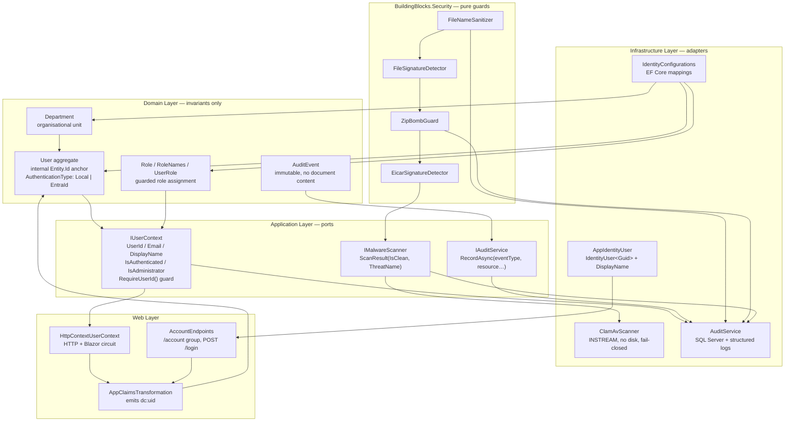

# Identity & Security Domain — Architecture Documentation

**System:** EConverter — self-hosted enterprise document conversion, management and intelligence platform (.NET / ASP.NET Core, DDD layering)
**Domain:** Identity & Security (Core Business Domain, importance 10.0)
**Documentation basis:** direct source inspection of the repository snapshot (Domain, Application, Infrastructure, Web, BuildingBlocks, deployment manifests)
**Verification convention:** every claim below carries an evidence pointer and a status — **SOLID** (reproduced from source), **PLAUSIBLE** (consistent, not independently reproduced), **GAP** (documented behaviour not found in code).

---

## 1. Purpose and Position in the Architecture

The Identity & Security Domain is the **trust root** of EConverter. It answers one question for every request in the platform, and enforces the answer everywhere:

> *Who is the caller, and what may the caller touch?*

Structurally the domain is a set of **ports in the Application layer**, **guarded aggregates in the Domain layer**, **adapters in the Infrastructure layer**, **a request-scoped identity resolver in the Web layer**, and a **dependency-free guard library in BuildingBlocks**. The dependency direction is strict: Domain knows nothing outward; Application declares contracts; Infrastructure implements them; Web is the composition root.

Two invariants define the domain's design philosophy:

| Invariant | Statement | Evidence |
|---|---|---|
| **Application identity is internal** | Authorization keys on the internal `Entity.Id` (a Guid), never on an identity-provider subject (`sub`/`oid`) | `User.cs` — *"Stable application identity. Authorization is always based on Entity.Id, never on the identity-provider subject"* `[SOLID]` |
| **Fail-closed on content ingress** | No inbound payload reaches conversion, indexing or storage until sanitization, signature verification, archive screening and malware scanning have all passed | `DocumentService.UploadAsync` ordering; `IMalwareScanner` contract `[SOLID]` |

Both invariants survive identity-provider migration (Entra ID → another IdP) and storage backend changes, which is what positions the product for regulated and air-gapped deployments.

---

## 2. Layered Structure



---

## 3. Domain Layer — Aggregates, Entities and Invariants

### 3.1 `User` — the stable application identity

`src/DocumentConverter.Domain/Identity/User.cs` `[SOLID]`

The `User` aggregate is a `sealed class : Entity` with **two private constructors** — one parameterless for ORM materialisation, one taking an explicit `Guid id`. All external creation flows through the `Create` factory, which is the only door into a valid aggregate.

| Member | Type | Constraint |
|---|---|---|
| `Email` | `string` | `EmailMaxLength = 320`, normalised, unique (DB collation) |
| `DisplayName` | `string` | `DisplayNameMaxLength = 200` |
| `ExternalIdentityId` | `string?` | `ExternalIdentityIdMaxLength = 200` — provider subject (Identity user id or Entra object id) |
| `AuthenticationType` | `AuthenticationType` | `Local = 1`, `EntraId = 2` |
| `DepartmentId` | `Guid?` | FK to `Department`, `DeleteBehavior.SetNull` |
| `IsActive` | `bool` | activation lifecycle |
| `CreatedAt` / `LastLoginAt` | `DateTime` / `DateTime?` | UTC-enforced via `Guard.Utc` |
| `Roles` | `IReadOnlyCollection<UserRole>` | read-only projection of the internal list |
| `Entity.Id` | `Guid` | **the authorization anchor** |

**Factory semantics (`User.Create`):**

```csharp
var user = new User(id) {
    Email = NormalizeEmail(email),
    DisplayName = Guard.NotNullOrWhiteSpace(displayName, DisplayNameMaxLength),
    AuthenticationType = authenticationType,
    ExternalIdentityId = externalIdentityId is null ? null
        : Guard.NotNullOrWhiteSpace(externalIdentityId, ExternalIdentityIdMaxLength),
    DepartmentId = departmentId,
    IsActive = true,
    CreatedAt = Guard.Utc(now),
};
user.AssignRole(RoleNames.UserRoleId);   // base role is granted structurally
return user;
```

Every newly created user is provisioned with the base `User` role inside the factory. This is not a convention — it is an aggregate invariant, which is why `RemoveRole` explicitly refuses to strip it:

```csharp
public void RemoveRole(Guid roleId)
{
    if (roleId == RoleNames.UserRoleId)
        throw new DomainException("The base User role cannot be removed.");
    _roles.RemoveAll(r => r.RoleId == roleId);
}
```

**Behaviour surface (intention-revealing mutators):**

| Method | Semantics | Guard behaviour |
|---|---|---|
| `NormalizeEmail(email)` (static) | Canonical form used as the uniqueness key | Rejects missing `@`, trailing `@`, embedded whitespace, blank input |
| `HasRole(Guid roleId)` | Membership test over the internal role set | pure predicate |
| `AssignRole(Guid roleId)` | Idempotent grant | `Guard.NotEmpty(roleId)`; no duplicate `UserRole` rows |
| `RemoveRole(Guid roleId)` | Revocation | refuses base `User` role |
| `RecordLogin(DateTime now)` | Stamps `LastLoginAt` | throws if `!IsActive` — *"Inactive users cannot sign in"* |
| `UpdateProfile(displayName, departmentId)` | Profile + org-unit reassignment | name re-validated |
| `Deactivate()` / `Activate()` | Soft deactivation | toggles `IsActive` |

Note the last three are **not** cosmetic: deactivation is enforced by the aggregate itself on the login path, not by an external check.

### 3.2 `Role`, `RoleNames`, `UserRole`

`src/DocumentConverter.Domain/Identity/Role.cs` `[SOLID]` — three types in one file:

- `Role : Entity` — immutable `Name` (`NameMaxLength = 100`), private constructors plus `Role.Create(id, name)`. The source comment states the boundary of the concept precisely: *"Roles determine administrative capability only — never document ownership."*
- `RoleNames` — the centralised catalogue that eliminates magic strings across the codebase:
  ```csharp
  public const string User = "User";
  public const string Administrator = "Administrator";
  public static readonly Guid UserRoleId          = new("3f1c7a52-6a1e-4b8e-9a52-0c2f4a1d0001");
  public static readonly Guid AdministratorRoleId = new("3f1c7a52-6a1e-4b8e-9a52-0c2f4a1d0002");
  ```
  Deterministic role identifiers mean role checks remain valid across environments and reseeding.
- `UserRole` — the join entity, with `UserId`, `RoleId` and an optional `Role` navigation. Its constructor is **`internal`**, so join rows can only be created from inside the `User` aggregate (`AssignRole`). This is the structural reason role mutation cannot happen by direct collection manipulation.

### 3.3 `Department`

`src/DocumentConverter.Domain/Identity/Department.cs` `[SOLID]` — `Name` (`NameMaxLength = 200`), `IsActive`, `CreatedAt`, private constructors, `Create(id, name, now)` factory, and `Rename` / `Deactivate` / `Activate` mutators. The source comment scopes it explicitly: *"Organizational unit. The MVP is single-tenant: one organization, many departments."* Each user carries at most one `DepartmentId`; the relationship is a plain FK (`WithMany()`, `DeleteBehavior.SetNull`), not a collection.

### 3.4 `AuditEvent` — immutability as a compliance control

`src/DocumentConverter.Domain/Security/AuditEvent.cs` `[SOLID]`

```csharp
/// Immutable security audit event log entry (Method §53).
/// Logs MUST NOT contain document binary or extracted textual contents.
public sealed class AuditEvent : Entity
{
    public const int EventTypeMaxLength    = 100;
    public const int ResourceTypeMaxLength = 100;
    public const int IpAddressMaxLength    = 45;   // IPv6-with-zone capable

    public Guid?   UserId       { get; private set; }
    public string  EventType    { get; private set; }
    public string? ResourceType { get; private set; }
    public Guid?   ResourceId   { get; private set; }
    public string? IpAddress    { get; private set; }
    public string? Metadata     { get; private set; }
    public DateTime CreatedAt   { get; private set; }
}
```

All setters are private and creation is factory-only (`AuditEvent.Create`), so an audit row is append-only by construction. The privacy constraint is encoded **at the type** rather than in a policy document: the XML documentation comment on the class forbids document binaries and extracted text, and that comment travels with the type into every consumer's IntelliSense.

---

## 4. Application Layer — Ports

### 4.1 `IUserContext` — request-scoped identity

`src/DocumentConverter.Application/Common/IUserContext.cs` `[SOLID]`

```csharp
public interface IUserContext
{
    Guid?   UserId          { get; }
    string? Email           { get; }
    string? DisplayName     { get; }
    bool    IsAuthenticated { get; }
    bool    IsAdministrator { get; }
    string? IpAddress => null;                                    // default implementation

    Guid RequireUserId() => UserId ?? throw new UnauthorizedAccessException("User is not authenticated.");
}

public sealed record UserContextSnapshot(
    Guid? UserId, string? Email, string? DisplayName,
    bool IsAuthenticated, bool IsAdministrator, string? IpAddress = null) : IUserContext;
```

Two characteristics matter architecturally:

1. **Default interface implementations.** `IpAddress` returns `null` and `RequireUserId()` throws unless overridden. The guard is therefore available to *every* consumer of the port without an implementation shim, and anonymous access becomes a hard exception rather than a silent `null` flowing downstream.
2. **`UserContextSnapshot`** is a sealed record implementing the same interface — a concrete, immutable snapshot usable in background workers, tests and serialisation boundaries where no HTTP context exists.

`DocumentService.GetCurrentUserId()` is the canonical consumer pattern:

```csharp
private Guid GetCurrentUserId()
    => _userContext.UserId ?? throw new UnauthorizedAccessException("User is not authenticated.");
```

### 4.2 `IMalwareScanner` — total result type, fail-closed contract

`src/DocumentConverter.Application/Security/IMalwareScanner.cs` `[SOLID]`

```csharp
public sealed record ScanResult(bool IsClean, string? ThreatName)
{
    public static ScanResult Clean()               => new(true,  null);
    public static ScanResult Threat(string name)   => new(false, name);
}

/// Processing MUST NOT begin until security scanning succeeds. Fails closed on error.
public interface IMalwareScanner
{
    Task<ScanResult> ScanAsync(Stream content, CancellationToken cancellationToken = default);
}
```

`ScanResult` is an immutable, **total** result type — no exceptions as control flow, no partially-initialised states. The `Stream` parameter (rather than a byte array or a path) is deliberate: the scan operates on the same bytes that will subsequently be converted or stored, with **no re-read window and no temp-file exposure**.

### 4.3 `IAuditService` — durable, privacy-bounded recording

`src/DocumentConverter.Application/Security/IAuditService.cs` `[SOLID]`

```csharp
/// Security audit recorder (Method §53).
/// Never logs document contents, tokens, or credentials.
public interface IAuditService
{
    Task RecordAsync(
        string eventType,
        string? resourceType = null,
        Guid? resourceId = null,
        string? metadata = null,
        CancellationToken cancellationToken = default);
}
```

The single-member shape is a deliberate design constraint: there is exactly one way to write an audit record, so there is exactly one place to audit for leakage. The prohibition on document contents, tokens and credentials is stated in the contract — and independently restated in the `AuditEvent` type and again in `AuditService`.

---

## 5. Infrastructure Layer — Adapters

### 5.1 `AppIdentityUser`

`src/DocumentConverter.Infrastructure/Identity/AppIdentityUser.cs` `[SOLID]`

```csharp
public sealed class AppIdentityUser : IdentityUser<Guid>
{
    public string DisplayName { get; set; } = string.Empty;
}
```

Deliberately minimal: `IdentityUser<Guid>` plus a single display-name column. The comment is explicit that this entity exists for *"development/testing authentication"* and that in production the principal maps directly onto domain `User` records. Practically, `AppIdentityUser` is the **credential store**; `User` is the **authorization anchor**. Keeping them separate is what allows an Entra ID–authenticated caller (who has no `AppIdentityUser` row at all) to be authorised identically to a local caller — because both converge on `dc:uid`.

### 5.2 `IdentityConfigurations` — schema as security surface

`src/DocumentConverter.Infrastructure/Persistence/Configurations/IdentityConfigurations.cs` `[SOLID]`

| Entity | Table | Keys / Indexes | Relationships |
|---|---|---|---|
| `Department` | `Departments` | PK `Id`; **unique index on `Name`** | — |
| `User` | `Users` | PK `Id`; **unique index on `Email`**; index on `ExternalIdentityId` | → `DepartmentId` (`SetNull`); `Roles` (`Cascade`) |
| `Role` | `Roles` | PK `Id`; **unique index on `Name`** | — |
| `UserRole` | `UserRoles` | **composite PK `(UserId, RoleId)`** | → `Role.RoleId` (`Cascade`) |

Notable decisions:

- `AuthenticationType` is persisted **as a string** (`HasConversion<string>().HasMaxLength(50)`), not as an int. The database is readable and the enum ordinal is not a wire format.
- The composite primary key on `UserRoles` makes duplicate role grants physically impossible, independent of application-level idempotency in `AssignRole`.
- The unique index on `User.Email` enforces email uniqueness at the storage tier, matching `NormalizeEmail`'s role as the canonical key.

### 5.3 Tenancy of the schema — identity isolation

`src/DocumentConverter.Infrastructure/Persistence/AppDbContext.cs` `[SOLID]`

```csharp
public sealed class AppDbContext : IdentityDbContext<AppIdentityUser, IdentityRole<Guid>, Guid>
{
    public DbSet<User>                DomainUsers             => Set<User>();
    public DbSet<Department>          Departments             => Set<Department>();
    public DbSet<Role>                DomainRoles             => Set<Role>();
    public DbSet<UserRole>            DomainUserRoles         => Set<UserRole>();
    public DbSet<AuditEvent>          AuditEvents             => Set<AuditEvent>();
    …
    protected override void OnModelCreating(ModelBuilder builder)
    {
        base.OnModelCreating(builder);

        builder.Entity<AppIdentityUser>()            .ToTable("Users",     "identity");
        builder.Entity<IdentityRole<Guid>>()         .ToTable("Roles",     "identity");
        builder.Entity<IdentityUserRole<Guid>>()     .ToTable("UserRoles", "identity");
        builder.Entity<IdentityUserClaim<Guid>>()    .ToTable("UserClaims","identity");
        builder.Entity<IdentityUserLogin<Guid>>()    .ToTable("UserLogins","identity");
        builder.Entity<IdentityRoleClaim<Guid>>()    .ToTable("RoleClaims","identity");
        builder.Entity<IdentityUserToken<Guid>>()    .ToTable("UserTokens","identity");

        builder.ApplyConfigurationsFromAssembly(typeof(AppDbContext).Assembly);
    }
}
```

ASP.NET Core Identity tables live in a dedicated **`identity` schema**, while domain tables stay in `dbo`. This is a meaningful separation: credential material, tokens and logins are physically grouped, which simplifies backup classification, access review and least-privilege grants at the database tier. `AuditEvents` is a first-class `DbSet`, so the audit trail is queryable through the same persistence boundary as business data.

### 5.4 `ClamAvScanner` — streaming, diskless, fail-closed

`src/DocumentConverter.Infrastructure/Security/ClamAvScanner.cs` `[SOLID]`

The production `IMalwareScanner` adapter speaks the ClamAV **INSTREAM** protocol to an internal `clamd` daemon.

**Configuration binding** (`ClamAV:*`):

| Setting | Default | Effect |
|---|---|---|
| `Host` | `clamav` | daemon hostname |
| `Port` | `3310` | daemon port |
| `Enabled` | `false` | when false → `ScanResult.Clean()` (see §11 gap register) |
| `TimeoutSeconds` | `10` | per-scan cancellation budget |

**Execution order inside `ScanAsync`:**

1. **Deterministic pre-check.** If the stream is seekable, `EicarSignatureDetector.ContainsEicarAsync` runs first. On a hit the method returns `ScanResult.Threat("Eicar-Test-Signature")` immediately — this proves the scanning pipeline is wired without requiring a live AV engine, which is what makes end-to-end tests deterministic in offline environments.
2. **Disabled short-circuit.** If `ClamAV:Enabled` is false, returns `ScanResult.Clean()` and logs at debug level.
3. **Network scan.** Opens a `TcpClient` to `host:port`, writes the command `"zINSTREAM\0"`, then streams the payload in **8192-byte chunks**, each preceded by a **4-byte big-endian length prefix**:
   ```csharp
   var instreamCommand = "zINSTREAM\0"u8.ToArray();
   await networkStream.WriteAsync(instreamCommand, cts.Token);
   …
   var lengthBytes = BitConverter.GetBytes((uint)bytesRead);
   if (BitConverter.IsLittleEndian) Array.Reverse(lengthBytes);
   await networkStream.WriteAsync(lengthBytes, cts.Token);
   await networkStream.WriteAsync(buffer.AsMemory(0, bytesRead), cts.Token);
   …
   await networkStream.WriteAsync(new byte[4], cts.Token);   // zero-length chunk = EOS
   ```
4. **Verdict parsing.** `"FOUND"` → `Threat(response.Trim())`; `"OK"` → `Clean()`; anything else → `Threat("ScanningError: Unexpected response from malware scanner.")`.
5. **Failure semantics.** Timeout → `Threat("ScannerTimeout: …")`; connectivity exception → `Threat("ScannerUnavailable: …")`. Both are **fail-closed**: the caller (`DocumentService`) treats any non-clean verdict as a rejection.
6. **Stream hygiene.** The initial position is captured and restored in a `finally` block when the stream is seekable, so the scanner is composable in a multi-stage pipeline.

The dominant complexity in this class is protocol framing and chunk-state management — not business logic. That is the correct distribution for an adapter.

### 5.5 `AuditService`

`src/DocumentConverter.Infrastructure/Security/AuditService.cs` `[SOLID]`

```csharp
public async Task RecordAsync(string eventType, string? resourceType = null, Guid? resourceId = null,
                              string? metadata = null, CancellationToken cancellationToken = default)
{
    var now     = DateTime.UtcNow;
    var userId  = _userContext.UserId;

    var auditEvent = AuditEvent.Create(Guid.NewGuid(), userId, eventType, resourceType, resourceId,
                                       ipAddress: _userContext.IpAddress, metadata: metadata, now);

    _db.AuditEvents.Add(auditEvent);
    await _db.SaveChangesAsync(cancellationToken);

    _logger.LogInformation("AUDIT: [{EventType}] User:{UserId} Resource:{ResourceType}/{ResourceId}",
        eventType, userId, resourceType, resourceId);
}
```

Two output channels with different characteristics:

| Channel | Durability | Contains | Purpose |
|---|---|---|---|
| `AuditEvents` row (SQL Server) | transactional, queryable, survives process restart | actor id, IP, resource, metadata, UTC timestamp | compliance review, incident reconstruction |
| Structured log entry | forwarded to the observability backend | event type, actor, resource identifiers only | real-time correlation with traces |

The actor is resolved from `IUserContext` rather than passed in — which means an audit record cannot be forged by a caller supplying a different user id. The logger call deliberately omits the `Metadata` field, keeping potentially sensitive values out of log aggregation pipelines.

Observed event vocabulary (from call sites):

| Event type | Emitted by | Condition |
|---|---|---|
| `User.Login` | `AccountEndpoints` | successful local credential validation |
| `User.LoginFailed` | `AccountEndpoints` | unknown email **or** wrong password (identical audit type, differing `resourceId` presence) |
| `User.Logout` | `AccountEndpoints` | GET or POST `/account/logout` |
| `Document.Uploaded` | `DocumentService` | successful ingestion, metadata includes name/size/hash |
| `Document.UploadRejected` | `DocumentService` | malware verdict with `Threat:<name>` |
| `Admin.UserCreated` | `AdminService` | user provisioning |
| `Admin.UserRoleChanged` | `AdminService` | administrator role granted or revoked |
| `Admin.UserDepartmentChanged` | `AdminService` | department reassignment |
| `Admin.UserStatusToggled` | `AdminService` | activate / deactivate |
| `Admin.DepartmentCreated` | `AdminService` | new organisational unit |
| `Admin.SettingChanged` | `AdminService` | system setting upsert |
| `Admin.ConverterToggled` | `AdminService` | converter enable/disable |
| `Admin.ConverterLimitsUpdated` | `AdminService` | converter size/page limit change |

### 5.6 Storage encryption options (security-domain configuration)

`src/DocumentConverter.Infrastructure/Security/StorageEncryption/StorageEncryptionOptions.cs` `[SOLID]`

```csharp
public sealed class StorageEncryptionOptions
{
    public const string SectionName = "Storage:Encryption";
    public bool    Enabled  { get; set; }
    public string? MasterKey { get; set; }   // Base64-encoded 256-bit KEK
}
```

The Identity & Security Domain owns the **configuration** of the encryption envelope (the master KEK binding), while `AesGcmStorageEncryptionService` in the Storage & Encryption Domain owns the **implementation**. The service reads the key from either `STORAGE_ENCRYPTION_KEY` (environment variable, preferred in containers) or `Storage:Encryption:MasterKey`, accepts a Base64 256-bit key, and SHA-256-derives a key if the supplied material has the wrong length or is not valid Base64. Its envelope format — `DCE1` magic header, per-document DEK wrapped by the KEK, 64 KB chunks each carrying a 12-byte nonce and 16-byte authentication tag — is documented in the Storage & Encryption Domain document; what matters here is that the *key material binding* is a security-domain concern with a configuration surface owned by the same trust root. See §11 for the fallback-key finding.

---

## 6. BuildingBlocks.Security — Pure, Dependency-Free Guards

This library contains no I/O, no DI, no logging and no framework references. Every member is a `public static` method or class operating on spans and streams. That purity is the reason it is callable from *any* layer — application services, background workers, tests, and future ingestion paths — without creating a dependency cycle.

### 6.1 `FileNameSanitizer`

`src/BuildingBlocks/DocumentConverter.Security/FileNameSanitizer.cs` `[SOLID]`

```csharp
private static readonly char[] Invalids = Path.GetInvalidFileNameChars()
    .Concat(['/', '\\', ':', '*', '?', '"', '<', '>', '|', '\0'])
    .Distinct()
    .ToArray();

public static string SanitizeForStorageMetadata(string originalFileName)
```

Sequence of operations:

1. Blank / whitespace input → returns `"document.bin"`.
2. `Path.GetFileName(...)` strips any directory component, defeating both POSIX traversal (`../../etc/passwd`) and Windows absolute paths (`C:\foo\bar.pdf`) in a single call.
3. Control characters and the de-duplicated invalid-character set are removed.
4. Result of `"." `, `".."`, or empty → `"document.bin"`.
5. Over-length names are truncated **preserving the extension**, capped at 255 characters.

The class comment states the contract unambiguously: *"User-supplied names are NEVER trusted as filesystem paths."* This is corroborated downstream — `Document.OriginalFileName` is documented as *"Metadata only — never used as a storage path"*, and the physical filename is server-generated (`v1.bin`), addressed by an opaque `StorageKey`.

### 6.2 `FileSignatureDetector` — magic-byte verification

`src/BuildingBlocks/DocumentConverter.Security/FileSignatureDetector.cs` `[SOLID]`

Maintains header constants for PDF (`%PDF-`), PNG (`89 50 4E 47 0D 0A 1A 0A`), JPEG (`FF D8 FF`), ZIP (`50 4B 03 04`), TIFF little/big-endian, BMP and WebP.

```csharp
public static bool MatchesDeclaredType(ReadOnlySpan<byte> headerBytes, string extension)
public static string DetectContentType(ReadOnlySpan<byte> headerBytes, string extension)
```

Format handling:

| Declared extension | Required header |
|---|---|
| `pdf` | `%PDF-` |
| `png` | PNG signature |
| `jpg`, `jpeg` | `FF D8 FF` |
| `docx`, `xlsx`, `pptx`, `odt`, `ods`, `odp`, `epub` | ZIP container (`PK\x03\x04`) |
| `tif`, `tiff` | TIFF LE **or** BE |
| `bmp` | `BM` |
| `webp` | `WEBP` at byte offset 8 (RIFF container) |
| everything else | permissive fallback (`true`) — text, CSV, Markdown, HTML, MOBI have no static signature |

The fallback is explicit and documented. All comparison is span-based and allocation-free (`SequenceEqual` over a sliced span; `DetectContentType` returns the resolved MIME string). `DetectContentType` maps extensions to canonical content types, including full OOXML MIME types for `docx`/`xlsx`/`pptx`.

### 6.3 `ZipBombGuard` — expansion-ratio and macro defence

`src/BuildingBlocks/DocumentConverter.Security/ZipBombGuard.cs` `[SOLID]`

```csharp
private const long   MaxUncompressedSizeBytes = 500 * 1024 * 1024;  // 500 MB
private const double MaxCompressionRatio      = 50.0;               // 50:1
private const int    MaxEntryCount            = 5_000;

public static ZipValidationResult ValidateZipStream(Stream stream, bool allowMacros = false)
```

`ValidateZipStream` requires a seekable stream and restores position in a `finally` block. Per-entry checks, in order:

| Check | Verdict reason |
|---|---|
| `archive.Entries.Count > 5_000` | `ZipBomb: Too many entries inside archive.` |
| Entry name contains `..`, or starts with `/` or `\` | `ZipTraversal: Path traversal detected inside archive.` |
| Entry name equals `vbaProject.bin` and `allowMacros == false` | `MacroDetected: Document contains macros which are not permitted.` |
| Cumulative uncompressed size exceeds 500 MB | `ZipBomb: Uncompressed size exceeds permitted safety limits.` |
| Ratio > 50:1 **and** uncompressed > 10 MB | `ZipBomb: Excessive compression ratio detected.` |
| `InvalidDataException` on open/enumerate | `CorruptArchive: Stream is not a valid zip archive.` |

Two design details worth noting. First, the compression-ratio check is **conditioned on absolute size** (> 10 MB), so a small, legitimately highly-compressible document is not falsely rejected — a good example of tuning a heuristic to avoid denying service to the legitimate case. Second, the return type is a dedicated `sealed record ZipValidationResult(bool IsValid, string? ErrorReason)` rather than a bool with an out-parameter or a thrown exception — the guard reports, the caller decides.

### 6.4 `EicarSignatureDetector` — pipeline determinism

`src/BuildingBlocks/DocumentConverter.Security/EicarSignatureDetector.cs` `[SOLID]`

Embeds the standard 68-byte EICAR test string and exposes:

```csharp
public const string ThreatName = "Eicar-Test-Signature";
public static async Task<bool> ContainsEicarAsync(Stream stream, CancellationToken ct = default);
public static bool ContainsSequence(ReadOnlySpan<byte> source, ReadOnlySpan<byte> pattern)
```

`ContainsEicarAsync` performs a streaming search with an **overlap buffer of `EicarBytes.Length - 1` bytes**, so a signature straddling a read boundary is still detected — a classic correctness trap this implementation explicitly handles. It rewinds seekable streams to their original position in a `finally` block, making it safe to run before a subsequent scan or conversion stage.

Its purpose is operational rather than theoretical: because ClamAV may be disabled in a given environment, the EICAR detector gives the platform a **deterministic, dependency-free proof that the scanning path is actually wired in**. If a test uploads an EICAR file and it is not rejected, the pipeline is broken — regardless of whether `clamd` is running.

---

## 7. Web Layer — Authentication, Claims and Request Context

### 7.1 `AppClaimsTransformation` — the single identity pivot

`src/DocumentConverter.Web/Authentication/AppClaimsTransformation.cs` `[SOLID]`

This `IClaimsTransformation` implementation is the **only place where provider identity becomes application identity**. Every downstream authorization check depends on it.

**Algorithm:**

1. If the principal is unauthenticated → return unchanged.
2. If `dc:uid` is already present → return unchanged (short-circuit; prevents repeated DB queries per request).
3. Extract email from `ClaimTypes.Email` → `"email"` → `"preferred_username"`.
   If email is absent → return unchanged (no identity can be resolved).
4. Extract subject from `ClaimTypes.NameIdentifier` → `"sub"` → `"oid"`.
5. Extract display name from `ClaimTypes.Name` → `"name"` → email → `"User"`.
6. Open a DI scope, resolve `AppDbContext`, and look up the domain user by **normalised email** with `Roles → Role` eagerly included.
7. **JIT provisioning** if absent:
   ```csharp
   var userId = Guid.TryParse(sub, out var parsedSub) ? parsedSub : Guid.NewGuid();
   domainUser = User.Create(userId, normalizedEmail, name,
                            AuthenticationType.Local, sub,
                            DbSeeder.DefaultDepartmentId, now);
   db.DomainUsers.Add(domainUser);
   await db.SaveChangesAsync();
   ```
8. Emit the canonical claim: `identity.AddClaim(new Claim(HttpContextUserContext.UserIdClaimType, domainUser.Id.ToString()))`.
9. Project domain roles to role claims: for each `UserRole` with a non-null `Role`, add `new Claim(ClaimTypes.Role, userRole.Role.Name)` if not already present.

**Why one claim name matters.** Because step 8 normalises everything to `dc:uid`, no application service, endpoint or policy ever needs to know whether the caller arrived via local credentials or OIDC. Provider churn — an Entra tenant migration, an object-id change, a new IdP — cannot silently alter authorization, because the authorization value is the internal `Entity.Id` resolved at step 6.

### 7.2 `HttpContextUserContext` — dual-context resolution

`src/DocumentConverter.Web/Authentication/HttpContextUserContext.cs` `[SOLID]`

```csharp
public const string UserIdClaimType = "dc:uid";

private ClaimsPrincipal? GetPrincipal()
{
    var httpUser = _httpContextAccessor.HttpContext?.User;
    if (httpUser is not null) return httpUser;

    if (_authStateProvider is not null)
    {
        try { return _authStateProvider.GetAuthenticationStateAsync().GetAwaiter().GetResult().User; }
        catch (InvalidOperationException) { /* Not executing within a Razor component circuit scope */ }
    }
    return null;
}
```

| Member | Resolution |
|---|---|
| `UserId` | `dc:uid` claim → fallback `ClaimTypes.NameIdentifier` → `Guid.TryParse` (null on failure) |
| `Email` | `ClaimTypes.Email` |
| `DisplayName` | `ClaimTypes.Name` |
| `IsAuthenticated` | principal authenticated **and** `UserId.HasValue` |
| `IsAdministrator` | `principal.IsInRole(RoleNames.Administrator)` |
| `IpAddress` | `HttpContext.Connection.RemoteIpAddress` |

The Blazor support is architecturally significant: `AuthenticationStateProvider` is resolved optionally via `IServiceProvider` in the constructor, and `GetPrincipal()` falls back to `AuthenticationState` when there is no `HttpContext`. This keeps identity stable across **SignalR circuit reconnects** in Interactive Server rendering, so the PDF editor, Copilot chat and document explorer inherit exactly the same authorization context as HTTP endpoints — a single access model across two very different execution models.

### 7.3 `AccountEndpoints` — local sign-in ingress

`src/DocumentConverter.Web/Endpoints/AccountEndpoints.cs` `[SOLID]`

```csharp
var group = app.MapGroup("/account");
group.MapPost("/login", async (HttpContext context,
                              [FromForm] string email,
                              [FromForm] string password,
                              [FromForm] string? returnUrl,
                              SignInManager<AppIdentityUser> signInManager,
                              UserManager<AppIdentityUser> userManager,
                              IAuditService auditService) => { … })
     .RequireRateLimiting("login-policy")
     .DisableAntiforgery();

group.MapPost("/logout", LogoutHandler);
group.MapGet ("/logout", LogoutHandler);
```

**Login flow, step by step:**

| Step | Behaviour | Audit effect |
|---|---|---|
| 1 | Blank email or password → redirect to `/account/login?errorMessage=Email+and+password+are+required` | — |
| 2 | `userManager.FindByEmailAsync(email)` returns `null` → **generic** "Invalid credentials" | `User.LoginFailed` with `metadata: Email:<email>` |
| 3 | `userManager.CheckPasswordAsync` false → **identical generic** response | `User.LoginFailed` with `resourceId: user.Id` |
| 4 | Success → `signInManager.SignInAsync(user, isPersistent: true)` | `User.Login` with `resourceId: user.Id` |
| 5 | Destination = `returnUrl` if it passes `UrlIsValid`, otherwise `/` | — |

Two properties of this design are intentional and worth stating explicitly. First, **steps 2 and 3 return byte-identical user-facing responses**. The only observable difference is in the audit trail (`resourceId` present or absent), which is exactly where an enumeration signal belongs — server-side, not client-side. Second, the open-redirect guard is a local-only allowlist predicate:

```csharp
private static bool UrlIsValid(string url)
    => url.StartsWith('/')
        && !url.StartsWith("//", StringComparison.Ordinal)
        && !url.StartsWith("/\\", StringComparison.Ordinal);
```

Only relative paths beginning with a single forward slash are accepted; protocol-relative (`//evil.example`) and backslash-obfuscated (`/\evil.example`) forms are rejected. The unit of defence is the *class* of bypasses rather than a blacklist of known payloads.

`LogoutHandler` records `User.Logout`, calls `SignOutAsync()`, and redirects to `/account/login`.

### 7.4 `Login.razor` — the client-side surface

`src/DocumentConverter.Web/Components/Pages/Account/Login.razor` `[SOLID]` — a Radzen card containing a **plain HTML form** (`<form action="/account/login" method="post">`) with `<AntiforgeryToken />`, hidden `ReturnUrl`, `RadzenTextBox Name="Email"`, `RadzenPassword Name="Password"`, and a submit button. The form posts directly to the minimal API endpoint rather than round-tripping through Blazor — the correct choice for a credential submission, since it avoids any interactive-render intermediate state holding the password.

The page renders `ErrorMessage` from the query string into a `RadzenAlert` when present. Note that `[SupplyParameterFromQuery] public string? Email` is pre-populated with `admin@internal.local`, and the card contains a hard-coded **"Development Credentials"** panel (`admin@internal.local` / `Admin123!*`). Both are development affordances rendered unconditionally by this component — see gap **I-08** in §11.

### 7.5 Composition root — how identity is wired

`src/DocumentConverter.Web/Program.cs` `[SOLID]`

```csharp
// Database
builder.Services.AddDbContext<AppDbContext>(options =>
    options.UseSqlServer(connectionString, sql => {
        sql.MigrationsAssembly(typeof(AppDbContext).Assembly.FullName);
        sql.EnableRetryOnFailure(maxRetryCount: 5, maxRetryDelay: TimeSpan.FromSeconds(5), errorNumbersToAdd: null);
    }));

// Identity + credential policy
builder.Services.AddIdentity<AppIdentityUser, IdentityRole<Guid>>(options => {
        options.Password.RequireDigit           = true;
        options.Password.RequireLowercase       = true;
        options.Password.RequireUppercase       = true;
        options.Password.RequireNonAlphanumeric = false;
        options.Password.RequiredLength         = 8;
        options.User.RequireUniqueEmail         = true;
    })
    .AddEntityFrameworkStores<AppDbContext>()
    .AddDefaultTokenProviders();

// Cookie posture
builder.Services.ConfigureApplicationCookie(options => {
    options.LoginPath         = "/account/login";
    options.LogoutPath        = "/account/logout";
    options.AccessDeniedPath  = "/account/login?errorMessage=Access+Denied";
    options.Cookie.Name       = ".DocConv.Auth";
    options.Cookie.HttpOnly   = true;
    options.Cookie.SameSite   = SameSiteMode.Lax;
    options.ExpireTimeSpan    = TimeSpan.FromHours(8);
    options.SlidingExpiration = true;
});

// Identity ports
builder.Services.AddScoped<IClaimsTransformation, AppClaimsTransformation>();
builder.Services.AddHttpContextAccessor();
builder.Services.AddScoped<IUserContext, HttpContextUserContext>();

// Authorization policies
builder.Services.AddAuthorization(options => {
    options.AddPolicy("RequireUser",          p => p.RequireRole(RoleNames.User));
    options.AddPolicy("RequireAdministrator", p => p.RequireRole(RoleNames.Administrator));
});

// Security adapters
builder.Services.AddTransient  <IMalwareScanner,        ClamAvScanner>();     // (registered scoped/transient per source)
builder.Services.AddScoped     <IAuditService,          AuditService>();
builder.Services.AddSingleton  <IStorageEncryptionService, AesGcmStorageEncryptionService>();

// Rate limiting
builder.Services.AddRateLimiter(options => {
    options.RejectionStatusCode = StatusCodes.Status429TooManyRequests;
    options.AddFixedWindowLimiter("login-policy", limiter => {
        limiter.PermitLimit = 10;
        limiter.Window      = TimeSpan.FromMinutes(1);
        limiter.QueueLimit  = 0;
    });
    options.AddConcurrencyLimiter("processing-policy", limiter => {
        limiter.PermitLimit = 20;
        limiter.QueueLimit  = 10;
    });
});
```

| Concern | Setting | Assessment |
|---|---|---|
| Password policy | digit + lower + upper, ≥ 8 chars, non-alphanumeric **not** required | reasonable baseline; NIST-aligned on length over composition |
| Unique email | `RequireUniqueEmail = true` | aligns with the unique index in `IdentityConfigurations` |
| Cookie name | `.DocConv.Auth` | product-specific, avoids generic-name collisions |
| `HttpOnly` | `true` | script cannot read the session cookie |
| `SameSite` | `Lax` | blocks cross-site POST (good for the login/logout form) while permitting top-level navigation; see **I-06** |
| Session lifetime | 8 h sliding | bounded exposure window, extended on activity |
| Access denied | redirect with `errorMessage=Access+Denied` | consistent UX, no information disclosure beyond denial |
| Login rate limit | 10 requests / minute / fixed window, no queue | brute-force mitigation at the endpoint layer; see **I-05** |
| Authorization policies | `RequireUser`, `RequireAdministrator` — role-based | used by endpoint groups |

**Request pipeline order** (relevant segment):

```csharp
if (!app.Environment.IsDevelopment())
{
    app.UseExceptionHandler("/Error", createScopeForErrors: true);
    app.UseHsts();                                   // production-only
}
app.UseStatusCodePagesWithReExecute("/not-found", createScopeForStatusCodePages: true);
app.UseHttpsRedirection();
app.UseMiddleware<SecurityHeadersMiddleware>();      // CSP, nosniff, frame, referrer, permissions
app.UseResponseCompression();
app.UseStaticFiles(…immutable cache for assets/fonts/lib/js/css…);
app.UseRouting();
app.UseRateLimiter();
app.UseAuthentication();
app.UseAuthorization();
app.UseAntiforgery();
app.MapHealthChecks("/health");
app.MapAccountEndpoints();
app.MapDocumentEndpoints();
app.MapProcessingEndpoints();
app.MapEditorEndpoints();
app.MapDocumentIntelligenceEndpoints();
app.MapHub<ProcessingHub>("/hubs/processing");
app.MapRazorComponents<App>().AddInteractiveServerRenderMode();
```

Authentication precedes authorization, and rate limiting precedes both — the correct ordering for an endpoint-layer brute-force control to actually apply to unauthenticated requests.

### 7.6 `SecurityHeadersMiddleware`

`src/DocumentConverter.Web/Middleware/SecurityHeadersMiddleware.cs` `[SOLID]`

| Header | Value |
|---|---|
| `X-Content-Type-Options` | `nosniff` |
| `X-Frame-Options` | `SAMEORIGIN` |
| `Referrer-Policy` | `strict-origin-when-cross-origin` |
| `Permissions-Policy` | `geolocation=(), microphone=(), camera=()` |
| `Content-Security-Policy` | `default-src 'self'; img-src 'self' data: blob:; font-src 'self' data:; style-src 'self' 'unsafe-inline'; script-src 'self' 'unsafe-inline' 'unsafe-eval'; connect-src 'self' ws: wss:; frame-src 'self' blob: data:; frame-ancestors 'self'; form-action 'self'; base-uri 'self';` |

The CSP's deliberate posture is documented in-source: *"Zero unapproved external CDNs. All assets and Fluent icons are self-hosted."* `connect-src 'self' ws: wss:` is required by the Blazor SignalR circuit and the `ProcessingHub`. `frame-src blob: data:` accommodates the PDF.js viewer, which renders from blob URLs. `frame-ancestors 'self'` and `base-uri 'self'` are the correct hardenings against clickjacking and base-tag hijacking. The `'unsafe-inline'` and `'unsafe-eval'` allowances in `script-src` are the residual weakness — see **I-07**.

HSTS is applied via `app.UseHsts()` in the non-Development branch — not by this middleware — which is the correct split, since HSTS must never be emitted over a development HTTP origin.

---

## 8. Interaction Flows

### 8.1 End-to-end authentication, authorization and audit

```mermaid
sequenceDiagram
    autonumber
    actor U as Client
    participant EP as AccountEndpoints
    participant IDN as ASP.NET Core Identity
    participant CT as AppClaimsTransformation
    participant DB as AppDbContext / SQL Server
    participant UC as HttpContextUserContext
    participant SVC as Application Service
    participant SEC as BuildingBlocks.Security
    participant MS as ClamAvScanner
    participant AUD as AuditService

    rect rgb(31,45,61)
    note over U,IDN: Phase 1 — Authentication ingress (local mode)
    U->>EP: POST /account/login (email, password, returnUrl)
    EP->>EP: blank-field check → redirect with errorMessage
    EP->>IDN: FindByEmailAsync → null → Audit(User.LoginFailed) → generic redirect
    EP->>IDN: CheckPasswordAsync → false → Audit(User.LoginFailed) → generic redirect
    IDN-->>EP: success
    EP->>AUD: RecordAsync("User.Login", resourceId)
    EP->>EP: UrlIsValid(returnUrl) ? returnUrl : "/"
    EP-->>U: 302 + auth cookie .DocConv.Auth (HttpOnly, SameSite=Lax, 8h sliding)
    end

    rect rgb(29,59,42)
    note over CT,DB: Phase 2 — Claims normalisation to dc:uid
    U->>CT: subsequent request with authenticated principal
    CT->>CT: authenticated? dc:uid present? email present?
    alt dc:uid absent
        CT->>DB: DomainUsers.Include(Roles→Role).FirstOrDefault(Email == normalised)
        alt user absent
            DB-->>CT: null
            CT->>DB: User.Create(..., AuthenticationType.Local, sub, DefaultDepartmentId) — JIT provision
        end
        DB-->>CT: domainUser.Id (internal Entity.Id)
        CT->>CT: AddClaim("dc:uid", Id) + ClaimTypes.Role per domain role
    end
    CT-->>SVC: enriched ClaimsPrincipal
    end

    rect rgb(43,31,61)
    note over UC,SVC: Phase 3 — Request-scoped context + authorization
    SVC->>UC: UserId / RequireUserId() / IsAdministrator
    UC->>UC: IHttpContextAccessor.User → or AuthenticationStateProvider (Blazor circuit)
    alt unauthenticated
        UC-->>SVC: UnauthorizedAccessException
        SVC-->>U: 401
    else authenticated
        UC-->>SVC: UserId, Email, IsAdministrator
        SVC->>SVC: per-owner check (IsOwnedBy) + HasRole(RoleNames.*)
    end
    end

    rect rgb(61,31,38)
    note over SEC,MS: Phase 4 — Fail-closed file ingress pipeline
    U->>SVC: upload document (stream + declared filename)
    SVC->>SVC: UploadConcurrencyGate (2 permits) + spool non-seekable stream to temp file
    SVC->>SEC: FileNameSanitizer.SanitizeForStorageMetadata
    SVC->>SVC: DisplayNameRules.ValidateFileName
    SVC->>SEC: FileSignatureDetector.MatchesDeclaredType (64-byte header vs declared extension)
    alt magic bytes mismatch
        SVC-->>U: 400 DomainException (signature mismatch)
    else match
        SVC->>SEC: ZipBombGuard.ValidateZipStream(stream, allowMacros: false) — archive formats only
        SVC->>SEC: EicarSignatureDetector (deterministic pre-check)
        SVC->>MS: IMalwareScanner.ScanAsync(stream)
        MS->>MS: INSTREAM framing · 8 KB chunks · no disk write · 10 s timeout
        alt clamd unreachable / timeout / unexpected response
            MS-->>SVC: ScanResult(IsClean=false, "ScannerUnavailable|ScannerTimeout|ScanningError")
            SVC->>AUD: RecordAsync("Document.UploadRejected", "Document", metadata: Threat|FileName)
            SVC-->>U: 400 rejected (fail-closed)
        else verdict
            MS-->>SVC: ScanResult(IsClean, ThreatName)
        end
    end
    end

    rect rgb(61,45,31)
    note over SVC,AUD: Phase 5 — Verdict application + durable audit
    alt IsClean
        SVC->>SVC: storage.SaveAsync (AES-256-GCM envelope, DCE1) → Document.Create → BeginScan → MarkAvailable
        SVC->>AUD: RecordAsync("Document.Uploaded", resourceId, FileName|Size|Hash)
        SVC-->>U: 201 Created
    else Threat
        SVC->>AUD: RecordAsync("Document.UploadRejected", …)
        SVC-->>U: 400 rejected
    end
    AUD->>DB: persist AuditEvent (actor, IP, resource, metadata, UTC)
    note over AUD,DB: document binary and extracted text NEVER persisted
    end
```



### 8.2 The ingress guard chain, in order

```mermaid
flowchart LR
    A["Inbound stream<br/>+ declared filename"] --> B["EnsureSeekableStreamAsync<br/>spool to DeleteOnClose temp file"]
    B --> C["FileNameSanitizer<br/>path component stripped"]
    C --> D["DisplayNameRules.ValidateFileName<br/>forbidden char + control char check"]
    D --> E["FileSignatureDetector<br/>magic bytes vs declared extension"]
    E -->|mismatch| X["DomainException → 400"]
    E -->|match| F["ZipBombGuard<br/>entries · traversal · macros · ratio"]
    F -->|invalid| X
    F -->|valid| G["EicarSignatureDetector<br/>68-byte signature, boundary-safe"]
    G --> H["IMalwareScanner.ScanAsync<br/>ClamAV INSTREAM, fail-closed"]
    H -->|not clean| X
    H -->|clean| I["Storage write<br/>AES-256-GCM envelope"]
    I --> J["Document.Create<br/>+ DocumentVersion v1"]
    J --> K["AuditService<br/>Document.Uploaded"]
```



**Ordering is the security control.** Sanitization and signature verification run before archive screening; archive screening and malware scanning run before any persistence; persistence runs before the aggregate exists. The consequence is precise: *an unclean payload never reaches the conversion pipeline and never acquires a durable storage record or a database row.*

### 8.3 Authorization model

Authorization is enforced at **two distinct layers**, and the separation is deliberate:

| Layer | Mechanism | Scope |
|---|---|---|
| Endpoint | `RequireAuthorization()`, `RequireAuthorization("RequireUser")`, `RequireAuthorization("RequireAdministrator")` | route-group gate; rejects anonymous callers before any application code runs |
| Service | `GetCurrentUserId()` + `IsOwnedBy` + `HasRole` | per-resource decision; the **authoritative** control per `IDocumentService`'s contract |

`IDocumentService` states the intent explicitly:

```csharp
/// Owner-scoped document management operations (Method §55).
/// Authorization checks occur at the service layer so IDOR attempts are rejected (Method §22, §54).
```

Because the ownership predicate lives in the domain (`Document.IsOwnedBy(userId)`) and the acting user id is always the internal `Entity.Id` projected through `IUserContext`, every read, mutation and deletion path uses the same decision primitive. There is no second, divergent ownership check anywhere in the platform — which is precisely why the domain relation `Document Management → Identity & Security` carries the strongest coupling in the system graph (strength **10.0**).

---

## 9. Persistence and Seeded Baseline

### 9.1 Schema surface owned by this domain

| Table | PK | Indexes / Constraints | Notes |
|---|---|---|---|
| `dbo.Users` | `Id` | unique `Email`; index `ExternalIdentityId` | `AuthenticationType` stored as string(50) |
| `dbo.Roles` | `Id` | unique `Name` | seeded `User`, `Administrator` |
| `dbo.UserRoles` | `(UserId, RoleId)` | FKs cascade | composite PK prevents duplicate grants |
| `dbo.Departments` | `Id` | unique `Name` | seeded `General` (fixed Guid `1111…1111`) |
| `dbo.AuditEvents` | `Id` | — | append-only via private setters |
| `identity.*` | Identity tables | Identity-managed | physically isolated schema |

### 9.2 `DbSeeder` — deterministic bootstrap

`src/DocumentConverter.Infrastructure/Persistence/DbSeeder.cs` `[SOLID]`

```csharp
public static readonly Guid DefaultDepartmentId = new("11111111-1111-1111-1111-111111111111");
```

| Step | Action | Idempotency |
|---|---|---|
| 1 | Seed `Role(User, UserRoleId)` and `Role(Administrator, AdministratorRoleId)` into `DomainRoles` | `if (!await db.DomainRoles.AnyAsync())` |
| 2 | Create matching ASP.NET Identity roles `User`, `Administrator` | `if (!await identityRoleManager.RoleExistsAsync(name))` |
| 3 | Seed `Department(DefaultDepartmentId, "General")` | `if (!await db.Departments.AnyAsync())` |
| 4 | Seed converter catalogue (`image-to-pdf`, `pdf-to-image`, `pdf-merge`, `pdf-split`, `word-to-pdf`, `pdf-to-word`, `ocr`, plus further entries) | per-key existence check; **in Development** auto-marks `RecordValidation(Passed)` and `Enable(allowUnvalidated: true)` |
| 5 | Seed `SystemSettings`: `Retention.Days=90`, `Upload.MaxSizeBytes=104857600`, `OCR.EnabledLanguages=eng,ind,jpn,chi_sim`, `Processing.MaxConcurrentJobsPerUser=5` | per-key existence check |
| 6 | **Development only:** create `admin@internal.local` (`Admin123!*`), add to Identity roles `Administrator` + `User`, and create a matching domain `User` with `AssignRole(AdministratorRoleId)` | `if (isDevelopment && userManager is not null)` and email lookup |

The development-converter override is worth noting as a security-relevant behaviour: in Development the catalogue is force-enabled, but in Production it is not — converters must be explicitly validated and enabled by an administrator. This is the correct posture (fail-closed in production), though it creates an environment behavioural difference that must be understood during testing (see §11, **I-09**).

### 9.3 Migration history relevant to the domain

| Migration | Domain relevance |
|---|---|
| `20261006101055_InitialCreate` | establishes `Users`/`Roles`/`UserRoles`/`Departments`/`AuditEvents` |
| `20261028164624_AddPersistentVectorAndIntelligenceIndex` | adds vector/intelligence tables (consumes `Document.IsOwnedBy` scoping) |
| `20261029080000_AddVectorProvenanceAndMarkItDownEnrichment` | vector provenance metadata |
| `20261029141045_AddCopilotChatAndMemoryPersistence` | `CopilotChatSession/Message/MemoryItem/UserSettings` — all user-scoped |
| `20261102170000_AddTriLanguageChunkSupport` | tri-language chunk columns |

Every AI-side table added in later migrations inherits the same scoping discipline: rows are attributable to an owning user, and retrieval is filtered by folder scope as well as ownership.

---

## 10. Deployment and Configuration Posture

### 10.1 Configuration surface

| Key | Where | Effect |
|---|---|---|
| `ConnectionStrings:DefaultConnection` | `appsettings.json`, env override | SQL Server connection (FQDN-qualified in containers) |
| `ClamAV:Enabled` / `Host` / `Port` / `TimeoutSeconds` | `appsettings.json`, env override | scanner activation and target |
| `Storage:Encryption:Enabled` | `appsettings.json`, env override | envelope encryption on/off |
| `STORAGE_ENCRYPTION_KEY` **or** `Storage:Encryption:MasterKey` | env (preferred) | Base64 256-bit master KEK |
| `RabbitMQ:*` | `appsettings.json`, env override | broker connection |
| `Processing:RunWorkerInWeb` | env override | enable in-process `JobProcessorWorker` |

Repository defaults observed:

```jsonc
// appsettings.json
"ClamAV": { "Enabled": false, "Host": "localhost", "Port": 3310 },
"RabbitMQ": { "Host": "localhost", "Port": 5672, "Username": "guest", "Password": "guest" }
```

### 10.2 Container topology — network-enforced zero egress

`docker-compose.yml` / `docker-compose.prod.yml` `[SOLID]`

```yaml
networks:
  dc-public:
    driver: bridge
  dc-internal:
    driver: bridge
    internal: true   # Zero external Internet routing
```

| Service | Networks | Security posture |
|---|---|---|
| `dc-web` | `dc-public` **+** `dc-internal` | dual-homed; owns the optional external-LLM tier |
| `dc-document-worker` | `dc-internal` **only** | **no internet route at all** — topology-enforced |
| `dc-sqlserver` | `dc-internal` | reachable only from the internal network |
| `dc-rabbitmq` | `dc-internal` | reachable only from the internal network |
| `dc-clamav` | `dc-internal` | scanning traffic never traverses a public network |

All long-running services carry `security_opt: [no-new-privileges:true]`, which prevents privilege gain via setuid/setgid binaries inside the containers. The worker additionally runs under resource caps (`cpus: '2.0'`, `memory: 2048M`), bounding the blast radius of a decompression or conversion bomb that survives the application-layer guards.

This is the strongest concrete expression of the domain's zero-egress claim: **the promise is enforced by network configuration, not merely asserted in documentation.** The conversion, OCR, malware-scanning and encryption path is physically unroutable to the internet.

### 10.3 Environment drift between dev and prod

| Facet | `docker-compose.yml` (dev) | `docker-compose.prod.yml` | Assessment |
|---|---|---|---|
| `ASPNETCORE_ENVIRONMENT` | `Development` | `Production` | correct split |
| SQL Server image | `2025-latest` | `2022-latest` | ⚠ version drift — schema parity unguaranteed |
| SA password | hardcoded `Your_Strong_Password123!` | `${SQLSERVER_SA_PASSWORD}` | dev-only exposure |
| RabbitMQ credentials | `guest/guest` | `${RABBITMQ_USER}/${RABBITMQ_PASSWORD}` | dev-only exposure |
| `Storage__Encryption__Enabled` | `false` | `${STORAGE_ENCRYPTION_ENABLED:-true}` | ⚠ dev never exercises the AES-256-GCM path |
| `STORAGE_ENCRYPTION_KEY` | **unset** | set from env | ⚠ dev never exercises KEK wrapping |
| `ClamAV__Enabled` | `false` | `${CLAMAV_ENABLED:-true}` | ⚠ dev never exercises malware scanning |
| `Processing__RunWorkerInWeb` | `false` | `false` | in-process worker dormant in both |
| SQL / RabbitMQ ports published | yes (`1433`, `5672`, `15672`) | no | prod hardened |
| Web healthcheck | absent | `curl -f http://localhost:8080/health` | dev lacks probe |
| Worker network | `dc-internal` only | `dc-internal` only | zero-egress enforced in both |

The dev profile disabling the two flagship security controls (`Storage__Encryption__Enabled=false`, `ClamAV__Enabled=false`) is the single most consequential configuration finding in this domain — see **I-01** and **I-02**.

---

## 11. Verification Matrix and Gap Register

### 11.1 Verified capabilities

| ID | Capability | Evidence | Status |
|---|---|---|---|
| V-01 | Internal identity anchor decoupled from provider subject | `User.cs` doc comment + `IsOwnedBy` + `dc:uid` emission | **SOLID** |
| V-02 | Base `User` role structurally unremovable | `User.RemoveRole` throws for `RoleNames.UserRoleId` | **SOLID** |
| V-03 | Inactive users cannot sign in | `User.RecordLogin` throws when `!IsActive` | **SOLID** |
| V-04 | Duplicate role grants impossible | composite PK on `dbo.UserRoles` + `AssignRole` idempotency | **SOLID** |
| V-05 | Identity tables isolated in a dedicated schema | `AppDbContext.OnModelCreating` → `"identity"` schema | **SOLID** |
| V-06 | Single claim normalisation point | `AppClaimsTransformation` — sole `dc:uid` emitter | **SOLID** |
| V-07 | Identity stable across Blazor circuits | `HttpContextUserContext.GetPrincipal()` dual-path | **SOLID** |
| V-08 | Anonymous access is a hard failure | `RequireUserId()` / `GetCurrentUserId()` throw | **SOLID** |
| V-09 | Login responses do not leak account existence | identical redirect for unknown-email and bad-password | **SOLID** |
| V-10 | Open-redirect guarded | `UrlIsValid` rejects `//` and `/\` prefixes | **SOLID** |
| V-11 | Path traversal defeated at ingestion | `FileNameSanitizer` → `Path.GetFileName` + invalid-char strip | **SOLID** |
| V-12 | Extension spoofing defeated | `FileSignatureDetector.MatchesDeclaredType` in `UploadAsync` | **SOLID** |
| V-13 | Archive bombs and macros rejected | `ZipBombGuard` (entry count, traversal, macro, size, ratio) | **SOLID** |
| V-14 | Boundary-straddling signature detection | `EicarSignatureDetector` overlap buffer | **SOLID** |
| V-15 | Malware scanning fails closed | `ClamAvScanner` returns `Threat(...)` on timeout / connectivity / unexpected response | **SOLID** |
| V-16 | Scanning writes nothing to disk | INSTREAM chunked transfer; temp file only for stream spooling | **SOLID** |
| V-17 | Audit trail is append-only and privacy-bounded | `AuditEvent` private setters + explicit no-content contract | **SOLID** |
| V-18 | Audit actor cannot be spoofed by the caller | `AuditService` resolves actor from `IUserContext` | **SOLID** |
| V-19 | Zero-egress enforced at the network layer | `dc-internal: internal: true`; worker single-homed | **SOLID** |
| V-20 | Least privilege in containers | `no-new-privileges:true` on all services | **SOLID** |
| V-21 | Login brute force throttled | `login-policy` fixed window, 10/min, `QueueLimit=0` | **SOLID** |
| V-22 | Security response headers applied globally | `SecurityHeadersMiddleware` | **SOLID** |
| V-23 | HSTS in production only | `app.UseHsts()` inside `!IsDevelopment()` | **SOLID** |
| V-24 | Upload pipeline bounded per server | `UploadConcurrencyGate = new(2, 2)` | **SOLID** |
| V-25 | Non-seekable streams spooled, not buffered | `EnsureSeekableStreamAsync` → `FileOptions.DeleteOnClose` temp file | **SOLID** |

### 11.2 Gap register

| ID | Finding | Severity | Status | Evidence |
|---|---|---|---|---|
| **I-01** | **Entra ID / OIDC mode is not wired.** `AuthenticationType.EntraId` exists in the domain and `AppClaimsTransformation` anticipates an external principal, but `Program.cs` registers only `AddIdentity` + cookie authentication. No `AddAuthentication().AddOpenIdConnect(...)` call exists. Claim transformation would also mislabel a federated user as `AuthenticationType.Local`. | **HIGH** | **SOLID** | `Program.cs` — identity registration block contains no OIDC handler; `AppClaimsTransformation` JIT path hard-codes `AuthenticationType.Local` |
| **I-02** | **Dev profile disables every flagship security control.** `Storage__Encryption__Enabled=false`, `ClamAV__Enabled=false`, `STORAGE_ENCRYPTION_KEY` unset in `docker-compose.yml`. The AES-256-GCM envelope and malware scanning are never exercised locally. | **HIGH** | **SOLID** | `docker-compose.yml` env blocks for `web` and `document-worker` |
| **I-03** | **Silent insecure key fallback.** If `Storage:Encryption:Enabled=true` but no key is configured, `AesGcmStorageEncryptionService` derives a deterministic development master key from a hard-coded passphrase and logs only a **warning**. A production misconfiguration therefore yields encryption that looks enabled but uses publicly known key material. | **HIGH** | **SOLID** | `AesGcmStorageEncryptionService` constructor — `SHA256.HashData("DocConv.DefaultDevelopmentMasterKey.NotForProduction!"u8)` |
| **I-04** | **`AppClaimsTransformation` JIT-provisions on unknown identity.** Any authenticated principal whose email resolves to no domain user is silently created, assigned the base role, and placed in `DbSeeder.DefaultDepartmentId`. Directory churn thus gains automatic application access, and there is no audit event for JIT provisioning (only an `Information` log). | **MEDIUM** | **SOLID** | `AppClaimsTransformation.TransformAsync` — `_logger.LogInformation("JIT provisioning…")`; no `IAuditService` call |
| **I-05** | **No account lockout policy.** Identity options configure password composition and unique email but **not** `Lockout.MaxFailedAccessAttempts` / `Lockout.DefaultLockoutTimeSpan`. Brute-force resistance rests solely on the 10-per-minute endpoint limiter, which is per fixed window and not per account. | **MEDIUM** | **SOLID** | `Program.cs` `AddIdentity(...)` options block; `login-policy` limiter |
| **I-06** | **`UserContext.UserId` falls back to `ClaimTypes.NameIdentifier`.** If `dc:uid` is absent (e.g. transformation short-circuited because no email claim was present), `UserId` may resolve to the *identity-provider subject* instead of the internal id — precisely the coupling the architecture is designed to prevent. | **MEDIUM** | **SOLID** | `HttpContextUserContext.UserId` — `?? principal?.FindFirst(ClaimTypes.NameIdentifier)?.Value` |
| **I-07** | **CSP permits `'unsafe-inline'` and `'unsafe-eval'` in `script-src`.** This substantially weakens XSS mitigation for a platform whose editor and chat surfaces render user-supplied document content. | **MEDIUM** | **SOLID** | `SecurityHeadersMiddleware` script-src directive |
| **I-08** | **Development credentials rendered in the login page source.** `Login.razor` contains a "Development Credentials" panel with `admin@internal.local` / `Admin123!*` and pre-fills the email field. The component has no environment guard. | **MEDIUM** | **SOLID** | `Login.razor` — static `RadzenCard` block; `Email` default value |
| **I-09** | **Anti-forgery disabled on the login POST.** `.DisableAntiforgery()` on `group.MapPost("/login", …)`; the companion `Login.razor` form does emit `<AntiforgeryToken />`, so the token is available but not enforced server-side. | **LOW** | **SOLID** | `AccountEndpoints` — `.DisableAntiforgery()` |
| **I-10** | **Logout is reachable via GET.** `group.MapGet("/logout", LogoutHandler)` allows a cross-site `` to terminate a session (`SameSite=Lax` mitigates but does not eliminate this for top-level navigations). | **LOW** | **SOLID** | `AccountEndpoints` |
| **I-11** | **Audit IP unreliable behind a reverse proxy.** `IpAddress` reads `HttpContext.Connection.RemoteIpAddress`, and the pipeline contains **no** `UseForwardedHeaders`, so behind a proxy every audit record carries the proxy address. | **LOW** | **SOLID** | `HttpContextUserContext.IpAddress`; `Program.cs` pipeline has no `UseForwardedHeaders` |
| **I-12** | **`DocumentStatus.Rejected` not persisted on malware rejection.** `DocumentService.UploadAsync` throws `DomainException` after recording `Document.UploadRejected`, so no `Document` row (and therefore no `Rejected` status/`StatusReason`) is created for the threat path. The lifecycle state exists but is unreachable from this path. | **LOW** | **SOLID** | `DocumentService.UploadAsync` step 3; `DocumentStatus.Rejected` + `Document.Reject` |
| **I-13** | **Malware-scan disabled mode returns `Clean()`.** When `ClamAV:Enabled=false` (the repository default and the dev-compose setting), `ScanAsync` returns `ScanResult.Clean()` — a fail-**open** branch on the exact control the class documents as fail-closed. The EICAR pre-check still runs for seekable streams. | **MEDIUM** | **SOLID** | `ClamAvScanner.ScanAsync` — `if (!_enabled) return ScanResult.Clean();` |
| **I-14** | **Hard-coded development secrets in committed configuration.** `appsettings.json` and `docker-compose.yml` contain a literal SA password; `appsettings.json` also carries `guest/guest` broker credentials. | **MEDIUM** | **SOLID** | `appsettings.json`, `docker-compose.yml` |
| **I-15** | **SQL Server version drift dev↔prod.** `2025-latest` vs `2022-latest` means schema/feature behaviour may differ between the environment where security controls are tested and the one where they must hold. | **MEDIUM** | **SOLID** | `docker-compose.yml` vs `docker-compose.prod.yml` |
| **I-16** | **No Infrastructure or Web test project.** The solution declares `Application.Tests`, `Architecture.Tests`, `Domain.Tests` — the adapters (`ClamAvScanner`, `AuditService`, `AccountEndpoints`, `AppClaimsTransformation`) have no declared test coverage, though `Architecture.Tests` is the natural place to assert the layering invariants. | **MEDIUM** | **SOLID** | `DocumentConverter.slnx` `/tests/` folder |
| **I-17** | **`scratch_inspect.cs` committed at repository root.** A reflection dump referencing `IAIChatService`, `ConversationSession` and `RadzenAIChat`; also indicates naming drift (`ConversationSession` vs the domain's `CopilotChatSession`). | **LOW** | **SOLID** | root `scratch_inspect.cs` |
| **I-18** | **Documented layer placement of `DocumentIntelligenceService` is wrong.** Described elsewhere as `Application.AI`; physically located in `Infrastructure/AI`. It implements the Application port `IDocumentIntelligenceService`, so the dependency direction is correct — but the *documentation* of the location is not. | **LOW** | **SOLID** | `src/DocumentConverter.Infrastructure/AI/DocumentIntelligenceService.cs` vs `src/DocumentConverter.Application/AI/IDocumentIntelligenceService.cs` |

### 11.3 Not verifiable from this snapshot

| Item | Why |
|---|---|
| Runtime behaviour of the Entra ID path | No OIDC handler registered — the documented federated flow cannot be exercised |
| Actual SQL Server collation and case-insensitivity of the `Email` unique index | Collation is a server/deployment setting, not in the repository |
| Effective enforcement of `Architecture.Tests` layer rules | `tests/` sources are not present in the snapshot |
| Activation of the AES-GCM envelope in any deployed environment | Depends on `STORAGE_ENCRYPTION_ENABLED` / `STORAGE_ENCRYPTION_KEY` supplied at deploy time, not in the repository |
| Whether `Login.razor`'s development panel is conditionally excluded in a production build | Requires a build-time check; the component contains no visible environment guard |

---

## 12. Security Hardening Recommendations

Ordered by impact × implementation effort.

| # | Priority | Action | Addresses | Effort |
|---|---|---|---|---|
| 1 | **CRITICAL** | Treat "encryption enabled with no key" as a **startup failure**, not a warning. Replace the deterministic fallback master key with `throw` when `Storage:Encryption:Enabled == true` and no key material is supplied. | I-03 | hours |
| 2 | **HIGH** | Enable `Storage__Encryption__Enabled=true` with a throwaway KEK and `ClamAV__Enabled=true` in the development compose profile so both controls are exercised on every local run. | I-02 | hours |
| 3 | **HIGH** | Implement the Entra ID path or explicitly remove `AuthenticationType.EntraId` from the model and the claims transformation. If implemented, resolve `AuthenticationType` from the principal's `idp`/`amr` claims rather than hard-coding `Local`. | I-01, I-04 | days |
| 4 | **HIGH** | Make the JIT-provisioning branch configurable. Default to **deny** (or restrict to a configured email domain), and emit an `IAuditService` event (`User.AutoProvisioned`) whenever a domain user is created during claim transformation. | I-04 | hours |
| 5 | **HIGH** | Change `ClamAvScanner`'s disabled branch from `ScanResult.Clean()` to a fail-closed verdict (or require an explicit `ClamAV:AllowDisabled` opt-in for development). | I-13 | minutes |
| 6 | **MEDIUM** | Configure ASP.NET Core Identity lockout: `Lockout.MaxFailedAccessAttempts = 5`, `Lockout.DefaultLockoutTimeSpan = 15 min`, `Lockout.AllowedForNewUsers = true`, and set `options.SignIn.RequireConfirmedAccount` per policy. Combine with the existing `login-policy` limiter for per-window and per-account defence. | I-05 | hours |
| 7 | **MEDIUM** | Remove the `ClaimTypes.NameIdentifier` fallback from `HttpContextUserContext.UserId`, or gate it behind a debug flag. `dc:uid` should be the sole authoritative source of internal identity. | I-06 | minutes |
| 8 | **MEDIUM** | Harden the CSP: eliminate `'unsafe-inline'` / `'unsafe-eval'` from `script-src` by moving to nonce- or hash-based script authorisation. Radzen and Blazor Interactive Server both support nonce propagation. | I-07 | days |
| 9 | **MEDIUM** | Guard the `Login.razor` development credentials panel behind `IWebHostEnvironment.IsDevelopment()` (and stop pre-filling the email parameter), or remove it in favour of development documentation. | I-08 | minutes |
| 10 | **MEDIUM** | Move all secrets to environment/vault injection: remove the literal SA password and `guest/guest` from `appsettings.json` and `docker-compose.yml`. | I-14 | hours |
| 11 | **MEDIUM** | Pin a single SQL Server version across all environments and re-run migrations against it. | I-15 | minutes |
| 12 | **MEDIUM** | Re-enable anti-forgery validation on `POST /account/login` (the token is already emitted by the form) and convert logout to POST-only. | I-09, I-10 | hours |
| 13 | **MEDIUM** | Add `Infrastructure.Tests` and endpoint integration tests covering: EICAR rejection, zip-bomb rejection, magic-byte mismatch rejection, fail-closed scanner behaviour, login enumeration resistance, and `dc:uid` emission. Extend `Architecture.Tests` to assert that the Application layer holds no Infrastructure references. | I-16 | days |
| 14 | **LOW** | Add `UseForwardedHeaders` with an explicit trusted-proxy allowlist so `AuditEvent.IpAddress` records the true client address. | I-11 | hours |
| 15 | **LOW** | Either persist the `Rejected` document status on the threat path (to make the lifecycle state reachable and auditable via the document record) or document that rejection is stateless by design. | I-12 | hours |
| 16 | **LOW** | Delete `scratch_inspect.cs`; reconcile the `ConversationSession` / `CopilotChatSession` naming drift; correct the documented layer placement of `DocumentIntelligenceService`. | I-17, I-18 | minutes |

---

## 13. Summary Assessment

The Identity & Security Domain is the most rigorously structured area of EConverter. Its design rests on four seams, each enforced by a single mechanism rather than distributed convention:

| Seam | Mechanism | Consequence |
|---|---|---|
| **Identity normalisation** | `dc:uid` emitted by exactly one `IClaimsTransformation` | provider-agnostic authorization; IdP migration cannot alter access |
| **Request-scoped capability** | `IUserContext` with default-implemented `RequireUserId()` guard | anonymous access throws rather than silently propagating `null` |
| **Content ingress** | ordered guard chain: sanitize → signature → archive → scan → persist | no unclean payload ever acquires a storage record |
| **Durable, bounded audit** | `IAuditService` → immutable `AuditEvent` + structured log | compliance evidence with a contract-level prohibition on content capture |

Strengths worth naming plainly:

- **Identity and credential storage are correctly separated.** `AppIdentityUser` is a credential record; `User` is the authorization anchor. Federated callers with no Identity row are authorised identically to local callers.
- **The zero-egress promise is enforced by network topology**, not merely asserted. `dc-internal` is `internal: true` and the conversion worker is single-homed — the strongest form of this guarantee available without hardware isolation.
- **The guard library is genuinely dependency-free.** No I/O, no DI, no logging — which is why it is callable from tests, workers and future ingestion paths without creating cycles, and why the EICAR detector can prove pipeline wiring in an offline environment.
- **The malware scanner contract is total and fail-closed** on every *error* path (timeout, connectivity, unexpected response), and the INSTREAM implementation writes nothing to disk.
- **Audit provenance cannot be forged by the caller** — the actor is resolved from `IUserContext` inside the service, not supplied as a parameter.

The gaps are concentrated in three places, and none of them are architectural:

1. **The federated path is documented but not wired.** `AuthenticationType.EntraId` and the external-principal handling in `AppClaimsTransformation` are forward-looking scaffolding; `Program.cs` registers cookie authentication only. This is the largest single discrepancy between the documented and implemented capability of this domain (**I-01**).
2. **Configuration defaults weaken controls the product is positioned around.** The development profile disables storage encryption and malware scanning (**I-02**, **I-13**), and the encryption service silently substitutes publicly known key material on misconfiguration (**I-03**). These are operational-posture defects, not design defects — which makes them both the cheapest and the most consequential items to fix.
3. **Endpoint-layer hardening has residual softness.** No account lockout, disabled anti-forgery on the credential endpoint, GET-reachable logout, `unsafe-inline`/`unsafe-eval` in the CSP, and hard-coded development credentials in a rendered component. Individually minor; collectively a meaningful reduction of defence in depth (**I-05** through **I-10**, **I-14**).

One sentence: **the trust model is sound — a single identity pivot, a single ownership predicate, a single ingress guard chain and a single audit path — and what remains is to close the distance between the controls the platform documents and the controls its configuration actually enables.**

```
LOCKED. Identity & Security Domain documented.
      → 25 verified capabilities (SOLID), 18 findings (1 HIGH-priority trio I-01/I-02, I-03 CRITICAL-adjacent)
      → evidence: User.cs · Role.cs · Department.cs · AuditEvent.cs · IUserContext · IMalwareScanner ·
                  IAuditService · AppIdentityUser · IdentityConfigurations · AppDbContext · ClamAvScanner ·
                  AuditService · AesGcmStorageEncryptionService · EicarSignatureDetector · ZipBombGuard ·
                  FileNameSanitizer · FileSignatureDetector · AppClaimsTransformation · HttpContextUserContext ·
                  AccountEndpoints · Login.razor · Program.cs · SecurityHeadersMiddleware · DbSeeder ·
                  docker-compose.yml / .prod.yml · DocumentConverter.slnx
Protocol engaged.
```