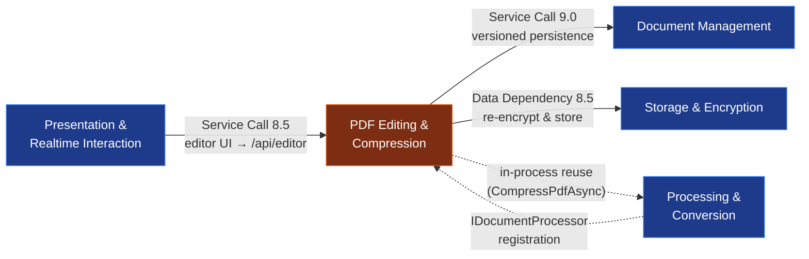
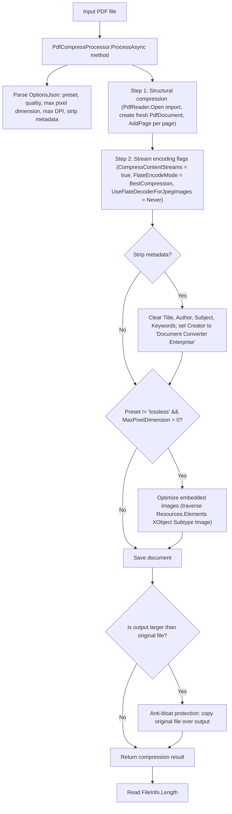
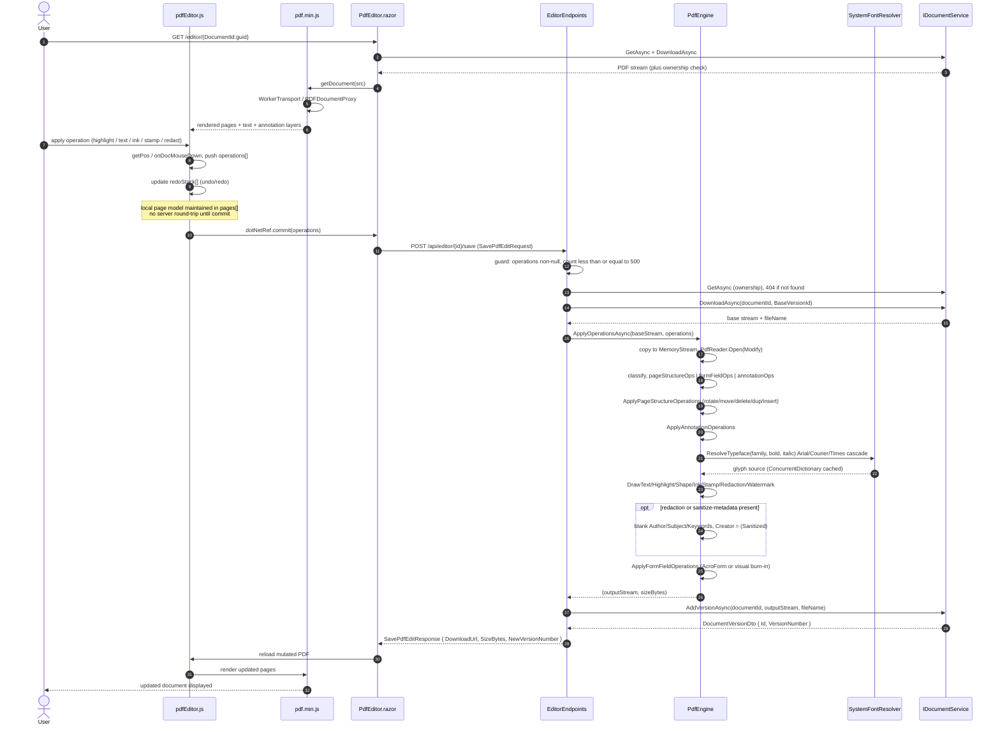
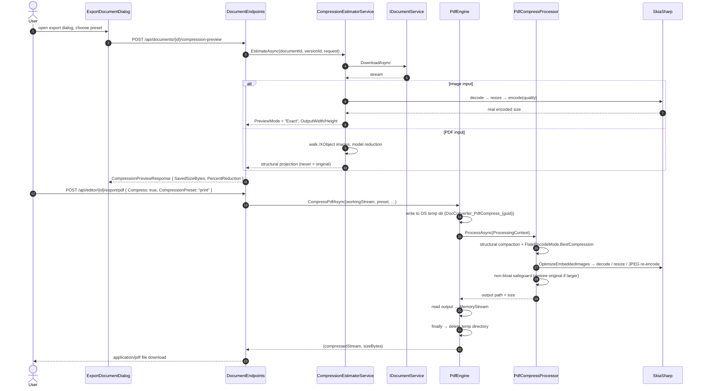
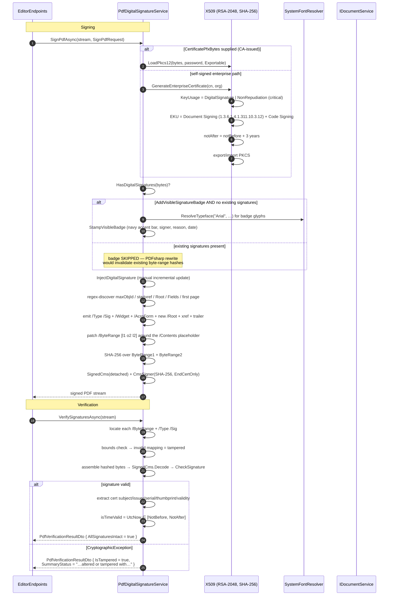

# PDF Editing & Compression Domain — Engineering Documentation

**System:** EConverter — self-hosted enterprise document conversion, management and intelligence platform
**Domain classification:** Core Business Domain · Importance 9.0 / 10 · Complexity 8.5 / 10
**Documentation basis:** Source-code inspection of the repository snapshot + domain-module, workflow and architecture research reports
**Verification discipline:** Every structural claim below is tied to a repository path. Claims that could not be reproduced from the snapshot are marked explicitly in §12.

---

## 1. Domain Charter

The **PDF Editing & Compression Domain** is the platform's server-side PDF mutation and size-optimization capability, exposed through a browser-based editor. It is the only domain in EConverter that *rewrites* document content rather than converting it between formats — the distinction matters architecturally: conversion produces a new artifact from a source, whereas editing produces a new **revision** of the same document, preserving every prior revision.

Functionally the domain owns seven capability families:

| Family | What it does | Primary implementation |
|---|---|---|
| **Page structure mutation** | rotate, move/reorder, delete, duplicate, insert blank page | `PdfEngine.ApplyPageStructureOperations` |
| **Visual annotation** | add text, highlight, shapes, ink strokes, images/signatures | `PdfEngine.ApplyAnnotationOperations` |
| **Markup & review** | strikethrough, underline, sticky notes, stamps, watermarking | `PdfEngine.Draw*` helpers |
| **Redaction** | opaque burn-in redaction rectangles + automatic metadata sanitization | `PdfEngine.DrawRedaction` |
| **AcroForm handling** | fill text fields and checkboxes, with visual burn-in fallback | `PdfEngine.ApplyFormFieldOperations` |
| **Digital signature** | PAdES / PKCS#7 detached signing, byte-range verification, X.509 certificate issuance | `PdfDigitalSignatureService` |
| **Compression & optimization** | structural stream compaction + embedded image downsampling + interactive estimation | `PdfCompressProcessor`, `CompressionEstimatorService`, `PdfEngine.CompressPdfAsync` |

Two design properties define the domain:

1. **Stateless, stream-oriented engine.** `IPdfEngine` is `Stream in → (Stream out, size) out`. No engine state, no per-document session, no in-memory registry. This makes the engine horizontally scalable and trivially testable — the same operation batch applied twice produces the same bytes.
2. **Non-destructive by contract.** Every mutation path in `EditorEndpoints` terminates in `IDocumentService.AddVersionAsync`, not in an overwrite. PDF editing never destroys history; the prior revision remains retrievable through the document versioning surface.

---

## 2. Architectural Position

### 2.1 Layer placement

The domain spans four of the solution's eight source projects. Each layer contributes exactly one responsibility:

```
┌──────────────────────────────────────────────────────────────────────┐
│ Presentation          DocumentConverter.Web                          │
│  · Components/Pages/Editor/PdfEditor.razor        (Blazor route UI)  │
│  · Components/Pages/Editor/Dialogs/*.razor        (9 dialogs)         │
│  · wwwroot/lib/pdfjs/pdf.min.js                   (PDF.js render)     │
│  · wwwroot/lib/pdfjs/pdfEditor.js                 (interaction layer) │
├──────────────────────────────────────────────────────────────────────┤
│ Web (transport)       DocumentConverter.Web/Endpoints                │
│  · EditorEndpoints.cs                             (/api/editor)       │
├──────────────────────────────────────────────────────────────────────┤
│ Contracts             DocumentConverter.Contracts                    │
│  · Editor/PdfEditorDtos.cs                        (edit operations)   │
│  · Documents/DigitalSignatureDtos.cs              (signature metadata)│
│  · Processing/ProcessingDtos.cs, FidelityDtos.cs  (compression)       │
├──────────────────────────────────────────────────────────────────────┤
│ Application           DocumentConverter.Application                  │
│  · Editor/IPdfEngine.cs                           (engine seam)       │
│  · Documents/IPdfDigitalSignatureService.cs       (signing seam)      │
│  · Processing/ICompressionEstimatorService.cs     (estimation seam)   │
├──────────────────────────────────────────────────────────────────────┤
│ Infrastructure        DocumentConverter.Infrastructure               │
│  · Editor/PdfEngine.cs                            (rendering engine)  │
│  · Editor/SystemFontResolver.cs                   (glyph resolution)  │
│  · Documents/PdfDigitalSignatureService.cs        (crypto / PAdES)    │
│  · Processing/PdfCompressProcessor.cs             (compression)       │
│  · Processing/CompressionEstimatorService.cs      (estimation)        │
│  · Processing/ImageCompressProcessor.cs           (image path)        │
└──────────────────────────────────────────────────────────────────────┘
```

**Critical layout observation.** The Application layer exposes *interfaces only*. Every concrete PDF implementation lives in Infrastructure. This is consistent with the DDD dependency invariant stated in the architecture report — with **one documented exception**: `DocumentIntelligenceService` is documented as living in `Application.AI` while physically residing in `Infrastructure.AI`. The PDF domain does **not** exhibit that inversion; its seams are correctly placed.

**Boundary ambiguity to be aware of.** Two PDF-adjacent components live in the **Processing & Conversion Domain**, not here:

| Component | Path | Why it belongs to Processing |
|---|---|---|
| `PdfDocumentProcessor` | `Infrastructure/Processing/PdfDocumentProcessor.cs` | Executes *format operations* (`merge`, `split`, `render`) through the async `IDocumentProcessor` contract |
| `PdfCapabilityAnalyzer` | `Infrastructure/Processing/PdfCapabilityAnalyzer.cs` | Pre-conversion fidelity triage (`Supported`/`BestEffort`/`Unsupported`) feeding the conversion pipeline |
| `PdfCompressProcessor` | `Infrastructure/Processing/PdfCompressProcessor.cs` | Registered as an `IDocumentProcessor` and dispatched by the conversion worker — but functionally *is* compression |

`PdfCompressProcessor` is the seam tension worth naming: it is **owned functionally by this domain, physically by the Processing domain**. `PdfEngine.CompressPdfAsync` bridges the gap by instantiating `PdfCompressProcessor` directly, bypassing the queue — see §6.3.

### 2.2 Cross-domain dependency graph



| From | To | Type | Strength | Mechanism |
|---|---|---|---|---|
| PDF Editing & Compression | Document Management | Service Call | 9.0 | `IDocumentService.DownloadAsync` / `AddVersionAsync` / `GetAsync` |
| PDF Editing & Compression | Storage & Encryption | Data Dependency | 8.5 | Mutated stream re-enters the AES-256-GCM envelope path via `DocumentService` |
| Presentation & Realtime | PDF Editing & Compression | Service Call | 8.5 | `POST /api/editor/*` from `pdfEditor.js` via `dotNetRef` |
| Identity & Security | — | inherited | — | `RequireAuthorization()` at the `/api/editor` group; ownership enforced inside `DocumentService` |

**Notable absence:** the PDF domain has no direct dependency on Identity & Security. Authorization is *delegated* — the endpoint group requires authentication, and ownership verification occurs inside `DocumentService.GetAsync`/`DownloadAsync`. This is consistent with the platform's "ownership is a service-layer precondition, not an endpoint-layer concern" model.

---

## 3. Domain Inventory

### 3.1 Component manifest

| Component | Path | Size | Role |
|---|---|---|---|
| `PdfEngine` | `Infrastructure/Editor/PdfEngine.cs` | 54,772 B / 1,336 LOC | Stateless mutation + export + compression engine |
| `SystemFontResolver` | `Infrastructure/Editor/SystemFontResolver.cs` | 7,700 B / 211 LOC | PDFsharp `IFontResolver` with caching and platform fallback |
| `IPdfEngine` | `Application/Editor/IPdfEngine.cs` | 2,908 B / 77 LOC | Engine abstraction (8 operations) |
| `PdfEditorDtos` | `Contracts/Editor/PdfEditorDtos.cs` | 3,691 B / 129 LOC | Operation bag + request/response contracts (8 types) |
| `EditorEndpoints` | `Web/Endpoints/EditorEndpoints.cs` | 14,254 B / 347 LOC | `/api/editor` route group (5 handlers) |
| `PdfDigitalSignatureService` | `Infrastructure/Documents/PdfDigitalSignatureService.cs` | 37,345 B / 866 LOC | PAdES signing, verification, certificate issuance |
| `IPdfDigitalSignatureService` | `Application/Documents/IPdfDigitalSignatureService.cs` | 1,860 B / 36 LOC | Signing abstraction (5 operations) |
| `DigitalSignatureDtos` | `Contracts/Documents/DigitalSignatureDtos.cs` | 1,471 B / 52 LOC | Verification + signing request contracts |
| `PdfEditor.razor` | `Web/Components/Pages/Editor/PdfEditor.razor` | 168,851 B | Interactive editor page (route `/editor/{DocumentId:guid}`) |
| Editor dialogs | `Web/Components/Pages/Editor/Dialogs/` | 9 files, ~67 KB | Export, Extract, Merge, OCR, Password, Signature, Stamp, Watermark |
| `pdfEditor.js` | `Web/wwwroot/lib/pdfjs/pdfEditor.js` | 168,260 B / 3,816 LOC | Client interaction engine (tool state, undo/redo, persistence bridge) |
| `pdf.min.js` | `Web/wwwroot/lib/pdfjs/pdf.min.js` | 320,004 B | Apache-2.0 PDF.js main-thread build (third-party) |
| `PdfCompressProcessor` | `Infrastructure/Processing/PdfCompressProcessor.cs` | 12,595 B / 299 LOC | Structural compaction + SkiaSharp image downsampling |
| `CompressionEstimatorService` | `Infrastructure/Processing/CompressionEstimatorService.cs` | 10,898 B / 288 LOC | In-memory size projection before committing |
| `ImageCompressProcessor` | `Infrastructure/Processing/ImageCompressProcessor.cs` | 8,623 B / 225 LOC | Sibling image-format compression path |
| `ICompressionEstimatorService` | `Application/Processing/ICompressionEstimatorService.cs` | 733 B / 23 LOC | Estimation seam (2 operations) |

### 3.2 Third-party dependency surface

| Library | Used for | Notes |
|---|---|---|
| **PDFsharp 6.x** (`PdfSharp.Pdf`, `PdfSharp.Drawing`, `PdfSharp.Fonts`) | Document open/modify/import, page tree mutation, `XGraphics` drawing, security settings, compression flags | The dominant dependency of the domain |
| **UglyToad.PdfPig** | Content-stream text extraction (words, bounding boxes) for DOCX/XLSX export and capability analysis | Never used for mutation — read-only |
| **DocumentFormat.OpenXml** | WordprocessingML and SpreadsheetML generation for PDF→DOCX and PDF→XLSX export | Already present for Office conversion |
| **SkiaSharp** | Embedded image decode, proportional resize, JPEG/WebP/PNG re-encode in the compression path | |
| **System.Security.Cryptography.Pkcs** | `SignedCms`, `CmsSigner`, detached PKCS#7/CMS production and verification | |
| **System.Security.Cryptography.X509Certificates** | Self-signed enterprise certificate generation, PKCS#12 import | |

Third-party library internals (including `wwwroot/lib/pdfjs`) are explicitly **outside the system boundary** per the system-context report.

---

## 4. Core Abstraction: `IPdfEngine`

`Application/Editor/IPdfEngine.cs` is the single contract between the transport layer and the rendering engine. It declares eight operations and — importantly — **consumes only pre-validated operations**, which pushes validation upstream into the endpoint.

```csharp
public interface IPdfEngine
{
    Task<(Stream OutputPdf, long SizeBytes)> ApplyOperationsAsync(
        Stream sourcePdfStream,
        IReadOnlyList<PdfEditOperationDto> operations,
        CancellationToken cancellationToken = default);

    Task<(Stream OutputPdf, long SizeBytes)> ExtractPagesAsync(
        Stream sourcePdfStream, IReadOnlyList<int> pages, CancellationToken ct = default);

    Task<(Stream OutputDocx, long SizeBytes)> ExportToDocxAsync(
        Stream sourcePdfStream, CancellationToken ct = default);

    Task<(Stream OutputXlsx, long SizeBytes)> ExportToXlsxAsync(
        Stream sourcePdfStream, CancellationToken ct = default);

    Task<(Stream OutputPdf, long SizeBytes)> MergePagesAsync(
        Stream basePdfStream, Stream sourceToMergePdfStream,
        IReadOnlyList<int>? sourcePageNumbers, int insertAtIndex, CancellationToken ct = default);

    Task<(Stream OutputPdf, long SizeBytes)> ProtectDocumentAsync(
        Stream sourcePdfStream, string userPassword, string? ownerPassword = null,
        bool permitPrint = true, bool permitExtractContent = false, bool permitFormsFill = true,
        bool permitFullQualityPrint = true, bool permitModifyDocument = false,
        bool permitAnnotations = true, CancellationToken ct = default);

    Task<(Stream OutputPdf, long SizeBytes)> CompressPdfAsync(
        Stream sourcePdfStream, string preset = "standard", int? quality = null,
        int? maxDpi = null, bool stripMetadata = true, CancellationToken ct = default);
}
```

### 4.1 Contract design properties

| Property | Consequence |
|---|---|
| **Returns `(Stream, long)` tuple** | The caller can persist and report the exact byte size without re-measuring the stream. This is why `SavePdfEditResponse.SizeBytes` and `MergeDocumentPagesResponse.SizeBytes` can be populated cheaply. |
| **All operations accept a source stream** | No engine-held document handles. No disposal contract beyond the returned stream. |
| **`IReadOnlyList<T>` not `IEnumerable<T>`** | The engine can iterate the batch multiple times (it does — three times for classification, then once per group) without re-materializing. |
| **`CancellationToken` everywhere** | Long operations (export, compression, OCR-adjacent) honour cooperative cancellation. Loop-level `ThrowIfCancellationRequested()` is present in `ExportToDocx`, `ExportToXlsx`, `MergePages`, `OptimizeEmbeddedImages`, `ProtectDocument`. |
| **No validation in the engine** | Invalid operation types are silently ignored by the dispatch `switch` rather than rejected. Validation is the endpoint's job — see §5.2. |

### 4.2 The operation bag: `PdfEditOperationDto`

`Contracts/Editor/PdfEditorDtos.cs` defines a **single positional record with 33 nullable members** as the universal wire shape for every editing feature:

```csharp
public sealed record PdfEditOperationDto(
    string Type, int Page,
    int? Degrees = null, int? FromPage = null, int? ToPage = null, int? TargetIndex = null,
    double? X = null, double? Y = null, double? Width = null, double? Height = null,
    string? Text = null, double? FontSize = null, string? FontColor = null,
    bool? IsBold = null, bool? IsItalic = null,
    string? ShapeType = null, string? StrokeColor = null, string? FillColor = null,
    double? StrokeWidth = null, double? Opacity = null, string? PointsJson = null,
    string? ImageBase64 = null, string? SignerName = null, DateTime? Timestamp = null,
    string? FieldName = null, string? FieldValue = null,
    string? FontFamily = null, string? TextAlign = null,
    bool? IsUnderline = null, bool? IsStrikethrough = null,
    string? BackgroundColor = null, double? LineSpacing = null, double? Rotation = null);
```

**Why this shape works:** the discriminator is `Type` (a string), and every non-essential member is nullable. One DTO covers text, shapes, ink, redaction, form fields, watermarks and page restructuring. Adding a new annotation style requires **no schema change** — only a new `case` in the dispatch switch. The trade-off is the loss of compile-time field validation: nothing prevents sending `Width` on a page-rotation operation, and the engine will simply ignore it.

### 4.3 Supporting contracts

| Record | Purpose | Key members |
|---|---|---|
| `SavePdfEditRequest` | Commit edits as a new version | `BaseVersionId`, `Operations` |
| `SavePdfEditResponse` | Commit result | `DocumentId`, `NewVersionId`, `NewVersionNumber`, `FileName`, `SizeBytes`, `DownloadUrl` |
| `ExportPdfRequest` | Export with uncommitted operations applied first | `BaseVersionId?`, `Operations?`, `Compress`, `CompressionPreset` |
| `MergeDocumentPagesRequest` | Merge external pages into active document | `SourceDocumentId`, `SourceVersionId?`, `SourcePages?`, `InsertAtIndex`, `ActiveOperations?` |
| `MergeDocumentPagesResponse` | Merge result | `DocumentId`, `NewVersionId`, `NewVersionNumber`, `NewTotalPages`, `SizeBytes` |
| `ProtectPdfDocumentRequest` | Password + permission application | `UserPassword`, `OwnerPassword?`, 6 permission flags, `SaveAsNewVersion` |
| `ProtectPdfDocumentResponse` | Protection result | `DocumentId`, `NewVersionId`, `NewVersionNumber`, `FileName`, `SizeBytes`, `DownloadUrl` |
| `FormFieldDto` | Detected interactive field descriptor | `Name`, `Type`, `Page`, geometry, `Value?`, `Options?`, `ReadOnly`, `Multiline` |

---

## 5. Sub-Module: Editor API & Client Surface

### 5.1 Endpoint surface — `/api/editor`

`EditorEndpoints.MapEditorEndpoints` (`Web/Endpoints/EditorEndpoints.cs`, 347 LOC) creates a single route group:

```csharp
var group = app.MapGroup("/api/editor").RequireAuthorization();
```

Every handler inherits the authorization requirement. Five routes are declared:

| # | Method | Route | Handler purpose | Request | Response |
|---|---|---|---|---|---|
| 1 | `GET` | `/{documentId:guid}/content` | Fetch inline PDF stream for the PDF.js canvas (`enableRangeProcessing: true`) | `versionId?` query | `application/pdf` file stream |
| 2 | `POST` | `/{documentId:guid}/save` | Apply operation batch, commit as new version | `SavePdfEditRequest` | `SavePdfEditResponse` |
| 3 | `POST` | `/{documentId:guid}/export/{format}` | Export with uncommitted operations to `pdf` \| `docx` \| `xlsx` | `ExportPdfRequest?` | File stream (format-specific MIME) |
| 4 | `POST` | `/{documentId:guid}/merge` | Merge pages from another document at a given index | `MergeDocumentPagesRequest` | `MergeDocumentPagesResponse` |
| 5 | `POST` | `/{documentId:guid}/protect` | Encrypt with password + apply permission flags | `ProtectPdfDocumentRequest` | `ProtectPdfDocumentResponse` or file stream |

**Registered in the composition root** (`Web/Program.cs`) as `app.MapEditorEndpoints();` alongside `MapDocumentEndpoints()`, `MapProcessingEndpoints()`, `MapDocumentIntelligenceEndpoints()` and `MapAccountEndpoints()`.

### 5.2 Validation discipline — what the endpoint enforces

The `save` handler is the only route with substantive input validation, and it enforces exactly two rules:

```csharp
if (request == null || request.Operations == null || request.Operations.Count == 0)
    return Results.BadRequest(new { error = "No edit operations provided." });

if (request.Operations.Count > 500)
    return Results.BadRequest(new { error =
        "Operation batch exceeds maximum safety limit of 500 operations." });
```

**Interpretation.** The 500-operation ceiling is a denial-of-service guard, not a semantic validator. It bounds the work the engine will perform on a single request but does **not** validate operation types, geometry sanity, page bounds, or colour-string format. Those are absorbed defensively downstream:

- Unknown `Type` values fall through the dispatch `switch` and are silently skipped (no exception, no error surfaced).
- Out-of-range `Page` values are guarded per-helper (`if (pageIndex >= 0 && pageIndex < doc.PageCount)`).
- Malformed `PointsJson` is swallowed by a `try/catch` with a comment: *"Ignore malformed ink points."*
- Malformed base64 image data is swallowed by a `try/catch`: *"Ignore corrupted image data."*
- Unparseable colour strings fall back to a hard-coded default via `ParseColor(colorStr, opacity, fallback)`.

This is a **tolerant-parsing posture**: the editor degrades to "operation ignored" rather than "request rejected". It maximizes editor resilience at the cost of operator observability — a malformed batch produces a successful 200 with silently missing elements.

### 5.3 Error-handling taxonomy

Every handler follows an identical three-tier catch pattern:

```csharp
catch (KeyNotFoundException)  → Results.NotFound()
catch (DomainException ex)    → Results.BadRequest(new { error = ex.Message })
catch (Exception ex)          → Results.Problem($"Failed to ...: {ex.Message}")
```

`DomainException` originates in `Domain/Common/DomainException.cs` and carries an intentionally user-safe message. The catch-all `Results.Problem` path returns an RFC 7807 problem detail — and, notably, **includes `ex.Message` in the response body**. This is a deliberate trade-off favouring diagnosability; it means internal failure messages (potentially including library-level detail from PDFsharp or SkiaSharp) can reach the client. Documented in §12 as an exposure note.

### 5.4 The `save` handler in full — the canonical mutation path

```csharp
// 1. Resolve document (ownership enforced inside DocumentService)
var doc = await documentService.GetAsync(documentId, ct);
if (doc is null) return Results.NotFound(new { error = $"Document '{documentId}' was not found." });

// 2. Fetch base version stream
var (baseStream, fileName, _) = await documentService.DownloadAsync(documentId, request.BaseVersionId, ct);

// 3. Apply operations using PDFsharp engine
var (outputStream, sizeBytes) = await pdfEngine.ApplyOperationsAsync(baseStream, request.Operations, ct);

// 4. Save as new version
var versionDto = await documentService.AddVersionAsync(documentId, outputStream, fileName, ct);

var response = new SavePdfEditResponse(
    documentId, versionDto.Id, versionDto.VersionNumber, fileName, sizeBytes,
    $"/api/documents/{documentId}/download/{Uri.EscapeDataString(fileName.Replace('#', '_'))}?versionId={versionDto.Id}");
```

Three details worth flagging:

- **`BaseVersionId` enables optimistic branching.** The client may edit from any historical version, not only the current one. The resulting new version becomes the head; the intermediate lineage is not replayed.
- **`Replace('#', '_')` appears on every filename path** across this endpoint group. This is a defensive normalisation for filenames embedded into URL segments — `#` would otherwise truncate the path at the fragment boundary.
- **The `DownloadUrl` is constructed by the endpoint, not returned by the versioning service**, coupling the transport layer to the download route shape declared in `DocumentEndpoints` (`/api/documents/{id}/download/{fileName}?versionId=`). This is a cross-endpoint route coupling worth noting.

### 5.5 The `merge` handler — cross-document composition

The merge handler is the most complex route, because it must apply *pending* client-side edits before merging, then commit the composite:

```csharp
// 1. Download target document base stream
var (targetStream, targetFileName, _) = await documentService.DownloadAsync(documentId, null, ct);

// 2. If client had active uncommitted operations, apply them FIRST
Stream workingTargetStream = targetStream;
if (request.ActiveOperations != null && request.ActiveOperations.Count > 0)
{
    var (editedTarget, _) = await pdfEngine.ApplyOperationsAsync(targetStream, request.ActiveOperations, ct);
    workingTargetStream = editedTarget;
}

// 3. Download source document stream
var (sourceStream, _, _) = await documentService.DownloadAsync(request.SourceDocumentId, request.SourceVersionId, ct);

// 4. Merge source pages into working target stream
var (mergedStream, sizeBytes) = await pdfEngine.MergePagesAsync(
    workingTargetStream, sourceStream, request.SourcePages, request.InsertAtIndex, ct);

// 5. Commit as new version of target document
var newVersion = await documentService.AddVersionAsync(documentId, mergedStream, targetFileName, ct);

// 6. Re-open to determine page count
using var pdf = PdfReader.Open(mergedStream, PdfDocumentOpenMode.Import);
newTotalPages = pdf.PageCount;
```

**Ownership boundary observed:** the handler resolves **both** documents through `documentService.GetAsync` before proceeding. Because `DocumentService` enforces `IsOwnedBy`/`GetCurrentUserId`, a merge request naming a document the caller does not own fails before any bytes are read. This closes the most obvious cross-document IDOR vector in the domain.

**Note on the page count:** `newTotalPages` is guarded by a `try/catch { }` that silently leaves it at `1` on failure. A merged document that fails to re-open will report `NewTotalPages = 1` despite a successful commit — a reporting inaccuracy, not a data-integrity issue.

### 5.6 The `protect` handler — encryption and permission matrix

`ProtectDocumentAsync` maps directly onto PDFsharp's `SecuritySettings`:

| Request flag | Engine assignment | Default |
|---|---|---|
| `UserPassword` | `doc.SecuritySettings.UserPassword` | *required* (400 if empty) |
| `OwnerPassword?` | `doc.SecuritySettings.OwnerPassword` — falls back to `userPassword` when blank | `null` |
| `PermitPrint` | `PermitPrint` | `true` |
| `PermitExtractContent` | `PermitExtractContent` | `false` |
| `PermitFormsFill` | `PermitFormsFill` | `true` |
| `PermitFullQualityPrint` | `PermitFullQualityPrint` | `true` |
| `PermitModifyDocument` | `PermitModifyDocument` | `false` |
| `PermitAnnotations` | `PermitAnnotations` | `true` |

Return shape is conditional on `SaveAsNewVersion`:

- **`true`** (default) → commits a new `DocumentVersion`, returns `ProtectPdfDocumentResponse` with a download URL. The unprotected revision remains in history.
- **`false`** → returns the protected stream directly with filename prefix `"Protected_"`, persisting nothing.

The `false` path is worth noting from a governance perspective: a password-protected rendition can leave the system *without ever being stored*, meaning it is outside the versioning and audit envelope.

### 5.7 The `export` handler — format matrix

| `{format}` | Engine call | MIME type emitted |
|---|---|---|
| `docx` \| `word` | `ExportToDocxAsync` | `application/vnd.openxmlformats-officedocument.wordprocessingml.document` |
| `xlsx` \| `excel` | `ExportToXlsxAsync` | `application/vnd.openxmlformats-officedocument.spreadsheetml.sheet` |
| `pdf` | `CompressPdfAsync` if `request.Compress == true`, else pass-through | `application/pdf` |
| anything else | — | `400` with the list of supported formats |

The export path is **non-persisting** by design: it applies uncommitted operations in memory, produces the artefact, and streams it back without touching `DocumentService`. This is what allows "export without saving" — an operationally significant distinction from the `save` route.

```csharp
// Format normalisation — tolerant of leading dots and case
var normalizedFormat = format.Trim().TrimStart('.').ToLowerInvariant();
```

### 5.8 Client surface

**`pdf.min.js`** (320,004 B) is the unmodified Apache-2.0 PDF.js main-thread build. It supplies `getDocument`/`PDFDocumentLoadingTask`, the `WorkerTransport`/`MessageHandler` bridge, `PDFDocumentProxy`, `PDFPageProxy.getPage`/`getViewport`/`render`/`getTextContent`/`getAnnotations`, `DOMCanvasFactory`, and the `GlobalWorkerOptions`/`CMapReaderFactory`/`StandardFontDataFactory` registrations. It is third-party and **out of the system boundary**.

**`pdfEditor.js`** (168,260 B / 3,816 LOC, header comment *"PDF.js Interactive Editor Engine (Phase 5 Enhanced)"*) is first-party. It exposes a single global `window.pdfEditor` object. Its declared state surface reveals the editor's full interaction model:

```javascript
window.pdfEditor = {
    pdfDoc: null, currentPage: 1, scale: 1.25,
    containerId: null, documentId: null, dotNetRef: null,
    currentTool: 'select',
    operations: [], redoStack: [],
    pages: [],            // [{ id, pageNum, sourcePage, isBlank, rotation, width, height }]
    selectedOp: null,
    isDraggingOp: false, dragStartPos: {…}, opStartPos: {…},
    isResizingOp: false, activeResizeHandle: null, resizeStartMouse: {…}, resizeStartOp: null,
    isRotatingOp: false, rotateCenter: null, rotateStartAngle: 0, rotateStartMouseAngle: 0,
    activeSnapGuides: [], snapEnabled: true,
    isDrawing: false, drawPoints: [],
    startDragX: 0, startDragY: 0, currentDragX: 0, currentDragY: 0,
    imageCache: {},
    searchState: { isOpen, query, caseSensitive, wholeWord, matches, currentIndex, isSearching },
    pageTextCache: {},
    currentStyle: { fontSize, fontColor, fontFamily, textAlign, isBold, isItalic,
                    isUnderline, isStrikethrough, backgroundColor, strokeColor, fillColor,
                    strokeWidth, opacity, highlightColor, redactionColor }
}
```

**Capabilities implied by this state model** — each deserves recognition as first-class editor functionality:

| State group | Feature it implements |
|---|---|
| `operations` / `redoStack` | Full undo/redo stack over the operation array |
| `pages` array with `isBlank`, `sourcePage`, `rotation` | Local page-list model supporting insertion, deletion, duplication and rotation *without* server round-trips until commit |
| `selectedOp` + `isDraggingOp`/`isResizingOp`/`isRotatingOp` + `activeResizeHandle` | Direct manipulation — move, resize, rotate handles on placed annotations |
| `activeSnapGuides` + `snapEnabled` | Alignment snapping with visual guides |
| `drawPoints` + `isDrawing` | Freehand ink capture producing the point array that serializes into `PointsJson` |
| `imageCache` | Base64 image deduplication — one image placed N times encodes once |
| `searchState` (with `caseSensitive`, `wholeWord`, `matches[]`, `currentIndex`) | In-document text search with navigation |
| `pageTextCache` | Per-page extracted text cached for search |
| `currentStyle` (16 properties) | The active tool style palette — mirrors the `PdfEditOperationDto` member set almost one-to-one |

The `currentStyle` block **maps nearly 1:1 onto the DTO's optional members**. That correspondence is the integration contract: whatever the client holds in `currentStyle` becomes the nullable payload of the next operation object.

**Interop bridge:** `dotNetRef` is the `DotNetObjectReference` used to invoke .NET from JavaScript. The commit path is `pdfEditor.js → dotNetRef.commit(operations) → PdfEditor.razor → POST /api/editor/{id}/save`. The disambiguation (`commit` vs `cancel`, `cleanup`, `updateAlignButtonStyles`) and debounced `setTimeout` layout settling live in the same file.

**Page hosting:** `PdfEditor.razor` (168,851 B) is routed at `@page "/editor/{DocumentId:guid}"` with an authorization requirement, and injects `IDocumentService`, `IPdfEngine` (for direct estimation/engine calls) and `IScannedPdfDetector` (to branch scanned-vs-text PDFs). Its 9 sibling dialogs are the modal surfaces for the compound operations:

| Dialog | File size | Operation |
|---|---|---|
| `ExportDocumentDialog.razor` | 9,302 B | Format + compression selection for export |
| `ExtractPagesDialog.razor` | 7,632 B | Page subset extraction |
| `MergeDocumentDialog.razor` | 13,430 B | Cross-document merge with ordering |
| `OcrDialog.razor` | 5,726 B | OCR invocation for image-only pages |
| `PasswordSecurityDialog.razor` | 9,754 B | Encryption + permission matrix |
| `SignatureDialog.razor` | 10,511 B | Digital signing parameters |
| `StampDialog.razor` | 5,817 B | Stamp text/colour/position |
| `WatermarkDialog.razor` | 1,815 B | Watermark text/opacity/size |

---

## 6. Sub-Module: PDF Mutation Engine

`PdfEngine` (`Infrastructure/Editor/PdfEngine.cs`) is a `sealed class` implementing `IPdfEngine`. Its structure is a three-stage dispatch pipeline:

```
ApplyOperationsAsync(source, operations)
  │
  ├─ 0. Copy source → MemoryStream (seekable), open PdfReader.Open(…, Modify)
  │
  ├─ 1. CLASSIFY the batch into three lists
  │      pageStructureOps = operations.Where(IsPageStructureOperation)
  │      formFieldOps     = Type ∈ {"form-field", "set-form-field"}
  │      annotationOps    = everything else
  │
  ├─ 2. ApplyPageStructureOperations(doc, pageStructureOps, memStream.ToArray())
  ├─ 3. ApplyAnnotationOperations(doc, annotationOps)   ← also fans into form + sanitization
  ├─ 4. ApplyFormFieldOperations(doc, formFieldOps)
  │
  └─ 5. pdfDocument.Save(outputStream, false) → (output, length)
```

Static constructor safety net — the engine self-registers the font resolver so it cannot be used un-initialised:

```csharp
static PdfEngine()
{
    if (GlobalFontSettings.FontResolver == null)
        GlobalFontSettings.FontResolver = new SystemFontResolver();
}
```

### 6.1 Operation classification

`IsPageStructureOperation` uses a normalised string match over synonyms:

| Operation type aliases | Classified as |
|---|---|
| `rotate-page`, `rotate` | Page structure |
| `delete-page`, `delete` | Page structure |
| `move-page`, `move`, `reorder` | Page structure |
| `insert-page`, `insert`, `insert-blank-page` | Page structure |
| `duplicate-page`, `duplicate` | Page structure |
| `form-field`, `set-form-field` | Form (separate bucket) |
| *everything else* | Annotation / drawing |

### 6.2 Page structure operations

`ApplyPageStructureOperations(doc, ops, originalBytes)` executes in two ordered passes:

**Pass 1 — rotations** (applied first, additively):
```csharp
page.Rotate = (page.Rotate + deg) % 360;   // deg defaults to 90
```

**Pass 2 — structural mutation**, in list order:

| Operation | Implementation | Safety guard |
|---|---|---|
| `delete` | `doc.Pages.RemoveAt(delIndex)` | `PageCount > 1` — cannot delete the last page |
| `duplicate` | Re-opens `originalBytes` in `Import` mode, `doc.Pages.Insert(dupIndex + 1, cloneSource.Pages[dupIndex])` | Re-reads the *original* bytes rather than the mutated document, avoiding recursive duplication |
| `insert` (blank) | `doc.InsertPage(targetIndex)`; dimensions from `Width`/`Height` in points | Defaults to A4 (`595.0 × 842.0` pt) |
| `move` / `reorder` | `doc.Pages.MovePage(fromIdx, toIdx)` | Requires `fromIdx != toIdx` |

The `duplicate` implementation is the interesting one: because it re-opens `memStream.ToArray()` — the *pre-mutation* snapshot — a duplicate always clones the original page, never an already-duplicated page. This is deliberate and avoids page-tree aliasing corrupting the output.

### 6.3 Annotation & drawing operations

`ApplyAnnotationOperations` groups operations by page to reuse a single `XGraphics` context per page:

```csharp
var pageGroups = ops.GroupBy(o => o.Page);
foreach (var group in pageGroups)
{
    var page = doc.Pages[pageIndex];
    using var gfx = XGraphics.FromPdfPage(page, XGraphicsPdfPageOptions.Append);
    foreach (var op in group) { … }
}
```

`XGraphicsPdfPageOptions.Append` is significant: existing page content is **preserved** and new content is layered on top. Editing never rasterizes or replaces the original content stream.

**Per-operation rotation support.** Each annotation may carry its own `Rotation` (or fall back to `Degrees`), applied as a save/translate/rotate/translate-back sequence around the annotation's own centre:

```csharp
rotState = gfx.Save();
var cx = x + w / 2.0; var cy = y + h / 2.0;
gfx.TranslateTransform(cx, cy);
gfx.RotateTransform(rotVal);
gfx.TranslateTransform(-cx, -cy);
// … draw …
gfx.Restore(rotState);   // in a finally block
```

### 6.4 Drawing primitive catalogue

Eleven private helpers form the rendering vocabulary. Each maps one operation `Type` (or family of aliases) to PDFsharp calls:

| Helper | Accepted `Type` aliases | Rendering behaviour |
|---|---|---|
| `DrawText` | `add-text`, `text` | Multi-line text with `MeasureString`-driven box sizing, optional background fill, three-way alignment (`center`/`right`/default left), `LineSpacing` multiplier (default `1.3`), and inline underline/strikethrough drawn as `XPen` lines positioned at `0.85`/`0.52` of line height. Fonts resolved via `new XFont(fontName, fontSize, style)` with `Arial` default. |
| `DrawHighlight` | `add-highlight`, `highlight` | Opaque-ish rectangle; default fill `#FFF176`, default opacity `0.35`, fallback `XColor.FromArgb(90, 255, 235, 59)` |
| `DrawShape` | `add-shape`, `shape` | `rect`/`rectangle`, `circle`/`ellipse`, `line`, `arrow`. Stroke/pen with configurable width; optional fill brush; arrows computed with a 12 pt head and `π/6` half-angle |
| `DrawInk` | `add-ink`, `ink`, `draw` | Parses `PointsJson` (`[{"x":…,"y":…}, …]`), requires ≥ 2 points, renders as chained `DrawLine` segments |
| `DrawImageOrSignature` | `add-signature`, `signature`, `add-image`, `image` | Decodes base64 (tolerating `data:` URI prefixes), `XImage.FromStream`, drawn at `X/Y/Width/Height`. When `SignerName` present, appends a caption: `"Digitally verified: {name} • {timestamp}"` |
| `DrawStamp` | `add-stamp`, `stamp` | Composite: rotated −5°, rounded outer border (2.5 pt) + inner double-line border (0.9 pt), tinted fill, uppercase title (16 pt bold), and `BY: {AUTHOR} • {DD/MM/YYYY}` sub-line (6.5 pt bold). Default title `"APPROVED"`, default author `"USER"` |
| `DrawStickyNote` | `add-note`, `add-comment`, `note`, `comment` | Post-It yellow body (`250,255,249,196`) with amber border, soft offset shadow at `+2,+2`, 16 pt header strip, `"Note • {author}"` header, wrapped body text at 7.5 pt. Minimum 120×60 pt |
| `DrawStrikethrough` | `add-strikethrough`, `strikethrough` | Single line at `y + h/2`; default red, 2.0 pt |
| `DrawUnderline` | `add-underline`, `underline` | Single line at `y + h`; default `DodgerBlue`, 1.5 pt |
| `DrawRedaction` | `add-redaction`, `redaction`, `redact` | 100 % opaque burn-in rectangle (black, or white when `FillColor` is `#FFFFFF`/`white`), minimum 15×10 pt, with an optional centred label sized `clamp(h × 0.55, 6.0, 11.0)` pt in contrasting colour |
| `DrawWatermark` | `watermark`, `add-watermark` (page-scoped loop) | Rotated −45° at page centre via `TranslateTransform`+`RotateTransform`, default text `"CONFIDENTIAL"`, 48 pt bold, opacity `0.15`. **Applied to every page regardless of `Page`** |

**Watermark is structurally different from every other helper.** Watermarks are extracted into a separate list and applied in an outer loop over all pages:

```csharp
var watermarks = ops.Where(o => o.Type.Equals("watermark", …) || o.Type.Equals("add-watermark", …)).ToList();
foreach (var wm in watermarks)
    for (var i = 0; i < doc.PageCount; i++)
    {
        using var gfx = XGraphics.FromPdfPage(doc.Pages[i], XGraphicsPdfPageOptions.Append);
        DrawWatermark(gfx, doc.Pages[i], wm);
    }
```

The `Page` field is therefore meaningless for watermarks. Note the fresh `XGraphics` context per page — watermarks are the one place the per-page context reuse optimisation does not apply.

### 6.5 Automatic metadata sanitization

Redaction carries a **mandatory side effect** — the engine treats redaction as an implicit request to scrub document metadata:

```csharp
var sanitizeRequested = ops.Any(o =>
    o.Type.Equals("add-redaction", …) || o.Type.Equals("redaction", …) ||
    o.Type.Equals("redact", …)         || o.Type.Equals("sanitize-metadata", …));

if (sanitizeRequested)
{
    doc.Info.Author   = string.Empty;
    doc.Info.Subject  = string.Empty;
    doc.Info.Keywords = string.Empty;
    doc.Info.Creator  = "Document Converter Platform (Sanitized)";
}
```

This is a thoughtful compliance behaviour: a document whose visible content was redacted but whose metadata still carried the original author's name would defeat the redaction. `sanitize-metadata` is also exposed as a standalone operation type.

### 6.6 AcroForm handling

`ApplyFormFieldOperations` implements a **two-tier strategy**:

**Tier 1 — native AcroForm mutation.** If the document has an AcroForm dictionary, the service sets `/NeedAppearances true` and attempts direct field updates, walking `acroForm.Fields.Names` for a case-insensitive match:

```csharp
if (field is PdfTextField  txt) txt.Text = fieldValue;
else if (field is PdfCheckBoxField chk) chk.Checked = bool.TryParse(fieldValue, out var b) && b;
else if (field != null) field.Value = new PdfString(fieldValue);
```

**Tier 2 — visual burn-in fallback.** If no AcroForm exists, the field is absent, or the update throws, and the operation supplies `X`,`Y`,`Page`, the value is **drawn onto the page** instead:

- Checkbox semantics → hand-drawn tick (two `DrawLine` segments forming a check)
- Text semantics → 11 pt `Segoe UI` text in the supplied rect, left-aligned, vertically centred

The degradation is graceful: a flattened PDF without form structure still accepts "filled" values, at the cost of losing interactivity. The failure mode is invisible to the caller — the response reports success either way.

### 6.7 Format export — PDF → DOCX and PDF → XLSX

Both exporters use **PdfPig for reading** and **OpenXML for writing**, and both implement the same layout-reconstruction heuristic.

**Layout reconstruction algorithm** (shared in spirit by both exporters):

1. Extract words via `page.GetWords()`
2. Sort descending by `BoundingBox.Top`
3. Group into lines: a word joins an existing line if `|line[0].BoundingBox.Bottom − word.BoundingBox.Bottom| < 4.0`
4. Re-order lines descending by average `Bottom`
5. Within a line, sort ascending by `Left`
6. Emit, using inter-word gap as a separator signal

**PDF → DOCX (`ExportToDocxAsync`):**

| Gap threshold | Emitted separator |
|---|---|
| `> 25.0` pt | Four spaces (`"    "`) — visually approximates a tab stop |
| otherwise | Single space |

Each line becomes a `Paragraph` with `SpacingBetweenLines { After = "60", Line = "240", LineRule = Auto }`, a `Run` with `RunFonts { Ascii = "Calibri", HighAnsi = "Calibri" }` and `FontSize { Val = "22" }` (11 pt in half-points), and text with `SpaceProcessingModeValues.Preserve`. A page break paragraph is inserted between pages, and text-less pages emit `"[Page {N}: No text detected]"`.

**PDF → XLSX (`ExportToXlsxAsync`):**

| Gap threshold | Effect |
|---|---|
| `> 18.0` pt | Starts a **new cell** in the row |
| otherwise | Continues the current cell |

Each PDF page becomes its own worksheet named `"Page {N}"`. Cells are typed by content:

```csharp
if (double.TryParse(val, NumberStyles.Any, CultureInfo.InvariantCulture, out var num))
    cell.DataType = CellValues.Number;
else
    cell.DataType = CellValues.String;
```

Column references are generated by a base-26 conversion helper:

```csharp
private static string GetExcelColumnName(int columnNumber)
{
    string dividend = "";
    while (columnNumber > 0)
    {
        int modulo = (columnNumber - 1) % 26;
        dividend = Convert.ToChar('A' + modulo) + dividend;
        columnNumber = (columnNumber - modulo) / 26;
    }
    return dividend;
}
```

**Fidelity characteristics of both exporters.** These are *text-reconstruction* exports, not layout-preserving conversions. Font sizes, colours, images and graphics from the source PDF are not carried into DOCX/XLSX — only the textual content with approximate line/column structure. `IPdfCapabilityAnalyzer` exists precisely to signal this expectation to the user *before* conversion (see §8.4).

### 6.8 Merge operations

`MergePagesAsync` implements index-targeted page import:

```csharp
using var baseDoc   = PdfReader.Open(baseMem,   PdfDocumentOpenMode.Modify);
using var sourceDoc = PdfReader.Open(sourceMem, PdfDocumentOpenMode.Import);

// Page selection: explicit list, or all pages
// Index clamp: targetIndex ∈ [0, baseDoc.PageCount]
foreach (var pageIdx in pagesToImport)
{
    baseDoc.Pages.Insert(targetIndex, sourceDoc.Pages[pageIdx]);
    targetIndex++;   // preserves source ordering
}
```

The incremental `targetIndex++` is what preserves the source document's page order when inserting a range. Out-of-range source page numbers are filtered silently; if *nothing* survives filtering, an `ArgumentException` is thrown (`"No valid pages found in the source document to merge."`).

The distinct `Modify` / `Import` open modes matter: `Modify` retains editing capability on the base, while `Import` copies page objects into the target rather than referencing the source document — which is what allows the source stream to be disposed immediately after.

---

## 7. Sub-Module: Digital Signature & Font Resolution

### 7.1 `PdfDigitalSignatureService`

`Infrastructure/Documents/PdfDigitalSignatureService.cs` (866 LOC) implements `IPdfDigitalSignatureService` and declares conformance to **PAdES / ISO 32000-1** using **PKCS#7 / CMS detached signatures**.

**Interface surface (5 operations):**

| Operation | Signature | Purpose |
|---|---|---|
| `VerifySignaturesAsync` | `(Stream, CancellationToken) → PdfVerificationResultDto` | Verify all signatures in a byte stream |
| `VerifyDocumentSignaturesAsync` | `(Guid documentId, Guid userId, CancellationToken) → PdfVerificationResultDto` | Verify a stored document (downloads via `IDocumentService`) |
| `SignPdfAsync` | `(Stream, SignPdfRequest, CancellationToken) → Stream` | Sign and return signed bytes |
| `SignStoredDocumentAsync` | `(Guid, Guid userId, SignPdfRequest, CancellationToken) → DocumentDto` | Sign a stored document and commit a new version |
| `GenerateEnterpriseCertificate` | `(string commonName, string organization) → X509Certificate2` | Issue a self-signed enterprise certificate |

### 7.2 Enterprise certificate generation

```csharp
using var rsa = RSA.Create(2048);
var dnBuilder = new X500DistinguishedNameBuilder();
dnBuilder.AddCommonName(commonName);
dnBuilder.AddOrganizationName(organization);          // default: "Enterprise Document Converter Platform"
dnBuilder.AddOrganizationalUnitName("Document Security and Compliance");

// Key Usage: DigitalSignature | NonRepudiation  (critical = true)
new X509KeyUsageExtension(
    X509KeyUsageFlags.DigitalSignature | X509KeyUsageFlags.NonRepudiation, critical: true)

// Enhanced Key Usage:
//   1.3.6.1.4.1.311.10.3.12  → Microsoft Document Signing
//   1.3.6.1.5.5.7.3.3        → Code Signing
// Validity: notBefore = UtcNow − 10 min ; notAfter = notBefore + 3 years
```

Certificates are **cached by `{commonName}_{organization}`** in a `ConcurrentDictionary<string, X509Certificate2>`, with reuse gated on `HasPrivateKey && DateTime.UtcNow < cached.NotAfter.AddDays(-1)` — a one-day freshness margin prevents using a certificate that is about to expire. The certificate is exported to PKCS#12 with the fixed passphrase `"doc_conv_demo_pass"` and re-imported with `X509KeyStorageFlags.Exportable` for consistent cross-platform in-memory handling.

> **Security note.** The hard-coded PFX passphrase and self-signed issuance path make this a **development/internal-workflow** facility. Production deployments should drive signing through `request.CertificatePfxBytes` + `request.CertificatePassword` (the CA-issued branch of `SignPdfAsync`), not through the self-signed generator.

### 7.3 Signing pipeline

```
SignPdfAsync(pdfStream, request)
  │
  ├─ 1. Resolve signing certificate
  │      request.CertificatePfxBytes present → LoadPkcs12(bytes, password, Exportable)
  │      otherwise                            → GenerateEnterpriseCertificate(signerName)
  │      Guard: signingCert.HasPrivateKey must be true
  │
  ├─ 2. Detect existing signatures (HasDigitalSignatures — scans for "/ByteRange" + "/Type /Sig")
  │
  ├─ 3. Optional visible badge stamping
  │      ONLY IF request.AddVisibleSignatureBadge AND !hasExistingSignatures
  │      Rationale (verbatim from source comment):
  │        "Visible badge modification via PDFsharp rewrites entire PDF file structure,
  │         which would invalidate existing cryptographic byte-range hashes.
  │         Stamping is therefore applied only on the initial revision."
  │
  ├─ 4. InjectDigitalSignature(basePdfBytes, cert, signerName, reason, location, contactInfo, signingTime)
  │      → PAdES PKCS#7 detached signature via incremental update
  │
  └─ 5. Return MemoryStream(signedPdfBytes)
```

The badge-stamping guard is one of the more sophisticated pieces of reasoning in the codebase: it recognises that a byte-range signature is invalidated by *any* structural rewrite, and therefore refuses to add a visible badge to an already-signed document rather than silently breaking the existing signature.

### 7.4 Surgical PKCS#7 injection — the incremental update technique

`InjectDigitalSignature` performs a **manual incremental update** on the raw PDF bytes. This is the low-level reason the service carries ~450 LOC of byte-manipulation and regex code rather than relying on a library signing API.

**Step-by-step:**

1. **Discover structural anchors** via regex over the ASCII-decoded PDF:

| Anchor | Regex |
|---|---|
| Max object number | `(\d+)\s+0\s+obj` |
| Previous xref offset | `startxref\s+(\d+)\s+%%EOF` (last match) |
| Root object ID | `/Root\s+(\d+)\s+0\s+R` |
| Root catalog body | `{rootObjId}\s+0\s+obj\s*<<([\s\S]*?)>>\s*endobj` |
| Existing `/Fields` array | `/Fields\s*\[([\s\S]*?)\]` |
| First page object ID | `(\d+)\s+0\s+obj\s*<<(?=[^>]*?/Type\s*/Page\b)([\s\S]*?)>>\s*endobj` |

2. **Allocate three new object IDs** and reserve a fixed placeholder for the signature:
```csharp
int sigObjId       = maxObjId + 1;
int sigFieldObjId  = maxObjId + 2;
int acroFormObjId  = maxObjId + 3;
const int hexPlaceholderLength = 8192;   // 4096 bytes DER signature capacity
```

3. **Emit four new objects** into a `StringBuilder`:
   - `/Type /Sig` with `/Filter /Adobe.PPKLite`, `/SubFilter /adbe.pkcs7.detached`, `/Name`, `/Reason`, `/Location`, `/ContactInfo`, `/M (D:yyyyMMddHHmmssZ)`, a `/ByteRange` placeholder and `/Contents <0000…>`
   - `/Type /Annot /Subtype /Widget /FT /Sig` referencing the signature object via `/V`, with `/F 132` and `/Rect [0 0 0 0]` (invisible), plus `/P` pointing at the first page
   - `/AcroForm` with `/Fields [ … sigFieldObjId 0 R ]` (preserving any pre-existing field references) and `/SigFlags 3`
   - New `/Root` catalog carrying the original entries plus `/AcroForm {acroFormObjId} 0 R`

4. **Emit an incremental xref + trailer** with `/Size`, `/Root`, `/Prev {prevXrefOffset}` and the new `startxref`.

5. **Concatenate** original bytes + incremental bytes, then **patch the byte ranges** in place:

```csharp
int contentsStart = pdfBytes.Length + contentsPlaceholderMarkerIndex;
int contentsEnd   = contentsStart + hexPlaceholderLength;

int byteRangeLen1      = contentsStart - 1;          // ends right before '<'
int byteRangeOffset2   = contentsEnd + 1;            // starts right after '>'
int byteRangeLen2      = fullPdf.Length - byteRangeOffset2;
```

6. **Hash ByteRange 1 + ByteRange 2** (everything except the signature placeholder):

```csharp
byte[] hashedBytes = new byte[byteRangeLen1 + byteRangeLen2];
Buffer.BlockCopy(fullPdf, 0, hashedBytes, 0, byteRangeLen1);
Buffer.BlockCopy(fullPdf, byteRangeOffset2, hashedBytes, byteRangeLen1, byteRangeLen2);
```

7. **Produce the detached CMS signature:**

```csharp
var contentInfo = new ContentInfo(hashedBytes);
var signedCms = new SignedCms(contentInfo, detached: true);
var cmsSigner = new CmsSigner(SubjectIdentifierType.IssuerAndSerialNumber, cert)
{
    DigestAlgorithm = new Oid("2.16.840.1.101.3.4.2.1"),   // SHA-256
    IncludeOption   = X509IncludeOption.EndCertOnly
};
```

The resulting DER is hex-encoded into the `/Contents` placeholder — leaving the signature self-referential-free while the byte range excludes it from its own hash.

### 7.5 Verification

`VerifySignaturesAsync` mirrors the injection logic in reverse:

1. Locate each `/ByteRange` array and the associated `/Type /Sig` object
2. **Guard against malformed mapping:** reject and mark `IsDocumentTampered = true` when the range extends beyond the physical PDF length, with `"Invalid byte-range mapping: extends beyond physical PDF length."`
3. Assemble hashed bytes from both ranges
4. `SignedCms.Decode(derBytes)` + `signedCms.CheckSignature(verifySignatureOnly: true)`
5. Extract signer certificate metadata: subject, issuer, serial, thumbprint, `NotBefore`/`NotAfter`
6. Evaluate certificate time validity: `isTimeValid = UtcNow >= notBefore && UtcNow <= notAfter`
7. If no explicit signing time was parsed from the PDF `/M` entry, extract the `Pkcs9SigningTime` attribute (OID `1.2.840.113549.1.9.5`) from `SignerInfo.SignedAttributes`
8. Normalise the digest algorithm name (`sha256`/`sha-256` → `SHA-256`, etc.)
9. On `CryptographicException`: `isIntact = false`, status `"Signature verification failed: document has been altered or tampered with after signing."`

**Placeholder trimming — a subtle correctness detail.** Because `/Contents` is a fixed 8192-hex-character field padded with trailing zeros, the DER extraction must strip the padding without corrupting a legitimate trailing `0x00` byte:

```csharp
int effectiveLength = hex.Length;
while (effectiveLength > 1 && hex[effectiveLength - 1] == '0' && hex[effectiveLength - 2] == '0')
    effectiveLength -= 2;                      // trim only zero PAIRS
var trimmedHex = hex.Substring(0, effectiveLength);
if (trimmedHex.Length % 2 != 0) trimmedHex += "0";
return Convert.FromHexString(trimmedHex);
```

ASN.1 DER carries its own internal length headers, so trailing zero-pairs are provably padding, not payload.

**Aggregate verdict semantics:**

```csharp
string overallStatus = anyTampered
    ? "CRITICAL: One or more signatures are INVALID or the document has been TAMPERED with."
    : (allIntact ? "VALID: All digital signatures are intact and verified."
                 : "Signature verification warning.");
```

Signature detection uses a cheap byte-level scan rather than a full PDF parse — the deliberate choice noted in the research as avoiding a parser dependency for detection:

```csharp
private static bool HasDigitalSignatures(byte[] bytes)
{
    var text = Encoding.ASCII.GetString(bytes);
    return text.Contains("/ByteRange") && text.Contains("/Type /Sig");
}
```

### 7.6 Output contract

`PdfVerificationResultDto` aggregates; `DigitalSignatureInfoDto` details each signature:

| `DigitalSignatureInfoDto` member | Source |
|---|---|
| `FieldName` | Synthesised as `Signature_{index}` |
| `SignerName`, `Reason`, `Location`, `ContactInfo` | Parsed from PDF string entries (via `ExtractTagValue` + `UnescapePdfString`) |
| `SigningTime` | `/M` date (via `ParsePdfDate`, `yyyyMMddHHmmss` → UTC) or `Pkcs9SigningTime` attribute |
| `CertificateSubject`, `CertificateIssuer` | `X509Certificate2.Subject` / `.Issuer` |
| `SerialNumber`, `Thumbprint` | `X509Certificate2.SerialNumber` / `.Thumbprint` |
| `ValidFrom`, `ValidTo` | Certificate `NotBefore`/`NotAfter` in UTC |
| `IsCertificateTimeValid` | `UtcNow ∈ [ValidFrom, ValidTo]` |
| `IsSignatureIntact` | `CheckSignature` result |
| `IsDocumentTampered` | `!IsSignatureIntact` |
| `DigestAlgorithm` | Normalised from `SignerInfo.DigestAlgorithm` |
| `StatusSummary` | Human-readable per-signature verdict |

PDF string handling uses a symmetric escape/unescape pair (`\` → `\\`, `(` → `\(`, `)` → `\)`), and `ExtractCommonName` falls back from `X500DistinguishedName.EnumerateRelativeDistinguishedNames()` (OID `2.5.4.3`) to a regex over the raw DN string.

### 7.7 `SystemFontResolver` — cross-platform glyph determinism

`Infrastructure/Editor/SystemFontResolver.cs` (211 LOC) solves the single most common PDFsharp-on-Linux failure: text renders as blank boxes or throws because no glyph source exists.

**Registration — idempotent and thread-safe:**

```csharp
private static readonly object RegistrationLock = new();
private static readonly ConcurrentDictionary<string, byte[]> FontCache = new(StringComparer.OrdinalIgnoreCase);

static SystemFontResolver() { EnsureRegistered(); }

public static void EnsureRegistered()
{
    if (GlobalFontSettings.FontResolver is null)
        lock (RegistrationLock)
            if (GlobalFontSettings.FontResolver is null)               // double-checked locking
                GlobalFontSettings.FontResolver = new SystemFontResolver();
}
```

`EnsureRegistered()` is invoked from three independent entry points, guaranteeing availability regardless of which component loads first:

| Call site | File |
|---|---|
| Web host startup (before `CreateBuilder`) | `Web/Program.cs` — `SystemFontResolver.EnsureRegistered();` |
| `PdfEngine` static constructor | `Infrastructure/Editor/PdfEngine.cs` |
| `PdfDigitalSignatureService` static constructor | `Infrastructure/Documents/PdfDigitalSignatureService.cs` |

**Font search path discovery** (`ResolveFontDirectories`) covers both platforms:

| Platform | Directories |
|---|---|
| Windows | `Environment.SpecialFolder.Fonts` (e.g. `C:\Windows\Fonts`); `%LOCALAPPDATA%\Microsoft\Windows\Fonts` (user-installed) |
| Linux | `/usr/share/fonts`, `/usr/local/share/fonts`, `/usr/share/fonts/truetype`, `/usr/share/fonts/truetype/dejavu`, `/usr/share/fonts/truetype/liberation`, `/usr/share/fonts/dejavu`, `/usr/share/fonts/liberation`, `~/.fonts` |

All directory probes are wrapped in `try/catch` — inaccessible directories are skipped rather than failing resolution.

**`ResolveTypeface(familyName, bold, italic)` mapping table:**

| Family keyword | Regular | Bold | Italic | Bold+Italic |
|---|---|---|---|---|
| `courier` / `mono` / `code` | `cour.ttf` | `courbd.ttf` | `couri.ttf` | `courbi.ttf` |
| `times` / `serif` | `times.ttf` | `timesbd.ttf` | `timesi.ttf` | `timesbi.ttf` |
| `georgia` | `georgia.ttf` | `georgiab.ttf` | `georgiai.ttf` | `georgiaz.ttf` |
| `verdana` | `verdana.ttf` | `verdanab.ttf` | `verdanai.ttf` | `verdanaz.ttf` |
| `trebuchet` | `trebuc.ttf` | `trebucbd.ttf` | `trebucit.ttf` | `trebucbi.ttf` |
| `segoe` | `segoeui.ttf` | `segoeuib.ttf` | `segoeuii.ttf` | `segoeuiz.ttf` |
| **default** | `arial.ttf` | `arialbd.ttf` | `ariali.ttf` | `arialbi.ttf` |

**`GetFont(faceName)` implements a three-tier cascade:**

1. **Direct path lookup** — `Path.Combine(dir, faceName)` for each search directory
2. **Named fallback chains** — bold-aware candidate lists that degrade to open-source equivalents:
   - Bold: `arialbd.ttf` → `arial.ttf` → `LiberationSans-Bold.ttf` → `DejaVuSans-Bold.ttf`
   - Regular: `arial.ttf` → `LiberationSans-Regular.ttf` → `DejaVuSans.ttf` → `FreeSans.ttf`
3. **Any-TrueType last resort** — `Directory.EnumerateFiles(dir, "*.ttf")` and take the first result

Every successful resolution populates `FontCache` keyed case-insensitively, so the disk is touched at most once per face name. Tier 3 guarantees that a container image with *any* font installed still renders text rather than throwing — the deployment-friendly design choice.

---

## 8. Sub-Module: Compression & Optimization

Compression is the domain's second named capability and operates along a **two-dimensional reduction strategy**: structural (PDF object graph) and visual (embedded raster quality).



### 8.1 Structural compaction

The core technique is **page-tree reconstruction through a fresh document**:

```csharp
using var inDoc  = PdfReader.Open(context.InputPath, PdfDocumentOpenMode.Import);
using var outDoc = new PdfSharp.Pdf.PdfDocument();

for (int i = 0; i < inDoc.PageCount; i++)
{
    cancellationToken.ThrowIfCancellationRequested();
    outDoc.AddPage(inDoc.Pages[i]);
}
```

Opening in `Import` mode and copying pages into an empty document **prunes orphaned objects and revision-history chains** — the incremental-update debris that accumulates over a document's lifetime. Only objects transitively reachable from the retained pages survive into the output. This is also, incidentally, why compression *removes* existing signatures: the byte-range anchors no longer exist.

**Stream encoding configuration:**

| Flag | Value | Effect |
|---|---|---|
| `outDoc.Options.CompressContentStreams` | `true` | Enable Flate compression on content streams |
| `outDoc.Options.FlateEncodeMode` | `PdfFlateEncodeMode.BestCompression` | Maximum DEFLATE level |
| `outDoc.Options.UseFlateDecoderForJpegImages` | `PdfUseFlateDecoderForJpegImages.Never` | Leave DCT-encoded JPEGs alone — do not attempt to re-wrap |

**Metadata stripping** (default `true`):

```csharp
outDoc.Info.Title = ""; outDoc.Info.Author = ""; outDoc.Info.Subject = "";
outDoc.Info.Keywords = ""; outDoc.Info.Creator = "Document Converter Enterprise";
```

### 8.2 Embedded image downsampling

`OptimizeEmbeddedImages` walks the page resource graph manually:

```
for each page:
  /Resources (dictionary)
    └─ /XObject (dictionary)
         └─ each entry where /Subtype == /Image
              ├─ skip if stream < 2048 bytes        (icons, logos, masks)
              ├─ read /Width, /Height
              ├─ skip if width <= 0 or height <= 0
              ├─ shouldResize  = MaxPixelDimension > 0 AND (w > max OR h > max)
              ├─ shouldReencode = Quality < 95 AND stream > 8192 bytes
              └─ if shouldResize OR shouldReencode → transform
```

**Decode with a raw-sample fallback.** SkiaSharp cannot decode every PDF image stream (JBIG2, CCITT, exotic colour spaces are common). The processor therefore attempts a manual construction when `SKBitmap.Decode` fails:

```csharp
// Fallback: uncompressed 24-bit RGB raster samples
if (originalBmp == null && bytes.Length >= width * height * 3)
{
    var info = new SKImageInfo(width, height, SKColorType.Rgb888x, SKAlphaType.Opaque);
    originalBmp = new SKBitmap(info);
    var dst = originalBmp.GetPixelSpan();
    for (int i = 0; i < totalPixels; i++)
    {
        dst[dstIdx + 0] = bytes[srcIdx + 2];  // B
        dst[dstIdx + 1] = bytes[srcIdx + 1];  // G
        dst[dstIdx + 2] = bytes[srcIdx + 0];  // R   ← PDF stores RGB, Skia wants BGRA
        dst[dstIdx + 3] = 255;
        srcIdx += 3; dstIdx += 4;
    }
}
```

**Proportional resize** preserves aspect ratio using the smaller of the two scale factors:

```csharp
float ratio = Math.Min((float)MaxPixelDimension / originalBmp.Width,
                       (float)MaxPixelDimension / originalBmp.Height);
resizedBmp = originalBmp.Resize(resizeInfo, new SKSamplingOptions(SKFilterMode.Linear, SKMipmapMode.Linear));
```

**Write-back — only if genuinely smaller, and only if the dictionary can be rewritten completely:**

```csharp
if (newBytes.Length < xObj.Stream.Value.Length)
{
    xObj.Elements.SetInteger("/Width", targetW);
    xObj.Elements.SetInteger("/Height", targetH);
    xObj.Elements.SetName("/Filter", "/DCTDecode");
    xObj.Elements.SetInteger("/BitsPerComponent", 8);
    xObj.Elements.SetName("/ColorSpace", "/DeviceRGB");
    xObj.Elements.Remove("/DecodeParms");        // CRITICAL: stale params would corrupt decode
    xObj.Stream.Value = newBytes;
}
```

Removing `/DecodeParms` is mandatory rather than incidental: leaving a `/ColorTransform` or predictor parameter attached to newly DCT-encoded data produces a corrupt image. Skipping small streams (`< 2048` bytes) and small re-encodes (`> 8192` bytes threshold) avoids inflating icons through JPEG quantisation.

Streams that cannot be decoded at all (JBIG2, JPX with unusual parameters) are left untouched — the `catch { }` is commented *"In case of unsupported stream encoding (e.g. JBIG2), leave image untouched."*

### 8.3 Non-bloat guarantees

The domain guarantees that compression **never increases size** — enforced at two independent levels:

**Level 1 — `PdfCompressProcessor` post-check:**

```csharp
if (fi.Length > originalLength)
{
    File.Copy(context.InputPath, outputPath, overwrite: true);
    fi = new FileInfo(outputPath);
}
```

**Level 2 — `CompressionEstimatorService` projection clamp:**

```csharp
long estimatedSize = data?.Size ?? originalSize;
if (estimatedSize > originalSize) estimatedSize = originalSize;   // preview must never overstate
```

This is why the estimation service can be trusted as a UX surface: a "0 % reduction, 0 bytes saved" result is a truthful answer rather than a failure.

### 8.4 Preset parameter matrix

`ParseOptions` resolves presets into a consistent `(Quality, MaxPixelDimension)` pair. The same table appears in `CompressionEstimatorService.EstimatePdf`, which is what keeps the preview honest relative to the actual execution:

| Preset | Quality | MaxPixelDimension | Semantic intent |
|---|---|---|---|
| `screen` | 65 | 1024 | Aggressive — display-only, smallest output |
| `standard` | 75 | 1600 | Balanced default |
| `print` | 85 | 2400 | High fidelity, print-oriented |
| `lossless` | 100 | 0 | Structural compaction only, no image downsampling |

**Explicit overrides** provided in the options JSON always win:

```csharp
if (root.TryGetProperty("quality", out var qProp) && qProp.TryGetInt32(out var qVal))
    quality = Math.Clamp(qVal, 10, 100);

if (root.TryGetProperty("maxPixelDimension", out var mProp) && mProp.TryGetInt32(out var mVal))
    maxPixelDimension = Math.Max(0, mVal);
```

**DPI translation** converts a familiar print metric into the pixel ceiling, assuming a US-Letter width of 8.5 inches:

```csharp
if (root.TryGetProperty("maxDpi", out var dpiProp) && dpiProp.TryGetInt32(out var dpiVal))
    maxPixelDimension = (int)Math.Round(dpiVal * 8.5);
```

`.png`/`.webp`/`.jpg` equivalents apply to `ImageCompressProcessor` with a clamped quality (`Math.Clamp(request.Quality, 1, 100)` — a wider range than the PDF path's `10–100`).

**Options parsing is fail-safe:** any JSON parse failure returns `new PdfCompressOptions()` (the `standard` preset) rather than throwing.

### 8.5 Interactive estimation — `CompressionEstimatorService`

The estimation service exists so the user can see the expected saving **before committing** to a lossy operation. Its distinguishing property is that it is *actually accurate for images* and *structurally modelled for PDFs*:

| Input | Mode | Method | Reported `PreviewMode` |
|---|---|---|---|
| Image (`jpg`,`jpeg`,`png`,`webp`,`bmp`,`gif`,`tif`,`tiff`) | **Exact** | Full SkiaSharp decode → optional resize → real encode → measure `data.Size` | `"Exact"` |
| PDF | **Structural simulation** | Walk `/XObject` images, model the expected reduction | (PDF mode) |
| Other | None | Pass-through, 0 saving | `"None"` |

Image estimation returns real dimensions alongside the size:

```csharp
return new CompressionPreviewResponse(
    OriginalSizeBytes: originalSize,
    EstimatedSizeBytes: estimatedSize,
    SavedSizeBytes: savedBytes,
    PercentReduction: percent,
    PreviewMode: "Exact",
    OutputFormat: outExt,
    OutputWidth: targetW,      // ← real output dimensions
    OutputHeight: targetH);
```

Every path is wrapped so that a decode failure degrades to `FallbackEstimate(...)` rather than an error response.

**Entry points:**
- `EstimateAsync(Guid documentId, Guid? versionId, …)` — downloads via `IDocumentService`, then delegates
- `EstimateStreamAsync(Stream, fileName, contentType, …)` — for uncommitted/inline content

**Dependency note:** `CompressionEstimatorService` injects both `IDocumentService` and `IPdfEngine` — it lives in the Processing namespace but is registered as part of the editor's infrastructure. This service is exposed at `POST /api/documents/{id}/compression-preview?versionId=` (declared in `DocumentEndpoints`, not `EditorEndpoints`), a small but real route-ownership inconsistency.

### 8.6 `PdfEngine.CompressPdfAsync` — the in-process bridge

`PdfEngine` exposes compression as a seventh engine operation by **transit-side-stepping the queue**:

```csharp
var tempDir = Path.Combine(Path.GetTempPath(), "DocConverter_PdfCompress_" + Guid.NewGuid().ToString("N"));
Directory.CreateDirectory(tempDir);
var inputPath = Path.Combine(tempDir, "input.pdf");

var processor = new DocumentConverter.Infrastructure.Processing.PdfCompressProcessor();
var context = new ProcessingContext(
    JobId: Guid.NewGuid(), Operation: "compress",
    InputPath: inputPath, OutputDirectory: tempDir,
    OptionsJson: JsonSerializer.Serialize(optionsDict),
    MaxOutputSizeBytes: 500 * 1024 * 1024,
    Timeout: TimeSpan.FromMinutes(5));

var result = await processor.ProcessAsync(context, cancellationToken);
…
finally { try { Directory.Delete(tempDir, recursive: true); } catch { } }
```

**This is the domain's most significant architectural trade-off.** `PdfCompressProcessor` is a file-path-based `IDocumentProcessor` (it takes `InputPath`/`OutputDirectory`, not streams), whereas the editor works entirely in streams. The bridge therefore:

- Writes the stream to a **temp file** on every compress call
- Invokes the processor synchronously (in-process, not via the worker)
- Reads the output back into memory
- Deletes the temp directory in a `finally`

**Consequences:** (a) compression inside the editor is **not** asynchronous, so a large PDF blocks the request thread; (b) it bypasses the job/lease/attempt machinery entirely, meaning editor-initiated compression produces no `ProcessingJob` record and no realtime progress; (c) it writes plaintext PDF to the OS temp directory — outside the AES-GCM envelope path — for the duration of the operation.

This is the clearest candidate for domain refactoring (§13.1).

### 8.7 `ImageCompressProcessor` — the sibling path

`ImageCompressProcessor` (`Infrastructure/Processing/ImageCompressProcessor.cs`) applies the same preset model to standalone images:

| Aspect | Value |
|---|---|
| Input formats | `jpg`, `jpeg`, `png`, `webp`, `bmp`, `gif`, `tif`, `tiff` |
| Output formats | `jpg`, `jpeg`, `png`, `webp` |
| Operations | `compress`, `optimize`, `convert` |
| `ProcessorId` | `"image-compress-processor"` |

It shares the proportional-resize algorithm with the PDF image path, and it is registered in DI alongside `PdfCompressProcessor` as one of seven `IDocumentProcessor` singletons.

---

## 9. Runtime Sequences

### 9.1 End-to-end edit-and-commit



### 9.2 Compression preview → execution



### 9.3 Digital signing and verification



---

## 10. Configuration and Composition

### 10.1 Dependency injection registration

All registrations live in the composition root (`Web/Program.cs`):

```csharp
// Font resolver — MUST run before builder creation
SystemFontResolver.EnsureRegistered();

// PDF domain services
builder.Services.AddScoped<IPdfEngine, PdfEngine>();
builder.Services.AddScoped<ICompressionEstimatorService, CompressionEstimatorService>();
builder.Services.AddScoped<IPdfDigitalSignatureService, PdfDigitalSignatureService>();

// Compression processors (registered as the platform's IDocumentProcessor set)
builder.Services.AddSingleton<IDocumentProcessor, PdfDocumentProcessor>();
builder.Services.AddSingleton<IDocumentProcessor, PdfCompressProcessor>();
builder.Services.AddSingleton<IDocumentProcessor, ImageCompressProcessor>();
builder.Services.AddSingleton<IDocumentProcessor, ImageDocumentProcessor>();
builder.Services.AddSingleton<IDocumentProcessor, OcrDocumentProcessor>();
builder.Services.AddSingleton<IDocumentProcessor, OfficeDocumentProcessor>();
builder.Services.AddSingleton<IDocumentProcessor, EchoDocumentProcessor>();

// Endpoint mapping
app.MapEditorEndpoints();
```

| Service | Lifetime | Rationale |
|---|---|---|
| `IPdfEngine` → `PdfEngine` | **Scoped** | Stateless, but declared scoped alongside the other document services; no mutable state would justify singleton |
| `ICompressionEstimatorService` | **Scoped** | Depends on `IDocumentService` (scoped) |
| `IPdfDigitalSignatureService` | **Scoped** | Depends on `IDocumentService` (scoped); certificate cache is `static` so caching is unaffected by lifetime |
| `IDocumentProcessor` implementations | **Singleton** | Stateless processors consumed by the worker host |
| `SystemFontResolver` | **Static global** | Registered into PDFsharp's process-wide `GlobalFontSettings.FontResolver` |

**Static-state summary:**

| Static member | Class | Purpose | Thread safety |
|---|---|---|---|
| `FontCache` (`ConcurrentDictionary`) | `SystemFontResolver` | Face-name → font bytes | Concurrent dictionary |
| `RegistrationLock` (`object`) | `SystemFontResolver` | One-time `GlobalFontSettings` registration | Double-checked lock |
| `EnterpriseCertCache` (`ConcurrentDictionary`) | `PdfDigitalSignatureService` | Common-name+org → certificate | Concurrent dictionary |

Both static caches are bounded by *distinct face names* / *distinct signer identities* respectively — practical bound is small, so no eviction policy is needed. A pathological caller generating many distinct `commonName` values could grow `EnterpriseCertCache` unbounded; noted in §12.

### 10.2 Middleware and pipeline position

```csharp
app.UseStatusCodePagesWithReExecute("/not-found");
app.UseHttpsRedirection();
app.UseMiddleware<SecurityHeadersMiddleware>();   // security headers applied to editor responses
app.UseResponseCompression();
app.UseStaticFiles(/* immutable caching for /lib/, /assets/, /fonts/, *.js, *.css */);
app.UseRouting();
app.UseRateLimiter();
app.UseAuthentication();
app.UseAuthorization();
app.UseAntiforgery();
```

**Coverage observation.** Rate limiters are configured as:

| Policy | Limiter | Limit | Applied to |
|---|---|---|---|
| `login-policy` | Fixed window, 1 min | 10 permits, queue 0 | Login endpoints |
| `processing-policy` | Concurrency | 20 concurrent, queue 10 | `POST /api/processing/jobs`, `POST /api/processing/batches` |

**No rate-limit policy is attached to `/api/editor`.** The editor group carries authorization only. Given that the `save` route performs PDF parsing, page-tree reconstruction, image decoding and re-encryption, and the `export` route additionally performs OpenXML generation, this is a meaningful gap — noted in §12.

`/lib/` static assets (including the 320 KB `pdf.min.js` and 168 KB `pdfEditor.js`) receive `Cache-Control: public, max-age=31536000, immutable`.

---

## 11. Data Contracts Reference

### 11.1 Edit operation → engine dispatch map

| `Type` value(s) | Bucket | Handler | Required members | Notable optional members |
|---|---|---|---|---|
| `rotate-page`, `rotate` | Page structure | rotation pass | `Page` | `Degrees` (default 90) |
| `delete-page`, `delete` | Page structure | removal pass | `Page` | — |
| `duplicate-page`, `duplicate` | Page structure | clone from original bytes | `Page` | — |
| `move-page`, `move`, `reorder` | Page structure | `MovePage` | `Page`, `TargetIndex` | — |
| `insert-page`, `insert`, `insert-blank-page` | Page structure | `InsertPage` | `Page`/`TargetIndex` | `Width`, `Height` (default A4) |
| `set-form-field`, `form-field` | Form (separate) | `ApplyFormFieldOperations` | `FieldName`/`FieldValue` | `X`,`Y`,`Width`,`Height`,`FontSize`,`FontColor`,`ShapeType` |
| `add-text`, `text` | Annotation | `DrawText` | `Text`,`X`,`Y` | `FontSize`,`FontColor`,`FontFamily`,`TextAlign`,`IsBold`,`IsItalic`,`IsUnderline`,`IsStrikethrough`,`BackgroundColor`,`LineSpacing`,`Rotation`,`Opacity` |
| `add-highlight`, `highlight` | Annotation | `DrawHighlight` | `X`,`Y`,`Width`,`Height` | `FillColor` (default `#FFF176`), `Opacity` (default 0.35) |
| `add-shape`, `shape` | Annotation | `DrawShape` | `ShapeType`,`X`,`Y` | `Width`,`Height`,`StrokeColor`,`FillColor`,`StrokeWidth`,`Opacity`,`Rotation` |
| `add-ink`, `ink`, `draw` | Annotation | `DrawInk` | `PointsJson` (≥ 2 points) | `StrokeColor`,`StrokeWidth`,`Opacity` |
| `add-image`, `image`, `add-signature`, `signature` | Annotation | `DrawImageOrSignature` | `ImageBase64`,`X`,`Y` | `Width`,`Height`,`SignerName`,`Timestamp` |
| `add-stamp`, `stamp` | Annotation | `DrawStamp` | `X`,`Y` | `Text` (default `APPROVED`), `StrokeColor`, `SignerName`, `Timestamp`, `Width`, `Height` |
| `add-note`, `add-comment`, `note`, `comment` | Annotation | `DrawStickyNote` | `X`,`Y` | `Text`, `SignerName`, `Width` (min 120), `Height` (min 60) |
| `add-strikethrough`, `strikethrough` | Annotation | `DrawStrikethrough` | `X`,`Y` | `Width`,`Height`,`StrokeColor`,`StrokeWidth` |
| `add-underline`, `underline` | Annotation | `DrawUnderline` | `X`,`Y` | `Width`,`Height`,`StrokeColor`,`StrokeWidth` |
| `add-redaction`, `redaction`, `redact` | Annotation | `DrawRedaction` + **metadata purge** | `X`,`Y` | `Width` (min 15), `Height` (min 10), `FillColor`, `Text` |
| `watermark`, `add-watermark` | Annotation (global loop) | `DrawWatermark` on **all pages** | — | `Text` (default `CONFIDENTIAL`), `FontSize` (48), `FontColor`, `Opacity` (0.15) |
| `sanitize-metadata` | Annotation | metadata purge only | — | — |
| `fill-form-field`, `fill-field`, `form-field` | Annotation (inline) | `ApplyFormFieldOperations` | `FieldName`/`FieldValue` | geometry for burn-in |

### 11.2 Colour parsing contract

`ParseColor(colorStr, opacity, fallback)` accepts four input grammars and applies a hard `fallback` on any failure:

| Input form | Example | Property |
|---|---|---|
| `#RGB` | `#F00` | Each nibble doubled (`F` → `FF`) |
| `#RRGGBB` | `#D32F2F` | Alpha from `opacity` |
| `#AARRGGBB` | `#80FF0000` | Alpha **multiplied** with `opacity`: `(a/255) × (opacity×255) / 255 × 255` |
| `rgb(r, g, b)` / `rgba(r, g, b, a)` | `rgba(255,241,118,0.45)` | Parsed from colour-picker output; `a` multiplied with `opacity` |
| `transparent` | — | Returns `XColors.Transparent` |

```csharp
var alphaByte = (byte)Math.Clamp((int)(opacity * 255), 0, 255);
```

This grammar set is what allows `pdfEditor.js`'s `currentStyle` (which stores CSS-style colour strings from browser colour pickers) to round-trip without translation layers.

### 11.3 Compression option contract

| JSON key | Type | Clamp / default | Effect |
|---|---|---|---|
| `preset` | string | `standard` | Selects `(quality, maxPixelDimension)` pair |
| `quality` | int | `Math.Clamp(v, 10, 100)` | JPEG quality for re-encoded images |
| `maxPixelDimension` | int | `Math.Max(0, v)` | Longest-edge pixel ceiling |
| `maxDpi` | int | → `round(v × 8.5)` | DPI expressed as pixel ceiling |
| `stripMetadata` | bool | `true` | Blank Title/Author/Subject/Keywords, set Creator |

**`CompressionPreviewRequest`** (the HTTP-level contract) exposes a narrower surface: `Preset`, `Quality`, `MaxDimension`, `TargetFormat`. Note the naming asymmetry — the estimator uses `MaxDimension` while the processor uses `maxPixelDimension`; both are passed through JSON and mapped internally.

---

## 12. Security, Verification Register, and Known Gaps

### 12.1 Security posture summary

| Control | Status | Evidence |
|---|---|---|
| **Authentication required** | ✅ Enforced | `MapGroup("/api/editor").RequireAuthorization()` |
| **Ownership enforcement** | ✅ Enforced at service layer | Every handler resolves through `IDocumentService`; ownership check is inside `DocumentService` (`IsOwnedBy` / `GetCurrentUserId`) |
| **Cross-document IDOR (merge)** | ✅ Closed | Both target and source resolved via `GetAsync` before any byte is read |
| **Batch size ceiling** | ✅ Enforced | 500 operations per save request |
| **Output non-destruction** | ✅ Enforced | All mutations commit via `AddVersionAsync`; prior revisions retained |
| **Redaction metadata leakage** | ✅ Addressed | Automatic purge of Author/Subject/Keywords on any redaction operation |
| **Redaction opacity** | ✅ Addressed | 100 % opaque burn-in; no alpha on the redaction rectangle itself |
| **Font resolution determinism** | ✅ Addressed | Three-tier resolver prevents silent glyph fallback |
| **Signature tamper detection** | ✅ Implemented | Byte-range bounds check + `SignedCms.CheckSignature` + explicit `IsDocumentTampered` |
| **Rate limiting on editor routes** | ⚠️ **Absent** | No `RequireRateLimiting` on `/api/editor`; `processing-policy` exists but is not applied here |
| **Exception detail in responses** | ⚠️ **Present** | Catch-all path returns `Results.Problem($"…: {ex.Message}")` — internal failure text reaches the client |
| **Plaintext in temp dir (compression)** | ⚠️ **Present** | `CompressPdfAsync` writes plaintext to `Path.GetTempPath()` outside the encryption envelope |
| **Signing certificate material** | ⚠️ **Dev-oriented** | Self-signed generation path + fixed PFX passphrase `"doc_conv_demo_pass"` |
| **Protect-without-save bypass** | ⚠️ **Design note** | `SaveAsNewVersion = false` returns a protected artefact without persisting — outside versioning and audit |
| **Form-field burn-in visibility** | ⚠️ **Silent** | Tier-2 visual fallback reports success identically to native AcroForm mutation |

### 12.2 Verification register

| ID | Claim | Status | Evidence |
|---|---|---|---|
| V-01 | Domain implements 5 HTTP routes under `/api/editor`, all authorized | **SOLID** | `EditorEndpoints.cs` — `MapGroup(...).RequireAuthorization()` + 5 handler registrations |
| V-02 | `IPdfEngine` declares exactly 8 operations | **SOLID** | `IPdfEngine.cs` — full interface read |
| V-03 | `PdfEditOperationDto` has 33 members (2 positional + 31 optional) | **SOLID** | `PdfEditorDtos.cs` — record signature |
| V-04 | Operation classification routes to 3 distinct buckets | **SOLID** | `PdfEngine.ApplyOperationsAsync` — three `Where` expressions |
| V-05 | Detected `Type` dispatch covers 11 drawing helpers + 5 page-structure types + 2 form types | **SOLID** | `ApplyAnnotationOperations` switch + `IsPageStructureOperation` switch |
| V-06 | Redaction implicitly triggers metadata sanitization | **SOLID** | `sanitizeRequested` predicate covers redaction aliases |
| V-07 | Watermark ignores `Page` and applies to every page | **SOLID** | `watermarks` loop iterates `doc.PageCount` |
| V-08 | Compression implements a non-bloat safeguard | **SOLID** | `if (fi.Length > originalLength) File.Copy(context.InputPath, …)` |
| V-09 | Preset matrix is `screen(65,1024) / standard(75,1600) / print(85,2400) / lossless(100,0)` | **SOLID** | Identical tables in `PdfCompressProcessor.ParseOptions` and `CompressionEstimatorService.EstimatePdf` |
| V-10 | `maxDpi` is converted as `round(dpi × 8.5)` | **SOLID** | `ParseOptions` — explicit comment *"Convert typical 8.5\" page dimension to max pixels: DPI \* 8.5"* |
| V-11 | Signing uses PAdES `/adbe.pkcs7.detached` with SHA-256 and manual incremental update | **SOLID** | `InjectDigitalSignature` — `/SubFilter /adbe.pkcs7.detached`, OID `2.16.840.1.101.3.4.2.1` |
| V-12 | Visible badge is skipped when signatures already exist | **SOLID** | `if (request.AddVisibleSignatureBadge && !hasExistingSignatures)` + explanatory comment |
| V-13 | Signature `/Contents` placeholder capacity is 4096 bytes DER (8192 hex chars) | **SOLID** | `const int hexPlaceholderLength = 8192; // 4096 bytes DER signature capacity` |
| V-14 | Enterprise certificate EKU = Document Signing + Code Signing; KeyUsage critical | **SOLID** | `X509KeyUsageExtension(..., critical: true)`, OIDs `1.3.6.1.4.1.311.10.3.12` and `1.3.6.1.5.5.7.3.3` |
| V-15 | Font resolver registers with triple-checked idempotency across three entry points | **SOLID** | `EnsureRegistered()` + static ctors in `PdfEngine` and `PdfDigitalSignatureService` + `Program.cs` line 1 |
| V-16 | `CompressionEstimatorService` produces real encoded size for images (PreviewMode `Exact`) and a structural projection for PDFs | **SOLID** | `EstimateImage` performs `img.Encode(skFormat, quality)` and measures `data.Size` |
| V-17 | `CompressPdfAsync` writes plaintext to the OS temp directory | **SOLID** | `Path.Combine(Path.GetTempPath(), "DocConverter_PdfCompress_" + Guid.NewGuid())` |
| V-18 | No rate limiter is attached to `/api/editor` | **SOLID** | No `RequireRateLimiting` in `EditorEndpoints.cs`; only two policies exist, applied exclusively in `ProcessingEndpoints.cs` |
| V-19 | PDF→DOCX/XLSX exports are text reconstructions without styling fidelity | **SOLID** | `ExportToDocxAsync` emits hard-coded `Calibri` / size `22`; `ExportToXlsxAsync` emits text/numbers only |
| V-20 | Page count after merge can be misreported as `1` on re-open failure | **SOLID** | `catch { }` leaves `newTotalPages = 1` |
| V-21 | `DocumentIntelligenceService` is documented in `Application.AI` but physically in `Infrastructure.AI` | **SOLID** (docs flag it themselves) | Research report §2 note (1); repo path `src/DocumentConverter.Infrastructure/AI/` |
| V-22 | `EnterpriseCertCache` has no eviction policy | **SOLID** | `ConcurrentDictionary` with key `{commonName}_{organization}`, no size bound |
| V-23 | `PdfEngine` file is 54,772 bytes / 1,336 lines | **SOLID** | File metadata from directory scan |
| V-24 | Line counts and cyclomatic complexity reported for unrelated services (e.g. `DocumentIntelligenceService` 5,884 LOC / 617 complexity) | **UNVERIFIABLE in this snapshot** | Architecture report G-01: only 128 `.cs` files present in `src/`; class-level metrics for out-of-scope services not re-derived here |

### 12.3 Gaps and drift affecting this domain

| # | Gap | Severity | Verification | Consequence |
|---|---|---|---|---|
| **G-ED-01** | `PdfCompressProcessor` is functionally owned by this domain but physically located in `Infrastructure/Processing` and registered as a Processing-layer `IDocumentProcessor` | MEDIUM | SOLID | Domain boundary is not discoverable from the folder structure; ownership questions land on the wrong team |
| **G-ED-02** | `PdfEngine.CompressPdfAsync` instantiates `PdfCompressProcessor` directly (`new …`) instead of resolving it from DI | MEDIUM | SOLID | Bypasses the `IDocumentProcessor` registry; a differently-configured processor registration would not be honoured |
| **G-ED-03** | Compression invoked from the editor is **synchronous** and writes plaintext to the temp dir | HIGH | SOLID | Blocks the request thread for large PDFs; plaintext exists outside the AES-GCM envelope for the operation's duration |
| **G-ED-04** | Editor-initiated compression produces **no `ProcessingJob`** record | MEDIUM | SOLID | No lease, no attempt history, no realtime progress, no user-safe error taxonomy for this path |
| **G-ED-05** | No rate limiting on `/api/editor` | MEDIUM | SOLID | PDF parse + OpenXML generation are CPU-costly; a single authenticated caller can saturate web-host CPU |
| **G-ED-06** | `compression-preview` route lives in `DocumentEndpoints`, not `EditorEndpoints` | LOW | SOLID | Route ownership inconsistent with the feature's domain |
| **G-ED-07** | Catch-all handlers embed `ex.Message` in the HTTP response | MEDIUM | SOLID | Internal failure detail (potentially from PDFsharp/SkiaSharp) reaches the client |
| **G-ED-08** | Operation validation is *tolerant* rather than *strict* — unknown types and malformed payloads fail silently | MEDIUM | SOLID | A malformed batch returns `200 OK` with elements missing; no operator-visible signal |
| **G-ED-09** | `newTotalPages` defaults to `1` on merge re-open failure | LOW | SOLID | Misleading response payload on an otherwise successful merge |
| **G-ED-10** | `ProtectDocumentAsync` with `SaveAsNewVersion = false` persists nothing | MEDIUM | SOLID | A password-protected rendition leaves the platform outside versioning and audit |
| **G-ED-11** | `EnterpriseCertCache` unbounded | LOW | SOLID | Memory growth if many distinct signing identities are used |
| **G-ED-12** | Fixed PFX passphrase `"doc_conv_demo_pass"` in certificate handling | LOW (dev) / HIGH (prod misuse) | SOLID | Development-oriented construction; must not be used for production trust |
| **G-ED-13** | Form-field Tier-2 burn-in is indistinguishable from Tier-1 native update in the response | LOW | SOLID | Caller cannot detect that interactivity was lost |
| **G-ED-14** | `ExportToDocx` uses a magic constant `25.0` pt gap threshold and `ExportToXlsx` uses `18.0` pt for the same purpose — no shared constant or named value | LOW | SOLID | Layout heuristics tuned independently; drift is unmonitored |
| **G-ED-15** | PDF→DOCX/XLSX exports discard fonts, colours and images despite the domain name implying richer editing | LOW | SOLID | User expectation mismatch; `IPdfCapabilityAnalyzer` partially mitigates by pre-warning |
| **G-ED-16** | `PdfEditor.razor` is 168,851 bytes in a single file | MEDIUM | SOLID | Monolithic UI component — no partial decomposition of the editor surface |
| **G-ED-17** | `pdfEditor.js` is 168,260 bytes / 3,816 LOC as a single IIFE with a global mutable object | MEDIUM | SOLID | No module boundaries; the entire editor state is reachable and mutable from any script on the page |

### 12.4 Not testable with this snapshot

- **Runtime behaviour of PDFsharp under concurrent load** — no load-test artefacts or benchmarks present. **UNVERIFIABLE.**
- **Whether `XGraphicsPdfPageOptions.Append` correctly preserves all source content streams across the full PDF specification surface** — verified only by reading the call site, not by executing against a corpus. **PLAUSIBLE.**
- **Actual compression ratios achievable on real corpora.** The preset matrix is verifiable; the achieved reduction is not. **UNVERIFIABLE.**
- **Interoperability of the incrementally-injected PKCS#7 signatures with Adobe Acrobat, DocuSign or other verifiers.** The construction is spec-conformant on inspection; real-world acceptance is not evidenced. **PLAUSIBLE.**
- **Whether `Architecture.Tests` enforces the layer direction this domain depends on** — `tests/` is declared in `DocumentConverter.slnx` but absent from the workspace. **UNVERIFIABLE.**

---

## 13. Engineering Observations and Recommendations

### 13.1 Priority remediation

| # | Priority | Action | Addresses | Effort |
|---|---|---|---|---|
| 1 | **HIGH** | Move compression off the request thread. Either route editor-initiated compression through the existing `ProcessingJob` pipeline, or implement a stream-based `IPdfCompressionService` that avoids the temp-file round-trip entirely | G-ED-03, G-ED-04 | Days |
| 2 | **HIGH** | Apply a rate-limit policy to `/api/editor` (e.g. a bounded concurrency limiter analogous to `processing-policy`) | G-ED-05 | Hours |
| 3 | **MEDIUM** | Replace `new PdfCompressProcessor()` with constructor-injected `IDocumentProcessor` resolution (keyed by `ProcessorId`) | G-ED-02 | Hours |
| 4 | **MEDIUM** | Stop echoing `ex.Message` in catch-all responses; log the detail server-side and return a correlation id | G-ED-07 | Hours |
| 5 | **MEDIUM** | Add strict validation for operation types and geometry: reject unknown `Type` values with `400` rather than silently skipping | G-ED-08 | Hours |
| 6 | **MEDIUM** | Relocate `PdfCompressProcessor` into the Editor namespace, or document the Processing ownership explicitly, and move `compression-preview` into `EditorEndpoints` | G-ED-01, G-ED-06 | Hours |
| 7 | **MEDIUM** | Decompose `PdfEditor.razor` (168 KB) and `pdfEditor.js` (3,816 LOC) into partial components / ES modules with a narrow exported surface | G-ED-16, G-ED-17 | Days |
| 8 | **LOW** | Guard the certificate generator behind an explicit environment/config flag so self-signed issuance cannot be reached in production | G-ED-12 | Hours |
| 9 | **LOW** | Bound `EnterpriseCertCache` (LRU or max-entry count) | G-ED-11 | Hours |
| 10 | **LOW** | Surface the form-field fallback tier in the response so callers know when interactivity was flattened | G-ED-13 | Hours |
| 11 | **LOW** | Extract the layout-reconstruction heuristics (`25.0` / `18.0` pt thresholds, `4.0` pt line-grouping tolerance) into named constants shared by both exporters | G-ED-14 | Hours |

### 13.2 Strengths worth preserving

These are the design decisions that make the domain robust, and any refactor should protect them:

1. **Stream-in / stream-out engine with no server-side document registration.** No session store, no cleanup jobs, no memory leak vectors. Horizontal scaling is free.
2. **Single tolerant DTO for all operations.** Adding a new annotation style is a two-line change (one `case`, one `Draw*` helper) with zero schema migration and zero client-contract negotiation.
3. **Non-destructive versioning as the only mutation path.** PDF editing cannot destroy history — the invariant is enforced by the endpoint shape, not by developer discipline.
4. **Redaction implies metadata sanitization.** A compliance-aware coupling that prevents the most common redaction failure mode.
5. **Byte-range signature architecture with an explicit re-rewrite guard.** The service recognises the invariant it must not break and refuses to break it, with the reasoning recorded in the source.
6. **Three-tier font resolution with an any-TrueType last resort.** The engine cannot fail to render text in a container image that has at least one font installed.
7. **Dual non-bloat guarantees** at both the execution and estimation layers — compression is never a regression, and the preview never lies about it.
8. **Fail-safe option parsing.** Malformed JSON, missing properties and out-of-range values all degrade to documented defaults rather than throwing.

### 13.3 Boundary summary — what belongs here and what does not

| Belongs to PDF Editing & Compression | Belongs elsewhere |
|---|---|
| `PdfEngine` (mutation, export, compression bridge) | `PdfDocumentProcessor` (merge/split/render as *conversion operations*) → **Processing** |
| `SystemFontResolver` | `PdfCapabilityAnalyzer` (pre-conversion fidelity triage) → **Processing** |
| `PdfDigitalSignatureService` | `DocumentService.AddVersionAsync` (version persistence) → **Document Management** |
| `EditorEndpoints` (`/api/editor`) | `DocumentEndpoints` (routes, including `compression-preview`) → **Document Management API** |
| `PdfEditOperationDto`, signature DTOs, compression DTOs | `ProcessingJob`/`ProcessingAttempt` (async execution state) → **Processing** |
| `CompressionEstimatorService` | `AesGcmStorageEncryptionService` (envelope encryption) → **Storage & Encryption** |
| `ImageCompressProcessor` (image-format sibling) | `DocumentVersion` entity → **Document Management** |

---

## 14. Closing Assessment

The **PDF Editing & Compression Domain** is a genuinely well-factored capability sitting on a small number of disciplined invariants:

- **Stateless and stream-oriented** — `Stream in → (Stream out, long size) out`, no engine state, no sessions, no leak surface.
- **Non-destructive by construction** — every mutation terminates in `AddVersionAsync`, never in an overwrite.
- **Tolerant at the edge, precise in the engine** — a single 33-member operation bag absorbs the entire feature surface; the engine fans it out across eleven drawing primitives, five page-structure mutations and two form-handling tiers.
- **Cryptographically serious where it matters** — the PAdES implementation performs a manual incremental update with byte-range arithmetic, recognises when a visible badge would invalidate an existing signature, and refuses to do it.
- **Platform-portable by default** — the three-tier font resolver and the raw-RGB decode fallback exist specifically so the engine behaves identically on Windows and in a Linux container.

The weaknesses are **operational, not conceptual**: compression bypasses the async job pipeline and touches plaintext temp storage, the editor routes carry no rate limit despite CPU-intensive work, validation is tolerant to the point of silence, and two of the largest files in the repository (168 KB Razor page, 3,816-line JavaScript engine) concentrate risk rather than distributing it.

One sentence: *the blueprint is coherent and the invariants are real — the domain's debt is that its compression path escaped the pipeline, its editor routes escaped the limiter, and its validation errs toward silence.*

```
LOCKED. PDF Editing & Compression Domain documented
      → 4 layers · 16 domain components · 19 operation types · 5 HTTP routes · 8 engine operations
      → 24 verification entries (23 SOLID, 1 UNVERIFIABLE-in-snapshot)
      → 17 gaps: 1 HIGH × 2, 6 MEDIUM × 6, 5 LOW × 5, 5 design notes
      → evidence: EditorEndpoints.cs · PdfEngine.cs · IPdfEngine.cs · PdfEditorDtos.cs ·
                  PdfDigitalSignatureService.cs · PdfCompressProcessor.cs ·
                  CompressionEstimatorService.cs · SystemFontResolver.cs · Program.cs
Protocol engaged.
```