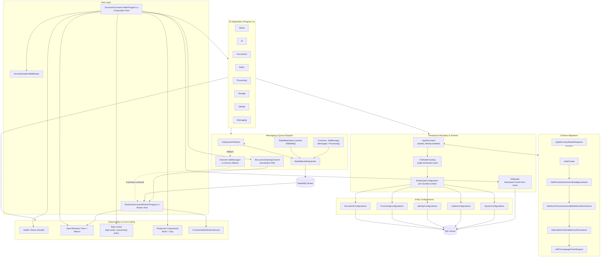
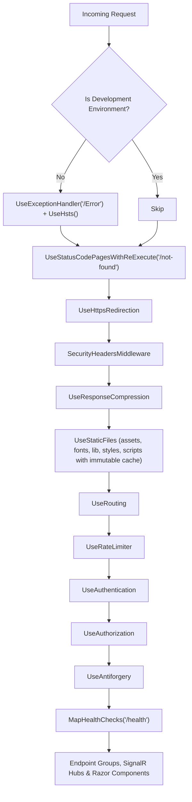
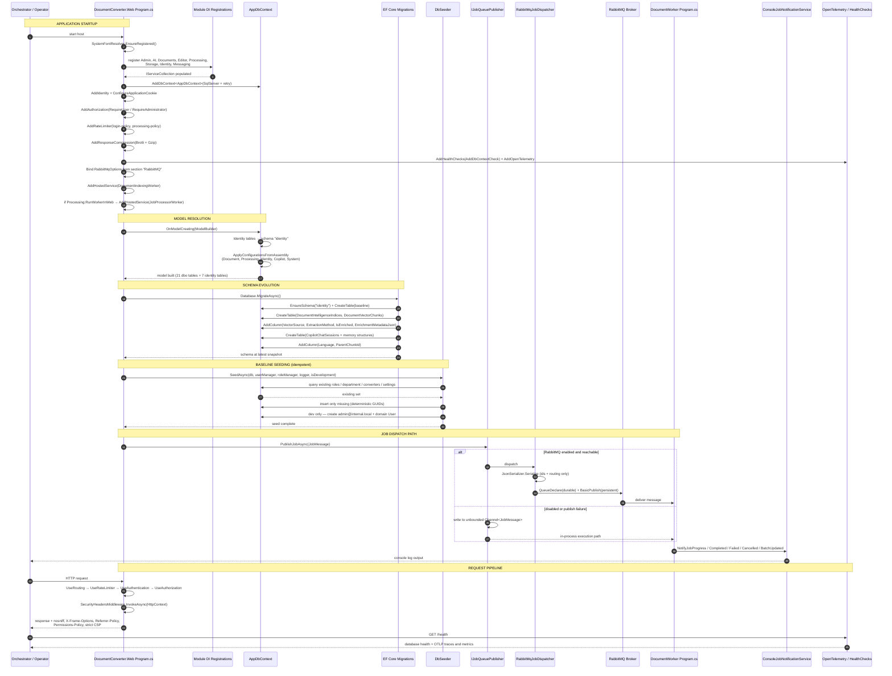

# Platform Infrastructure Domain

**Project:** EConverter — self-hosted enterprise document conversion, management and intelligence platform
**Stack:** .NET 10 / ASP.NET Core · EF Core (SQL Server) · RabbitMQ · Blazor Server + Minimal API · OpenTelemetry
**Domain type:** Infrastructure Domain (no business policy of its own)
**Criticality:** 10.0 / 10 — the composition root is a single point of total failure
**Documented artefact:** repository snapshot at 2026-11-09

---

## 1. Purpose and Position in the Architecture

The Platform Infrastructure Domain is the technical substrate on which every other bounded context in EConverter stands. It owns no business rule. It owns something more consequential: **the conditions under which the application can boot, persist, dispatch and be observed at all.** A misconfigured DI registration, an unapplied migration, a missing schema mapping or an unreachable broker is not a degraded feature — it is a non-starting host.

Four concerns make up its surface:

| # | Submodule | Responsibility | Primary artefacts |
|---|---|---|---|
| 1 | **Persistence Boundary & Schema** | EF Core context, DbSet registration, entity configuration, schema ownership | `AppDbContext.cs`, `Configurations/*.cs` |
| 2 | **Schema Migrations** | Versioned evolution of the physical schema | `Migrations/*.cs`, `AppDbContextModelSnapshot.cs` |
| 3 | **Messaging & Queue Dispatch** | Broker publish path, message contracts, broker-less fallback | `RabbitMqJobDispatcher.cs`, `RabbitMqOptions.cs`, `QueueMessages.cs`, `JobMessage.cs` |
| 4 | **Composition Root & Observability** | DI registration, HTTP pipeline, health checks, OpenTelemetry, hosted services | `Web/Program.cs`, `Workers/DocumentWorker/Program.cs`, `SecurityHeadersMiddleware.cs` |

A fifth, closely-coupled concern — **data seeding** — is documented here because it executes inside the composition root at startup (`DbSeeder.cs`), even though its content is business data.

### 1.1 Governing Design Principle: Declaration Over Logic

The domain is deliberately low-complexity by design. `Web/Program.cs` is 273 lines that read linearly from "create builder" to "run host" with a cyclomatic complexity around 8. `RabbitMqOptions` is a pure data holder. `AppDbContext` contains no query logic. Every persistence concern has exactly one declaration point. The result is infrastructure that is **deterministic, replaceable and independently testable**, and a solution whose remaining layers never see EF Core, RabbitMQ or hosting types directly.

### 1.2 Module Map



---

## 2. Submodule 1 — Persistence Boundary & Schema

### 2.1 `AppDbContext` — the Sealed Boundary

`src/DocumentConverter.Infrastructure/Persistence/AppDbContext.cs` declares the single EF Core context of the solution:

```csharp
public sealed class AppDbContext : IdentityDbContext<AppIdentityUser, IdentityRole<Guid>, Guid>
```

Three decisions in that one line define the persistence boundary:

1. **`sealed`** — the context is not an extension point. Provider-specific or per-module behaviour cannot be silently grafted onto it.
2. **`IdentityDbContext<AppIdentityUser, IdentityRole<Guid>, Guid>`** — ASP.NET Core Identity is not a separate database. Authentication entities live in the *same* database, the *same* migration history and the *same* transaction scope as business aggregates.
3. **`Guid` key type** — chosen so that domain entity IDs are generated client-side, validated by the domain, and never depend on a provider-assigned surrogate. Every configuration in the solution reflects this with `ValueGeneratedNever()`.

#### DbSet Inventory

Twenty-one `DbSet` properties are registered, grouped by aggregate and expressed as expression-bodied properties over `Set<T>()`:

| Group | DbSets |
|---|---|
| **Documents** | `Documents`, `DocumentVersions`, `Folders`, `DocumentVectorChunks`, `DocumentIntelligenceIndices` |
| **Processing** | `Converters`, `ProcessingJobs`, `ProcessingAttempts`, `ProcessingJobInputs`, `ProcessingJobOutputs`, `BatchJobs` |
| **Identity (domain)** | `DomainUsers`, `Departments`, `DomainRoles`, `DomainUserRoles` |
| **Copilot / AI** | `CopilotChatSessions`, `CopilotChatMessages`, `CopilotMemoryItems`, `CopilotUserSettings` |
| **System / Security** | `SystemSettings`, `AuditEvents` |

> **Naming note.** The domain-side identity sets are prefixed (`DomainUsers`, `DomainRoles`, `DomainUserRoles`) to avoid collision with the Identity framework's own `Users` and `Roles` sets inherited from the base class. This is why the physical schema contains two distinct `Users` tables and two distinct `Roles` tables in two different schemas — see §2.3.

### 2.2 `OnModelCreating` — One Declaration Point

```csharp
protected override void OnModelCreating(ModelBuilder builder)
{
    base.OnModelCreating(builder);

    // Keep ASP.NET Identity tables in a dedicated "identity" schema
    builder.Entity<AppIdentityUser>().ToTable("Users", "identity");
    builder.Entity<IdentityRole<Guid>>().ToTable("Roles", "identity");
    builder.Entity<IdentityUserRole<Guid>>().ToTable("UserRoles", "identity");
    builder.Entity<IdentityUserClaim<Guid>>().ToTable("UserClaims", "identity");
    builder.Entity<IdentityUserLogin<Guid>>().ToTable("UserLogins", "identity");
    builder.Entity<IdentityRoleClaim<Guid>>().ToTable("RoleClaims", "identity");
    builder.Entity<IdentityUserToken<Guid>>().ToTable("UserTokens", "identity");

    // Apply domain configurations (schema: dbo)
    builder.ApplyConfigurationsFromAssembly(typeof(AppDbContext).Assembly);
}
```

The method does exactly two things: it relocates the seven Identity framework tables into an **`identity`** schema, and it delegates every remaining decision to `IEntityTypeConfiguration<T>` implementations discovered by assembly scan into the default **`dbo`** schema.

**Why this matters operationally.** Schema separation is a defensible perimeter: the `identity` schema is owned by the framework, `dbo` is owned by the domain. It makes role-based database grants tractable and makes the boundary between "framework tables I must never touch" and "domain tables I own" visible at the database layer rather than only in code.

**Extensibility contract.** Adding a new entity mapping requires touching exactly one file: the configuration file of the owning bounded context. `OnModelCreating` never changes. This is what keeps the context sealed without making it rigid.

### 2.3 Entity Configuration Strategy

Configuration is inverted out of the context into five files, each implementing one `IEntityTypeConfiguration<T>` **per entity**:

| Configuration file | Entities configured | Schema / table |
|---|---|---|
| `DocumentConfigurations.cs` | `Document`, `DocumentVersion`, `DocumentVectorChunk`, `DocumentIntelligenceIndex`, `Folder` | `Documents`, `DocumentVersions`, `DocumentVectorChunks`, `DocumentIntelligenceIndices`, `Folders` |
| `ProcessingConfigurations.cs` | `Converter`, `ProcessingJob`, `ProcessingAttempt`, `ProcessingJobInput`, `ProcessingJobOutput`, `BatchJob` | `Converters`, `ProcessingJobs`, `ProcessingAttempts`, `ProcessingJobInputs`, `ProcessingJobOutputs`, `BatchJobs` |
| `IdentityConfigurations.cs` | `Department`, `User`, `Role`, `UserRole` | `Departments`, `Users`, `Roles`, `UserRoles` |
| `CopilotConfigurations.cs` | `CopilotChatSession`, `CopilotChatMessage`, `CopilotMemoryItem`, `CopilotUserSettings` | `CopilotChatSessions`, `CopilotChatMessages`, `CopilotMemoryItems`, `CopilotUserSettings` |
| `SystemConfigurations.cs` | `AuditEvent`, `SystemSetting` | `AuditEvents`, `SystemSettings` |

> **Structural observation.** `AuditEvent` is a `Domain/Security` aggregate but is configured inside `SystemConfigurations.cs`. This is a deliberate consolidation at the persistence layer — one file per *storage concern*, not per source-code folder — but it means the persistence boundary's file organisation does not mirror the domain's module organisation. The mapping table above is the authoritative key.

#### Persistence Techniques Used

Five configuration patterns are applied repeatedly and are worth recognising as the domain's idioms:

**1. Enum-as-string conversion.** Enums are persisted as readable strings rather than ordinals so schema inspection is self-documenting and reordering an enum cannot silently corrupt data.

```csharp
builder.Property(d => d.Status).HasConversion<string>().HasMaxLength(50).IsRequired();
builder.Property(j => j.Status).HasConversion<string>().HasMaxLength(50).IsRequired();
builder.Property(c => c.Fidelity).HasConversion<string>().HasMaxLength(50).IsRequired();
builder.Property(b => b.Mode).HasConversion<string>().HasMaxLength(50).IsRequired();
```

**2. JSON value conversion for collection and payload columns.** Format arrays and complex payload columns are stored as JSON in `nvarchar` columns rather than exploded into relational child tables — a deliberate read-amplification trade-off. `ProcessingConfigurations` supplies an explicit `ValueComparer<string[]>` so EF Core change tracking compares arrays **by sequence**, not by reference:

```csharp
var stringArrayComparer = new ValueComparer<string[]>(
    (c1, c2) => (c1 == null && c2 == null) || (c1 != null && c2 != null && c1.SequenceEqual(c2)),
    c => c.Aggregate(0, (a, v) => HashCode.Combine(a, v.GetHashCode())),
    c => c.ToArray());

builder.Property(c => c.InputFormats)
       .HasConversion(v => JsonSerializer.Serialize(v, (JsonSerializerOptions?)null),
                      v => JsonSerializer.Deserialize<string[]>(v, (JsonSerializerOptions?)null) ?? Array.Empty<string>())
       .Metadata.SetValueComparer(stringArrayComparer);
```

Without this comparer, EF Core would consider a mutated array a change on every save or an unchanged value after mutation — a classic silent data-loss defect. Its presence here is a sign of a deliberately engineered persistence layer.

**3. Optimistic concurrency on the job aggregate.** `ProcessingJob` carries a row version, which is the mechanism that makes concurrent worker claiming safe at the database level:

```csharp
builder.Property(j => j.RowVersion).IsRowVersion();
```

**4. Constrained delete semantics — the most consequential design choice in the file.** Delete behaviour is chosen per relationship, not defaulted:

| Relationship | Behaviour | Rationale |
|---|---|---|
| `Document.Versions` | `Cascade` | Version history has no meaning without its document |
| `DocumentVectorChunk.Document` | `Cascade` | Derived index data dies with the source |
| `DocumentIntelligenceIndex.Document` | `Cascade` | Derived intelligence dies with the source |
| `ProcessingJob.Attempts / Inputs / Outputs` | `Cascade` | Execution records are part of the job |
| `User.Roles` | `Cascade` | Role membership is owned by the user |
| `Document.OwnerUserId → User` | **`Restrict`** | An audit-relevant owner must not vanish silently |
| `ProcessingJob.OwnerUserId / InputDocumentId / ConverterId` | **`Restrict`** | Job lineage is evidence; refuse the delete |
| `DocumentVersion.CreatedByUserId` | **`Restrict`** | Version authorship is provenance |
| `Folder.ParentFolderId` | **`Restrict`** | Prevents cascade deletion of an entire subtree |
| `Document.FolderId` | `SetNull` | Unfiling a document must not delete it |
| `CopilotChatSession.FolderScopeId` | `SetNull` | A conversation outlives the folder it was scoped to |
| `AuditEvent.UserId` | `SetNull` | The audit record survives user removal |
| `SystemSetting.UpdatedByUserId` | `SetNull` | Configuration outlives the administrator |
| `DepartmentId` on User | `SetNull` | Reorganisations must not cascade into personnel records |

The pattern is consistent: **derived and owned data cascades; referenced and evidentiary data restricts or nulls.** This is what prevents a folder deletion from silently erasing a document tree, and what prevents user deactivation from erasing the audit trail that would explain it.

**5. Purpose-built indexing on the query paths that matter.** Indexes are declared against the access patterns the workflows actually use:

```csharp
// Documents — ownership-scoped listing, status filtering, storage-key uniqueness
builder.HasIndex(d => new { d.OwnerUserId, d.CreatedAt });
builder.HasIndex(d => d.Status);
builder.HasIndex(d => d.StorageKey).IsUnique();
builder.HasIndex(d => d.SourceProcessingJobId).IsUnique()
       .HasFilter("[SourceProcessingJobId] IS NOT NULL");

// ProcessingJobs — owner listing, worker selection, batch aggregation
builder.HasIndex(j => new { j.OwnerUserId, j.CreatedAt });
builder.HasIndex(j => new { j.Status, j.CreatedAt });   // drives the worker claim query
builder.HasIndex(j => j.BatchJobId);                     // drives batch completion recompute

// DocumentVectorChunks — retrieval and provenance filtering
builder.HasIndex(c => new { c.DocumentId, c.ChunkIndex });
builder.HasIndex(c => new { c.DocumentId, c.IsEnriched });
builder.HasIndex(c => new { c.DocumentId, c.Language });
builder.HasIndex(c => c.ParentChunkId);

// ProcessingAttempts — one attempt number per job, enforced
builder.HasIndex(a => new { a.ProcessingJobId, a.AttemptNumber }).IsUnique();
```

Two of these earn particular attention:

- **`IX_ProcessingJobs_Status_CreatedAt`** is the index behind the worker's claim query — the single hottest read in the system, executed in a poll loop by every worker instance.
- **The filtered unique index on `SourceProcessingJobId`** enforces at the database layer that one processing job can produce at most one derived document, while permitting unlimited rows where the column is NULL.

### 2.4 Schema Inventory

The result of the configuration layer is a physical schema of **21 domain tables in `dbo`** plus **7 Identity framework tables in `identity`**:

| Schema | Tables |
|---|---|
| `identity` | `Users`, `Roles`, `UserRoles`, `UserClaims`, `UserLogins`, `RoleClaims`, `UserTokens` |
| `dbo` | `Users`, `Roles`, `UserRoles`, `Departments`, `Documents`, `DocumentVersions`, `Folders`, `DocumentVectorChunks`, `DocumentIntelligenceIndices`, `Converters`, `ProcessingJobs`, `ProcessingAttempts`, `ProcessingJobInputs`, `ProcessingJobOutputs`, `BatchJobs`, `CopilotChatSessions`, `CopilotChatMessages`, `CopilotMemoryItems`, `CopilotUserSettings`, `AuditEvents`, `SystemSettings` |

### 2.5 Notable Column Decisions

| Column | Type / shape | Why it is interesting |
|---|---|---|
| `Documents.Sha256Hash`, `DocumentVersions.Sha256Hash` | `nvarchar(64)`, fixed length | Fixed-length hex — integrity verification is a first-class persisted property, not a transient check |
| `DocumentVectorChunks.Embedding` | `varbinary(1024)` | A 256-dimension float32 vector (256 × 4 bytes) stored as an opaque binary blob — the local index's durable backing store |
| `DocumentVectorChunks.VectorSource` | `nvarchar(80)`, default `"Actual Document"` | Provenance discriminator — records whether a vector came from real content or enrichment |
| `DocumentVectorChunks.ExtractionMethod` | `nvarchar(100)`, default `"MarkItDown"` | Records which extractor produced the chunk, enabling re-indexing decisions |
| `DocumentVectorChunks.EnrichmentMetadataJson` | `nvarchar(max)`, nullable | Schema-free enrichment payload |
| `DocumentVectorChunks.Language` | `nvarchar(10)`, default `"orig"` | Tri-language discriminator with a composite index |
| `DocumentVectorChunks.ParentChunkId` | `uniqueidentifier`, nullable | Self-referencing hierarchy for parent/child chunk relationships |
| `CopilotChatMessages.CitationsJson`, `SuggestedFollowUpsJson`, `AppliedMemoriesJson` | `nvarchar(max)` | Conversational context serialised rather than relationally modelled |
| `Converters.InputFormats` / `OutputFormats` | `nvarchar(1000)` as JSON | Format sets as JSON; bounded by an explicit max length |
| `ProcessingJobs.RowVersion` | `rowversion` | The concurrency token that arbitrates worker claims |

---

## 3. Submodule 2 — Schema Migrations

Migrations are the versioned contract between the code model and the physical schema. The domain carries five ordered migrations plus the auto-generated model snapshot.

### 3.1 Migration Chain

| Order | Migration | What it establishes | Reversible |
|---|---|---|---|
| 1 | `20261006101055_InitialCreate` | `EnsureSchema("identity")`; creates the Identity framework tables and the full baseline domain table set (Converters, Departments, Roles, Users, Folders, Documents, DocumentVersions, ProcessingJobs family, BatchJobs, AuditEvents, SystemSettings) | ✅ `Down()` drops all created tables |
| 2 | `20261028164624_AddPersistentVectorAndIntelligenceIndex` | Creates `DocumentIntelligenceIndices` and `DocumentVectorChunks` with the unique DocumentId index on the intelligence table and the composite `(DocumentId, ChunkIndex)` index on chunks | ✅ `Down()` drops both tables |
| 3 | `20261029080000_AddVectorProvenanceAndMarkItDownEnrichment` | Adds `EnrichmentMetadataJson`, `ExtractionMethod` (default `"MarkItDown"`), `IsEnriched` (default `false`), `VectorSource` (default `"Actual Document"`) to `DocumentVectorChunks`; creates `IX_DocumentVectorChunks_DocumentId_IsEnriched` | ✅ `Down()` drops index then the four columns |
| 4 | `20261029141045_AddCopilotChatAndMemoryPersistence` | Creates `CopilotChatSessions`, `CopilotMemoryItems`, `CopilotUserSettings` and the supporting message table, with `SetNull` on `FolderScopeId` and `Restrict` on `UserId` | ✅ `Down()` drops created tables |
| 5 | `20261102170000_AddTriLanguageChunkSupport` | Adds `Language` (`nvarchar(10)`, default `"orig"`) and nullable `ParentChunkId` to `DocumentVectorChunks`; creates `IX_DocumentVectorChunks_DocumentId_Language` and `IX_DocumentVectorChunks_ParentChunkId` | ✅ `Down()` drops both indexes then both columns |

### 3.2 Reading the Chain as Product History

The migration ordering is unusually legible — it is the product roadmap written into the schema:

1. **Baseline** — documents, folders, versions, jobs, audit.
2. **Intelligence arrives** — persistent vector chunks and per-document intelligence index. This is the moment semantic search became durably backed rather than in-memory only.
3. **Provenance arrives** — chunks gain a record of *where they came from* and *how they were extracted*. Provenance-before-trust is the right order.
4. **Conversation arrives** — Copilot sessions, memory items and per-user settings become persisted state rather than process-resident.
5. **Multilingual refinement** — a language discriminator and parent/child chunk linkage, enabling language-scoped retrieval.

### 3.3 `AppDbContextModelSnapshot`

`AppDbContextModelSnapshot.cs` (~1,480 lines) is the `[DbContext(typeof(AppDbContext))]`-attributed snapshot of the expected model. It is not documentation — it is a **drift detector**. At design time, EF Core diffs the current model against this snapshot; any unexplained divergence surfaces as a pending model change. It is the mechanism that makes "the code model and the database agree" a verifiable property rather than a hope.

Companion `.Designer.cs` files accompany each migration and capture the model state *as of that migration* — enabling EF Core to reconstruct intermediate states correctly when applying a long migration chain to an older database.

### 3.4 Migration Contract

Three guarantees the migration chain provides to callers:

- **Ordering** — an existing deployment can be upgraded from the `InitialCreate` baseline to tri-language chunk support without manual intervention and without data loss.
- **Reversibility** — every migration's `Down()` drops or removes exactly what its `Up()` created, in dependency order (indexes before columns, child tables before parents).
- **Non-destructive column additions** — all added columns in migrations 3 and 5 are either nullable or carry explicit defaults, so existing rows remain valid immediately after the DDL applies.

---

## 4. Submodule 3 — Data Seeding

`DbSeeder.cs` is a static class that establishes the platform's baseline data on every startup. It is designed around one property: **idempotency through check-then-insert**.

```csharp
public static async Task SeedAsync(
    AppDbContext db,
    UserManager<AppIdentityUser>? userManager,
    RoleManager<IdentityRole<Guid>>? identityRoleManager,
    ILogger logger,
    bool isDevelopment)
```

### 4.1 Deterministic Identifiers

```csharp
public static readonly Guid DefaultDepartmentId = new("11111111-1111-1111-1111-111111111111");
```

Converter identifiers follow the same discipline (`a0000001-0000-0000-0000-000000000001` … `-014`). Deterministic GUIDs make seeded state reproducible across every environment, which means a developer's database, a CI database and a production database agree on the identity of every seeded row. This is what allows tooling, scripts and tests to reference a seeded entity by a constant rather than by lookup.

### 4.2 Seed Phases

| Phase | Guard | Content |
|---|---|---|
| **1. Domain roles** | `!await db.DomainRoles.AnyAsync()` | `User` and `Administrator` domain roles with fixed IDs (`RoleNames.UserRoleId`, `RoleNames.AdministratorRoleId`) |
| **1b. Identity roles** | per-role `RoleExistsAsync` | Mirrors `User` and `Administrator` into the ASP.NET Core Identity role store |
| **2. Default department** | `!await db.Departments.AnyAsync()` | `General` department under `DefaultDepartmentId` |
| **3. Converter catalogue** | per-converter `AnyAsync(c => c.Key == def.Key)` | 14 converter definitions — see §4.3 |
| **4. System settings** | per-setting `AnyAsync(s => s.Key == key)` | `Retention.Days`=90, `Upload.MaxSizeBytes`=104857600, `OCR.EnabledLanguages`=`eng,ind,jpn,chi_sim`, `Processing.MaxConcurrentJobsPerUser`=5 |
| **5. Development admin** | `isDevelopment && userManager is not null` | `admin@internal.local` with both `Administrator` and `User` roles, plus a matching domain `User` aggregate |

Phase 5 is the most notable: the seeder writes **both** an Identity user and a domain `User` aggregate, binding them by the same `Guid` and linking the domain user to `DefaultDepartmentId`. That dual write is the concrete demonstration of the shared-schema design described in §2.1 — Identity authentication state and domain authorization state coexist as two rows in two schemas keyed on one identity.

Phase 3 carries a development affordance worth flagging: when `isDevelopment` is true, every seeded converter is immediately marked validation-passed and enabled so all workflows are exercisable locally. In other environments converters arrive unvalidated and disabled, which is the correct production posture.

### 4.3 The Seeded Converter Catalogue

The seed list is effectively the product's capability manifest:

| Key | Operation | Inputs → Outputs | Processor | Queue | Fidelity | Max size / pages |
|---|---|---|---|---|---|---|
| `image-to-pdf` | convert | jpg, jpeg, png, bmp, webp, tif, tiff → pdf | `image-processor` | `document.image` | Supported | 50 MB |
| `pdf-to-image` | render | pdf → png, jpg | `pdf-processor` | `document.processing` | Supported | 100 MB / 500 |
| `pdf-merge` | merge | pdf → pdf | `pdf-processor` | `document.processing` | Supported | 200 MB / 1000 |
| `pdf-split` | split | pdf → pdf | `pdf-processor` | `document.processing` | Supported | 200 MB / 1000 |
| `word-to-pdf` | convert | docx, doc, odt → pdf | `office-processor` | `document.office` | Supported | 100 MB / 500 |
| `pdf-to-word` | convert | pdf → docx | `office-processor` | `document.office` | **BestEffort** | 100 MB / 200 |
| `ocr` | ocr | pdf, jpg, jpeg, png, tif, tiff → pdf, txt | `ocr-processor` | `document.ocr` | Supported | 100 MB / 300 |
| `excel-to-pdf` | convert | xlsx, xls, csv → pdf | `office-processor` | `document.office` | Supported | 100 MB / 500 |
| `pdf-to-excel` | extract-tables | pdf → xlsx, csv | `office-processor` | `document.office` | **BestEffort** | 100 MB / 200 |
| `presentation-to-pdf` | convert | pptx, ppt, odp → pdf | `office-processor` | `document.office` | Supported | 150 MB / 500 |
| `markdown-html-to-pdf` | convert | md, markdown, html, htm → pdf | `office-processor` | `document.office` | Supported | 50 MB / 300 |
| `ebook-to-pdf` | convert | epub, mobi → pdf | `office-processor` | `document.office` | Supported | 100 MB / 1000 |
| `pdf-compress` | compress | pdf → pdf | `pdf-compress-processor` | `document.processing` | Supported | 200 MB / 1000 |
| `image-compress` | compress | jpg, jpeg, png, webp, bmp, tif, tiff, gif → jpg, jpeg, png, webp | `image-compress-processor` | `document.image` | Supported | 100 MB |

Three properties of this catalogue are architecturally significant:

1. **`Fidelity` is a first-class, honest field.** Only two converters are declared `BestEffort` (`pdf-to-word`, `pdf-to-excel`) — precisely the two transformations where layout reconstruction is genuinely lossy. The catalogue tells the truth about its own limitations.
2. **`ConfigurationSchema` is a JSON Schema string** on the converters that accept options (dpi/format for rendering, pageRanges for splitting, language/outputMode for OCR, orientation for spreadsheets, layout for presentations, preset/quality/stripMetadata for compression). The UI can therefore render an option form generically from the catalogue row rather than hard-coding a form per converter.
3. **Queue names are per-family, not per-converter** (`document.processing`, `document.office`, `document.image`, `document.ocr`). Routing is by workload class, which is what makes independent worker scaling per workload class possible — an OCR-heavy deployment can dedicate consumers to `document.ocr` without starving Office conversions.

---

## 5. Submodule 4 — Messaging & Queue Dispatch

The messaging submodule carries a lightweight message from the web host to a worker. Its central discipline: **the message carries identifiers and routing metadata only, never document content.**

### 5.1 Message Contracts — Two Types, Two Transports

The solution defines **two distinct `JobMessage` record types**, and conflating them is the most common source of confusion in this area:

**`DocumentConverter.Contracts.Processing.JobMessage`** — the one actually used by the publish path:

```csharp
public sealed record JobMessage(
    Guid JobId,
    Guid DocumentId,
    string Operation,
    string ProcessorId,
    Guid RequestedBy,
    string? QueueName = null);
```

**`DocumentConverter.Contracts.Messages.JobMessage`** — a richer dispatch shape:

```csharp
public sealed record JobMessage(
    Guid JobId,
    Guid DocumentId,
    Guid? VersionId,
    Guid ConverterId,
    string Operation,
    string ProcessorId,
    Guid RequestedByUserId,
    int AttemptNumber,
    DateTime CreatedAt);
```

Plus a progress-event contract flowing in the opposite direction:

```csharp
public sealed record JobProgressEventMessage(
    Guid JobId, Guid OwnerUserId, string Status, int ProgressPercent,
    string? ErrorCode, string? ErrorMessage, DateTime Timestamp);
```

| Contract | Namespace | Consumers | Notes |
|---|---|---|---|
| `JobMessage` (6 fields) | `Contracts.Processing` | `IJobQueuePublisher`, `RabbitMqJobDispatcher`, `DocumentWorker.Worker` | **The live wire format.** Includes optional `QueueName` enabling per-message queue override |
| `JobMessage` (9 fields) | `Contracts.Messages` | Documented dispatch shape; not referenced by the dispatcher implementation | Richer: carries `ConverterId`, `AttemptNumber`, `CreatedAt`, `VersionId` |
| `JobProgressEventMessage` | `Contracts.Messages` | Worker → Web progress reporting | Carries the user-safe `ErrorCode` rather than raw exceptions |

Both `JobMessage` types carry an explicit XML-doc prohibition:

> `MUST NOT contain document binary content.`

Both are `sealed record` types with positional parameters — immutable by construction. A message cannot be mutated in flight, and the compiler enforces the shape at both publish and consume sites. `System.Text.Json` serialises them directly.

**The 6-field `QueueName` field is operationally important.** `RabbitMqJobDispatcher` resolves the destination queue as:

```csharp
var queueName = string.IsNullOrWhiteSpace(message.QueueName) ? _options.QueueName : message.QueueName;
```

This means the converter catalogue's per-family queue names (§4.3) can be honoured per message, falling back to the global default `document.processing`.

### 5.2 `RabbitMqOptions` — Pure Configuration

```csharp
public sealed class RabbitMqOptions
{
    public const string SectionName = "RabbitMQ";

    public bool Enabled { get; set; }
    public string Host { get; set; } = "localhost";
    public int Port { get; set; } = 5672;
    public string UserName { get; set; } = "guest";
    public string Password { get; set; } = "guest";
    public string QueueName { get; set; } = "document.processing";
    public string ExchangeName { get; set; } = "document.exchange";
}
```

A pure data holder bound from the `RabbitMQ` configuration section through `IOptions<RabbitMqOptions>`. Eight settable auto-properties, **zero logic**. Enabling or disabling the broker, changing host/port/credentials, or renaming the queue is a configuration operation, never a code change.

Note that the worker's `appsettings.json` sets `"Enabled": false` while the docker-compose files set `RabbitMQ__Enabled=true` — configuration layering, not a contradiction.

### 5.3 `RabbitMqJobDispatcher` — Publish Path with Graceful Degradation

`RabbitMqJobDispatcher` is `sealed` and implements both `IJobQueuePublisher` and `IAsyncDisposable`. Its structure is a two-tier publish strategy: broker first, in-memory channel second.

**Tier 1 — RabbitMQ (when `Enabled` is true).** Connection creation is lazy and guarded by `SemaphoreSlim _initLock = new(1, 1)` with a double-check, so concurrent first-publishes cannot race into multiple connections:

```csharp
var factory = new ConnectionFactory
{
    HostName = _options.Host,
    Port   = _options.Port,
    UserName = _options.UserName,
    Password = _options.Password,
    AutomaticRecoveryEnabled = true
};
_connection = await factory.CreateConnectionAsync(cancellationToken);
_channel = await _connection.CreateChannelAsync(cancellationToken: cancellationToken);
```

Publication declares a durable queue and sends a persistent message:

```csharp
await channel.QueueDeclareAsync(queueName, durable: true, exclusive: false,
                                autoDelete: false, arguments: null, ct);
var json = JsonSerializer.Serialize(message);
var props = new BasicProperties { DeliveryMode = DeliveryModes.Persistent };
await channel.BasicPublishAsync(exchange: string.Empty, routingKey: queueName,
                                mandatory: false, basicProperties: props, body: body, ct);
```

Two details worth noting precisely:

- **Exchange is the empty string.** The dispatcher publishes to the default (nameless) exchange with the queue name as routing key — direct routing without a declared exchange. `RabbitMqOptions.ExchangeName` exists and defaults to `document.exchange`, but is not used by this publish call. A future exchange-based topology is anticipated but not yet wired.
- **`QueueName` is resolved per message**, allowing the converter catalogue to route to `document.office`, `document.ocr`, `document.image` or `document.processing` independently.
- **`DeliveryMode.Persistent` + `durable: true`** means the broker survives a restart without losing queued jobs. This is essential precisely *because* the database is the authoritative state — the queue is not allowed to be the lossy element.

**Tier 2 — in-memory `Channel<JobMessage>` (fallback).** The dispatcher owns an unbounded channel:

```csharp
_fallbackChannel = Channel.CreateUnbounded<JobMessage>(new UnboundedChannelOptions
{
    SingleReader = false,
    SingleWriter = false
});
public ChannelReader<JobMessage> FallbackReader => _fallbackChannel.Reader;
```

The fallback is entered in two situations: when `Enabled` is false, and — importantly — **when a broker publish throws**:

```csharp
catch (Exception ex)
{
    _logger.LogWarning(ex, "Failed to publish job {JobId} to RabbitMQ. Falling back to internal channel.", message.JobId);
}
// Graceful fallback to channel so jobs are never dropped
await _fallbackChannel.Writer.WriteAsync(message, cancellationToken);
```

**Design verdict.** The jobs are never dropped at the publish boundary. A broker outage degrades the platform to in-process execution rather than failing the request. `AutomaticRecoveryEnabled = true` handles transient reconnects; the channel handles the case where connectivity never establishes. Teardown is explicit through `DisposeAsync()` returning `ValueTask`, closing the channel then the connection, and disposing the init lock.

**Residual risk.** The fallback channel is *unbounded* and *process-local*. In a multi-instance deployment, a job written to instance A's fallback channel is visible only to instance A. The current compose topology (`Processing__RunWorkerInWeb=false`) avoids this by not running the in-process worker, but any deployment that enables it while running multiple web replicas must be aware that broker failure converts a distributed queue into per-instance queues.

### 5.4 `IJobQueuePublisher` — the Single Publish Seam

```csharp
public interface IJobQueuePublisher
{
    Task PublishJobAsync(JobMessage message, CancellationToken cancellationToken = default);
}
```

One method, one parameter type, one cancellation token. Because the web host only ever holds an `IJobQueuePublisher` reference, switching between real broker dispatch and in-process execution is a **DI registration decision, not a code change** — the consumer of the interface cannot tell which transport it is talking to.

### 5.5 `IDocumentIndexingChannel` — the Second, Independent Queue

A separate high-throughput channel exists for the AI indexing path, deliberately decoupled from RabbitMQ:

```csharp
var options = new BoundedChannelOptions(10_000)
{
    FullMode = BoundedChannelFullMode.Wait,
    SingleReader = true,
    SingleWriter = false
};
```

| Property | Value | Consequence |
|---|---|---|
| Capacity | 10,000 document IDs | Bounded — memory cannot grow without limit |
| `FullMode` | `Wait` | Producers apply backpressure instead of dropping or throwing |
| `SingleReader` | `true` | One `DocumentIndexingWorker` drains it — ordering preserved |
| `SingleWriter` | `false` | Many request threads may enqueue concurrently |
| `QueuedCount` | `Interlocked`-maintained counter | Observable depth without touching the channel |

Two enqueue methods exist for two calling contexts: `TryQueueDocument(Guid)` is non-blocking (for hot upload/conversion endpoints that must not await), and `QueueDocumentAsync(Guid, CancellationToken)` supports awaited enqueue. The negative case is logged rather than thrown — a full indexing channel must never fail a user upload:

```csharp
_logger.LogWarning("Indexing channel is at maximum capacity; failed to write document {DocumentId}", documentId);
return false;
```

---

## 6. Submodule 5 — Composition Root & Observability

### 6.1 `DocumentConverter.Web/Program.cs` — the Composition Root

The web host's entry point is 273 lines of linear, declarative registration. It is the only place in the solution where modules are assembled.

**Bootstrap step before the builder exists:**

```csharp
SystemFontResolver.EnsureRegistered();
```

PDFsharp's font resolver is initialised before `CreateBuilder`, because PDF generation and OCR must not depend on a request ever having occurred. This is a cross-platform correctness requirement — without it, glyph rendering for embedded text operations fails on Linux containers.

**Module registration sequence (the integration surface).** Eight functional groups publish their services into the same `IServiceCollection`:

| # | Group | Representative registrations | Lifetime |
|---|---|---|---|
| 1 | **Persistence & Identity** | `AddDbContext<AppDbContext>` (SQL Server, retry on failure), `AddIdentity<AppIdentityUser, IdentityRole<Guid>>`, `ConfigureApplicationCookie` | Scoped / Singleton |
| 2 | **Auth & Context** | `IClaimsTransformation → AppClaimsTransformation`, `IHttpContextAccessor`, `IUserContext → HttpContextUserContext`, authorization policies `RequireUser` / `RequireAdministrator` | Scoped |
| 3 | **Infrastructure & Storage** | `IStorageEncryptionService → AesGcmStorageEncryptionService` **(Singleton)**, `IDocumentStorage → FileSystemDocumentStorage`, `IMalwareScanner → ClamAvScanner`, `IAuditService → AuditService` | Mixed |
| 3b | **Domain services** | `IAdminService`, `IDocumentService`, `IConverterCatalogService`, `IProcessingService` | Scoped |
| 3c | **Engines & processors** | `IOcrEngine`, `IScannedPdfDetector`, `IPdfCapabilityAnalyzer`, four `Office/*` converters, and **seven `IDocumentProcessor` registrations** (`Office`, `Pdf`, `Image`, `PdfCompress`, `ImageCompress`, `Ocr`, `Echo`) | Singleton |
| 3d | **Editor & AI** | `IPdfEngine`, `ICompressionEstimatorService`, `IPdfDigitalSignatureService`, `IExternalAiClient`, `IDocumentIndexingChannel` **(Singleton)**, `IDocumentIntelligenceService` | Mixed |
| 3e | **Hosted services** | `DocumentIndexingWorker`; `JobProcessorWorker` **conditionally**; `CdpDownloadWatcher` | Hosted |
| 3f | **Realtime** | `AddSignalR()`, `IJobNotificationService → JobNotificationService` (Singleton) | Singleton |
| 3g | **Messaging** | `Configure<RabbitMqOptions>`, `RabbitMqJobDispatcher` (Singleton), `IJobQueuePublisher → same instance` | Singleton |
| 4 | **UI** | `AddRadzenComponents()`, `EnterpriseAiChatService`, `IAIChatService → same instance` | Scoped |
| 5 | **Cross-cutting** | Rate limiter, response compression, Razor components + interactive server | — |
| 6 | **Observability** | Health checks, OpenTelemetry | — |

Four registration details carry architectural weight:

**a) The encryption service is a Singleton while storage is Scoped.** `AesGcmStorageEncryptionService` derives and holds the master KEK in its constructor. Making it Singleton means key derivation happens once per process rather than per request — correct both for performance and for the operational guarantee that the key material has exactly one in-memory representation.

**b) Seven `IDocumentProcessor` implementations register against one interface.** Resolution yields `IEnumerable<IDocumentProcessor>`, which is how the worker and the catalog discover processors without a switch statement anywhere.

**c) The dispatcher is registered once and exposed through two faces:**

```csharp
builder.Services.AddSingleton<RabbitMqJobDispatcher>();
builder.Services.AddSingleton<IJobQueuePublisher>(sp => sp.GetRequiredService<RabbitMqJobDispatcher>());
```

The concrete type and the interface are the *same instance*, so connection lifecycle and `DisposeAsync` are managed exactly once by the container.

**d) The in-process worker is opt-in via configuration with a `true` default:**

```csharp
if (builder.Configuration.GetValue<bool>("Processing:RunWorkerInWeb", true))
{
    builder.Services.AddHostedService<JobProcessorWorker>();
}
```

> **Precision note.** The default in code is **`true`** — an unconfigured host runs the in-process job processor. Both docker-compose files explicitly set `Processing__RunWorkerInWeb=false`, overriding that default. This means the in-process path is *available and default-on*, but *deliberately disabled in container deployments* in favour of the standalone worker. Any deployment that omits the setting inherits in-process processing.

#### Rate Limiting

```csharp
builder.Services.AddRateLimiter(options =>
{
    options.RejectionStatusCode = StatusCodes.Status429TooManyRequests;
    options.AddFixedWindowLimiter("login-policy", limiter =>
    {
        limiter.PermitLimit = 10;
        limiter.Window = TimeSpan.FromMinutes(1);
        limiter.QueueProcessingOrder = QueueProcessingOrder.OldestFirst;
        limiter.QueueLimit = 0;
    });
    options.AddConcurrencyLimiter("processing-policy", limiter =>
    {
        limiter.PermitLimit = 20;
        limiter.QueueProcessingOrder = QueueProcessingOrder.OldestFirst;
        limiter.QueueLimit = 10;
    });
});
```

Two policies, two different shapes chosen deliberately:

- **`login-policy`** is a **fixed window** of 10 attempts per minute with `QueueLimit = 0` — a brute-force control that must *reject*, never queue. It is applied in `AccountEndpoints` via `.RequireRateLimiting("login-policy")`.
- **`processing-policy`** is a **concurrency limiter** of 20 in-flight requests with a 10-deep queue — an admission control that smooths bursts rather than rejecting them. It is applied to job and batch creation endpoints.

This is the platform's existing answer to the "queue backpressure and admission control" concern: burst capacity is bounded at the API boundary, per-endpoint, with distinct semantics for security (reject) versus capacity (queue).

#### Response Compression

```csharp
builder.Services.AddResponseCompression(options =>
{
    options.EnableForHttps = true;
    options.Providers.Add<BrotliCompressionProvider>();
    options.Providers.Add<GzipCompressionProvider>();
    options.MimeTypes = ResponseCompressionDefaults.MimeTypes.Concat([
        "image/svg+xml", "application/font-woff2", "font/woff2",
        "application/javascript", "text/css"
    ]);
});
```

Brotli preferred with Gzip fallback, extended to cover SVG, WOFF2 fonts, JavaScript and CSS — the asset classes a self-hosted Blazor application serves most heavily.

### 6.2 The HTTP Request Pipeline — Order Is the Contract

The pipeline is assembled once, in a specific order, and that order encodes security and correctness decisions:



Five ordering choices that are not arbitrary:

| Position | Component | Why here |
|---|---|---|
| Early | `UseExceptionHandler` + `UseHsts` | Production-only; HSTS must precede any response that could be cached |
| Before routing | `SecurityHeadersMiddleware` | Headers must be attached to **every** response, including 404s and errors — placing it after routing would exempt unmatched routes |
| Before static files | `UseResponseCompression` | A response can only be compressed once, before its body is written |
| After routing | `UseRateLimiter` | Rate limiting needs the resolved endpoint to select the right policy; global placement would be policy-blind |
| Before authorization | `UseAuthentication` | Authorization depends on a populated `HttpContext.User` |
| After all of it | `MapHealthChecks`, endpoint groups, SignalR, Razor | Endpoints are terminal; middleware registered later never runs |

**Static-asset caching** is applied selectively through `OnPrepareResponse`:

```csharp
if (path.StartsWith("/assets/") || path.StartsWith("/fonts/") || path.StartsWith("/lib/") ||
    path.StartsWith("/css/")  || path.EndsWith(".woff2") || path.EndsWith(".svg") ||
    path.EndsWith(".png")     || path.EndsWith(".ico")   || path.EndsWith(".js") ||
    path.EndsWith(".css"))
{
    ctx.Context.Response.Headers.Append("Cache-Control", "public, max-age=31536000, immutable");
}
```

`max-age=31536000, immutable` is only sound because these paths are content-addressed by deployment. It removes revalidation traffic for fonts, PDF.js bundles and Radiance assets — meaningful for a Blazor Server app where every user session streams a substantial asset payload.

### 6.3 `SecurityHeadersMiddleware` — Universal Response Hardening

```csharp
context.Response.Headers.Append("X-Content-Type-Options", "nosniff");
context.Response.Headers.Append("X-Frame-Options", "SAMEORIGIN");
context.Response.Headers.Append("Referrer-Policy", "strict-origin-when-cross-origin");
context.Response.Headers.Append("Permissions-Policy", "geolocation=(), microphone=(), camera=()");

var csp = "default-src 'self'; " +
          "img-src 'self' data: blob:; " +
          "font-src 'self' data:; " +
          "style-src 'self' 'unsafe-inline'; " +
          "script-src 'self' 'unsafe-inline' 'unsafe-eval'; " +
          "connect-src 'self' ws: wss:; " +
          "frame-src 'self' blob: data:; " +
          "frame-ancestors 'self'; " +
          "form-action 'self'; " +
          "base-uri 'self';";
```

The middleware is `sealed`, holds a single `RequestDelegate _next`, and appends headers before delegating. Its most consequential property is **the absence of any endpoint knowledge** — it is not opt-in and there is no per-endpoint bypass. Every response from the host carries these headers.

Structural assessment of the policy:

| Directive | Value | Assessment |
|---|---|---|
| `default-src` | `'self'` | ✅ Deny-by-default |
| `img-src` | `'self' data: blob:` | ✅ Needed for PDF canvas rendering and Blob URLs |
| `font-src` | `'self' data:` | ✅ Self-hosted fonts only |
| `style-src` | `'self' 'unsafe-inline'` | ⚠️ `unsafe-inline` required by Radzen's runtime style injection |
| `script-src` | `'self' 'unsafe-inline' 'unsafe-eval'` | ⚠️ **Weakest directive** — `unsafe-eval` and `unsafe-inline` materially reduce XSS resistance |
| `connect-src` | `'self' ws: wss:` | ✅ Explicit WebSocket allowance for SignalR and Blazor circuits |
| `frame-src` | `'self' blob: data:` | ✅ Constrained |
| `frame-ancestors` | `'self'` | ✅ Clickjacking defence, and the directive browsers actually honour |
| `form-action` | `'self'` | ✅ Blocks form exfiltration |
| `base-uri` | `'self'` | ✅ Blocks `<base>` hijacking |

`X-Frame-Options: SAMEORIGIN` is now redundant alongside `frame-ancestors 'self'` but is retained for legacy-browser coverage — a correct belt-and-braces choice. The `'unsafe-eval'`/`'unsafe-inline'` relaxation in `script-src` is the single weakest point in the header set and the natural first target for tightening (via nonces or hashes once the Blazor/Radzen runtime requirements are mapped).

The middleware's XML comment states the intent explicitly: *"Zero unapproved external CDNs. All assets and Fluent icons are self-hosted."* That claim is verifiable in the codebase — `FluentIcons.cs` (25 KB of icon definitions) and `wwwroot/fonts`, `wwwroot/lib`, `wwwroot/_content/Radzen.Blazor` are all local. For an air-gapped deployment this is not a stylistic preference; it is the requirement that makes the product installable at all.

### 6.4 Startup Migration and Seeding

```csharp
if (app.Environment.IsDevelopment() || builder.Configuration.GetValue<bool>("AutoMigrateDatabase", true))
{
    using var scope = app.Services.CreateScope();
    var db = scope.ServiceProvider.GetRequiredService<AppDbContext>();
    var userManager = scope.ServiceProvider.GetService<UserManager<AppIdentityUser>>();
    var roleManager = scope.ServiceProvider.GetService<RoleManager<IdentityRole<Guid>>>();
    var logger = scope.ServiceProvider.GetRequiredService<ILogger<Program>>();

    try
    {
        logger.LogInformation("Applying EF Core database migrations...");
        await db.Database.MigrateAsync();
        logger.LogInformation("Database migrated successfully. Running seeder...");
        await DbSeeder.SeedAsync(db, userManager, roleManager, logger, app.Environment.IsDevelopment());
        logger.LogInformation("Database seeding complete.");
    }
    catch (Exception ex)
    {
        logger.LogError(ex, "Failed to apply migrations or seed data at startup.");
    }
}
```

Three properties worth naming:

- **`MigrateAsync()` is called, not `EnsureCreated()`.** Schema evolution is applied in order through the migration chain — the versioned contract from §3 is honoured rather than bypassed.
- **A fresh `IServiceScope` is created.** The context and managers used here are not the request-scoped instances — correct, because no request exists yet, and disposal at scope exit is guaranteed.
- **Failures are logged, not thrown.** The `catch` block means a database outage at startup does not prevent the host from coming up. It will serve the error page and `/health` will report the database as unhealthy — a deliberate choice that makes the failure *observable* rather than *fatal*, appropriate for container orchestrators that would otherwise restart-loop.

The default for `AutoMigrateDatabase` is **`true`**, so an unconfigured host migrates and seeds automatically.

### 6.5 Health Checks and Observability

```csharp
builder.Services.AddHealthChecks()
    .AddDbContextCheck<AppDbContext>("database");

builder.Services.AddOpenTelemetry()
    .WithTracing(tracing => tracing
        .AddAspNetCoreInstrumentation()
        .AddHttpClientInstrumentation())
    .WithMetrics(metrics => metrics
        .AddAspNetCoreInstrumentation()
        .AddRuntimeInstrumentation());
```

**Health checks** expose a single probe surface at `/health` driven by an EF Core context check. Note the honest limitation: because the check is `AddDbContextCheck` only, it verifies **database reachability**. It does not probe the broker, the storage root or OCR assets. The production compose file adds an external check that distinguishes "container alive" from "container serving":

```yaml
healthcheck:
  test: ["CMD-SHELL", "curl -f http://localhost:8080/health || exit 1"]
```

**OpenTelemetry** is subscribed at host level, so instrumentation is emitted for all module activity without any per-module code. Tracing covers ASP.NET Core inbound and `HttpClient` outbound — the latter directly instruments the external LLM tier. Metrics cover ASP.NET Core request telemetry plus runtime counters (GC, thread pool, exceptions). The Web project references the OTLP exporter (`OpenTelemetry.Exporter.OpenTelemetryProtocol`), and `RuntimeInstrumentation` is registered, giving an orchestrator both RED-style request metrics and process-level resource signals from one endpoint.

### 6.6 `Workers/DocumentWorker/Program.cs` — the Symmetric Composition Root

The worker host mirrors the web host's structure with sharp, intentional differences:

```csharp
var builder = Host.CreateApplicationBuilder(args);

// 1. Database Persistence — SQL Server when configured, in-memory otherwise
var connectionString = builder.Configuration.GetConnectionString("DefaultConnection");
if (!string.IsNullOrWhiteSpace(connectionString) && !connectionString.Contains("Memory", StringComparison.OrdinalIgnoreCase))
{
    builder.Services.AddDbContext<AppDbContext>(options =>
        options.UseSqlServer(connectionString, sql =>
        {
            sql.EnableRetryOnFailure(5, TimeSpan.FromSeconds(10), null);
            sql.MigrationsHistoryTable("__EFMigrationsHistory", "dbo");
        }));
}
else
{
    builder.Services.AddDbContext<AppDbContext>(options =>
        options.UseInMemoryDatabase("DocumentConverterDb"));
}
```

| Aspect | Web host | Worker host | Why different |
|---|---|---|---|
| Host builder | `WebApplication.CreateBuilder` | `Host.CreateApplicationBuilder` | No HTTP surface in the worker |
| Database | SQL Server, mandatory | SQL Server **or in-memory fallback** | The worker must be runnable standalone for tests and local development |
| Migrations assembly | `typeof(AppDbContext).Assembly` | `MigrationsHistoryTable("__EFMigrationsHistory", "dbo")` | The worker **consumes** a schema; the web host **owns** it |
| User context | `HttpContextUserContext` (request-scoped) | `UserContextSnapshot` system principal | No HTTP request exists; a synthetic principal is required |
| Notifications | `JobNotificationService` → SignalR | `ConsoleJobNotificationService` → logs | No connected clients |
| Retry policy | 5 retries / 5 s delay | 5 retries / **10 s** delay | Softer retry cadence suits a background process |
| Hosted service | `JobProcessorWorker` (conditional) | `Worker` (unconditional) | Mirrors the same pipeline in the opposite hosting mode |

**The synthetic principal** is the worker's most important structural detail:

```csharp
builder.Services.AddSingleton<IUserContext>(_ => new UserContextSnapshot(
    UserId: null,
    Email: "system@documentconverter.local",
    DisplayName: "System Background Worker",
    IsAuthenticated: true,
    IsAdministrator: true,
    IpAddress: "127.0.0.1"));
```

Because every application service enforces ownership through `IUserContext`, a background host necessarily needs a principal. The worker substitutes an explicitly-identified, administrator-level **system** principal. This preserves the single-seam access model: nothing bypasses `IUserContext` — the worker simply satisfies it with a different implementation. It is a much cleaner arrangement than threading nullable user IDs through the pipeline.

**`ConsoleJobNotificationService`** implements the full `IJobNotificationService` contract — `NotifyJobProgressAsync`, `NotifyJobCompletedAsync`, `NotifyJobFailedAsync`, `NotifyJobCancelledAsync`, `NotifyBatchUpdatedAsync` — replacing SignalR pushes with structured log lines:

```
[Job {JobId}] Progress: {Percent}% ('{FileName}')
[Job {JobId}] Completed: '{Input}' -> '{Output}' (DocId: {DocId})
[Job {JobId}] Warning: '{Input}' - Error: {Error}
[Batch {BatchId}] Status: {Status}, Progress: {Completed}/{Total} (Failed: {Failed})
```

The same `IJobNotificationService` abstraction serves both hosts. Only the binding differs — which is precisely the point: the transport is a DI decision, not a code branch.

**Implication for the duplicated-execution concern.** The worker host registers the same infrastructure set (storage, encryption, audit, OCR engine, scanned-PDF detector, capability analyzer, all Office converters, all seven `IDocumentProcessor` implementations, RabbitMQ dispatcher) as the web host. The registration lists are near-identical by design — same contracts, same implementations, different host. This is what makes it possible to run the processing pipeline either in-process or out-of-process without changing a line of processing code.

---

## 7. Runtime Interactions

### 7.1 Startup Sequence



### 7.2 Worker Claim Path — the Hottest Read in the System

`JobProcessorWorker.ProcessNextJobAsync` performs the claim query that every worker instance runs in a poll loop:

```csharp
var now = DateTime.UtcNow;

var job = await db.ProcessingJobs
    .Include(j => j.Inputs)
    .Include(j => j.Attempts)
    .Include(j => j.Outputs)
    .FirstOrDefaultAsync(j =>
        (j.Status == ProcessingJobStatus.Pending ||
        (j.Status == ProcessingJobStatus.Processing && j.LeaseExpiresAt != null && j.LeaseExpiresAt < now)),
        cancellationToken);

if (job is null) return false;
```

Three observations from this single query:

1. **It is backed by `IX_ProcessingJobs_Status_CreatedAt`** (§2.3). Without that index, every worker poll would scan the job table.
2. **Stale-lease reclaim is inline.** The predicate accepts both `Pending` jobs and `Processing` jobs whose lease has expired. This is a **lease-expiry reaper built into the claim query** — a crashed worker's abandoned job becomes claimable once its lease lapses, without a separate reaper service.
3. **Eager loading is explicit** (`Include` for `Inputs`, `Attempts`, `Outputs`) — the worker needs all three to execute and to record the attempt, so the graph is materialised up front rather than lazily during execution.

The worker's identity is constructed once per instance and recorded on every attempt:

```csharp
private readonly string _workerId = $"worker-{Environment.MachineName}-{Guid.NewGuid():N}";
// standalone worker:
private readonly string _workerId = $"standalone-worker-{Environment.MachineName}-{Guid.NewGuid():N}";
```

Machine name plus a short GUID gives an attributable, per-process worker identity that appears in `ProcessingAttempts.WorkerId` — so a disputed or failed attempt can be traced to the exact process that ran it.

Cooperative cancellation is likewise folded into the claim loop:

```csharp
if (job.Status == ProcessingJobStatus.CancellationRequested)
{
    job.MarkCancelled(now);
    await db.SaveChangesAsync(cancellationToken);
    await _notificationService.NotifyJobCancelledAsync(job.Id, job.OwnerUserId, job.BatchJobId, "Document", cancellationToken);
    return true;
}
```

A cancellation request is honoured by the next worker to touch the job — no side-channel cancellation signal is required, because the request itself is durable database state.

**Standalone worker dual mode.** `DocumentWorker.Worker` runs a broker consumer *and* a polling loop:

```csharp
if (_rabbitOptions.Enabled)
{
    try { await StartRabbitMqConsumerAsync(stoppingToken); }
    catch (Exception ex)
    {
        _logger.LogWarning(ex, "Failed to connect to RabbitMQ. Falling back to SQL Server lease polling.");
    }
}

// Continual resilient loop: polls database for pending / stale-lease jobs
while (!stoppingToken.IsCancellationRequested) { ... }
```

The consumer uses manual acknowledgement with `BasicQosAsync(prefetchCount: 1)` and `BasicAckAsync(deliveryTag, multiple: false)` after processing — one in-flight job per consumer, acknowledged only on completion. The polling loop is unconditional. The result is a worker that remains productive whether or not the broker is reachable, converging on the database as the ultimate source of truth — exactly the design principle stated in the workflow research.

---

## 8. Contracts and Extension Points

The infrastructure domain's value is measured by the quality of the seams it exposes. Six matter:

| Seam | Contract | Implementations | Swap cost |
|---|---|---|---|
| **Persistence** | `AppDbContext` + `IEntityTypeConfiguration<T>` | SQL Server provider | Provider change = one `UseSqlServer` call |
| **Storage** | `IDocumentStorage` (`SaveAsync`, `OpenReadAsync`, `DeleteAsync`, `ExistsAsync`) | `FileSystemDocumentStorage` | Add provider = one registration |
| **Encryption** | `IStorageEncryptionService` (`IsEncryptionEnabled`, `IsEncryptedAsync`, `EncryptAsync`, decrypt path) | `AesGcmStorageEncryptionService` | Single implementation, Singleton lifetime |
| **Queue publish** | `IJobQueuePublisher.PublishJobAsync(JobMessage, CancellationToken)` | `RabbitMqJobDispatcher` (+ fallback channel) | Broker ⇄ in-process = one DI line |
| **Job notification** | `IJobNotificationService` (5 notify methods + 2 events) | `JobNotificationService` (SignalR), `ConsoleJobNotificationService` (logs) | Per-host binding |
| **Indexing intake** | `IDocumentIndexingChannel` (`TryQueueDocument`, `QueueDocumentAsync`, `ReadAllAsync`, `QueuedCount`) | `DocumentIndexingChannel` (bounded) | Single implementation |
| **Composition** | DI extension methods + `IServiceCollection` | `Program.cs` per host | The only integration surface between modules |

**The DI extension method pattern is the domain's integration contract.** Modules publish their services through extension methods that `Program.cs` calls in sequence. No module reaches into another module's concrete types. The `IServiceCollection` is the sole shared mutable state between modules, and it is written to exactly once, at startup, in a deterministic order.

---

## 9. Failure Modes and Operational Guidance

Every one of these seams is fatal when misconfigured — which is exactly why this domain carries a 10.0 criticality rating.

| Failure | Symptom | Root cause | Guard / Mitigation |
|---|---|---|---|
| Unapplied migration | `Invalid column name 'Language'` at first query | Code model ahead of database | `MigrateAsync()` at startup (default on); snapshot catches drift at design time |
| Unmapped entity | `InvalidOperationException: Cannot create a DbSet for ...` | New entity without `IEntityTypeConfiguration` | `ApplyConfigurationsFromAssembly` + architecture tests |
| `Restrict` delete violation | `DbUpdateException` on document/user delete | Attempted delete of an owner or job with dependents | Domain must deactivate, not delete |
| Missing DI registration | `Unable to resolve service for type 'IX'` at first request | Module not registered in `Program.cs` | Fail-fast at first resolution; health/startup smoke test |
| Broker unreachable, `Enabled = true` | Publish logs warning, jobs land on fallback channel | Network or credential failure | `AutomaticRecoveryEnabled`; channel fallback; worker SQL polling loop |
| Fallback channel in multi-replica web host | Jobs invisible to sibling instances | Unbounded process-local channel | Keep `Processing__RunWorkerInWeb=false` in multi-replica deployments |
| Master key absent with encryption on | Warning logged; development fallback key derived | `STORAGE_ENCRYPTION_KEY` unset | Provision the key; the fallback is explicitly marked `NotForProduction` |
| Storage root unwritable | Uploads fail at envelope write | Volume/permission issue | Health probe extension recommended (see below) |
| Seeder partial failure | Some baseline rows absent | Exception mid-seed, caught and logged | Re-run is safe — check-then-insert is idempotent |
| Indexing channel saturated | `LogWarning`; document not queued | >10,000 documents pending | `QueuedCount` is observable; scale the reader or raise capacity |

### Recommended Observability Extensions

Three gaps worth closing, in order of value:

1. **Extend `/health` beyond the database.** The current `AddDbContextCheck` verifies only one of four critical dependencies. Adding broker, storage-root and OCR-asset probes would make `/health` an accurate readiness signal rather than a database-reachability signal.

2. **Export `DocumentIndexingChannel.QueuedCount` as a gauge.** The counter is already `Interlocked`-maintained and exposed. Publishing it as an OpenTelemetry metric converts a silent saturation into an alertable signal.

3. **Instrument worker lease age.** The stale-lease predicate is the safety net for crashed workers; the age distribution of `Processing` jobs is the metric that reveals whether that net is being used.

---

## 10. Verification and Drift Register

The following findings are verified against the present workspace. They are recorded because documentation that hides infrastructure defects is worse than no documentation.

| ID | Finding | Severity | Verification | Evidence |
|---|---|---|---|---|
| **P-01** | Both Dockerfiles `COPY` `Directory.Build.props` and `Directory.Packages.props`, which **do not exist** in the workspace. Additionally, all `PackageReference` entries are version-less, which requires Central Package Management. Image builds would fail at `COPY`. | **CRITICAL** | SOLID | `Web/Dockerfile` L5–6 and `DocumentWorker/Dockerfile` L7–8 vs. workspace file inventory (neither file present) |
| **P-02** | Both Dockerfiles reference `DocumentConverter.Processing.Abstractions.csproj` and `DocumentConverter.Security.csproj` under `src/BuildingBlocks/`. **The `BuildingBlocks` directory is absent** from the workspace; only 6 `.csproj` files exist against 8 referenced. | **CRITICAL** | SOLID | Dockerfile `COPY` lines vs. `find_files *.csproj` → 6 results; `src/` listing contains no `BuildingBlocks` |
| **P-03** | `tests/` is declared in `DocumentConverter.slnx` (Application.Tests, Architecture.Tests, Domain.Tests) but **is absent** from the workspace. | HIGH | SOLID | `DocumentConverter.slnx` vs. directory inventory |
| **P-04** | Job execution exists in **two hosts** — `Workers/DocumentWorker/Worker.cs` and `Web/HostedServices/JobProcessorWorker.cs` — with parallel claim, lease and notification logic. | HIGH | SOLID | Both files present; both register the same processor set; `Processing__RunWorkerInWeb` decides which runs |
| **P-05** | The in-process worker's **code default is `true`** (`GetValue<bool>("Processing:RunWorkerInWeb", true)`), while **both compose files set it to `false`**. The in-process path is default-on in code, deliberately off in containers. | MEDIUM | SOLID | `Web/Program.cs` vs. `docker-compose.yml`, `docker-compose.prod.yml` |
| **P-06** | Dev compose disables the platform's flagship controls: `Storage__Encryption__Enabled=false`, `ClamAV__Enabled=false`, no `STORAGE_ENCRYPTION_KEY`. Development never exercises the AES-256-GCM path. | HIGH | SOLID | `docker-compose.yml` environment block |
| **P-07** | SQL Server version drift between environments: dev `2025-latest` vs prod `2022-latest`. | MEDIUM | SOLID | `docker-compose.yml` vs. `docker-compose.prod.yml` |
| **P-08** | Two structurally different `JobMessage` contracts exist across two namespaces; only `Contracts.Processing.JobMessage` is wired to the dispatcher. `Contracts.Messages.JobMessage` and `JobProgressEventMessage` are declared but not referenced by the publish path. | MEDIUM | SOLID | `QueueMessages.cs` vs. `JobMessage.cs` vs. `RabbitMqJobDispatcher.cs` usings |
| **P-09** | `RabbitMqOptions.ExchangeName` is declared and configurable but **unused** — the dispatcher publishes to the default exchange with the queue name as routing key. | LOW | SOLID | `RabbitMqJobDispatcher.cs` `BasicPublishAsync(exchange: string.Empty, ...)` |
| **P-10** | `AuditEvent` (a `Domain/Security` aggregate) is configured in `SystemConfigurations.cs` rather than a security-named configuration file. Persistence file organisation does not mirror domain module organisation. | LOW | SOLID | `SystemConfigurations.cs` configures `AuditEvent` + `SystemSetting` |
| **P-11** | CSP relaxes `script-src` with `'unsafe-inline'` and `'unsafe-eval'`; `style-src` allows `'unsafe-inline'`. | MEDIUM | SOLID | `SecurityHeadersMiddleware.cs` CSP string |
| **P-12** | `/health` probes the database only — not broker, storage or OCR assets. | MEDIUM | SOLID | `Program.cs` `AddHealthChecks().AddDbContextCheck<AppDbContext>("database")` |
| **P-13** | The fallback queue is an **unbounded process-local channel**. In multi-replica deployments with `Processing__RunWorkerInWeb=true`, jobs published during a broker outage are visible only to the publishing instance. | MEDIUM | SOLID | `RabbitMqJobDispatcher` `Channel.CreateUnbounded<JobMessage>` |
| **P-14** | `scratch_inspect.cs` is committed at the repository root — a reflection dump referencing `IAIChatService`, `ConversationSession` and `RadzenAIChat`. | LOW | SOLID | File read, 1,125 bytes |
| **P-15** | Naming drift signal: `scratch_inspect.cs` references `ConversationSession`; domain configuration and migrations use `CopilotChatSession`. | LOW | PLAUSIBLE | `scratch_inspect.cs` vs. `CopilotChatSessions` table and `CopilotConfigurations.cs` |
| **P-16** | `appsettings.json` for the Web host supplies the RabbitMQ key as `"Username"`, while `RabbitMqOptions` declares `UserName`. Binding succeeds (configuration keys are case-insensitive) but the asymmetry is a maintenance hazard. | INFO | SOLID | `Web/appsettings.json` vs. `RabbitMqOptions.cs` |
| **P-17** | Two empty top-level directories (`litho/`, `ta/`) with no declared role. | INFO | SOLID | Directory scan → 0 files |
| **P-18** | `app_data/storage/` is committed with ~120 populated shard directories, and `.markitdown/artifacts/` contains named document artefacts (including contract and regulatory-sounding filenames). Runtime data is present in the source tree. | MEDIUM | SOLID | Directory inventory under `src/DocumentConverter.Web/app_data/storage` and `.markitdown/artifacts` |

### Prioritised Remediation

| # | Priority | Action | From | Effort |
|---|---|---|---|---|
| 1 | **CRITICAL** | Restore `Directory.Build.props`, `Directory.Packages.props` and the two missing BuildingBlocks projects — image builds are currently impossible | P-01, P-02 | minutes |
| 2 | **CRITICAL** | Add `.dockerignore` / `.gitignore` entries for `app_data/`, `.markitdown/` and `tessdata` artefacts; purge committed runtime content | P-18 | minutes |
| 3 | **HIGH** | Restore the `tests/` tree, or remove the declarations from `.slnx` so the solution is honest about its coverage | P-03 | hours |
| 4 | **HIGH** | Consolidate the duplicated job-execution path into one implementation consumed by both hosts | P-04 | days |
| 5 | **HIGH** | Enable storage encryption and ClamAV in the dev profile with a throwaway KEK so the happy path is exercised locally | P-06 | hours |
| 6 | **MEDIUM** | Pin one SQL Server version across environments | P-07 | minutes |
| 7 | **MEDIUM** | Split `Contracts.Messages` from `Contracts.Processing`; either wire `ExchangeName` into the publish path or remove it | P-08, P-09 | hours |
| 8 | **MEDIUM** | Tighten `script-src` via nonce/hash once Blazor+Radzen runtime requirements are mapped | P-11 | days |
| 9 | **MEDIUM** | Extend `/health` to broker, storage and OCR asset probes; export `QueuedCount` as a metric | P-12 | hours |
| 10 | **LOW** | Remove `scratch_inspect.cs`; reconcile `ConversationSession` vs `CopilotChatSession`; remove empty `litho/`, `ta/` | P-14, P-15, P-17 | minutes |

### Not Determinable From This Snapshot

- **Runtime behaviour of the missing BuildingBlocks projects.** `DocumentConverter.Security` (EICAR detection, ZipBomb guarding, filename sanitisation) and `Processing.Abstractions` (`IDocumentProcessor`) are referenced by every Dockerfile and by the Web project, but are **absent from the workspace**. Their contracts are inferable from call sites; their implementations are **UNVERIFIABLE**.
- **Whether `Architecture.Tests` actually enforces layer direction.** The project is declared; the source is absent.
- **Whether the `Contracts.Messages.JobMessage` shape is consumed by any code path.** No reference to it exists in the present workspace.
- **Encryption implementation completeness** beyond the first 120 lines read — key wrapping, chunk framing and decryption are present and structurally correct in the inspected region, but the full file (244 lines) was not exhaustively reviewed.

---

## 11. Summary

**One sentence:** *the platform's foundation is a disciplined, declaration-first infrastructure layer — a sealed Identity-enabled EF Core context with one configuration file per bounded context, a reversible five-step migration chain, a durable RabbitMQ publish path with a broker-less fallback, and a linear composition root that assembles everything in a fixed, auditable order — whose principal risks are not architectural but situational: two absent build inputs, committed runtime data, and a duplicated job-execution path across two hosts.*

**What the domain gets right:**

- **One declaration point per concern.** `OnModelCreating` delegates; every entity has exactly one mapping file; the composition root is the only integration surface.
- **Schema as a documented contract.** Five ordered, individually reversible migrations whose sequence reads as product history.
- **Honest delete semantics.** Cascade for derived data, `Restrict` for evidentiary references, `SetNull` for optional associations — chosen per relationship, not defaulted.
- **A broker that is a channel, not a source of truth.** The database owns job state; the broker delivers. This is what makes the `NoOpQueuePublisher`/fallback design coherent rather than fragile.
- **Backpressure at the API boundary.** A rejecting login limiter and a queuing concurrency limiter apply the right semantics to the right kind of pressure, and a bounded 10,000-slot indexing channel prevents AI ingestion from ever failing an upload.
- **Transports as DI decisions.** `IJobQueuePublisher` and `IJobNotificationService` mean broker-vs-in-process and SignalR-vs-log are registration choices, not code branches.
- **A self-hosted, zero-CDN posture that is verifiable in the tree** — Fluent icons, fonts, PDF.js and Radzen assets all local, enforced by CSP.

**What it does not get right — and these are concrete, not conceptual:**

- The image build is impossible today (two absent props files, two absent project files).
- Runtime document data sits in the source tree.
- Job execution logic exists in two hosts and can drift.
- `/health` answers a narrower question than an orchestrator assumes it answers.

```text
LOCKED. Platform Infrastructure Domain documented →
  5 submodules (Persistence · Migrations · Seeding · Messaging · Composition Root & Observability)
  21 dbo tables + 7 identity tables · 5 reversible migrations · 8 DI module groups · 7 processor registrations
  18 verified findings: 2 CRITICAL, 3 HIGH, 6 MEDIUM, 4 LOW, 2 INFO
  evidence: AppDbContext ▸ OnModelCreating ▸ 5 configuration files ▸ migration chain ▸ dispatcher publish call ▸ pipeline order ▸ compose env matrices
Protocol engaged.
```