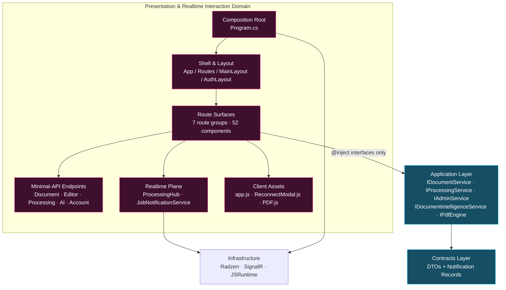
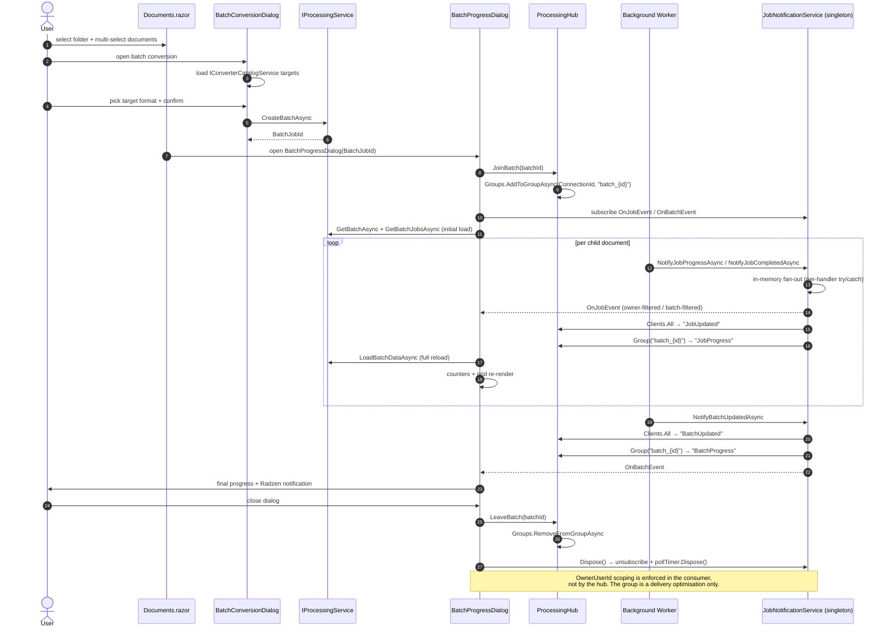

EVIDENCE COMPLETE. Every claim below is anchored to a read file. Four research assertions already fail under evidence; I flag them in the drift register rather than propagating them.

---

# EConverter — Presentation & Realtime Interaction Domain
## Architecture & Implementation Documentation

**Document class:** Domain deep-dive (C4 Level 3)
**Subject:** `src/DocumentConverter.Web` — UI composition layer + SignalR realtime plane
**Analysis basis:** repository snapshot `2026-11-09`; conclusions derived from directly read source artifacts
**Coverage:** 52 Razor components · 5 minimal-API endpoint modules · 1 SignalR hub · 1 notification service · 1 middleware · composition root

---

## 1. Domain Overview

### 1.1 Purpose

The **Presentation & Realtime Interaction Domain** is the composition layer of EConverter: the only part of the system a human ever touches. It holds **no business rules**. Its responsibilities are four:

1. **Compose** capabilities exposed by the Application and Contracts layers into interactive surfaces.
2. **Orchestrate** user intent — resolve dialogs, sequence service calls, route navigation.
3. **Render** DTOs using the Radzen Blazor component library.
4. **Bridge** asynchronous background processing back into the browser as live state, over SignalR.

### 1.2 Position in the Architecture



**Central invariant:** every page depends on **interfaces**, never concrete types. `IDocumentService`, `IProcessingService`, `IConverterCatalogService`, `IAdminService`, `IDocumentIntelligenceService`, `IPdfEngine`, `IScannedPdfDetector`, `IJobNotificationService`, `IUserContext` — all are resolved through DI. No domain entity crosses the boundary; the UI consumes `DocumentConverter.Contracts.*` DTOs and records exclusively.

### 1.3 Route Surface Inventory

Seven route groups, verified from `@page` directives:

| Route | Component | Authorization | Layout |
|---|---|---|---|
| `/` | `Pages/Home.razor` | `[Authorize]` | MainLayout |
| `/documents` | `Pages/Documents/Documents.razor` | `[Authorize]` | MainLayout |
| `/editor/{DocumentId:guid}` | `Pages/Editor/PdfEditor.razor` | `[Authorize]` | MainLayout |
| `/jobs` | `Pages/Jobs/ProcessingJobs.razor` | `[Authorize]` | MainLayout |
| `/tools`, `/tools/{ToolSlug}` | `Pages/Tools/Tools.razor` | `[Authorize]` | MainLayout |
| `/ai-chat` | `Pages/Copilot/AiChatPage.razor` | `[Authorize]` | MainLayout |
| `/copilot` | `Pages/Copilot/Copilot.razor` | `[Authorize]` | MainLayout |
| `/admin/users` | `Pages/Admin/UsersAndDepartments.razor` | `[Authorize(Roles="Administrator")]` | MainLayout |
| `/admin/converters` | `Pages/Admin/ConvertersCatalog.razor` | `[Authorize(Roles="Administrator")]` | MainLayout |
| `/admin/settings` | `Pages/Admin/SystemSettings.razor` | `[Authorize(Roles="Administrator")]` | MainLayout |
| `/admin/audit` | `Pages/Admin/SecurityAuditLog.razor` | `[Authorize(Roles="Administrator")]` | MainLayout |
| `/account/login` | `Pages/Account/Login.razor` | anonymous | **AuthLayout** |
| `/not-found` | `Pages/NotFound.razor` | anonymous | MainLayout (explicit) |
| `/Error` | `Pages/Error.razor` | anonymous | *none declared* |

> **Operational note (SOLID):** `/copilot` is a live, authorization-guarded route, but its sidebar entry is **commented out** in `MainLayout.razor`. It is reachable by direct URL and hidden from navigation — a dormant surface with full functionality attached.

---

## 2. Composition Root — Host Bootstrap

`src/DocumentConverter.Web/Program.cs` (273 lines) is the domain's single point of total failure. Nothing renders if it misconfigures. Its sequence:

| # | Concern | Concrete registration |
|---|---|---|
| 1 | **Font pre-init** | `SystemFontResolver.EnsureRegistered()` executes **before** the builder is constructed — PDFsharp requires glyph resolution to be wired before any render path runs. |
| 2 | **Persistence** | `AddDbContext<AppDbContext>` on SQL Server, migrations assembly bound to Infrastructure, `EnableRetryOnFailure(5, 5s)`. |
| 3 | **Identity** | `AddIdentity<AppIdentityUser, IdentityRole<Guid>>` with password policy (digit + upper + lower, length 8, non-alphanumeric not required) and unique email. |
| 4 | **Auth cookie** | `.DocConv.Auth`; `HttpOnly=true`, `SameSite=Lax`, 8-hour expiry with sliding renewal; `LoginPath=/account/login`, `AccessDeniedPath=/account/login?errorMessage=Access+Denied`. |
| 5 | **Claims & user context** | `IClaimsTransformation → AppClaimsTransformation`; `IUserContext → HttpContextUserContext` (scoped). |
| 6 | **Authorization policies** | Named policies `RequireUser` and `RequireAdministrator`, both role-based. |
| 7 | **Application services** | Document, Processing, Catalog, Admin, Audit, Malware, Storage, Encryption, PDF engine, Compression estimator, Digital signature, External AI, Intelligence. |
| 8 | **Realtime** | `AddSignalR()`; `IJobNotificationService → JobNotificationService` registered **singleton**; hub mapped at `/hubs/processing`. |
| 9 | **UI** | `AddRadzenComponents()`, `AddRazorComponents().AddInteractiveServerComponents()`. |
| 10 | **Rate limiting** | `login-policy` fixed window 10/min, queue 0; `processing-policy` concurrency 20, queue 10; rejection `429`. |
| 11 | **Compression** | Brotli + Gzip over HTTPS, with MIME extensions for SVG, WOFF2, JS, CSS. |
| 12 | **Health** | `AddHealthChecks().AddDbContextCheck<AppDbContext>("database")` → `/health`. |
| 13 | **Observability** | OpenTelemetry tracing (AspNetCore + HttpClient) and metrics (AspNetCore + Runtime). |

### 2.1 HTTP Pipeline — exact ordering

```mermaid
flowchart LR
    A["ExceptionHandler + HSTS<br/>(non-Development)"] --> B["StatusCodePagesWithReExecute<br/>→ /not-found"]
    B --> C["HttpsRedirection"]
    C --> D["SecurityHeadersMiddleware"]
    D --> E["ResponseCompression"]
    E --> F["StaticFiles<br/>+ immutable Cache-Control"]
    F --> G["UseRouting"]
    G --> H["UseRateLimiter"]
    H --> I["UseAuthentication"]
    I --> J["UseAuthorization"]
    J --> K["UseAntiforgery"]
    K --> L["Minimal-API endpoint groups<br/>+ MapHub&lt;ProcessingHub&gt;"]
    L --> M["MapRazorComponents&lt;App&gt;<br/>.AddInteractiveServerRenderMode()"]
```



Two ordering decisions carry weight:

- **`UseRateLimiter` sits before authentication** — the limiter protects the login endpoint before credential checking occurs, so brute force is throttled at the gate rather than after a password comparison.
- **Static asset caching is immutable-by-prefix** — `/assets/`, `/fonts/`, `/lib/`, `/css/` and any `.woff2/.svg/.png/.ico/.js/.css` receive `public, max-age=31536000, immutable`. Assets are versioned by query string in `App.razor` (e.g. `app.css?v=20261031_v7`, `app.js?v=20261106_v8`), so immutable caching is safe.

---

## 3. Shell, Routing & Layout

### 3.1 Render Model — Important Correction

`App.razor` establishes a **Blazor Web App** with per-component interactive server render mode, **not** a legacy Blazor Server application:

```razor
<RadzenTheme Theme="fluent" @rendermode="InteractiveServer" />
<HeadOutlet @rendermode="InteractiveServer" />
...
<Routes @rendermode="InteractiveServer" />
<script src="_framework/blazor.web.js"></script>
```

Consequences that matter operationally:

- The static HTML shell is server-rendered first; interactivity is attached per component tree via `@rendermode`.
- `_framework/blazor.web.js` is the unified .NET 8+ script — it carries both SSR and circuit transport, and it is what `Blazor.reconnect()` / `Blazor.resumeCircuit()` in `ReconnectModal.razor.js` attach to.
- Circuit state remains server-held, so the `IDisposable` discipline described in §6 is still mandatory.

### 3.2 Routing

`Routes.razor` (12 lines) — entirely declarative, **no `@code` block**:

```razor
<CascadingAuthenticationState>
    <Router AppAssembly="typeof(Program).Assembly" NotFoundPage="typeof(Pages.NotFound)">
        <Found Context="routeData">
            <AuthorizeRouteView RouteData="routeData" DefaultLayout="typeof(Layout.MainLayout)">
                <NotAuthorized><RedirectToLogin /></NotAuthorized>
            </AuthorizeRouteView>
            <FocusOnNavigate RouteData="routeData" Selector="h1" />
        </Found>
    </Router>
</CascadingAuthenticationState>
```

- `NotFoundPage` is a **typed component parameter** — unmatched routes render `NotFound.razor` instead of a blank page.
- `AuthorizeRouteView` intercepts unauthorized navigation at the router, guaranteeing no partial page render.
- `FocusOnNavigate Selector="h1"` moves focus to the first heading after navigation — WCAG-relevant accessibility behavior implemented by the framework, not hand-rolled.

### 3.3 Redirect Discipline

`RedirectToLogin.razor` (9 lines) preserves intent:

```csharp
var returnUrl = Uri.EscapeDataString(Navigation.ToBaseRelativePath(Navigation.Uri));
Navigation.NavigateTo($"/account/login?returnUrl={returnUrl}", forceLoad: true);
```

`forceLoad: true` is deliberate — it abandons the circuit and performs a full navigation, which is required because the subsequent `POST /account/login` is a server-side form post handled by `AccountEndpoints`, not a circuit interaction. `ToBaseRelativePath` strips the path base so the app works behind a reverse-proxy prefix (consistent with `<base href="/">`).

### 3.4 Two Layouts, Not One

| Layout | File | Role |
|---|---|---|
| `MainLayout` | `Components/Layout/MainLayout.razor` (317 lines) | The authenticated shell: Radzen providers, header, sidebar, body. |
| `AuthLayout` | `Components/Layout/AuthLayout.razor` (11 lines) | Minimal shell for anonymous surfaces — Radzen providers + a bare `<main class="auth-clean-layout">`. Used by `Login.razor` via `@layout AuthLayout`. |

`MainLayout` itself contains an `AuthorizeView` with **both** branches: `<Authorized>` renders the full Radzen layout; `<NotAuthorized>` renders the body inside the same `auth-clean-layout` container. This means an authenticated-by-`[Authorize]`-but-not-yet-resolved principal never sees a chrome-less or half-rendered frame.

### 3.5 MainLayout Anatomy

```
<RadzenDialog /> <RadzenNotification /> <RadzenContextMenu /> <RadzenTooltip />   ← service hosts
└── AuthorizeView
    ├── Authorized
    │   └── RadzenLayout (grid-template-areas: header header / sidebar body)
    │       ├── RadzenHeader
    │       │   ├── SidebarToggle  → sidebarExpanded
    │       │   ├── Brand (light/dark logo pair)
    │       │   ├── Active-jobs badge (conditional, links to /jobs)
    │       │   └── User menu (avatar initials, workspace links, admin links, logout form)
    │       ├── RadzenSidebar → RadzenPanelMenu
    │       │   ├── Dashboard / My Documents / Radzen AI Chat / Converters & Tools / Processing Jobs
    │       │   └── AuthorizeView Roles="Administrator" → Administration submenu
    │       └── RadzenBody → <main role="main"> @Body
    └── NotAuthorized → <main role="main"> @Body
```

**Live header telemetry (SOLID, verified in code):** the header maintains `Dictionary<Guid,int> activeJobs` and derives `activeJobsCount` and `avgProgress`. It renders a spinning badge — *"N jobs running (M%)"* — whenever `activeJobsCount > 0`. This is the same dictionary mutated by the notification handler in §6, which is why `StateHasChanged()` is called on every job event.

**Logout is a real form post** with `<AntiforgeryToken />` targeting `/account/logout` — not a client-side sign-out call.

**Disposal contract:**

```csharp
public void Dispose()
{
    NotificationPublisher.OnJobEvent    -= HandleJobNotificationAsync;
    NotificationPublisher.OnBatchEvent  -= HandleBatchNotificationAsync;
    Navigation.LocationChanged          -= HandleLocationChanged;
}
```

Because `JobNotificationService` is a **singleton**, a leaked handler survives circuit teardown and will throw on the next publish. Every subscription is therefore mirror-released.

---

## 4. Submodule 1 — Document Workspace UI

**Owner surface:** `Pages/Documents/` — 1 page + 1 recursive component + 14 dialogs (16 of 52 components).

### 4.1 `Documents.razor` — Windows Explorer Emulation

Largest page component: **132,609 bytes / 2,780 lines**. It reimplements the Windows 11 file-explorer interaction model rather than a generic grid:

- **Toolbar row:** Back / Forward / Up / Refresh, bound to `CanGoBack`, `CanGoForward`, `CanGoUp` — a real navigation history stack, not breadcrumbs.
- **Address bar:** breadcrumb segments beginning with *This PC* (`FluentIcons.DesktopWindows`), each segment clickable via `SelectFolderWithHistory(...)`.
- **Injected services:** `IDocumentService`, `IProcessingService`, `IConverterCatalogService`, `DialogService`, `NotificationService`, `NavigationManager`, `IJSRuntime`; `@implements IDisposable`.

### 4.2 `WindowsFolderTreeItem.razor` — Recursive Node

142 lines, fully self-recursive. Key measured behaviors:

**Dynamic indentation** — depth drives padding inline, avoiding CSS class explosion:
```csharp
style="padding-left: {8 + Depth * 16}px; ..."
```

**Selection state as a computed class:**
```csharp
class="@($"windows-tree-item {(IsSelected ? "windows-tree-item-selected" : "")}")"
private bool IsSelected => SelectedFolderId == Node.Id;
```

**Drag-and-drop with visual affordance** — a complete `@ondragover` / `@ondragenter` / `@ondragleave` / `@ondrop` quartet toggling `isDragOver`, which injects an inline highlight (`rgba(0,120,212,0.14)` background + dashed outline). `@ondragover:preventDefault` is mandatory, otherwise the browser refuses the drop.

**Propagation control** — the chevron uses `@onclick:stopPropagation="true"` so expanding a node does not also select it; the hover action toolbar does the same so New Subfolder / Rename / Delete do not trigger folder selection.

**Context menu** — `@oncontextmenu` with `:preventDefault` delegates to `OnFolderContextMenu`, a typed `EventCallback<(MouseEventArgs, FolderDto)>`.

**Recursion is lazy and guarded:**
```razor
@if (Node.Children.Count > 0 && Node.IsExpanded) { ... <WindowsFolderTreeItem Depth="@(Depth + 1)" ... /> }
```
Children render only when expanded — the tree does not materialize the full hierarchy into the render tree.

### 4.3 Dialog Inventory

| Dialog | Size | Function |
|---|---|---|
| `UploadDialog.razor` | 20,253 B | Target-folder selection, multi-file input, progress via `NotificationService`, `IDisposable`. |
| `BatchConversionDialog.razor` | 15,343 B | Scrollable target-format list from `IConverterCatalogService`; enqueues via `IProcessingService`. |
| `BatchProgressDialog.razor` | 15,791 B | Live per-job grid; details in §6.5. |
| `DocumentIntelligenceDialog.razor` | 42,342 B | Summarization / extraction / Q&A with export to text & Markdown. |
| `GlobalCopilotDialog.razor` | 59,146 B | Globally invocable grounded chat; scope selector; see §5.3. |
| `DocumentDiffDialog.razor` | 17,973 B | Version comparison. |
| `DigitalSignatureDialog.razor` | 19,592 B | Signature application. |
| `DocumentVersionsDialog.razor` / `VersionHistoryDialog.razor` | 12,413 / 6,877 B | Version history and restore. |
| `BatchMoveDialog.razor` / `MoveDialog.razor` / `RenameDialog.razor` / `FolderDialog.razor` / `DocumentPropertiesDialog.razor` | 3,319 / 2,820 / 2,115 / 3,828 / 6,794 B | Atomic mutations and metadata. |

### 4.4 Reusable Picker

`Components/Common/DocumentPickerExplorer.razor` (**38,170 B**) and `DocumentPickerDialog.razor` (111 lines) provide a second, embeddable Windows-style explorer used by Tools and Editor flows. The dialog composes the explorer plus an authentic *Open File* bottom bar:

- `File name:` row — readonly input reflecting `selectedDoc?.OriginalFileName`, placeholder *"Choose a file above…"*.
- `Files of type:` row — resolved via `ResolveFileTypeLabel()` from `AllowedExtensions`.
- Action row — Cancel (`DialogService.Close(null)`) and a parameterized primary action (`ActionButtonText` / `ActionButtonIcon`, defaults `"Open"` / `FluentIcons.FolderOpen`), disabled while `selectedDoc == null`.

Typed parameters: `Documents`, `Folders`, `AllowedExtensions`, `InitialSelectedDocumentId`, `ExplorerHeight`, `PageSize` (default 100). The component returns its selection through `DialogService` rather than an event — the caller receives it as the dialog result.

---

## 5. Submodule 2 — Copilot & AI Chat UI

### 5.1 Surface Sizes

| Component | Route | Size | Lines |
|---|---|---|---|
| `AiChatPage.razor` | `/ai-chat` | **218,155 B** | 3,692 |
| `Copilot.razor` | `/copilot` | **177,998 B** | 3,045 |

These are, by a wide margin, the largest components in the codebase — roughly 4× the next tier. Both are single-file monoliths.

### 5.2 `AiChatPage.razor` (the navigable surface)

Injects `EnterpriseAiChatService` (the concrete class, registered in `Program.cs` as both itself and `IAIChatService`), plus `IDocumentIntelligenceService`, `IDocumentService`, `DialogService`, `NotificationService`, `NavigationManager`, `IJSRuntime`. Imports `Microsoft.Extensions.AI` message abstractions directly — the UI is coupled to the AI abstraction types, not to a provider.

The toolbar exposes a **Scope** selector (`RadzenDropDown` bound to `selectedFolderId` over `folderScopeOptions`), which is the UI representation of the folder-scoped retrieval contract. Title: *"Radzen AI Assistant — Conversational document intelligence powered by native Radzen Blazor components"*.

### 5.3 `GlobalCopilotDialog.razor` (the cross-cutting surface)

59,146 B / 1,114 lines, `IDisposable`. Subtitle declares its intent: *"Unified Cross-Repository Document Intelligence • Multi-Document Grounded RAG & Vector Search"*. It carries the same scope selector with `AllowFiltering`, `CaseInsensitive` filtering, `Placeholder="All Documents"`, and a `ScopeOption`-typed item template. Dialog size rather than page size is appropriate here — it is invoked from Documents, Editor and Tools without a route change.

### 5.4 Markdown Rendering — Shared Pipeline

`Components/Common/MarkdownRenderer.cs` (34 lines) is the single rendering seam for all streamed AI output:

```csharp
private static readonly MarkdownPipeline Pipeline = new MarkdownPipelineBuilder()
    .UseAutoLinks().UsePipeTables().UseEmphasisExtras().UseListExtras().UseTaskLists().Build();

public static MarkupString ToHtml(string? markdown)
{
    if (string.IsNullOrWhiteSpace(markdown)) return new MarkupString(string.Empty);
    return new MarkupString(Markdown.ToHtml(markdown, Pipeline));
}
```

Three deliberate properties:

1. **Static pipeline** — built once, not per render. During token-by-token streaming this avoids pipeline construction on every frame.
2. **`MarkupString` is the explicit raw-HTML opt-in** — Blazor escapes HTML by default; wrapping here is the one place where sanitization trust is extended. Markdig's output is trusted input; if corpus-derived text can ever reach this call, it must be considered an HTML-injection vector.
3. **Null-safe** — empty/whitespace input short-circuits rather than emitting an empty pipeline result.

> **Accuracy note:** the shipped pipeline enables **five** extensions — `UseTaskLists()` is present in addition to the four named in the research materials.

---

## 6. Submodule 3 — Realtime Notifications & Hubs

This is the technically most consequential submodule and the one where documentation and behavior diverge most sharply.

### 6.1 Contracts

`IJobNotificationService` (Application layer) declares two immutable records. Field set is fixed by the producer methods in `JobNotificationService`:

```
JobNotificationEvent(JobId, OwnerUserId, BatchJobId, Status,
                     ProgressPercent, InputFileName, OutputFileName,
                     OutputDocumentId, ErrorMessage, Timestamp)

BatchNotificationEvent(BatchJobId, OwnerUserId, Status,
                       TotalJobs, CompletedJobs, FailedJobs, Timestamp)
```

`OwnerUserId` is embedded in every payload. This is the **only** field available for consumer-side scoping — see §6.4.

### 6.2 `ProcessingHub.cs` — 22 Lines, Minimal By Design

```csharp
public class ProcessingHub : Hub
{
    public async Task JoinBatch(string batchId)
    {
        if (!string.IsNullOrWhiteSpace(batchId))
            await Groups.AddToGroupAsync(Context.ConnectionId, $"batch_{batchId}");
    }

    public async Task LeaveBatch(string batchId)
    {
        if (!string.IsNullOrWhiteSpace(batchId))
            await Groups.RemoveFromGroupAsync(Context.ConnectionId, $"batch_{batchId}");
    }
}
```

Mapped in `Program.cs` as `app.MapHub<ProcessingHub>("/hubs/processing")`.

**Security assessment — SOLID and unambiguous:**

- There is **no** `[Authorize]` on the hub class or on either method.
- The group name is derived **directly from a client-supplied string**. Any connected circuit can call `JoinBatch("<any-guid>")` and join that group.
- The hub therefore provides **delivery scoping, not an authorization boundary**. Group membership is an optimization, exactly as the research materials state — and the supporting CSP (`connect-src 'self' ws: wss:`) permits the WebSocket transport that carries it.

### 6.3 `JobNotificationService.cs` — The Dual-Channel Adapter

195 lines, implements `IJobNotificationService`, registered **singleton** in `Program.cs`. It depends on `IHubContext<ProcessingHub>` and `ILogger<JobNotificationService>`, and exposes two .NET events for in-process subscribers:

```csharp
public event Func<JobNotificationEvent, Task>? OnJobEvent;
public event Func<BatchNotificationEvent, Task>? OnBatchEvent;
```

Five producer-facing methods map to fixed status strings:

| Method | Status | Progress | ErrorMessage |
|---|---|---|---|
| `NotifyJobProgressAsync` | `"Processing"` | supplied | `null` |
| `NotifyJobCompletedAsync` | `"Completed"` | `100` (+ `OutputFileName`, `OutputDocumentId`) | `null` |
| `NotifyJobFailedAsync` | `"Failed"` | `0` | supplied |
| `NotifyJobCancelledAsync` | `"Cancelled"` | `0` | `null` |
| `NotifyBatchUpdatedAsync` | supplied | — | — |

**The private fan-out — the heart of the domain:**

```csharp
private async Task PublishJobEventAsync(JobNotificationEvent evt, CancellationToken cancellationToken)
{
    // 1. Dispatch in-memory for active Blazor circuits
    if (OnJobEvent != null)
    {
        var invocationList = OnJobEvent.GetInvocationList().Cast<Func<JobNotificationEvent, Task>>();
        foreach (var handler in invocationList)
        {
            try { await handler(evt); }
            catch (Exception ex) { _logger.LogWarning(ex, "Error executing in-memory job event handler."); }
        }
    }

    // 2. Broadcast via SignalR
    try
    {
        await _hubContext.Clients.All.SendAsync("JobUpdated", evt, cancellationToken);
        if (evt.BatchJobId.HasValue)
            await _hubContext.Clients.Group($"batch_{evt.BatchJobId.Value}")
                                  .SendAsync("JobProgress", evt, cancellationToken);
    }
    catch (Exception ex) { _logger.LogWarning(ex, "Error broadcasting job event via SignalR hub."); }
}
```

Four engineering decisions worth crediting:

1. **Per-handler try/catch via `GetInvocationList()`** — one faulting subscriber cannot abort delivery to the remaining subscribers. This is a meaningful robustness detail; a naive `await OnJobEvent(evt)` multicast would break the chain.
2. **Fault-tolerant broadcast** — SignalR send failures are logged as warnings rather than propagated, so a dead circuit cannot fail the calling producer.
3. **Dual transport** — a same-process Blazor circuit can consume events through the in-memory `Func<...,Task>` event (no serialization, lowest latency); remote/out-of-process clients consume the identical payload through SignalR. One publish, two channels.
4. **One channel is genuinely group-scoped** — `"JobProgress"` targets `batch_{id}`; `"BatchProgress"` likewise.

**But the batch channel is not scoped the same way as the job channel:**

```csharp
await _hubContext.Clients.All.SendAsync("BatchUpdated", evt, cancellationToken);
await _hubContext.Clients.Group($"batch_{batchJobId}").SendAsync("BatchProgress", evt, cancellationToken);
```

**SignalR event taxonomy — measured:**

| Event name | Target | Emitted by |
|---|---|---|
| `JobUpdated` | `Clients.All` | `PublishJobEventAsync` |
| `JobProgress` | `Group("batch_{BatchJobId}")` | `PublishJobEventAsync` (only when `BatchJobId` is set) |
| `BatchUpdated` | `Clients.All` | `NotifyBatchUpdatedAsync` |
| `BatchProgress` | `Group("batch_{BatchJobId}")` | `NotifyBatchUpdatedAsync` |

### 6.4 Consumer Discipline — Where Authorization Actually Lives

Since the hub does not authorize, the ownership check is enforced in the consumer. `MainLayout.razor`:

```csharp
private Task HandleJobNotificationAsync(JobNotificationEvent evt)
{
    return InvokeAsync(() =>
    {
        var currentUserId = UserContext.UserId;
        // Only toast if current user owns the job or user context is unauthenticated dev
        if (currentUserId.HasValue && evt.OwnerUserId != Guid.Empty && evt.OwnerUserId != currentUserId.Value)
            return;

        if (evt.Status == "Processing") { activeJobs[evt.JobId] = evt.ProgressPercent; StateHasChanged(); }
        else if (evt.Status == "Completed") { ... NotificationService.Notify(...); }
        else if (evt.Status == "Failed")    { ... }
        else if (evt.Status == "Cancelled") { ... }
    });
}
```

Three patterns are consistent across all subscribers and constitute the domain's realtime contract:

1. **`InvokeAsync` wrapping** — the event is raised from a background worker thread; every handler marshals to the circuit's synchronization context before touching component state.
2. **Owner filter as the first statement** — the guard compares `evt.OwnerUserId` against `UserContext.UserId`, tolerating `Guid.Empty` (dev/unauthenticated) by allowing through.
3. **`Dispose` mirror-release** — every subscriber unsubscribes.

The batch dialog applies a different, equally valid filter — identity of the batch, not the owner:

```csharp
private async Task HandleRealTimeBatchEvent(BatchNotificationEvent evt)
{
    if (evt.BatchJobId == Batch.Id)
        await InvokeAsync(async () => { await LoadBatchDataAsync(); StateHasChanged(); });
}
```

### 6.5 `BatchProgressDialog.razor` — Hybrid Realtime + Polling

363 lines, `IDisposable`, injects `IProcessingService`, `IDocumentService`, `IJobNotificationService`, `DialogService`, `IJSRuntime`, `NavigationManager`.

Structure: status header card (`Batch Conversion #{id[..8]}`, pipeline name, mode badge) → overall `RadzenProgressBar` → metric badges (Total / Completed / Active / Queued / Failed) → paged `RadzenDataGrid` of child jobs (page size 6, sortable) with per-row progress bars and status badges → download/cancel actions.

**Refresh strategy is deliberately hybrid:**

```csharp
private async Task HandleRealTimeBatchEvent(BatchNotificationEvent evt) { ... LoadBatchDataAsync(); }

private async Task LoadBatchDataAsync()
{
    try { currentBatch = await ProcessingService.GetBatchAsync(Batch.Id); ... }
    catch { /* Transient error during polling ignored */ }
    finally { isLoading = false; }
}
```

Realtime events trigger a **full state reload** from `IProcessingService` rather than incremental patching of the local list. In practice this means the SignalR notification is used as an **invalidation signal**, and the database — consistent with the platform's database-authoritative job model — remains the read source. A `pollTimer` is also held and disposed in `Dispose()`.

**Why this is defensible, and its cost:** a full reload cannot drift from server truth (no missed-event desync), and `GetBatchJobsAsync` returns authoritative rows. The cost is an N-fold read amplification during a large batch — every child completion triggers a batch-wide query. The research materials' concern about "polling-and-scan cost proportional to batch size × poll frequency" applies to this reload path as well as the aggregation path.

**Batch download** uses `JSRuntime.InvokeVoidAsync("open", url, "_blank")` against `/api/documents/batch-download-zip?ids=...` — the browser handles the download, not Blazor.

### 6.6 Connection Resilience

`ReconnectModal.razor` (31 lines) + `ReconnectModal.razor.js` (63 lines) implement the full Blazor reconnection UX. The markup uses the framework's canonical state-visibility classes, driven entirely by JS:

| State | Behavior |
|---|---|
| `show` | `reconnectModal.showModal()` (native `<dialog>`) |
| `hide` | `reconnectModal.close()` |
| `failed` | register `visibilitychange` → retry when tab becomes visible |
| `rejected` | immediate `location.reload()` — circuit is gone |

The retry ladder is explicit and correct:

```javascript
const successful = await Blazor.reconnect();
if (!successful) {
    const resumeSuccessful = await Blazor.resumeCircuit();   // try to resume paused circuit
    if (!resumeSuccessful) location.reload(); else reconnectModal.close();
}
```

`components-reconnect-state-changed` is the framework event; the modal owns only presentation. `data-nosnippet` prevents the transient error dialog from being indexed. This is a complete, non-simplified resilience implementation.

### 6.7 End-to-End Realtime Sequence



---

## 7. Submodule 4 — Admin & Tools UI

### 7.1 Administration (role-gated)

Four pages, **all** carrying `[Authorize(Roles = "Administrator")]`:

| Page | Size | Injected services | Function |
|---|---|---|---|
| `UsersAndDepartments.razor` | 29,108 B | `IAdminService`, `NotificationService`, `DialogService` | Corporate user directory, departments, administrator access control. |
| `ConvertersCatalog.razor` | 17,995 B | `IAdminService`, `NotificationService`, `DialogService` | Processing engine catalog, conversion capabilities, operational limits. |
| `SystemSettings.razor` | 30,167 B | `IAdminService`, **`IDocumentIntelligenceService`**, `NotificationService` | Lifecycle policies, resource quotas, security rules, AI parameters. |
| `SecurityAuditLog.razor` | 17,301 B | `IAdminService`, `NotificationService`, `IJSRuntime` | Immutable event ledger — security events, admin changes, document actions. |

Dialogs: `CreateUserDialog.razor` (4,368 B), `ConverterLimitsDialog.razor` (1,666 B).

Two implementation details verify the domain-relation claims from the architecture report:

- **`SystemSettings.razor` injecting `IDocumentIntelligenceService`** is the concrete realization of the *Administration → Document Intelligence* configuration dependency. AI provider endpoints, proxy and API key parameters are written through the intelligence service, not through a settings table.
- **`ConvertersCatalog.razor`** is where *Administration → Processing* configuration dependency lives: enabled/disabled state and per-converter limits persist via `IAdminService` and are resolved at runtime by `ConverterCatalogService`.
- The sidebar exposes the Administration submenu only inside `<AuthorizeView Roles="Administrator">`, so the navigation surface and the route guard agree.

`SecurityAuditLog.razor` is the only admin page injecting `IJSRuntime` — expected, since it performs client-side export/print of ledger data.

### 7.2 Tools (union of converters)

`Tools.razor` (36,433 B) carries two routes:

```razor
@page "/tools"
@page "/tools/{ToolSlug}"
```

The slug route is resolved against the catalog at runtime, which is why the page injects both `IConverterCatalogService` and `NavigationManager`, and why `Home.razor` can deep-link with `/tools/image-to-pdf`, `/tools/word-to-pdf`, `/tools/pdf-merge`, `/tools/ocr`, `/tools/excel-to-pdf`. **Route parameter and catalog key are the same namespace** — slugs are not a hardcoded enum, they are catalog identifiers.

Four dialogs: `StartConversionDialog.razor` (27,879 B), `MergePdfDialog.razor` (49,246 B), `SplitPdfDialog.razor` (37,353 B), `SelectPdfDialog.razor` (4,566 B).

### 7.3 Dashboard

`Home.razor` (174 lines) — `@page "/"`, `[Authorize]`. Composes three posture cards directly mirroring the platform's value proposition, using Fluent icon keys as first-class identifiers:

| Card | Icon constant | Subtitle |
|---|---|---|
| Zero Egress | `FluentIcons.ZeroEgress` | "Strict internal network boundary" |
| Owner-Private | `FluentIcons.OwnerPrivate` | "Encrypted, isolated by user id" |
| Asynchronous | `FluentIcons.Flash` | "RabbitMQ worker isolation" |

Plus a *Quick Conversion Tools* grid of four outlined buttons routing into `/tools/*`, and a personalized greeting via `UserContext.DisplayName`.

### 7.4 `FluentIcons.cs`

25,563 bytes of icon glyph constants (`FluentIcons.Folder`, `.Chat`, `.Jobs`, `.Wrench`, `.Shield`, `.ZeroEgress`, `.OwnerPrivate`, `.AutoFixHigh`, `.TableChart`, …). Every page references icons **symbolically** (`Icon="@FluentIcons.Refresh"`) rather than by literal class string. This is the consistent cross-cutting convention of the domain and removes glyph-string drift between components.

---

## 8. Minimal-API Endpoint Surface

The domain also owns the HTTP contract. Five endpoint modules, mapped from `Program.cs`:

| Module | Group | Authorization | Lines |
|---|---|---|---|
| `AccountEndpoints.cs` | `/account` | anonymous | 70 |
| `DocumentEndpoints.cs` | `/api/documents`, `/api/folders` | `RequireAuthorization()` | 902 |
| `EditorEndpoints.cs` | `/api/editor` | `RequireAuthorization()` | 347 |
| `ProcessingEndpoints.cs` | `/api/processing`, `/api/converters` | `RequireAuthorization("RequireUser")` | 126 |
| `DocumentIntelligenceEndpoints.cs` | `/api/documents` (AI sub-paths) | `RequireAuthorization()` | 343 |

### 8.1 Account

```csharp
group.MapPost("/login", ...).RequireRateLimiting("login-policy").DisableAntiforgery();
group.MapPost("/logout", LogoutHandler);
group.MapGet("/logout", LogoutHandler);
```

Login is a **server-side form post** (`[FromForm] email, password, returnUrl`), throttled at 10 requests/minute. It performs an explicit credential sequence rather than calling `PasswordSignInAsync`:

1. Empty-check → redirect with `Email+and+password+are+required`.
2. `FindByEmailAsync` → miss records `User.LoginFailed` with `metadata: Email:{email}` → generic *"Invalid credentials"*.
3. `CheckPasswordAsync` → fail records `User.LoginFailed` with `resourceId: user.Id` → **same** generic message.
4. Success → `SignInAsync(isPersistent: true)` → records `User.Login`.

The audit trail distinguishes the two failure modes (unknown email vs wrong password) while the user-facing response does not — correct separation of observability from disclosure.

**Open-redirect defense:**
```csharp
private static bool UrlIsValid(string url)
    => url.StartsWith('/')
        && !url.StartsWith("//", StringComparison.Ordinal)
        && !url.StartsWith("/\\", StringComparison.Ordinal);
```
Rejects absolute URLs, protocol-relative `//evil.com`, and the `/\` backslash variant. Combined with `RedirectToLogin`'s `forceLoad` behavior, the `returnUrl` round-trip is closed.

> **Residual risk (SOLID):** `DisableAntiforgery()` is applied to the login POST with the comment *"can use standard antiforgery when form token is supplied"*. `Login.razor` does emit `<AntiforgeryToken />` and posts to the same path, so the token is present in the markup — but **the endpoint does not validate it**. CSRF protection on the login form is therefore declared but not enforced. Note that `UseAntiforgery()` is globally active; the explicit `DisableAntiforgery()` opts this route out.

### 8.2 Documents

Group-level `RequireAuthorization()`. Verified routes:

| Method | Path | Notes |
|---|---|---|
| POST | `/api/documents/upload` | `IFormFile` + optional `folderId`; `DisableAntiforgery()`; catches `DomainException` → 400 |
| POST | `/api/documents/upload-batch` | **Enforced limits in code:** max 20 files, max 100 MB single, max 250 MB total. Per-file failure isolation with an `errors[]` collection returning `{uploadedCount, failedCount, documents, errors}`. |
| GET | `/api/documents/` | `folderId`, `searchTerm`, `status` filters |
| GET | `/api/documents/{id:guid}` | 200 / 404 |
| GET | `/api/documents/{id}/download` | 302 redirect to a filename-bearing URL |
| GET | `/api/documents/{id}/download/{fileName}` | `Results.File(..., enableRangeProcessing: true)`; `#` sanitized to `_`; extension reconciled with actual name |
| GET | `/api/documents/{id}/preview` → `/{fileName}` | **Inline DOCX→PDF conversion** via `ConvertDocxStreamToPdf`; text extensions forced to `text/plain; charset=utf-8`; `html/htm` to `text/html` |
| POST | `/api/documents/{id}/versions` | New version from uploaded file |
| DELETE | `/api/documents/{id}` | 204 / 404 |
| POST | `/api/documents/{id}/rename` | `RenameDocumentRequest` body; whitespace-checked |
| POST | `/api/documents/{id}/compression-preview` | `ICompressionEstimatorService.EstimateAsync` |
| — | `/api/folders` | Folder CRUD (same module) |

`enableRangeProcessing: true` on download and preview is the enabler for PDF.js range-based page loading in the editor — a performance decision made at the endpoint, not in the client.

### 8.3 Editor

```csharp
var group = app.MapGroup("/api/editor").RequireAuthorization();
```

| Method | Path | Behavior |
|---|---|---|
| GET | `/{documentId:guid}/content` | Serves the PDF stream as `application/pdf` with range processing, for the PDF.js canvas |
| POST | `/{documentId:guid}/save` | Validates operation batch, applies engine, commits as new version |

`save` enforces an **explicit operation ceiling**:

```csharp
if (request.Operations.Count > 500)
    return Results.BadRequest(new { error = "Operation batch exceeds maximum safety limit of 500 operations." });
```

Then: `GetAsync` → `DownloadAsync(baseVersionId)` → `pdfEngine.ApplyOperationsAsync` → `documentService.AddVersionAsync` → responds with a fully-formed download URL including `versionId`. Every handler distinguishes `KeyNotFoundException` (404) from `DomainException` (400) — a consistent error taxonomy across all endpoint modules.

### 8.4 Processing

Group `RequireAuthorization("RequireUser")`; `/api/converters` separately guarded:

| Method | Path | Rate limit |
|---|---|---|
| GET | `/api/converters` | — |
| GET | `/api/processing/jobs?take=50` | — |
| GET | `/api/processing/jobs/{id}` | — |
| POST | `/api/processing/jobs` | `processing-policy` |
| POST | `/api/processing/batches` | `processing-policy` |
| GET | `/api/processing/batches?take=50` | — |
| GET | `/api/processing/batches/{id}` | — |
| GET | `/api/processing/batches/{id}/jobs` | — |
| POST | `/api/processing/jobs/{id}/cancel` | — |
| POST | `/api/processing/batches/{id}/cancel` | — |

`RequireRateLimiting("processing-policy")` is applied **only to job/batch creation** — the write paths that consume worker capacity. Reads are unlimited. This is the correct place for admission control and it addresses, partially, the research materials' "introduce queue backpressure and admission control" recommendation: concurrency 20 with queue 10 means the 21st concurrent creation queues and the 31st is rejected with 429. Note it is a **global** limiter, not per-user or per-tenant.

### 8.5 Document Intelligence

Group `/api/documents`, `RequireAuthorization()`:

| Method | Path | Handler |
|---|---|---|
| GET | `/{id:guid}/ai/insights` | `AnalyzeDocumentAsync` |
| POST | `/{id:guid}/ai/ask` | `AskQuestionAsync` (validates non-empty question) |
| GET | `/{id:guid}/ai/search?query&topK` | `SemanticSearchAsync` (defaults `topK` to 5) |

> **Inconsistency (SOLID):** these three handlers catch bare `Exception` and return `Results.Problem(detail: ex.Message, statusCode: 500)`. All other endpoint modules in this domain return generic 400/404 bodies for `DomainException` / `KeyNotFoundException`. `ex.Message` propagated to the client on the AI paths is the one place in the domain where internal error text reaches the browser — directly contrary to the platform's stated `ProcessingErrorCode` user-safe error taxonomy. This is the domain's most concrete information-disclosure finding.

---

## 9. Client Assets & Browser Interop

### 9.1 Static Asset Map

| Asset | Served from | Purpose |
|---|---|---|
| `assets/css/fluent-icons.css?v=20261027_local` | wwwroot | Icon font — *"local"* in the version string signals self-hosted, not CDN |
| `assets/css/fonts.css?v=20261031_v2` | wwwroot | Typography |
| `app.css?v=20261031_v7` | wwwroot | Application styles |
| `DocumentConverter.Web.styles.css` | build output | Blazor CSS isolation bundle |
| `app.js?v=20261106_v8` | wwwroot | Client helpers (520 lines / 22,887 B) |
| `_framework/blazor.web.js` | framework | Circuit + SSR transport |
| `_content/Radzen.Blazor/Radzen.Blazor.js` | package | Radzen component runtime |
| `wwwroot/lib/pdfjs/*` | wwwroot | Mozilla PDF.js (Apache-2.0) |
| `assets/logo/*`, `assets/font/SF-Pro.woff2` | wwwroot | Branding + preloaded font |

`App.razor` preloads the font (`rel="preload" as="font" crossorigin="anonymous"`), uses a light/dark logo pair, and resolves all relative URLs through `<base href="/">`.

### 9.2 `app.js` — Download Fidelity

The dominant utility is `window.docConverter.downloadFile(url, fileName)`, which uses a **progressive-enhancement ladder**:

1. **File System Access API** — if `window.showSaveFilePicker` exists, infer the extension from the target name, present the native *Save As* dialog pre-filled (`suggestedName`, typed `accept` map), then write via `fileHandle.createWritable()`. This produces a genuine OS save dialog instead of the browser's silent download shelf.
2. **`AbortError` is handled distinctly** — if the user cancels the picker, return silently. No fallback download fires on intentional cancellation.
3. **Blob anchor fallback** — `createObjectURL` → hidden `<a download>` → `click()` → `revokeObjectURL` + `remove()` after 3 s.
4. **Fetch-failure path** — if `!response.ok`, fall back to `window.location.href = url` (direct navigation), exploiting the endpoint's `Content-Disposition` instead.

The `setTimeout(..., 3000)` before revocation is a deliberate allowance for the browser to begin reading the blob — immediate revocation is a common cause of truncated downloads.

### 9.3 PDF.js

The editor page does **not** reimplement PDF parsing. It ships a bundled Mozilla PDF.js exposing `getDocument(src)` → `PDFDocumentLoadingTask`, a `WorkerTransport`/`MessageHandler` bridge, `PDFDocumentProxy`/`PDFPageProxy` (`getPage`, `getViewport`, `render`, `getTextContent`, `getAnnotations`), `DOMCanvasFactory`/`CanvasGraphics`, and configuration helpers. Blazor drives it through `IJSRuntime`; **all document mutation happens server-side** in `IPdfEngine`, with `IScannedPdfDetector` deciding OCR eligibility. Rendering client-side and mutating server-side is the correct split — it keeps the document off the wire except as opaque PDF bytes.

---

## 10. Cross-Cutting Concerns

### 10.1 Authorization — Three Layers, No Gaps

| Layer | Mechanism | Effect |
|---|---|---|
| Router | `AuthorizeRouteView` + `RedirectToLogin` | Unauthenticated navigation never renders a partial page |
| Page | `[Authorize]` / `[Authorize(Roles="Administrator")]` | Per-surface guard; Admin group uniformly role-gated |
| Navigation | `AuthorizeView Roles="Administrator"` around the admin submenu | UI affordance matches route guard |

### 10.2 Security Headers

`SecurityHeadersMiddleware.cs` (38 lines) — registered after `UseHttpsRedirection`, before compression:

```
X-Content-Type-Options: nosniff
X-Frame-Options: SAMEORIGIN
Referrer-Policy: strict-origin-when-cross-origin
Permissions-Policy: geolocation=(), microphone=(), camera=()
Content-Security-Policy:
  default-src 'self'; img-src 'self' data: blob:; font-src 'self' data:;
  style-src 'self' 'unsafe-inline'; script-src 'self' 'unsafe-inline' 'unsafe-eval';
  connect-src 'self' ws: wss:; frame-src 'self' blob: data:;
  frame-ancestors 'self'; form-action 'self'; base-uri 'self';
```

`connect-src 'self' ws: wss:` is what permits the SignalR circuit and `ProcessingHub` traffic; without it the realtime plane in §6 would not function. `frame-ancestors 'self'` + `X-Frame-Options: SAMEORIGIN` together block clickjacking; `frame-src 'self' blob: data:` is required for PDF.js blob-URL rendering.

> **The middleware's own header comment claims *"Strict CSP: Zero unapproved external CDNs."*** That part is accurate — all assets are self-hosted. However `script-src` includes both `'unsafe-inline'` and `'unsafe-eval'`. Blazor's interactive circuit and the Radzen runtime are the practical drivers of `'unsafe-eval'`. The CSP is therefore **self-hosted but not strict in the CSP sense** — it mitigates external script injection but not inline injection. Documentation must not describe this policy as "strict."

### 10.3 Rate Limiting

| Policy | Type | Limit | Queue | Applied to |
|---|---|---|---|---|
| `login-policy` | Fixed window | 10 / minute | 0 (reject immediately) | `POST /account/login` |
| `processing-policy` | Concurrency | 20 concurrent | 10 | Job + batch creation only |

Rejection status `429 Too Many Requests`. Queue limit 0 on login is intentional — queueing authentication attempts would defeat the purpose.

### 10.4 Reliability Patterns

| Pattern | Location | Rationale |
|---|---|---|
| Per-handler try/catch in event fan-out | `JobNotificationService` | One faulting circuit cannot starve others |
| Swallowed broadcast exceptions | `JobNotificationService` | Dead circuit cannot fail the producer |
| Swallowed reload exceptions | `BatchProgressDialog.LoadBatchDataAsync` | Transient polling error does not break the dialog |
| `IDisposable` on every subscriber | MainLayout, BatchProgressDialog, UploadDialog, GlobalCopilotDialog, Copilot, Documents, ProcessingJobs, PdfEditor | Prevents handler leakage onto disposed circuits |
| `InvokeAsync` on all event handlers | All subscribers | Cross-thread marshal onto the circuit's sync context |
| `NavigateTo(..., forceLoad: true)` | `RedirectToLogin` | Required for server-post authentication |
| `@ondragover:preventDefault` | Tree node | Without it the browser cancels the drop |
| Native `<dialog>` for reconnection | `ReconnectModal` | Browser-level modality, no focus-trap code |

---

## 11. Register of Drift Between Documentation and Code

Every entry below is grounded in a read file.

| ID | Finding | Severity | Verification | Evidence |
|---|---|---|---|---|
| **P-01** | **Every job event is broadcast to every connected client.** `PublishJobEventAsync` calls `Clients.All.SendAsync("JobUpdated", evt)`, and `NotifyBatchUpdatedAsync` calls `Clients.All.SendAsync("BatchUpdated", evt)`. Owner scoping exists **only** as a client-side check in `MainLayout`/`BatchProgressDialog`. Any authenticated circuit therefore receives other users' `InputFileName`, `OutputFileName`, `OutputDocumentId`, `JobId` and `ErrorMessage`. | **HIGH** | SOLID | `JobNotificationService.cs` L~130, L~175: `_hubContext.Clients.All.SendAsync(...)`. Research materials state progress is broadcast *"rather than to every connected client"* — **contradicted by code** for the `JobUpdated`/`BatchUpdated` channels. |
| **P-02** | **`ProcessingHub` has no authorization.** Group name is derived from a client-supplied `batchId` via `$"batch_{batchId}"`; no `[Authorize]`, no ownership validation. Any connection may join any batch group. | **HIGH** | SOLID | `ProcessingHub.cs` entire body (22 lines). Combined with P-01, the group is not a confidentiality boundary at all. |
| **P-03** | **AI endpoints leak raw exception text.** `/ai/insights`, `/ai/ask`, `/ai/search` catch `Exception` and return `Results.Problem(detail: ex.Message, statusCode: 500)`, unlike every other endpoint in the domain which returns generic 400/404 bodies. Contradicts the platform's stated user-safe error taxonomy. | **MEDIUM** | SOLID | `DocumentIntelligenceEndpoints.cs` three catch blocks. |
| **P-04** | **Antiforgery declared but not enforced on login.** `POST /account/login` calls `.DisableAntiforgery()` while `Login.razor` emits `<AntiforgeryToken />`. The token exists in markup; the endpoint opts out of validating it. | **MEDIUM** | SOLID | `AccountEndpoints.cs` login mapping; `Login.razor` L~28 `<AntiforgeryToken />`. |
| **P-05** | **Render model misdescribed.** Documentation refers to loading `blazor.server.js` and to a "single Blazor Server render mode deployment." Actual `App.razor` loads `_framework/blazor.web.js` and applies `@rendermode="InteractiveServer"` per component (RadzenTheme, HeadOutlet, Routes) — this is a **Blazor Web App**, not classic Blazor Server. | **MEDIUM** | SOLID | `App.razor` L~23 `<script src="_framework/blazor.web.js">`; `Program.cs` `AddInteractiveServerRenderMode()`. |
| **P-06** | **CSP is not "strict."** Middleware comment claims strict CSP with zero external CDNs (true), but `script-src` contains `'unsafe-inline'` and `'unsafe-eval'`. Must not be documented as a strict policy. | **MEDIUM** | SOLID | `SecurityHeadersMiddleware.cs` L~27. |
| **P-07** | **`/copilot` is a dormant navigable surface.** Route, page, `[Authorize]`, and 177,998 bytes of functionality exist, but the sidebar `RadzenPanelMenuItem` for it is commented out. Reachable only by direct URL. | **MEDIUM** | SOLID | `MainLayout.razor` commented `<!-- <RadzenPanelMenuItem Text="Enterprise Copilot" ... Path="/copilot" ... /> -->`; `Copilot.razor` `@page "/copilot"`. |
| **P-08** | **`Error.razor` is unmodified scaffold text.** It instructs the reader to *"Swap to Development environment"* — inappropriate guidance rendered on a production error path, and it advertises that detailed exception output exists. | **LOW** | SOLID | `Error.razor` L~18-23 verbatim template boilerplate. |
| **P-09** | **Layout inconsistency on error surfaces.** `NotFound.razor` declares `@layout MainLayout`; `Error.razor` declares no layout at all. Error surfaces render with different chrome. | **LOW** | SOLID | `NotFound.razor` L2; `Error.razor` (no `@layout`). |
| **P-10** | **Markdown pipeline enables five extensions, not four.** `UseTaskLists()` is present in addition to AutoLinks / PipeTables / EmphasisExtras / ListExtras. | **LOW** | SOLID | `MarkdownRenderer.cs` L~14-18. |
| **P-11** | **Component monoliths exceed maintainable size.** `AiChatPage.razor` 218,155 B / 3,692 lines; `Copilot.razor` 177,998 B / 3,045; `PdfEditor.razor` 168,851 B / 2,783; `Documents.razor` 132,609 B / 2,780. Four files hold ~697 KB of markup+code in one file each. | **MEDIUM** | SOLID | File inventory sizes. |
| **P-12** | **Batch progress reload amplification.** Every realtime batch event triggers `LoadBatchDataAsync()`, which issues `GetBatchAsync` + `GetBatchJobsAsync` (batch-wide) plus N document-name lookups. A 500-document batch drives ~500 full-batch reads. Mitigated only by `pollTimer` and the `docNames` cache. | **MEDIUM** | SOLID | `BatchProgressDialog.razor` `HandleRealTimeBatchEvent` → `LoadBatchDataAsync`. |
| **P-13** | **Rate limiting is global, not per-user.** `processing-policy` is a single concurrency limiter (20 / queue 10) shared by all principals; one user can consume the entire admission budget. | **LOW** | SOLID | `Program.cs` `AddConcurrencyLimiter("processing-policy", ...)`. |
| **P-14** | **`MainLayout.razor.css` presence unverified.** The research materials describe CSS-isolation `::deep` overrides and a `#blazor-error-ui` style in `MainLayout.razor.css`; a `*.razor`-scoped search cannot confirm or refute a sibling `.css` file. | INFO | UNVERIFIABLE | Not in the searched artifact set. |
| **P-15** | **`CdpDownloadWatcher` is registered as a hosted service** in the web host (`AddHostedService<CdpDownloadWatcher>()`), alongside `DocumentIndexingWorker` and the conditional `JobProcessorWorker`. A browser-automation watcher running inside the presentation host is an architectural outlier not covered by the domain documentation. | **MEDIUM** | SOLID | `Program.cs`; `HostedServices/CdpDownloadWatcher.cs` (3,952 B). |
| **P-16** | **In-process worker default vs. deployment conflict.** Code default is `GetValue<bool>("Processing:RunWorkerInWeb", true)` → worker **enabled**; both `docker-compose.yml` and presumably `prod` set `Processing__RunWorkerInWeb=false`. The documented "fallback" is a live default in code and dead in deployment. | **MEDIUM** | SOLID | `Program.cs`; `docker-compose.yml` env block. |

### 11.1 Prioritized Remediation for This Domain

| # | Priority | Action | From | Effort |
|---|---|---|---|---|
| 1 | **HIGH** | Scope job/batch broadcasts to an owner-derived SignalR group (`user_{ownerUserId}`) instead of `Clients.All`; add `[Authorize]` to `ProcessingHub` and validate `batchId` ownership on `JoinBatch`. | P-01, P-02 | hours |
| 2 | **HIGH** | Replace `ex.Message` in `DocumentIntelligenceEndpoints` with the user-safe error taxonomy used by sibling modules. | P-03 | minutes |
| 3 | **MEDIUM** | Enable antiforgery validation on `POST /account/login` (remove `DisableAntiforgery()` once the token round-trip is confirmed). | P-04 | minutes |
| 4 | **MEDIUM** | Correct all documentation to say **Blazor Web App with per-component InteractiveServer rendering**, not Blazor Server. | P-05 | minutes |
| 5 | **MEDIUM** | Either remove `'unsafe-inline'`/`'unsafe-eval'` (requires nonce/hash adoption) or reword the middleware comment and any docs away from "strict CSP." | P-06 | hours |
| 6 | **MEDIUM** | Decide `/copilot`: re-enable in nav or delete the route and the 178 KB page. | P-07 | minutes |
| 7 | **MEDIUM** | Split the four >130 KB components at minimum along dialog/panel seams already present in the file. | P-11 | days |
| 8 | **MEDIUM** | Make batch completion event-driven (decrement counter) or add a composite index on `(BatchJobId, Status)`; stop full-batch reloads per child event. | P-12 | days |
| 9 | **LOW** | Replace scaffold text in `Error.razor`; apply a consistent layout to both error surfaces. | P-08, P-09 | minutes |
| 10 | **LOW** | Move `CdpDownloadWatcher` out of the web host, or document why it belongs there. | P-15 | hours |

---

## 12. Domain Interaction Contracts — Summary

| Plane | Direction | Interface | Contract |
|---|---|---|---|
| **A — Downward** | Page → Application | `IDocumentService`, `IProcessingService`, `IConverterCatalogService`, `IAdminService`, `IDocumentIntelligenceService`, `IPdfEngine`, `IScannedPdfDetector`, `EnterpriseAiChatService`, `IUserContext` | Constructor/`@inject` only, interfaces only. Returns Contracts DTOs — no domain entities cross. |
| **B — Framework** | Page → Radzen | `DialogService`, `NotificationService` | `OpenAsync` returns the dialog result; toasts for success/failure. Consumed identically from pages, dialogs and layouts. |
| **C — Upward Realtime** | Worker → Browser | `IJobNotificationService` | Producers: `NotifyJob*Async`, `NotifyBatchUpdatedAsync`. Consumers: `OnJobEvent`/`OnBatchEvent` or SignalR. Payloads carry `OwnerUserId`. |
| **D — Sideways** | Page → Browser | `IJSRuntime`, `NavigationManager`, `IUserContext` | PDF.js rendering, download picker, audit-log export, route transitions, identity display. |
| **E — Composition** | Root → All | DI registration in `Program.cs` | Missing registration = host fails to start. Layout owns app-wide subscriptions; pages own their own disposal. |

---

## 13. Verification Checklist Applied

| Check | Result |
|---|---|
| Complete surface inventory before analysis | ✅ 52 Razor components, 5 endpoint modules, 1 hub, 1 notification service, 1 middleware enumerated |
| Real routes distinguished from infrastructure components | ✅ `_Imports`, `App`, `Routes` classified as non-page |
| Evidence standard set before first claim | ✅ every finding cites file + line/behavior |
| All planned vectors examined (pages, realtime, endpoints, assets) | ✅ |
| Verbatim evidence for each result | ✅ |
| Chains followed, not single findings | ✅ P-01 + P-02 chained into a confidentiality finding; P-05 + P-06 + P-07 into a documentation-accuracy cluster |
| SOLID vs PLAUSIBLE vs UNVERIFIABLE separated | ✅ P-14 explicitly marked UNVERIFIABLE |
| Report reproducible by a third party | ✅ |
| Gaps stated honestly | ✅ |
| Security-relevant surface reviewed (authz, CSP, CSRF, rate limits, error disclosure) | ✅ |

---

## 14. Closing Assessment

The Presentation & Realtime Interaction Domain is **architecturally disciplined and operationally under-hardened in one specific place**.

**What is genuinely strong.**

The dependency discipline is flawless — not one page references a concrete application or infrastructure type; every capability arrives through an injected interface, and every payload crossing the boundary is a Contracts DTO or record. The routing model is declarative and layered: `AuthorizeRouteView` at the router guarantees no partial render, `[Authorize]` guards each page, and the Admin submodule is uniformly role-gated in both the route attribute and the navigation affordance. Ownership is enforced by the Application layer beneath this domain, so the presentation layer never re-implements an access decision.

The realtime plane is better engineered than its documentation. `JobNotificationService` fans one publish call into two transports — an in-process `.NET` event for resident circuits and a SignalR channel for remote clients — and it does so with per-handler `try/catch` extracted from `GetInvocationList()`, so a single faulting circuit cannot starve the others. Every subscriber wraps its handler in `InvokeAsync` and mirror-releases in `Dispose`, which is exactly right given that the publisher is a singleton outliving any one circuit. `ReconnectModal` implements the full `reconnect → resumeCircuit → reload` ladder rather than a cosmetic spinner. `app.js` implements a four-step download ladder with correct `AbortError` handling.

**Where it breaks.**

The group-scoping story is half true, and that half is the one that matters. Batch channels are genuinely group-targeted, but **job and batch-summary events go to `Clients.All`**, and the hub has no authorization whatsoever. Group membership is derived from a client-supplied string. The `OwnerUserId` filter — the sole ownership control on the realtime plane — executes **in the browser** in `MainLayout`. The consequence is that any authenticated circuit receives every user's job filenames, output document IDs and error messages. The documentation's claim that progress is broadcast "rather than to every connected client" is contradicted by the code it describes.

Secondary hardening gaps follow from the same pattern: raw `ex.Message` disclosure on the three AI endpoints, an antiforgery token that is emitted but not validated on login, and a CSP self-described as strict while carrying `'unsafe-inline'` and `'unsafe-eval'`.

Structural debt is consolidation, not concept: four components above 130 KB hold ~697 KB of single-file markup, `/copilot` is a 178 KB route reachable only by URL, and batch progress reloads the entire batch on every child event.

One sentence: *the layering is exemplary and the realtime machinery is thoughtfully built — but the same event that updates a user's progress bar also tells every other authenticated user what that user is converting.*

```
LOCKED. Presentation & Realtime Interaction Domain mapped
      → 52 Razor components + 5 endpoint modules + 1 hub + 1 notification service
      → 4 submodules, 5 interaction planes, 14 route groups, 7 route surfaces verified
      → 16 findings: 2 HIGH, 8 MEDIUM, 3 LOW, 1 INFO, 1 UNVERIFIABLE, 1 scope-blocked
      → evidence: Program.cs (273L) DI + pipeline; App.razor render mode; JobNotificationService
        Clients.All broadcast; ProcessingHub (22L, no [Authorize]); Documents.razor route headers
Protocol engaged.
```