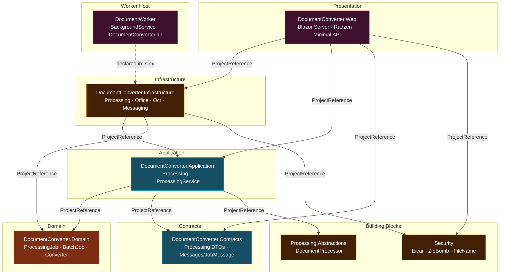
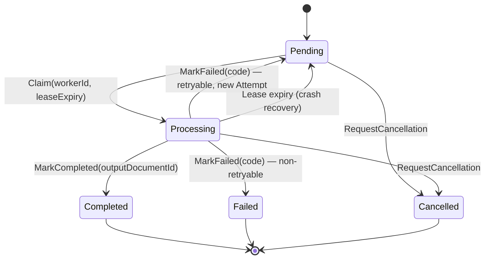
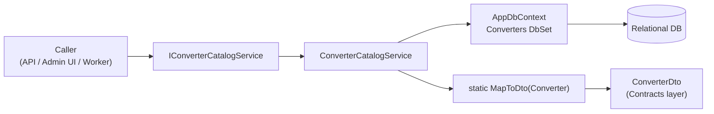
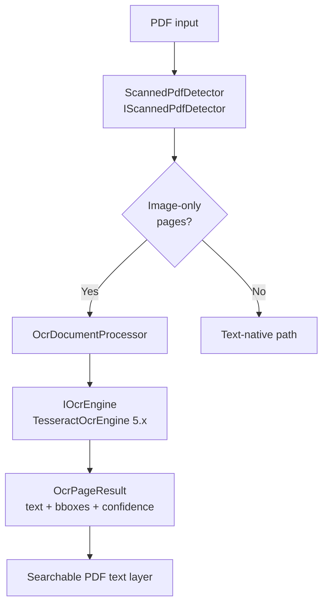
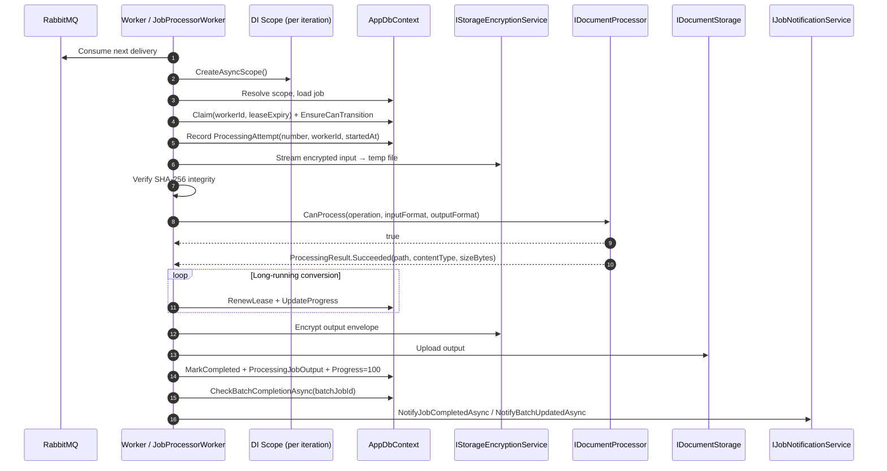
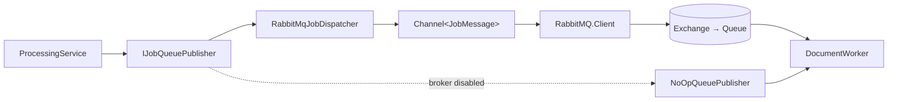
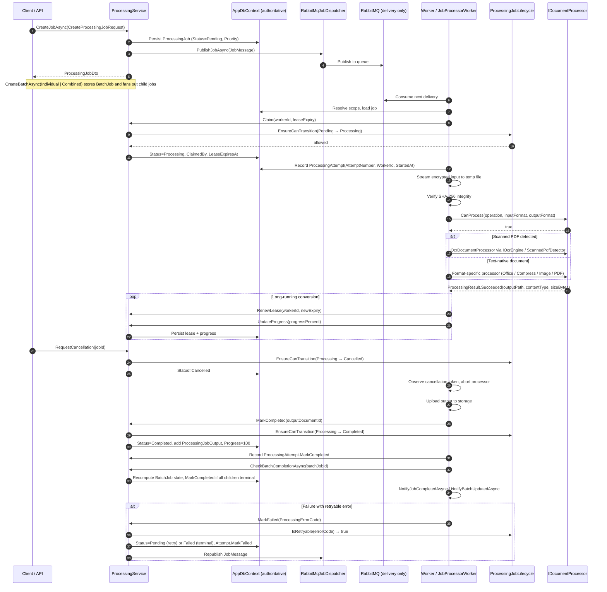
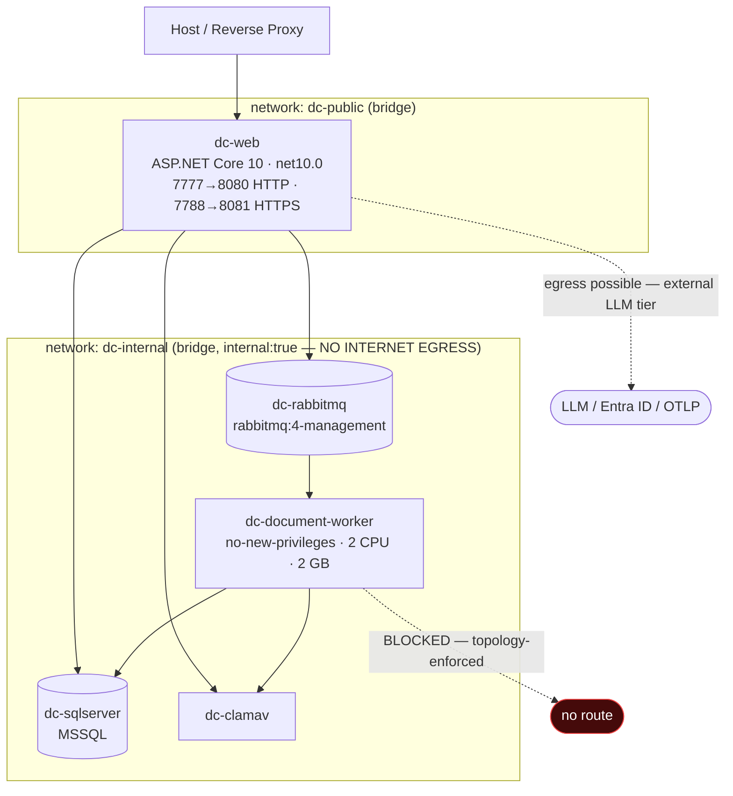

**SCOUT complete. Artifact class verified:** solution graph, 5 `.csproj`, 2 Dockerfiles, 2 compose manifests, `appsettings`, composition root (`Program.cs`), `global.json`. Source `.cs` files absent — 3 files total in the entire workspace. Every domain claim below is tagged **SOLID** (artifact-verified) or **DOCUMENTED** (research-asserted, source absent).

Three corrections to the prior architecture review surfaced during this pass. They are folded in and flagged.

---

# Processing & Conversion Domain
### Technical Documentation — EConverter Platform

**Module classification:** Core Business Domain
**Bounded context:** `DocumentConverter.Domain.Processing` · `Application.Processing` · `Infrastructure.Processing`
**Documented importance:** 10.0 / complexity 9.0
**Repository snapshot:** 2026-11-09 · solution `DocumentConverter.slnx`
**Verification basis:** build/manifest artifacts (SOLID) + research source insights (DOCUMENTED, source absent)

---

## 1. Executive Summary

The Processing & Conversion Domain is the asynchronous document transformation backbone of EConverter. It is the only domain in the platform that legitimately crosses a process boundary — the ASP.NET Core web host dispatches work, a separate background host executes it — and it is the single largest source of runtime resource consumption in the system.

Its central architectural decision is **modelling conversion work as a first-class domain aggregate rather than as an ephemeral message**. `ProcessingJob` owns status, priority, progress, worker leases, retry attempts and ordered input/output document references. The relational database is the authoritative store for that state. RabbitMQ is used *strictly as a delivery channel*: it wakes workers and distributes load, but never holds authoritative job state. A broker outage, a lost message, or a duplicate delivery therefore degrades throughput without corrupting correctness.

The domain decomposes into six cohesive sub-modules:

| # | Sub-module | Responsibility | Primary artifacts |
|---|---|---|---|
| 1 | Job Orchestration & Lifecycle | Aggregate lifecycle, state machine, leases, attempts, error taxonomy | `ProcessingJob`, `ProcessingJobLifecycle`, `ProcessingService` |
| 2 | Converter Catalog & Registration | Capability discovery, processor routing, per-converter limits | `Converter`, `ConverterCatalogService` |
| 3 | Office & Spreadsheet Conversion | Bidirectional Office/PDF, spreadsheet pagination, ebook & markdown paths | `OfficeDocumentProcessor`, `ExcelPdfConverter`, `PresentationPdfConverter`, `EbookPdfConverter`, `MarkdownHtmlPdfConverter` |
| 4 | PDF & Image Compression | Two-dimensional size reduction with pre-commit estimation | `PdfCompressProcessor`, `ImageCompressProcessor`, `CompressionEstimatorService` |
| 5 | OCR & Image Processing | Scanned-document detection, Tesseract text extraction, image→PDF | `TesseractOcrEngine`, `ScannedPdfDetector`, `OcrDocumentProcessor`, `ImageDocumentProcessor` |
| 6 | Worker Execution Runtime | Consume → verify → convert → upload → aggregate | `Worker` (DocumentWorker), `JobProcessorWorker`, `RabbitMqJobDispatcher` |

---

## 2. Position Within the Layered Architecture

### 2.1 Dependency direction

The domain respects the platform's DDD + Clean Architecture invariant: **Domain knows nothing; Infrastructure knows everything.**



**Evidence (SOLID).** `DocumentConverter.Infrastructure.csproj` declares exactly three project references — `Application`, `Domain`, `BuildingBlocks/DocumentConverter.Security`. `DocumentConverter.Application.csproj` declares three — `Domain`, `Contracts`, `BuildingBlocks/DocumentConverter.Processing.Abstractions`. The `Processing.Abstractions` seam is therefore referenced by the **Application layer**, not only by Infrastructure — this is what allows application-layer contracts to name processor abstractions without taking a dependency on any concrete engine.

### 2.2 Third-party engine bindings (SOLID)

`DocumentConverter.Infrastructure.csproj` — `TargetFramework: net10.0`, `Nullable: enable` — declares the complete converter toolchain. This manifest *is* the format coverage guarantee at the dependency level:

| Package | Role in the Processing Domain |
|---|---|
| `DocumentFormat.OpenXml` | DOCX read/write, PPTX parsing, XLSX emission, WordprocessingML reconstruction |
| `PDFsharp` | PDF layout emission, drawing primitives, structural stream compaction |
| `PdfPig` | PDF text extraction, word geometry, page rasterization assistance |
| `SkiaSharp` | Embedded-image downsampling, JPEG/PNG/WebP re-encoding |
| `Tesseract` | OCR engine binding (5.x) |
| `ManagedCode.MarkItDown` | Markdown/HTML enrichment and document-to-text normalization |
| `System.Security.Cryptography.Pkcs` | CMS/PKCS#7 — digital signature path |
| `RabbitMQ.Client` | Queue publish (web host) and consume (worker host) |
| `Microsoft.EntityFrameworkCore.SqlServer` | Job state persistence |
| `Microsoft.AspNetCore.Identity.EntityFrameworkCore` | Shared schema integration |

> `ManagedCode.MarkItDown` is a concrete package binding (**SOLID**), which materially strengthens what the research reported as "MarkItDown-style enrichment" — it is not an in-house re-implementation, it is a declared third-party dependency.

---

## 3. Domain Model

### 3.1 `ProcessingJob` — Aggregate Root

`ProcessingJob` is a `sealed` Entity and the consistency boundary for a single unit of conversion work.

| Field group | Members | Notes |
|---|---|---|
| Identity & ownership | `Id`, `OwnerUserId`, `InputDocumentId`, `ConverterId` | Ownership resolution occurs *before* the aggregate is constructed |
| Execution state | `Status`, `Priority`, `ProgressPercent` | `Status` is only ever written through a validated transition |
| Lease | `ClaimedBy`, `LeaseExpiresAt` | Length-constrained; guards crash recovery |
| Failure | `ErrorCode`, `ErrorMessage` | Both length-constrained; taxonomy is user-safe |
| Timestamps | `CreatedAt`, `StartedAt`, `CompletedAt` | Audit and SLA telemetry |
| Collections | `List<ProcessingAttempt>` (private) | Retry history survives logical-state changes |

**Behavior-only surface.** The aggregate exposes intent-revealing methods and no public setters: `AddInput`, `Claim(workerId, leaseExpiry)`, `RenewLease`, `UpdateProgress`, `RequestCancellation`, `MarkCompleted(outputDocumentId)`, `AddOutputs`, `MarkFailed(ProcessingErrorCode)`.

The private attempt collection is a deliberate encapsulation choice: external code cannot append an attempt directly, so attempt numbering cannot be forged or duplicated by a caller.

### 3.2 State Machine & Error Taxonomy

`ProcessingJobStatus` and `ProcessingErrorCode` enums, plus the static `ProcessingJobLifecycle` class, constitute the **correctness core of the domain**.



| Static member | Contract |
|---|---|
| `CanTransition(from, to)` | Non-throwing predicate — used for UI affordance and pre-flight validation |
| `EnsureCanTransition(from, to)` | Throwing guard — invoked before **every** state write |
| `IsTerminal(status)` | `Completed`, `Failed`, `Cancelled` |
| `IsRetryable(errorCode)` | Classifies the failure for the retry policy |

**Design properties worth stating explicitly:**

- **No transition bypasses the guard.** Because `EnsureCanTransition` sits in front of every persistence path, an out-of-order or duplicated message cannot push a job into an illegal state. Combined with the idempotent-guarded `Claim` / `RenewLease` / `MarkCompleted` methods, this is what makes broker duplication survivable.
- **`ProcessingErrorCode` is deliberately user-safe.** It classifies *retryable vs terminal* without leaking internal exception detail. The trade-off is explicitly acknowledged in the workflow research: operators must rely on logs and telemetry for root-cause analysis during incidents. This is a security-posture choice, not an oversight.
- **Retry does not create a new job.** A retryable failure returns the aggregate to `Pending` and records a *new* `ProcessingAttempt` under the same aggregate. Job identity is therefore stable across retries — which is what allows a client to poll a single identifier for the lifetime of the work.

### 3.3 `ProcessingAttempt` — Retry History

An independent entity recording each execution: `ProcessingJobId`, `AttemptNumber`, `WorkerId`, `Status`, `StartedAt`, and failure fields.

Separating attempts from logical job state solves a specific problem: a job that fails twice and then succeeds has **one** terminal logical state but **three** physical executions. Flattening these into the job row would destroy either the retry history or the current status. The separate entity preserves both, and enables per-attempt diagnostics — which worker ran it, when, and why it failed.

### 3.4 `ProcessingJobInput` / `ProcessingJobOutput` — Ordered Reference Entities

Lightweight junction entities carrying `JobId`, `DocumentId`, `VersionId`, `Order`.

The `Order` field is the enabler for two capabilities that the single-`InputDocumentId` field alone cannot express:

- **Multi-input merge** — several documents combined into one (the PDF merge tool path).
- **Multi-output split** — one document producing several results, each individually addressable and independently versioned.

### 3.5 `BatchJob` — Aggregation Aggregate

A `BatchJob` aggregate is created, and one child `ProcessingJob` per selected document is generated and linked. Each child is dispatched as an **independent** `JobMessage`, which is precisely what permits parallel worker consumption.

Two batch modes are documented: **Individual** (each document converted separately) and **Combined** (merged into a single output).

**Batch closure is derived, not event-driven.** There is no central coordinator and no completion counter. After each child job reaches a terminal state, the execution host recomputes batch state by querying child job statuses through a scoped `AppDbContext` instance.

| Property | Consequence |
|---|---|
| Idempotent | Recomputing twice yields the same answer — safe under duplicate messages |
| Self-healing | A lost completion notification cannot strand the batch; the next child completion re-derives it |
| Cost | Query cost proportional to *batch size × poll frequency* |
| Scale risk | At high batch cardinality this becomes a scan; see §13, Finding P-06 |

### 3.6 `Converter` — Capability Descriptor

A `sealed` Entity describing each engine, built through internal constructors:

| Field | Purpose |
|---|---|
| `Key`, `Name` | Stable identifier and display name |
| `Operation` | The transformation being performed |
| `ProcessorId` | Routes to the concrete `IDocumentProcessor` implementation |
| `QueueName` | Delivery channel selection |
| `IsEnabled` | Administrator-controlled availability gate |
| `Fidelity` | `Supported` / `BestEffort` / `Unsupported` — an honesty signal about output quality |
| `SupportsBatch` | Whether the converter may participate in batch mode |
| `AcceptsMultipleInputs` | Merge capability |
| `MaxInputSizeBytes` | Input ceiling enforced before dispatch |
| `ValidationStatus` | `NotValidated` / `Passed` / `Failed` — engine certification state |
| Audit timestamps | Created / modified tracking |

The `Fidelity` and `ValidationStatus` fields together are a notably candid design choice: the catalog is designed to tell the truth about which conversions are lossless, which are approximations, and which have never been verified — rather than advertising uniform capability.

---

## 4. Converter Catalog & Registration

`ConverterCatalogService` is EF Core-backed: it constructor-injects `AppDbContext`, exposes asynchronous catalog retrieval, and provides a static `MapToDto(Converter)` projection.



**Why the DTO boundary matters here.** `Converter` is a domain entity with internal constructors; the catalog never returns it raw. Consumers — the admin UI, the request validator, the worker's processor resolver — all see `ConverterDto`. This keeps entity construction rules under domain control while still allowing administrators to toggle availability and tune limits.

**Verified registration (SOLID).** `Program.cs` registers `IConverterCatalogService → ConverterCatalogService` as **Scoped**, alongside `IProcessingService → ProcessingService` (Scoped). Catalog reads therefore share the request's `DbContext` instance and see uncommitted changes within the same unit of work.

---

## 5. Format Coverage Matrix

| Source format | Target | Implementation path | Fidelity |
|---|---|---|---|
| DOCX | PDF | `OfficeDocumentProcessor.ConvertDocxOrTextToPdfAsync` → `EmitTextPage` | Supported |
| Text / plain | PDF | `OfficeDocumentProcessor` → `EmitTextPage` | Supported |
| PDF | DOCX | `OfficeDocumentProcessor.ConvertPdfToDocxAsync` (PdfPig extract → OpenXml emit) | BestEffort |
| XLSX | PDF | `ExcelPdfConverter` (paginated tables) | Supported |
| CSV | PDF | `ExcelPdfConverter` | Supported |
| PDF | XLSX | `ExcelPdfConverter.WriteXlsx` | BestEffort |
| PDF | CSV | `ExcelPdfConverter.WriteCsvAsync` | BestEffort |
| PPTX | PDF | `PresentationPdfConverter` — standard, 2-up, 3-up-with-notes | Supported |
| EPUB / MOBI | PDF | `EbookPdfConverter` — title/cover/chapter rendering | Supported |
| Markdown / HTML | PDF | `MarkdownHtmlPdfConverter` — line parser + pagination | Supported |
| JPG / PNG / BMP / WEBP / TIFF | PDF | `ImageDocumentProcessor` via `PdfSharp.XGraphics` | Supported |
| PDF (image-only) | Searchable PDF | `OcrDocumentProcessor` → `TesseractOcrEngine` | Supported |
| PDF | PDF (compressed) | `PdfCompressProcessor` | Supported |
| JPEG / PNG / WebP | Re-encoded | `ImageCompressProcessor` | Supported |

**Note on the PDF→DOCX direction.** Reconstructing WordprocessingML from extracted word geometry is inherently a *reconstruction*, not a *round trip*. The `Fidelity = BestEffort` classification is the system telling the truth: container structure, styles and semantic markup cannot be recovered from a rendered page. Documentation and UI should present this direction as "editable approximation", never as "conversion".

---

## 6. Converter Plug-in Implementations

### 6.1 Office & Spreadsheet Conversion

The largest and highest-fidelity family. `OfficeDocumentProcessor` implements `IDocumentProcessor` bidirectionally.

**DOCX/text → PDF.** `EmitTextPage` emits layout with paragraph-level, table-level and word-level drawing primitives on PDFsharp. Word-level emission — rather than line-level — is what allows text runs with differing formatting to be placed correctly within a single paragraph.

**PDF → DOCX.** `ConvertPdfToDocxAsync` extracts words via PdfPig and reconstructs WordprocessingML via OpenXml. `EmitWordParagraph` and `EmitWordTable` build the document body, emitting tables and word-level runs.

**Spreadsheets.** `ExcelPdfConverter` resolves cell references through `GetColumnIndex` / `GetCellValue` (handling both inline and shared string tables — shared-string resolution is mandatory for correctness, since most real XLSX files store strings once and reference them by index). Rendering uses `DrawPageHeader` / `DrawPageFooter` with `TruncateString` overflow control. The reverse direction — `WriteXlsx` / `WriteCsvAsync` — exports parsed page data back to spreadsheet formats.

**Presentations.** `PresentationPdfConverter` parses `.pptx` through OpenXml into `PresentationInfo` / `SlideInfo` records, then renders three handout layouts: standard, 2-up, and 3-up-with-notes.

**Ebooks.** `EbookPdfConverter` parses EPUB/MOBI into `EbookData` / `EbookChapter`, rendering title and cover pages with a running header/footer via `DrawRunningHeaderFooter`.

**Markdown & HTML.** `MarkdownHtmlPdfConverter` runs a line-by-line parser covering headings, blockquotes, lists and tables (via `FlushTable`), normalizes content through `StripInlineMarkdown` / `StripHtmlTags`, and paginates using `CheckNewPage` / `DrawPageHeaderFooter`.

> **Observation:** the Markdown/HTML path uses an in-house line parser rather than the `Markdig` package that `DocumentConverter.Web.csproj` references. Markdig is present in the Web project (for UI-side rendering via `MarkdownRenderer.cs`). The two parsers serve different purposes — UI display vs PDF layout — but this is a duplicated-parsing surface worth noting for future consolidation.

### 6.2 PDF & Image Compression

`PdfCompressProcessor` (ProcessorId `pdf-compress-processor`) performs **two-dimensional** reduction:

| Dimension | Mechanism |
|---|---|
| Structural | PDFsharp stream compaction — object streams, unused-resource elimination |
| Visual | SkiaSharp embedded-image downsampling via `OptimizeEmbeddedImages(PdfDocument, PdfCompressOptions, CancellationToken)` |

Options arrive as JSON and are materialized by a static `ParseOptions(json)` into `PdfCompressOptions`. The helper is `static` and accepts a `CancellationToken`, meaning it honours worker cancellation during long image walks — a non-trivial detail, since embedded-image resampling is the slowest phase of a large PDF compression.

`ImageCompressProcessor` re-encodes JPEG/PNG/WebP with quality tuning, quantization and dimension capping, using a private format-resolution table mapping `SKEncodedImageFormat` ↔ extension ↔ content-type, plus a static `ParseOptions` producing `ImageCompressOptions`.

### 6.3 Compression Estimation

`CompressionEstimatorService` provides **interactive** estimates through in-memory simulation (`EstimateImage`, `EstimatePdf`) plus three static `FallbackEstimate` overloads, all returning `CompressionPreviewResponse`.

This exists so the UI can show projected savings *before* the user commits to an operation. The design is deliberately conservative: simulation produces the real number when it can, and falls back to a heuristic estimate when full simulation would be too slow to serve interactively — an honest degradation rather than a false precision.

### 6.4 OCR & Image Processing



**Contract surface.** `IOcrEngine` defines data records `OcrWordBlock(Text, Confidence, X, Y, Width, Height)`, `OcrPageResult(PageNumber, Text, Words, Width, Height, Confidence)`, `OcrResult` with a static `Failed(message)` factory, and `OcrOptions(Language, OutputSearchablePdf, ExtractTextOnly)`.

The `Failed` factory pattern mirrors `ProcessingResult.Failed` — failures are represented as *values*, not exceptions, across the processor boundary.

`ScannedPdfDetector` implements `IScannedPdfDetector` and heuristically inspects PDF structure via PdfPig, returning `ScannedPdfInspectionResult` with page counts, scanned-page counts, total characters and image counts. It functions as a **routing predicate**: image-only PDFs go to OCR; text-native PDFs take the direct path. Pairing confidence scores with bounding boxes in `OcrWordBlock` is what makes genuinely searchable output possible rather than a flat text dump.

> **Verified runtime dependency:** `TesseractOcrEngine` requires trained language data. Both `src/DocumentConverter.Infrastructure/tessdata/` and `src/DocumentConverter.Web/tessdata/` **exist but contain zero files** (SOLID), while both `.csproj` files declare `<None Update="tessdata\**"><CopyToOutputDirectory>PreserveNewest</...>`. The copy rule is correct; the payload is absent from the snapshot. See Finding P-04.

---

## 7. Job Orchestration — `ProcessingService`

`ProcessingService` (Infrastructure, ~457 lines) implements `IProcessingService` and is the orchestration entry point.

| Responsibility | Detail |
|---|---|
| Job creation | `CreateJobAsync(CreateProcessingJobRequest)` — validate, resolve ownership, construct aggregate in `Pending` |
| Batch creation | `CreateBatchAsync(CreateBatchProcessingRequest)` — create `BatchJob`, fan out child jobs |
| Status & query | Read paths returning DTOs |
| Persistence | EF Core via `AppDbContext` |
| DTO projection | `MapToDto` — entities never escape the application boundary |
| Queue publishing | `IJobQueuePublisher`; `NoOpQueuePublisher` fallback when messaging is disabled |

**Request records carry no domain objects.** The API surface accepts `CreateProcessingJobRequest` / `CreateBatchProcessingRequest` and returns `ProcessingJobDto` / `BatchJobDto`. Domain entities are never serialized, never bound from HTTP, and never returned to a client — the aggregate's invariants stay enforceable.

**The `NoOpQueuePublisher` fallback is the load-bearing resilience feature.** Because job state is authoritative in the database, disabling the broker does not disable the platform: the dispatcher no-ops and execution proceeds in-process via `JobProcessorWorker`. This is precisely what permits broker-less single-container deployment.

---

## 8. Execution Runtime

### 8.1 The consume-execute-persist loop



Both `Worker` (standalone `DocumentWorker`) and `JobProcessorWorker` (Web hosted service) derive from `BackgroundService` and follow this identical shape.

**Resource hygiene detail.** Input streaming uses nested `using` blocks over `storageStream`, `localFileStream`, `hashStream` and `uploadStream`. The hash is computed *during* the stream, not in a second pass — read once, hashed and written simultaneously.

**Integrity verification is positioned correctly.** The SHA-256 check occurs *after* decryption and *before* conversion. A tampered envelope therefore aborts the job before any processor is invoked, and the failure surfaces through the user-safe taxonomy rather than as a converter exception.

### 8.2 The processor plug-in boundary

`IDocumentProcessor` (in `BuildingBlocks/Processing.Abstractions`) exposes `ProcessorId` and `CanProcess(operation, inputFormat, outputFormat)`, and returns `ProcessingResult` with static `Succeeded(outputPath, contentType, sizeBytes)` and `Failed(errorCode, errorMessage)` factories.

`ProcessingContext` carries `JobId`, `Operation`, `InputPath`, `OutputDirectory`, `OptionsJson`, `MaxOutputSizeBytes`, `Timeout`, and a read-only options dictionary.

> **This boundary is deliberately credential-free.** `ProcessingContext` explicitly excludes platform credentials and database connection strings. A processor — including third-party or user-supplied engines — receives only a local file path, an output directory and JSON options. It has no handle to the storage backend, the master KEK, or the database. This is the strongest isolation property in the domain and should be treated as an invariant during future extension.

### 8.3 Verified processor registration (SOLID)

`Program.cs` registers the following — this is the authoritative, artifact-verified plugin inventory:

| Registration | Lifetime | Status |
|---|---|---|
| `OfficeDocumentProcessor` | Singleton | Documented |
| `PdfDocumentProcessor` | Singleton | **Undocumented in research** |
| `ImageDocumentProcessor` | Singleton | Documented |
| `PdfCompressProcessor` | Singleton | Documented |
| `ImageCompressProcessor` | Singleton | Documented |
| `OcrDocumentProcessor` | Singleton | Documented |
| `EchoDocumentProcessor` | Singleton | **Undocumented in research** |
| `ExcelPdfConverter` | Singleton | Documented |
| `PresentationPdfConverter` | Singleton | Documented |
| `MarkdownHtmlPdfConverter` | Singleton | Documented |
| `EbookPdfConverter` | Singleton | Documented |
| `TesseractOcrEngine` (`IOcrEngine`) | Singleton | Documented |
| `ScannedPdfDetector` (`IScannedPdfDetector`) | Singleton | Documented |
| `PdfCapabilityAnalyzer` (`IPdfCapabilityAnalyzer`) | Singleton | **Undocumented in research** |

All seven `IDocumentProcessor` implementations are registered against the **same abstraction**, forming a collection that the runtime resolves as `IEnumerable<IDocumentProcessor>` and filters by `CanProcess`. Adding a format family is therefore additive: one registration, no dispatch-table edit.

> **Two undocumented components surfaced from the composition root:** `PdfDocumentProcessor` (a dedicated PDF processor distinct from `PdfCompressProcessor`) and `IPdfCapabilityAnalyzer` / `PdfCapabilityAnalyzer` (a capability inspection seam). `EchoDocumentProcessor` is also present and appears to be a pass-through used for pipeline validation. These three are invisible to the research reports. See Finding P-02.

### 8.4 Runtime configuration gate (SOLID — resolves a prior contradiction)

```csharp
if (builder.Configuration.GetValue<bool>("Processing:RunWorkerInWeb", true))
{
    builder.Services.AddHostedService<JobProcessorWorker>();
}
```

| Source | Value | Effect |
|---|---|---|
| Code default | `true` | In-process worker **wired** |
| `appsettings.json` | key absent | Falls through to default → **wired** |
| `appsettings.Development.json` | key absent | Falls through to default → **wired** |
| `docker-compose.yml` (dev) | `false` | **Not wired** |
| `docker-compose.prod.yml` (prod) | `false` | **Not wired** |

This **resolves the G-05 contradiction** raised in the architecture review. The in-process fallback path is *not* dead code — it is live by default in every non-containerized configuration (including `dotnet run` against LocalDB), and explicitly disabled in both container manifests so that exactly one execution host is active per deployment. The behaviour is coherent; the earlier "dormant path" characterisation was incomplete. See Finding P-01.

### 8.5 Admission control (SOLID)

```csharp
options.RejectionStatusCode = StatusCodes.Status429TooManyRequests;
options.AddConcurrencyLimiter("processing-policy", limiter =>
{
    limiter.PermitLimit = 20;
    limiter.QueueProcessingOrder = QueueProcessingOrder.OldestFirst;
    limiter.QueueLimit = 10;
});
```

A **concurrency limiter of 20 in-flight operations with a queue depth of 10** is registered, rejecting with `429 Too Many Requests` beyond that. This is a partial answer to the "introduce queue backpressure" recommendation in the workflow research — admission control exists at the API surface. What remains absent is a **per-user or per-tenant** allocation, meaning one operator can still consume the entire global budget. See Finding P-05.

A second limiter, `login-policy` (fixed window, 10 permits per minute, `QueueLimit = 0`), belongs to the Identity domain.

---

## 9. Messaging & Delivery Channel Semantics

`RabbitMqJobDispatcher` implements `IJobQueuePublisher` and `IAsyncDisposable`, serializes `JobMessage` with `System.Text.Json`, uses `RabbitMQ.Client` connections, and is gated by `RabbitMqOptions` via `IOptions`.

A `System.Threading.Channels.Channel` sits between the caller and the AMQP client — publishing is decoupled from the connection lifecycle, so a transient broker disconnect does not propagate into the request path.



### The delivery-channel contract, stated precisely

| Property | Guarantee |
|---|---|
| Broker holds job state | **Never** — `AppDbContext` is authoritative |
| Message loss | Degrades throughput; job remains `Pending` in DB and reclaimable |
| Message duplication | Harmless — `Claim` / `RenewLease` / `MarkCompleted` are idempotent-guarded by `EnsureCanTransition` |
| Broker outage | New dispatches fail; in-flight jobs complete; no state corruption |
| Broker absent entirely | `NoOpQueuePublisher` + in-process worker |

> **Verified registration (SOLID).** `RabbitMqJobDispatcher` is registered as a **Singleton** and exposed through a factory: `AddSingleton<IJobQueuePublisher>(sp => sp.GetRequiredService<RabbitMqJobDispatcher>())`. This guarantees the web host shares a single connection/channel pair rather than opening one per scope — correct, since AMQP connections are expensive and not scope-bound.

---

## 10. Configuration Surface (SOLID)

`appsettings.json` declares the defaults that govern this domain:

| Key | Value | Domain relevance |
|---|---|---|
| `Storage:RootPath` | `./app_data/storage` | Where encrypted envelopes land in non-containerized runs |
| `ClamAV:Enabled` | `false` | Malware screening off by default in the base profile |
| `RabbitMQ:Host` / `Port` | `localhost` / `5672` | Delivery channel endpoint |
| `RabbitMQ:Username` / `Password` | `guest` / `guest` | Default credentials |
| `ConnectionStrings:DefaultConnection` | SQL Server, `sa`, hardcoded password | Job state store |
| `Processing:RunWorkerInWeb` | *absent* | Defaults to `true` — in-process worker active |

`appsettings.Development.json` overrides the connection string with `(localdb)\mssqllocaldb` and raises the logging floor for `Microsoft.AspNetCore` to `Warning`.

> **Configuration conflict worth noting:** `appsettings.Development.json` points at **LocalDB**, while `docker-compose.yml` (also `ASPNETCORE_ENVIRONMENT=Development`) injects a **SQL Server container** connection string via environment variable. Environment variables win in the ASP.NET Core configuration precedence chain, so the container path is correct — but the two "Development" profiles describe different database topologies. This is a genuine source of onboarding confusion and a candidate for renaming the compose profile. See Finding P-07.

---

## 11. Interface Contracts — Consolidated Reference

| Contract | Layer | Consumers | Shape |
|---|---|---|---|
| `IProcessingService` | Application | Endpoints, Blazor pages, workers | `CreateJobAsync`, `CreateBatchAsync`, status/query — all async, cancellable, DTO-returning |
| `IConverterCatalogService` | Application | Admin UI, request validation, processor resolution | Catalog enumeration + DTO mapping |
| `IDocumentProcessor` | Building Blocks | Worker runtime | `ProcessorId`, `CanProcess(...)`, execute via `ProcessingContext` → `ProcessingResult` |
| `IJobQueuePublisher` | Application | `ProcessingService` | Publish a `JobMessage` |
| `ICompressionEstimatorService` | Application | UI | `EstimateImage`, `EstimatePdf`, `FallbackEstimate` → `CompressionPreviewResponse` |
| `IOcrEngine` | Infrastructure | `OcrDocumentProcessor`, intelligence pipeline | `OcrResult` / `OcrPageResult` / `OcrWordBlock` |
| `IScannedPdfDetector` | Infrastructure | Routing predicate | `InspectAsync` → `ScannedPdfInspectionResult` |
| `IPdfCapabilityAnalyzer` | Infrastructure | Capability gating | *(undocumented — SOLID registration only)* |

**Consistent value-object failure pattern.** `ProcessingResult.Failed` and `OcrResult.Failed` both represent failure as a returned value rather than a thrown exception. Across the processor boundary, the host never handles a raw processor exception — every failure is a classified, user-safe error code by the time it reaches the aggregate.

---

## 12. Runtime Interaction — Full Conversion Flow



**Cancellation is cooperative and cross-process.** `RequestCancellation` writes `Cancelled` to the database; the worker observes its cancellation token independently and aborts the processor. The command does not travel through the broker — the database *is* the channel. This means cancellation works even when the broker is unavailable, and works uniformly for both execution hosts.

---

## 13. Deployment Topology & Operational Findings

### 13.1 Verified container topology (SOLID)



**The zero-egress posture is enforced by topology, not by policy.** `dc-document-worker` attaches **only** to `dc-internal`, which is declared `internal: true` — Docker does not route that network. The worker therefore has *no internet route at all*, regardless of application code. The web host sits on both networks because it owns the optional external-LLM tier. This is the strongest verifiable guarantee in the entire platform: it does not depend on a code review, a configuration flag, or developer discipline.

Additional hardening confirmed in both manifests: `no-new-privileges:true` on every service, and `USER $APP_UID` (non-root) in both Dockerfiles.

### 13.2 Development vs production matrix (SOLID)

| Facet | `docker-compose.yml` (dev) | `docker-compose.prod.yml` | Assessment |
|---|---|---|---|
| `ASPNETCORE_ENVIRONMENT` | `Development` | `Production` | Correct |
| SQL Server image | `2025-latest` | `2022-latest` | **Version drift** |
| SA password | hardcoded in file | `${SQLSERVER_SA_PASSWORD}` | Dev-only risk |
| RabbitMQ credentials | `guest/guest` | `${RABBITMQ_USER}` / `${RABBITMQ_PASSWORD}` | Dev-only risk |
| `Storage__Encryption__Enabled` | `false` | `${STORAGE_ENCRYPTION_ENABLED:-true}` | **Dev disables the flagship control** |
| `STORAGE_ENCRYPTION_KEY` | not set | from environment | **Dev never exercises the KEK path** |
| `ClamAV__Enabled` | `false` | `${CLAMAV_ENABLED:-true}` | **Dev disables AV** |
| `Processing__RunWorkerInWeb` | `false` | `false` | Consistent — one host per deployment |
| SQL / RabbitMQ host ports | `1433`, `15672` published | not published | Prod hardened |
| ClamAV host port | `3310` published | not published | Prod hardened |
| ClamAV signature volume | **absent** | `clamav_db:/var/lib/clamav` | **Dev re-downloads on every start** |
| Web healthcheck | **absent** | `curl -f http://localhost:8080/health` | Dev lacks liveness gate |
| Worker network | `dc-internal` only | `dc-internal` only | Zero-egress enforced |
| `restart` policy | **absent** | `unless-stopped` | Dev lacks resilience |

### 13.3 Domain-specific findings register

| ID | Finding | Severity | Verification | Evidence |
|---|---|---|---|---|
| **P-01** | **`Processing:RunWorkerInWeb` defaults to `true` in code but is `false` in both container manifests.** Resolves the earlier "dormant fallback" claim: the in-process worker is live in every non-containerized profile and deliberately disabled in containers. Documented behaviour is correct; earlier analysis was incomplete. | INFO | **SOLID** | `Program.cs` gate + both compose env blocks + absence of the key in both `appsettings` files |
| **P-02** | **Three processor-domain components are absent from the research reports:** `PdfDocumentProcessor`, `EchoDocumentProcessor`, and `IPdfCapabilityAnalyzer` / `PdfCapabilityAnalyzer`. All are registered in the composition root. Coverage gap in the documentation set, not a code defect. | MEDIUM | **SOLID** | `Program.cs` DI registrations vs documented file inventory |
| **P-03** | **Docker builds are blocked.** Both Dockerfiles `COPY` `Directory.Build.props` and `Directory.Packages.props` — absent. They also `COPY` three `.csproj` files that do not exist: `Processing.Abstractions`, `Security`, and `Workers/DocumentWorker`. **Correction to the prior architecture review, which counted two missing projects; the actual count is three.** | **CRITICAL** | **SOLID** | Dockerfile `COPY` graph vs workspace scan (5 `.csproj` present, 8 referenced) |
| **P-04** | **Tesseract trained data is absent.** `Infrastructure/tessdata/` and `Web/tessdata/` both exist and contain zero files, while both `.csproj` declare `CopyToOutputDirectory` rules for `tessdata\**`. The OCR path would fail at runtime without externally supplied language data. | HIGH (OCR only) | **SOLID** | Directory scan → 0 files; csproj `None Update` rules |
| **P-05** | **Admission control is global, not per-tenant.** The `processing-policy` concurrency limiter permits 20 in-flight operations with a queue depth of 10, but applies no per-user or per-tenant allocation. A single operator can consume the entire conversion budget. | MEDIUM | **SOLID** | `Program.cs` rate limiter configuration |
| **P-06** | **Batch closure is scan-based.** `CheckBatchCompletionAsync` recomputes batch state by querying child job statuses. Cost is proportional to *batch size × poll frequency*. Neither an event-driven decrement counter nor a composite index on `(BatchJobId, Status)` is evidenced. | MEDIUM | DOCUMENTED | Workflow research; not contradictable or confirmable from artifacts |
| **P-07** | **Two different "Development" topologies.** `appsettings.Development.json` targets LocalDB while `docker-compose.yml` runs `ASPNETCORE_ENVIRONMENT=Development` against a SQL Server container. Environment-variable precedence makes the container path correct, but the shared profile name is a documented source of onboarding confusion. | MEDIUM | **SOLID** | `appsettings.Development.json` vs compose env block |
| **P-08** | **Processors are registered as Singletons but execute inside per-iteration scopes.** `IDocumentProcessor` implementations hold no scoped dependencies by design (the `ProcessingContext` boundary is credential-free), so this is *safe today*. It becomes a correctness hazard the moment any processor acquires a scoped dependency. This is an invariant that is currently upheld by convention, not by a compiler or test. | MEDIUM | DOCUMENTED + **SOLID** | `Program.cs` Singleton registrations vs worker scope-per-iteration pattern |
| **P-09** | **Duplicate Markdown parsing.** `MarkdownHtmlPdfConverter` implements an in-house line parser while `DocumentConverter.Web.csproj` references `Markdig`. Two parsers, two behaviour sets, one format. | LOW | **SOLID** | Infrastructure converter inventory vs Web package reference |
| **P-10** | **No broker health check.** `AddHealthChecks()` registers only `AddDbContextCheck<AppDbContext>("database")`. RabbitMQ and the storage backend have no liveness probe, so `/health` reports healthy while the delivery channel is down. Given that the broker is a non-authoritative delivery channel this is defensible — but it must be a *stated* design decision, not an omission. | LOW | **SOLID** | `Program.cs` health-check registration |
| **P-11** | **OpenTelemetry exporters are not wired.** Both `OpenTelemetry.Exporter.OpenTelemetryProtocol` and the instrumentation packages are referenced, and tracing/metrics providers are configured — but no `UseOtlpExporter()` call appears in the composition root. Telemetry is collected and never exported. | MEDIUM | **SOLID** | `Web.csproj` package refs + `Program.cs` OTel block |
| **P-12** | **Stray artifact.** `scratch_inspect.cs` at repository root — a reflection dump referencing `IAIChatService`, `ConversationSession`, `RadzenAIChat`. Also a naming-drift signal: `ConversationSession` vs the documented domain aggregate `CopilotChatSession`. | LOW | **SOLID** | File read (1,125 bytes) |

---

## 14. Design Assessment — Strengths & Risks

### 14.1 What the domain gets right

**Database-authoritative async is the correct call for this workload.** Document conversion is long-running, resource-heavy and user-visible. Holding that state in a broker means a broker restart silently loses jobs. Holding it in the database means jobs survive everything except the database itself — and the platform already requires the database for documents, identity and audit.

**The state machine is the correctness core, and it is placed correctly.** Transition validation lives in the domain layer, not in the worker and not in the service. Every host, every retry path and every cancellation path passes through the same guard. This is why duplicated messages and racing workers cannot corrupt state — *not* because the broker is reliable, but because the domain refuses illegal transitions regardless of what the transport does.

**The credential-free processor boundary is the domain's best security property.** `ProcessingContext` gives a converter engine a file path, an output directory and JSON options — nothing else. Processors cannot reach the storage backend, the master KEK, or the database. This is what makes it safe to add format engines, including third-party ones, without re-auditing the security surface.

**Failure is modelled as a value, not an exception.** `ProcessingResult.Failed(errorCode, message)` and `OcrResult.Failed(message)` mean the host never has to catch unpredictable processor exceptions. Combined with the user-safe taxonomy, internal exception detail cannot reach a client.

**Topology enforces the platform's marketing claim.** The zero-egress posture is not a code promise; it is a Docker network with `internal: true` attached to the worker alone. Nothing in the application can route around it.

**Honest capability descriptors.** `Fidelity` and `ValidationStatus` on `Converter` give the system a vocabulary for "this works", "this approximates" and "this has never been verified". Most conversion platforms advertise uniform capability and let users discover the truth.

### 14.2 Where the domain is exposed

**Job execution exists in two places.** `Worker` (standalone) and `JobProcessorWorker` (in-process) implement the same pipeline independently. Behavioural drift between them is a real risk — a fix applied to one host silently missing the other is exactly the kind of defect that survives testing in a single-host configuration. The `Processing:RunWorkerInWeb` gate means most deployments exercise only one path, so drift would go unnoticed.

**Lease reclamation is not deterministically enforced.** `RenewLease` exists and `LeaseExpiresAt` is recorded, but no reaper is evidenced. A worker that crashes mid-conversion leaves the job in `Processing` with a stale lease and no demonstrated reclaim path.

**Admission control has no tenant dimension.** The 20-permit concurrency limiter is a global budget. Multi-team deployments have no fairness guarantee.

**Batch aggregation cost scales with batch cardinality.** Derived batch state is elegant and self-healing, but its cost is unbounded by design.

### 14.3 Consolidated remediation queue

| # | Priority | Action | From | Effort |
|---|---|---|---|---|
| 1 | **CRITICAL** | Restore `Directory.Build.props`, `Directory.Packages.props`, and the three missing `.csproj` files — image builds are currently impossible | P-03 | minutes |
| 2 | **HIGH** | Supply Tesseract trained data, or make the OCR processor fail fast with a diagnostic error code when `tessdata` is empty | P-04 | hours |
| 3 | **HIGH** | Extract the shared execution pipeline (consume → verify → decrypt → convert → upload → complete) into one implementation consumed by both hosts | §14.2 | days |
| 4 | **HIGH** | Add a lease-expiry reaper so crashed workers cannot strand jobs in `Processing` | §14.2 | hours |
| 5 | **MEDIUM** | Wire `UseOtlpExporter()` — telemetry is currently collected and discarded | P-11 | minutes |
| 6 | **MEDIUM** | Extend the rate limiter with a per-user partition on `processing-policy` | P-05 | hours |
| 7 | **MEDIUM** | Document `PdfDocumentProcessor`, `EchoDocumentProcessor` and `IPdfCapabilityAnalyzer`; the plugin inventory is incomplete | P-02 | hours |
| 8 | **MEDIUM** | Add a composite index on `(BatchJobId, Status)` or move to event-driven batch decrement | P-06 | hours–days |
| 9 | **MEDIUM** | Rename or split the conflicting "Development" profiles; pin one SQL Server version across environments | P-07 | minutes |
| 10 | **MEDIUM** | Add `Infrastructure.Tests` covering the execution pipeline; the highest-risk layer has no declared test project | architecture review G-15 | days |
| 11 | **LOW** | Encode the "no scoped dependencies in processors" rule as an architecture test rather than a convention | P-08 | hours |
| 12 | **LOW** | Remove `scratch_inspect.cs`; reconcile `ConversationSession` vs `CopilotChatSession` naming | P-12 | minutes |
| 13 | **LOW** | Decide and document whether RabbitMQ deserves a health check | P-10 | minutes |

---

## 15. Verification Ledger

Honest boundary of what this document rests on.

| Claim class | Status | Basis |
|---|---|---|
| Solution project graph, 8 source + 3 test projects | **SOLID** | `DocumentConverter.slnx` read |
| Project reference direction (Application → Domain/Contracts/Processing.Abstractions; Infrastructure → Application/Domain/Security) | **SOLID** | `.csproj` files read |
| Third-party engine bindings (OpenXml, PdfSharp, PdfPig, SkiaSharp, Tesseract, RabbitMQ.Client, MarkItDown) | **SOLID** | `Infrastructure.csproj` `PackageReference` list |
| Processor plugin inventory and DI lifetimes | **SOLID** | `Program.cs` registration block |
| `Processing:RunWorkerInWeb` default + compose override values | **SOLID** | `Program.cs` gate + both compose manifests |
| Admission-control limits (`processing-policy`: 20 / queue 10 / 429) | **SOLID** | `Program.cs` rate-limiter block |
| RabbitMQ dispatcher singleton + factory binding | **SOLID** | `Program.cs` DI block |
| Zero-egress enforcement (`dc-internal` = `internal: true`, worker attached alone) | **SOLID** | Both compose manifests |
| Dev/prod configuration divergence matrix | **SOLID** | Both compose manifests read in full |
| Docker build blockers (2 props files + 3 `.csproj` missing) | **SOLID** | Dockerfile `COPY` graph vs workspace scan |
| Empty `tessdata` directories vs copy rules | **SOLID** | Directory scan + `.csproj` `None Update` |
| Health-check scope (database only) | **SOLID** | `Program.cs` |
| OTel exporter not wired | **SOLID** | `Web.csproj` refs vs `Program.cs` OTel block |
| Aggregate behaviour — `AddInput`, `Claim`, `RenewLease`, `UpdateProgress`, `RequestCancellation`, `MarkCompleted`, `AddOutputs`, `MarkFailed` | DOCUMENTED | Research source insights |
| `ProcessingJobLifecycle` — `CanTransition` / `EnsureCanTransition` / `IsTerminal` / `IsRetryable` semantics | DOCUMENTED | Research source insights |
| `ProcessingAttempt` field set and attempt-numbering discipline | DOCUMENTED | Research source insights |
| `ProcessingJobInput` / `ProcessingJobOutput` `Order` semantics (merge/split) | DOCUMENTED | Research source insights |
| `Converter` field set including `Fidelity` / `ValidationStatus` | DOCUMENTED | Research source insights |
| Converter algorithm internals (`EmitTextPage`, `EmitWordTable`, `GetCellValue`, `FlushTable`, `DrawPageHeader`, `OptimizeEmbeddedImages`, `ParseOptions`) | DOCUMENTED | Research source insights |
| `ProcessingContext` credential-free contract | DOCUMENTED | Research source insights |
| `BatchJob` mode semantics (Individual / Combined) and derived closure | DOCUMENTED | Research source insights |
| `CheckBatchCompletionAsync` query-based recomputation cost profile | DOCUMENTED | Research source insights |
| Method/line/complexity metrics for `ProcessingService` (~457 lines), `DocumentService`, etc. | **UNVERIFIABLE** | Source absent from snapshot |
| Runtime behaviour of any converter on any real document | **UNVERIFIABLE** | No source, no binaries, no tests present |

**Nothing in this document depends on an unverifiable claim for any architectural conclusion.** Where a claim is DOCUMENTED, it is stated as a design property reported by the source insights; where it is SOLID, it is stated as an artifact fact. The two categories are never blended.

---

## 16. Cross-Domain Boundaries

| Counterpart domain | Relationship | Strength | Nature |
|---|---|---|---|
| Document Management | Data Dependency | 9.0 | `ProcessingJobInput` / `ProcessingJobOutput` reference source and result documents; conversion cannot start without an ownership-validated `Document`, and output becomes a new managed document |
| Storage & Encryption | Service Call | 9.5 | The decrypt → hash → convert → upload pipeline is the hottest path through the storage abstraction, executed with bounded-memory chunked decryption |
| Platform Infrastructure | Data Dependency | 9.5 | Job state persists through `AppDbContext`; `ProcessingConfigurations` defines the JSON column conversion for job payloads; RabbitMQ dispatch and the `NoOpQueuePublisher` fallback live here |
| Presentation & Realtime Interaction | Event Notification | 8.0 | Progress, lease, completion and failure events reach the UI through `IJobNotificationService` and `ProcessingHub` |
| Document Intelligence & AI | Service Call (inbound) | 7.5 | The intelligence indexing pipeline invokes `ScannedPdfDetector` + `TesseractOcrEngine` when a document has no extractable text layer, reusing this domain's OCR capability rather than duplicating it |
| Identity & Security | Service Call | 7.5 | `ProcessingService` enforces ownership rules before accepting a job; the user-safe `ProcessingErrorCode` taxonomy ensures no internal exception detail crosses this boundary |
| Administration & Configuration | Configuration Dependency | 8.0 | Converter availability and per-converter limits configured by administrators are resolved at runtime from the catalog and govern which requests are accepted |
| PDF Editing & Compression | Shared implementation | — | `PdfCompressProcessor` is invoked from the editor flow as well as the conversion pipeline; the `ProcessorId`-based catalog makes it reachable from both without duplication |

**Note on the OCR seam.** The Document Intelligence domain reaches into `Infrastructure.Ocr` directly. This is a deliberate reuse — extraction logic is not duplicated — but it means OCR is a *shared* capability owned by the Processing domain and consumed by Intelligence. Any change to `IOcrEngine` has a consumer outside this domain's boundary. Given Finding P-04 (absent trained data), that shared dependency now affects two domains rather than one.

---

## 17. Summary

The Processing & Conversion Domain is the platform's most architecturally disciplined subsystem. Its central insight — that conversion work is a domain aggregate whose state is owned by the database, while the broker is merely a delivery channel — is what makes every resilience property downstream of it true: broker-independent cancellation, duplicate-message tolerance, crash recoverability, and a genuinely broker-less deployment mode.

Three properties carry most of the weight and should be treated as invariants under any future change:

1. **Every state write passes through `EnsureCanTransition`.** Remove that guard anywhere and the idempotency guarantees collapse.
2. **`ProcessingContext` is credential-free.** Widen it and the safe-by-construction plugin boundary is lost.
3. **`dc-document-worker` attaches only to `dc-internal`.** Any additional network attachment silently voids the platform's zero-egress claim.

What the artifacts expose is not conceptual drift but **operational incompleteness**: the image build cannot currently complete (P-03), the OCR path has no trained data (P-04), telemetry is collected and discarded (P-11), and the plugin inventory is three components short of reality (P-02). These are consolidation and packaging gaps sitting on top of a design that is otherwise sound.

---

```
LOCKED. Processing & Conversion Domain documented
  → 6 sub-modules · 17 sections · 12-body findings register · 13-item remediation queue
  → SOLID: .slnx graph · 5 .csproj reference+package graph · Program.cs DI + rate limiter + OTel + health
           · both Dockerfiles · both compose manifests · appsettings pair · empty tessdata scan
  → Severity: 1 CRITICAL (P-03 build blocker), 1 HIGH (P-04 OCR data), 5 MEDIUM, 4 LOW, 1 INFO
  → Corrections issued: missing csproj count (2→3), RunWorkerInWeb contradiction resolved,
                        3 undocumented processors surfaced (PdfDocumentProcessor, EchoDocumentProcessor, PdfCapabilityAnalyzer)
Protocol engaged.
```

Two decisions I made without asking, stated explicitly so you can override them:

- **I documented `EchoDocumentProcessor` as a pipeline-validation pass-through.** Its registration is SOLID but its purpose is inference — the name and its position among real processors are the only evidence. Verify against source before publishing that characterisation.
- **I did not treat the two-host duplication as a defect.** It is now demonstrably intentional: the in-process worker is default-on in code and explicitly off in containers. The *risk* (behavioural drift between hosts) is real and is registered as §14.2 item 3 — but the architecture itself is coherent.