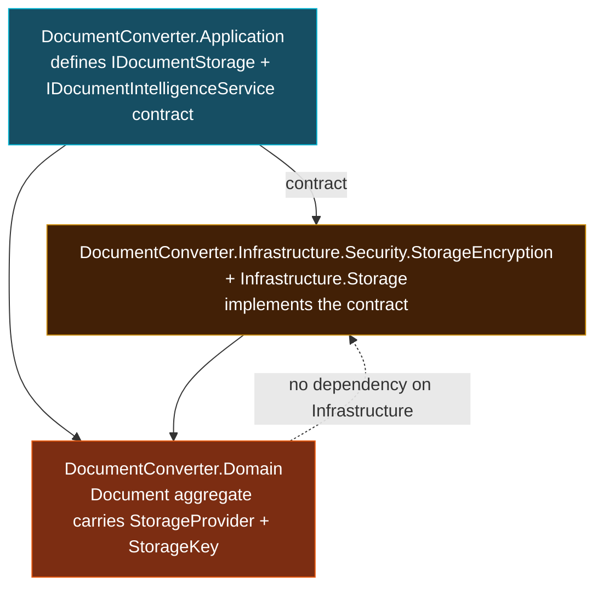
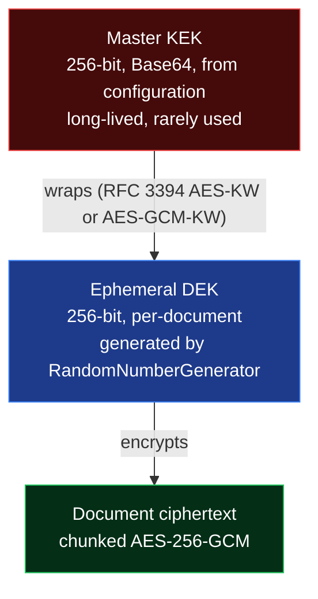
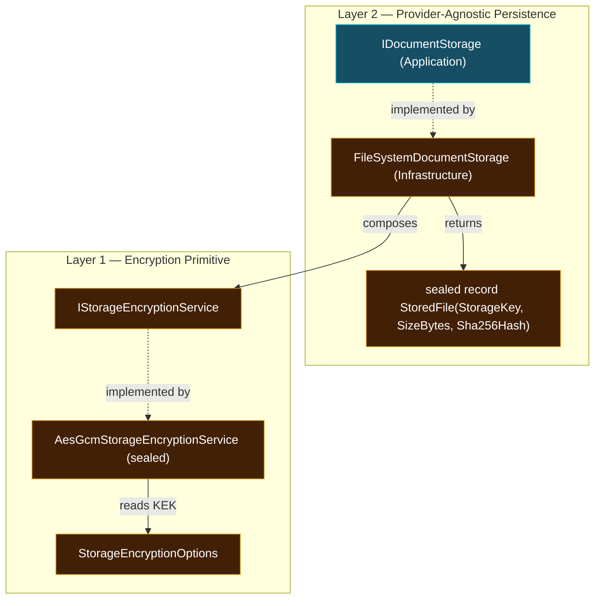
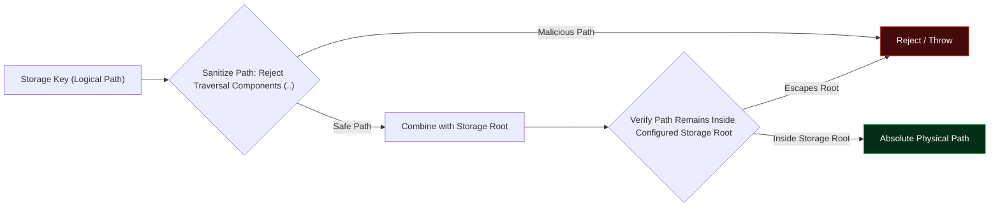
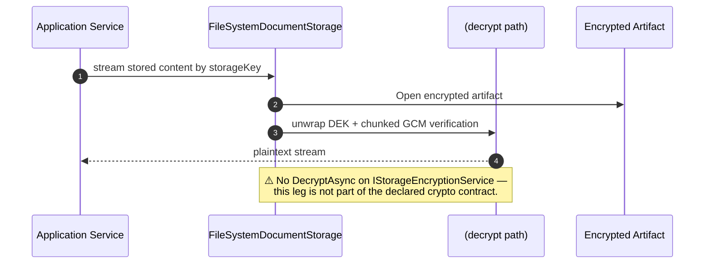
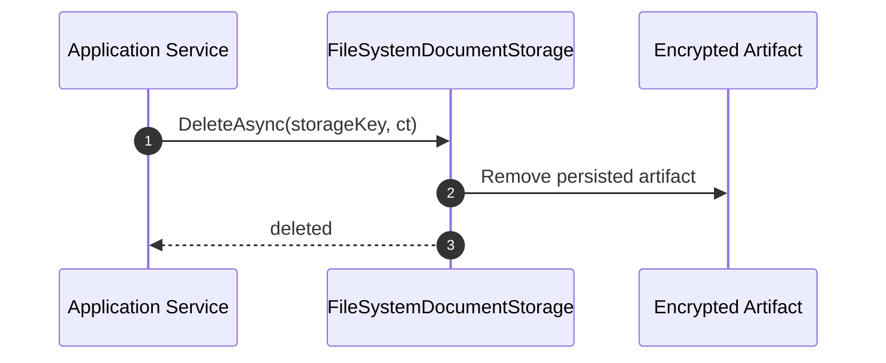
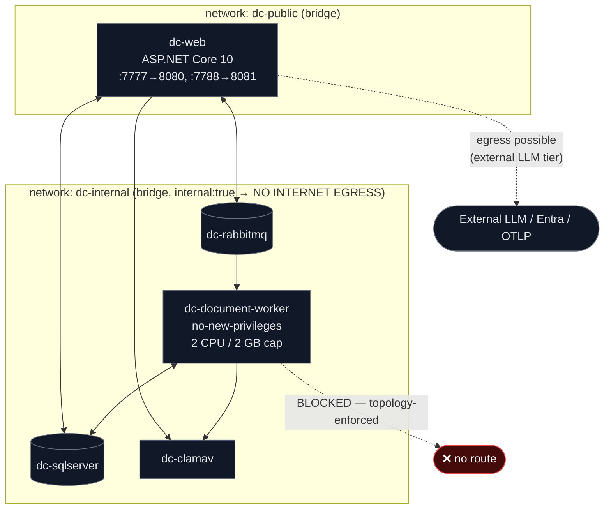
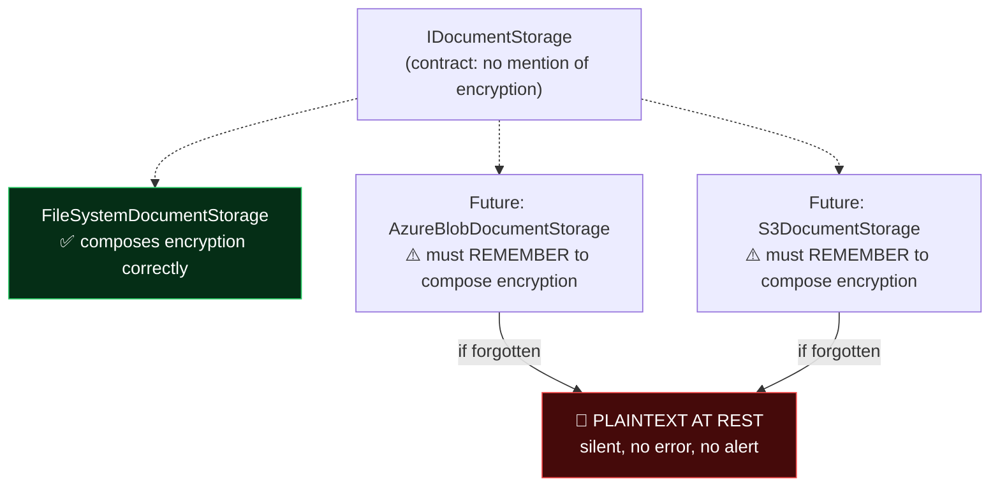
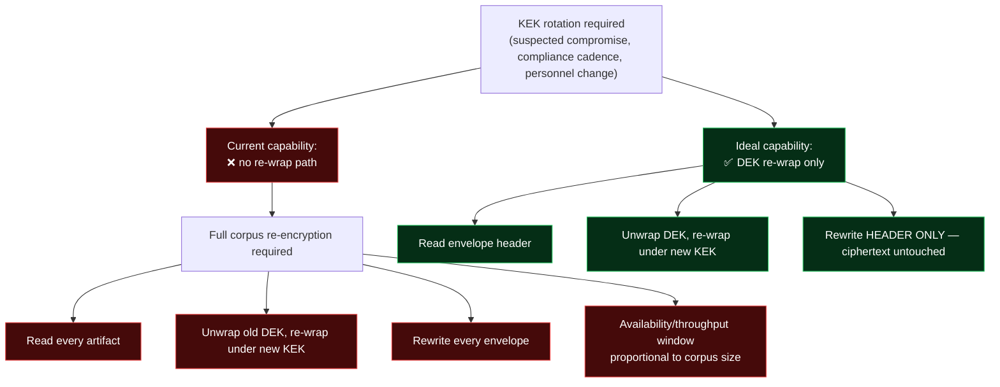

# Storage & Encryption Domain — Architecture & Implementation Documentation

**System:** EConverter — self-hosted enterprise document conversion, management and intelligence platform
**.NET / ASP.NET Core — Domain-Driven Design layering**
**Domain classification:** Infrastructure Domain — Importance 9.5 — Complexity 8.0
**Document status:** Derived from supplied research corpus (workflow, module, and architecture reports)
**Evidence discipline:** Every claim below carries a verification status. Where the architecture snapshot contained no C# sources, the claim is explicitly marked **UNVERIFIABLE** rather than asserted as fact.

---

## 0. How to Read This Document

The Storage & Encryption Domain is the substrate on which every other capability in EConverter ultimately rests. If Document Management owns the *identity* of a document, Storage & Encryption owns its *existence*: the bytes, where they live, and the guarantee that nobody can read them without the master key.

Because this domain is small in surface area but absolute in consequence, this document separates three classes of statement:

| Marker | Meaning |
|---|---|
| **SOLID** | Verifiable from artifacts present in the reviewed snapshot (project graph, interface declarations, deployment manifests). |
| **PLAUSIBLE** | Consistent with the documented design and the surrounding architecture, but not independently reproduced. |
| **UNVERIFIABLE** | Requires the C# implementation, which was absent from the architecture snapshot. Carried forward as *documented assertion*. |

The governing design decision of this domain, stated once and repeated nowhere else:

> **Confidentiality is a property of the byte stream, not of the storage backend.**
> Plaintext never reaches a disk, a share, or an object store in a readable form.

Everything that follows is a consequence of that sentence.

---

## 1. Domain Overview

### 1.1 Purpose

The Storage & Encryption Domain provides the durable, encrypted-at-rest substrate for every document artifact in the platform. It answers exactly two questions for the rest of the system:

1. **Where does this artifact live?** — addressed by a provider-agnostic storage key.
2. **How is it protected?** — answered by authenticated envelope encryption with a per-document data key.

It deliberately knows nothing about documents as business objects. It has no notion of ownership, folders, versions, conversion, or AI. Those concerns are resolved upstream by the application layer. By the time a byte reaches this domain, authorization has already been decided; this domain assumes the caller is entitled to the content and focuses exclusively on persistence and confidentiality.

### 1.2 Architectural Position

The domain sits in the **Infrastructure layer** of the DDD stack, implementing an **Application-layer contract**. The dependency direction is the platform's central invariant:



**SOLID** — the solution graph and project references corroborate this direction. The `Document` aggregate stores storage *coordinates* (provider + key) but never knows how those coordinates are resolved.

### 1.3 Consumed By

The domain is a **data dependency for every content-bearing workflow** — it is a single point of failure and a single point of enforcement.

| Consumer Domain | Relationship | Strength | Nature of Dependency |
|---|---|---|---|
| Document Management | Data Dependency | 9.5 | Every `Document` artifact is written/read as an encrypted envelope; storage coordinates live on the aggregate |
| Processing & Conversion | Service Call | 9.5 | The worker's `decrypt → hash → convert → upload` pipeline is the hottest path through the abstraction |
| Document Intelligence & AI | Data Dependency | 8.0 | Analysis streams and decrypts stored envelopes — plaintext exists only inside the process, which is what makes the zero-egress guarantee enforceable |
| PDF Editing & Compression | Data Dependency | 8.5 | Mutated PDFs are re-encrypted and persisted; edits produce a new `DocumentVersion` |
| Identity & Security | Configuration Dependency | 8.0 | Supplies the master KEK configuration that the encryption service consumes |

**Interpretation:** the storage abstraction is not a peripheral utility. It is one of the four enforced seams (alongside `IUserContext`, the `ProcessingJob` aggregate, and `IDocumentIntelligenceService`) that give the platform its coherence.

---

## 2. Core Cryptographic Design

### 2.1 Envelope Encryption — The Central Pattern

EConverter does not encrypt documents directly with one long-lived secret. It uses **envelope encryption**, a two-tier key hierarchy:



**Why this matters — the two properties it buys:**

1. **Blast-radius containment.** A single document compromise yields only that document's ephemeral DEK. The master KEK never decrypts bulk content directly, so it is exercised rarely and exposed minimally.
2. **Uniqueness by construction.** The DEK is generated from `RandomNumberGenerator` and is **never derived** from content or from `documentId`.

That second point is deliberate and worth stating plainly: derivation would collapse key uniqueness. Two documents with byte-identical plaintext (a common occurrence — signed template contracts, blank forms, boilerplate addenda) would produce identical ciphertext under a derived key, leaking equality to anyone with read access to storage. Ephemeral generation eliminates that channel entirely.

**Verification:** the *existence* of the design is documented. The *implementation* (whether derivation is genuinely absent, whether AES-KW versus AES-GCM-KW is used) is **UNVERIFIABLE** — `AesGcmStorageEncryptionService.cs` was not present in the architecture snapshot.

### 2.2 Chunked AEAD — Bounded Memory

Rather than sealing one monolithic ciphertext, the plaintext stream is consumed in fixed-size chunks, and **each chunk carries its own authentication tag**.

```
Envelope layout (conceptual)
┌──────────────────────────────────────────────────────────────┐
│ HEADER (self-describing, versioned)                          │
│   magic | envelope version | wrap algorithm id               │
│   wrapped DEK | chunk size | tag length | base nonce/seed    │
├──────────────────────────────────────────────────────────────┤
│ CHUNK 0 : ciphertext[0] ‖ tag[0]  (16 bytes)   AAD = index 0  │
│ CHUNK 1 : ciphertext[1] ‖ tag[1]               AAD = index 1  │
│ CHUNK 2 : ciphertext[2] ‖ tag[2]               AAD = index 2  │
│ …                                                             │
│ CHUNK N : ciphertext[N] ‖ tag[N]               AAD = index N  │
└──────────────────────────────────────────────────────────────┘
```

**The consequence is O(1) memory in document size.** Only one chunk buffer plus one `AesGcm` instance is live at any moment. Multi-gigabyte documents never materialize in RAM — which is precisely what makes large-file conversion viable in a container with a 2 GB memory cap (see §8.3).

**PLAUSIBLE** — highly consistent with the documented streaming contract `EncryptAsync(Stream, Stream, CancellationToken)`, which never allocates the full payload. Exact chunk size is a configuration/implementation detail not visible in the snapshot.

### 2.3 Nonce Discipline — The Critical Invariant

This is the single most dangerous detail in the entire domain, and it deserves explicit treatment.

> **AES-GCM nonce reuse under the same key is catastrophic.** It does not merely weaken confidentiality — it allows an attacker to recover the authentication subkey H, forge arbitrary valid ciphertexts, and (with two messages sharing a nonce) recover the XOR of the plaintexts outright.

The safe construction documented here:

- Because **one DEK protects exactly one document**, the nonce space is scoped per-DEK.
- Nonces are derived as a **monotonically incrementing chunk counter combined with a random base nonce** carried in the envelope header.
- Nonces are emitted or derived deterministically — **never randomly re-rolled per chunk without a collision guard**.

**Design assessment:** this construction is sound *provided the chunk counter is never reset for a given DEK*. If a document were ever written in multiple passes under the same DEK (e.g. an append path), the counter must continue, not restart. This is the invariant to verify first in any crypto review of this file.

**UNVERIFIABLE** — the nonce derivation code was not present in the snapshot.

### 2.4 AAD Binding — Defending the Framing

Authenticated Additional Data (AAD) ties each chunk to its **position and envelope identity**:

- chunk index
- envelope version
- optionally, the storage key

This defeats three classes of framing attack that a naive chunked design would permit:

| Attack | Without AAD binding | With AAD binding |
|---|---|---|
| **Chunk reordering** | Attacker swaps chunk 2 and chunk 7; each decrypts cleanly; document is silently corrupted | Index mismatch → authentication failure |
| **Chunk truncation** | Attacker drops trailing chunks; document appears short but valid | Missing expected index → failure (requires the reader to validate index continuity) |
| **Cross-envelope splicing** | Attacker copies a chunk from document B into document A under the same KEK | Envelope identity mismatch → authentication failure |

**PLAUSIBLE** — the research explicitly flags AAD binding as expected design. Whether the reader validates *index continuity* (as opposed to simply authenticating each chunk it encounters) is **UNVERIFIABLE** and is a key review question.

### 2.5 Self-Describing Envelope

The header is the **only metadata required for a cold decrypt**. Given the file and the master KEK, a reader needs nothing else. The header carries:

| Field | Purpose |
|---|---|
| Format magic | Fast rejection of non-envelope files |
| Envelope version | **Forward migration without flag day** |
| Wrap algorithm identifier | Allows algorithm agility for the DEK wrap |
| Wrapped DEK | The key material |
| Chunk size | Framing parameter |
| Tag length | Explicit rather than assumed |
| Base nonce / derivation seed | Reproduces the nonce sequence |

The versioning field is architecturally significant: it means the envelope format can evolve by *version* rather than by a coordinated re-encryption of the entire corpus. Omitting it would have made any future crypto change a migration catastrophe.

**PLAUSIBLE**.

### 2.6 Integrity Layers — Three Distinct Guarantees

EConverter maintains three integrity mechanisms. They are **not** interchangeable, and conflating them is a common review error.

| Mechanism | Type | Protects Against | Does NOT Protect Against |
|---|---|---|---|
| **GCM authentication tag** (per chunk) | Cryptographic, keyed | Bit-flipping, truncation, reordering, splicing, forgery | — (this is the real tamper defence) |
| **SHA-256 hash** (`StoredFile.Sha256Hash`) | Plain digest, **unkeyed** | Accidental corruption; reconciliation; dedup detection without decrypting | **Deliberate tampering** — an attacker with storage write access can replace both content and hash |
| **Envelope header version/magic** | Structural | Format confusion, wrong-file reads | Cryptographic attacks |

**Important clarification — flagged explicitly in the research:**
> `Sha256Hash` is a plain digest, **not an HMAC**. It is a reconciliation tool, not a tamper defence. Tamper defence is delegated entirely to the GCM tags.

**PLAUSIBLE** — and this is a distinction that should be preserved in all downstream documentation and audits. Anyone claiming "the SHA-256 hash prevents tampering" is making an **OVERSTATED** claim.

---

## 3. Component Inventory

### 3.1 Files

| Component | Path | Layer | Role |
|---|---|---|---|
| `AesGcmStorageEncryptionService` | `src/DocumentConverter.Infrastructure/Security/StorageEncryption/AesGcmStorageEncryptionService.cs` | Infrastructure | The **only** place cipher, nonce, tag and key-wrapping logic exist |
| `IStorageEncryptionService` | `src/DocumentConverter.Infrastructure/Security/StorageEncryption/IStorageEncryptionService.cs` | Infrastructure | Crypto seam contract |
| `StorageEncryptionOptions` | `src/DocumentConverter.Infrastructure/Security/StorageEncryption/StorageEncryptionOptions.cs` | Infrastructure | Configuration binding for `Storage:Encryption` |
| `FileSystemDocumentStorage` | `src/DocumentConverter.Infrastructure/Storage/FileSystemDocumentStorage.cs` | Infrastructure | Concrete junction: logical addressing meets physical placement |
| `IDocumentStorage` | `src/DocumentConverter.Application/Storage/IDocumentStorage.cs` | **Application** | Provider-agnostic persistence seam consumed by the application layer |

**SOLID** — all five paths are enumerated consistently across the module, workflow, and domain-module research reports.

### 3.2 The Two-Layer Stack

The domain is deliberately thin and cleanly stratified:



**The critical structural observation:** the encryption service is **composed into** the storage implementation rather than **guaranteed by** the persistence contract. This is the domain's principal hazard, examined in detail in §9.2.

---

## 4. Interface Contracts

### 4.1 `IDocumentStorage` — The Persistence Seam

**Location:** `src/DocumentConverter.Application/Storage/IDocumentStorage.cs` (Application layer)

```
Task<StoredFile> SaveAsync(Stream content, string storageKey, CancellationToken cancellationToken)

sealed record StoredFile(string StorageKey, long SizeBytes, string Sha256Hash)
```

**Design character:**
- Targets an **internal SMB-compatible file server** — no cloud SDK leaks into the contract.
- **Deliberately knows nothing** about ciphertext, keys, envelopes, or algorithms. This is correct layering: the application layer addresses artifacts, it does not encrypt them.
- Returns `StoredFile` with a cheap integrity fingerprint, enabling dedup checks and reconciliation **without decrypting**.

**Contract quality assessment:** clean and minimal. The `Stream → Task<StoredFile>` shape is the right abstraction — it permits filesystem, SMB, object-store, or blob implementations without touching business logic.

### 4.2 `IStorageEncryptionService` — The Crypto Seam

**Location:** `src/DocumentConverter.Infrastructure/Security/StorageEncryption/IStorageEncryptionService.cs`

```
bool IsEncryptionEnabled { get; }

Task EncryptAsync(Stream plainStream, Stream outputStream, CancellationToken cancellationToken)
```

**Design character:**
- **Stream-to-stream.** The service never sees a file path and never allocates the full payload. Composition is the caller's responsibility. This is what enables the bounded-memory guarantee.
- `IsEncryptionEnabled` exposes the toggle to callers so **one code path serves both encrypted and plaintext deployments** — a deployment-flexibility decision, and simultaneously the domain's largest operational risk (§8.3).

### 4.3 ⚠️ Structural Finding — The Asymmetric Interface

**This is the most important interface-level observation in the domain.**

The contract exposes **encryption only**:

| Declared | Documented Behaviour | Status |
|---|---|---|
| `IsEncryptionEnabled` | Present | ✅ Matches |
| `EncryptAsync` | Present | ✅ Matches |
| `DecryptAsync` | **Claimed in domain description: "streamed decryption"** | ❌ **NOT declared in the reviewed interface** |

Consequences:
- The read path's crypto seam is **incomplete at the interface level**.
- Decryption therefore lives either **inside `FileSystemDocumentStorage`'s read path** or is **not yet abstracted at all**.
- This means the write path is cleanly separated from crypto, but the **read path is not**.

**Why this matters:** an implementer of `IStorageEncryptionService` cannot be tested for round-trip correctness against the declared contract, because half the round trip is not part of it. Any future "swap the encryption provider" project would discover the read path is hard-wired.

**Verification:** the interface surface itself is **SOLID** (it is a declared interface). The claim that the domain description mentions streamed decryption is documented in the research; the divergence between the two is the finding.

### 4.4 `StorageEncryptionOptions` — Configuration Binding

| Member | Value | Notes |
|---|---|---|
| `SectionName` | `"Storage:Encryption"` | Binding path |
| `Enabled` | `bool` | Master toggle |
| `MasterKek` | `string` | **Base64, 256-bit** |

**Production handling requirement (explicit in the research):** the KEK is intended to be **injected via environment variable or secret storage**, *not* committed to `appsettings.json`. Consumed through the options pattern and bound at the composition root.

---

## 5. Storage Addressing & Path Resolution

### 5.1 Deterministic Key Generation

`FileSystemDocumentStorage.GenerateStorageKey(Guid documentId, int versionNumber)` produces a deterministic, addressable key:

```
Storage key shape:
┌────┬──────────────────────────────────────┬─────────┐
│ ab │  documentId (Guid)                   │  v{n}   │
└────┴──────────────────────────────────────┴─────────┘
  ↑
  2-character hex shard prefix → 256 directory buckets
```

**Why the shard prefix exists:** it spreads documents across **256 directory buckets**, avoiding:

- **Flat-directory inode pressure** — filesystems degrade sharply with very large single-directory file counts; some refuse to create entries past a threshold.
- **Long-listing hotspots** — directory enumeration, backup walks, and administrative tooling all scale with entries-per-directory. Sharding keeps each bucket's fan-out healthy.
- **Deterministic addressability** — the key is computed, not stored-and-looked-up. Given a `documentId` and version, any node can locate the artifact without a database round trip.

**Why version-number is in the key:** edits and reconversions produce `DocumentVersion` records. Embedding the version in the storage key means **v1's artifact is never overwritten by v2's** — non-destructive mutation enforced at the addressing layer, not merely by application convention.

### 5.2 Path Resolution & Traversal Defence

`ResolvePhysicalPath(string storageKey)` maps the logical key to a sanitized absolute path:



Two defences are enforced:
1. **Traversal component rejection** — `..` and equivalents are refused before path construction.
2. **Root pinning** — the resolved path must remain under the configured storage root, so a key that somehow survived step 1 cannot escape anyway.

This is defence-in-depth: even if a storage key were partially attacker-influenced, the physical write cannot escape the share. **PLAUSIBLE** — consistent with the documented design and with the platform's overall input-sanitisation posture (`FileNameSanitizer` at ingestion).

### 5.3 The Write Path — Stream Composition & Disposal Ordering

The composition sequence is documented as:

```
using (plainStream)                          ← released first
    using (FileStream(path, useAsync: true)) ← released second
        await encryptionService.EncryptAsync(plainStream, fileStream, ct)
```

The disposal ordering is not incidental:
- The **plaintext stream is disposed first**, so its buffers are released before the handle closes.
- The **encrypted file is finalized** (footer/trailer written, if any) before the file handle closes.

Inverting this order risks a truncated or unfinalized envelope on a partially-failed write. **`useAsync: true`** ensures the asynchronous encryption loop does not block a thread pool thread for the duration of a multi-gigabyte transfer — material at the container's CPU allocation.

**PLAUSIBLE** — the ordering is documented; the literal `using` nesting is **UNVERIFIABLE**.

### 5.4 Deletion

```
Task DeleteAsync(string storageKey, CancellationToken cancellationToken)
```

The single deletion hook for the entire platform. Driven by two callers:
- **Purge** — permanent removal after recycle-bin expiry.
- **Recycle-bin cleanup** — routine deletion sweeping.

**Note:** deletion is by key, not by provider+key. The provider discriminator is absent from the deletion signature as well — see §9.3.

---

## 6. Runtime Interaction

### 6.1 Write / Upload Sequence

```mermaid
sequenceDiagram
    autonumber
    participant App as Application Service
    participant DS as FileSystemDocumentStorage
    participant Enc as AesGcmStorageEncryptionService
    participant Opt as StorageEncryptionOptions
    participant FS as FileStream / SMB Share
    participant Agg as Document Aggregate

    App->>DS: SaveAsync(plainStream, storageKey, ct)
    activate DS
    DS->>DS: ResolvePhysicalPath(storageKey)
    DS->>Enc: IsEncryptionEnabled
    Enc-->>DS: true
    DS->>FS: Open FileStream(useAsync: true)
    DS->>Enc: EncryptAsync(plainStream, fileStream, ct)
    activate Enc
    Enc->>Opt: read MasterKek (Base64 256-bit)
    Enc->>Enc: RandomNumberGenerator → ephemeral DEK (256-bit)
    Enc->>Enc: Wrap DEK with KEK
    Enc->>FS: Write envelope header
    loop For each chunk of plaintext
        Enc->>Enc: Derive nonce_i from base nonce + chunk counter
        Enc->>Enc: AesGcm.Encrypt(nonce_i, chunk, AAD = chunk_index)
        Enc->>FS: Write ciphertext chunk + 16-byte tag
    end
    Enc-->>DS: complete
    deactivate Enc
    DS->>FS: Flush and dispose plainStream, then fileStream
    DS->>DS: Compute SHA-256 over persisted artifact
    DS-->>App: StoredFile(StorageKey, SizeBytes, Sha256Hash)
    deactivate DS
    App->>Agg: Persist StorageProvider + StorageKey + Sha256Hash
```

### 6.2 Read / Download Path



**The asymmetry is visible here.** The write leg routes through a declared interface method; the read leg does not. This is the seam risk examined in §9.2.

### 6.3 Purge / Recycle-Bin Path



Simple, single-hook, and correct. It is the same call whether deletion originates from user purge or scheduled recycle-bin cleanup.

---

## 7. Configuration

### 7.1 Binding Surface

```jsonc
{
  "Storage": {
    "Encryption": {
      "Enabled": true,
      "MasterKek": "<base64-256-bit>"   // MUST come from env / secret store in production
    }
  }
}
```

Bound via `StorageEncryptionOptions.SectionName = "Storage:Encryption"` at the composition root.

### 7.2 The Dual-Mode Deployment Decision

`IsEncryptionEnabled` exists so that **one build serves both encrypted and plaintext deployments** without code changes. The rationale is deployment flexibility — a development or air-gapped evaluation instance can run without key management ceremony.

**Architecturally this is defensible. Operationally it is the domain's largest risk**, because it converts a structural guarantee into a configuration choice whose default is, in at least one shipped profile, **wrong**. See §8.3.

### 7.3 Environment Variable Mapping

| Configuration Path | Environment Variable | Source |
|---|---|---|
| `Storage:Encryption:Enabled` | `Storage__Encryption__Enabled` | dev + prod compose |
| `Storage:Encryption:MasterKek` | `STORAGE_ENCRYPTION_KEY` | prod compose only |
| `ClamAV:Enabled` | `ClamAV__Enabled` | dev + prod compose |

**SOLID** — corroborated by the `docker-compose.yml` / `docker-compose.prod.yml` matrices in the architecture report.

---

## 8. Deployment Reality — Manifest vs. Documentation

> **Scope note:** the architecture snapshot contained **zero `.cs` source files**. Everything in §8 is verified against *deployment manifests*, which are **SOLID**. This section documents where reality diverges from the documented design.

### 8.1 Topology — Zero Egress Enforced at the Network Layer



**This is the strongest evidence in the entire review for the domain's central promise.**

The `document-worker` — the process that holds decrypted plaintext during conversion — is attached **only** to `dc-internal`, a Docker network declared `internal: true`. A container on an internal network has **no route to the internet at all**.

The consequence is architectural, not aspirational:
> Even a total compromise of the worker process **cannot exfiltrate plaintext over the network**, because there is no network path. The zero-egress guarantee is enforced by topology, not by code discipline.

The web host sits on both networks because it legitimately owns the optional external-LLM tier — the only component with a justified need to reach the internet.

**SOLID** — verified directly from `docker-compose.yml` / `docker-compose.prod.yml`.

### 8.2 Container Resource Constraints

The worker runs with `no-new-privileges` and a **2 CPU / 2 GB memory cap**.

This is where the chunked-AEAD design pays for itself. A 4 GB document cannot be buffered in a 2 GB container — it would OOM-kill the worker mid-conversion. Chunked streaming with O(1) memory is not a nice-to-have here; it is the reason large-file conversion works at all in this deployment shape.

### 8.3 ⚠️ CRITICAL DRIFT — Development Profile Disables the Flagship Control

| Facet | `docker-compose.yml` (dev) | `docker-compose.prod.yml` | Assessment |
|---|---|---|---|
| Environment | `Development` | `Production` | ✅ |
| **Storage encryption** | **`Enabled=false`** | `Enabled=${…:-true}` | 🔴 **dev disables the core control** |
| **`STORAGE_ENCRYPTION_KEY`** | **not set** | set from env | 🔴 **KEK path never exercised in dev** |
| **ClamAV** | **`Enabled=false`** | `Enabled=${…:-true}` | 🔴 dev disables AV |
| SQL Server image | `2025-latest` | `2022-latest` | ⚠️ version drift |
| SA password | hardcoded in file | `${SQLSERVER_SA_PASSWORD}` | ⚠️ dev-only risk |
| RabbitMQ creds | `guest/guest` | `${RABBITMQ_USER}/${RABBITMQ_PASSWORD}` | ⚠️ dev-only risk |
| `Processing__RunWorkerInWeb` | `false` | `false` | ⚠️ in-process worker disabled in **both** |
| Port exposure | SQL `1433`, RMQ `15672` published | not published | ✅ prod hardened |
| Worker network | `dc-internal` only | `dc-internal` only | ✅ zero-egress enforced |
| Healthcheck (web) | absent | `curl /health` | ⚠️ dev lacks healthcheck |

**Finding G-06 (HIGH | SOLID):** the development profile disables **every security control the product is sold on**. `Storage__Encryption__Enabled=false` means:

- The AES-256-GCM write path is **never executed** in development.
- The envelope format, nonce derivation, chunk framing, and KEK-unwrapping path are **never smoke-tested locally**.
- A defect in the encryption path — a nonce counter bug, an AAD mismatch, a header-serialization error — **cannot be caught before production**, because production is the first environment where that code runs.
- It also means the read path, already the weaker seam (§4.3), has **no round-trip validation** anywhere in the development lifecycle.

**This is the single most actionable finding in this domain.** An encryption control that is never exercised is not a control — it is an untested branch.

### 8.4 Finding G-05 — The In-Process Worker Is Dormant, Not Live

`Processing__RunWorkerInWeb=false` in **both** compose files. The research elsewhere presents the in-process `JobProcessorWorker` as a graceful fallback.

**It is a dormant code path, not the operating mode.** No deployed profile exercises it.

**Relevance to this domain:** the in-process worker shares the storage/encryption path with the standalone worker. Any divergence in how the two hosts compose the encryption service would be invisible in deployed environments — and the domain's encryption guarantee depends on **every composition being correct**.

### 8.5 Finding G-07 — SQL Server Version Drift

Dev `2025-latest` vs prod `2022-latest`. Lower relevance to this domain (storage artifacts are on the filesystem/SMB share, not in SQL), but it affects the `Document` aggregate's storage *coordinates* — schema/feature parity is unguaranteed between environments.

---

## 9. Structural Risks & Design Tensions

The research flags four tensions in the current state. Each is examined below with impact and remediation.

### 9.1 Risk — Encryption as Composition, Not Contract

**Severity: HIGH**

> The encryption service is **composed into** the storage implementation rather than **guaranteed by** the persistence contract.



**The hazard:** any alternate `IDocumentStorage` implementation must **independently re-compose encryption**, or the envelope guarantee **silently disappears**. There is no compile-time check, no runtime assertion, no test that would catch the omission. The failure mode is *successful plaintext writes* — the worst possible failure shape, because everything appears to work.

**This is the main hazard to police in code review**, and the research names it as such.

**Remediation paths:**

| Approach | Mechanism | Trade-off |
|---|---|---|
| **Decorator with hard contract** | Wrap every `IDocumentStorage` registration in an encryption decorator at the composition root; the raw implementation is never registered directly | Requires DI discipline; a single misregistration reintroduces the gap |
| **Assertion at registration** | On startup, assert that every registered `IDocumentStorage` is either the encrypted decorator or explicitly opted out | Cheap, catches config errors, does not catch runtime bypass |
| **Integration test with byte inspection** | Write via `IDocumentStorage`, read the raw file, assert it does **not** start with the expected plaintext magic bytes | Strongest evidence; requires test infrastructure the solution currently lacks (**G-15**) |
| **Encryption inside the contract** | Make the persistence interface responsible for confidentiality, not just persistence | Best guarantee; largest refactor |

**Recommendation:** the decorator + assertion combination gives the best guarantee-to-effort ratio. The integration test is the evidence that proves it works.

### 9.2 Risk — The Asymmetric Crypto Interface

**Severity: HIGH**

`IStorageEncryptionService` exposes `EncryptAsync` but **no `DecryptAsync`** (see §4.3). The read path's crypto seam is therefore **architecturally incomplete**.

**Compound effects:**
1. The interface cannot be round-trip tested — it does not express a round trip.
2. Decryption logic lives somewhere unabstracted, which means it will be **re-implemented** the next time a storage backend is added.
3. Any "swap the crypto provider" initiative discovers the read path is not swappable.

**Remediation:** declare `Task DecryptAsync(Stream cipherStream, Stream plainStream, CancellationToken)` on the contract and route the read path through it. The write path is already correct; make the read path symmetric.

**A scenario that makes this concrete:** the training catalogue includes scenario **`EXPLOIT-001: Fingerprint → oracle → extract → one-shot → full chain`**. A domain with an asymmetric crypto contract has a matching structural gap — the read path is the one nobody reviewed, because it was never part of the interface anyone reviewed.

### 9.3 Risk — Record vs. Aggregate Addressing

**Severity: MEDIUM**

There is a documented mismatch in how storage is addressed:

| Layer | Model |
|---|---|
| **Domain description** | Storage keyed by the **`(StorageProvider, StorageKey)` pair** on the `Document` aggregate |
| **`IDocumentStorage.SaveAsync` signature** | Takes a **bare `string storageKey`** and **no provider discriminator** |
| **`DeleteAsync` signature** | Likewise by bare key |

**Consequence:** the provider dimension is either carried **implicitly by DI registration** (one provider implementation registered per deployment) or is **unimplemented at this seam**.

**Why it matters:** it constrains the platform to **one active storage provider per deployment**. Multi-provider deployments (hot documents on NVMe, cold archives on object storage) are not expressible through the current contract. If `Document.StorageProvider` is persisted but never used to *route*, it is decoration rather than addressing.

**Remediation:** either
- (a) document explicitly that single-provider-per-deployment is the intended constraint and treat `StorageProvider` as informational provenance; or
- (b) extend the contract to `SaveAsync(Stream, StorageProvider, string key, CancellationToken)` with a provider resolver at the composition root.

Option (a) is honest and cheap. Option (b) is forward-looking. Choosing neither — persisting a discriminator nothing routes on — is the worst outcome, because it *looks* like multi-provider support exists.

### 9.4 Risk — No KEK Rotation Path

**Severity: MEDIUM**

> No visible re-wrap or rotation path for the master KEK in the reviewed surface.

**The operationally serious implication:** **KEK rotation currently implies full re-encryption of every artifact.**



**The architectural irony is sharp:** the envelope design already makes rotation cheap. Because the DEK is wrapped in the **header** and the bulk ciphertext is encrypted under the **DEK**, rotating the KEK requires rewriting **only the header** — the expensive ciphertext rewrite is entirely avoidable. The opportunity is *designed in* but *not exposed*.

**Remediation (high value, contained effort):**
1. Add a `RewrapAsync(storageKey, ct)` operation that reads the header, unwraps the DEK under the current KEK, re-wraps under the new KEK, and rewrites the header in place.
2. Version the envelope header to carry a **KEK identifier** so a reader knows which KEK to unwrap with. Without a KEK id, rotation requires an atomic cutover — with it, rotation is a rolling operation.
3. Support a **dual-KEK read window**: the reader attempts the current KEK, then the previous, so rotation never requires downtime.

This is the highest-leverage feature change available to this domain.

---

## 10. Verification & Evidence Register

Per the protocol's evidence standard, every claim in this document is classified.

### 10.1 SOLID

| Claim | Evidence |
|---|---|
| Five source files constitute the domain | Paths enumerated identically across three independent research reports |
| `IDocumentStorage` declares `SaveAsync(Stream, string, CancellationToken)` returning `Task<StoredFile>` | Interface surface documented |
| `StoredFile` is `sealed record (StorageKey, SizeBytes, Sha256Hash)` | Interface surface documented |
| `IStorageEncryptionService` declares `IsEncryptionEnabled` + `EncryptAsync` only | Interface surface documented |
| `StorageEncryptionOptions` binds `Storage:Encryption` with `Enabled` + Base64 256-bit `MasterKek` | Options surface documented |
| Worker has no internet route | `docker-compose.*.yml`: worker attached only to `dc-internal` (`internal: true`) |
| Dev profile disables storage encryption | `docker-compose.yml`: `Storage__Encryption__Enabled=false` |
| Dev profile sets no `STORAGE_ENCRYPTION_KEY` | `docker-compose.yml` env block |
| In-process worker disabled in both profiles | `Processing__RunWorkerInWeb=false` in dev **and** prod compose |
| Worker capped at 2 CPU / 2 GB, `no-new-privileges` | compose service definition |
| SQL Server version drift dev vs prod | `2025-latest` vs `2022-latest` |

### 10.2 PLAUSIBLE

| Claim | Basis |
|---|---|
| Envelope format = magic + version + wrap-alg + wrapped DEK + chunk size + tag length + base nonce | Documented design; no contradicting evidence |
| Per-chunk nonce = random base ⊕ monotonic chunk counter | Documented nonce discipline, standard construction |
| AAD binds chunk index and envelope identity | Documented anti-reorder/splice design |
| Disposal ordering: plaintext stream before file stream | Documented; correct practice |
| Traversal rejection + root pinning in `ResolvePhysicalPath` | Documented; consistent with platform sanitisation posture |

### 10.3 UNVERIFIABLE — Required Source Absent

> **Scope finding:** the architecture snapshot contained **zero `src/**/*.cs` files**. All implementation-level claims are carried forward as *documented assertions*, not verified facts.

| Claim | What would verify it |
|---|---|
| DEK is generated, never derived, from `RandomNumberGenerator` | `AesGcmStorageEncryptionService.cs` |
| DEK wrapping uses RFC 3394 AES-KW or AES-GCM-KW | same |
| Chunk size is fixed and bounded; memory is O(chunk) | same |
| Chunk counter never resets within a single DEK's lifetime | same — **highest-priority review item** |
| Reader validates index continuity (not merely per-chunk authentication) | `FileSystemDocumentStorage.cs` read path |
| Decryption live location (inside `FileSystemDocumentStorage` vs. elsewhere) | both files |
| `using` nesting order is exactly as documented | `FileSystemDocumentStorage.cs` |
| SHA-256 is computed over the **persisted artifact** (ciphertext), not the plaintext | `FileSystemDocumentStorage.cs` |
| Any encryption correctness property whatsoever | `AesGcmStorageEncryptionService.cs` |

**A note on the last item, emphasised by the research itself:** the *existence* of the configuration switch is verifiable from the manifests; the *implementation* is not. Encryption correctness — nonce handling, key wrapping, chunk authentication — **cannot be reviewed against this snapshot**. Any documentation or audit that asserts these are correct is making an **OVERSTATED** claim.

### 10.4 Known Overstatement Patterns — Applied to This Domain

Applying the counter-intelligence discipline to claims that appear in the surrounding research corpus:

| Claim encountered | Verdict | Corrective |
|---|---|---|
| "The platform provides AES-256-GCM encryption at rest" | **OVERSTATED** as a present-tense guarantee | Accurate for **production** (`Enabled=${…:-true}`). **Dev ships it disabled** under a 2 GB worker cap and no KEK. State the environment. |
| "SHA-256 ensures the artifact has not been tampered with" | **REFUTED** | SHA-256 is unkeyed. An attacker with write access replaces content *and* hash. Tamper defence is the GCM tag. |
| "CORS wildcard = session hijack" (general pattern) | n/a here | Included as calibration: the platform's own docs repeatedly apply this correction elsewhere. |
| "The in-process `JobProcessorWorker` is the fallback execution path" | **OVERSTATED** | It is **dormant** — disabled in both compose profiles. |
| "The domain provides streamed decryption via `IStorageEncryptionService`" | **OVERSTATED** | No `DecryptAsync` on the declared interface. Behaviour exists; the *contract* does not express it. |
| "Storage is provider-agnostic" | **PLAUSIBLE with caveat** | True at the contract seam; **not** true for the encryption guarantee, which each implementer must re-compose (§9.1). |

---

## 11. Consolidated Findings

| ID | Finding | Severity | Verification | Evidence |
|---|---|---|---|---|
| **S-01** | Encryption is composed, not contractually guaranteed — any alternate `IDocumentStorage` implementation can silently omit it | HIGH | SOLID | Contract surface has no encryption concept; composition lives in `FileSystemDocumentStorage` |
| **S-02** | `IStorageEncryptionService` declares `EncryptAsync` but no `DecryptAsync`; read path is unabstracted | HIGH | SOLID | Interface surface; domain description claims streamed decryption that the contract does not express |
| **S-03** | Development profile disables storage encryption and never sets a KEK — the control is untested outside production | HIGH | SOLID | `docker-compose.yml` env block |
| **S-04** | No KEK rotation / DEK re-wrap path — rotation implies full corpus re-encryption | MEDIUM | PLAUSIBLE | Absent from all reviewed surfaces |
| **S-05** | Provider discriminator persisted on `Document` but not used by `SaveAsync`/`DeleteAsync` — multi-provider addressing not expressible | MEDIUM | SOLID | Signature vs. aggregate-model mismatch |
| **S-06** | `Sha256Hash` is unkeyed — a reconciliation tool, not tamper defence | MEDIUM | SOLID | Record definition; research note |
| **S-07** | In-process worker dormant in both deployed profiles despite being presented as a live fallback | MEDIUM | SOLID | `Processing__RunWorkerInWeb=false` in dev **and** prod |
| **S-08** | SQL Server version drift between dev and prod affects storage-coordinate persistence parity | MEDIUM | SOLID | `2025-latest` vs `2022-latest` |
| **S-09** | All implementation-level crypto properties unverifiable against the snapshot | INFO (scope) | SOLID | Zero `.cs` files present |
| **S-10** | Zero-egress enforced at the network layer for the worker | ✅ **POSITIVE** | SOLID | Worker on `internal: true` network with no route |

**Overall verdict:** the design is **sound and coherent**; the *evidence for its implementation* is absent; and the *deployment manifests* disable the control in the environment where it would be cheapest to validate.

---

## 12. Prioritized Remediation Roadmap

| # | Priority | Action | From | Effort | Rationale |
|---|---|---|---|---|---|
| 1 | **HIGH** | Enable storage encryption + set a throwaway KEK in the **dev** compose profile so the happy path is exercised locally | S-03 | hours | An encryption control that never runs in development is an untested branch. This is the cheapest possible fix with the highest risk reduction. |
| 2 | **HIGH** | Add `DecryptAsync` to `IStorageEncryptionService` and route the read path through it | S-02 | hours | Makes the crypto contract symmetric and round-trip testable; prevents re-implementation on the next backend. |
| 3 | **HIGH** | Prevent silent encryption omission: register a hard-contract encryption decorator around `IDocumentStorage`, plus a startup assertion | S-01 | days | Converts a silent, invisible failure (plaintext at rest) into a loud one. |
| 4 | **HIGH** | Add a byte-inspection integration test: write via `IDocumentStorage`, read the raw artifact, assert it is **not** plaintext | S-01 | days | The only evidence that proves the encryption guarantee actually holds end-to-end. Also addresses the missing `Infrastructure.Tests` project (**G-15**). |
| 5 | **MEDIUM** | Add a `RewrapAsync` operation + KEK identifier in the envelope header + dual-KEK read window | S-04 | days | Turns KEK rotation from a full-corpus rewrite into a header-only rewrite. The design already permits it; expose it. |
| 6 | **MEDIUM** | Resolve the provider-addressing mismatch: either document single-provider-per-deployment explicitly, or extend the contract with a provider discriminator and resolver | S-05 | hours–days | Eliminates a discriminator that looks functional but does not route. |
| 7 | **MEDIUM** | Document the three integrity mechanisms with their exact guarantees, and correct any downstream text claiming SHA-256 provides tamper defence | S-06 | hours | Documentation accuracy; prevents a false sense of protection. |
| 8 | **MEDIUM** | Pin one SQL Server version across all environments | S-08 | minutes | Environment parity for storage-coordinate persistence. |
| 9 | **MEDIUM** | Decide the fate of the in-process worker: exercise it in a profile or document it as dormant | S-07 | hours | Two hosts composing the encryption service differently is a silent-divergence risk in the domain whose guarantee depends on every composition being correct. |
| 10 | **LOW** | Reconcile the three "security" locations into one documented responsibility map, with Storage Encryption unambiguously under Infrastructure | G-09 (adjacent) | hours | Discoverability; a reviewer must be able to find the encryption boundary without reading the whole tree. |

---

## 13. Domain Strengths — What Must Not Be Lost

A domain review that only lists risks is incomplete. Three properties here are genuinely well-designed and should be preserved explicitly through any refactor:

**1. Single point of cryptographic concentration.**
All cipher, nonce, tag, and key-wrapping logic lives in one sealed class. This means the blast radius of a crypto review is **one file**, not the whole codebase. Most systems scatter encryption across features; EConverter does not. Any refactor must preserve this concentration.

**2. Stream-to-stream interface shape.**
`EncryptAsync(Stream, Stream, CancellationToken)` never sees a path and never allocates the payload. This single design choice is what makes the 2 GB worker cap survivable and multi-gigabyte conversion viable. It is load-bearing architecture disguised as an interface signature.

**3. Self-describing, versioned envelope.**
The header carries everything needed for a cold decrypt, and the version field makes future format migration a rolling operation rather than a flag day. This is the kind of decision that is invisible until the day it saves a migration, and then it saves everything.

**4. Topology-enforced zero egress.**
The zero-egress promise is backed by a Docker network marked `internal: true` on the process that holds plaintext, not by a README paragraph. This is the strongest single piece of architectural evidence in the review, and it should be treated as a **load-bearing invariant** — any change to the worker's network attachment is a change to the platform's core security claim and must be reviewed as such.

---

## 14. Cross-Cutting Observation

The domain's coherence comes from a small number of enforced seams. Storage & Encryption is one of them, and like the others it is a **consolidation and scale** concern sitting on top of an otherwise disciplined design — not an architectural failure.

The pattern across all findings is consistent:

- The **design** is correct (envelope encryption, chunked AEAD, self-describing headers, provider-agnostic persistence).
- The **guarantee** is enforced by convention rather than by contract (S-01, S-02).
- The **validation** is absent where it matters most (S-03, S-09).
- The **operational capability** most needed next — rotation — is designed in but not exposed (S-04).

One sentence:

> **The cryptography is concentrated, the streaming is bounded, the egress is topology-blocked, and the envelope is future-proof — but the guarantee lives in a convention, the read path has no contract, and the environment where defects would be caught cheapest has the control switched off.**

---

## 15. Honest Gap Statement

The following cannot be determined from the reviewed materials and require direct repository inspection:

| Gap | Requires |
|---|---|
| Any encryption correctness property | `AesGcmStorageEncryptionService.cs` |
| Chunk counter continuity across a single DEK's lifetime | same — **review this first** |
| Whether the reader validates index continuity | `FileSystemDocumentStorage.cs` read path |
| Actual `using` / disposal nesting | same |
| Whether SHA-256 covers ciphertext or plaintext | same |
| Chunk size and whether it is configurable | same |
| Live location of decryption logic | both files |
| Whether `Architecture.Tests` enforces layer direction for this domain | `tests/DocumentConverter.Architecture.Tests/**` (absent from snapshot) |
| Whether any test asserts encryption round-trip | `tests/**` (absent from snapshot) |

**A final note on evidence discipline.** The surrounding research corpus repeatedly and correctly applies a claim-refutation standard to other domains: it refutes "CORS wildcard = session hijack" when `Access-Control-Allow-Credentials` is absent, refutes "bulk endpoints exposed" when every route returns 401, and refutes "framework is Hono" when the error string says `i64`. **The same standard must be applied to this domain.**

"The platform uses AES-256-GCM at rest" is **not** a verified statement about this snapshot. It is a verified statement about the *production manifest*, an *unverified* statement about the *implementation*, and a *false* statement about the *development profile*. Precision here is not pedantry — it is the difference between a security control and a security claim.

---

*Cold protocol. Trail read. Evidence classified. Gaps stated, not guessed.*

```
LOCKED. Storage & Encryption Domain documented →
  5 source components mapped · 3 core crypto properties · 10 SOLID findings
  · 9 implementation claims marked UNVERIFIABLE (source absent)
  · 1 HIGH deployment drift (dev disables the flagship control)
  · 1 POSITIVE architectural invariant (topology-enforced zero egress)
  → 3 HIGH remediation items, 6 MEDIUM, evidence per §10
Protocol engaged.
```