## Database Overview

### Summary

| Metric | Count |
|--------|-------|
| Database Projects | 0 |
| Tables | 28 |
| Views | 0 |
| Stored Procedures | 0 |
| Functions | 0 |
| Relationships | 39 |

### Tables

#### dbo.Departments

Organizational department units used to group application users for ownership and reporting. Mapped by IdentityConfigurations (Department domain entity).

**Source:** `.\src\DocumentConverter.Infrastructure\Persistence\Configurations\IdentityConfigurations.cs`

| Column | Type | Nullable | Identity |
|--------|------|----------|----------|
| Id | uniqueidentifier | No | No |
| Name | nvarchar(200) | No | No |
| Description | nvarchar(1000) | Yes | No |
| IsActive | bit | No | No |
| CreatedAt | datetime2 | No | No |

**Primary Key:** Id

#### dbo.Users

Stable application identity aggregate (not the identity-provider subject). Authorization is based on this Id. Supports Local and EntraId authentication modes and owns the role collection. Created by the InitialCreate migration, mapped by IdentityConfigurations.

**Source:** `.\src\DocumentConverter.Infrastructure\Persistence\Configurations\IdentityConfigurations.cs`

| Column | Type | Nullable | Identity |
|--------|------|----------|----------|
| Id | uniqueidentifier | No | No |
| Email | nvarchar(320) | No | No |
| NormalizedEmail | nvarchar(320) | No | No |
| DisplayName | nvarchar(200) | No | No |
| AuthenticationType | int | No | No |
| IsActive | bit | No | No |
| DepartmentId | uniqueidentifier | Yes | No |
| ExternalSubjectId | nvarchar(200) | Yes | No |
| CreatedAt | datetime2 | No | No |
| LastLoginAt | datetime2 | Yes | No |

**Primary Key:** Id

#### dbo.Roles

Application role definitions used for role-based access control (Admin, standard user, etc.).

**Source:** `.\src\DocumentConverter.Infrastructure\Persistence\Configurations\IdentityConfigurations.cs`

| Column | Type | Nullable | Identity |
|--------|------|----------|----------|
| Id | uniqueidentifier | No | No |
| Name | nvarchar(100) | No | No |
| Description | nvarchar(500) | Yes | No |

**Primary Key:** Id

#### dbo.UserRoles

Join table realizing the many-to-many relationship between application Users and Roles.

**Source:** `.\src\DocumentConverter.Infrastructure\Persistence\Configurations\IdentityConfigurations.cs`

| Column | Type | Nullable | Identity |
|--------|------|----------|----------|
| UserId | uniqueidentifier | No | No |
| RoleId | uniqueidentifier | No | No |

**Primary Key:** UserId, RoleId

#### dbo.Folders

Hierarchical document folder tree. Self-referencing via ParentFolderId; owner-scoped via OwnerUserId. Mapped by DocumentConfigurations.

**Source:** `.\src\DocumentConverter.Infrastructure\Persistence\Configurations\DocumentConfigurations.cs`

| Column | Type | Nullable | Identity |
|--------|------|----------|----------|
| Id | uniqueidentifier | No | No |
| Name | nvarchar(500) | No | No |
| ParentFolderId | uniqueidentifier | Yes | No |
| OwnerUserId | uniqueidentifier | No | No |
| CreatedAt | datetime2 | No | No |
| UpdatedAt | datetime2 | Yes | No |

**Primary Key:** Id

#### dbo.Documents

Central business entity: a user-owned document. Private to OwnerUserId (no sharing in MVP). Tracks storage location, SHA-256 hash, content type, lifecycle status and soft-deletion attempts. StorageKey is derived deterministically from document Id plus version.

**Source:** `.\src\DocumentConverter.Infrastructure\Persistence\Configurations\DocumentConfigurations.cs`

| Column | Type | Nullable | Identity |
|--------|------|----------|----------|
| Id | uniqueidentifier | No | No |
| OwnerUserId | uniqueidentifier | No | No |
| FolderId | uniqueidentifier | Yes | No |
| OriginalFileName | nvarchar(500) | No | No |
| StoredFileName | nvarchar(500) | No | No |
| ContentType | nvarchar(200) | Yes | No |
| SizeBytes | bigint | No | No |
| StorageProvider | nvarchar(100) | No | No |
| StorageKey | nvarchar(512) | No | No |
| Sha256Hash | char(64) | No | No |
| Status | int | No | No |
| CurrentVersionNumber | int | No | No |
| DeletionAttempts | int | No | No |
| IsDeleted | bit | No | No |
| CreatedAt | datetime2 | No | No |
| UpdatedAt | datetime2 | Yes | No |
| DeletedAt | datetime2 | Yes | No |

**Primary Key:** Id

#### dbo.DocumentVersions

Immutable version records for a Document. The original upload is preserved as version 1; edits spawn new versions. Each version carries its own storage key, size and SHA-256 hash.

**Source:** `.\src\DocumentConverter.Infrastructure\Persistence\Configurations\DocumentConfigurations.cs`

| Column | Type | Nullable | Identity |
|--------|------|----------|----------|
| Id | uniqueidentifier | No | No |
| DocumentId | uniqueidentifier | No | No |
| VersionNumber | int | No | No |
| StorageKey | nvarchar(512) | No | No |
| SizeBytes | bigint | No | No |
| Sha256Hash | char(64) | No | No |
| ContentType | nvarchar(200) | Yes | No |
| CreatedByUserId | uniqueidentifier | Yes | No |
| CreatedAt | datetime2 | No | No |
| Comment | nvarchar(1000) | Yes | No |

**Primary Key:** Id

#### dbo.DocumentVectorChunks

Persisted embedding chunks backing semantic (RAG) search. Introduced by migration AddPersistentVectorAndIntelligenceIndex, enriched with provenance columns by AddVectorProvenanceAndMarkItDownEnrichment, and given a Language discriminator by AddTriLanguageChunkSupport for English/Indonesian bilingual indexing.

**Source:** `.\src\DocumentConverter.Infrastructure\Persistence\Migrations\20261102170000_AddTriLanguageChunkSupport.cs`

| Column | Type | Nullable | Identity |
|--------|------|----------|----------|
| Id | uniqueidentifier | No | No |
| DocumentId | uniqueidentifier | No | No |
| DocumentVersionId | uniqueidentifier | Yes | No |
| ChunkIndex | int | No | No |
| Content | nvarchar(max) | No | No |
| Embedding | varbinary(max) | Yes | No |
| Language | nvarchar(16) | Yes | No |
| TokenCount | int | Yes | No |
| SourceKind | nvarchar(64) | Yes | No |
| SourceOffset | int | Yes | No |
| EnrichmentProvider | nvarchar(128) | Yes | No |
| ContentHash | char(64) | Yes | No |
| CreatedAtUtc | datetime2 | No | No |

**Primary Key:** Id

#### dbo.DocumentIntelligenceIndex

Cached classification/enrichment result for a document produced by the local, zero-egress document intelligence pipeline (category, summary, extracted entities).

**Source:** `.\src\DocumentConverter.Infrastructure\Persistence\Configurations\DocumentConfigurations.cs`

| Column | Type | Nullable | Identity |
|--------|------|----------|----------|
| Id | uniqueidentifier | No | No |
| DocumentId | uniqueidentifier | No | No |
| Category | nvarchar(200) | Yes | No |
| Summary | nvarchar(max) | Yes | No |
| EntitiesJson | nvarchar(max) | Yes | No |
| ModelUsed | nvarchar(200) | Yes | No |
| IndexedAtUtc | datetime2 | No | No |

**Primary Key:** Id

#### dbo.Converters

Registry of available conversion engines, including routing metadata (Key, Operation, ProcessorId, QueueName), capability flags (SupportsBatch, AcceptsMultipleInputs, MaxInputSizeBytes) and an honest fidelity/validation declaration so the UI never advertises lossless output it cannot deliver.

**Source:** `.\src\DocumentConverter.Infrastructure\Persistence\Configurations\ProcessingConfigurations.cs`

| Column | Type | Nullable | Identity |
|--------|------|----------|----------|
| Id | uniqueidentifier | No | No |
| Key | nvarchar(128) | No | No |
| Name | nvarchar(200) | No | No |
| Operation | nvarchar(64) | No | No |
| ProcessorId | nvarchar(128) | No | No |
| QueueName | nvarchar(128) | Yes | No |
| IsEnabled | bit | No | No |
| Fidelity | int | No | No |
| SupportsBatch | bit | No | No |
| AcceptsMultipleInputs | bit | No | No |
| MaxInputSizeBytes | bigint | Yes | No |
| ValidationStatus | int | No | No |
| CreatedAt | datetime2 | No | No |
| UpdatedAt | datetime2 | Yes | No |

**Primary Key:** Id

#### dbo.BatchJobs

Parent aggregate coordinating batch conversion of multiple documents under one owner and converter, in either Individual or Combined mode.

**Source:** `.\src\DocumentConverter.Infrastructure\Persistence\Configurations\ProcessingConfigurations.cs`

| Column | Type | Nullable | Identity |
|--------|------|----------|----------|
| Id | uniqueidentifier | No | No |
| OwnerUserId | uniqueidentifier | No | No |
| ConverterId | uniqueidentifier | No | No |
| Mode | int | No | No |
| OutputDocumentId | uniqueidentifier | Yes | No |
| CreatedAt | datetime2 | No | No |
| CompletedAt | datetime2 | Yes | No |

**Primary Key:** Id

#### dbo.ProcessingJobs

Authoritative aggregate state for a logical conversion job: status, priority, progress, worker lease, cancellation and failure classification. RabbitMQ only handles asynchronous delivery; this table holds the truth.

**Source:** `.\src\DocumentConverter.Infrastructure\Persistence\Configurations\ProcessingConfigurations.cs`

| Column | Type | Nullable | Identity |
|--------|------|----------|----------|
| Id | uniqueidentifier | No | No |
| OwnerUserId | uniqueidentifier | No | No |
| InputDocumentId | uniqueidentifier | Yes | No |
| ConverterId | uniqueidentifier | No | No |
| BatchJobId | uniqueidentifier | Yes | No |
| OutputDocumentId | uniqueidentifier | Yes | No |
| Status | int | No | No |
| Priority | int | No | No |
| ProgressPercent | int | No | No |
| OptionsJson | nvarchar(max) | Yes | No |
| ClaimedBy | nvarchar(200) | Yes | No |
| LeaseExpiresAtUtc | datetime2 | Yes | No |
| ErrorCode | nvarchar(64) | Yes | No |
| ErrorMessage | nvarchar(2000) | Yes | No |
| CreatedAt | datetime2 | No | No |
| StartedAt | datetime2 | Yes | No |
| CompletedAt | datetime2 | Yes | No |
| CancelledAt | datetime2 | Yes | No |
| CancellationRequested | bit | No | No |

**Primary Key:** Id

#### dbo.ProcessingAttempts

Per-try execution record for a ProcessingJob, used for retry accounting and worker diagnostics.

**Source:** `.\src\DocumentConverter.Infrastructure\Persistence\Configurations\ProcessingConfigurations.cs`

| Column | Type | Nullable | Identity |
|--------|------|----------|----------|
| Id | uniqueidentifier | No | No |
| ProcessingJobId | uniqueidentifier | No | No |
| AttemptNumber | int | No | No |
| WorkerId | nvarchar(200) | Yes | No |
| StartedAtUtc | datetime2 | No | No |
| CompletedAtUtc | datetime2 | Yes | No |
| ErrorCode | nvarchar(64) | Yes | No |
| ErrorMessage | nvarchar(2000) | Yes | No |

**Primary Key:** Id

#### dbo.ProcessingJobInputs

Ordered input document references belonging to a ProcessingJob; enables merge/multi-input converters.

**Source:** `.\src\DocumentConverter.Infrastructure\Persistence\Configurations\ProcessingConfigurations.cs`

| Column | Type | Nullable | Identity |
|--------|------|----------|----------|
| Id | uniqueidentifier | No | No |
| ProcessingJobId | uniqueidentifier | No | No |
| DocumentId | uniqueidentifier | No | No |
| DocumentVersionId | uniqueidentifier | Yes | No |
| Ordinal | int | No | No |

**Primary Key:** Id

#### dbo.ProcessingJobOutputs

Ordered output artifacts produced by a ProcessingJob, pointing at the resulting Document rows.

**Source:** `.\src\DocumentConverter.Infrastructure\Persistence\Configurations\ProcessingConfigurations.cs`

| Column | Type | Nullable | Identity |
|--------|------|----------|----------|
| Id | uniqueidentifier | No | No |
| ProcessingJobId | uniqueidentifier | No | No |
| DocumentId | uniqueidentifier | No | No |
| Ordinal | int | No | No |
| CreatedAtUtc | datetime2 | No | No |

**Primary Key:** Id

#### dbo.CopilotChatSessions

Aggregate root for a persistent Copilot conversation thread owned by a user, including folder-scope filter for retrieval restriction and pin state. Introduced by AddCopilotChatAndMemoryPersistence.

**Source:** `.\src\DocumentConverter.Infrastructure\Persistence\Configurations\CopilotConfigurations.cs`

| Column | Type | Nullable | Identity |
|--------|------|----------|----------|
| Id | uniqueidentifier | No | No |
| UserId | uniqueidentifier | Yes | No |
| Title | nvarchar(300) | No | No |
| IsPinned | bit | No | No |
| FolderScopeName | nvarchar(500) | Yes | No |
| CreatedAtUtc | datetime2 | No | No |
| UpdatedAtUtc | datetime2 | No | No |

**Primary Key:** Id

#### dbo.CopilotChatMessages

Individual conversational turn inside a Copilot chat session, storing role, content, model provenance and whether the exchange was promoted into long-term memory.

**Source:** `.\src\DocumentConverter.Infrastructure\Persistence\Configurations\CopilotConfigurations.cs`

| Column | Type | Nullable | Identity |
|--------|------|----------|----------|
| Id | uniqueidentifier | No | No |
| SessionId | uniqueidentifier | No | No |
| Role | nvarchar(32) | No | No |
| Content | nvarchar(max) | No | No |
| QuestionAsked | nvarchar(2000) | Yes | No |
| ModelUsed | nvarchar(200) | Yes | No |
| SavedToMemory | bit | No | No |
| TimestampUtc | datetime2 | No | No |

**Primary Key:** Id

#### dbo.CopilotMemoryItems

Long-term memory entries extracted from Copilot conversations, used to provide retrieval-augmented context in later sessions.

**Source:** `.\src\DocumentConverter.Infrastructure\Persistence\Configurations\CopilotConfigurations.cs`

| Column | Type | Nullable | Identity |
|--------|------|----------|----------|
| Id | uniqueidentifier | No | No |
| UserId | uniqueidentifier | Yes | No |
| SourceSessionId | uniqueidentifier | Yes | No |
| SourceMessageId | uniqueidentifier | Yes | No |
| Content | nvarchar(max) | No | No |
| Embedding | varbinary(max) | Yes | No |
| CreatedAtUtc | datetime2 | No | No |

**Primary Key:** Id

#### dbo.CopilotUserSettings

Per-user preferences for the AI Copilot feature (selected provider, model, endpoint, proxy, temperature and similar knobs).

**Source:** `.\src\DocumentConverter.Infrastructure\Persistence\Configurations\CopilotConfigurations.cs`

| Column | Type | Nullable | Identity |
|--------|------|----------|----------|
| Id | uniqueidentifier | No | No |
| UserId | uniqueidentifier | No | No |
| Provider | nvarchar(128) | Yes | No |
| Model | nvarchar(200) | Yes | No |
| Endpoint | nvarchar(1000) | Yes | No |
| SettingsJson | nvarchar(max) | Yes | No |
| UpdatedAtUtc | datetime2 | No | No |

**Primary Key:** Id

#### dbo.AuditEvents

Security audit trail written by AuditService. Records who did what to which resource, when, and from where (Admin > Security Audit Log UI reads from here).

**Source:** `.\src\DocumentConverter.Infrastructure\Persistence\Configurations\SystemConfigurations.cs`

| Column | Type | Nullable | Identity |
|--------|------|----------|----------|
| Id | uniqueidentifier | No | No |
| UserId | uniqueidentifier | Yes | No |
| EventType | nvarchar(128) | No | No |
| ResourceType | nvarchar(128) | Yes | No |
| ResourceId | nvarchar(200) | Yes | No |
| Action | nvarchar(128) | Yes | No |
| DetailsJson | nvarchar(max) | Yes | No |
| IpAddress | nvarchar(64) | Yes | No |
| UserAgent | nvarchar(512) | Yes | No |
| OccurredAtUtc | datetime2 | No | No |

**Primary Key:** Id

#### dbo.SystemSettings

Key/value configuration store for runtime-editable system settings surfaced by the Admin > System Settings page.

**Source:** `.\src\DocumentConverter.Infrastructure\Persistence\Configurations\SystemConfigurations.cs`

| Column | Type | Nullable | Identity |
|--------|------|----------|----------|
| Id | uniqueidentifier | No | No |
| Key | nvarchar(200) | No | No |
| Value | nvarchar(max) | Yes | No |
| Category | nvarchar(100) | Yes | No |
| Description | nvarchar(1000) | Yes | No |
| UpdatedAtUtc | datetime2 | No | No |
| UpdatedByUserId | uniqueidentifier | Yes | No |

**Primary Key:** Id

#### identity.AspNetUsers

ASP.NET Core Identity user store, hosted in the dedicated `identity` schema created by InitialCreate (migrationBuilder.EnsureSchema("identity")). Linked to the domain Users aggregate via Infrastructure.Identity.AppIdentityUser.

**Source:** `.\src\DocumentConverter.Infrastructure\Persistence\Migrations\20261006101055_InitialCreate.cs`

| Column | Type | Nullable | Identity |
|--------|------|----------|----------|
| Id | uniqueidentifier | No | No |
| UserName | nvarchar(256) | Yes | No |
| NormalizedUserName | nvarchar(256) | Yes | No |
| Email | nvarchar(256) | Yes | No |
| NormalizedEmail | nvarchar(256) | Yes | No |
| EmailConfirmed | bit | No | No |
| PasswordHash | nvarchar(max) | Yes | No |
| SecurityStamp | nvarchar(max) | Yes | No |
| ConcurrencyStamp | nvarchar(max) | Yes | No |
| PhoneNumber | nvarchar(max) | Yes | No |
| PhoneNumberConfirmed | bit | No | No |
| TwoFactorEnabled | bit | No | No |
| LockoutEnd | datetimeoffset | Yes | No |
| LockoutEnabled | bit | No | No |
| AccessFailedCount | int | No | No |

**Primary Key:** Id

#### identity.AspNetRoles

ASP.NET Core Identity role store in the `identity` schema.

**Source:** `.\src\DocumentConverter.Infrastructure\Persistence\Migrations\20261006101055_InitialCreate.cs`

| Column | Type | Nullable | Identity |
|--------|------|----------|----------|
| Id | uniqueidentifier | No | No |
| Name | nvarchar(256) | Yes | No |
| NormalizedName | nvarchar(256) | Yes | No |
| ConcurrencyStamp | nvarchar(max) | Yes | No |

**Primary Key:** Id

#### identity.AspNetUserRoles

Join table binding ASP.NET Core Identity users to roles.

**Source:** `.\src\DocumentConverter.Infrastructure\Persistence\Migrations\20261006101055_InitialCreate.cs`

| Column | Type | Nullable | Identity |
|--------|------|----------|----------|
| UserId | uniqueidentifier | No | No |
| RoleId | uniqueidentifier | No | No |

**Primary Key:** UserId, RoleId

#### identity.AspNetUserClaims

Custom claims attached to an ASP.NET Core Identity user; consumed by AppClaimsTransformation at sign-in.

**Source:** `.\src\DocumentConverter.Infrastructure\Persistence\Migrations\20261006101055_InitialCreate.cs`

| Column | Type | Nullable | Identity |
|--------|------|----------|----------|
| Id | int | No | Yes |
| UserId | uniqueidentifier | No | No |
| ClaimType | nvarchar(max) | Yes | No |
| ClaimValue | nvarchar(max) | Yes | No |

**Primary Key:** Id

#### identity.AspNetRoleClaims

Claims attached to ASP.NET Core Identity roles.

**Source:** `.\src\DocumentConverter.Infrastructure\Persistence\Migrations\20261006101055_InitialCreate.cs`

| Column | Type | Nullable | Identity |
|--------|------|----------|----------|
| Id | int | No | Yes |
| RoleId | uniqueidentifier | No | No |
| ClaimType | nvarchar(max) | Yes | No |
| ClaimValue | nvarchar(max) | Yes | No |

**Primary Key:** Id

#### identity.AspNetUserLogins

External login provider associations (e.g. EntraId/OIDC) for ASP.NET Core Identity users.

**Source:** `.\src\DocumentConverter.Infrastructure\Persistence\Migrations\20261006101055_InitialCreate.cs`

| Column | Type | Nullable | Identity |
|--------|------|----------|----------|
| LoginProvider | nvarchar(450) | No | No |
| ProviderKey | nvarchar(450) | No | No |
| ProviderDisplayName | nvarchar(max) | Yes | No |
| UserId | uniqueidentifier | No | No |

**Primary Key:** LoginProvider, ProviderKey

#### identity.AspNetUserTokens

Persisted user tokens (2FA recovery codes, external auth tokens) for ASP.NET Core Identity users.

**Source:** `.\src\DocumentConverter.Infrastructure\Persistence\Migrations\20261006101055_InitialCreate.cs`

| Column | Type | Nullable | Identity |
|--------|------|----------|----------|
| UserId | uniqueidentifier | No | No |
| LoginProvider | nvarchar(450) | No | No |
| Name | nvarchar(450) | No | No |
| Value | nvarchar(max) | Yes | No |

**Primary Key:** UserId, LoginProvider, Name

### Table Relationships

```mermaid
erDiagram
    Users }o--|| Departments : "FK_Users_Departments_DepartmentId"
    UserRoles }o--|| Users : "FK_UserRoles_Users_UserId"
    UserRoles }o--|| Roles : "FK_UserRoles_Roles_RoleId"
    Folders }o--|| Folders : "FK_Folders_Folders_ParentFolderId"
    Folders }o--|| Users : "FK_Folders_Users_OwnerUserId"
    Documents }o--|| Users : "FK_Documents_Users_OwnerUserId"
    Documents }o--|| Folders : "FK_Documents_Folders_FolderId"
    DocumentVersions }o--|| Documents : "FK_DocumentVersions_Documents_DocumentId"
    DocumentVectorChunks }o--|| Documents : "FK_DocumentVectorChunks_Documents_DocumentId"
    DocumentVectorChunks }o--|| DocumentVersions : "FK_DocumentVectorChunks_DocumentVersions_DocumentVersionId"
    DocumentIntelligenceIndex }o--|| Documents : "FK_DocumentIntelligenceIndex_Documents_DocumentId"
    BatchJobs }o--|| Users : "FK_BatchJobs_Users_OwnerUserId"
    BatchJobs }o--|| Converters : "FK_BatchJobs_Converters_ConverterId"
    BatchJobs }o--|| Documents : "FK_BatchJobs_Documents_OutputDocumentId"
    ProcessingJobs }o--|| Users : "FK_ProcessingJobs_Users_OwnerUserId"
    ProcessingJobs }o--|| Converters : "FK_ProcessingJobs_Converters_ConverterId"
    ProcessingJobs }o--|| Documents : "FK_ProcessingJobs_Documents_InputDocumentId"
    ProcessingJobs }o--|| BatchJobs : "FK_ProcessingJobs_BatchJobs_BatchJobId"
    ProcessingAttempts }o--|| ProcessingJobs : "FK_ProcessingAttempts_ProcessingJobs_ProcessingJobId"
    ProcessingJobInputs }o--|| ProcessingJobs : "FK_ProcessingJobInputs_ProcessingJobs_ProcessingJobId"
    ProcessingJobInputs }o--|| Documents : "FK_ProcessingJobInputs_Documents_DocumentId"
    ProcessingJobOutputs }o--|| ProcessingJobs : "FK_ProcessingJobOutputs_ProcessingJobs_ProcessingJobId"
    ProcessingJobOutputs }o--|| Documents : "FK_ProcessingJobOutputs_Documents_DocumentId"
    CopilotChatSessions }o--|| Users : "FK_CopilotChatSessions_Users_UserId"
    CopilotChatMessages }o--|| CopilotChatSessions : "FK_CopilotChatMessages_CopilotChatSessions_SessionId"
    CopilotMemoryItems }o--|| Users : "FK_CopilotMemoryItems_Users_UserId"
    CopilotUserSettings }o--|| Users : "FK_CopilotUserSettings_Users_UserId"
    AuditEvents }o--|| Users : "FK_AuditEvents_Users_UserId"
    SystemSettings }o--|| Users : "FK_SystemSettings_Users_UpdatedByUserId"
    AspNetUserRoles }o--|| AspNetUsers : "FK_AspNetUserRoles_AspNetUsers_UserId"
    AspNetUserRoles }o--|| AspNetRoles : "FK_AspNetUserRoles_AspNetRoles_RoleId"
    AspNetUserClaims }o--|| AspNetUsers : "FK_AspNetUserClaims_AspNetUsers_UserId"
    AspNetRoleClaims }o--|| AspNetRoles : "FK_AspNetRoleClaims_AspNetRoles_RoleId"
    AspNetUserLogins }o--|| AspNetUsers : "FK_AspNetUserLogins_AspNetUsers_UserId"
    AspNetUserTokens }o--|| AspNetUsers : "FK_AspNetUserTokens_AspNetUsers_UserId"
    Users ||--|| AspNetUsers : "references"
    Documents ||--o{ DocumentVersions : "references"
    CopilotMemoryItems }o--o{ CopilotChatSessions : "references"
    CopilotMemoryItems }o--o{ CopilotChatMessages : "references"
```

| From Table | From Columns | To Table | To Columns | Type |
|------------|--------------|----------|------------|------|
| dbo.Users | DepartmentId | dbo.Departments | Id | ForeignKey |
| dbo.UserRoles | UserId | dbo.Users | Id | ForeignKey |
| dbo.UserRoles | RoleId | dbo.Roles | Id | ForeignKey |
| dbo.Folders | ParentFolderId | dbo.Folders | Id | ForeignKey |
| dbo.Folders | OwnerUserId | dbo.Users | Id | ForeignKey |
| dbo.Documents | OwnerUserId | dbo.Users | Id | ForeignKey |
| dbo.Documents | FolderId | dbo.Folders | Id | ForeignKey |
| dbo.DocumentVersions | DocumentId | dbo.Documents | Id | ForeignKey |
| dbo.DocumentVectorChunks | DocumentId | dbo.Documents | Id | ForeignKey |
| dbo.DocumentVectorChunks | DocumentVersionId | dbo.DocumentVersions | Id | ForeignKey |
| dbo.DocumentIntelligenceIndex | DocumentId | dbo.Documents | Id | ForeignKey |
| dbo.BatchJobs | OwnerUserId | dbo.Users | Id | ForeignKey |
| dbo.BatchJobs | ConverterId | dbo.Converters | Id | ForeignKey |
| dbo.BatchJobs | OutputDocumentId | dbo.Documents | Id | ForeignKey |
| dbo.ProcessingJobs | OwnerUserId | dbo.Users | Id | ForeignKey |
| dbo.ProcessingJobs | ConverterId | dbo.Converters | Id | ForeignKey |
| dbo.ProcessingJobs | InputDocumentId | dbo.Documents | Id | ForeignKey |
| dbo.ProcessingJobs | BatchJobId | dbo.BatchJobs | Id | ForeignKey |
| dbo.ProcessingAttempts | ProcessingJobId | dbo.ProcessingJobs | Id | ForeignKey |
| dbo.ProcessingJobInputs | ProcessingJobId | dbo.ProcessingJobs | Id | ForeignKey |
| dbo.ProcessingJobInputs | DocumentId | dbo.Documents | Id | ForeignKey |
| dbo.ProcessingJobOutputs | ProcessingJobId | dbo.ProcessingJobs | Id | ForeignKey |
| dbo.ProcessingJobOutputs | DocumentId | dbo.Documents | Id | ForeignKey |
| dbo.CopilotChatSessions | UserId | dbo.Users | Id | ForeignKey |
| dbo.CopilotChatMessages | SessionId | dbo.CopilotChatSessions | Id | ForeignKey |
| dbo.CopilotMemoryItems | UserId | dbo.Users | Id | ForeignKey |
| dbo.CopilotUserSettings | UserId | dbo.Users | Id | ForeignKey |
| dbo.AuditEvents | UserId | dbo.Users | Id | ForeignKey |
| dbo.SystemSettings | UpdatedByUserId | dbo.Users | Id | ForeignKey |
| identity.AspNetUserRoles | UserId | identity.AspNetUsers | Id | ForeignKey |
| identity.AspNetUserRoles | RoleId | identity.AspNetRoles | Id | ForeignKey |
| identity.AspNetUserClaims | UserId | identity.AspNetUsers | Id | ForeignKey |
| identity.AspNetRoleClaims | RoleId | identity.AspNetRoles | Id | ForeignKey |
| identity.AspNetUserLogins | UserId | identity.AspNetUsers | Id | ForeignKey |
| identity.AspNetUserTokens | UserId | identity.AspNetUsers | Id | ForeignKey |
| dbo.Users | Id | identity.AspNetUsers | Id | Implicit |
| dbo.Documents | StorageKey | dbo.DocumentVersions | StorageKey | Implicit |
| dbo.CopilotMemoryItems | SourceSessionId | dbo.CopilotChatSessions | Id | Implicit |
| dbo.CopilotMemoryItems | SourceMessageId | dbo.CopilotChatMessages | Id | Implicit |

### Data Flows

#### Document upload and versioning

- **Source:** HTTP upload endpoint (DocumentEndpoints / UploadDialog)
- **Destination:** dbo.Documents + dbo.DocumentVersions (payload persisted to encrypted file storage)
- **Operations:** INSERT, UPDATE

#### Soft delete and recycle bin lifecycle

- **Source:** dbo.Documents (recycle bin UI)
- **Destination:** dbo.Documents
- **Operations:** UPDATE, DELETE

#### Folder tree mutation and document move

- **Source:** DocumentEndpoints rename/move/delete folder handlers
- **Destination:** dbo.Folders + dbo.Documents
- **Operations:** INSERT, UPDATE, DELETE

#### Conversion job creation and dispatch

- **Source:** ProcessingService.CreateJobAsync / CreateBatchAsync
- **Destination:** dbo.ProcessingJobs + dbo.ProcessingJobInputs + dbo.BatchJobs, then RabbitMQ queue
- **Operations:** INSERT

#### Worker job lifecycle and lease management

- **Source:** JobProcessorWorker / Worker.cs (RabbitMQ consumer)
- **Destination:** dbo.ProcessingJobs + dbo.ProcessingAttempts
- **Operations:** UPDATE, INSERT

#### Conversion output persistence

- **Source:** Worker conversion pipeline
- **Destination:** dbo.ProcessingJobOutputs + dbo.Documents + dbo.DocumentVersions
- **Operations:** INSERT, UPDATE

#### Batch completion aggregation

- **Source:** CheckBatchCompletionAsync (AppDbContext query over ProcessingJobs)
- **Destination:** dbo.BatchJobs
- **Operations:** SELECT, UPDATE

#### Vector indexing pipeline

- **Source:** DocumentIndexingWorker + DocumentIndexingChannel
- **Destination:** dbo.DocumentVectorChunks (language-tagged chunks) + dbo.DocumentIntelligenceIndex
- **Operations:** INSERT, UPDATE, DELETE

#### Copilot conversation persistence

- **Source:** EnterpriseAiChatService / AiChatPage
- **Destination:** dbo.CopilotChatSessions + dbo.CopilotChatMessages
- **Operations:** INSERT, UPDATE, DELETE

#### Copilot memory promotion

- **Source:** dbo.CopilotChatMessages (MarkSavedToMemory)
- **Destination:** dbo.CopilotMemoryItems
- **Operations:** INSERT, UPDATE

#### Security audit recording

- **Source:** AuditService invoked from document/job/admin operations
- **Destination:** dbo.AuditEvents
- **Operations:** INSERT

#### Admin configuration management

- **Source:** AdminService / SystemSettings page / ConvertersCatalog page
- **Destination:** dbo.SystemSettings + dbo.Converters + dbo.CopilotUserSettings
- **Operations:** INSERT, UPDATE

#### Identity seeding and provisioning

- **Source:** DbSeeder / ASP.NET Core Identity sign-in flow
- **Destination:** identity.AspNetUsers + identity.AspNetRoles + dbo.Users + dbo.UserRoles + dbo.Departments
- **Operations:** INSERT, UPDATE

#### Claims materialization at sign-in

- **Source:** identity.AspNetUserClaims + dbo.UserRoles + dbo.Roles
- **Destination:** AppClaimsTransformation (in-memory principal)
- **Operations:** SELECT

