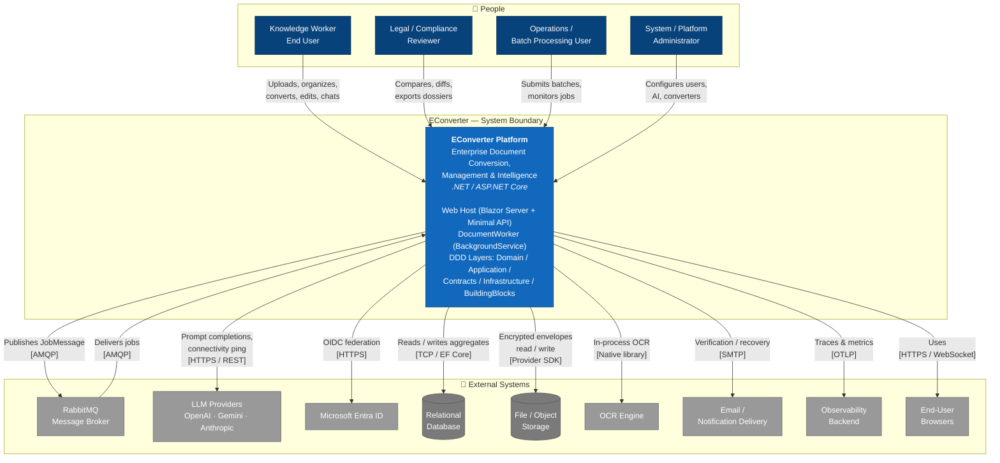
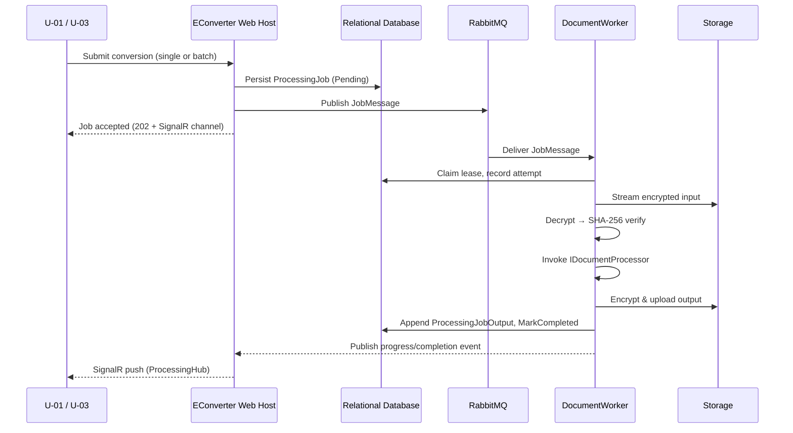
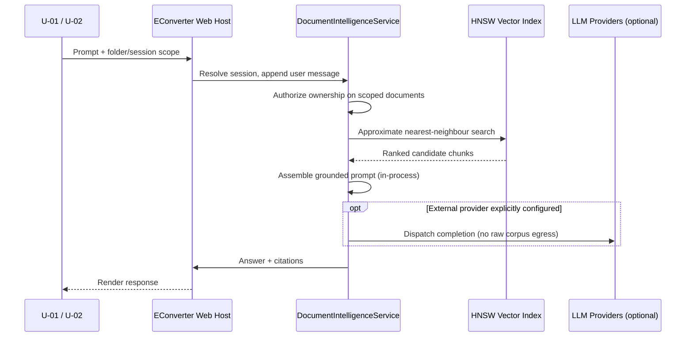
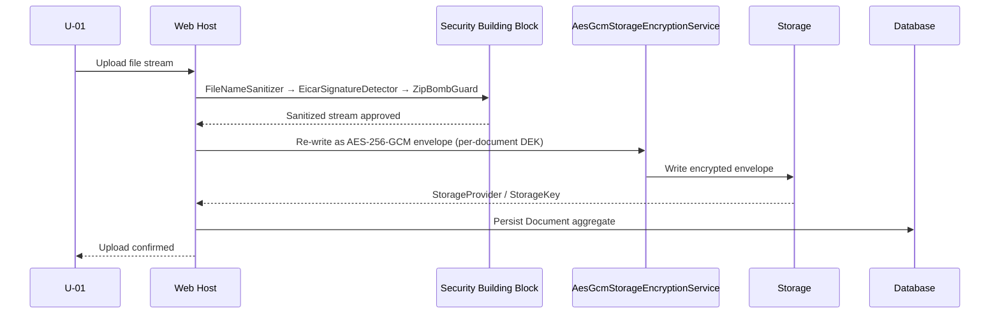
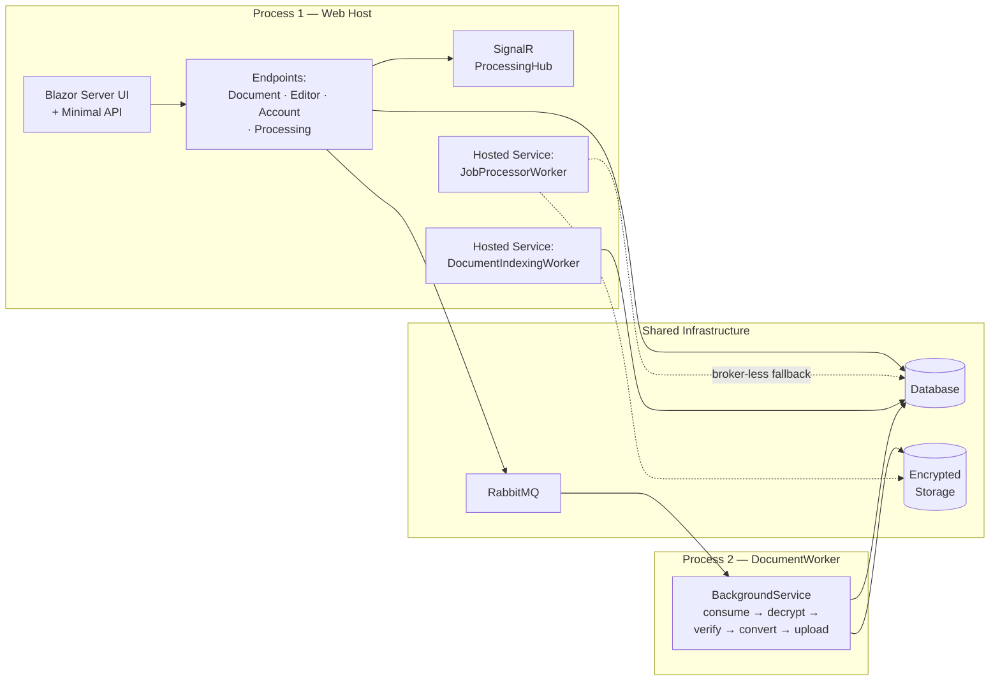

# EConverter — C4 Model: System Context Architecture

**Document Level:** C4 Level 1 — System Context
**System:** EConverter — Enterprise Document Conversion, Management & Intelligence Platform
**Generated:** 2026-11-18T00:00:00Z
**Timestamp:** 1763424000
**Basis:** System Context Research Report + Domain Module Research Report (consolidated)

---

## 1. Project Introduction

### 1.1 Project Name and Description

**EConverter** is a self-hosted, single-tenant-per-deployment enterprise platform for document conversion, document management, and on-premises document intelligence, built on **.NET / ASP.NET Core**.

The platform consolidates two enterprise needs that are normally served by separate products:

1. **High-fidelity document format conversion** — Office ↔ PDF, spreadsheet ↔ PDF, text/Markdown/HTML → PDF, ebook/presentation → PDF, image conversion and OCR.
2. **AI-assisted document understanding over private corpora** — zero-egress, in-process analysis, local vector indexing, grounded Copilot question-answering and publication-ready dossier export.

The combination is deliberate: conversion produces artifacts, intelligence produces insight, and the Copilot dossier exporter turns insight into deliverables (XLSX / DOCX / Markdown) that finance, legal and compliance teams can distribute.

### 1.2 Core Functionality and Value

| Capability Cluster | Description | Business Value |
|---|---|---|
| **Document Management** | Hierarchical folders, versions, recycle bin, per-owner private ownership (MVP: no cross-user sharing) | Central business asset store; every other capability operates on it |
| **Processing & Conversion** | Asynchronous `ProcessingJob` aggregates with leases, attempts, progress and a user-safe error taxonomy; batches; converter catalog | Reliable bulk back-office conversion at scale |
| **Document Intelligence & AI** | Contractually zero-egress analysis, multilingual chunking, local HNSW vector index, semantic retrieval, Copilot sessions, dossier export | Privacy-preserving AI for regulated / air-gapped environments |
| **PDF Editing & Compression** | Server-side mutation (annotations, forms, redaction, watermarking, signatures, page restructure) plus structural + image compression | In-browser document finishing without third-party SaaS |
| **Storage & Encryption** | AES-256-GCM chunked envelope encryption, per-document DEK wrapped by a master KEK | Compliance value at rest; enforces the tenant boundary cryptographically |
| **Identity & Security** | Local + Entra ID dual authentication, claims transformation, ownership authorization, input sanitization, malware scanning, audit trail | Governed access with an evidence trail |
| **Administration & Configuration** | Users/roles/departments, converter catalog limits, AI provider config, system settings, audit review | Operator control surface |

### 1.3 Technical Characteristics Overview

| Characteristic | Detail |
|---|---|
| **Runtime topology** | Two processes: (1) Blazor Server + Minimal API web host; (2) standalone `DocumentWorker` `BackgroundService`. A third execution path exists in-process (`JobProcessorWorker`) when no broker is configured. |
| **Architecture style** | Domain-Driven Design layering: Domain → Application → Contracts → Infrastructure → Web → Workers → BuildingBlocks |
| **Bounded contexts** | Documents, Processing, AI, Editor, Security, Identity, Admin, Storage, System |
| **Job state authority** | The database, not the broker. RabbitMQ is a delivery channel only; `ProcessingJob` is the aggregate of record. |
| **AI posture** | Two-tier and intentional: in-process `IDocumentIntelligenceService` (zero egress) for corpus analysis; a separately permitted `ExternalAiClient` for optional cloud LLM completions. |
| **Encryption model** | Envelope encryption: ephemeral per-document DEK, wrapped by a configured master KEK; chunked AES-256-GCM with per-chunk authentication tags for bounded-memory streaming. |
| **UI technology** | Blazor Server interactive components on Radzen; SignalR hub for realtime job notifications; PDF.js for the in-browser editor. |
| **Observability** | OpenTelemetry tracing and metrics configured at host startup; health checks. |
| **Deployment model** | Self-hosted, single-tenant per deployment; multi-tenant collaboration and external share links are explicitly out of MVP scope. |

---

## 2. Target Users

### 2.1 User Role Definitions

#### U-01 — Knowledge Worker / End User
**Description:** Individual office user or analyst who uploads, organizes and converts documents and interacts with the AI Copilot over their own document tree.

**Needs:**
- Convert documents between Office, PDF, text and spreadsheet formats with layout fidelity.
- Organize documents into hierarchical folders; manage versions and recycle-bin recovery.
- Edit PDFs directly in the browser (annotations, forms, redaction, watermarking, signatures).
- Ask grounded questions over their own corpus and receive cited answers.
- Run chat sessions scoped to a folder or document set with persistent history.

**Primary entry surfaces:** `Documents.razor`, `UploadDialog.razor`, `PdfEditor.razor`, `AiChatPage.razor`, `GlobalCopilotDialog.razor`.

#### U-02 — Legal / Compliance Reviewer
**Description:** Professional who must review, compare and evidence large volumes of contractual and regulatory documents under strict confidentiality constraints.

**Needs:**
- Cross-document comparison, clause diffing and grounded search across a corpus.
- Generate executive briefings and dossier exports (Word, Excel, Markdown) as evidence artifacts.
- Guarantee that no document content egresses to third-party cloud services.
- Redact sensitive content and watermark output before distribution.

**Primary entry surfaces:** `AiChatPage.razor`, document diff dialogs, `ExportDocumentDialog.razor`, `CopilotDossierExporter` output.

#### U-03 — Operations / Batch Processing User
**Description:** User or team responsible for high-volume, repeatable conversion workloads across many documents.

**Needs:**
- Submit and monitor batches of conversion jobs with progress and priority control.
- Cancel, retry and diagnose failed jobs via a user-safe error taxonomy.
- Track per-attempt history, worker leases and job outputs reliably.

**Primary entry surfaces:** `BatchConversionDialog.razor`, `BatchProgressDialog.razor`, `ProcessingJobs.razor`, `ProcessingHub` (SignalR).

#### U-04 — System / Platform Administrator
**Description:** IT administrator who configures the platform, its AI provider settings, users, roles and operational health.

**Needs:**
- Manage users, roles and activation lifecycle (local or Entra ID identities).
- Configure AI providers, endpoints, proxy and API key parameters.
- Monitor health, distributed traces and metrics.
- Control converter catalog availability and storage/security settings.

**Primary entry surfaces:** `UsersAndDepartments.razor`, `ConvertersCatalog.razor`, `SystemSettings.razor`, `SecurityAuditLog.razor`.

### 2.2 Usage Scenario Descriptions

| Scenario | Actor | Flow |
|---|---|---|
| S-01 Ingestion | U-01 | Upload dialog → ownership resolution → sanitization + threat screening → envelope encryption → storage write → `Document` aggregate persisted |
| S-02 Single conversion | U-01 / U-02 | Conversion request → `ProcessingJob` created (Pending) → JobMessage published → worker claims lease → decrypt → SHA-256 verify → convert → encrypt → upload → `MarkCompleted` → SignalR notification |
| S-03 Batch conversion | U-03 | Batch dialog → `BatchJob` + N child `ProcessingJob` → independent dispatch → parallel consumption → aggregated completion recomputed via scoped `AppDbContext` |
| S-04 Corpus indexing | U-01 (implicit) | `DocumentIndexingWorker` polls channel → access check → text extraction (+ OCR fallback for scanned PDFs) → multilingual chunking → embeddings → HNSW index hydration |
| S-05 Grounded Q&A | U-01 / U-02 | Prompt + scope → session resolve → HNSW similarity search → ranking within folder tree → grounded prompt assembly → answer → `CopilotChatSession` persisted |
| S-06 Dossier export | U-02 | Analysis artifact selection → `CopilotDossierExporter` materializes XLSX/DOCX/Markdown → persisted through document pipeline → download |
| S-07 PDF editing | U-01 / U-02 | Browser captures operations → `PdfEditOperationDto` batch → `EditorEndpoints` → `PdfEngine` mutation (PDFsharp/PdfPig) → optional compression → re-encrypt → new `DocumentVersion` |
| S-08 Auth & audit | All | Local credentials or Entra ID OIDC → claims transformation to internal roles → `User` aggregate resolution → `HttpContextUserContext` → ownership authorization → `AuditEvent` written |
| S-09 Administration | U-04 | Admin pages → `IAdminService` → user/role/department lifecycle, converter limits, AI provider config, audit review |

### 2.3 User Requirement Analysis

| Requirement Class | Requirement | Satisfied By |
|---|---|---|
| **Confidentiality** | Documents must not leave the tenant boundary | In-process `IDocumentIntelligenceService`; AES-256-GCM envelope encryption; explicit `ExternalAiClient` gating |
| **Fidelity** | Converted output must preserve layout | `OfficeDocumentProcessor`, `ExcelPdfConverter`, word-level layout emission, SkiaSharp rendering |
| **Scale** | Bulk operations without blocking the UI | Asynchronous `ProcessingJob` + `BatchJob`, worker leases, RabbitMQ delivery |
| **Diagnosability** | Failures must be actionable without leaking internals | `ProcessingErrorCode` taxonomy, `ProcessingAttempt` history, user-safe error surface |
| **Governance** | Access and actions must be auditable | ASP.NET Core Identity + OIDC, claims transformation, `AuditEvent` store, `SecurityAuditLog.razor` |
| **Operability** | Operators must control and observe the platform | Converter catalog, system settings, OpenTelemetry, health checks |

---

## 3. System Boundaries

### 3.1 System Scope Definition

The EConverter solution boundary comprises the ASP.NET Core web host, the standalone `DocumentWorker` background service, and the layered class libraries carrying domain, application contracts, infrastructure adapters and shared building blocks.

**Responsibilities inside the boundary:**
- Document and folder lifecycle management (create, rename, move, version, recycle-bin restore, purge)
- In-process format conversion (Office / PDF / spreadsheet / text / image / ebook / presentation)
- PDF editing and compression
- Asynchronous job and batch orchestration with lease/attempt semantics
- Local document intelligence (analysis, embeddings, HNSW vector indexing, retrieval ranking)
- Copilot chat session management and memory
- Dossier / report export
- User and role administration
- Storage encryption (AES-256-GCM envelope with per-document DEK wrapped by a master KEK)
- Access-control enforcement, input sanitization, malware scanning, audit
- Observability instrumentation

**Single-tenant constraint:** The domain model states documents are private to their `OwnerUserId` with no cross-user sharing in the MVP. Multi-tenant collaboration, external sharing links and federated document exchange are out of scope.

### 3.2 Included Core Components

| Component | Path | Responsibility |
|---|---|---|
| Web Host | `src/DocumentConverter.Web` | ASP.NET Core host: minimal API endpoints (`DocumentEndpoints` and peers), Blazor/Radzen UI pages, SignalR hubs, middleware, hosted services, authentication, `wwwroot/pdfjs` |
| Document Worker | `src/Workers/DocumentWorker` | `BackgroundService` consuming RabbitMQ jobs; decrypt → hash → convert → upload pipeline |
| In-Process Job Processor | `src/DocumentConverter.Web/HostedServices/JobProcessorWorker.cs` | In-process dequeue, hash verification, storage/disk streaming, batch completion aggregation |
| Application Layer | `src/DocumentConverter.Application` | AI, Admin, Common, Documents, Editor, Processing, Security, Storage services and contracts; `IProcessingService`, `IDocumentIntelligenceService` |
| Domain Layer | `src/DocumentConverter.Domain` | Documents, Processing, AI, Identity, Security, System, Common aggregates, entities, value objects and lifecycle state machines |
| Contracts Layer | `src/DocumentConverter.Contracts` | AI, Admin, Documents, Editor, Messages, Processing DTOs and message shapes |
| Infrastructure Layer | `src/DocumentConverter.Infrastructure` | AI (incl. HNSW), Admin, Documents, Editor, Identity, Messaging, OCR, Persistence (Configurations, Migrations), Processing (incl. Office), Security (StorageEncryption), Storage adapters |
| Processing Abstractions | `src/BuildingBlocks/DocumentConverter.Processing.Abstractions` | Processing seam contracts shared by processors and workers |
| Security Building Block | `src/BuildingBlocks/DocumentConverter.Security` | Security abstractions used to enforce ownership and access rules |
| Enterprise AI Chat Service | `src/DocumentConverter.Web/Services/EnterpriseAiChatService.cs` | AI chat session orchestration and `IChatClient` construction |

### 3.3 Excluded External Dependencies

The following are outside the boundary. They are consumed, not implemented:

| Excluded Component | Rationale |
|---|---|
| RabbitMQ broker runtime | External infrastructure; the platform publishes and consumes but does not host it |
| Relational database server | Hosting, backup and tuning are external operational concerns |
| External object/file storage backends | Lifecycle management is provider-owned |
| Third-party LLM providers (OpenAI, Google Gemini, Anthropic) | Models, quotas and billing are vendor-owned |
| Microsoft Entra ID tenant | Policies and conditional access configuration are tenant-owned |
| OCR engine binaries/models beyond the `Infrastructure.Ocr` adapter | Third-party native tooling |
| Observability backend (collector, APM, dashboards) | External telemetry infrastructure |
| End-user browsers and Radzen client-side CDN assets | Client-owned execution environment |
| PDF.js third-party library internals under `wwwroot/lib` | Vendored external library |
| Third-party NuGet dependencies (OpenXml, PdfSharp, PdfPig, SkiaSharp, EF Core providers) | Maintained outside this repository |
| Cross-user document sharing, external collaboration, public share links | Explicitly out of scope for the MVP |

---

## 4. External System Interactions

### 4.1 External System Inventory

| ID | External System | Interaction Type | Direction | Criticality | Failure Mode / Fallback |
|---|---|---|---|---|---|
| X-01 | **RabbitMQ Message Broker** | Asynchronous messaging (AMQP publish/consume) | Outbound publish / inbound consume | High | `NoOpQueuePublisher` fallback: system degrades to in-process `JobProcessorWorker` execution |
| X-02 | **LLM Providers** (OpenAI, Google Gemini, Anthropic) | Outbound HTTPS REST (API key / bearer) | Outbound | Medium | Optional path; in-process intelligence remains available; errors normalized without leaking payload content |
| X-03 | **Microsoft Entra ID** | OIDC federated identity | Outbound redirect / inbound assertion | High (when enabled) | `AuthenticationType.Local` remains available as an alternative mode |
| X-04 | **Relational Database** | Database access over TCP via EF Core (`AppDbContext`) | Bidirectional | Critical | None — platform cannot start or operate without it |
| X-05 | **File / Object Storage Providers** | Storage I/O (provider SDK or filesystem) | Bidirectional | Critical | None for persistence; `FileSystemDocumentStorage` is the reference adapter |
| X-06 | **OCR Engine** | In-process library / native tooling | In-process | Medium | OCR-dependent paths fail gracefully; non-OCR conversion unaffected |
| X-07 | **Email / Notification Delivery** | Outbound SMTP or provider API | Outbound | Medium | Account flows (registration, verification, password recovery) degrade; authentication of existing users unaffected |
| X-08 | **Identity Provider Database / Session Store** | In-process framework service persisted via EF Core | Bidirectional | High | Shares the business schema; unavailable only if X-04 is unavailable |
| X-09 | **Observability Backend** | Outbound OTLP / telemetry export | Outbound | Low | Telemetry dropped; application function unaffected |
| X-10 | **End-User Browsers** | HTTPS / WebSocket (Blazor Server circuit + SignalR) | Bidirectional | Critical | No UI without it |

### 4.2 Interaction Method Descriptions

#### X-01 — RabbitMQ Message Broker
Durable message queue carrying conversion job payloads (`JobMessage`) from the web host to the `DocumentWorker`. The `ProcessingJob` aggregate remains the authoritative state; the broker only handles asynchronous delivery. Queue names, routing keys and prefetch options are defined by `RabbitMqOptions` and applied in `RabbitMqJobDispatcher`. A `NoOpQueuePublisher` fallback exists when no broker is configured, in which case `JobProcessorWorker` handles dequeue in-process.

**Dependency nature:** Optional at the topology level, but strongly preferred for horizontal worker scaling.

#### X-02 — Large Language Model Providers
Outbound HTTP integrations invoked by `ExternalAiClient` for prompt completions and connectivity pings, including provider-specific auth headers, JSON response parsing and normalized error handling. Also consumed through `Microsoft.Extensions.AI` `IChatClient` instances built by `EnterpriseAiChatService`.

**Critical design constraint:** This boundary is explicitly permitted and separately governed. The `IDocumentIntelligenceService` contract mandates zero egress of raw corpus content. The two-tier posture is intentional: in-process analysis is the default, cloud LLM traffic is opt-in and administrator-configured.

#### X-03 — Microsoft Entra ID
Optional external identity provider. `AuthenticationType` supports both `Local` and `EntraId` modes. The `User` aggregate is the stable application identity, with authorization keyed on the internal `Entity.Id` rather than the provider subject — this decouples authorization from provider-side subject churn.

#### X-04 — Relational Database
Persistence backend accessed exclusively through EF Core (`AppDbContext`), storing domain aggregates for AI, Documents, Identity, Processing, Security and System. The context extends an Identity-enabled `DbContext` so authentication entities share the business schema. Schema is defined by per-context configuration classes and versioned migrations.

**Authoritative role:** Because the database — not the broker — owns job state, this is the single most critical external dependency.

#### X-05 — File / Object Storage Providers
Storage abstraction (`StorageProvider` / `StorageKey` on `Document`) into which encrypted document envelopes are written and from which the worker streams inputs and outputs. Provider-agnostic by design; `FileSystemDocumentStorage` is the reference implementation.

#### X-06 — OCR Engine
Optical character recognition component in the `Infrastructure.Ocr` module used to extract text from non-textual documents as part of the intelligence and conversion pipeline. `ScannedPdfDetector` classifies image-only PDFs before `TesseractOcrEngine` is invoked.

#### X-07 — Email / Notification Delivery
Account and messaging flows exposed via the `Contracts.Messages` module and Account UI pages (registration, verification, password recovery). Transport is outbound SMTP or provider API (inferred).

#### X-08 — Identity Provider Database / Session Store
ASP.NET Core Identity and Blazor authentication state (cookie / session) supporting the interactive server UI. In-process framework service persisted via EF Core into the shared business schema.

#### X-09 — Observability Backend
OpenTelemetry tracing and metrics exporters configured at host startup for distributed tracing and health monitoring.

#### X-10 — End-User Browsers
The delivery channel for the Blazor Server interactive UI. Radzen client-side assets are served from CDNs; PDF.js internals are vendored under `wwwroot/lib`.

### 4.3 Dependency Relationship Analysis

```
CRITICAL (no fallback, platform non-functional if absent):
  X-04 Relational Database
  X-05 Storage Providers
  X-10 End-User Browsers
  X-08 Identity Provider Database / Session Store (dependent on X-04)

HIGH (degrades to a documented alternative or blocks a major capability):
  X-01 RabbitMQ  → falls back to in-process JobProcessorWorker
  X-03 Entra ID  → falls back to Local authentication mode

MEDIUM (blocks a feature class, not the platform):
  X-02 LLM Providers  → in-process intelligence remains
  X-06 OCR Engine     → only OCR-dependent paths blocked
  X-07 Email Delivery → only account self-service flows blocked

LOW (no functional impact):
  X-09 Observability Backend → telemetry dropped only
```

**Key architectural observation:** The critical-path external dependencies reduce to three infrastructure concerns — a relational database, a storage backend, and the browser channel. Everything else has a designed degradation path. This is the direct consequence of two decisions: (a) the database owns job state rather than the broker, and (b) document intelligence is contractually in-process rather than delegated to a cloud service.

---

## 5. System Context Diagram

### 5.1 C4 Level 1 — System Context



### 5.2 Key Interaction Flows

#### Flow A — Asynchronous Conversion (highest-traffic core path)



#### Flow B — Zero-Egress Grounded Q&A



#### Flow C — Ingestion with Encryption Boundary



### 5.3 Architecture Decision Descriptions

| ID | Decision | Rationale | Consequence |
|---|---|---|---|
| **AD-01** | **Database owns job state; RabbitMQ is a delivery channel only** | `ProcessingJob` is a first-class domain aggregate with leases, attempts, progress and a status state machine. Brokers are replaceable; domain invariants are not. | Enables the `NoOpQueuePublisher` in-process fallback. Job history and diagnostics survive broker restarts. Trade-off: the DB is on the critical path for every job transition. |
| **AD-02** | **In-process, zero-egress document intelligence** | `IDocumentIntelligenceService` explicitly mandates no document content leaves the process boundary. | Positions the product for regulated and air-gapped deployments. Local HNSW index replaces a managed vector database. Trade-off: index quality/scaling is bounded by local resources. |
| **AD-03** | **Two-tier AI posture — in-process vs. permitted external client** | Corpus analysis must never egress; conversational completions may be improved by cloud LLMs when the operator opts in. | `DocumentIntelligenceService` (in-process) and `ExternalAiClient` (cloud) are separate, independently governed components. Operators retain full control via admin-configured endpoints, proxy and keys. |
| **AD-04** | **Envelope encryption with per-document DEK wrapped by a master KEK** | Limits blast radius of any single key compromise; allows per-document key rotation without re-encrypting the corpus. | Chunked AES-256-GCM with per-chunk authentication tags enables bounded-memory streaming on the worker's hottest path. Trade-off: KEK availability is a hard operational dependency. |
| **AD-05** | **Authorization keyed on internal `Entity.Id`, not provider subject** | Decouples authorization from identity-provider-side subject churn and supports dual authentication modes (`Local` / `EntraId`) behind one identity model. | Users can migrate between authentication providers without losing ownership of their documents. |
| **AD-06** | **Per-owner document privacy, no sharing in MVP** | Simplifies the authorization model to a single check (`Document.IsOwnedBy` + `GetCurrentUserId`) applied uniformly across every capability. | Consistent enforcement across documents, AI retrieval, editing and conversion. Trade-off: no collaboration features until a sharing model is designed. |
| **AD-07** | **Provider-agnostic storage seam (`StorageProvider` / `StorageKey`)** | Business logic must not depend on a specific storage backend. | Filesystem, object store or blob backends are interchangeable without touching domain or application code. |
| **AD-08** | **User-safe error taxonomy (`ProcessingErrorCode`)** | Internal exceptions must never leak to end users through job failure surfaces. | Actionable, stable error semantics for operations users; internal detail is retained in `ProcessingAttempt` history for diagnosis. |

---

## 6. Technical Architecture Overview

### 6.1 Main Technology Stack

| Layer | Technology | Role |
|---|---|---|
| **Runtime** | .NET / ASP.NET Core | Host framework for both runtime processes |
| **Web Host** | Blazor Server (interactive), Minimal API endpoint groups, SignalR hubs | User-facing UI, API surface, realtime notifications |
| **UI Components** | Radzen Blazor components | Document explorer, dialogs, admin pages, chat surfaces |
| **Background Processing** | `BackgroundService` (`DocumentWorker`), `JobProcessorWorker` hosted service | Job consumption and execution |
| **Messaging** | RabbitMQ (AMQP) with `NoOpQueuePublisher` fallback | Asynchronous job delivery |
| **Persistence** | EF Core (`AppDbContext`) + per-context configurations + versioned migrations | Authoritative state store; Identity-enabled shared schema |
| **Document Formats** | OpenXml (WordprocessingML/SpreadsheetML), PdfSharp, PdfPig | High-fidelity conversion and PDF mutation |
| **PDF Rendering / Imaging** | SkiaSharp | Image downsampling, compression, rendering |
| **OCR** | Tesseract via `Infrastructure.Ocr` adapter | Text extraction from scanned/image-only documents |
| **Vector Search** | Local HNSW index (`HnswVectorIndex`) with persisted chunk entities | Semantic retrieval without external vector infrastructure |
| **AI Integration** | `Microsoft.Extensions.AI` `IChatClient`; `ExternalAiClient` for OpenAI/Gemini/Anthropic | Optional cloud LLM completions |
| **Identity** | ASP.NET Core Identity (Local) + OIDC (Entra ID) | Dual-mode authentication |
| **Cryptography** | AES-256-GCM envelope encryption with KEK-wrapped DEKs | Encryption at rest |
| **Anti-malware** | ClamAV adapter + EICAR signature detection + zip-bomb guard | Inbound threat screening |
| **Observability** | OpenTelemetry (traces + metrics), health checks | Operational visibility |
| **Document Rendering (client)** | PDF.js (vendored under `wwwroot/lib`) | In-browser PDF editing surface |

### 6.2 Architecture Patterns

| Pattern | Application in EConverter |
|---|---|
| **Domain-Driven Design (layered)** | Domain → Application → Contracts → Infrastructure → Web / Workers, with BuildingBlocks for shared seams |
| **Aggregate / Aggregate Root** | `Document`, `ProcessingJob`, `BatchJob`, `CopilotChatSession`, `User` |
| **State Machine** | `ProcessingJobLifecycle` (`CanTransition` / `EnsureCanTransition` / `IsRetryable`) governing Pending → Processing → Completed / Failed / Cancelled |
| **Repository via ORM** | EF Core `AppDbContext` with per-bounded-context configuration classes |
| **Adapter** | `FileSystemDocumentStorage`, `ClamAvScanner`, `TesseractOcrEngine`, `ExternalAiClient` |
| **Abstract Factory / Catalog** | `ConverterCatalogService` mapping source/target format pairs to `IDocumentProcessor` implementations |
| **Competing Consumers** | Multiple worker instances consuming from a durable queue with lease-based claims |
| **Envelope Encryption** | Per-document DEK wrapped by master KEK; chunked AES-GCM streams |
| **Publish/Subscribe (UI)** | SignalR `ProcessingHub` broadcasting job events to connected clients |
| **Two-Tier Trust Boundary** | In-process intelligence (zero egress) vs. explicitly permitted outbound LLM traffic |
| **Composition Root** | `Program.cs` registers all modules into DI and builds the middleware/endpoint pipeline |
| **Graceful Degradation** | `NoOpQueuePublisher` for broker-less deployments; dual auth modes; optional external AI |

### 6.3 Runtime Topology



### 6.4 Key Design Decisions and Architecture Insights

**1. The system is two processes sharing one domain model, with a designed third execution path.**
`DocumentWorker` (standalone) and `JobProcessorWorker` (in-process) both implement the same consume-execute-persist loop against the same `ProcessingJob` aggregate. This is a deliberate resilience decision — deployments without a broker remain fully functional, and the broker becomes an optimization for horizontal scaling rather than a hard dependency. It also introduces a known duplication surface that is worth consolidating into a single shared execution library over time.

**2. The encryption boundary is the true trust boundary.**
Every document artifact passes through `AesGcmStorageEncryptionService` on the way in and out. Plaintext exists only within a process, bounded by streamed chunk decryption. This is what makes the zero-egress AI claim verifiable rather than aspirational: the same boundary that protects documents at rest also protects them from the intelligence pipeline's perspective.

**3. Job state ownership is the load-bearing architectural choice.**
By placing authoritative job state in the database rather than the broker, the platform gains: durable attempt history, diagnostics independent of broker uptime, the in-process fallback, and batch completion aggregation via ordinary queries. The cost is that the relational database moves to the critical path for every job transition — an acceptable trade for an enterprise back-office workload.

**4. The two-tier AI posture is the product differentiator, and it is enforced by contract.**
`IDocumentIntelligenceService` carries an explicit no-egress mandate. `ExternalAiClient` is a separately permitted, administrator-configured component. This separation is what allows the same product to serve both regulated/air-gapped deployments and organizations willing to use cloud LLM completions without compromising the corpus confidentiality guarantee.

**5. Authorization is uniformly ownership-based, and this uniformity is the security posture.**
`Document.IsOwnedBy` combined with `GetCurrentUserId` from `HttpContextUserContext` gates every capability — document CRUD, conversion inputs, AI retrieval scoping, PDF editing targets and version creation. There is no second authorization model to reason about. The MVP's no-sharing constraint is not merely a feature limitation; it is what keeps the authorization surface auditable.

**6. The external dependency profile is deliberately shallow.**
Three critical external dependencies (database, storage, browser), two high-criticality dependencies with documented fallbacks (broker, identity provider), and the remainder optional or degrading. This is a self-hosted enterprise product optimized for deployment in environments where minimizing external trust surface is itself a requirement.

---

## Appendix A — External System Interaction Matrix (Consolidated)

| External System | Protocol | Direction | Criticality | Fallback | Boundary Owner |
|---|---|---|---|---|---|
| RabbitMQ Broker | AMQP | Publish / Consume | High | `NoOpQueuePublisher` + `JobProcessorWorker` | External infra |
| LLM Providers | HTTPS REST | Outbound | Medium | In-process intelligence | Vendor |
| Microsoft Entra ID | OIDC / HTTPS | Bidirectional | High | `AuthenticationType.Local` | Tenant |
| Relational Database | TCP / EF Core | Bidirectional | Critical | None | External infra |
| File / Object Storage | Provider SDK / FS | Bidirectional | Critical | None | External infra |
| OCR Engine | In-process native | In-process | Medium | Feature-class degradation | Third-party binary |
| Email Delivery | SMTP / provider API | Outbound | Medium | Account self-service degradation | External provider |
| Identity DB / Session Store | In-process / EF Core | Bidirectional | High | Dependent on database | In-process (shared schema) |
| Observability Backend | OTLP | Outbound | Low | Telemetry dropped | External infra |
| End-User Browsers | HTTPS / WebSocket | Bidirectional | Critical | None | Client |

## Appendix B — Confidence and Coverage Notes

- **System context confidence:** 0.90
- **Domain module confidence:** 8.8 / 10
- **Known structural misalignments flagged in research (documented, not resolved by this context view):**
  1. `DocumentIntelligenceService` is documented as belonging to the Application AI layer but physically resides in `DocumentConverter.Infrastructure.AI`.
  2. Job execution logic is duplicated between the standalone `DocumentWorker` project and `Web/HostedServices/JobProcessorWorker.cs` — "the processing runtime" is not a single code location.
  3. The security concern spans three layers with loosely related responsibilities: `BuildingBlocks/DocumentConverter.Security` (EICAR, zip-bomb, filename sanitizer), `Domain/Security` (`AuditEvent`), and `Infrastructure/Security` (`AuditService`, `ClamAvScanner`).
  4. The DDD Contracts layer serves both cross-layer DTOs and transport schemas (`Contracts/Messages/QueueMessages.cs`), blurring application contracts with transport payloads.

These are internal structural observations at the Container/Component level; they do not alter the System Context boundary or the external interaction model presented in this document.
