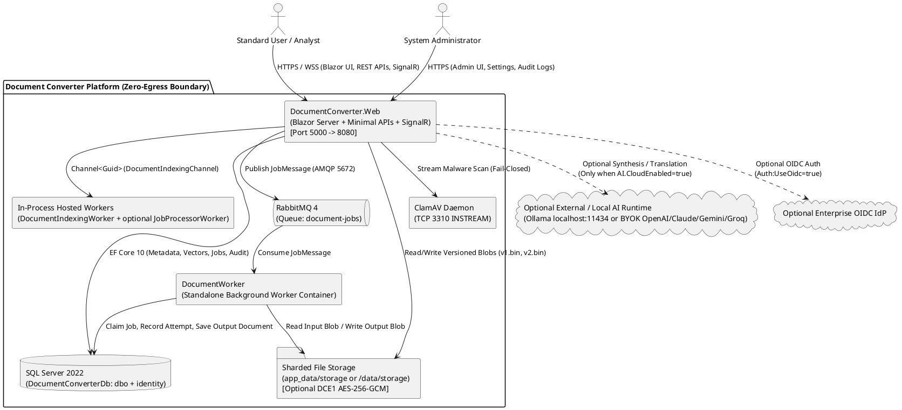

# Project Overview and Repository Inventory

**Purpose:** Establish the technical, functional, and organizational baseline of the Enterprise Document Converter, Management, and Local RAG Knowledge Platform (`DocumentConverter.slnx`) for academic research (Undergraduate Information Systems Final Project / *Tugas Akhir*) and engineering handover.  
**Scope:** Project purpose, business context, problem statement, objectives, scope and limitations, verified technology stack, high-level system overview, solution inventory, project catalog, and third-party NuGet package inventory.  
**Evidence status:** `Code-verified` (source code, `.csproj`, `Directory.Build.props`, `Directory.Packages.props`, `global.json`, and `Dockerfile` assets); `Runtime-verified` (.NET SDK 10.0.403 build and automated test suite). Organizational deployment context outside the repository is marked `Requires confirmation`.  
**Last reviewed:** 2026-11-05

---

## 1. Project Purpose

The **Enterprise Document Converter & Knowledge Governance Platform** (`DocumentConverter.slnx`) is a self-hosted, multi-project .NET 10 web and worker system that unifies four traditionally fragmented enterprise capabilities inside a single security boundary:

1. **Multi-Format Document Conversion & Optimization:** Asynchronous and synchronous transformation across 17 seeded converter definitions (Office OpenXML `.docx`/`.xlsx`/`.pptx`, CSV, Markdown, HTML, EPUB/MOBI e-books, images, and PDFs), scanned-document Optical Character Recognition (OCR via Tesseract), and lossy/lossless PDF and image compression.
2. **Secure Document Management & Cryptographic Integrity:** Owner-isolated hierarchical folder management, immutable multi-version file history (`v1.bin`, `v2.bin`, ...) with line-by-line version diffing and rollback, interactive browser-based PDF editing (`PDF.js` + `PDFsharp` 6.x), PAdES (`adbe.pkcs7.detached`) cryptographic digital signing and tamper verification, and optional at-rest envelope encryption (`DCE1` AES-256-GCM).
3. **Local / Hybrid Retrieval-Augmented Generation (RAG) & Document Intelligence:** Automated background document ingestion using `ManagedCode.MarkItDown`, `UglyToad.PdfPig`, `DocumentFormat.OpenXml`, and `Tesseract`; sliding-window semantic chunking (180 words, 30-word overlap); 10-rule deterministic RAG chunk enrichment with prompt-injection sanitization; cross-lingual Indonesian (`id`) and English (`en`) chunk projection; 256-dimensional MurmurHash3 + BM25 + domain-concept vector embeddings stored in SQL Server (`varbinary(1024)`) and indexed in an in-memory Hierarchical Navigable Small World (`HnswVectorIndex`) graph; and zero-egress extractive synthesis with optional Bring-Your-Own-Key (BYOK) / local Ollama LLM synthesis.
4. **Data Governance, Security Controls, and Auditability:** Multi-stage upload validation (magic-byte verification, ZIP-bomb and macro rejection, EICAR and ClamAV `INSTREAM` malware scanning), per-user ownership isolation (`dc:uid`), append-only security and operational audit logging (`dbo.AuditEvents`), and a two-stage deletion lifecycle (Recycle Bin soft-delete and irreversible storage purge).

**Evidence**
- `DocumentConverter.slnx` — 11-project solution structure (`src/BuildingBlocks/*`, `src/DocumentConverter.*`, `src/Workers/DocumentWorker`, `tests/*`).
- `src/DocumentConverter.Web/Program.cs` — ASP.NET Core / Blazor Server host startup, DI registrations, authentication, rate limiting, and middleware pipeline.
- `src/DocumentConverter.Infrastructure/Persistence/DbSeeder.cs` — Seeded departments, roles, users, 17 converters, and 11 system settings.

**Status:** `Code-verified`.

---

## 2. Business Context

Organizations routinely handle sensitive operational, legal, financial, and human-resources documents (contracts, invoices, standard operating procedures, board presentations, and compliance audits) that require format conversion, redaction, signing, version control, and cross-document knowledge retrieval.

In typical organizational workflows (`Inferred` from domain models in `src/DocumentConverter.Domain` and UI workflows in `src/DocumentConverter.Web/Components/Pages`; specific target organization details `Requires confirmation`):
- Employees rely on ad-hoc consumer web tools to convert, merge, split, or compress PDFs and Office files, exposing confidential organizational data to third-party external servers (**uncontrolled data egress**).
- Document repositories store binary blobs without semantic indexing, forcing analysts to manually inspect dozens of PDFs or spreadsheets to answer compliance, financial obligation, or clause-comparison queries (**knowledge fragmentation**).
- Adopting cloud-hosted generative AI assistants introduces data residency, privacy, and prompt-injection risks when applied to internal documents, and often lacks strict alignment with document-level ownership and audit requirements (**governance gap**).

The platform addresses this context by enforcing a **Zero-Egress Default** architecture (`AI.CloudEnabled = false` by default in `DbSeeder.cs`, and `internal: true` Docker bridge networking on `dc-internal` in `docker-compose.prod.yml`), ensuring all document conversion, OCR, encryption, and baseline RAG indexing/retrieval execute locally within the organization's infrastructure.

---

## 3. Problem Statement

Based on the implemented system boundaries and controls, the core information systems problems addressed by this project are:

1. **Fragmented Document Lifecycle & Security Exposure:** Separating file conversion utilities, PDF editing/signing tools, and document storage forces users to transfer files across disconnected tools, losing version lineage, cryptographic hash provenance (`SHA-256`), and centralized access control.
2. **Unsearchable Unstructured Document Corpora:** Multi-format files (`.pdf`, `.docx`, `.xlsx`, `.pptx`, scanned images, `.epub`) and bilingual Indonesian/English organizational records cannot be queried semantically or compared systematically using filename search alone.
3. **Data Sovereignty & Governance Risks in Enterprise AI:** Connecting enterprise document repositories to external LLM APIs risks leaking sensitive content, retrieving unauthorized documents across user boundaries (Insecure Direct Object Reference / IDOR), or executing embedded prompt-injection directives contained inside untrusted documents.
4. **Incomplete Lifecycle Traceability:** Without integrated audit logging, malware screening, and structured version/deletion states, administrators cannot trace who uploaded, converted, modified, signed, queried, or purged a document.

---

## 4. Objectives

### 4.1 Engineering & System Objectives (`Code-verified`)
- **OBJ-1 (Unified Document Processing & Management):** Provide a single web platform for secure document upload, hierarchical folder organization, asynchronous/synchronous format conversion, interactive PDF editing, PAdES digital signing, and immutable version control.
- **OBJ-2 (Defense-in-Depth Ingestion & Storage Security):** Enforce magic-byte validation, archive bomb/macro guards, fail-closed antivirus scanning (`ClamAvScanner`), per-user ownership checks, and optional AES-256-GCM envelope encryption (`DCE1`) at rest.
- **OBJ-3 (Zero-Egress Bilingual RAG & Knowledge Retrieval):** Implement an in-process RAG pipeline supporting multi-format text/OCR extraction, prompt-injection sanitization, 10-rule metadata enrichment, Indonesian-English cross-lingual retrieval, HNSW approximate nearest-neighbor search with Maximal Marginal Relevance (MMR), and verifiable page-level citations.
- **OBJ-4 (Auditable Governance & Administration):** Record security and operational events in `dbo.AuditEvents` and provide administrative controls over users, roles, departments, converter limits, and AI provider settings.

### 4.2 Academic Research Objectives (Information Systems *Tugas Akhir*)
See [Academic Research Mapping](../11-research-mapping/academic-research-mapping.md) for the complete Design Science Research Methodology (DSRM) formulation linking these engineering capabilities to Information Systems research questions and evaluation metrics.

---

## 5. Scope and Limitations

### 5.1 Implemented Scope (`Code-verified`)
- **Web Application & APIs:** Blazor Server interactive UI (`Radzen.Blazor`) and 51 HTTP Minimal API endpoints across 5 endpoint groups (`AccountEndpoints`, `DocumentEndpoints`, `DocumentIntelligenceEndpoints`, `EditorEndpoints`, `ProcessingEndpoints`), plus `/health` and SignalR hub `/hubs/processing`.
- **Background Processing:** Dual-mode job execution via RabbitMQ (`RabbitMqJobDispatcher`) or in-memory `Channel<JobMessage>` fallback, processed by either the standalone `DocumentWorker` container or the in-process `JobProcessorWorker` hosted service, plus asynchronous RAG indexing via `DocumentIndexingChannel` and `DocumentIndexingWorker`.
- **Persistence:** SQL Server (`DocumentConverterDb`) managed via Entity Framework Core 10 (`AppDbContext`) with 5 migrations creating 25 tables across two schemas (`dbo` with 18 tables and `identity` with 7 ASP.NET Core Identity tables).
- **Security & Governance:** Cookie authentication + optional OIDC (`Auth:UseOidc`), RBAC (`Administrator`, `User`), owner-based document/folder/RAG isolation, `DCE1` AES-256-GCM file encryption, PAdES PKCS#7 detached PDF signatures, and `dbo.AuditEvents` logging.

### 5.2 Verified Technical Limitations & Implementation Gaps (`Code-verified`)
To ensure strict academic and engineering transparency, the following implementation limitations were identified directly from the source code:

1. **Automated Retention Expiration Worker Not Implemented:** Although `DbSeeder.cs` seeds the system setting `Retention.Days = 90` and `dbo.Documents` includes an `ExpiresAt` column (`Document.cs`), **no background worker or scheduled job queries `ExpiresAt` or `Retention.Days` to automatically soft-delete or purge expired documents**. Deletion and purging are currently user- or administrator-triggered actions.
2. **RAG Derived Data Lifecycle on Document Delete/Purge & Versioning:**
   - When a document is soft-deleted (`DocumentService.DeleteAsync`) or permanently purged (`DocumentService.PurgeDocumentAsync`), the `dbo.Documents` row remains in the database with `Status = Deleted` or `Status = Purged` (physical blobs are deleted on purge). Because physical SQL row deletion does not occur on `PurgeDocumentAsync`, the SQL foreign-key `ON DELETE CASCADE` on `dbo.DocumentVectorChunks` and `dbo.DocumentIntelligenceIndices` is not triggered, nor are the static in-memory `DocumentIndexCache` or `GlobalHnswIndex` evicted (`HnswVectorIndex` only supports full `Clear()`, not single-document node removal).
   - While repository-wide RAG search (`SemanticSearchRepositoryAsync`) properly excludes `Deleted` and `Purged` documents via its Stage 1 SQL filter (`Status == DocumentStatus.Available`), single-document RAG endpoints (`AnalyzeDocumentAsync`, `AskQuestionAsync`, `SemanticSearchAsync`) only verify document ownership (`EnsureUserHasDocumentAccessAsync`) and do not filter by `Status == DocumentStatus.Available`.
   - Adding a new version via `DocumentService.AddVersionAsync` or `RollbackVersionAsync` does not automatically re-queue the document on `IDocumentIndexingChannel` or invalidate `DocumentIndexCache`; manual re-indexing (`POST /api/ai/documents/{id:guid}/reindex`) is required to refresh vectors after a version update.
3. **Standalone `DocumentWorker` Does Not Trigger In-Memory Web RAG Indexing:** When `Processing:RunWorkerInWeb = false` and conversion jobs execute in the external `DocumentWorker` process (`src/Workers/DocumentWorker/Worker.cs`), `IDocumentIndexingChannel` is not injected into `Worker.cs`, so newly converted output documents are indexed lazily on first query or via `/api/ai/corpus/prewarm` rather than immediately upon job completion.
4. **Strict Single-Owner Access Model (No Inter-User or Department Sharing ACLs):** Although `dbo.Users` has a foreign key to `dbo.Departments`, document and folder access control in `DocumentService` and `DocumentIntelligenceService` is strictly enforced per `OwnerUserId == currentUserId`. Cross-user sharing, folder permissions, and department-wide shared document visibility are not implemented.
5. **Local Embedding Model Is Deterministic Feature-Hashing (Not a Neural Transformer):** `DocumentIntelligenceService.ComputeEmbedding` computes a 256-dimensional vector using MurmurHash3 (`0x9747b28c`), BM25-style term-frequency saturation, character 3-grams, word bigrams, and bilingual domain-concept projection. While fast and zero-egress, it does not capture deep contextual semantics beyond its curated concept clusters and lexical n-grams unless paired with an external/local LLM for synthesis and translation.

---

## 6. Technology Stack

All projects enforce central build and package settings via `global.json`, `Directory.Build.props`, and `Directory.Packages.props`.

| Layer / Concern | Technology / Package | Version | Verification Status & Evidence |
|---|---|---|---|
| **.NET SDK & Target Framework** | .NET 10 (`net10.0`, C# `latest`, SDK `10.0.114` pinned with `rollForward: latestFeature`) | `10.0.114` / `10.0.403` | `Code-verified` (`global.json`, `Directory.Build.props`) & `Runtime-verified` (`dotnet --info`) |
| **Web UI & Real-Time** | ASP.NET Core Blazor Server (Interactive Server Components), Radzen.Blazor, SignalR (`ProcessingHub`) | `10.0.0` / `9.0.4` | `Code-verified` (`src/DocumentConverter.Web/Program.cs`, `Directory.Packages.props`) |
| **HTTP API & OpenAPI** | ASP.NET Core Minimal APIs, `Microsoft.AspNetCore.OpenApi`, Rate Limiting (`fixed` window) | `10.0.5` | `Code-verified` (`src/DocumentConverter.Web/Program.cs`, `Endpoints/*.cs`) |
| **Authentication & Identity** | ASP.NET Core Identity (`AppIdentityUser`), Cookie Auth, OpenID Connect (`Microsoft.AspNetCore.Authentication.OpenIdConnect`) | `10.0.5` | `Code-verified` (`Program.cs`, `AppClaimsTransformation.cs`) |
| **ORM & Database** | Entity Framework Core 10 (`Microsoft.EntityFrameworkCore.SqlServer`), Microsoft SQL Server 2022 | `10.0.5` | `Code-verified` (`AppDbContext.cs`, `docker-compose.yml`) |
| **Messaging & Queues** | `RabbitMQ.Client` (AMQP 0.9.1) with in-memory `System.Threading.Channels` fallback | `7.1.1` | `Code-verified` (`RabbitMqJobDispatcher.cs`, `DocumentIndexingChannel.cs`) |
| **PDF Inspection & Manipulation** | `PDFsharp` (`PdfSharp`), `UglyToad.PdfPig` | `6.2.4` / `1.7.0-custom-5` | `Code-verified` (`PdfEngine.cs`, `PdfDigitalSignatureService.cs`, `DocumentIntelligenceService.cs`) |
| **Office & E-Book Processing** | `DocumentFormat.OpenXml` (`.docx`, `.xlsx`, `.pptx`), custom EPUB/PalmDOC MOBI parsers | `3.3.0` | `Code-verified` (`OfficeDocumentProcessor.cs`, `Office/*.cs`) |
| **RAG Ingestion & Markdown** | `ManagedCode.MarkItDown`, `Markdig` | `0.1.5` / `0.41.0` | `Code-verified` (`DocumentIntelligenceService.cs`, `MarkdownRenderer.cs`) |
| **OCR & Image Processing** | `Tesseract` (`tessdata/eng.traineddata`), `SkiaSharp`, `SkiaSharp.NativeAssets.Linux.NoDependencies`, `HarfBuzzSharp` | `5.2.0` / `3.116.1` / `8.3.0.1` | `Code-verified` (`TesseractOcrEngine.cs`, `ImageDocumentProcessor.cs`, `ImageCompressProcessor.cs`) |
| **Cryptography & Security** | `System.Security.Cryptography.Pkcs` (CMS/PKCS#7 PAdES), `AesGcm` (`DCE1` envelope encryption), ClamAV TCP `INSTREAM` | `10.0.5` | `Code-verified` (`PdfDigitalSignatureService.cs`, `AesGcmStorageEncryptionService.cs`, `ClamAvScanner.cs`) |
| **Observability** | OpenTelemetry (`OpenTelemetry.Extensions.Hosting`, AspNetCore, Http, Runtime), ASP.NET Core Health Checks (`/health`) | `1.11.2` | `Code-verified` (`src/DocumentConverter.Web/Program.cs`, `src/Workers/DocumentWorker/Program.cs`) |
| **Automated Testing** | `xunit.v3`, `Shouldly`, `NetArchTest.Rules`, `Microsoft.EntityFrameworkCore.InMemory`, `coverlet.collector` | `3.2.2` / `4.3.0` / `1.3.2` / `10.0.5` | `Code-verified` & `Runtime-verified` (`tests/*`) |

---

## 7. High-Level System Overview



**Diagram Explanation & Evidence**
- Users and administrators interact with `DocumentConverter.Web` (`src/DocumentConverter.Web/Program.cs`), which hosts both the interactive Blazor Server UI (`Components/Pages/**`) and 51 Minimal API endpoints (`Endpoints/*.cs`).
- File uploads pass through `ClamAvScanner` (`src/DocumentConverter.Infrastructure/Security/ClamAvScanner.cs`) and `FileSystemDocumentStorage` (`src/DocumentConverter.Infrastructure/Storage/FileSystemDocumentStorage.cs`), with optional `AesGcmStorageEncryptionService` (`DCE1` header) encryption.
- Conversion jobs are published via `RabbitMqJobDispatcher` (`src/DocumentConverter.Infrastructure/Messaging/RabbitMqJobDispatcher.cs`) to RabbitMQ (or an internal `Channel<JobMessage>` fallback) and executed by `DocumentWorker` (`src/Workers/DocumentWorker/Worker.cs`) or `JobProcessorWorker` (`src/DocumentConverter.Web/HostedServices/JobProcessorWorker.cs`).
- Document intelligence indexing runs asynchronously via `DocumentIndexingWorker` (`src/DocumentConverter.Web/HostedServices/DocumentIndexingWorker.cs`), persisting 256-D vectors to `dbo.DocumentVectorChunks` in SQL Server and hydrating the in-memory `HnswVectorIndex`.

---

## 8. Solution and Project Catalog

The solution `DocumentConverter.slnx` contains **11 projects** (6 library projects, 2 executable applications, and 3 automated test projects). All 11 projects target `net10.0` (`Directory.Build.props`).

| # | Project Name | Relative Path | SDK / Output Type | Primary Responsibility | Compile-Time Project References |
|---|---|---|---|---|---|
| 1 | `DocumentConverter.Processing.Abstractions` | `src/BuildingBlocks/DocumentConverter.Processing.Abstractions/DocumentConverter.Processing.Abstractions.csproj` | `Microsoft.NET.Sdk` (Library) | Defines `IDocumentProcessor`, `ProcessingContext`, `ProcessingResult`, and `ProcessingException` contracts for pluggable conversion engines. | None |
| 2 | `DocumentConverter.Security` | `src/BuildingBlocks/DocumentConverter.Security/DocumentConverter.Security.csproj` | `Microsoft.NET.Sdk` (Library) | Pure security primitives: `FileSignatureDetector` (magic bytes), `FileNameSanitizer`, `ZipBombGuard` (500 MB / 50:1 / 5,000 entries / `vbaProject.bin` check), and `EicarSignatureDetector`. | None |
| 3 | `DocumentConverter.Domain` | `src/DocumentConverter.Domain/DocumentConverter.Domain.csproj` | `Microsoft.NET.Sdk` (Library) | Pure domain entities, aggregates, value objects, state machines (`Document`, `DocumentVersion`, `DocumentVectorChunk`, `DocumentIntelligenceIndex`, `Folder`, `ProcessingJob`, `BatchJob`, `Converter`, `User`, `Role`, `Department`, `AuditEvent`, `SystemSetting`, `Copilot*`). | None |
| 4 | `DocumentConverter.Contracts` | `src/DocumentConverter.Contracts/DocumentConverter.Contracts.csproj` | `Microsoft.NET.Sdk` (Library) | Immutable C# `record` Data Transfer Objects (DTOs) for Documents, Digital Signatures, PDF Editor, Processing, Admin, and AI/RAG (`DocumentIntelligenceDtos.cs`). | None |
| 5 | `DocumentConverter.Application` | `src/DocumentConverter.Application/DocumentConverter.Application.csproj` | `Microsoft.NET.Sdk` (Library) | Application service interfaces (`IDocumentService`, `IProcessingService`, `IDocumentIntelligenceService`, `IExternalAiClient`, `IDocumentIndexingChannel`, `IPdfEngine`, `IPdfDigitalSignatureService`, `IAdminService`, `IAuditService`, `IMalwareScanner`, `IDocumentStorage`, `IUserContext`). | `Domain`, `Contracts`, `Processing.Abstractions`, `Security` |
| 6 | `DocumentConverter.Infrastructure` | `src/DocumentConverter.Infrastructure/DocumentConverter.Infrastructure.csproj` | `Microsoft.NET.Sdk` (Library) | EF Core `AppDbContext` & migrations, `DocumentService`, `DocumentIntelligenceService`, `HnswVectorIndex`, `ExternalAiClient`, `MultilingualChunkProcessor`, `PdfEngine`, `PdfDigitalSignatureService`, 6 `IDocumentProcessor` engines, `TesseractOcrEngine`, `FileSystemDocumentStorage`, `AesGcmStorageEncryptionService`, `ClamAvScanner`, `RabbitMqJobDispatcher`, `AdminService`, `AuditService`. | `Domain`, `Contracts`, `Application`, `Processing.Abstractions`, `Security` |
| 7 | `DocumentConverter.Web` | `src/DocumentConverter.Web/DocumentConverter.Web.csproj` | `Microsoft.NET.Sdk.Web` (Exe) | Main web host: Blazor Server UI (`Components/**`), 5 Minimal API endpoint modules (`Endpoints/*.cs`), `ProcessingHub` SignalR hub, `EnterpriseAiChatService`, `JobProcessorWorker`, `DocumentIndexingWorker`, `CdpDownloadWatcher`, `AppClaimsTransformation`, `SecurityHeadersMiddleware`. | `Domain`, `Contracts`, `Application`, `Infrastructure`, `Security`, `Processing.Abstractions` |
| 8 | `DocumentWorker` | `src/Workers/DocumentWorker/DocumentWorker.csproj` | `Microsoft.NET.Sdk.Worker` (Exe) | Standalone background worker service (`Worker.cs`) for isolated container execution of conversion, OCR, and compression jobs. | `Domain`, `Contracts`, `Application`, `Infrastructure`, `Processing.Abstractions` |
| 9 | `DocumentConverter.Domain.Tests` | `tests/DocumentConverter.Domain.Tests/DocumentConverter.Domain.Tests.csproj` | `Microsoft.NET.Sdk` (Test Exe) | Unit tests for `Document` and `ProcessingJob` state machines and domain invariants (`DocumentLifecycleTests`, `ProcessingJobLifecycleTests`). | `Domain` |
| 10 | `DocumentConverter.Application.Tests` | `tests/DocumentConverter.Application.Tests/DocumentConverter.Application.Tests.csproj` | `Microsoft.NET.Sdk` (Test Exe) | Integration and functional tests covering security/IDOR, encryption, malware scanning, RAG/HNSW/cross-lingual intelligence, PDF editing, digital signatures, splitting, merging, compression, OCR, and format conversions. | `Domain`, `Contracts`, `Application`, `Infrastructure`, `Security`, `Processing.Abstractions` |
| 11 | `DocumentConverter.Architecture.Tests` | `tests/DocumentConverter.Architecture.Tests/DocumentConverter.Architecture.Tests.csproj` | `Microsoft.NET.Sdk` (Test Exe) | `NetArchTest.Rules` tests verifying clean dependency direction (`Domain` and `Application` isolation from `Infrastructure` and `Web`). | `Domain`, `Application`, `Infrastructure`, `Web` |

---

## 9. Repository Directory Inventory

```text
Document Converter/
├── .github/workflows/
│   └── deploy.yml                                # CI/CD pipeline (Build, Test, GHCR Push, SSH VPS Deploy)
├── src/
│   ├── BuildingBlocks/
│   │   ├── DocumentConverter.Processing.Abstractions/
│   │   └── DocumentConverter.Security/
│   ├── DocumentConverter.Domain/
│   ├── DocumentConverter.Contracts/
│   ├── DocumentConverter.Application/
│   ├── DocumentConverter.Infrastructure/
│   │   ├── Admin/                                # AdminService
│   │   ├── AI/                                   # DocumentIntelligenceService, HnswVectorIndex, ExternalAiClient, etc.
│   │   ├── Documents/                            # DocumentService, PdfDigitalSignatureService
│   │   ├── Editor/                               # PdfEngine, SystemFontResolver
│   │   ├── Identity/                             # AppIdentityUser
│   │   ├── Messaging/                            # RabbitMqJobDispatcher, RabbitMqOptions
│   │   ├── Ocr/                                  # TesseractOcrEngine, ScannedPdfDetector
│   │   ├── Persistence/                          # AppDbContext, DbSeeder, Configurations/, Migrations/
│   │   ├── Processing/                           # ProcessingService, ConverterCatalogService, 6 Processors, Office/
│   │   ├── Security/                             # AuditService, ClamAvScanner, StorageEncryption/
│   │   └── Storage/                              # FileSystemDocumentStorage
│   ├── DocumentConverter.Web/
│   │   ├── Authentication/                       # AppClaimsTransformation, HttpContextUserContext
│   │   ├── Common/                               # MarkdownRenderer
│   │   ├── Components/                           # Blazor Server Layout, Common, and Pages (Account, Admin, Copilot, Documents, Editor, Jobs, Tools)
│   │   ├── Endpoints/                            # Account, Document, DocumentIntelligence, Editor, Processing Minimal APIs
│   │   ├── HostedServices/                       # JobProcessorWorker, DocumentIndexingWorker, CdpDownloadWatcher
│   │   ├── Hubs/                                 # ProcessingHub (SignalR)
│   │   ├── Middleware/                           # SecurityHeadersMiddleware
│   │   ├── Services/                             # EnterpriseAiChatService, JobNotificationService
│   │   ├── tessdata/                             # eng.traineddata for Tesseract OCR
│   │   └── wwwroot/                              # Static web assets, PDF.js, JS interop
│   └── Workers/
│       └── DocumentWorker/                       # Standalone background worker host
├── tests/
│   ├── DocumentConverter.Domain.Tests/
│   ├── DocumentConverter.Application.Tests/
│   └── DocumentConverter.Architecture.Tests/
├── docs/                                         # Complete technical and academic documentation set
├── Directory.Build.props                         # Shared net10.0 target, nullable, warnings-as-errors
├── Directory.Packages.props                      # Central Package Management (CPM) version catalog
├── DocumentConverter.slnx                        # XML Solution file
├── docker-compose.yml                            # Local multi-container stack
├── docker-compose.prod.yml                       # Production VPS stack (internal: true network isolation)
├── DEPLOYMENT.md                                 # VPS Docker & GitHub Actions deployment guide
└── README.md                                     # Root project entry point
```

---

## 10. Related Documentation

- [Requirements Analysis](../02-requirements/requirements-analysis.md)
- [System Architecture](../03-system-design/system-architecture.md)
- [Module Documentation Index](../04-modules/README.md)
- [Database Documentation](../05-database/database-documentation.md)
- [API Documentation](../06-api/api-documentation.md)
- [Security and Data Governance](../07-security-governance/security-and-data-governance.md)
- [RAG Technical Documentation](../08-rag/rag-technical-documentation.md)
- [Testing and Evaluation](../09-testing/testing-and-evaluation.md)
- [Deployment and Maintenance](../10-deployment/deployment-and-maintenance.md)
- [Academic Research Mapping](../11-research-mapping/academic-research-mapping.md)
- [Evidence Register and Completeness Report](../12-evidence/evidence-and-completeness-report.md)

