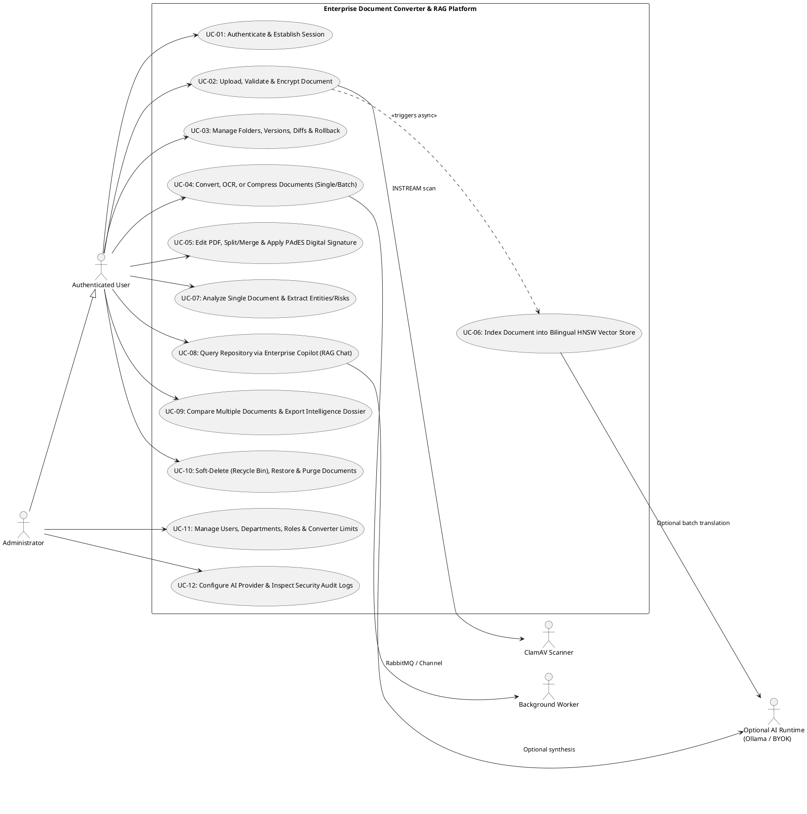
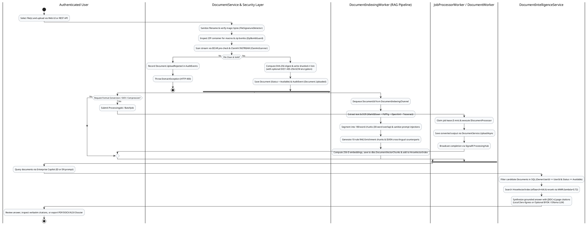

# Requirements Analysis

**Purpose:** Reconstruct and formalize the stakeholder analysis, actor descriptions, functional requirements (`FR-*`), non-functional requirements (`NFR-*`), use case specifications (`UC-*`), and business process workflows from the implemented system, with full traceability to implementing source modules.  
**Scope:** System-wide requirements analysis supporting both the undergraduate Information Systems Final Project (*Tugas Akhir*) and engineering handover.  
**Evidence status:** `Code-verified` (derived directly from implemented endpoints, domain entities, application services, security controls, and tests). Organizational stakeholder roles outside the codebase are marked `Inferred (Requires confirmation)`.  
**Last reviewed:** 2026-11-05

---

## 1. Stakeholder Analysis

| Stakeholder ID | Stakeholder Group | Role / Interest in the System | Key Concerns | Verification Status |
|---|---|---|---|---|
| **SH-01** | **Knowledge Workers / Business Analysts / Legal & Finance Staff** | Primary end users who upload, organize, convert, edit, digitally sign, compare, and query documents via Enterprise Copilot. | High conversion fidelity, fast semantic search across Indonesian & English documents, accurate page citations, and confidential document isolation. | `Code-verified` (Personas in `CopilotPersonas` in `DocumentIntelligenceDtos.cs`; workflows in `Documents.razor`, `Copilot.razor`, `PdfEditor.razor`) |
| **SH-02** | **System & Security Administrators** | Manage users, roles, departments, converter resource limits, AI provider settings (Zero-Egress vs. BYOK/Ollama), and review `dbo.AuditEvents`. | Malware prevention, zero unauthorized data egress, rate limiting, auditability, and operational stability. | `Code-verified` (`AdminService.cs`, `UsersAndDepartments.razor`, `ConvertersCatalog.razor`, `SystemSettings.razor`, `SecurityAuditLog.razor`) |
| **SH-03** | **Data Protection & Governance Officers** | Oversee document lifecycle, cryptographic integrity (`SHA-256` and PAdES signatures), encryption at rest (`DCE1`), and prompt-injection defense. | Tamper detection, tenant/user isolation (IDOR prevention), retention policy enforcement, and AI grounding faithfulness. | `Code-verified` (Controls in `PdfDigitalSignatureService.cs`, `AesGcmStorageEncryptionService.cs`, `DocumentIntelligenceService.cs`); organizational policy `Requires confirmation` |
| **SH-04** | **DevOps / Infrastructure Engineers** | Deploy, configure, monitor, and back up the containerized stack (`dc-web`, `dc-document-worker`, `dc-sqlserver`, `dc-rabbitmq`, `dc-clamav`). | Reproducible CI/CD builds, health checks (`/health`), container resource limits, and zero-egress internal networking (`dc-internal`). | `Code-verified` (`docker-compose.prod.yml`, `.github/workflows/deploy.yml`, `DEPLOYMENT.md`) |

---

## 2. Actor Descriptions

| Actor | Type | Authentication / Authorization | Capabilities in Codebase | Evidence |
|---|---|---|---|---|
| **Anonymous Visitor** | Human | Unauthenticated | Access `/account/login`, submit local credentials (`POST /api/account/login`) or initiate OIDC challenge (`GET /api/account/external-login`), and query container health (`GET /health`). Redirected to `/account/login` for all other routes via `RedirectToLogin.razor` or HTTP `401`. | `src/DocumentConverter.Web/Endpoints/AccountEndpoints.cs`, `Components/RedirectToLogin.razor` |
| **Authenticated User (`User`)** | Human | Cookie / OIDC session with `dc:uid` claim (`HttpContextUserContext.UserId`) | Upload, download, organize folders, version, diff, rollback, soft-delete, restore, and purge **own** documents; submit single/batch conversion, OCR, compression, split, and merge jobs; edit and digitally sign PDFs; use Single-Document AI and Enterprise Copilot (`SemanticSearchRepositoryAsync`, multi-doc comparison, Knowledge Graph, persistent chat & memories). | `src/DocumentConverter.Web/Authentication/AppClaimsTransformation.cs`, `Endpoints/DocumentEndpoints.cs`, `Endpoints/DocumentIntelligenceEndpoints.cs` |
| **Administrator (`Administrator`)** | Human | Authenticated User with `ClaimTypes.Role = "Administrator"` (`AdminOnly` policy) | All `User` capabilities plus: create/enable/disable users, assign roles and departments, enable/disable converters, configure converter `MaxInputSizeBytes` and `MaxPages`, update `dbo.SystemSettings` (including global AI provider settings via `POST /api/ai/config`), and inspect `dbo.AuditEvents`. | `src/DocumentConverter.Web/Program.cs` (`AdminOnly` policy), `src/DocumentConverter.Infrastructure/Admin/AdminService.cs` |
| **Background Worker (`JobProcessorWorker` / `DocumentWorker`)** | System | Internal service scope (`IUserContext.UserId == null`) | Polls/consumes `JobMessage` from RabbitMQ (`document-jobs`) or in-memory channel, claims `ProcessingJob` with a 5-minute lease, executes the mapped `IDocumentProcessor`, saves converted output as a new `Document`, and broadcasts progress via SignalR (`ProcessingHub`). | `src/DocumentConverter.Web/HostedServices/JobProcessorWorker.cs`, `src/Workers/DocumentWorker/Worker.cs` |
| **RAG Indexing Worker (`DocumentIndexingWorker`)** | System | Internal hosted service scope | Hydrates persisted `dbo.DocumentVectorChunks` into `HnswVectorIndex` at startup, then consumes `DocumentId` items from `DocumentIndexingChannel` (2 concurrent workers) to extract text/OCR, chunk, enrich, translate (`id`/`en`), embed, and persist vectors. | `src/DocumentConverter.Web/HostedServices/DocumentIndexingWorker.cs`, `src/DocumentConverter.Infrastructure/AI/DocumentIndexingChannel.cs` |
| **External / Local AI Provider** | External System | Outbound HTTPS / HTTP from `ExternalAiClient` | Optional OpenAI, Anthropic Claude, Google Gemini, Groq, or Custom/Local OpenAI-compatible runtime (e.g., Ollama at `http://localhost:11434/v1`) invoked only when `AI.CloudEnabled = true` or per-user BYOK override is active. | `src/DocumentConverter.Infrastructure/AI/ExternalAiClient.cs` |
| **ClamAV Daemon (`clamd`)** | External System | Internal TCP socket (`clamav:3310`) | Receives raw file streams via the `zINSTREAM\0` protocol during upload and version addition; returns `OK` or `FOUND`. | `src/DocumentConverter.Infrastructure/Security/ClamAvScanner.cs` |

---

## 3. Functional Requirements Catalog and Module Traceability

Every functional requirement below is verified against the codebase and mapped to its implementing module and primary source files.

### 3.1 Authentication, Authorization, and User Management (`FR-AUTH`, `FR-USER`)

| Req ID | Requirement Description | Status | Implementing Module & Evidence |
|---|---|---|---|
| **FR-AUTH-01** | The system shall authenticate local users via email and password using ASP.NET Core Identity (`SignInManager<AppIdentityUser>`) with rate limiting (`auth` policy: 10 requests/minute/IP) and lockout after 5 failed attempts for 15 minutes. | Implemented (`Code-verified`) | [01-Authentication & Authorization](../04-modules/01-authentication-and-authorization.md) — `Program.cs`, `AccountEndpoints.cs` |
| **FR-AUTH-02** | The system shall support optional OpenID Connect (OIDC) federation when `Auth:UseOidc = true` and automatically provision (JIT) a corresponding domain `User` record in `dbo.Users` upon first login, emitting a stable internal `dc:uid` claim. | Implemented (`Code-verified`) | [01-Authentication & Authorization](../04-modules/01-authentication-and-authorization.md) — `Program.cs`, `AppClaimsTransformation.cs` |
| **FR-AUTH-03** | The system shall enforce role-based access control (`Administrator` vs. `User`) and strict owner-based resource authorization (`OwnerUserId == UserId`) across all document, folder, job, and RAG operations. | Implemented (`Code-verified`) | [01-Authentication & Authorization](../04-modules/01-authentication-and-authorization.md) — `HttpContextUserContext.cs`, `DocumentService.cs`, `DocumentIntelligenceService.cs` |
| **FR-USER-01** | Administrators shall be able to list users, create new local users with department and role assignments, toggle user active status (`IsActive`), change user roles (`Administrator`/`User`), and assign users to departments (`dbo.Departments`). | Implemented (`Code-verified`) | [02-User & Role Management](../04-modules/02-user-and-role-management.md) — `AdminService.cs`, `UsersAndDepartments.razor` |

### 3.2 Document Upload, Security Screening, and Storage (`FR-DOC`)

| Req ID | Requirement Description | Status | Implementing Module & Evidence |
|---|---|---|---|
| **FR-DOC-01** | The system shall sanitize uploaded filenames (`FileNameSanitizer`), verify magic-byte file signatures against declared extensions (`FileSignatureDetector`), and inspect ZIP-based containers (`.docx`, `.xlsx`, `.pptx`, `.odt`, `.ods`, `.odp`, `.epub`) for path traversal, macro binaries (`vbaProject.bin`), and decompression bombs (`>500 MB`, ratio `>50:1`, or `>5,000` entries via `ZipBombGuard`). | Implemented (`Code-verified`) | [03-Document Upload & Storage](../04-modules/03-document-upload-and-storage.md) — `DocumentService.UploadAsync`, `FileSignatureDetector.cs`, `ZipBombGuard.cs` |
| **FR-DOC-02** | The system shall scan all uploaded files and new versions for malware using an in-memory EICAR signature detector (`EicarSignatureDetector`) and ClamAV TCP `INSTREAM` (`ClamAvScanner`), failing closed and recording an audit event (`Document.UploadRejected` / `Document.VersionRejected`) if a threat is detected or the scanner is unreachable when enabled. | Implemented (`Code-verified`) | [03-Document Upload & Storage](../04-modules/03-document-upload-and-storage.md) — `ClamAvScanner.cs`, `EicarSignatureDetector.cs`, `DocumentService.cs` |
| **FR-DOC-03** | The system shall compute a lowercase 64-character `SHA-256` hex digest (`Sha256Hex`) for every stored document version and persist files in a two-level sharded directory hierarchy (`{id[0..2]}/{id[2..4]}/{id:N}/v{versionNumber}.bin`). | Implemented (`Code-verified`) | [03-Document Upload & Storage](../04-modules/03-document-upload-and-storage.md) — `FileSystemDocumentStorage.cs`, `DocumentService.cs` |
| **FR-DOC-04** | When `Storage:Encryption:Enabled = true`, the system shall encrypt every stored file using AES-256-GCM envelope encryption with a unique 256-bit per-file Data Encryption Key (DEK) wrapped by the 256-bit Master Key (KEK) under the `DCE1` binary format, and transparently decrypt upon read while maintaining backward compatibility for unencrypted legacy files. | Implemented (`Code-verified`) | [03-Document Upload & Storage](../04-modules/03-document-upload-and-storage.md) — `AesGcmStorageEncryptionService.cs`, `FileSystemDocumentStorage.cs` |

### 3.3 Document Management, Versioning, PDF Editing, and Digital Signatures (`FR-MGT`, `FR-VER`, `FR-EDIT`, `FR-SIGN`)

| Req ID | Requirement Description | Status | Implementing Module & Evidence |
|---|---|---|---|
| **FR-MGT-01** | Authenticated users shall be able to organize documents into nested folders (`dbo.Folders`), rename and move documents/folders, perform batch moves and batch ZIP downloads, and filter documents by folder, status, or search term. | Implemented (`Code-verified`) | [05-Document Management & Editor](../04-modules/05-document-management-and-editor.md) — `DocumentService.cs`, `DocumentEndpoints.cs`, `Documents.razor` |
| **FR-MGT-02** | Authenticated users shall be able to split PDF documents using three modes (`divide_two`, `extract_range`, `burst_all`) and merge multiple PDFs (with optional page-range selection and ordering) into a new tracked repository document. | Implemented (`Code-verified`) | [05-Document Management & Editor](../04-modules/05-document-management-and-editor.md) — `DocumentService.SplitPdfAsync`, `DocumentService.MergeDocumentsAsync` |
| **FR-VER-01** | The system shall maintain an immutable version history (`dbo.DocumentVersions`) for each document, supporting new version uploads, downloading specific historical versions, line-by-line text comparison between any two versions (`CompareVersionsAsync`) or two distinct documents (`CompareDocumentsAsync`), and non-destructive version rollback (`RollbackVersionAsync`, which creates a new version `N+1` copying the target historical version's content). | Implemented (`Code-verified`) | [06-Document Versioning](../04-modules/06-document-versioning.md) — `DocumentService.cs`, `Document.cs` |
| **FR-EDIT-01** | The system shall provide an interactive browser-based PDF editor (`/editor/{DocumentId:guid}`) supporting page structure operations (rotate, delete, duplicate, move, insert blank page, extract pages, merge pages), visual annotations (text, highlight, underline, strikethrough, shapes, freehand ink, sticky notes, business stamps, watermarks, opaque blackout/whiteout redactions with metadata scrubbing), AcroForm field creation/filling, password protection (`ProtectDocumentAsync`), and saving edits either as a new version (`commit-version`) or a new document (`save-as-new`). | Implemented (`Code-verified`) | [05-Document Management & Editor](../04-modules/05-document-management-and-editor.md) — `PdfEngine.cs`, `EditorEndpoints.cs`, `PdfEditor.razor` |
| **FR-SIGN-01** | The system shall cryptographically sign PDF documents using PAdES / ISO 32000-1 detached PKCS#7 / CMS signatures (`/SubFilter /adbe.pkcs7.detached`, SHA-256 digest) via PDF incremental updates (preserving multi-signer byte ranges), using either a user-supplied `.pfx`/`.p12` X.509 certificate or an auto-generated 2048-bit RSA enterprise certificate, and verify signature integrity and tampering (`VerifySignaturesAsync`). | Implemented (`Code-verified`) | [05-Document Management & Editor](../04-modules/05-document-management-and-editor.md) — `PdfDigitalSignatureService.cs`, `DocumentEndpoints.cs` |

### 3.4 Document Conversion, OCR, and Compression (`FR-CONV`)

| Req ID | Requirement Description | Status | Implementing Module & Evidence |
|---|---|---|---|
| **FR-CONV-01** | The system shall provide a catalog of 17 configurable converters (`dbo.Converters`) supporting synchronous and asynchronous conversion across Office documents (`.docx`, `.xlsx`, `.pptx`, `.csv`), web/text formats (`.md`, `.html`, `.txt`), e-books (`.epub`, `.mobi`), images (`.png`, `.jpg`, `.webp`, `.bmp`, `.tiff`), and PDFs. | Implemented (`Code-verified`) | [04-Document Conversion](../04-modules/04-document-conversion.md) — `DbSeeder.cs`, `OfficeDocumentProcessor.cs`, `PdfDocumentProcessor.cs`, `ImageDocumentProcessor.cs` |
| **FR-CONV-02** | The system shall support single-document and batch conversion jobs (`dbo.BatchJobs`, `dbo.ProcessingJobs`) with lease-based worker claiming (`Claim`), attempt tracking (`dbo.ProcessingAttempts`), real-time progress notifications via SignalR (`ProcessingHub`), pre-conversion PDF capability/fidelity analysis (`PdfCapabilityAnalyzer`), and compression size estimation (`CompressionEstimatorService`). | Implemented (`Code-verified`) | [04-Document Conversion](../04-modules/04-document-conversion.md) — `ProcessingService.cs`, `JobProcessorWorker.cs`, `Worker.cs`, `ProcessingEndpoints.cs` |
| **FR-CONV-03** | The system shall detect scanned PDFs (`ScannedPdfDetector`) and execute Optical Character Recognition (`TesseractOcrEngine` with `OcrDocumentProcessor`) to convert scanned PDFs or images into searchable PDFs or plain text. | Implemented (`Code-verified`) | [04-Document Conversion](../04-modules/04-document-conversion.md) — `OcrDocumentProcessor.cs`, `TesseractOcrEngine.cs`, `ScannedPdfDetector.cs` |

### 3.5 RAG Knowledge Management and Enterprise Copilot (`FR-RAG`)

| Req ID | Requirement Description | Status | Implementing Module & Evidence |
|---|---|---|---|
| **FR-RAG-01** | Upon document upload or in-web conversion completion (or on demand), the system shall asynchronously extract text and embedded image OCR across pages/slides/sheets (`ManagedCode.MarkItDown`, `PdfPig`, `OpenXml`, `Tesseract`), segment text into 180-word chunks with 30-word overlap, sanitize prompt-injection directives (`SanitizeUntrustedChunkData`), and generate paired `Actual Document` and 10-rule `RAG Enrichment` chunks. | Implemented (`Code-verified`) | [09-RAG Knowledge Management](../04-modules/09-rag-knowledge-management.md), [RAG Technical Documentation](../08-rag/rag-technical-documentation.md) — `DocumentIntelligenceService.cs`, `DocumentIndexingWorker.cs` |
| **FR-RAG-02** | The system shall detect chunk language (`id` vs. `en` via `DocumentLanguageDetector`) and generate cross-lingual translated counterpart chunks (`MultilingualChunkProcessor`) linked via `ParentChunkId` so Indonesian queries retrieve English documents and English queries retrieve Indonesian documents. | Implemented (`Code-verified`) | [09-RAG Knowledge Management](../04-modules/09-rag-knowledge-management.md), [RAG Technical Documentation](../08-rag/rag-technical-documentation.md) — `DocumentLanguageDetector.cs`, `MultilingualChunkProcessor.cs` |
| **FR-RAG-03** | The system shall compute 256-dimensional normalized embeddings (`ComputeEmbedding`), persist them to `dbo.DocumentVectorChunks` (`varbinary(1024)`) and `dbo.DocumentIntelligenceIndices`, and index them in `HnswVectorIndex` (`M=16`, `efConstruction=64`, `efSearch=64`) for fast owner-filtered similarity search with Maximal Marginal Relevance (`lambda=0.72`) diversity reranking. | Implemented (`Code-verified`) | [09-RAG Knowledge Management](../04-modules/09-rag-knowledge-management.md), [RAG Technical Documentation](../08-rag/rag-technical-documentation.md) — `DocumentIntelligenceService.cs`, `HnswVectorIndex.cs` |
| **FR-RAG-04** | The system shall provide Single-Document Intelligence (classification across 8 categories, executive summary, key points, action items, named entities, risk/PII/clause flags, Q&A) and Repository-wide Enterprise Copilot (multi-turn persistent chat `dbo.CopilotChatSessions`, long-term user memory `dbo.CopilotMemoryItems`, 5 specialist personas, multi-document comparison matrices, Enterprise Knowledge Graph & financial obligations tracker, and PDF/DOCX/XLSX/MD dossier export via `CopilotDossierExporter`). | Implemented (`Code-verified`) | [09-RAG Knowledge Management](../04-modules/09-rag-knowledge-management.md) — `DocumentIntelligenceService.cs`, `CopilotDossierExporter.cs`, `EnterpriseAiChatService.cs` |

### 3.6 Audit Logging, Retention, Deletion, and Administration (`FR-AUD`, `FR-RET`, `FR-ADM`)

| Req ID | Requirement Description | Status | Implementing Module & Evidence |
|---|---|---|---|
| **FR-AUD-01** | The system shall record append-only audit events in `dbo.AuditEvents` capturing `Id`, `UserId`, `EventType`, `ResourceType`, `ResourceId`, `IpAddress`, `Metadata` (JSON), and `OccurredAt` for document uploads, rejections, downloads, version operations, soft-deletes, restores, purges, job submissions/cancellations, and administrative actions. | Implemented (`Code-verified`) | [07-Audit Logging](../04-modules/07-audit-logging.md) — `AuditService.cs`, `AdminService.cs`, `SecurityAuditLog.razor` |
| **FR-RET-01** | The system shall support a two-stage deletion workflow: soft-deletion (`Status = Deleted`, moving documents to the Recycle Bin where downloads are blocked and restoration to `Available` is supported) and permanent purging (`PurgeDocumentAsync` / `EmptyRecycleBinAsync`, setting `Status = Purged` and deleting all physical version blobs from disk). | Implemented (`Code-verified`) | [08-Retention & Deletion](../04-modules/08-retention-and-deletion.md) — `DocumentService.cs`, `Document.cs` |
| **FR-RET-02** | The system shall automatically purge or archive documents whose `ExpiresAt` timestamp or `Retention.Days` (`90` days) threshold has elapsed, and cascade-clean derived RAG vector chunks and in-memory caches upon soft-delete/purge. | **Partially Implemented** (`Code-verified` gap: `Retention.Days` setting and `ExpiresAt` column exist, but no background expiration job or vector cache eviction on purge is implemented) | [08-Retention & Deletion](../04-modules/08-retention-and-deletion.md) — `DbSeeder.cs`, `Document.cs`, `DocumentService.PurgeDocumentAsync` |
| **FR-ADM-01** | Administrators shall be able to view and filter audit logs, enable/disable converters, adjust converter file size and page limits, and modify key-value system settings in `dbo.SystemSettings`. | Implemented (`Code-verified`) | [10-Administrative Functionality](../04-modules/10-administrative-functionality.md) — `AdminService.cs`, `Components/Pages/Admin/*.razor` |

---

## 4. Non-Functional Requirements Catalog (`NFR-*`)

| NFR ID | Category | Requirement Specification | Implementation Evidence & Verification Status |
|---|---|---|---|
| **NFR-SEC-01** | **Data Sovereignty / Zero-Egress** | By default, document processing, OCR, storage, and RAG indexing/retrieval must operate with zero outbound internet traffic. | `Code-verified`: `AI.CloudEnabled = "false"` in `DbSeeder.cs`; `dc-internal` Docker bridge configured with `internal: true` in `docker-compose.yml` and `docker-compose.prod.yml`; CSP in `SecurityHeadersMiddleware.cs` restricts all assets to `'self'`. |
| **NFR-SEC-02** | **Encryption at Rest & Tamper Detection** | Stored document binaries must support authenticated encryption at rest that detects ciphertext or tag tampering. | `Code-verified` & `Runtime-verified`: `AesGcmStorageEncryptionService.cs` implements AES-256-GCM envelope encryption (`DCE1` header, 96-bit nonces, 128-bit tags); verified by `Milestone8SecurityHardeningTests`. |
| **NFR-SEC-03** | **Rate Limiting & Abuse Protection** | Authentication, upload, and job creation APIs must enforce per-IP rate limiting and request body size limits. | `Code-verified`: `Program.cs` configures fixed-window rate limiters (`auth`: 10/min, `upload`: 30/min, `jobs`: 60/min, HTTP `429`) and `MaxRequestBodySize = 104,857,600` (100 MB). |
| **NFR-SEC-04** | **Prompt-Injection Resilience** | Untrusted document text ingested into the RAG pipeline must be sanitized against instruction-override directives before indexing and LLM prompting. | `Code-verified` & `Runtime-verified`: `DocumentIntelligenceService.SanitizeUntrustedChunkData` redacts 5 regex directive patterns to `[UNTRUSTED_DIRECTIVE_REDACTED]`; verified by `EnrichChunkForRag_ShouldFollowAllTenRagEnrichmentRulesAndSerializeValidJson`. |
| **NFR-REL-01** | **Graceful Degradation & Fallback** | If external dependencies (RabbitMQ or external Cloud LLM APIs) are unavailable, the system must fall back to local in-process mechanisms without dropping jobs or failing user queries. | `Code-verified` & `Runtime-verified`: `RabbitMqJobDispatcher.cs` falls back to `Channel<JobMessage>`; `DocumentIntelligenceService.cs` catches `ExternalAiClient` exceptions and falls back to local zero-egress synthesis (`AskQuestionOnStreamAsync_WhenExternalAiThrows_ShouldGracefullyFallbackToLocalZeroEgress`). |
| **NFR-REL-02** | **Worker Lease Recovery** | Interrupted background conversion jobs must be recoverable after lease expiration and bounded by a maximum retry count. | `Code-verified`: `JobProcessorWorker.cs` and `Worker.cs` claim jobs with a 5-minute lease (`LeaseDuration = 5 min`) and recover expired leases up to `MaxAttempts = 3`. |
| **NFR-ARCH-01** | **Clean Layer Dependency Direction** | The `Domain` layer must have zero dependencies on `Application`, `Infrastructure`, `Web`, EF Core, Blazor, or RabbitMQ; `Application` must not depend on `Infrastructure` or `Web`. | `Code-verified` & `Runtime-verified`: Enforced by `ArchitectureTests.cs` (`NetArchTest.Rules`). |
| **NFR-PORT-01** | **Containerized Resource Isolation** | Background worker containers must run as non-root (`USER $APP_UID`), enforce `no-new-privileges:true`, and cap CPU/RAM consumption (`2.0` CPUs, `2048M` RAM). | `Code-verified`: `src/Workers/DocumentWorker/Dockerfile`, `docker-compose.yml`, `docker-compose.prod.yml`. |

---

## 5. Use Case Specifications

### 5.1 System Use Case Diagram

**Diagram Explanation & Evidence**
- Depicts the 12 core use cases implemented across `DocumentConverter.Web` and `DocumentConverter.Infrastructure`. `Administrator` inherits all `Authenticated User` use cases and adds `UC-11` and `UC-12` (enforced via `RequireAuthorization("AdminOnly")` and `[Authorize(Policy = "AdminOnly")]`).

### 5.2 Detailed Use Case Specifications (`UC-01` through `UC-12`)

#### UC-01: Authenticate & Establish Session
- **Actors:** Anonymous Visitor, Optional OIDC Identity Provider
- **Preconditions:** Application database is migrated and seeded (`DbSeeder.SeedAsync`).
- **Main Flow:**
  1. User navigates to `/account/login` (`Login.razor`) and submits email and password to `POST /api/account/login` (or selects SSO via `GET /api/account/external-login`).
  2. `AccountEndpoints` verifies the user's `IsActive` status in `dbo.Users` and validates credentials via `SignInManager<AppIdentityUser>.PasswordSignInAsync` (`lockoutOnFailure: true`).
  3. Upon authentication, `AppClaimsTransformation.TransformAsync` resolves or JIT-provisions the domain `User` in `dbo.Users`, attaches the `dc:uid` claim (`HttpContextUserContext.UserIdClaimType`) and `ClaimTypes.Role` claims, and redirects to `/`.
- **Postconditions:** Encrypted HTTP-only session cookie (`.DocumentConverter.Auth`, 8-hour sliding expiration) is issued.
- **Exception Flows:** Invalid credentials increment access failed count (lockout for 15 minutes after 5 attempts) and redirect to `/account/login?error=invalid`; deactivated user redirects with `error=locked`; exceeding 10 requests/min returns HTTP `429`.
- **Evidence:** `src/DocumentConverter.Web/Endpoints/AccountEndpoints.cs`, `src/DocumentConverter.Web/Authentication/AppClaimsTransformation.cs`.

#### UC-02: Upload, Validate, Scan & Encrypt Document
- **Actors:** Authenticated User, ClamAV Daemon (`clamd`), `DocumentIndexingChannel`
- **Preconditions:** User is authenticated (`dc:uid` present).
- **Main Flow:**
  1. User uploads a file via `UploadDialog.razor` or `POST /api/documents` (`multipart/form-data`, rate-limited to 30/min).
  2. `DocumentService.UploadAsync` sanitizes the filename (`FileNameSanitizer`), copies the stream into memory, checks non-zero length, verifies magic bytes against the declared extension (`FileSignatureDetector.MatchesDeclaredType`), and validates ZIP-based Office/e-book archives via `ZipBombGuard.ValidateZipStream` (`allowMacros: false`).
  3. `DocumentService` creates a `Document` aggregate (`Status = Uploaded`, Version 1), transitions it to `Scanning`, and invokes `IMalwareScanner.ScanAsync` (`EicarSignatureDetector` + `ClamAvScanner`).
  4. Upon clean scan, `DocumentService` computes the `SHA-256` hash (`Sha256Hex`), saves the binary via `FileSystemDocumentStorage.SaveAsync` (which applies `AesGcmStorageEncryptionService` `DCE1` envelope encryption if `Storage:Encryption:Enabled = true`), marks the document `Available`, commits to `AppDbContext`, records `Document.Uploaded` in `dbo.AuditEvents`, and enqueues the document ID to `IDocumentIndexingChannel.TryQueueDocument`.
- **Postconditions:** Document metadata and Version 1 are persisted in `dbo.Documents` and `dbo.DocumentVersions`; binary is stored on disk; asynchronous RAG indexing is queued.
- **Exception Flows:** Magic-byte mismatch, macro/ZIP-bomb detection, or malware detection throws `DomainException` (HTTP `400`), aborts storage write, and (for malware) records `Document.UploadRejected` in `dbo.AuditEvents`.
- **Evidence:** `src/DocumentConverter.Infrastructure/Documents/DocumentService.cs` (`UploadAsync`), `src/DocumentConverter.Infrastructure/Storage/FileSystemDocumentStorage.cs`.

#### UC-03: Manage Folders, Versions, Diffs & Rollback
- **Actors:** Authenticated User
- **Preconditions:** User owns the target document(s) and folder(s).
- **Main Flow:**
  1. User creates/renames/deletes folders (`/api/folders`) or moves/renames documents (`/api/documents/{id}/move`, `/rename`).
  2. User uploads a revised file to `POST /api/documents/{id}/versions` (`DocumentService.AddVersionAsync`), which runs the full magic-byte, ZIP-bomb, and malware scan pipeline, stores `v{N+1}.bin`, marks previous versions `IsCurrent = false`, and promotes `v{N+1}` as `IsCurrent = true`.
  3. User compares any two versions (`GET /api/documents/{id}/versions/diff?v1=1&v2=2`) or two documents (`POST /api/documents/compare`), executing LCS line-by-line text diffing (`ComputeLineDiff`).
  4. User triggers rollback (`POST /api/documents/{id}/versions/{versionNumber}/rollback`), which opens the target historical version stream and creates a new current version `N+1` with identical content and `SHA-256` hash.
- **Postconditions:** Version history remains append-only; audit events (`Document.VersionAdded`, `Document.VersionRollback`) are recorded.
- **Evidence:** `src/DocumentConverter.Infrastructure/Documents/DocumentService.cs` (`AddVersionAsync`, `RollbackVersionAsync`, `CompareVersionsAsync`).

#### UC-04: Convert, OCR, or Compress Documents (Single & Batch)
- **Actors:** Authenticated User, `JobProcessorWorker` / `DocumentWorker`, SignalR `ProcessingHub`
- **Preconditions:** Input document is `Available` and owned by the user; selected `Converter` is enabled (`IsEnabled = true`) and supports the input extension and file size (`MaxInputSizeBytes`).
- **Main Flow:**
  1. Optionally, user inspects PDF conversion fidelity (`GET /api/processing/analyze-pdf/{documentId}`) or previews compression savings (`POST /api/processing/compression-preview/{documentId}`).
  2. User submits a single job (`POST /api/processing/jobs`) or batch job (`POST /api/processing/batches`).
  3. `ProcessingService` validates ownership and converter constraints, persists `ProcessingJob` (and `BatchJob` if batch) in `Pending` status, records `ProcessingJob.Submitted` in `dbo.AuditEvents`, and `ProcessingEndpoints` publishes a `JobMessage` via `IJobQueuePublisher.PublishJobAsync`.
  4. `JobProcessorWorker` or `DocumentWorker` claims the job (`job.Claim` with 5-minute lease), resolves the matching `IDocumentProcessor` (`OfficeDocumentProcessor`, `PdfDocumentProcessor`, `ImageDocumentProcessor`, `OcrDocumentProcessor`, `PdfCompressProcessor`, or `ImageCompressProcessor`), executes the transformation in a temporary working directory, uploads the output as a new `Document` via `IDocumentService.UploadAsync`, marks the job `Completed`, and broadcasts completion via SignalR (`IJobNotificationService`).
- **Postconditions:** Output document is stored in the user's repository (`OutputDocumentId`) and linked in `dbo.ProcessingJobOutputs`.
- **Evidence:** `src/DocumentConverter.Infrastructure/Processing/ProcessingService.cs`, `src/DocumentConverter.Web/HostedServices/JobProcessorWorker.cs`, `src/Workers/DocumentWorker/Worker.cs`.

#### UC-05: Edit PDF, Split/Merge & Apply PAdES Digital Signature
- **Actors:** Authenticated User
- **Preconditions:** Target document is a valid PDF owned by the user.
- **Main Flow:**
  1. **Interactive Edit:** User opens `/editor/{DocumentId:guid}`, applies page mutations, annotations, redactions, form fields, or password protection (`POST /api/editor/documents/{id}/apply`, `/protect`), and commits changes as a new version (`POST /api/editor/documents/{id}/commit-version`) or new document (`/save-as-new`).
  2. **Split / Merge:** User splits a PDF (`POST /api/documents/{id}/split` in `divide_two`, `extract_range`, or `burst_all` mode) or merges multiple PDFs (`POST /api/documents/merge`).
  3. **Digital Signature:** User signs a stored PDF (`POST /api/documents/{id}/signatures/sign`) or ad-hoc PDF (`POST /api/documents/signatures/sign-stream`). `PdfDigitalSignatureService` optionally stamps a visible signature badge (if no prior signatures exist), appends an incremental PDF update with `/Type /Sig` and `/SubFilter /adbe.pkcs7.detached`, signs the `ByteRange` SHA-256 digest using `SignedCms`, and saves the signed PDF as a new document version (`{name}_signed.pdf`).
  4. **Signature Verification:** User verifies signatures via `GET /api/documents/{id}/signatures/verify`, which parses all `/ByteRange` entries and executes `SignedCms.CheckSignature(verifySignatureOnly: true)` to detect any post-signing byte alteration.
- **Postconditions:** Modified or signed PDF is stored as a new version or new repository document.
- **Evidence:** `src/DocumentConverter.Infrastructure/Editor/PdfEngine.cs`, `src/DocumentConverter.Infrastructure/Documents/PdfDigitalSignatureService.cs`, `src/DocumentConverter.Web/Endpoints/EditorEndpoints.cs`.

#### UC-06: Index Document into Bilingual HNSW Vector Store
- **Actors:** `DocumentIndexingWorker`, `DocumentIntelligenceService`, `MultilingualChunkProcessor`
- **Preconditions:** Document ID is queued in `DocumentIndexingChannel` or triggered via `EnsureDocumentIndexedAsync` / `ReindexDocumentAsync`.
- **Main Flow:**
  1. `DocumentIndexingWorker` dequeues `documentId` and calls `IDocumentIntelligenceService.EnsureDocumentIndexedAsync(documentId)`.
  2. `DocumentIntelligenceService` downloads the current document stream, extracts text per page/slide/sheet (`ExtractPagesFromStream` using MarkItDown, PdfPig, OpenXml, and Tesseract OCR), and builds 180-word sliding-window chunks (`BuildSemanticChunks`).
  3. Each chunk is sanitized against prompt injection (`SanitizeUntrustedChunkData`), paired with a 10-rule `RAG Enrichment` chunk (`EnrichChunkForRag`), and expanded with cross-lingual `id`/`en` translated counterpart chunks (`MultilingualChunkProcessor.GenerateCrossLingualChunksAsync`).
  4. Each chunk is embedded into a 256-dimensional unit vector (`ComputeEmbedding`), persisted in `dbo.DocumentVectorChunks` and `dbo.DocumentIntelligenceIndices`, and added to `GlobalHnswIndex` (`HnswVectorIndex.Add`).
- **Postconditions:** Document chunks and pre-computed insights are persisted in SQL Server and searchable in `HnswVectorIndex`.
- **Evidence:** `src/DocumentConverter.Web/HostedServices/DocumentIndexingWorker.cs`, `src/DocumentConverter.Infrastructure/AI/DocumentIntelligenceService.cs`.

#### UC-07: Analyze Single Document & Extract Entities/Risks
- **Actors:** Authenticated User
- **Preconditions:** User owns the target document.
- **Main Flow:**
  1. User opens the Document Intelligence dialog (`DocumentIntelligenceDialog.razor`) or calls `GET /api/ai/documents/{id}/analyze`.
  2. `DocumentIntelligenceService.AnalyzeDocumentAsync` verifies ownership (`EnsureUserHasDocumentAccessAsync`), returns cached/persisted `DocumentInsightsDto` from `DocumentIndexCache` or `dbo.DocumentIntelligenceIndices` if available, or runs full extraction, 8-category classification (`ClassifyDocument`), executive summary generation, entity extraction (dates, monetary amounts, emails, governing law, parties), and risk/PII/clause flagging (`DetectClausesAndRisks`).
- **Postconditions:** `DocumentInsightsDto` is returned to the caller and cached.
- **Evidence:** `src/DocumentConverter.Infrastructure/AI/DocumentIntelligenceService.cs` (`AnalyzeDocumentAsync`, `AnalyzeDocumentStreamAsync`).

#### UC-08: Query Repository via Enterprise Copilot (RAG Chat)
- **Actors:** Authenticated User, Optional External/Local LLM (`ExternalAiClient`)
- **Preconditions:** User is authenticated and has indexed documents in their repository.
- **Main Flow:**
  1. User sends a question in `AiChatPage.razor` / `Copilot.razor` (`POST /api/ai/chat/messages` or `POST /api/ai/repository/ask`).
  2. `SendChatMessageAsync` loads or creates a `CopilotChatSession`, checks if the user prompt contains an explicit memory instruction (e.g., `"Remember that..."`) to extract into `dbo.CopilotMemoryItems`, and retrieves the user's `CopilotUserSettings` (persona, custom instructions, active memories, and optional per-user BYOK AI credentials).
  3. `AskRepositoryAsync` executes `SemanticSearchRepositoryAsync`:
     - **Stage 1 (SQL Coarse Filter):** Queries `dbo.Documents` where `Status == DocumentStatus.Available` and `OwnerUserId == currentUserId` (plus optional `FolderId`), selecting up to 100 candidate document IDs and priming up to 40 into `HnswVectorIndex`.
     - **Stage 2 (HNSW Beam Search):** Searches `GlobalHnswIndex` (`efSearch = 64`) restricted to `candidateDocumentIds`, applying lexical/identifier/translation score boosts.
     - **Stage 3 (MMR Reranking):** Applies Maximal Marginal Relevance (`lambda = 0.72`, max 2 chunks per document across multi-doc queries) to select diverse passages.
  4. If Cloud/External AI (or local Ollama) is enabled, `ExternalAiClient.SynthesizeAnswerAsync` is invoked with persona instructions, user memories, conversation history, and numbered source excerpts (`[DOC-1]`, `[DOC-2]`). If disabled or if the external call fails, the deterministic Zero-Egress extractive synthesizer (`SynthesizeRepositoryAnswer`) builds a grounded response.
  5. Both user and assistant messages (with JSON-serialized `GlobalSemanticCitationDto` citations and follow-up suggestions) are persisted in `dbo.CopilotChatMessages`.
- **Postconditions:** Grounded answer with page-level citations and confidence score is returned and saved in the chat session.
- **Evidence:** `src/DocumentConverter.Infrastructure/AI/DocumentIntelligenceService.cs` (`SendChatMessageAsync`, `AskRepositoryAsync`, `SemanticSearchRepositoryAsync`).

#### UC-09: Compare Multiple Documents & Export Intelligence Dossier
- **Actors:** Authenticated User
- **Preconditions:** User selects 2 to 5 owned documents for comparison or has an active Copilot synthesis/knowledge graph result.
- **Main Flow:**
  1. User invokes `POST /api/ai/repository/compare` (`CompareDocumentsAsync`) with `DocumentIds` and optional `CustomDimensions`.
  2. `DocumentIntelligenceService` evaluates 6 core dimensions (`Pricing & Payment Schedules`, `Term, Renewal & Termination`, `Liability & Indemnification`, `Confidentiality & IP`, `SLAs & Deliverables`, `Governing Law & Jurisdiction`) plus custom dimensions, computes substantive clause diffs (`Modified`, `Added`, `Removed`) and an `OverallAlignmentScore`, and optionally synthesizes an executive comparison via `ExternalAiClient`.
  3. User exports the comparison matrix, chat synthesis, or Enterprise Knowledge Graph via `POST /api/ai/export/dossier` or `GET /api/ai/export/financial-excel` (`CopilotDossierExporter`), generating a formatted `.pdf`, `.docx`, `.xlsx`, or `.md` file.
- **Postconditions:** Downloadable executive dossier or multi-sheet Excel financial tracker is returned.
- **Evidence:** `src/DocumentConverter.Infrastructure/AI/DocumentIntelligenceService.cs` (`CompareDocumentsAsync`), `src/DocumentConverter.Infrastructure/AI/CopilotDossierExporter.cs`.

#### UC-10: Soft-Delete (Recycle Bin), Restore & Purge Documents
- **Actors:** Authenticated User
- **Preconditions:** User owns the target document(s).
- **Main Flow:**
  1. User deletes a document (`DELETE /api/documents/{id}`) or batch (`POST /api/documents/batch-delete`). `DocumentService.DeleteAsync` transitions `Document.Status` from `Available` to `Deleted` (`DeletedAt = DateTime.UtcNow`) and records `Document.Deleted`.
  2. From the Recycle Bin view (`status=Deleted`), the user can either restore the document (`POST /api/documents/{id}/restore`, transitioning status back to `Available`) or permanently purge it (`DELETE /api/documents/{id}/purge` or `DELETE /api/documents/recycle-bin/empty`).
  3. On purge (`PurgeDocumentAsync`), `DocumentService` deletes every version's physical `.bin` file from `IDocumentStorage`, transitions `Document.Status` to `Purged`, and records `Document.Purged` in `dbo.AuditEvents`.
- **Postconditions:** Physical storage blobs are removed on purge; `Document` metadata record remains in `dbo.Documents` with `Status = Purged` for audit continuity.
- **Evidence:** `src/DocumentConverter.Infrastructure/Documents/DocumentService.cs` (`DeleteAsync`, `RestoreAsync`, `PurgeDocumentAsync`, `EmptyRecycleBinAsync`).

#### UC-11: Manage Users, Departments, Roles & Converter Limits
- **Actors:** Administrator
- **Preconditions:** User holds the `Administrator` role (`IUserContext.IsAdministrator == true`).
- **Main Flow:**
  1. Administrator navigates to `/admin/users` (`UsersAndDepartments.razor`) or `/admin/converters` (`ConvertersCatalog.razor`).
  2. `AdminService` verifies `EnsureAdmin()` before creating users (`CreateUserAsync`), toggling active status (`ToggleUserStatusAsync`), assigning roles (`SetUserRoleAsync`), creating departments (`CreateDepartmentAsync`), toggling converter availability (`ToggleConverterAsync`), or updating converter `MaxInputSizeBytes` and `MaxPages` (`UpdateConverterLimitsAsync`).
  3. Every administrative change is logged to `dbo.AuditEvents` (`Admin.UserCreated`, `Admin.UserRoleUpdated`, `Admin.ConverterToggled`, `Admin.ConverterLimitsUpdated`, etc.).
- **Postconditions:** Updated identity, role, department, or converter configuration is persisted in SQL Server and audited.
- **Evidence:** `src/DocumentConverter.Infrastructure/Admin/AdminService.cs`.

#### UC-12: Configure AI Provider & Inspect Security Audit Logs
- **Actors:** Administrator (or Authenticated User for personal BYOK override)
- **Preconditions:** User is an Administrator for global settings/audit logs (`AdminOnly`), or an authenticated user for personal Copilot BYOK settings.
- **Main Flow:**
  1. Administrator updates system settings in `/admin/settings` (`SystemSettings.razor`) or configures global AI provider settings (`POST /api/ai/config`, which enforces `userContext.IsAdministrator`), testing connectivity via `POST /api/ai/test-connection`.
  2. Alternatively, a non-admin user configures personal BYOK credentials in `dbo.CopilotUserSettings` via `POST /api/ai/config` (`SaveUserAiProviderOverrideAsync`), which applies only to that user's session without altering global `dbo.SystemSettings`.
  3. Administrator reviews and filters security/operational events in `/admin/audit-log` (`SecurityAuditLog.razor` -> `AdminService.GetAuditLogsAsync`).
- **Postconditions:** Global or per-user AI configuration is saved; audit trail is displayed (up to 500 matching events ordered by `OccurredAt DESC`).
- **Evidence:** `src/DocumentConverter.Web/Endpoints/DocumentIntelligenceEndpoints.cs` (`/api/ai/config`), `src/DocumentConverter.Infrastructure/Admin/AdminService.cs`.

---

## 6. Business Process Descriptions

### 6.1 End-to-End Document Ingestion, Conversion, and RAG Knowledge Retrieval Process

**Diagram Explanation & Evidence**
- Traces the complete operational workflow from initial file ingestion (`DocumentService.UploadAsync`) through parallel asynchronous vector indexing (`DocumentIndexingWorker`) and optional background format transformation (`JobProcessorWorker` / `DocumentWorker`), culminating in permission-filtered cross-lingual RAG retrieval (`SemanticSearchRepositoryAsync`) and dossier export (`CopilotDossierExporter`).

---

## 7. Related Documentation

- [Project Overview](../01-overview/project-overview.md)
- [System Architecture](../03-system-design/system-architecture.md)
- [Module Documentation Index](../04-modules/README.md)
- [RAG Technical Documentation](../08-rag/rag-technical-documentation.md)
- [Testing and Evaluation](../09-testing/testing-and-evaluation.md)
- [Academic Research Mapping](../11-research-mapping/academic-research-mapping.md)

