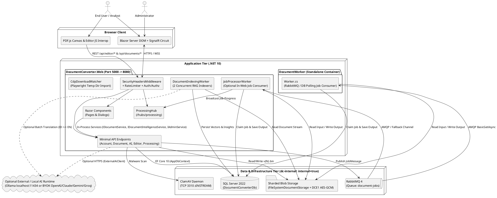
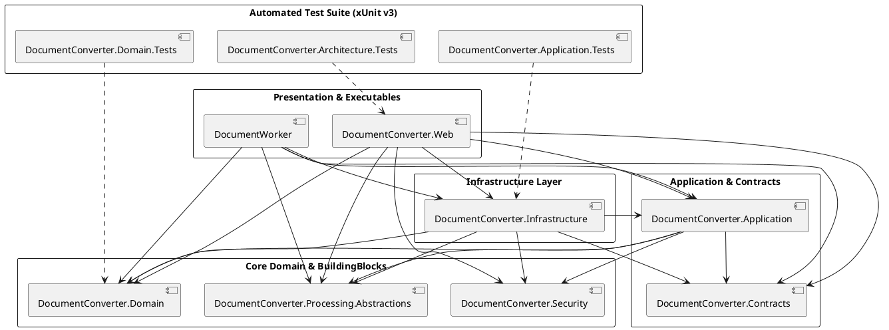
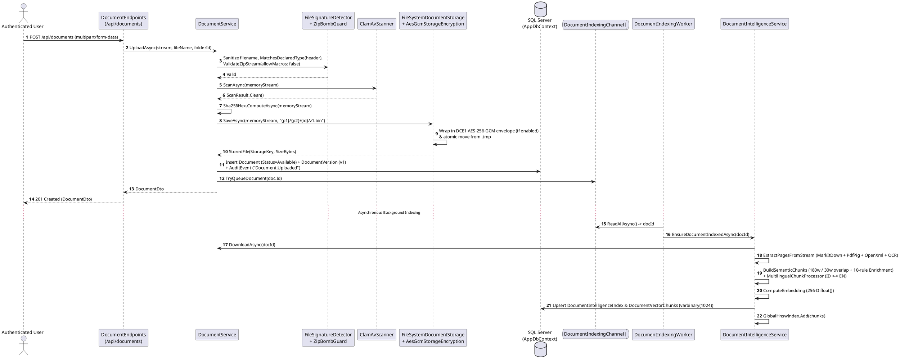
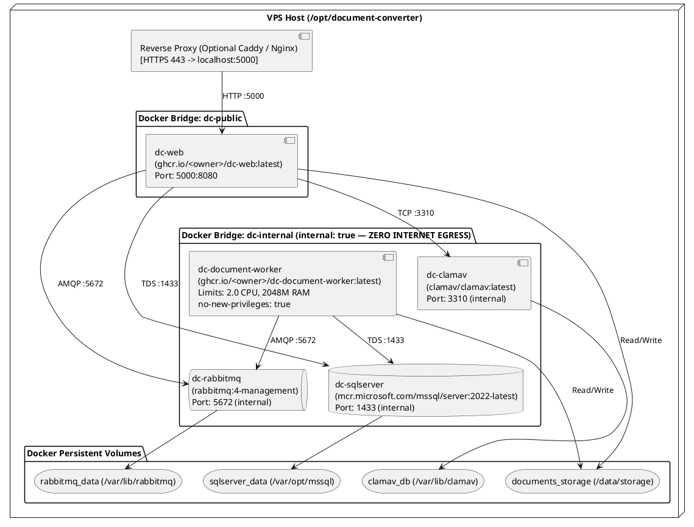

# System Architecture

**Purpose:** Document the verified system context, layered application architecture, compile-time and runtime dependency graphs, startup and middleware pipeline, component responsibilities, end-to-end data flows, deployment topology, infrastructure dependencies, and security architecture of `DocumentConverter.slnx`.  
**Scope:** All 8 source projects (`src/**`), 3 test projects (`tests/**`), container definitions (`Dockerfile`, `docker-compose.yml`, `docker-compose.prod.yml`), and CI/CD pipeline (`.github/workflows/deploy.yml`).  
**Evidence status:** `Code-verified` & `Runtime-verified` (`ArchitectureTests.cs`).  
**Last reviewed:** 2026-11-05

---

## 1. Overall System Architecture

The system implements a **Modular Monolith Web Host with Optional Out-of-Process Worker Offloading**. Rather than splitting domain boundaries into separate network microservices prematurely, all business logic, persistence mappings, document engines, and RAG intelligence reside in shared, strongly-typed .NET 10 class libraries (`Domain`, `Contracts`, `Application`, `Infrastructure`, `Security`, `Processing.Abstractions`) that are hosted by two executable entry points:

1. **`DocumentConverter.Web` (`src/DocumentConverter.Web/Program.cs`):** Serves the interactive Blazor Server UI (`Radzen.Blazor`), 51 Minimal API endpoints, SignalR hub (`/hubs/processing`), background RAG indexing worker (`DocumentIndexingWorker`), local directory auto-import watcher (`CdpDownloadWatcher`), and—when `Processing:RunWorkerInWeb = true` (default in local development)—the in-process `JobProcessorWorker`.
2. **`DocumentWorker` (`src/Workers/DocumentWorker/Program.cs`):** A standalone headless `.NET Worker` container used in production (`Processing:RunWorkerInWeb = false` in `docker-compose.yml` and `docker-compose.prod.yml`) to isolate CPU- and memory-intensive document conversions, OCR, and PDF/image compression (`limits: 2.0 CPUs, 2048M RAM`) on a zero-egress internal network (`dc-internal`).

**Diagram Explanation & Evidence**
- Verified from `src/DocumentConverter.Web/Program.cs`, `src/Workers/DocumentWorker/Program.cs`, `docker-compose.yml`, and `docker-compose.prod.yml`.
- All internal infrastructure containers (`sqlserver`, `rabbitmq`, `clamav`, `document-worker`) attach exclusively to `dc-internal` (`internal: true`), whereas only `web` bridges `dc-public` and `dc-internal`.

---

## 2. Application Architecture and Layering

The solution follows a Clean/Onion-inspired layered architecture verified by automated `NetArchTest.Rules` tests in `tests/DocumentConverter.Architecture.Tests/ArchitectureTests.cs`:

1. **Domain Layer (`DocumentConverter.Domain`)** — Pure business entities, value objects, and state transition rules. Zero dependencies on any other project or framework (`Entity.cs`, `Guard.cs`, `Sha256Hex.cs`, `Document.cs`, `ProcessingJob.cs`).
2. **BuildingBlocks (`DocumentConverter.Security` & `DocumentConverter.Processing.Abstractions`)** — Self-contained security validators (`FileSignatureDetector`, `ZipBombGuard`, `EicarSignatureDetector`, `FileNameSanitizer`) and processing engine contracts (`IDocumentProcessor`, `ProcessingContext`, `ProcessingResult`).
3. **Contracts Layer (`DocumentConverter.Contracts`)** — Pure serializable C# `record` DTOs shared across API endpoints, Blazor components, and application services.
4. **Application Layer (`DocumentConverter.Application`)** — Service interfaces (`IDocumentService`, `IDocumentIntelligenceService`, `IProcessingService`, `IAdminService`, `IPdfEngine`, `IPdfDigitalSignatureService`, `IMalwareScanner`, `IDocumentStorage`, `IAuditService`, `IUserContext`). References only `Domain`, `Contracts`, `Security`, and `Processing.Abstractions`.
5. **Infrastructure Layer (`DocumentConverter.Infrastructure`)** — Concrete implementations of all Application interfaces, EF Core `AppDbContext`, SQL Server configurations/migrations, HNSW vector index (`HnswVectorIndex`), conversion engines (`OfficeDocumentProcessor`, `PdfDocumentProcessor`, etc.), `ClamAvScanner`, `AesGcmStorageEncryptionService`, and `RabbitMqJobDispatcher`.
6. **Presentation & Host Layer (`DocumentConverter.Web` & `DocumentWorker`)** — Composition roots (`Program.cs`), Blazor UI components, Minimal API endpoints, authentication/authorization plumbing (`AppClaimsTransformation`, `HttpContextUserContext`), and `BackgroundService` hosts.

---

## 3. Project and Dependency Structure

**Diagram Explanation & Evidence**
- Reconstructed directly from `<ProjectReference>` elements across all 11 `.csproj` files and verified at runtime by `ArchitectureTests.cs` (`Domain_MustNotDependOn_Infrastructure_Or_Web`, `Domain_MustNotDependOn_EntityFramework_Or_Blazor`, `Application_MustNotDependOn_Infrastructure_Or_Web`).

---

## 4. Component Descriptions and Dependency Injection Lifetimes

Registered in `src/DocumentConverter.Web/Program.cs` (lines 28–215) and `src/Workers/DocumentWorker/Program.cs` (lines 14–56):

| Interface / Service | Concrete Implementation | DI Lifetime | Responsibility | Evidence Path |
|---|---|---|---|---|
| `AppDbContext` | `AppDbContext` | `Scoped` | EF Core 10 unit of work for `dbo` (18 tables) and `identity` (7 tables) schemas in SQL Server. | `src/DocumentConverter.Infrastructure/Persistence/AppDbContext.cs` |
| `IUserContext` | `HttpContextUserContext` (Web) / `WorkerUserContext` (Worker) | `Scoped` / `Singleton` | Resolves `UserId` (`dc:uid`), `Email`, `DisplayName`, `IsAuthenticated`, `IsAdministrator`, and `IpAddress` from `HttpContext` or Blazor `AuthenticationStateProvider`. | `src/DocumentConverter.Web/Authentication/HttpContextUserContext.cs` |
| `IClaimsTransformation` | `AppClaimsTransformation` | `Transient` | Maps authenticated cookie/OIDC principals to internal `dbo.Users.Id` (`dc:uid`), performing JIT user provisioning if absent. | `src/DocumentConverter.Web/Authentication/AppClaimsTransformation.cs` |
| `IStorageEncryptionService` | `AesGcmStorageEncryptionService` | `Singleton` | Encrypts/decrypts storage streams using AES-256-GCM envelope encryption (`DCE1` binary format, per-file 256-bit DEK wrapped by 256-bit KEK). | `src/DocumentConverter.Infrastructure/Security/StorageEncryption/AesGcmStorageEncryptionService.cs` |
| `IDocumentStorage` | `FileSystemDocumentStorage` | `Singleton` | Manages sharded file storage (`{id[0..2]}/{id[2..4]}/{id:N}/v{version}.bin`) with atomic `.tmp` writes and path-traversal guards. | `src/DocumentConverter.Infrastructure/Storage/FileSystemDocumentStorage.cs` |
| `IMalwareScanner` | `ClamAvScanner` | `Scoped` | Executes pre-scan `EicarSignatureDetector` and TCP `zINSTREAM\0` scan against ClamAV (`clamav:3310`); fails closed on timeout or connection error. | `src/DocumentConverter.Infrastructure/Security/ClamAvScanner.cs` |
| `IAuditService` | `AuditService` | `Scoped` | Appends `AuditEvent` records (`dbo.AuditEvents`) with automatic `UserId` and `IpAddress` enrichment. | `src/DocumentConverter.Infrastructure/Security/AuditService.cs` |
| `IDocumentService` | `DocumentService` | `Scoped` | Core document lifecycle: upload, download, folders, versions, LCS text diffing, rollback, PDF split/merge, Recycle Bin soft-delete, restore, and purge. | `src/DocumentConverter.Infrastructure/Documents/DocumentService.cs` |
| `IPdfDigitalSignatureService` | `PdfDigitalSignatureService` | `Scoped` | PAdES / ISO 32000-1 detached PKCS#7 (`adbe.pkcs7.detached`) PDF signing via incremental update, visible badge stamping, self-signed X.509 generation, and cryptographic tamper verification. | `src/DocumentConverter.Infrastructure/Documents/PdfDigitalSignatureService.cs` |
| `IPdfEngine` | `PdfEngine` | `Scoped` | PDFsharp 6.x & PdfPig engine for page mutations, annotations, redactions, AcroForms, password protection, and DOCX/XLSX export. | `src/DocumentConverter.Infrastructure/Editor/PdfEngine.cs` |
| `IAdminService` | `AdminService` | `Scoped` | Administrator operations: user/role/department management, converter limits, system settings (`dbo.SystemSettings`), and audit log querying. | `src/DocumentConverter.Infrastructure/Admin/AdminService.cs` |
| `IDocumentIndexingChannel` | `DocumentIndexingChannel` | `Singleton` | Bounded in-memory `Channel<Guid>` (capacity `10,000`, `DropWrite` with `ConcurrentDictionary` deduplication) queuing documents for background RAG indexing. | `src/DocumentConverter.Infrastructure/AI/DocumentIndexingChannel.cs` |
| `IExternalAiClient` | `ExternalAiClient` | `Scoped` (`AddHttpClient`) | Typed HTTP client (`60s` timeout) dispatching chat completion / synthesis and connectivity tests to OpenAI, Anthropic Claude, Google Gemini, Groq, or Custom/Local Ollama (`http://localhost:11434/v1`). | `src/DocumentConverter.Infrastructure/AI/ExternalAiClient.cs` |
| `IDocumentIntelligenceService` | `DocumentIntelligenceService` | `Scoped` | Complete RAG and Document Intelligence engine: extraction, chunking, 10-rule enrichment, cross-lingual `id`/`en` projection, 256-D embedding, SQL + `HnswVectorIndex` retrieval, MMR reranking, synthesis, comparison matrix, Knowledge Graph, chat sessions, memories, and dossier export. | `src/DocumentConverter.Infrastructure/AI/DocumentIntelligenceService.cs` |
| `EnterpriseAiChatService` | `EnterpriseAiChatService` | `Scoped` | Blazor UI helper orchestrating multi-document chat context assembly, query intent routing, and Markdown dossier formatting. | `src/DocumentConverter.Web/Services/EnterpriseAiChatService.cs` |
| `IJobQueuePublisher` | `RabbitMqJobDispatcher` | `Singleton` | Publishes `JobMessage` to durable RabbitMQ queue (`document-jobs`) or falls back to internal `Channel<JobMessage>`. | `src/DocumentConverter.Infrastructure/Messaging/RabbitMqJobDispatcher.cs` |
| `IProcessingService` | `ProcessingService` | `Scoped` | Creates and queries `ProcessingJob` and `BatchJob` aggregates, validates converter constraints, and handles job cancellation. | `src/DocumentConverter.Infrastructure/Processing/ProcessingService.cs` |
| `IDocumentProcessor` (6) | `EchoDocumentProcessor`, `PdfDocumentProcessor`, `ImageDocumentProcessor`, `OcrDocumentProcessor`, `OfficeDocumentProcessor`, `PdfCompressProcessor`, `ImageCompressProcessor` | `Singleton` | Pluggable conversion, OCR, and compression engines matched via `CanProcess(operation, inputExt, outputExt)`. | `src/DocumentConverter.Infrastructure/Processing/*.cs` |
| `IHostedService` (Web) | `DocumentIndexingWorker`, `CdpDownloadWatcher`, `JobProcessorWorker` (conditional) | `Singleton` | Background hosted services running inside `DocumentConverter.Web`. | `src/DocumentConverter.Web/HostedServices/*.cs` |

---

## 5. Runtime Startup and HTTP Request Pipeline

### 5.1 Startup Sequence (`src/DocumentConverter.Web/Program.cs`)
1. **Service Registration (Lines 16–215):** Configures Razor Components (`AddInteractiveServerComponents`), Kestrel & Multipart limits (`100 MB`), OpenTelemetry metrics/tracing, `AppDbContext` (`DefaultConnection`), ASP.NET Core Identity (`AppIdentityUser`, `IdentityRole<Guid>`), Authentication (`.DocumentConverter.Auth` cookie + conditional OpenID Connect when `Auth:UseOidc = true`), Authorization (`AdminOnly` policy), Fixed-Window Rate Limiters (`auth`, `upload`, `jobs`), storage/security/AI/processing services, and hosted workers.
2. **Database Migration & Seeding (Lines 219–237):** Creates a startup DI scope, resolves `AppDbContext`, executes `await db.Database.MigrateAsync()` when `db.Database.IsRelational()` is true, and invokes `await DbSeeder.SeedAsync(scope.ServiceProvider)` to seed default departments, roles (`Administrator`, `User`), demo users (`admin@internal.local`, `user@internal.local`), 17 converters, and 11 system settings.
3. **Middleware Pipeline Order (Lines 240–279):**
   - `UseExceptionHandler("/Error")` + `UseHsts()` (non-Development) or `MapOpenApi()` (Development)
   - `UseMiddleware<SecurityHeadersMiddleware>()` (injects `Content-Security-Policy`, `X-Content-Type-Options: nosniff`, `X-Frame-Options: SAMEORIGIN`, `Referrer-Policy`, `Permissions-Policy`)
   - `UseStatusCodePagesWithReExecute("/not-found")`
   - `UseHttpsRedirection()`
   - `UseRateLimiter()`
   - `UseAuthentication()` (triggers `AppClaimsTransformation.TransformAsync`)
   - `UseAuthorization()`
   - `UseAntiforgery()`
   - `MapStaticAssets()`
   - Endpoint Mappings: `MapHealthChecks("/health")`, `MapHub<ProcessingHub>("/hubs/processing")`, `MapAccountEndpoints()`, `MapDocumentEndpoints()`, `MapEditorEndpoints()`, `MapDocumentIntelligenceEndpoints()`, `MapProcessingEndpoints()`, and `MapRazorComponents<App>().AddInteractiveServerRenderMode()`.

---

## 6. Data Flow Overview

### 6.1 Document Upload, Encryption, and Asynchronous RAG Indexing Flow

**Diagram Explanation & Evidence**
- Verified from `DocumentService.UploadAsync` (`src/DocumentConverter.Infrastructure/Documents/DocumentService.cs`, lines 49–188), `DocumentIndexingWorker.cs`, and `DocumentIntelligenceService.cs`.

---

## 7. Deployment Architecture and Infrastructure Dependencies

### 7.1 Multi-Container Production Topology (`docker-compose.prod.yml`)

**Diagram Explanation & Evidence**
- Verified from `docker-compose.prod.yml` and `DEPLOYMENT.md`.
- Both `dc-web` and `dc-document-worker` mount the shared `documents_storage` volume at `/data/storage` (`DOCUMENT_STORAGE_ROOT=/data/storage`) and share the same `STORAGE_ENCRYPTION_KEY` environment variable so encrypted blobs written by one container can be decrypted by the other.

### 7.2 Infrastructure Dependencies Summary

| Dependency | Container / Runtime | Protocol & Port | Required / Optional | Fallback Behavior in Code |
|---|---|---|---|---|
| **Microsoft SQL Server 2022** | `mcr.microsoft.com/mssql/server:2022-latest` | TCP `1433` (TDS) | **Required** | None; primary relational and vector persistence store (`AppDbContext`). |
| **Shared File System Volume** | `documents_storage` (`/data/storage` or `app_data/storage`) | Local / Volume I/O | **Required** | None; stores versioned document binaries (`v{N}.bin`). |
| **RabbitMQ 4.x** | `rabbitmq:4-management` | TCP `5672` (AMQP) | **Optional** (`RabbitMQ:Enabled`) | Falls back to in-memory `Channel<JobMessage>` in `RabbitMqJobDispatcher.cs` when disabled or unreachable (requires `Processing:RunWorkerInWeb = true` if running without RabbitMQ, though `Worker.cs` also polls `dbo.ProcessingJobs` directly every 2 seconds!). |
| **ClamAV Antivirus** | `clamav/clamav:latest` | TCP `3310` (`zINSTREAM`) | **Configurable** (`ClamAV:Enabled`) | When `ClamAV:Enabled = false`, only in-memory `EicarSignatureDetector` runs. When `ClamAV:Enabled = true`, `ClamAvScanner` **fails closed** (rejects uploads if `clamd` is unreachable). |
| **LibreOffice (`soffice`)** | Installed in `DocumentWorker` & `Web` Dockerfiles (`libreoffice-writer`, `libreoffice-calc`, `libreoffice-impress`) | Headless CLI subprocess | **Optional** | `OfficeDocumentProcessor` uses native OpenXML/PDFsharp converters (`ExcelPdfConverter`, `PresentationPdfConverter`, `MarkdownHtmlPdfConverter`, `EbookPdfConverter`) and invokes `soffice --headless --convert-to pdf` for `.doc`/`.docx`/`.odt` when available, falling back to `ConvertOfficeToPdfFallbackAsync` if `soffice` is not installed. |
| **Tesseract OCR Data** | `src/DocumentConverter.Web/tessdata/eng.traineddata` | In-process native library | **Included** | If native Tesseract engine fails to load on a host OS, `DocumentIntelligenceService` falls back to deterministic ASCII/printable run extraction (`ExtractPrintableTextFromBytesFallback`). |
| **External / Local LLM Runtime** | Ollama (`http://localhost:11434/v1`) or OpenAI / Claude / Gemini / Groq | HTTP / HTTPS REST | **Optional** (`AI.CloudEnabled`) | Defaults to `false` (Zero-Egress). If enabled and an API/network failure occurs, `DocumentIntelligenceService` automatically falls back to local deterministic synthesis. |

---

## 8. Security Architecture Summary

1. **Authentication & Identity Decoupling:** `AppClaimsTransformation` decouples authentication subject identifiers (ASP.NET Core Identity ` identity.Users` or OIDC `sub`/`oid`) from domain authorization by mapping every authenticated principal to `dbo.Users.Id` via the `dc:uid` claim (`HttpContextUserContext.UserIdClaimType`).
2. **Resource-Level Ownership Isolation (Anti-IDOR):** Neither `DocumentService` nor `DocumentIntelligenceService` trusts client-supplied user IDs; every query filters by `_userContext.UserId` (`OwnerUserId == userId`).
3. **Multi-Layer File Ingestion Defense:** Filename sanitization -> Magic-byte signature verification -> ZIP decompression bomb & VBA macro rejection -> EICAR + ClamAV `INSTREAM` scan -> `SHA-256` integrity hashing -> `DCE1` AES-256-GCM envelope encryption.
4. **Transport & Browser Hardening:** `SecurityHeadersMiddleware` applies a strict `Content-Security-Policy` (`default-src 'self'`), `X-Content-Type-Options: nosniff`, `X-Frame-Options: SAMEORIGIN`, and `Permissions-Policy`.

See [Security and Data Governance](../07-security-governance/security-and-data-governance.md) for the complete security analysis.

---

## 9. Related Documentation

- [Project Overview](../01-overview/project-overview.md)
- [Requirements Analysis](../02-requirements/requirements-analysis.md)
- [Module Documentation Index](../04-modules/README.md)
- [Database Documentation](../05-database/database-documentation.md)
- [API Documentation](../06-api/api-documentation.md)
- [Security and Data Governance](../07-security-governance/security-and-data-governance.md)
- [RAG Technical Documentation](../08-rag/rag-technical-documentation.md)
- [Deployment and Maintenance](../10-deployment/deployment-and-maintenance.md)

