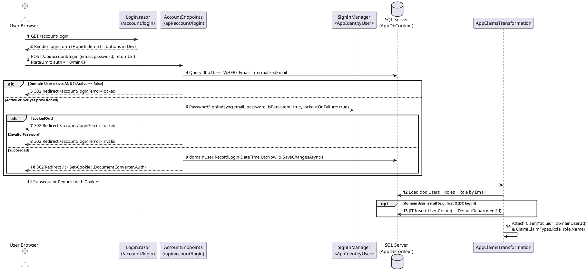

# Module 01: Authentication and Authorization

**Purpose:** Document the authentication schemes (ASP.NET Core Identity local cookie login and optional OpenID Connect), claims transformation (`dc:uid`), role-based access control (`AdminOnly`), and resource-level ownership authorization implemented in `DocumentConverter.Web`.  
**Scope:** `src/DocumentConverter.Web/Program.cs`, `Endpoints/AccountEndpoints.cs`, `Authentication/AppClaimsTransformation.cs`, `Authentication/HttpContextUserContext.cs`, and `Components/Pages/Account/Login.razor`.  
**Evidence status:** `Code-verified` & `Runtime-verified`.  
**Last reviewed:** 2026-11-05

---

## 1. Purpose

The Authentication and Authorization module authenticates users via either local email/password credentials (`identity.Users`) or an external OpenID Connect (OIDC) Identity Provider, decouples external authentication subjects from domain authorization by issuing a stable internal `dc:uid` claim mapped to `dbo.Users.Id`, and exposes `IUserContext` to both HTTP Minimal APIs and Blazor Interactive Server circuits.

---

## 2. Features

- **Local Password Authentication:** Form-POST login (`POST /api/account/login`) backed by `SignInManager<AppIdentityUser>.PasswordSignInAsync` with brute-force lockout protection and fixed-window IP rate limiting.
- **Conditional OpenID Connect (OIDC) Federation:** Activated when configuration key `Auth:UseOidc = true` (`Program.cs`, lines 84–99).
- **Just-In-Time (JIT) Domain User Provisioning:** `AppClaimsTransformation.TransformAsync` automatically creates a `dbo.Users` record assigned to `DbSeeder.DefaultDepartmentId` if an authenticated user does not yet exist in the domain table.
- **Dual-Context Principal Resolution (`HttpContextUserContext`):** Resolves `UserId` (`dc:uid`), `Email`, `DisplayName`, `IsAuthenticated`, `IsAdministrator`, and `IpAddress` seamlessly across HTTP endpoints (`IHttpContextAccessor`) and Blazor Server SignalR circuits (`AuthenticationStateProvider`).
- **Role-Based & Ownership Authorization:** Enforces the `AdminOnly` policy (`RoleNames.Administrator`) for administrative pages/endpoints and `OwnerUserId == UserId` across all document, folder, job, and RAG services.

---

## 3. Business Rules

1. **Password Complexity & Lockout (`Program.cs`, lines 46–61):**
   - Minimum length: `8` characters; requires digit, lowercase, uppercase, and non-alphanumeric character.
   - Lockout: `MaxFailedAccessAttempts = 5`, `DefaultLockoutTimeSpan = 15 minutes`.
2. **Domain Active Check (`AccountEndpoints.cs`, lines 28–33):** Even if a user's password is valid in `identity.Users`, login is rejected (`?error=locked`) if the corresponding `dbo.Users` row has `IsActive == false`.
3. **Session Cookie Settings (`Program.cs`, lines 63–81):** Cookie name `.DocumentConverter.Auth`, `HttpOnly = true`, `SameSite = Lax`, `ExpireTimeSpan = 8 hours`, `SlidingExpiration = true`. API routes starting with `/api/` receive HTTP `401` / `403` status codes instead of HTML login redirects.
4. **Rate Limiting (`Program.cs`, lines 110–116):** The `auth` policy restricts `/api/account/*` to `10` requests per minute per client IP (`QueueLimit = 0`, returns HTTP `429`).

---

## 4. Input and Output

| Operation | Input | Output |
|---|---|---|
| Local Login (`POST /api/account/login`) | Form fields: `email`, `password`, `returnUrl` (optional) | HTTP `302` redirect to `returnUrl` (valid local path) with `.DocumentConverter.Auth` cookie, or redirect to `/account/login?error=missing|invalid|locked`. |
| External OIDC Login (`GET /api/account/external-login`) | Query param: `returnUrl` (optional) | OIDC `Challenge` redirect (when `Auth:UseOidc = true`) or redirect to `/account/login?error=oidc_not_configured`. |
| Logout (`GET` or `POST /api/account/logout`) | Authenticated cookie session | Clears Identity cookie and redirects (`302`) to `/account/login`. |
| Claims Transformation (`TransformAsync`) | Authenticated `ClaimsPrincipal` | Augmented `ClaimsPrincipal` containing `dc:uid` (`Guid`) and `ClaimTypes.Role` claims from `dbo.UserRoles`. |

---

## 5. Processing Flow

**Diagram Explanation & Evidence**
- Verified from `src/DocumentConverter.Web/Endpoints/AccountEndpoints.cs` (lines 14–96) and `src/DocumentConverter.Web/Authentication/AppClaimsTransformation.cs` (lines 24–103).

---

## 6. Related Classes and Methods

- `src/DocumentConverter.Web/Endpoints/AccountEndpoints.cs` — `MapAccountEndpoints`
- `src/DocumentConverter.Web/Authentication/AppClaimsTransformation.cs` — `TransformAsync`
- `src/DocumentConverter.Web/Authentication/HttpContextUserContext.cs` — `GetPrincipal`, `UserId`, `IsAuthenticated`, `IsAdministrator`, `IpAddress`
- `src/DocumentConverter.Infrastructure/Identity/AppIdentityUser.cs` — `DomainUserId`, `DisplayName`
- `src/DocumentConverter.Domain/Identity/User.cs` — `Create`, `NormalizeEmail`, `RecordLogin`, `AssignRole`, `Deactivate`, `Activate`
- `src/DocumentConverter.Web/Components/Pages/Account/Login.razor` — Interactive login page and error banner display

---

## 7. Database Dependencies

- `identity.Users`, `identity.Roles`, `identity.UserRoles`, `identity.UserClaims`, `identity.UserLogins` (ASP.NET Core Identity tables)
- `dbo.Users`, `dbo.Roles`, `dbo.UserRoles`, `dbo.Departments` (Domain identity tables)

---

## 8. API Endpoints

| Method | Route | Auth / Rate Limit | Purpose |
|---|---|---|---|
| `POST` | `/api/account/login` | `AllowAnonymous`, RateLimit `auth` (10/min) | Local email/password sign-in. |
| `GET` | `/api/account/external-login` | `AllowAnonymous`, RateLimit `auth` (10/min) | Initiates OpenID Connect challenge when `Auth:UseOidc = true`. |
| `POST` | `/api/account/logout` | Cookie session, `DisableAntiforgery` | Signs out current session and redirects to `/account/login`. |
| `GET` | `/api/account/logout` | Cookie session | Signs out current session and redirects to `/account/login`. |

---

## 9. Error Handling and Security Considerations

- **Open-Redirect Prevention (`AccountEndpoints.cs`, lines 66–69):** `returnUrl` is validated using `Uri.IsWellFormedUriString(returnUrl, UriKind.Relative) && returnUrl.StartsWith('/') && !returnUrl.StartsWith("//")`; otherwise it defaults to `"/"`.
- **Anti-Enumeration:** Both unknown email and wrong password return the same redirect query `?error=invalid`.
- **Observability Gap (`Code-verified`):** `AccountEndpoints.cs` does not currently invoke `IAuditService.RecordAsync` on successful or failed login attempts; authentication events are logged via `ILogger` rather than persisted in `dbo.AuditEvents`.
- **Development Quick-Login Helper (`Login.razor`):** `Login.razor` includes quick-fill buttons for the seeded demo accounts (`admin@internal.local` and `user@internal.local`). Before production deployment, default seeded passwords should be overridden via `SEED_ADMIN_PASSWORD` and `SEED_USER_PASSWORD` environment variables.

