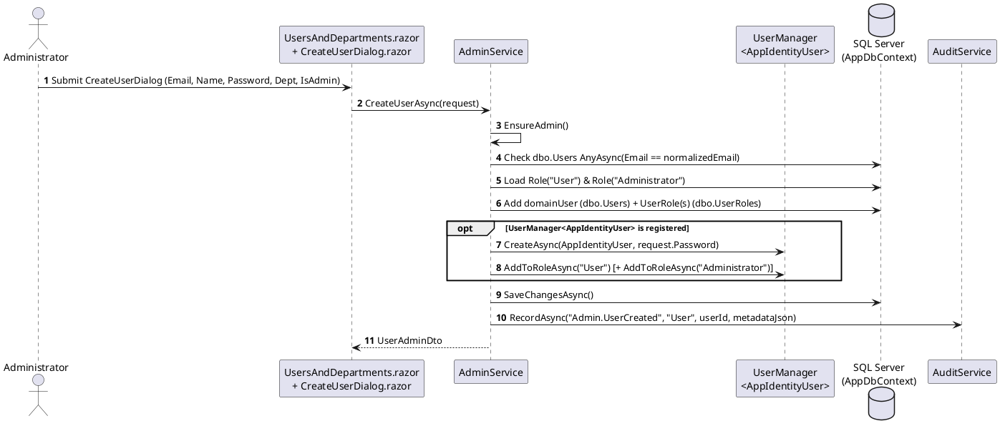

# Module 02: User and Role Management

**Purpose:** Document the administrative lifecycle for managing domain and identity users, role assignments (`Administrator` vs. `User`), account activation/deactivation, and organizational departments.  
**Scope:** `src/DocumentConverter.Application/Admin/IAdminService.cs`, `src/DocumentConverter.Infrastructure/Admin/AdminService.cs`, `src/DocumentConverter.Web/Components/Pages/Admin/UsersAndDepartments.razor`, and `Dialogs/CreateUserDialog.razor`.  
**Evidence status:** `Code-verified`.  
**Last reviewed:** 2026-11-05

---

## 1. Purpose

The User and Role Management module enables system administrators to provision new local user accounts across both the ASP.NET Core Identity store (`identity.Users`) and the internal domain model (`dbo.Users`), manage organizational departments (`dbo.Departments`), toggle user active status (`IsActive`), and grant or revoke the `Administrator` role.

---

## 2. Features

- **Unified User Directory View (`GetUsersAsync`):** Lists all domain users along with their department name, active status, administrator flag, last login timestamp, total owned document count (`dbo.Documents`), and total conversion job count (`dbo.ProcessingJobs`).
- **Dual-Store Local User Creation (`CreateUserAsync`):** Creates a synchronized `AppIdentityUser` in `identity.Users` (via `UserManager<AppIdentityUser>`) and a domain `User` in `dbo.Users`, assigning `User` and optional `Administrator` roles in both stores.
- **Role Promotion / Demotion (`SetUserRoleAsync`):** Grants or revokes the `Administrator` role in both `dbo.UserRoles` and `identity.UserRoles` (`UserManager.AddToRoleAsync` / `RemoveFromRoleAsync`).
- **Account Activation / Deactivation (`ToggleUserStatusAsync`):** Flips `dbo.Users.IsActive` (`user.Activate()` / `user.Deactivate()`), immediately blocking deactivated users from logging in via `AccountEndpoints`.
- **Department Management (`GetDepartmentsAsync`, `CreateDepartmentAsync`, `SetUserDepartmentAsync`):** Creates organizational departments and assigns users to departments, displaying per-department user and document counts.

---

## 3. Business Rules

1. **Administrator Authorization (`AdminService.EnsureAdmin`, lines 37–43):** Every mutating and read method on `AdminService` checks `_userContext.IsAdministrator`. If `false`, it throws `UnauthorizedAccessException("Administrator privileges are required.")`.
2. **Self-Lockout & Self-Demotion Protection (`AdminService.cs`, lines 187–190 & 245–248):**
   - An administrator **cannot remove their own Administrator role** (`if (_userContext.UserId == userId && !makeAdmin) throw new DomainException("You cannot remove your own Administrator role.")`).
   - An administrator **cannot deactivate their own account** (`if (_userContext.UserId == userId && user.IsActive) throw new DomainException("You cannot deactivate your own account.")`).
3. **Unique Normalized Email (`CreateUserAsync`, lines 284–290):** Email addresses are normalized via `User.NormalizeEmail` (trimmed lowercase) and checked for uniqueness across `dbo.Users` before creation.
4. **Unique Department Name (`CreateDepartmentAsync`, lines 269–273):** Department names are compared case-insensitively (`ToLower()`) to prevent duplicates.

---

## 4. Input and Output

| Method (`IAdminService`) | Input | Output |
|---|---|---|
| `GetUsersAsync` | `CancellationToken` | `IReadOnlyList<UserAdminDto>` (Id, Email, DisplayName, DepartmentName, DepartmentId, IsActive, IsAdmin, CreatedAt, LastLoginAt, DocumentCount, JobCount) |
| `CreateUserAsync` | `CreateUserAdminRequest` (Email, DisplayName, Password, DepartmentId, IsAdmin) | `UserAdminDto` |
| `SetUserRoleAsync` | `Guid userId`, `bool makeAdmin` | `Task` (updates `dbo.UserRoles` & `identity.UserRoles`) |
| `SetUserDepartmentAsync` | `Guid userId`, `Guid? departmentId` | `Task` (updates `dbo.Users.DepartmentId`) |
| `ToggleUserStatusAsync` | `Guid userId` | `Task` (flips `dbo.Users.IsActive`) |
| `GetDepartmentsAsync` | `CancellationToken` | `IReadOnlyList<DepartmentDto>` (Id, Name, CreatedAt, UserCount, DocumentCount) |
| `CreateDepartmentAsync` | `string name` | `DepartmentDto` |

---

## 5. Processing Flow

**Diagram Explanation & Evidence**
- Verified from `src/DocumentConverter.Infrastructure/Admin/AdminService.cs` (`CreateUserAsync`, lines 281–368).

---

## 6. Related Classes and Methods

- `src/DocumentConverter.Application/Admin/IAdminService.cs`
- `src/DocumentConverter.Infrastructure/Admin/AdminService.cs` (`GetUsersAsync`, `CreateUserAsync`, `SetUserRoleAsync`, `SetUserDepartmentAsync`, `ToggleUserStatusAsync`, `GetDepartmentsAsync`, `CreateDepartmentAsync`)
- `src/DocumentConverter.Domain/Identity/User.cs`, `Role.cs`, `Department.cs`
- `src/DocumentConverter.Web/Components/Pages/Admin/UsersAndDepartments.razor`
- `src/DocumentConverter.Web/Components/Pages/Admin/Dialogs/CreateUserDialog.razor`

---

## 7. Database Dependencies

- `dbo.Users`, `dbo.Roles`, `dbo.UserRoles`, `dbo.Departments`
- `identity.Users`, `identity.Roles`, `identity.UserRoles`
- `dbo.Documents` and `dbo.ProcessingJobs` (queried for aggregate counts in `GetUsersAsync` and `GetDepartmentsAsync`)
- `dbo.AuditEvents` (records `Admin.UserCreated`, `Admin.UserRoleUpdated`, `Admin.UserDepartmentUpdated`, `Admin.UserStatusToggled`, `Admin.DepartmentCreated`)

---

## 8. API Endpoints and UI Entry Points

User and role management is invoked directly via Blazor Server Interactive Server dependency injection (`@inject IAdminService AdminService`) on the `/admin/users` route (`UsersAndDepartments.razor`, guarded by `@attribute [Authorize(Policy = "AdminOnly")]`). No external REST endpoints are exposed for user management.

---

## 9. Error Handling and Security Considerations

- **Defense-in-Depth Authorization:** Protected both at the Razor page router level (`[Authorize(Policy = "AdminOnly")]`) and inside every `AdminService` method (`EnsureAdmin()`).
- **Synchronized Identity & Domain State:** `CreateUserAsync` and `SetUserRoleAsync` update both `dbo.UserRoles` and `identity.UserRoles` so cookie claims and domain queries remain consistent.
- **Audit Traceability:** Every user creation, role change, department assignment, and status toggle writes a structured JSON metadata record to `dbo.AuditEvents`.

