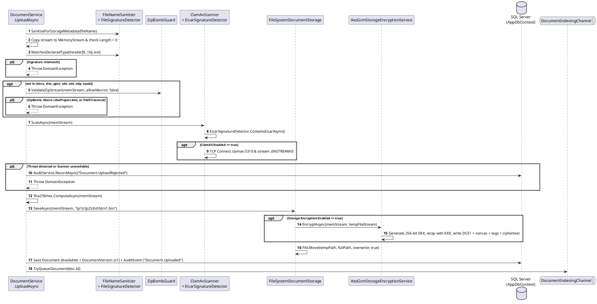

# Module 03: Document Upload and Storage

**Purpose:** Document the multi-stage document upload validation pipeline, malware scanning, SHA-256 integrity hashing, sharded filesystem persistence, at-rest AES-256-GCM envelope encryption (`DCE1`), and automated local directory import (`CdpDownloadWatcher`).  
**Scope:** `DocumentService.UploadAsync`, `FileSystemDocumentStorage`, `AesGcmStorageEncryptionService`, `ClamAvScanner`, `FileSignatureDetector`, `ZipBombGuard`, `EicarSignatureDetector`, `FileNameSanitizer`, and `CdpDownloadWatcher`.  
**Evidence status:** `Code-verified` & `Runtime-verified` (`DocumentSecurityAndIdorTests`, `Milestone8SecurityHardeningTests`).  
**Last reviewed:** 2026-11-05

---

## 1. Purpose

The Document Upload and Storage module enforces a defense-in-depth ingestion gate before any user-supplied file is written to disk or indexed into the RAG vector store. It guarantees that stored files match their declared format signatures, are free of VBA macros, archive decompression bombs, and malware signatures, are addressed by deterministic content hashes (`SHA-256`) and non-user-controlled sharded keys, and are optionally encrypted at rest using authenticated AES-256-GCM envelope encryption (`DCE1`).

---

## 2. Features

- **Filename Sanitization (`FileNameSanitizer`):** Strips directory paths (`C:\...`, `../../`), control characters, and illegal filesystem characters, capping display names at 255 characters while never using user filenames as physical storage paths.
- **Magic-Byte Signature Verification (`FileSignatureDetector`):** Inspects the first 16 bytes of the upload stream against known binary headers (`%PDF-`, PNG, JPEG, ZIP/OpenXML/EPUB `50 4B 03 04`, TIFF LE/BE, BMP `BM`, WebP `WEBP`) to block extension spoofing.
- **Archive Bomb & Macro Guard (`ZipBombGuard`):** Inspects all ZIP-based containers (`.docx`, `.xlsx`, `.pptx`, `.odt`, `.ods`, `.odp`, `.epub`) to reject archives with `> 5,000` entries, uncompressed size `> 500 MB`, compression ratio `> 50:1` (when uncompressed `> 10 MB`), internal `..` path traversal, or embedded macros (`vbaProject.bin`).
- **Two-Tier Malware Scanning (`EicarSignatureDetector` + `ClamAvScanner`):** Performs an in-memory 8 KB sliding-window scan for the 68-byte EICAR test signature followed by a zero-disk TCP `zINSTREAM\0` stream scan against the ClamAV daemon (`clamav:3310`), failing closed if the scanner times out or cannot be reached when enabled.
- **Sharded Atomic File Storage (`FileSystemDocumentStorage`):** Writes versioned binaries to `{RootPath}/{docId[0..2]}/{docId[2..4]}/{docId:N}/v{versionNumber}.bin` via a temporary `.tmp` file followed by an atomic `File.Move(..., overwrite: true)`.
- **AES-256-GCM Envelope Encryption (`AesGcmStorageEncryptionService`):** Encrypts each file on disk with a unique 256-bit Data Encryption Key (DEK) wrapped by the 256-bit Master Key (KEK) under the `DCE1` binary envelope format, transparently decrypting on read while supporting unencrypted legacy files.
- **Automated Playwright/CDP Download Watcher (`CdpDownloadWatcher`):** Monitors `/tmp/playwright*` directories for headless browser downloads in development/testing environments and automatically imports them into the admin user's repository.

---

## 3. Business Rules

1. **Maximum Upload Size:** Enforced at the HTTP transport layer (`MaxRequestBodySize = 104,857,600` bytes / 100 MB in `Program.cs`) and seeded in `dbo.SystemSettings` (`Storage.MaxUploadSizeBytes = 104857600`).
2. **Non-Empty Stream Rule (`DocumentService.UploadAsync`, lines 73–76):** Zero-byte files are rejected with `DomainException("Uploaded file cannot be empty.")`.
3. **Folder Ownership Rule (`DocumentService.UploadAsync`, lines 58–66):** If `folderId` is specified, the folder must exist in `dbo.Folders` with `OwnerUserId == userId`; otherwise `DomainException("Target folder was not found.")` is thrown.
4. **Fail-Closed Malware Policy (`ClamAvScanner.cs`, lines 110–120):** When `ClamAV:Enabled = true`, any socket timeout (`ClamAV:TimeoutSeconds`, default `10s`) or connection refusal returns `ScanResult.Threat("ScannerUnavailable: ...")`, causing `DocumentService` to reject the upload and record `Document.UploadRejected` in `dbo.AuditEvents`.
5. **Envelope Encryption Binary Layout (`AesGcmStorageEncryptionService.cs`, lines 14–19 & 98–145):**
   - Total overhead: **92 bytes**:
     - Bytes `0..3` (4B): Magic header `"DCE1"` (`0x44, 0x43, 0x45, 0x31`)
     - Bytes `4..15` (12B): KEK Nonce (`96-bit` random)
     - Bytes `16..31` (16B): KEK Authentication Tag (`128-bit` GCM tag)
     - Bytes `32..63` (32B): Encrypted per-file DEK (`256-bit`)
     - Bytes `64..75` (12B): Data Nonce (`96-bit` random)
     - Bytes `76..91` (16B): Data Authentication Tag (`128-bit` GCM tag)
     - Bytes `92..N`: Encrypted file payload

---

## 4. Input and Output

| Operation | Input | Output |
|---|---|---|
| `IDocumentService.UploadAsync` | `Stream content`, `string fileName`, `Guid? folderId`, `CancellationToken` | `DocumentDto` (Id, OriginalFileName, ContentType, FileExtension, SizeBytes, Sha256Hash, Status=`"Available"`, FolderId, Versions `[v1]`) |
| `IDocumentStorage.SaveAsync` | `Stream content`, `string storageKey` (`{p1}/{p2}/{id:N}/v{v}.bin`) | `StoredFile(StorageKey, SizeBytes)` (returns plaintext byte count even when encrypted on disk) |
| `IDocumentStorage.OpenReadAsync` | `string storageKey` | Decrypted `Stream` (verified against GCM authentication tags if file starts with `"DCE1"`) |

---

## 5. Processing Flow

**Diagram Explanation & Evidence**
- Verified from `src/DocumentConverter.Infrastructure/Documents/DocumentService.cs` (lines 49–188), `FileSystemDocumentStorage.cs` (lines 47–96), and `AesGcmStorageEncryptionService.cs` (lines 98–145).

---

## 6. Related Classes and Methods

- `src/DocumentConverter.Infrastructure/Documents/DocumentService.cs` — `UploadAsync`
- `src/BuildingBlocks/DocumentConverter.Security/FileNameSanitizer.cs` — `SanitizeForStorageMetadata`
- `src/BuildingBlocks/DocumentConverter.Security/FileSignatureDetector.cs` — `MatchesDeclaredType`, `DetectContentType`
- `src/BuildingBlocks/DocumentConverter.Security/ZipBombGuard.cs` — `ValidateZipStream`
- `src/BuildingBlocks/DocumentConverter.Security/EicarSignatureDetector.cs` — `ContainsEicarAsync`
- `src/DocumentConverter.Infrastructure/Security/ClamAvScanner.cs` — `ScanAsync`
- `src/DocumentConverter.Infrastructure/Storage/FileSystemDocumentStorage.cs` — `SaveAsync`, `OpenReadAsync`, `DeleteAsync`, `ExistsAsync`, `GenerateStorageKey`
- `src/DocumentConverter.Infrastructure/Security/StorageEncryption/AesGcmStorageEncryptionService.cs` — `EncryptAsync`, `DecryptToStreamAsync`
- `src/DocumentConverter.Web/HostedServices/CdpDownloadWatcher.cs` — `ExecuteAsync`, `ImportDownloadedFileAsync`

---

## 7. Database Dependencies

- `dbo.Documents` (inserts master document row)
- `dbo.DocumentVersions` (inserts `VersionNumber = 1`, `IsCurrent = true`)
- `dbo.Folders` (validates `FolderId` ownership)
- `dbo.AuditEvents` (records `Document.Uploaded` or `Document.UploadRejected`)

---

## 8. API Endpoints

| Method | Route | Auth / Rate Limit | Purpose |
|---|---|---|---|
| `POST` | `/api/documents` | Authenticated, `DisableAntiforgery`, RateLimit `upload` (30/min/IP) | Uploads a single file (`multipart/form-data` with `file` and optional `folderId`). |

---

## 9. Error Handling and Security Considerations

- **Path Traversal Prevention (`FileSystemDocumentStorage.ResolveSafePath`, lines 155–180):** Validates that the resolved `Path.GetFullPath` starts with `_rootPath` and contains no `..` segments; user-supplied filenames are stored only in `dbo.Documents.OriginalFileName` and never used on the filesystem.
- **Cryptographic Tamper Detection:** Modifying even a single byte of an encrypted `v{N}.bin` file on disk causes `AesGcm.Decrypt` in `AesGcmStorageEncryptionService.DecryptToStreamAsync` to throw `CryptographicException` (`Runtime-verified` in `Milestone8SecurityHardeningTests.EnvelopeEncryption_TamperedCiphertext_ShouldThrowCryptographicException`).
- **Development Master Key Warning:** If `Storage:Encryption:Enabled = true` and no `STORAGE_ENCRYPTION_KEY` / `Storage:Encryption:MasterKey` is provided, `AesGcmStorageEncryptionService` logs a warning and derives a deterministic development key via `SHA256("DocumentConverter-Enterprise-Default-Dev-Master-Key-2026")`. Production deployments must set a random 32-byte Base64 `STORAGE_ENCRYPTION_KEY`.

