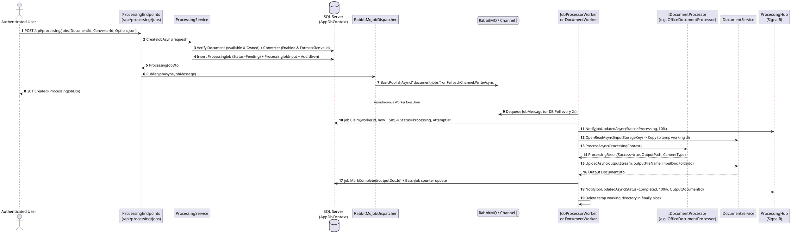

# Module 04: Document Conversion, OCR, and Compression

**Purpose:** Document the asynchronous and synchronous document conversion, Optical Character Recognition (OCR), and PDF/image compression subsystem, including the 17 seeded converters, 6 `IDocumentProcessor` engines, RabbitMQ / in-memory job dispatching, worker lease management, and SignalR progress broadcasting.  
**Scope:** `ProcessingService`, `ConverterCatalogService`, `ProcessingEndpoints`, `RabbitMqJobDispatcher`, `JobProcessorWorker`, `DocumentWorker/Worker`, `PdfCapabilityAnalyzer`, `CompressionEstimatorService`, `TesseractOcrEngine`, `ScannedPdfDetector`, and all `IDocumentProcessor` implementations in `src/DocumentConverter.Infrastructure/Processing/`.  
**Evidence status:** `Code-verified` & `Runtime-verified` (`BatchProcessingTests`, `CompressionTests`, `FormatExpansionConversionTests`, `OcrProcessingTests`, `PdfCapabilityAndWordConversionTests`, `ProcessingJobLifecycleTests`).  
**Last reviewed:** 2026-11-05

---

## 1. Purpose

The Document Conversion module orchestrates format transformations, scanned-document OCR, and file size optimization across 17 configured converter pipelines. It supports both background queue-driven processing (for single and batch jobs with real-time SignalR progress notifications) and synchronous stream conversion (`/api/documents/{id}/convert-sync`).

---

## 2. Features

- **17 Configurable Converters (`dbo.Converters`):** Seeded by `DbSeeder.SeedAsync` and manageable at runtime by administrators (enable/disable, max input size bytes, max pages).
- **6 Pluggable Processing Engines (`IDocumentProcessor`):**
  1. `OfficeDocumentProcessor` (`office-processor`) — Delegates to specialized sub-converters:
     - Word (`.docx`, `.doc`, `.odt`) <-> PDF (`soffice --headless` or native OpenXML/PdfPig + PDFsharp fallback with heading, paragraph, and table reconstruction).
     - Spreadsheets (`ExcelPdfConverter`) — `.xlsx`/`.csv` <-> `.pdf` round-trip table rendering and extraction.
     - Presentations (`PresentationPdfConverter`) — `.pptx`/`.ppt` -> `.pdf` supporting `"slides"` and `"handouts-3-notes"` layouts.
     - Web/Docs (`MarkdownHtmlPdfConverter`) — `.md`/`.markdown`/`.html`/`.htm` -> styled corporate `.pdf`.
     - E-Books (`EbookPdfConverter`) — `.epub` (OPF/XHTML spine parser) and `.mobi` (Big-Endian PalmDOC binary record parser) -> `.pdf`.
  2. `OcrDocumentProcessor` (`ocr-processor`) — Uses `TesseractOcrEngine` (`tessdata/eng.traineddata`) and `PDFsharp`/`SkiaSharp` to convert scanned PDFs or images (`.png`, `.jpg`, `.tiff`, `.bmp`, `.webp`) into searchable PDFs or extracted `.txt` files.
  3. `PdfCompressProcessor` (`pdf-compress-processor`) — Downsamples and re-encodes embedded PDF XObject images (`screen`, `standard`, `high` presets) and compresses PDF streams via `PdfEngine`.
  4. `ImageCompressProcessor` (`image-compress-processor`) — Uses `SkiaSharp` (`SKSamplingOptions`) to resize and compress `.jpg`, `.png`, `.webp`, `.bmp`, and `.tiff` images.
  5. `ImageDocumentProcessor` (`image-processor`) — Converts images to PDF (`image-to-pdf`) or transcodes between image formats (`image-format-convert`).
  6. `PdfDocumentProcessor` (`pdf-processor`) & `EchoDocumentProcessor` (`echo-processor`) — PDF normalization/passthrough and binary verification copy.
- **Pre-Conversion Fidelity & Compression Forecasting:**
  - `PdfCapabilityAnalyzer` inspects a PDF before conversion to `.docx` to report `ConversionFidelityVerdict` (`Supported`, `BestEffort`, `Unsupported`), text layer presence, multi-column/table layout complexity, and whether OCR fallback is required.
  - `CompressionEstimatorService` calculates exact or forecasted byte savings and percentage reduction before a user commits a compression job.
- **Resilient Queue Dispatching & Lease-Based Worker Execution:**
  - `RabbitMqJobDispatcher` publishes `JobMessage` to durable RabbitMQ queue `document-jobs` (`DeliveryModes.Persistent`) and automatically falls back to an unbounded in-memory `Channel<JobMessage>` if RabbitMQ is disabled or unreachable.
  - `JobProcessorWorker` (in-Web) and `DocumentWorker/Worker` (standalone container) claim jobs with a 5-minute lease (`LeaseExpiresAt`), recover expired leases up to `MaxAttempts = 3`, and push real-time status updates via SignalR (`ProcessingHub`).

---

## 3. Seeded Converter Catalog (`Code-verified` from `DbSeeder.cs`)

| # | Converter Key | Name | Operation | Input Formats | Output Formats | ProcessorId | Fidelity | Max Size | Max Pages |
|---|---|---|---|---|---|---|---|---|---|
| 1 | `echo-copy` | Verification Copy | `echo` | `pdf,txt,png,jpg,jpeg,docx` | `pdf,txt,png,jpg,jpeg,docx` | `echo-processor` | `Supported` | 50 MB | `NULL` |
| 2 | `image-to-pdf` | Image to PDF | `convert` | `png,jpg,jpeg` | `pdf` | `image-processor` | `Supported` | 50 MB | `NULL` |
| 3 | `pdf-Passthrough` | PDF Normalization & Optimization | `convert` | `pdf` | `pdf` | `pdf-processor` | `Supported` | 100 MB | 1000 |
| 4 | `ocr-searchable-pdf` | OCR to Searchable PDF | `ocr` | `pdf,png,jpg,jpeg,tif,tiff,bmp,webp` | `pdf` | `ocr-processor` | `Supported` | 100 MB | 500 |
| 5 | `ocr-pdf-to-text` | OCR Text Extraction (.txt) | `ocr` | `pdf,png,jpg,jpeg,tif,tiff,bmp,webp` | `txt` | `ocr-processor` | `Supported` | 100 MB | 500 |
| 6 | `office-to-pdf` | Word / Office to PDF | `convert` | `docx,doc,odt` | `pdf` | `office-processor` | `Supported` | 100 MB | 1000 |
| 7 | `pdf-to-word` | PDF to Word (.docx) | `convert` | `pdf` | `docx` | `office-processor` | `BestEffort` | 100 MB | 500 |
| 8 | `excel-to-pdf` | Excel & CSV to PDF Report | `convert` | `xlsx,csv` | `pdf` | `office-processor` | `Supported` | 100 MB | 500 |
| 9 | `pdf-to-excel` | PDF to Excel & CSV Table Extractor | `convert` | `pdf` | `xlsx,csv` | `office-processor` | `BestEffort` | 100 MB | 500 |
| 10 | `powerpoint-to-pdf` | PowerPoint to PDF Slides & Handouts | `convert` | `pptx,ppt` | `pdf` | `office-processor` | `Supported` | 100 MB | 500 |
| 11 | `markdown-to-pdf` | Markdown to Styled PDF | `convert` | `md,markdown` | `pdf` | `office-processor` | `Supported` | 50 MB | 500 |
| 12 | `html-to-pdf` | HTML Report to PDF | `convert` | `html,htm` | `pdf` | `office-processor` | `Supported` | 50 MB | 500 |
| 13 | `epub-to-pdf` | EPUB E-Book to PDF | `convert` | `epub` | `pdf` | `office-processor` | `Supported` | 100 MB | 2000 |
| 14 | `mobi-to-pdf` | MOBI E-Book to PDF | `convert` | `mobi` | `pdf` | `office-processor` | `BestEffort` | 100 MB | 2000 |
| 15 | `image-format-convert` | Image Format Converter | `convert` | `png,jpg,jpeg,webp,bmp,tif,tiff` | `png,jpg,webp,bmp` | `image-processor` | `Supported` | 50 MB | `NULL` |
| 16 | `pdf-compress` | PDF Size Optimizer & Compressor | `compress` | `pdf` | `pdf` | `pdf-compress-processor` | `Supported` | 100 MB | 1000 |
| 17 | `image-compress` | Image Quality & Size Optimizer | `compress` | `jpg,jpeg,png,webp,bmp,tif,tiff` | `jpg,png,webp` | `image-compress-processor` | `Supported` | 50 MB | `NULL` |

---

## 4. Business Rules

1. **Ownership & Status Validation (`ProcessingService.CreateJobAsync`, lines 39–61):** A user can only submit a job for a document they own (`OwnerUserId == userId`) whose `Status == DocumentStatus.Available`.
2. **Converter Validation (`ProcessingService.CreateJobAsync`, lines 63–89):**
   - Selected converter must exist and have `IsEnabled == true`.
   - Document's `FileExtension` must be listed in `converter.SupportsInputFormat(doc.FileExtension)`.
   - Document's `SizeBytes` must not exceed `converter.MaxInputSizeBytes`.
3. **Worker Lease & Retry Policy (`JobProcessorWorker.cs` & `Worker.cs`):**
   - `LeaseDuration = 5 minutes`; `MaxAttempts = 3`.
   - Transient failures (`retryable: true` and `Attempts.Count < 3`) transition the job back to `Pending` (`ClaimedBy = null`, `LeaseExpiresAt = null`). Permanent failures or exhausted retries mark the job `Failed`.
4. **Synchronous Conversion Shortcut (`DocumentEndpoints.cs`, `POST /api/documents/{id}/convert-sync`):** Converts `.pdf`, `.docx`, `.xlsx`, `.pptx`, `.md`, `.html`, `.txt`, `.csv`, `.png`, `.jpg`, `.webp`, `.bmp` to `.pdf`, `.docx`, `.xlsx`, or `.txt` in-memory and immediately saves the result via `IDocumentService.UploadAsync` into the same `FolderId`.

---

## 5. Processing Flow

**Diagram Explanation & Evidence**
- Verified from `src/DocumentConverter.Infrastructure/Processing/ProcessingService.cs` (lines 33–115), `src/DocumentConverter.Web/Endpoints/ProcessingEndpoints.cs` (lines 28–55), and `src/DocumentConverter.Web/HostedServices/JobProcessorWorker.cs` (lines 99–285).

---

## 6. Related Classes and Methods

- `src/DocumentConverter.Infrastructure/Processing/ProcessingService.cs` — `CreateJobAsync`, `CreateBatchAsync`, `GetJobAsync`, `ListJobsAsync`, `CancelJobAsync`, `CancelBatchAsync`
- `src/DocumentConverter.Infrastructure/Processing/ConverterCatalogService.cs` — `GetAvailableConvertersAsync`, `GetByKeyAsync`
- `src/DocumentConverter.Infrastructure/Processing/PdfCapabilityAnalyzer.cs` — `AnalyzeAsync`
- `src/DocumentConverter.Infrastructure/Processing/CompressionEstimatorService.cs` — `EstimateDocumentAsync`, `EstimateStreamAsync`
- `src/DocumentConverter.Infrastructure/Processing/OfficeDocumentProcessor.cs` + `Office/ExcelPdfConverter.cs`, `PresentationPdfConverter.cs`, `MarkdownHtmlPdfConverter.cs`, `EbookPdfConverter.cs`
- `src/DocumentConverter.Infrastructure/Processing/OcrDocumentProcessor.cs` + `Ocr/TesseractOcrEngine.cs`, `Ocr/ScannedPdfDetector.cs`
- `src/DocumentConverter.Infrastructure/Processing/PdfCompressProcessor.cs`, `ImageCompressProcessor.cs`, `ImageDocumentProcessor.cs`, `PdfDocumentProcessor.cs`, `EchoDocumentProcessor.cs`
- `src/DocumentConverter.Web/HostedServices/JobProcessorWorker.cs` & `src/Workers/DocumentWorker/Worker.cs`
- `src/DocumentConverter.Web/Hubs/ProcessingHub.cs` & `Services/JobNotificationService.cs`

---

## 7. Database Dependencies

- `dbo.Converters`, `dbo.ProcessingJobs`, `dbo.BatchJobs`, `dbo.ProcessingAttempts`, `dbo.ProcessingJobInputs`, `dbo.ProcessingJobOutputs`
- `dbo.Documents`, `dbo.DocumentVersions`, `dbo.AuditEvents`

---

## 8. API Endpoints

| Method | Route | Auth / Rate Limit | Purpose |
|---|---|---|---|
| `GET` | `/api/processing/converters` | Authenticated | Lists all converters in `dbo.Converters`. |
| `GET` | `/api/processing/analyze-pdf/{documentId:guid}` | Authenticated | Inspects PDF layout complexity, text layer, and conversion fidelity verdict. |
| `GET` | `/api/processing/inspect-ocr/{documentId:guid}` | Authenticated | Inspects whether a PDF is scanned (`ScannedPdfDetector`). |
| `POST` | `/api/processing/compression-preview/{documentId:guid}` | Authenticated | Estimates compressed size and percentage reduction for a stored document. |
| `POST` | `/api/processing/compression-preview-upload` | Authenticated, `DisableAntiforgery` | Estimates compression savings for an uploaded stream without saving. |
| `POST` | `/api/processing/jobs` | Authenticated, RateLimit `jobs` (60/min/IP) | Submits a single asynchronous conversion/OCR/compression job. |
| `GET` | `/api/processing/jobs` | Authenticated | Lists processing jobs owned by the current user (`?status=`). |
| `GET` | `/api/processing/jobs/{id:guid}` | Authenticated | Gets details of a specific processing job. |
| `POST` | `/api/processing/jobs/{id:guid}/cancel` | Authenticated | Cancels a `Pending` job or requests cancellation for a `Processing` job. |
| `POST` | `/api/processing/batches` | Authenticated, RateLimit `jobs` (60/min/IP) | Submits a multi-document batch processing job (`CreateBatchProcessingRequest`). |
| `GET` | `/api/processing/batches` | Authenticated | Lists batch jobs owned by the current user. |
| `GET` | `/api/processing/batches/{id:guid}` | Authenticated | Gets batch status and progress counters. |
| `GET` | `/api/processing/batches/{id:guid}/jobs` | Authenticated | Lists individual `ProcessingJobDto` items belonging to a batch. |
| `POST` | `/api/processing/batches/{id:guid}/cancel` | Authenticated | Cancels all active jobs in a batch. |
| `GET` | `/api/processing/batches/{id:guid}/download-zip` | Authenticated | Downloads all completed output documents of a batch as a `.zip` archive. |
| `POST` | `/api/documents/{id:guid}/convert-sync` | Authenticated | Executes immediate synchronous conversion and stores the output document. |

---

## 9. Error Handling and Security Considerations

- **Ephemeral Working Directory Cleanup:** Both `JobProcessorWorker.cs` (lines 278–283) and `Worker.cs` (lines 257–262) execute conversions inside `Path.Combine(Path.GetTempPath(), "dc-jobs", job.Id.ToString("N"))` and recursively delete the directory inside a `finally` block.
- **Subprocess Timeout Enforcement (`OfficeDocumentProcessor.cs`):** When LibreOffice (`soffice --headless`) is invoked, it uses an isolated user profile (`-env:UserInstallation=...`) and is killed (`process.Kill(entireProcessTree: true)`) if `context.Timeout` (5 minutes) expires.
- **Difference Between `JobProcessorWorker` and `DocumentWorker` (`Code-verified`):** `JobProcessorWorker` in `DocumentConverter.Web` broadcasts SignalR updates via `IJobNotificationService` and enqueues output documents into `IDocumentIndexingChannel`. The standalone `DocumentWorker` container (`Worker.cs`) does not hold a reference to the Web process's in-memory SignalR hub or `IDocumentIndexingChannel`.

