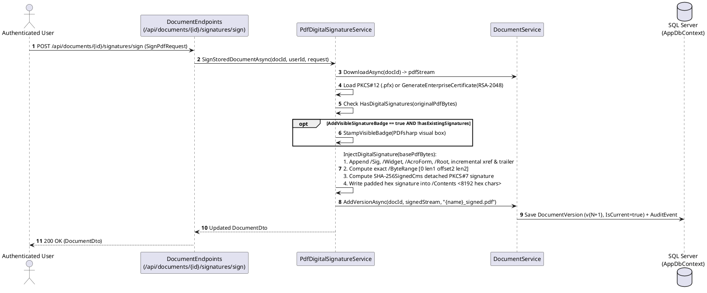

# Module 05: Document Management, PDF Editor, and Digital Signatures

**Purpose:** Document the repository explorer, folder hierarchy management, PDF split/merge utilities, interactive browser-based PDF editor (`PdfEngine`), and PAdES PKCS#7 detached cryptographic digital signatures (`PdfDigitalSignatureService`).  
**Scope:** `DocumentService`, `PdfEngine`, `PdfDigitalSignatureService`, `DocumentEndpoints`, `EditorEndpoints`, `Documents.razor`, `PdfEditor.razor`, and `Tools.razor`.  
**Evidence status:** `Code-verified` & `Runtime-verified` (`DocumentSecurityAndIdorTests`, `PdfEngineTests`, `PdfDigitalSignatureTests`, `PdfSplitTests`, `PdfMergeTests`).  
**Last reviewed:** 2026-11-05

---

## 1. Purpose

This module provides the core interactive document workspace: organizing documents into nested folders, inspecting metadata, splitting and merging PDFs, editing PDF pages/annotations/redactions/forms in the browser (`/editor/{DocumentId:guid}`), and applying or verifying ISO 32000-1 / PAdES cryptographic digital signatures.

---

## 2. Features

### 2.1 Repository & Folder Management (`DocumentService`)
- **Hierarchical Folders (`dbo.Folders`):** Create, rename, and delete folders with optional `ParentFolderId` nesting and circular-reference detection (`MoveFolderInternalAsync`).
- **Document Operations:** List/search documents by folder, status, or filename substring; rename documents (`DisplayNameRules`); move single or batch documents/folders (`BatchMoveAsync`); download single documents (`inline` preview or `attachment`) or multi-document `.zip` archives (`DownloadBatchZipAsync`).
- **PDF Split (`SplitPdfAsync`):** Three modes via `PDFsharp`:
  1. `divide_two` — Splits a PDF at `SplitAtPage` into `{name}_part1_p1-{k}.pdf` and `{name}_part2_p{k+1}-{N}.pdf`.
  2. `extract_range` — Extracts custom page ranges (e.g., `"2, 4-5"`) into a new PDF document.
  3. `burst_all` — Splits an $N$-page PDF into $N$ individual single-page PDF documents (`{name}_p1.pdf`, ..., `{name}_pN.pdf`).
- **PDF Merge (`MergeDocumentsAsync`):** Combines 2 or more PDFs (with custom ordering and per-document `PageRanges` filtering) into a single new repository document.

### 2.2 Interactive Browser PDF Editor (`PdfEngine` & `EditorEndpoints`)
- **Page Structure Mutations:** `rotate-page` (90/180/270 degrees), `delete-page`, `duplicate-page`, `move-page` (reorder), `insert-blank-page`, `extract-pages`, and `merge-pages`.
- **Visual Annotations & Markups:** `add-text`, `add-highlight` (semi-transparent yellow/color overlay), `add-underline`, `add-strikethrough`, `add-shape` (`rect`, `ellipse`/`circle`, `line`, `arrow`), `add-ink` (freehand polyline points), `add-note` (sticky note callout card), `add-stamp` / `stamp` (e.g., `APPROVED`, `CONFIDENTIAL` with signer & timestamp), `add-watermark` (45-degree rotated translucent overlay), and `add-signature` / `add-image` (base64 PNG/JPEG).
- **Cryptographic/Visual Redaction (`add-redaction` / `redaction`):** Burns an opaque blackout (`#000000`) or whiteout (`#FFFFFF`) rectangle with optional overlay label (`[REDACTED]`) onto the page and scrubs document metadata (`Author`, `Subject`, `Keywords`, `Creator` cleared in `PdfEngine.cs`, lines 663–669).
- **AcroForm Field Creation & Filling (`form-field` / `set-form-field`):** Reads and populates PDF `/AcroForm` fields (`GetFormFieldsAsync`) and burns visual values onto pages.
- **PDF Password Encryption (`ProtectDocumentAsync`):** Encrypts PDFs with User and Owner passwords and granular print/extract permissions (`PdfStandardSecuritySettings`).
- **Direct Format Exports:** Exports edited PDF streams directly to `.docx` (`ExportToDocxAsync`) or `.xlsx` (`ExportToXlsxAsync`).

### 2.3 PAdES Cryptographic Digital Signatures (`PdfDigitalSignatureService`)
- **X.509 Certificate Support:** Accepts user-uploaded `.pfx`/`.p12` PKCS#12 certificates (`CertificatePfxBytes` + `CertificatePassword`) or generates a 2048-bit RSA self-signed enterprise certificate (`GenerateEnterpriseCertificate` with Key Usage `DigitalSignature | NonRepudiation` and EKU `1.3.6.1.4.1.311.10.3.12` Document Signing, cached in `EnterpriseCertCache`).
- **PDF Incremental Update Signing (`InjectDigitalSignature`):** Appends `/Type /Sig` (`/Filter /Adobe.PPKLite`, `/SubFilter /adbe.pkcs7.detached`), `/Type /Annot /Subtype /Widget /FT /Sig`, `/AcroForm` (`/SigFlags 3`), and an incremental `xref` and `trailer` (`/Prev`) without rewriting prior bytes, preserving existing signatures in multi-signer workflows.
- **Cryptographic Verification (`VerifyPdfBytes`):** Parses all `/ByteRange [ o1 l1 o2 l2 ]` and `/Contents <hex>` blocks, reconstructs the signed byte ranges, decodes the ASN.1 DER CMS package via `SignedCms`, and executes `signedCms.CheckSignature(verifySignatureOnly: true)` to detect any post-signing tampering.

---

## 3. Business Rules

1. **Strict Ownership Isolation (`DocumentService.cs`):** Every document and folder operation queries `WHERE Id == id AND OwnerUserId == userId`. Non-owners receive `KeyNotFoundException` (mapped to HTTP `404 Not Found` to prevent existence enumeration).
2. **Display Name Validation (`DisplayNameRules.Validate`):** Document and folder names cannot be empty, exceed 200 characters, equal `"."` or `".."`, or contain path separators or invalid characters.
3. **Multi-Signer Badge Rule (`PdfDigitalSignatureService.cs`, lines 134–148):** Visible signature badge stamping via `PDFsharp` (`StampVisibleBadge`) rewrites the PDF object graph, which would invalidate prior `/ByteRange` digests. Therefore, `StampVisibleBadge` is executed **only if the PDF has no existing digital signatures** (`!hasExistingSignatures`); subsequent signatures are appended purely via PDF incremental update (`InjectDigitalSignature`).
4. **Minimum Merge Count (`DocumentService.MergeDocumentsAsync`, line 1277):** Merging requires at least 2 source documents (`request.SourceDocuments.Count < 2` throws `ArgumentException`).

---

## 4. Processing Flow: PAdES Digital Signing and Verification

**Diagram Explanation & Evidence**
- Verified from `src/DocumentConverter.Infrastructure/Documents/PdfDigitalSignatureService.cs` (lines 89–442).

---

## 5. Related Classes and Methods

- `src/DocumentConverter.Infrastructure/Documents/DocumentService.cs` — `GetAsync`, `DownloadAsync`, `ListAsync`, `RenameAsync`, `MoveToFolderAsync`, `BatchMoveAsync`, `DownloadBatchZipAsync`, `CreateFolderAsync`, `RenameFolderAsync`, `DeleteFolderAsync`, `ListFoldersAsync`, `GetPdfMetadataAsync`, `SplitPdfAsync`, `MergeDocumentsAsync`
- `src/DocumentConverter.Infrastructure/Editor/PdfEngine.cs` — `ApplyOperationsAsync`, `ExtractPagesAsync`, `ExportToDocxAsync`, `ExportToXlsxAsync`, `MergePagesAsync`, `GetFormFieldsAsync`, `ProtectDocumentAsync`, `CompressPdfAsync`
- `src/DocumentConverter.Infrastructure/Documents/PdfDigitalSignatureService.cs` — `GenerateEnterpriseCertificate`, `SignPdfAsync`, `VerifySignaturesAsync`, `VerifyDocumentSignaturesAsync`, `SignStoredDocumentAsync`
- `src/DocumentConverter.Web/Endpoints/DocumentEndpoints.cs` & `EditorEndpoints.cs`

---

## 6. Database Dependencies

- `dbo.Documents`, `dbo.Folders`, `dbo.DocumentVersions`, `dbo.AuditEvents`

---

## 7. API Endpoints

See [API Documentation](../06-api/api-documentation.md) Sections 3.2 (`/api/documents` and `/api/folders`) and 3.3 (`/api/editor`) for the full contract of all 33 endpoints in this module.

---

## 8. Error Handling and Security Considerations

- **IDOR Prevention (`Runtime-verified` in `DocumentSecurityAndIdorTests`, `PdfSplitTests`, `PdfMergeTests`):** Attempting to read, download, rename, move, split, merge, edit, or sign another user's document or folder throws `KeyNotFoundException` (`404 Not Found`).
- **Redaction Caveat (`PdfEngine.cs`, lines 625–670):** `ApplyOperationsAsync` burns an opaque rectangle over the target coordinates on the PDF page graphics canvas and clears document-level metadata (`Author`, `Subject`, `Keywords`, `Creator`), but does not parse and remove underlying glyph operators from the raw PDF content stream if text existed underneath the rectangle. Users requiring complete glyph removal should rasterize/OCR or verify redaction output.

