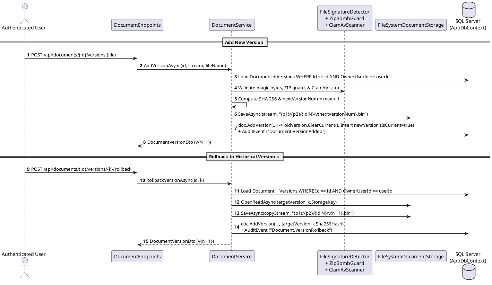

# Module 06: Document Versioning, Diffing, and Rollback

**Purpose:** Document the immutable document versioning lifecycle (`dbo.DocumentVersions`), non-destructive version rollback, and Longest Common Subsequence (LCS) line-by-line version/document comparison.  
**Scope:** `Document.AddVersion` (`src/DocumentConverter.Domain/Documents/Document.cs`), `DocumentService` (`AddVersionAsync`, `RollbackVersionAsync`, `GetVersionsAsync`, `CompareVersionsAsync`, `CompareDocumentsAsync`), `DocumentEndpoints.cs`, `VersionHistoryDialog.razor`, `DocumentVersionsDialog.razor`, and `DocumentDiffDialog.razor`.  
**Evidence status:** `Code-verified` & `Runtime-verified` (`DocumentLifecycleTests`, `DocumentVersioningDiffTests`).  
**Last reviewed:** 2026-11-05

---

## 1. Purpose

The Document Versioning module maintains a complete, append-only revision history for every document in the repository. Rather than overwriting files in place when a document is updated, edited in the PDF Editor, or digitally signed, the system creates a new numbered `DocumentVersion` (`v1.bin`, `v2.bin`, `v3.bin`), computes its cryptographic `SHA-256` digest, and supports non-destructive rollback and line-by-line text comparison across versions or distinct documents.

---

## 2. Features

- **Immutable Version Addition (`AddVersionAsync`):** Runs the full security validation pipeline (magic-byte check, ZIP-bomb/macro check, EICAR + ClamAV malware scan), writes a new sharded blob (`{p1}/{p2}/{docId:N}/v{N+1}.bin`), demotes the previous current version (`IsCurrent = false`), and promotes the new version (`IsCurrent = true`), updating the parent `Document.StorageKey`, `SizeBytes`, and `Sha256Hash`.
- **Non-Destructive Version Rollback (`RollbackVersionAsync`):** Restores a historical version `k` without deleting versions `k+1..N` by reading version `k`'s stream from storage and creating a new current version `N+1` with identical content and `SHA-256` hash (`Runtime-verified` in `DocumentVersioningDiffTests.RollbackVersionAsync_CreatesNewCurrentVersion_RestoringTargetContent`).
- **Historical Version Download (`DownloadAsync`):** Allows users to download either the active current version (`versionId = null`) or any historical `DocumentVersion.Id`.
- **Line-by-Line Version & Cross-Document Diffing (`CompareVersionsAsync` & `CompareDocumentsAsync`):** Extracts text from PDFs (`PdfPig`), Word documents (`OpenXml`), or text-based formats (`.txt`, `.md`, `.csv`, `.json`, `.xml`, `.html`) and computes a Longest Common Subsequence (LCS) line diff (`Added`, `Deleted`, `Unchanged`) capped at 2,000 lines per side for deterministic memory bounds.

---

## 3. Business Rules

1. **Available State Requirement (`Document.AddVersion`, lines 187–190):** A new version can only be added when `Document.Status == DocumentStatus.Available`; otherwise `InvalidStateTransitionException` is thrown.
2. **Sequential Version Numbering (`Document.AddVersion`, line 192):** `nextVersionNumber = _versions.Count == 0 ? 1 : _versions.Max(v => v.VersionNumber) + 1`.
3. **Unique `(DocumentId, VersionNumber)` Constraint:** Enforced in SQL Server via unique index `IX_DocumentVersions_DocumentId_VersionNumber` (`DocumentConfigurations.cs`).
4. **Rollback Target Validation (`RollbackVersionAsync`, lines 770–778):** If the target version is already `IsCurrent == true`, `DomainException("Version is already the current version.")` is thrown.
5. **RAG Re-Indexing Nuance (`Code-verified` Limitation):** Neither `AddVersionAsync` nor `RollbackVersionAsync` automatically re-queues the document on `IDocumentIndexingChannel` or evicts `DocumentIndexCache`. Users or workflows must invoke `POST /api/ai/documents/{id:guid}/reindex` if RAG vectors need to reflect the newly added version.

---

## 4. Input and Output

| Method (`IDocumentService`) | Input | Output |
|---|---|---|
| `AddVersionAsync` | `Guid documentId`, `Stream content`, `string fileName` | `DocumentVersionDto` (Id, VersionNumber, SizeBytes, Sha256Hash, IsCurrent=`true`, CreatedAt) |
| `GetVersionsAsync` | `Guid documentId` | `IReadOnlyList<DocumentVersionDto>` (ordered by `VersionNumber DESC`) |
| `RollbackVersionAsync` | `Guid documentId`, `int versionNumber` | `DocumentVersionDto` (newly created version `N+1` with restored content) |
| `CompareVersionsAsync` | `Guid documentId`, `int versionNumberA`, `int versionNumberB` | `DocumentDiffResultDto` (HasContentChanged, IsTextComparable, SizeDeltaBytes, TextDiffLines) |
| `CompareDocumentsAsync` | `Guid documentIdA`, `Guid documentIdB` | `DocumentDiffResultDto` |

---

## 5. Processing Flow

**Diagram Explanation & Evidence**
- Verified from `src/DocumentConverter.Infrastructure/Documents/DocumentService.cs` (`AddVersionAsync`, lines 190–298; `RollbackVersionAsync`, lines 753–825).

---

## 6. Related Classes and Methods

- `src/DocumentConverter.Domain/Documents/Document.cs` — `AddVersion`
- `src/DocumentConverter.Domain/Documents/DocumentVersion.cs` — `Create`, `ClearCurrent`
- `src/DocumentConverter.Infrastructure/Documents/DocumentService.cs` — `AddVersionAsync`, `GetVersionsAsync`, `RollbackVersionAsync`, `CompareVersionsAsync`, `CompareDocumentsAsync`, `ExtractComparableTextAsync`, `ComputeLineDiff`
- `src/DocumentConverter.Web/Components/Pages/Documents/Dialogs/VersionHistoryDialog.razor`, `DocumentVersionsDialog.razor`, `DocumentDiffDialog.razor`

---

## 7. Database Dependencies

- `dbo.Documents` (updates `StorageKey`, `SizeBytes`, `Sha256Hash`, `UpdatedAt`)
- `dbo.DocumentVersions` (inserts new `DocumentVersion` row and updates previous `IsCurrent = 0`)
- `dbo.AuditEvents` (records `Document.VersionAdded`, `Document.VersionRejected`, `Document.VersionRollback`)

---

## 8. API Endpoints

| Method | Route | Auth / Rate Limit | Purpose |
|---|---|---|---|
| `GET` | `/api/documents/{id:guid}/versions` | Authenticated | Lists all versions of a document (`VersionNumber DESC`). |
| `POST` | `/api/documents/{id:guid}/versions` | Authenticated, `DisableAntiforgery`, RateLimit `upload` (30/min) | Uploads a new version for an existing document. |
| `POST` | `/api/documents/{id:guid}/versions/{versionNumber:int}/rollback` | Authenticated | Rolls back a document to `versionNumber` by creating version `N+1`. |
| `GET` | `/api/documents/{id:guid}/versions/diff?v1={int}&v2={int}` | Authenticated | Computes line-by-line text diff and metadata delta between two versions. |
| `POST` | `/api/documents/compare` | Authenticated | Computes line-by-line text diff between two distinct documents (`CompareDocumentsRequest`). |

---

## 9. Error Handling and Security Considerations

- **Full Antivirus & Signature Re-Verification on Every Version:** `AddVersionAsync` applies the exact same `FileSignatureDetector`, `ZipBombGuard`, and `ClamAvScanner` checks as initial upload, preventing an attacker from uploading a clean `v1` and replacing it with an infected or spoofed `v2` (`Runtime-verified` in `Milestone8SecurityHardeningTests.AddVersion_WithEicarMalware_ShouldRejectAndAudit`).
- **Memory-Bounded LCS Diffing (`DocumentService.ComputeLineDiff`, lines 1020–1025):** Truncates inputs exceeding `maxLines = 2000` lines per version before allocating the `int[n+1, m+1]` LCS dynamic programming matrix to prevent Out-Of-Memory (OOM) denial-of-service on huge text files.

