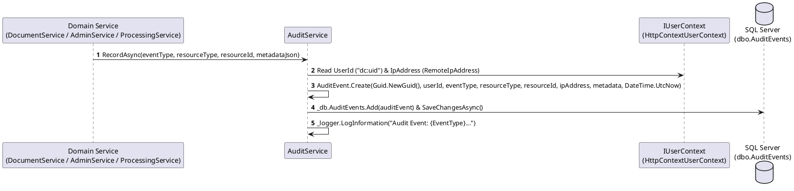

# Module 07: Audit Logging

**Purpose:** Document the append-only security and operational audit logging subsystem (`IAuditService`, `AuditService`, `dbo.AuditEvents`) and administrative audit log inspection interface.  
**Scope:** `src/DocumentConverter.Domain/Security/AuditEvent.cs`, `src/DocumentConverter.Application/Security/IAuditService.cs`, `src/DocumentConverter.Infrastructure/Security/AuditService.cs`, `src/DocumentConverter.Infrastructure/Admin/AdminService.cs`, and `src/DocumentConverter.Web/Components/Pages/Admin/SecurityAuditLog.razor`.  
**Evidence status:** `Code-verified` & `Runtime-verified` (`Milestone8SecurityHardeningTests`).  
**Last reviewed:** 2026-11-05

---

## 1. Purpose

The Audit Logging module provides an append-only, tamper-evident operational trail in SQL Server (`dbo.AuditEvents`) recording security-relevant actions across document ingestion, malware rejection, downloads, versioning, deletion/purging, conversion job execution, and system administration, enriched automatically with the acting user's internal `UserId` (`dc:uid`) and client `IpAddress`.

---

## 2. Features

- **Automatic Context Enrichment (`AuditService.RecordAsync`):** Captures `_userContext.UserId` and `_userContext.IpAddress` automatically from the active HTTP request or Blazor circuit without requiring callers to pass identity parameters manually.
- **Structured JSON Metadata:** Stores event-specific diagnostic payloads (such as `SHA-256` hashes, malware threat names, version numbers, converter keys, and setting deltas) in `dbo.AuditEvents.Metadata` (`nvarchar(4000)`).
- **Administrative Filtering & Search (`AdminService.GetAuditLogsAsync`):** Allows administrators in `/admin/audit-log` (`SecurityAuditLog.razor`) to filter up to 500 recent events by `EventType`, `SearchTerm` (matching `EventType`, `ResourceType`, `Metadata`, `IpAddress`, or `UserEmail`), `FromDate`, and `ToDate`.

---

## 3. Catalog of Audited Event Types (`Code-verified`)

Every `RecordAsync` call across the entire solution has been inventoried below:

| Category | EventType String | ResourceType | Trigger Location | Metadata Recorded |
|---|---|---|---|---|
| **Document Ingestion & Security** | `Document.Uploaded` | `Document` | `DocumentService.UploadAsync` (L164) | `fileName`, `sizeBytes`, `sha256` |
| **Document Ingestion & Security** | `Document.UploadRejected` | `Document` | `DocumentService.UploadAsync` (L114) | `fileName`, `threat` (e.g., `Eicar-Test-Signature`, `ScannerUnavailable`) |
| **Document Access** | `Document.Downloaded` | `Document` | `DocumentService.DownloadAsync` (L358) | `versionNumber` |
| **Document Organization** | `Document.Renamed` | `Document` | `DocumentService.RenameAsync` (L414) | `newName` |
| **Document Organization** | `Document.Moved` | `Document` | `DocumentService.MoveToFolderAsync` (L455) | `folderId` |
| **Document Organization** | `Document.BatchMoved` | `Document` | `DocumentService.BatchMoveAsync` (L687) | `documentCount`, `folderCount`, `targetFolderId` |
| **Document Manipulation** | `Document.Split` | `Document` | `DocumentService.SplitPdfAsync` (L1249) | `mode`, `partsCreated` |
| **Document Manipulation** | `Document.Merged` | `Document` | `DocumentService.MergeDocumentsAsync` (L1436) | `sourceCount`, `totalPages`, `outputFileName` |
| **Versioning** | `Document.VersionAdded` | `Document` | `DocumentService.AddVersionAsync` (L275) | `versionNumber`, `sizeBytes`, `sha256` |
| **Versioning** | `Document.VersionRejected` | `Document` | `DocumentService.AddVersionAsync` (L234) | `fileName`, `threat` |
| **Versioning** | `Document.VersionRollback` | `Document` | `DocumentService.RollbackVersionAsync` (L806) | `restoredFromVersion`, `newVersionNumber` |
| **Retention & Deletion** | `Document.Deleted` | `Document` | `DocumentService.DeleteAsync` (L384) | `null` |
| **Retention & Deletion** | `Document.BatchDeleted` | `Document` | `DocumentService.BatchDeleteAsync` (L741) | `documentCount`, `folderCount` |
| **Retention & Deletion** | `Document.Restored` | `Document` | `DocumentService.RestoreAsync` (L1464) | `null` |
| **Retention & Deletion** | `Document.BatchRestored` | `Document` | `DocumentService.BatchRestoreAsync` (L1494) | `restoredCount` |
| **Retention & Deletion** | `Document.Purged` | `Document` | `DocumentService.PurgeDocumentAsync` (L1527) | `fileName` |
| **Retention & Deletion** | `Document.RecycleBinEmptied` | `Document` | `DocumentService.EmptyRecycleBinAsync` (L1553) | `purgedCount` |
| **Folders** | `Folder.Created` | `Folder` | `DocumentService.CreateFolderAsync` (L522) | `name`, `parentFolderId` |
| **Folders** | `Folder.Renamed` | `Folder` | `DocumentService.RenameFolderAsync` (L554) | `newName` |
| **Folders** | `Folder.Deleted` | `Folder` | `DocumentService.DeleteFolderAsync` (L585) | `null` |
| **Processing Jobs** | `ProcessingJob.Submitted` | `ProcessingJob` | `ProcessingService.CreateJobAsync` (L100) | `converterKey`, `inputDocumentId` |
| **Processing Jobs** | `ProcessingJob.Cancelled` | `ProcessingJob` | `ProcessingService.CancelJobAsync` (L341) | `status` |
| **Batch Jobs** | `BatchJob.Submitted` | `BatchJob` | `ProcessingService.CreateBatchAsync` (L199) | `converterKey`, `totalJobs`, `combineOutput` |
| **Batch Jobs** | `BatchJob.Cancelled` | `BatchJob` | `ProcessingService.CancelBatchAsync` (L390) | `totalJobs` |
| **Administration** | `Admin.SettingUpdated` | `SystemSetting` | `AdminService.UpdateSettingAsync` (L133) | `key`, `value` |
| **Administration** | `Admin.UserRoleUpdated` | `User` | `AdminService.SetUserRoleAsync` (L214) | `email`, `isAdmin` |
| **Administration** | `Admin.UserDepartmentUpdated` | `User` | `AdminService.SetUserDepartmentAsync` (L234) | `email`, `departmentId` |
| **Administration** | `Admin.UserStatusToggled` | `User` | `AdminService.ToggleUserStatusAsync` (L259) | `email`, `isActive` |
| **Administration** | `Admin.DepartmentCreated` | `Department` | `AdminService.CreateDepartmentAsync` (L277) | `name` |
| **Administration** | `Admin.UserCreated` | `User` | `AdminService.CreateUserAsync` (L352) | `email`, `isAdmin`, `departmentId` |
| **Administration** | `Admin.ConverterToggled` | `Converter` | `AdminService.ToggleConverterAsync` (L407) | `key`, `enabled` |
| **Administration** | `Admin.ConverterLimitsUpdated` | `Converter` | `AdminService.UpdateConverterLimitsAsync` (L422) | `key`, `maxInputSizeBytes`, `maxPages` |

---

## 4. Processing Flow

**Diagram Explanation & Evidence**
- Verified from `src/DocumentConverter.Infrastructure/Security/AuditService.cs` (lines 22–52).

---

## 5. Related Classes and Methods

- `src/DocumentConverter.Domain/Security/AuditEvent.cs` — `Create`
- `src/DocumentConverter.Application/Security/IAuditService.cs` — `RecordAsync`
- `src/DocumentConverter.Infrastructure/Security/AuditService.cs` — `RecordAsync`
- `src/DocumentConverter.Infrastructure/Admin/AdminService.cs` — `GetAuditLogsAsync`, `GetAuditDistinctEventTypesAsync`
- `src/DocumentConverter.Web/Components/Pages/Admin/SecurityAuditLog.razor`

---

## 6. Database Dependencies

- `dbo.AuditEvents` (indexed on `EventType`, `UserId`, and `OccurredAt` via `SystemConfigurations.cs`)
- `dbo.Users` (joined in `AdminService.GetAuditLogsAsync` to resolve `UserEmail` for display)

---

## 7. Security Considerations and Known Gaps

- **Append-Only Application Semantics:** No method in `IAuditService`, `IAdminService`, or any endpoint updates or deletes rows in `dbo.AuditEvents`.
- **Sensitive Value Redaction Gap in `Admin.SettingUpdated` (`Code-verified`):** In `AdminService.UpdateSettingAsync` (lines 133–138), when a system setting is updated, `Metadata` serializes `new { key, value }`. If an administrator updates `AI.ApiKey` via `SaveAiProviderConfigAsync` -> `AdminService.UpdateSettingAsync`, the API key value is written into `dbo.AuditEvents.Metadata`. See [Security and Data Governance](../07-security-governance/security-and-data-governance.md) for the recommended redaction control.
- **Un-audited Flows (`Code-verified`):** Interactive login/logout (`AccountEndpoints.cs`) and AI/RAG query invocations (`DocumentIntelligenceEndpoints.cs`) are logged to standard structured application logs (`ILogger`) rather than `dbo.AuditEvents`.

