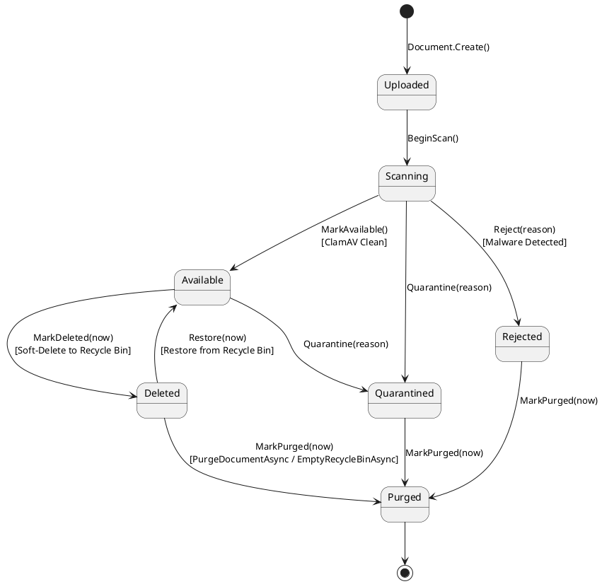
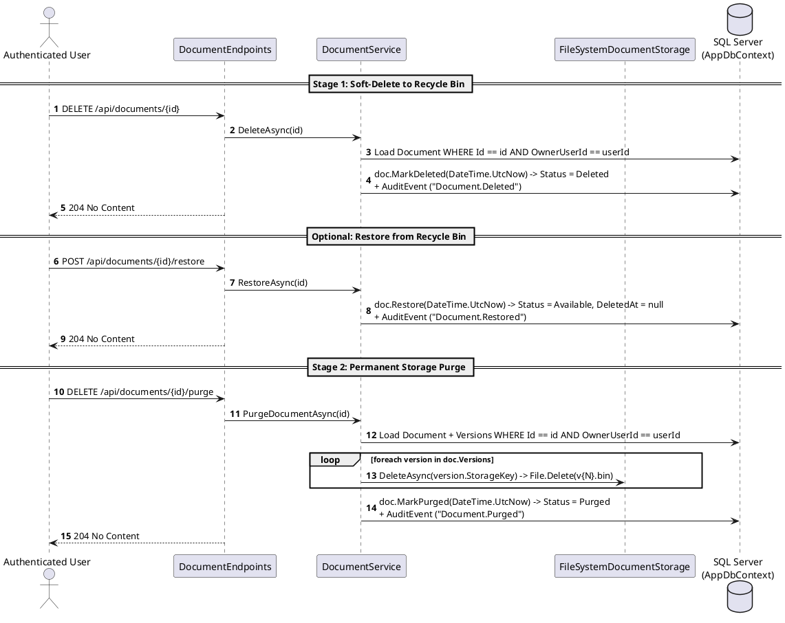

# Module 08: Retention and Deletion (Recycle Bin and Purge)

**Purpose:** Document the document lifecycle state machine (`DocumentStatus`), two-stage deletion workflow (Recycle Bin soft-delete vs. permanent storage purge), restoration capabilities, and the exact verification status of automated retention enforcement and RAG derived-data cleanup.  
**Scope:** `src/DocumentConverter.Domain/Documents/Document.cs`, `DocumentStatus.cs`, `src/DocumentConverter.Infrastructure/Documents/DocumentService.cs`, `src/DocumentConverter.Web/Endpoints/DocumentEndpoints.cs`, and `src/DocumentConverter.Infrastructure/Persistence/DbSeeder.cs`.  
**Evidence status:** `Code-verified` & `Runtime-verified` (`DocumentLifecycleTests`, `DocumentSecurityAndIdorTests`).  
**Last reviewed:** 2026-11-05

---

## 1. Purpose

The Retention and Deletion module governs the end-of-life stages of repository documents. To prevent accidental data loss while supporting permanent erasure of storage binaries, the system implements a two-stage deletion lifecycle:
1. **Stage 1 — Soft Delete (`DocumentStatus.Deleted` / Recycle Bin):** Hides the document from standard repository listings and blocks downloads, while preserving all version binaries on disk so the owner can restore the document (`RestoreAsync`).
2. **Stage 2 — Permanent Purge (`DocumentStatus.Purged`):** Permanently deletes all physical version binaries (`v1.bin`, `v2.bin`, ...) from `FileSystemDocumentStorage` (`PurgeDocumentAsync` / `EmptyRecycleBinAsync`) while retaining a tombstoned metadata row (`Status = Purged`) in `dbo.Documents` for audit trail integrity.

---

## 2. Document Lifecycle State Machine (`DocumentStatus`)

**Diagram Explanation & Evidence**
- Verified from `src/DocumentConverter.Domain/Documents/Document.cs` (lines 118–260) and `tests/DocumentConverter.Domain.Tests/DocumentLifecycleTests.cs`.
- Attempting to transition directly from `Uploaded` or `Available` to `Purged` via `Document.MarkPurged` throws `InvalidStateTransitionException` (`Cannot transition from Available to Purged`). Note that in `DocumentService.PurgeDocumentAsync` (lines 1516–1520), if a user calls `PurgeDocumentAsync` on a document that is not yet in `Deleted`, `Rejected`, or `Quarantined`, `PurgeDocumentAsync` first calls `doc.MarkDeleted(now)` and then `doc.MarkPurged(now)`.

---

## 3. Features

- **Single & Batch Soft-Delete (`DeleteAsync` & `BatchDeleteAsync`):** Moves one or multiple documents (and recursively deletes empty/selected folder structures) into the `Deleted` state (`DeletedAt = DateTime.UtcNow`).
- **Single & Batch Restore (`RestoreAsync` & `BatchRestoreAsync`):** Restores `Deleted` documents back to `Available` (`DeletedAt = null`).
- **Single Document Purge (`PurgeDocumentAsync`):** Iterates through all `doc.Versions`, calls `await _storage.DeleteAsync(version.StorageKey)` to erase every physical `.bin` file on disk, transitions `doc.Status` to `Purged`, and records `Document.Purged` in `dbo.AuditEvents`.
- **Empty Recycle Bin (`EmptyRecycleBinAsync`):** Queries all documents owned by the current user with `Status == DocumentStatus.Deleted`, deletes all physical version binaries from storage, marks all matching documents `Purged`, and records `Document.RecycleBinEmptied`.

---

## 4. Business Rules and Verified Implementation Gaps

### 4.1 Implemented Business Rules (`Code-verified`)
1. **Download Blocked When Deleted or Purged (`DocumentService.DownloadAsync`, lines 318–321):** `DownloadAsync` enforces `if (doc.Status != DocumentStatus.Available) throw new DomainException($"Document cannot be downloaded in status {doc.Status}.")`.
2. **Default Repository Listing Excludes Deleted & Purged (`DocumentService.ListAsync`, lines 494–497):** When no `status` filter is passed, `ListAsync` applies `.Where(d => d.Status != DocumentStatus.Deleted && d.Status != DocumentStatus.Purged)`. Passing `status = "Deleted"` returns only Recycle Bin items.
3. **Repository-Wide RAG Search Excludes Deleted & Purged (`DocumentIntelligenceService.SemanticSearchRepositoryAsync`, line 599):** The Stage 1 SQL coarse filter queries `.Where(d => d.Status == DocumentStatus.Available && d.OwnerUserId == currentUserId.Value)`, ensuring soft-deleted and purged documents are excluded from Enterprise Copilot repository searches.

### 4.2 Partially Implemented / Missing Lifecycle Behaviors (`Code-verified` Gaps)
Per Mandatory Analysis Rules 9 and 10, the following retention and derived-data lifecycle gaps are documented from source evidence:

| Area | Evidence in Codebase | Actual Behavior (`Code-verified`) | Status |
|---|---|---|---|
| **Automated Retention Expiration (`Retention.Days` & `ExpiresAt`)** | `DbSeeder.cs` (L190) seeds `Retention.Days = "90"`. `Document.cs` (L35) defines `DateTime? ExpiresAt` (indexed via `IX_Documents_ExpiresAt`). | `UploadAsync` passes `ExpiresAt: null` when creating documents, and **no `BackgroundService` or scheduled job queries `ExpiresAt` or `Retention.Days`**. Expiration is not automatically enforced. | **Partially Implemented** (Schema & setting exist; background enforcement worker not implemented). |
| **Database Vector Chunks (`dbo.DocumentVectorChunks`) & Insights (`dbo.DocumentIntelligenceIndices`) on Purge** | `DocumentConfigurations.cs` configures `ON DELETE CASCADE` on `DocumentId`. However, `DocumentService.PurgeDocumentAsync` (L1501–1529) transitions `doc.Status = DocumentStatus.Purged` rather than calling `_db.Documents.Remove(doc)`. | Because the `dbo.Documents` row is retained as a `Purged` tombstone and not physically deleted from SQL Server, `ON DELETE CASCADE` never fires. Derived rows in `dbo.DocumentVectorChunks` and `dbo.DocumentIntelligenceIndices` remain in SQL Server after `PurgeDocumentAsync`. | **Gap Identified** (`PurgeDocumentAsync` deletes physical storage `.bin` files but does not delete `DocumentVectorChunks` or `DocumentIntelligenceIndices` rows). |
| **In-Memory RAG Caches (`DocumentIndexCache` & `GlobalHnswIndex`) on Soft-Delete / Purge** | `DocumentIntelligenceService.cs` (L37–42) holds static `DocumentIndexCache` and `GlobalHnswIndex`. | `DocumentService.DeleteAsync` and `PurgeDocumentAsync` do not notify `DocumentIntelligenceService` to evict `DocumentIndexCache`. Furthermore, while `SemanticSearchRepositoryAsync` filters by `Status == Available`, single-document AI methods (`AnalyzeDocumentAsync`, `AskQuestionAsync`, `SemanticSearchAsync`) only check `OwnerUserId == currentUserId` in `EnsureUserHasDocumentAccessAsync` and do not check `Status == Available`. | **Gap Identified** (Owner can still query cached/persisted single-document AI endpoints for a soft-deleted or purged `documentId`). |

---

## 5. Processing Flow: Soft-Delete, Restore, and Purge

**Diagram Explanation & Evidence**
- Verified from `src/DocumentConverter.Infrastructure/Documents/DocumentService.cs` (`DeleteAsync` L368–386, `RestoreAsync` L1448–1466, `PurgeDocumentAsync` L1501–1530).

---

## 6. Related Classes and Methods

- `src/DocumentConverter.Domain/Documents/Document.cs` — `MarkDeleted`, `Restore`, `MarkPurged`
- `src/DocumentConverter.Domain/Documents/DocumentStatus.cs` — Enum values (`Uploaded`, `Scanning`, `Available`, `Rejected`, `Quarantined`, `Deleted`, `Purged`)
- `src/DocumentConverter.Infrastructure/Documents/DocumentService.cs` — `DeleteAsync`, `BatchDeleteAsync`, `RestoreAsync`, `BatchRestoreAsync`, `PurgeDocumentAsync`, `EmptyRecycleBinAsync`
- `src/DocumentConverter.Web/Endpoints/DocumentEndpoints.cs`

---

## 7. API Endpoints

| Method | Route | Auth | Purpose |
|---|---|---|---|
| `DELETE` | `/api/documents/{id:guid}` | Authenticated | Soft-deletes a document (`Status = Deleted`). |
| `POST` | `/api/documents/batch-delete` | Authenticated | Soft-deletes multiple documents and folders (`BatchDeleteRequest`). |
| `POST` | `/api/documents/{id:guid}/restore` | Authenticated | Restores a soft-deleted document to `Available`. |
| `POST` | `/api/documents/batch-restore` | Authenticated | Restores multiple soft-deleted documents (`BatchRestoreRequest`). |
| `DELETE` | `/api/documents/{id:guid}/purge` | Authenticated | Permanently deletes all physical version blobs and sets `Status = Purged`. |
| `DELETE` | `/api/documents/recycle-bin/empty` | Authenticated | Permanently purges all documents in the user's Recycle Bin (`Status == Deleted`). |

