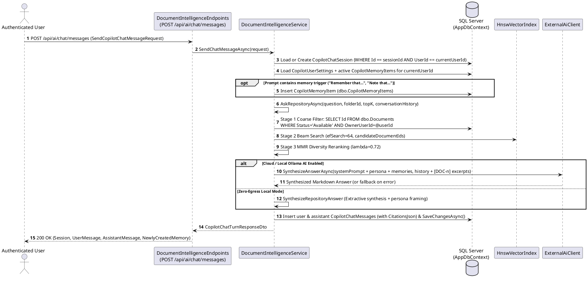

# Module 09: RAG Knowledge Management and Enterprise Copilot

**Purpose:** Provide the functional module overview of the RAG Knowledge Management and Enterprise Copilot subsystem (Single-Document Intelligence, Repository-Wide Semantic Search, Multi-Turn Chat Sessions, Long-Term User Memory, Cross-Document Comparison Matrices, Enterprise Knowledge Graph, and Dossier Exports).  
**Scope:** `IDocumentIntelligenceService`, `DocumentIntelligenceService`, `HnswVectorIndex`, `MultilingualChunkProcessor`, `DocumentLanguageDetector`, `ExternalAiClient`, `DocumentIndexingChannel`, `DocumentIndexingWorker`, `CopilotDossierExporter`, `EnterpriseAiChatService`, `DocumentIntelligenceEndpoints`, `Copilot.razor`, `AiChatPage.razor`, and `DocumentIntelligenceDialog.razor`.  
**Evidence status:** `Code-verified` & `Runtime-verified` (`DocumentIntelligenceTests`).  
**Last reviewed:** 2026-11-05

> [!NOTE]
> For the deep-dive algorithmic specification of the RAG pipeline (extraction, 180-word/30-word overlap chunking, 10-rule enrichment metadata, 256-D MurmurHash3 + BM25 embeddings, HNSW graph parameters, MMR reranking, and ingestion/query sequence diagrams), see **[RAG Technical Documentation](../08-rag/rag-technical-documentation.md)**.

---

## 1. Purpose

The RAG Knowledge Management module transforms the document repository from a passive file store into an interactive, bilingual (Indonesian & English) knowledge base. It operates under a **Zero-Egress Default** policy (`AI.CloudEnabled = false`), executing text/OCR extraction, vector embedding, HNSW similarity search, entity/risk extraction, and baseline answer synthesis entirely in-process, while allowing administrators or individual users to optionally connect external LLMs (OpenAI, Claude, Gemini, Groq) or a local OpenAI-compatible runtime (e.g., Ollama at `http://localhost:11434/v1`).

---

## 2. Features

1. **Single-Document Intelligence (`AnalyzeDocumentAsync` / `AskQuestionAsync`):**
   - Classifies documents into 8 categories (`Legal Contract & NDA`, `Financial & Invoice`, `Technical & Engineering Spec`, `HR & Resume / Policy`, `Executive & Strategy Report`, `Compliance & Security Audit`, `Research & Academic Paper`, `General Business Document`).
   - Extracts executive summaries, key points, obligation/action items, structured entities (`Financial`, `Date`, `Organization`, `Legal`, `Contact`, `Identifier`), and compliance/PII/contract risk flags (`High`, `Medium`, `Low`).
   - Answers targeted natural-language questions against a single document with page-numbered verbatim citations.
2. **Repository-Wide Enterprise Copilot (`AskRepositoryAsync` / `SemanticSearchRepositoryAsync`):**
   - Executes owner-filtered HNSW + MMR semantic search across all `Available` documents (or scoped to a specific folder).
   - Supports **cross-lingual retrieval** between Bahasa Indonesia (`id`) and English (`en`) via `DocumentLanguageDetector` and `MultilingualChunkProcessor`.
   - Applies **5 Specialist Personas** (`CopilotPersonas` in `DocumentIntelligenceDtos.cs`): `Enterprise Analyst`, `Legal & Compliance Counsel`, `Financial Auditor`, `Technical Architect`, and `Executive Briefing`.
3. **Persistent Multi-Turn Chat & Long-Term User Memory (`dbo.CopilotChatSessions`, `dbo.CopilotMemoryItems`):**
   - Persists user-scoped conversation threads, message history, citations, and follow-up suggestions in SQL Server.
   - Automatically extracts and persists long-term user memories when a prompt begins with directives such as `"Remember that..."`, `"Always remember..."`, or `"Note that..."` (`TryExtractMemoryFromPrompt`), injecting active memories into subsequent prompts.
4. **Cross-Document Comparison Matrix (`CompareDocumentsAsync`):**
   - Compares 2 to 5 documents side-by-side across 6 core contractual/operational dimensions plus user-specified custom dimensions, detecting clause discrepancies, substantive changes (`Modified`, `Added`, `Removed`), and computing an `OverallAlignmentScore`.
5. **Enterprise Knowledge Graph & Financial Tracker (`GetEnterpriseKnowledgeGraphAsync`):**
   - Aggregates cross-document entities, counterparties, monetary obligations, parsed currency values, deadlines, and topic clouds across the user's corpus.
6. **Publication-Ready Dossier Export (`CopilotDossierExporter`):**
   - Exports Copilot synthesis reports, comparison matrices, citations, and financial trackers into `.pdf`, `.docx`, `.xlsx`, or `.md` files.

---

## 3. Business Rules

1. **Strict User Isolation (`EnsureUserHasDocumentAccessAsync` & `ResolveCurrentUserId`):**
   - Single-document operations verify `dbo.Documents.AnyAsync(d => d.Id == documentId && d.OwnerUserId == currentUserId.Value)`. Non-owners receive `UnauthorizedAccessException` (`403 Forbidden`).
   - Repository-wide searches filter `dbo.Documents` by `OwnerUserId == currentUserId.Value && Status == DocumentStatus.Available`.
   - Chat sessions (`dbo.CopilotChatSessions`) and memory items (`dbo.CopilotMemoryItems`) are strictly scoped by `UserId == currentUserId`.
2. **Global vs. Per-User AI Provider Configuration (`GetAiProviderConfigAsync` & `SaveUserAiProviderOverrideAsync`):**
   - Only an `Administrator` can modify global `AI.*` settings in `dbo.SystemSettings`.
   - Standard users saving AI settings via `POST /api/ai/config` store a personal BYOK override (`<<AI_CONFIG>>{json}<<END_AI_CONFIG>>`) inside their own `dbo.CopilotUserSettings.CustomInstructions` row without affecting other users.
3. **Automatic Zero-Egress Fallback:** If `AI.CloudEnabled == true` and `ExternalAiClient.SynthesizeAnswerAsync` throws any exception (e.g., network offline, timeout, or invalid API key), `DocumentIntelligenceService` catches the error, logs a warning, and returns the local deterministic synthesis labeled `"Zero-Egress In-Process RAG (Cloud Fallback)"`.

---

## 4. Processing Flow: Enterprise Copilot Chat Turn with Memory & Citations

**Diagram Explanation & Evidence**
- Verified from `src/DocumentConverter.Infrastructure/AI/DocumentIntelligenceService.cs` (`SendChatMessageAsync`, lines 1353–1536; `AskRepositoryAsync`, lines 730–895).

---

## 5. Related Classes and Methods

- `src/DocumentConverter.Application/AI/IDocumentIntelligenceService.cs`
- `src/DocumentConverter.Infrastructure/AI/DocumentIntelligenceService.cs`
- `src/DocumentConverter.Infrastructure/AI/Hnsw/HnswVectorIndex.cs`
- `src/DocumentConverter.Infrastructure/AI/MultilingualChunkProcessor.cs`
- `src/DocumentConverter.Infrastructure/AI/DocumentLanguageDetector.cs`
- `src/DocumentConverter.Infrastructure/AI/ExternalAiClient.cs`
- `src/DocumentConverter.Infrastructure/AI/CopilotDossierExporter.cs`
- `src/DocumentConverter.Infrastructure/AI/DocumentIndexingChannel.cs`
- `src/DocumentConverter.Web/HostedServices/DocumentIndexingWorker.cs`
- `src/DocumentConverter.Web/Services/EnterpriseAiChatService.cs`
- `src/DocumentConverter.Web/Endpoints/DocumentIntelligenceEndpoints.cs`

---

## 6. Database Dependencies

- `dbo.DocumentIntelligenceIndices`, `dbo.DocumentVectorChunks`
- `dbo.CopilotChatSessions`, `dbo.CopilotChatMessages`, `dbo.CopilotMemoryItems`, `dbo.CopilotUserSettings`
- `dbo.Documents`, `dbo.SystemSettings`

---

## 7. API Endpoints

Exposes 22 endpoints under `/api/ai/*` (`DocumentIntelligenceEndpoints.cs`). See [API Documentation](../06-api/api-documentation.md) Section 3.4 for full request/response contracts.

