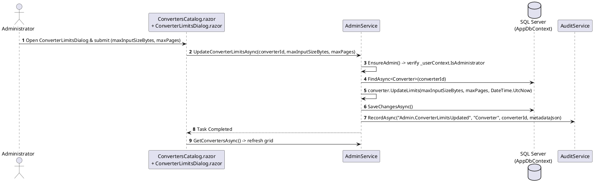

# Module 10: Administrative Functionality

**Purpose:** Document the administrative control plane for converter catalog governance, runtime system settings (`dbo.SystemSettings`), user/department administration, and security audit inspection.  
**Scope:** `src/DocumentConverter.Application/Admin/IAdminService.cs`, `src/DocumentConverter.Infrastructure/Admin/AdminService.cs`, and `src/DocumentConverter.Web/Components/Pages/Admin/*.razor` (`ConvertersCatalog.razor`, `SystemSettings.razor`, `SecurityAuditLog.razor`, `UsersAndDepartments.razor`).  
**Evidence status:** `Code-verified`.  
**Last reviewed:** 2026-11-05

---

## 1. Purpose

The Administrative Functionality module provides a dedicated, role-protected control plane (`/admin/*`, guarded by the `AdminOnly` authorization policy) allowing system administrators to govern platform-wide operational parameters (`dbo.SystemSettings`), enable or disable transformation engines (`dbo.Converters`), tune resource consumption limits (`MaxInputSizeBytes`, `MaxPages`), manage users and departments, and inspect the security audit log (`dbo.AuditEvents`).

---

## 2. Features

1. **Converter Catalog & Resource Limits Governance (`/admin/converters` — `ConvertersCatalog.razor`):**
   - Displays all 17 registered converters along with supported input/output formats, fidelity classification, validation status, and total historical job counts (`TotalJobsRun`).
   - Enables or disables individual converters at runtime (`ToggleConverterAsync`).
   - Updates per-converter `MaxInputSizeBytes` and `MaxPages` limits via `ConverterLimitsDialog.razor` (`UpdateConverterLimitsAsync`).
2. **System Settings Management (`/admin/settings` — `SystemSettings.razor`):**
   - Reads and updates key-value operational settings in `dbo.SystemSettings` (`GetSettingsAsync`, `GetSettingValueAsync`, `UpdateSettingAsync`), creating new keys on the fly if not already present.
   - Manages global AI provider configuration (`AI.CloudEnabled`, `AI.Provider`, `AI.Model`, `AI.ApiKey`, `AI.CustomEndpoint`).
3. **User, Role, and Department Administration (`/admin/users` — `UsersAndDepartments.razor`):**
   - Covered in detail in [Module 02: User and Role Management](02-user-and-role-management.md).
4. **Security Audit Log Explorer (`/admin/audit-log` — `SecurityAuditLog.razor`):**
   - Covered in detail in [Module 07: Audit Logging](07-audit-logging.md).

---

## 3. Business Rules

1. **Mandatory `AdminOnly` Enforcement:**
   - Every Blazor page under `Components/Pages/Admin/` declares `@attribute [Authorize(Policy = "AdminOnly")]`.
   - Every method on `AdminService` except `GetSettingValueAsync` (which is used internally by `DocumentIntelligenceService` to read `AI.*` defaults) calls `EnsureAdmin()`, throwing `UnauthorizedAccessException` if `_userContext.IsAdministrator` is `false`.
2. **Converter Limit Validation (`Converter.UpdateLimits` in `src/DocumentConverter.Domain/Processing/Converter.cs`):**
   - `MaxInputSizeBytes` must be strictly positive (`Guard.AgainstNonPositive`).
   - `MaxPages`, when non-null, must be strictly positive.

---

## 4. Input and Output

| Method (`IAdminService`) | Input | Output |
|---|---|---|
| `GetConvertersAsync` | `CancellationToken` | `IReadOnlyList<ConverterAdminDto>` (includes `TotalJobsRun` count from `dbo.ProcessingJobs`) |
| `ToggleConverterAsync` | `Guid converterId`, `bool enable` | `Task` (updates `dbo.Converters.IsEnabled` & records `Admin.ConverterToggled`) |
| `UpdateConverterLimitsAsync` | `Guid converterId`, `long maxInputSizeBytes`, `int? maxPages` | `Task` (updates `dbo.Converters` & records `Admin.ConverterLimitsUpdated`) |
| `GetSettingsAsync` | `CancellationToken` | `IReadOnlyList<SystemSettingDto>` (ordered by `Key`) |
| `GetSettingValueAsync` | `string key`, `string defaultValue` | `string` (returns `defaultValue` if key is absent) |
| `UpdateSettingAsync` | `string key`, `string value` | `Task` (upserts `dbo.SystemSettings` & records `Admin.SettingUpdated`) |

---

## 5. Processing Flow: Updating Converter Resource Limits

**Diagram Explanation & Evidence**
- Verified from `src/DocumentConverter.Infrastructure/Admin/AdminService.cs` (lines 413–428) and `src/DocumentConverter.Web/Components/Pages/Admin/ConvertersCatalog.razor`.

---

## 6. Related Classes and Methods

- `src/DocumentConverter.Application/Admin/IAdminService.cs`
- `src/DocumentConverter.Infrastructure/Admin/AdminService.cs`
- `src/DocumentConverter.Domain/Processing/Converter.cs` — `Enable`, `Disable`, `UpdateLimits`
- `src/DocumentConverter.Domain/System/SystemSetting.cs` — `Create`, `UpdateValue`
- `src/DocumentConverter.Web/Components/Pages/Admin/ConvertersCatalog.razor`, `SystemSettings.razor`, `SecurityAuditLog.razor`, `UsersAndDepartments.razor`
- `src/DocumentConverter.Web/Components/Pages/Admin/Dialogs/ConverterLimitsDialog.razor`, `CreateUserDialog.razor`

---

## 7. Database Dependencies

- `dbo.Converters`, `dbo.SystemSettings`, `dbo.Users`, `dbo.Roles`, `dbo.UserRoles`, `dbo.Departments`, `dbo.AuditEvents`, `dbo.ProcessingJobs`, `dbo.Documents`

---

## 8. Security Considerations

- **Server-Side Circuit Authorization:** Because Blazor Interactive Server executes C# event handlers inside the server circuit over SignalR, `AdminService.EnsureAdmin()` provides a mandatory second layer of defense behind the Razor page `@attribute [Authorize(Policy = "AdminOnly")]` directive.
- **Global AI Config Endpoint Protection (`DocumentIntelligenceEndpoints.cs`, lines 387–405):** When `POST /api/ai/config` is called, it checks `userContext.IsAdministrator`: only administrators can write to global `dbo.SystemSettings` via `SaveAiProviderConfigAsync`, whereas non-admin callers are routed to `SaveUserAiProviderOverrideAsync` (personal `dbo.CopilotUserSettings`).

