# Database Documentation

**Purpose:** Provide the authoritative Entity Relationship Diagram (ERD), schema inventory (`dbo` and `identity`), table descriptions, complete column data dictionary, primary and foreign key relationships, indexes, constraints, EF Core migration history, seed data, and key database operations for `DocumentConverterDb`.  
**Scope:** All 25 tables mapped by `AppDbContext` (`src/DocumentConverter.Infrastructure/Persistence/AppDbContext.cs`), entity configurations (`Configurations/*.cs`), and 5 EF Core migrations (`Migrations/*.cs`).  
**Evidence status:** `Code-verified` (derived directly from `AppDbContext.cs`, `Configurations/*.cs`, and `AppDbContextModelSnapshot.cs`). Live production SQL Server instance was not inspected (`Database-verified: Not executed` per non-production rule).  
**Last reviewed:** 2026-11-05

---

## 1. Database Overview

- **DBMS:** Microsoft SQL Server 2022 (`mcr.microsoft.com/mssql/server:2022-latest` in `docker-compose.yml`, or LocalDB / SQL Server on Windows).
- **Default Catalog Name:** `DocumentConverterDb` (configured via `ConnectionStrings:DefaultConnection` in `src/DocumentConverter.Web/appsettings.json` and `src/Workers/DocumentWorker/appsettings.json`).
- **Data Access Technology:** Entity Framework Core 10 (`Microsoft.EntityFrameworkCore.SqlServer` `10.0.5`). No Dapper, stored procedures, database views, or triggers exist in the repository (`Code-verified`).
- **Schemas:**
  1. **`dbo` Schema (18 Application Domain Tables):** `Departments`, `Users`, `Roles`, `UserRoles`, `Folders`, `Documents`, `DocumentVersions`, `DocumentVectorChunks`, `DocumentIntelligenceIndices`, `Converters`, `BatchJobs`, `ProcessingJobs`, `ProcessingAttempts`, `ProcessingJobInputs`, `ProcessingJobOutputs`, `AuditEvents`, `SystemSettings`, `CopilotChatSessions`, `CopilotChatMessages`, `CopilotMemoryItems`, `CopilotUserSettings`. *(Wait: let's count exact `dbo` tables: 1. `Departments`, 2. `Users`, 3. `Roles`, 4. `UserRoles`, 5. `Folders`, 6. `Documents`, 7. `DocumentVersions`, 8. `DocumentVectorChunks`, 9. `DocumentIntelligenceIndices`, 10. `Converters`, 11. `BatchJobs`, 12. `ProcessingJobs`, 13. `ProcessingAttempts`, 14. `ProcessingJobInputs`, 15. `ProcessingJobOutputs`, 16. `AuditEvents`, 17. `SystemSettings`, 18. `CopilotChatSessions`, 19. `CopilotChatMessages`, 20. `CopilotMemoryItems`, 21. `CopilotUserSettings` = **21 `dbo` tables** + **7 `identity` tables** = **28 tables total**!)*
  2. **`identity` Schema (7 ASP.NET Core Identity Tables):** `Users` (`AppIdentityUser`), `Roles` (`IdentityRole<Guid>`), `UserRoles`, `UserClaims`, `UserLogins`, `RoleClaims`, `UserTokens`.

**Evidence**
- `src/DocumentConverter.Infrastructure/Persistence/AppDbContext.cs` — `DbSet<T>` declarations and `OnModelCreating` table/schema mappings.
- `src/DocumentConverter.Infrastructure/Persistence/Configurations/DocumentConfigurations.cs`, `IdentityConfigurations.cs`, `ProcessingConfigurations.cs`, `SystemConfigurations.cs`, `CopilotConfigurations.cs` — Fluent API configurations.
- `src/DocumentConverter.Infrastructure/Persistence/Migrations/AppDbContextModelSnapshot.cs` — Snapshot of all 28 tables.

**Status:** `Code-verified`.

---

## 2. Entity Relationship Diagram (ERD)

```plantuml
@startuml
hide circle
skinparam linetype ortho
skinparam shadowing false

package "dbo Schema — Identity & Organization" {
    entity "dbo.Departments" as Departments {
        * Id : uniqueidentifier <<PK>>
        --
        * Name : nvarchar(200) <<UQ>>
        * CreatedAt : datetime2
    }

    entity "dbo.Users" as Users {
        * Id : uniqueidentifier <<PK>>
        --
        * Email : nvarchar(256) <<UQ>>
        * DisplayName : nvarchar(200)
        * AuthType : nvarchar(32)
        ExternalSubjectId : nvarchar(256) <<IX>>
        DepartmentId : uniqueidentifier <<FK>>
        * IsActive : bit
        * CreatedAt : datetime2
        LastLoginAt : datetime2
    }

    entity "dbo.Roles" as Roles {
        * Id : uniqueidentifier <<PK>>
        --
        * Name : nvarchar(64) <<UQ>>
        * Description : nvarchar(500)
    }

    entity "dbo.UserRoles" as UserRoles {
        * UserId : uniqueidentifier <<PK, FK>>
        * RoleId : uniqueidentifier <<PK, FK>>
        --
        * AssignedAt : datetime2
    }
}

package "dbo Schema — Documents, Storage & RAG Intelligence" {
    entity "dbo.Folders" as Folders {
        * Id : uniqueidentifier <<PK>>
        --
        * OwnerUserId : uniqueidentifier <<FK, IX>>
        ParentFolderId : uniqueidentifier <<FK>>
        * Name : nvarchar(200)
        * CreatedAt : datetime2
        * UpdatedAt : datetime2
    }

    entity "dbo.Documents" as Documents {
        * Id : uniqueidentifier <<PK>>
        --
        * OwnerUserId : uniqueidentifier <<FK, IX>>
        FolderId : uniqueidentifier <<FK>>
        * OriginalFileName : nvarchar(260)
        * StoredFileName : nvarchar(260)
        * ContentType : nvarchar(128)
        * FileExtension : nvarchar(32)
        * SizeBytes : bigint
        * StorageProvider : nvarchar(32)
        * StorageKey : nvarchar(500)
        * Sha256Hash : nchar(64) <<IX>>
        * Status : nvarchar(32) <<IX>>
        StatusReason : nvarchar(500)
        * CreatedAt : datetime2
        * UpdatedAt : datetime2
        DeletedAt : datetime2
        ExpiresAt : datetime2 <<IX>>
    }

    entity "dbo.DocumentVersions" as DocumentVersions {
        * Id : uniqueidentifier <<PK>>
        --
        * DocumentId : uniqueidentifier <<FK, UQ(DocumentId,VersionNumber)>>
        * VersionNumber : int
        * StorageKey : nvarchar(500)
        * SizeBytes : bigint
        * Sha256Hash : nchar(64)
        * CreatedByUserId : uniqueidentifier
        SourceJobId : uniqueidentifier
        * IsCurrent : bit <<IX>>
        * CreatedAt : datetime2
    }

    entity "dbo.DocumentIntelligenceIndices" as DocIndices {
        * DocumentId : uniqueidentifier <<PK, FK>>
        --
        *Sha256Hash : nchar(64) <<IX>>
        * FileName : nvarchar(260)
        * DocumentCategory : nvarchar(128)
        * CategoryConfidence : real
        * ExecutiveSummary : nvarchar(4000)
        * KeyPointsJson : nvarchar(max)
        * ActionItemsJson : nvarchar(max)
        * EntitiesJson : nvarchar(max)
        * RiskFlagsJson : nvarchar(max)
        * SuggestedQuestionsJson : nvarchar(max)
        * TotalWordCount : int
        * PageCount : int
        * ChunkCount : int
        * IndexedAt : datetime2
    }

    entity "dbo.DocumentVectorChunks" as VectorChunks {
        * Id : uniqueidentifier <<PK>>
        --
        * DocumentId : uniqueidentifier <<FK, IX>>
        * ChunkIndex : int
        * PageNumber : int
        * SectionTitle : nvarchar(300)
        * TextContent : nvarchar(max)
        * Embedding : varbinary(1024)
        * VectorSource : nvarchar(64) <<IX>>
        * ExtractionMethod : nvarchar(64)
        * IsEnriched : bit <<IX>>
        EnrichmentJson : nvarchar(max)
        * Language : nvarchar(16) <<IX>>
        ParentChunkId : uniqueidentifier <<IX>>
        * CreatedAt : datetime2
    }
}

package "dbo Schema — Enterprise Copilot & Memory" {
    entity "dbo.CopilotChatSessions" as ChatSessions {
        * Id : uniqueidentifier <<PK>>
        --
        UserId : uniqueidentifier <<IX>>
        * Title : nvarchar(260)
        * Scope : nvarchar(64)
        FolderId : uniqueidentifier
        DocumentId : uniqueidentifier
        * Persona : nvarchar(100)
        * IsPinned : bit <<IX>>
        * CreatedAt : datetime2
        * UpdatedAt : datetime2 <<IX>>
    }

    entity "dbo.CopilotChatMessages" as ChatMessages {
        * Id : uniqueidentifier <<PK>>
        --
        * SessionId : uniqueidentifier <<FK, IX>>
        * Role : nvarchar(32)
        * Content : nvarchar(max)
        ConfidenceScore : real
        ModelUsed : nvarchar(128)
        * SavedToMemory : bit
        CitationsJson : nvarchar(max)
        FollowUpSuggestionsJson : nvarchar(max)
        * Timestamp : datetime2
    }

    entity "dbo.CopilotMemoryItems" as MemoryItems {
        * Id : uniqueidentifier <<PK>>
        --
        UserId : uniqueidentifier <<IX>>
        * Fact : nvarchar(1000)
        * Category : nvarchar(64) <<IX>>
        * SourceSessionTitle : nvarchar(260)
        * IsActive : bit <<IX>>
        * CreatedAt : datetime2
    }

    entity "dbo.CopilotUserSettings" as UserSettings {
        * UserId : uniqueidentifier <<PK>>
        --
        * MemoryEnabled : bit
        * ResponsePersona : nvarchar(100)
        * CustomInstructions : nvarchar(2000)
        * UpdatedAt : datetime2
    }
}

package "dbo Schema — Conversion Jobs & Governance" {
    entity "dbo.Converters" as Converters {
        * Id : uniqueidentifier <<PK>>
        --
        * Key : nvarchar(64) <<UQ>>
        * Name : nvarchar(200)
        * Operation : nvarchar(64)
        * InputFormats : nvarchar(256)
        * OutputFormats : nvarchar(256)
        * ProcessorId : nvarchar(128)
        * QueueName : nvarchar(128)
        * Fidelity : nvarchar(32)
        * SupportsBatch : bit
        * AcceptsMultipleInputs : bit
        * MaxInputSizeBytes : bigint
        MaxPages : int
        * IsEnabled : bit
        ConfigurationSchema : nvarchar(4000)
        * ValidationStatus : nvarchar(32)
        LastValidationMessage : nvarchar(1000)
        LastValidatedAt : datetime2
        * UpdatedAt : datetime2
    }

    entity "dbo.BatchJobs" as BatchJobs {
        * Id : uniqueidentifier <<PK>>
        --
        * OwnerUserId : uniqueidentifier <<IX>>
        * ConverterId : uniqueidentifier
        * Mode : nvarchar(32)
        * TotalJobs : int
        * CompletedJobs : int
        * FailedJobs : int
        CombinedOutputDocumentId : uniqueidentifier
        * CreatedAt : datetime2
        CompletedAt : datetime2
    }

    entity "dbo.ProcessingJobs" as ProcessingJobs {
        * Id : uniqueidentifier <<PK>>
        --
        * OwnerUserId : uniqueidentifier <<IX>>
        * InputDocumentId : uniqueidentifier
        InputVersionId : uniqueidentifier
        OutputDocumentId : uniqueidentifier
        * ConverterId : uniqueidentifier <<FK>>
        BatchJobId : uniqueidentifier <<FK, IX>>
        OptionsJson : nvarchar(4000)
        * Status : nvarchar(32) <<IX>>
        * ProgressPercent : int
        ErrorCode : nvarchar(64)
        ErrorMessage : nvarchar(2000)
        ClaimedBy : nvarchar(128)
        LeaseExpiresAt : datetime2 <<IX>>
        * CreatedAt : datetime2
        StartedAt : datetime2
        CompletedAt : datetime2
        CancelledAt : datetime2
    }

    entity "dbo.ProcessingAttempts" as Attempts {
        * Id : uniqueidentifier <<PK>>
        --
        * ProcessingJobId : uniqueidentifier <<FK, UQ(ProcessingJobId,AttemptNumber)>>
        * AttemptNumber : int
        * WorkerId : nvarchar(128)
        * StartedAt : datetime2
        FinishedAt : datetime2
        * Succeeded : bit
        ErrorCode : nvarchar(64)
        ErrorMessage : nvarchar(2000)
    }

    entity "dbo.ProcessingJobInputs" as JobInputs {
        * Id : uniqueidentifier <<PK>>
        --
        * ProcessingJobId : uniqueidentifier <<FK, UQ(ProcessingJobId,SortOrder)>>
        * DocumentId : uniqueidentifier
        VersionId : uniqueidentifier
        * SortOrder : int
    }

    entity "dbo.ProcessingJobOutputs" as JobOutputs {
        * Id : uniqueidentifier <<PK>>
        --
        * ProcessingJobId : uniqueidentifier <<FK>>
        * DocumentId : uniqueidentifier
        * Label : nvarchar(128)
        * CreatedAt : datetime2
    }

    entity "dbo.AuditEvents" as AuditEvents {
        * Id : uniqueidentifier <<PK>>
        --
        UserId : uniqueidentifier <<IX>>
        * EventType : nvarchar(128) <<IX>>
        ResourceType : nvarchar(128)
        ResourceId : uniqueidentifier
        IpAddress : nvarchar(64)
        Metadata : nvarchar(4000)
        * OccurredAt : datetime2 <<IX>>
    }

    entity "dbo.SystemSettings" as SystemSettings {
        * Id : uniqueidentifier <<PK>>
        --
        * Key : nvarchar(128) <<UQ>>
        * Value : nvarchar(2000)
        * Description : nvarchar(500)
        * UpdatedAt : datetime2
    }
}

Departments |o--o{ Users : "DepartmentId (SET NULL)"
Users ||--o{ UserRoles : "UserId (CASCADE)"
Roles ||--o{ UserRoles : "RoleId (CASCADE)"
Users ||--o{ Folders : "OwnerUserId (RESTRICT)"
Folders |o--o{ Folders : "ParentFolderId (RESTRICT)"
Users ||--o{ Documents : "OwnerUserId (RESTRICT)"
Folders |o--o{ Documents : "FolderId (SET NULL)"
Documents ||--o{ DocumentVersions : "DocumentId (CASCADE)"
Documents ||--o| DocIndices : "DocumentId (CASCADE)"
Documents ||--o{ VectorChunks : "DocumentId (CASCADE)"
ChatSessions ||--o{ ChatMessages : "SessionId (CASCADE)"
Converters ||--o{ ProcessingJobs : "ConverterId (RESTRICT)"
BatchJobs |o--o{ ProcessingJobs : "BatchJobId (SET NULL)"
ProcessingJobs ||--o{ Attempts : "ProcessingJobId (CASCADE)"
ProcessingJobs ||--o{ JobInputs : "ProcessingJobId (CASCADE)"
ProcessingJobs ||--o{ JobOutputs : "ProcessingJobId (CASCADE)"
@enduml
```

**Diagram Explanation & Evidence**
- Only physical foreign keys configured in `Configurations/*.cs` are drawn with relationship connectors. Logical foreign keys stored as scalar `Guid` properties without a physical SQL foreign key constraint (such as `ProcessingJobs.OwnerUserId`, `ProcessingJobs.InputDocumentId`, `BatchJobs.OwnerUserId`, `CopilotChatSessions.UserId`, `AuditEvents.UserId`, and `DocumentVectorChunks.ParentChunkId`) are marked with their column types and indexes without fabricating physical FK lines.

---

## 3. Complete Table Catalog (28 Tables)

### 3.1 `dbo` Schema Tables (21 Tables)

| # | Table Name | Entity Class | Primary Key | Purpose | Evidence File |
|---|---|---|---|---|---|
| 1 | `dbo.Departments` | `Department` | `Id (uniqueidentifier)` | Organizational departments (e.g., `General Operations`). | `IdentityConfigurations.cs` |
| 2 | `dbo.Users` | `User` | `Id (uniqueidentifier)` | Internal domain user profiles linked via email / `dc:uid` claim. | `IdentityConfigurations.cs` |
| 3 | `dbo.Roles` | `Role` | `Id (uniqueidentifier)` | Domain roles (`Administrator`, `User`). | `IdentityConfigurations.cs` |
| 4 | `dbo.UserRoles` | `UserRole` | `(UserId, RoleId)` | Many-to-many join between `dbo.Users` and `dbo.Roles`. | `IdentityConfigurations.cs` |
| 5 | `dbo.Folders` | `Folder` | `Id (uniqueidentifier)` | Per-user hierarchical folder tree (`ParentFolderId`). | `DocumentConfigurations.cs` |
| 6 | `dbo.Documents` | `Document` | `Id (uniqueidentifier)` | Master document metadata, ownership, status, and current file attributes. | `DocumentConfigurations.cs` |
| 7 | `dbo.DocumentVersions` | `DocumentVersion` | `Id (uniqueidentifier)` | Immutable version history (`VersionNumber`, `StorageKey`, `Sha256Hash`, `IsCurrent`). | `DocumentConfigurations.cs` |
| 8 | `dbo.DocumentIntelligenceIndices` | `DocumentIntelligenceIndex` | `DocumentId (uniqueidentifier)` | 1:1 cached document intelligence summary, classification, entities, and risk flags JSON. | `DocumentConfigurations.cs` |
| 9 | `dbo.DocumentVectorChunks` | `DocumentVectorChunk` | `Id (uniqueidentifier)` | Semantic text chunks, 256-D embeddings (`varbinary(1024)`), 10-rule enrichment JSON, and `id`/`en` language metadata. | `DocumentConfigurations.cs` |
| 10 | `dbo.Converters` | `Converter` | `Id (uniqueidentifier)` | Catalog of 17 transformation, OCR, and compression engines and their limits. | `ProcessingConfigurations.cs` |
| 11 | `dbo.BatchJobs` | `BatchJob` | `Id (uniqueidentifier)` | Parent batch coordination records tracking `TotalJobs`, `CompletedJobs`, and `FailedJobs`. | `ProcessingConfigurations.cs` |
| 12 | `dbo.ProcessingJobs` | `ProcessingJob` | `Id (uniqueidentifier)` | Individual conversion/OCR/compression job state machine and worker lease metadata. | `ProcessingConfigurations.cs` |
| 13 | `dbo.ProcessingAttempts` | `ProcessingAttempt` | `Id (uniqueidentifier)` | Execution attempt history per `ProcessingJob` (`AttemptNumber`, `WorkerId`, error details). | `ProcessingConfigurations.cs` |
| 14 | `dbo.ProcessingJobInputs` | `ProcessingJobInput` | `Id (uniqueidentifier)` | Ordered input document/version references for a `ProcessingJob`. | `ProcessingConfigurations.cs` |
| 15 | `dbo.ProcessingJobOutputs` | `ProcessingJobOutput` | `Id (uniqueidentifier)` | Output document references produced by a completed `ProcessingJob`. | `ProcessingConfigurations.cs` |
| 16 | `dbo.AuditEvents` | `AuditEvent` | `Id (uniqueidentifier)` | Append-only security and operational audit trail. | `SystemConfigurations.cs` |
| 17 | `dbo.SystemSettings` | `SystemSetting` | `Id (uniqueidentifier)` | Key-value runtime configuration store (`Retention.Days`, `AI.*`, `Security.*`). | `SystemConfigurations.cs` |
| 18 | `dbo.CopilotChatSessions` | `CopilotChatSession` | `Id (uniqueidentifier)` | Persistent multi-turn Enterprise Copilot chat sessions scoped to a user. | `CopilotConfigurations.cs` |
| 19 | `dbo.CopilotChatMessages` | `CopilotChatMessage` | `Id (uniqueidentifier)` | Individual `user` and `assistant` chat messages, citations JSON, and model provenance. | `CopilotConfigurations.cs` |
| 20 | `dbo.CopilotMemoryItems` | `CopilotMemoryItem` | `Id (uniqueidentifier)` | User-scoped long-term factual and preference memory items injected into Copilot prompts. | `CopilotConfigurations.cs` |
| 21 | `dbo.CopilotUserSettings` | `CopilotUserSettings` | `UserId (uniqueidentifier)` | Per-user Copilot persona, memory toggle, custom instructions, and optional JSON BYOK AI override. | `CopilotConfigurations.cs` |

### 3.2 `identity` Schema Tables (7 ASP.NET Core Identity Tables)

Configured in `AppDbContext.OnModelCreating` (`src/DocumentConverter.Infrastructure/Persistence/AppDbContext.cs`, lines 50–57):

| # | Table Name | Entity Type | Primary Key | Purpose |
|---|---|---|---|---|
| 22 | `identity.Users` | `AppIdentityUser : IdentityUser<Guid>` | `Id (uniqueidentifier)` | ASP.NET Core Identity credential store (`PasswordHash`, `SecurityStamp`, lockout counters, plus `DomainUserId` and `DisplayName`). |
| 23 | `identity.Roles` | `IdentityRole<Guid>` | `Id (uniqueidentifier)` | ASP.NET Core Identity roles (`Administrator`, `User`). |
| 24 | `identity.UserRoles` | `IdentityUserRole<Guid>` | `(UserId, RoleId)` | ASP.NET Core Identity user-to-role mapping. |
| 25 | `identity.UserClaims` | `IdentityUserClaim<Guid>` | `Id (int IDENTITY)` | Custom per-user claims. |
| 26 | `identity.UserLogins` | `IdentityUserLogin<Guid>` | `(LoginProvider, ProviderKey)` | External OIDC / OAuth login provider bindings. |
| 27 | `identity.RoleClaims` | `IdentityRoleClaim<Guid>` | `Id (int IDENTITY)` | Claims attached to Identity roles. |
| 28 | `identity.UserTokens` | `IdentityUserToken<Guid>` | `(UserId, LoginProvider, Name)` | Authentication tokens managed by ASP.NET Core Identity. |

---

## 4. Column Data Dictionary

### 4.1 `dbo.Departments`, `dbo.Users`, `dbo.Roles`, `dbo.UserRoles`

| Table | Column | SQL Type | Nullable | Constraints / Defaults | Description |
|---|---|---|---|---|---|
| `dbo.Departments` | `Id` | `uniqueidentifier` | No | `PK`, `ValueGeneratedNever` | Department UUID (`DbSeeder.DefaultDepartmentId = 11111111-1111-1111-1111-111111111111`). |
| `dbo.Departments` | `Name` | `nvarchar(200)` | No | `UNIQUE` (`IX_Departments_Name`) | Trimmed department name. |
| `dbo.Departments` | `CreatedAt` | `datetime2` | No | — | UTC creation timestamp. |
| `dbo.Users` | `Id` | `uniqueidentifier` | No | `PK`, `ValueGeneratedNever` | Internal domain user ID emitted as the `dc:uid` claim. |
| `dbo.Users` | `Email` | `nvarchar(256)` | No | `UNIQUE` (`IX_Users_Email`) | Lowercase normalized email address. |
| `dbo.Users` | `DisplayName` | `nvarchar(200)` | No | — | User's display name. |
| `dbo.Users` | `AuthType` | `nvarchar(32)` | No | Enum string (`Local`, `ExternalOidc`) | Authentication source type. |
| `dbo.Users` | `ExternalSubjectId` | `nvarchar(256)` | Yes | `IX_Users_ExternalSubjectId` | External IdP `sub` / `oid` identifier. |
| `dbo.Users` | `DepartmentId` | `uniqueidentifier` | Yes | `FK -> dbo.Departments(Id) ON DELETE SET NULL` | Associated department. |
| `dbo.Users` | `IsActive` | `bit` | No | — | Whether the user is allowed to sign in. |
| `dbo.Users` | `CreatedAt` | `datetime2` | No | — | UTC creation timestamp. |
| `dbo.Users` | `LastLoginAt` | `datetime2` | Yes | — | UTC timestamp of last login. |
| `dbo.Roles` | `Id` | `uniqueidentifier` | No | `PK`, `ValueGeneratedNever` | Role UUID (`AdminRoleId`, `UserRoleId`). |
| `dbo.Roles` | `Name` | `nvarchar(64)` | No | `UNIQUE` (`IX_Roles_Name`) | `Administrator` or `User`. |
| `dbo.Roles` | `Description` | `nvarchar(500)` | No | — | Role description. |
| `dbo.UserRoles` | `UserId` | `uniqueidentifier` | No | `PK (UserId, RoleId)`, `FK -> dbo.Users(Id) ON DELETE CASCADE` | Domain user ID. |
| `dbo.UserRoles` | `RoleId` | `uniqueidentifier` | No | `PK (UserId, RoleId)`, `FK -> dbo.Roles(Id) ON DELETE CASCADE` | Domain role ID. |
| `dbo.UserRoles` | `AssignedAt` | `datetime2` | No | — | UTC role assignment timestamp. |

### 4.2 `dbo.Folders`, `dbo.Documents`, `dbo.DocumentVersions`

| Table | Column | SQL Type | Nullable | Constraints / Defaults | Description |
|---|---|---|---|---|---|
| `dbo.Folders` | `Id` | `uniqueidentifier` | No | `PK`, `ValueGeneratedNever` | Folder UUID. |
| `dbo.Folders` | `OwnerUserId` | `uniqueidentifier` | No | `FK -> dbo.Users(Id) ON DELETE RESTRICT`, `IX` | Owner user ID. |
| `dbo.Folders` | `ParentFolderId` | `uniqueidentifier` | Yes | `FK -> dbo.Folders(Id) ON DELETE RESTRICT`, `IX` | Parent folder ID (`NULL` for root folders). |
| `dbo.Folders` | `Name` | `nvarchar(200)` | No | — | Validated display name (`DisplayNameRules`). |
| `dbo.Folders` | `CreatedAt` | `datetime2` | No | — | UTC creation timestamp. |
| `dbo.Folders` | `UpdatedAt` | `datetime2` | No | — | UTC last-modified timestamp. |
| `dbo.Documents` | `Id` | `uniqueidentifier` | No | `PK`, `ValueGeneratedNever` | Master document UUID. |
| `dbo.Documents` | `OwnerUserId` | `uniqueidentifier` | No | `FK -> dbo.Users(Id) ON DELETE RESTRICT`, `IX` | Document owner user ID. |
| `dbo.Documents` | `FolderId` | `uniqueidentifier` | Yes | `FK -> dbo.Folders(Id) ON DELETE SET NULL`, `IX` | Containing folder (`NULL` for root). |
| `dbo.Documents` | `OriginalFileName` | `nvarchar(260)` | No | — | User-visible display filename. |
| `dbo.Documents` | `StoredFileName` | `nvarchar(260)` | No | — | Internal blob filename (`v1.bin`). |
| `dbo.Documents` | `ContentType` | `nvarchar(128)` | No | — | Detected MIME type (`FileSignatureDetector`). |
| `dbo.Documents` | `FileExtension` | `nvarchar(32)` | No | — | Normalized lowercase extension without dot (e.g., `pdf`, `docx`). |
| `dbo.Documents` | `SizeBytes` | `bigint` | No | — | Current version plaintext size in bytes. |
| `dbo.Documents` | `StorageProvider` | `nvarchar(32)` | No | — | Storage backend identifier (`FileSystem`). |
| `dbo.Documents` | `StorageKey` | `nvarchar(500)` | No | — | Current version relative key (`{p1}/{p2}/{id:N}/v{N}.bin`). |
| `dbo.Documents` | `Sha256Hash` | `nchar(64)` | No | Fixed length `64`, `IX_Documents_Sha256Hash` | Current version lowercase SHA-256 hex digest. |
| `dbo.Documents` | `Status` | `nvarchar(32)` | No | `IX_Documents_Status` | Lifecycle state: `Uploaded`, `Scanning`, `Available`, `Rejected`, `Quarantined`, `Deleted`, `Purged`. |
| `dbo.Documents` | `StatusReason` | `nvarchar(500)` | Yes | — | Rejection/quarantine reason (e.g., malware threat name). |
| `dbo.Documents` | `CreatedAt` | `datetime2` | No | — | UTC upload timestamp. |
| `dbo.Documents` | `UpdatedAt` | `datetime2` | No | — | UTC last-modified timestamp. |
| `dbo.Documents` | `DeletedAt` | `datetime2` | Yes | — | UTC soft-delete timestamp (`NULL` when `Available`). |
| `dbo.Documents` | `ExpiresAt` | `datetime2` | Yes | `IX_Documents_ExpiresAt` | Optional retention expiration timestamp. |
| `dbo.DocumentVersions` | `Id` | `uniqueidentifier` | No | `PK`, `ValueGeneratedNever` | Version record UUID. |
| `dbo.DocumentVersions` | `DocumentId` | `uniqueidentifier` | No | `FK -> dbo.Documents(Id) ON DELETE CASCADE`, `UQ(DocumentId, VersionNumber)` | Parent document ID. |
| `dbo.DocumentVersions` | `VersionNumber` | `int` | No | `UQ(DocumentId, VersionNumber)` | Sequential 1-based version number (`1, 2, ...`). |
| `dbo.DocumentVersions` | `StorageKey` | `nvarchar(500)` | No | — | Version-specific relative storage key (`.../v{VersionNumber}.bin`). |
| `dbo.DocumentVersions` | `SizeBytes` | `bigint` | No | — | Plaintext byte length of this version. |
| `dbo.DocumentVersions` | `Sha256Hash` | `nchar(64)` | No | Fixed length `64` | SHA-256 hex digest of this version. |
| `dbo.DocumentVersions` | `CreatedByUserId` | `uniqueidentifier` | No | — | User ID who created this version. |
| `dbo.DocumentVersions` | `SourceJobId` | `uniqueidentifier` | Yes | — | Optional `ProcessingJob.Id` that generated this version. |
| `dbo.DocumentVersions` | `IsCurrent` | `bit` | No | `IX(DocumentId, IsCurrent)` | `1` for the active version, `0` for historical versions. |
| `dbo.DocumentVersions` | `CreatedAt` | `datetime2` | No | — | UTC version creation timestamp. |

### 4.3 `dbo.DocumentIntelligenceIndices` and `dbo.DocumentVectorChunks`

| Table | Column | SQL Type | Nullable | Constraints / Defaults | Description |
|---|---|---|---|---|---|
| `dbo.DocumentIntelligenceIndices` | `DocumentId` | `uniqueidentifier` | No | `PK`, `FK -> dbo.Documents(Id) ON DELETE CASCADE` | Document ID (1:1 primary key). |
| `dbo.DocumentIntelligenceIndices` | `Sha256Hash` | `nchar(64)` | No | `IX(DocumentId, Sha256Hash)` | Content hash at the time of indexing (used for cache validation). |
| `dbo.DocumentIntelligenceIndices` | `FileName` | `nvarchar(260)` | No | — | File name at indexing time. |
| `dbo.DocumentIntelligenceIndices` | `DocumentCategory` | `nvarchar(128)` | No | — | Classified category (e.g., `Legal Contract & NDA`, `Financial & Invoice`). |
| `dbo.DocumentIntelligenceIndices` | `CategoryConfidence` | `real` | No | — | Classification confidence score (`[0.0, 1.0]`). |
| `dbo.DocumentIntelligenceIndices` | `ExecutiveSummary` | `nvarchar(4000)` | No | — | Generated executive summary. |
| `dbo.DocumentIntelligenceIndices` | `KeyPointsJson` | `nvarchar(max)` | No | — | JSON array of key points (`List<string>`). |
| `dbo.DocumentIntelligenceIndices` | `ActionItemsJson` | `nvarchar(max)` | No | — | JSON array of extracted obligations/action items (`List<string>`). |
| `dbo.DocumentIntelligenceIndices` | `EntitiesJson` | `nvarchar(max)` | No | — | JSON array of `ExtractedEntityDto`. |
| `dbo.DocumentIntelligenceIndices` | `RiskFlagsJson` | `nvarchar(max)` | No | — | JSON array of `ComplianceRiskFlagDto`. |
| `dbo.DocumentIntelligenceIndices` | `SuggestedQuestionsJson` | `nvarchar(max)` | No | — | JSON array of suggested follow-up questions. |
| `dbo.DocumentIntelligenceIndices` | `TotalWordCount` | `int` | No | — | Total word count across extracted pages. |
| `dbo.DocumentIntelligenceIndices` | `PageCount` | `int` | No | — | Total extracted page/slide/sheet count. |
| `dbo.DocumentIntelligenceIndices` | `ChunkCount` | `int` | No | — | Total vector chunks generated for this document. |
| `dbo.DocumentIntelligenceIndices` | `IndexedAt` | `datetime2` | No | — | UTC indexing completion timestamp. |
| `dbo.DocumentVectorChunks` | `Id` | `uniqueidentifier` | No | `PK`, `ValueGeneratedNever` | Vector chunk UUID. |
| `dbo.DocumentVectorChunks` | `DocumentId` | `uniqueidentifier` | No | `FK -> dbo.Documents(Id) ON DELETE CASCADE`, `IX(DocumentId, ChunkIndex)` | Parent document ID. |
| `dbo.DocumentVectorChunks` | `ChunkIndex` | `int` | No | `IX(DocumentId, ChunkIndex)` | Sequential 0-based index within the document. |
| `dbo.DocumentVectorChunks` | `PageNumber` | `int` | No | — | 1-based source page/slide/sheet number. |
| `dbo.DocumentVectorChunks` | `SectionTitle` | `nvarchar(300)` | No | — | Detected heading or section title. |
| `dbo.DocumentVectorChunks` | `TextContent` | `nvarchar(max)` | No | — | Sanitized chunk text or synthesized enrichment text. |
| `dbo.DocumentVectorChunks` | `Embedding` | `varbinary(1024)` | No | MaxLength `1024` | 256 IEEE-754 `float` values (`256 * 4 = 1024` bytes). |
| `dbo.DocumentVectorChunks` | `VectorSource` | `nvarchar(64)` | No | Default `'Actual Document'`, `IX` | `"Actual Document"`, `"RAG Enrichment"`, or `"Cross-Lingual Translation (EN)"` / `"(ID)"`. |
| `dbo.DocumentVectorChunks` | `ExtractionMethod` | `nvarchar(64)` | No | Default `'MarkItDown'` | Provenance tag (e.g., `"MarkItDown"`, `"MarkItDown + OCR"`, `"PdfPig + MarkItDown"`, `"RAG Enrichment Engine"`). |
| `dbo.DocumentVectorChunks` | `IsEnriched` | `bit` | No | Default `0`, `IX` | `0` for Actual Document / Translation, `1` for 10-rule RAG Enrichment chunk. |
| `dbo.DocumentVectorChunks` | `EnrichmentJson` | `nvarchar(max)` | Yes | — | Serialized `ChunkEnrichmentMetadataDto` JSON. |
| `dbo.DocumentVectorChunks` | `Language` | `nvarchar(16)` | No | Default `'en'`, `IX(DocumentId, Language)` | ISO 639-1 language code (`"en"`, `"id"`, `"other"`). |
| `dbo.DocumentVectorChunks` | `ParentChunkId` | `uniqueidentifier` | Yes | `IX_DocumentVectorChunks_ParentChunkId` | Points to the original source-language chunk `Id` when this row is a translated counterpart. |
| `dbo.DocumentVectorChunks` | `CreatedAt` | `datetime2` | No | — | UTC creation timestamp. |

### 4.4 `dbo.Converters`, `dbo.BatchJobs`, `dbo.ProcessingJobs`, `dbo.ProcessingAttempts`, `dbo.ProcessingJobInputs`, `dbo.ProcessingJobOutputs`

| Table | Column | SQL Type | Nullable | Constraints / Defaults | Description |
|---|---|---|---|---|---|
| `dbo.Converters` | `Id` | `uniqueidentifier` | No | `PK`, `ValueGeneratedNever` | Converter UUID. |
| `dbo.Converters` | `Key` | `nvarchar(64)` | No | `UNIQUE` (`IX_Converters_Key`) | Unique converter key (e.g., `office-to-pdf`, `pdf-to-word`, `ocr-searchable-pdf`). |
| `dbo.Converters` | `Name` | `nvarchar(200)` | No | — | Human-readable converter name. |
| `dbo.Converters` | `Operation` | `nvarchar(64)` | No | — | Operation code (`convert`, `ocr`, `compress`). |
| `dbo.Converters` | `InputFormats` | `nvarchar(256)` | No | — | Comma-separated input extensions (e.g., `docx,doc,odt`). |
| `dbo.Converters` | `OutputFormats` | `nvarchar(256)` | No | — | Comma-separated output extensions (e.g., `pdf`). |
| `dbo.Converters` | `ProcessorId` | `nvarchar(128)` | No | — | Target `IDocumentProcessor.ProcessorId`. |
| `dbo.Converters` | `QueueName` | `nvarchar(128)` | No | — | Target queue name (`document-jobs`). |
| `dbo.Converters` | `Fidelity` | `nvarchar(32)` | No | — | `Supported`, `BestEffort`, or `Unsupported`. |
| `dbo.Converters` | `SupportsBatch` | `bit` | No | — | Whether batch execution is allowed. |
| `dbo.Converters` | `AcceptsMultipleInputs` | `bit` | No | — | Whether a single job accepts multiple input files. |
| `dbo.Converters` | `MaxInputSizeBytes` | `bigint` | No | — | Maximum allowed input file size in bytes. |
| `dbo.Converters` | `MaxPages` | `int` | Yes | — | Optional maximum page count limit. |
| `dbo.Converters` | `IsEnabled` | `bit` | No | — | Administrative enable/disable flag. |
| `dbo.Converters` | `ConfigurationSchema` | `nvarchar(4000)` | Yes | — | Optional JSON schema for converter options. |
| `dbo.Converters` | `ValidationStatus` | `nvarchar(32)` | No | — | `Untested`, `Passed`, or `Failed`. |
| `dbo.Converters` | `LastValidationMessage` | `nvarchar(1000)` | Yes | — | Self-test validation diagnostic message. |
| `dbo.Converters` | `LastValidatedAt` | `datetime2` | Yes | — | UTC timestamp of last validation. |
| `dbo.Converters` | `UpdatedAt` | `datetime2` | No | — | UTC last-modified timestamp. |
| `dbo.BatchJobs` | `Id` | `uniqueidentifier` | No | `PK`, `ValueGeneratedNever` | Batch job UUID. |
| `dbo.BatchJobs` | `OwnerUserId` | `uniqueidentifier` | No | `IX_BatchJobs_OwnerUserId` | Submitting user ID. |
| `dbo.BatchJobs` | `ConverterId` | `uniqueidentifier` | No | — | Selected converter ID. |
| `dbo.BatchJobs` | `Mode` | `nvarchar(32)` | No | — | `Individual` or `Combined`. |
| `dbo.BatchJobs` | `TotalJobs` | `int` | No | — | Total child jobs in batch. |
| `dbo.BatchJobs` | `CompletedJobs` | `int` | No | — | Completed child job count. |
| `dbo.BatchJobs` | `FailedJobs` | `int` | No | — | Failed child job count. |
| `dbo.BatchJobs` | `CombinedOutputDocumentId` | `uniqueidentifier` | Yes | — | Optional combined output document ID. |
| `dbo.BatchJobs` | `CreatedAt` | `datetime2` | No | — | UTC submission timestamp. |
| `dbo.BatchJobs` | `CompletedAt` | `datetime2` | Yes | — | UTC completion timestamp. |
| `dbo.ProcessingJobs` | `Id` | `uniqueidentifier` | No | `PK`, `ValueGeneratedNever` | Processing job UUID. |
| `dbo.ProcessingJobs` | `OwnerUserId` | `uniqueidentifier` | No | `IX_ProcessingJobs_OwnerUserId` | Submitting user ID. |
| `dbo.ProcessingJobs` | `InputDocumentId` | `uniqueidentifier` | No | — | Primary input `Document.Id`. |
| `dbo.ProcessingJobs` | `InputVersionId` | `uniqueidentifier` | Yes | — | Optional specific `DocumentVersion.Id`. |
| `dbo.ProcessingJobs` | `OutputDocumentId` | `uniqueidentifier` | Yes | — | Generated output `Document.Id`. |
| `dbo.ProcessingJobs` | `ConverterId` | `uniqueidentifier` | No | `FK -> dbo.Converters(Id) ON DELETE RESTRICT` | Converter definition used. |
| `dbo.ProcessingJobs` | `BatchJobId` | `uniqueidentifier` | Yes | `FK -> dbo.BatchJobs(Id) ON DELETE SET NULL`, `IX` | Parent `BatchJob.Id` if submitted as a batch. |
| `dbo.ProcessingJobs` | `OptionsJson` | `nvarchar(4000)` | Yes | — | JSON conversion options (e.g., `{"outputFormat":"pdf"}`). |
| `dbo.ProcessingJobs` | `Status` | `nvarchar(32)` | No | `IX_ProcessingJobs_Status` | `Pending`, `Processing`, `Completed`, `Failed`, `CancelRequested`, `Cancelled`. |
| `dbo.ProcessingJobs` | `ProgressPercent` | `int` | No | — | Progress percentage (`0` to `100`). |
| `dbo.ProcessingJobs` | `ErrorCode` | `nvarchar(64)` | Yes | — | Standardized `ProcessingErrorCode` string. |
| `dbo.ProcessingJobs` | `ErrorMessage` | `nvarchar(2000)` | Yes | — | Failure diagnostic message. |
| `dbo.ProcessingJobs` | `ClaimedBy` | `nvarchar(128)` | Yes | — | Worker node identifier holding the lease. |
| `dbo.ProcessingJobs` | `LeaseExpiresAt` | `datetime2` | Yes | `IX_ProcessingJobs_LeaseExpiresAt` | UTC lease expiration timestamp (`Now + 5 min`). |
| `dbo.ProcessingJobs` | `CreatedAt` | `datetime2` | No | — | UTC job creation timestamp. |
| `dbo.ProcessingJobs` | `StartedAt` | `datetime2` | Yes | — | UTC first claim timestamp. |
| `dbo.ProcessingJobs` | `CompletedAt` | `datetime2` | Yes | — | UTC completion/failure timestamp. |
| `dbo.ProcessingJobs` | `CancelledAt` | `datetime2` | Yes | — | UTC cancellation timestamp. |
| `dbo.ProcessingAttempts` | `Id` | `uniqueidentifier` | No | `PK`, `ValueGeneratedNever` | Attempt UUID. |
| `dbo.ProcessingAttempts` | `ProcessingJobId` | `uniqueidentifier` | No | `FK -> dbo.ProcessingJobs(Id) ON DELETE CASCADE`, `UQ(ProcessingJobId, AttemptNumber)` | Parent job ID. |
| `dbo.ProcessingAttempts` | `AttemptNumber` | `int` | No | `UQ` | 1-based attempt counter (`1..3`). |
| `dbo.ProcessingAttempts` | `WorkerId` | `nvarchar(128)` | No | — | Executing worker ID. |
| `dbo.ProcessingAttempts` | `StartedAt` | `datetime2` | No | — | UTC attempt start timestamp. |
| `dbo.ProcessingAttempts` | `FinishedAt` | `datetime2` | Yes | — | UTC attempt completion timestamp. |
| `dbo.ProcessingAttempts` | `Succeeded` | `bit` | No | — | Whether this attempt succeeded. |
| `dbo.ProcessingAttempts` | `ErrorCode` | `nvarchar(64)` | Yes | — | Error code if failed. |
| `dbo.ProcessingAttempts` | `ErrorMessage` | `nvarchar(2000)` | Yes | — | Error message if failed. |
| `dbo.ProcessingJobInputs` | `Id` | `uniqueidentifier` | No | `PK`, `ValueGeneratedNever` | Job input row UUID. |
| `dbo.ProcessingJobInputs` | `ProcessingJobId` | `uniqueidentifier` | No | `FK -> dbo.ProcessingJobs(Id) ON DELETE CASCADE`, `UQ(ProcessingJobId, SortOrder)` | Parent job ID. |
| `dbo.ProcessingJobInputs` | `DocumentId` | `uniqueidentifier` | No | — | Input `Document.Id`. |
| `dbo.ProcessingJobInputs` | `VersionId` | `uniqueidentifier` | Yes | — | Input `DocumentVersion.Id`. |
| `dbo.ProcessingJobInputs` | `SortOrder` | `int` | No | `UQ` | 0-based input sequence order. |
| `dbo.ProcessingJobOutputs` | `Id` | `uniqueidentifier` | No | `PK`, `ValueGeneratedNever` | Job output row UUID. |
| `dbo.ProcessingJobOutputs` | `ProcessingJobId` | `uniqueidentifier` | No | `FK -> dbo.ProcessingJobs(Id) ON DELETE CASCADE`, `IX` | Parent job ID. |
| `dbo.ProcessingJobOutputs` | `DocumentId` | `uniqueidentifier` | No | — | Output `Document.Id`. |
| `dbo.ProcessingJobOutputs` | `Label` | `nvarchar(128)` | No | — | Output role label (`"Primary"`). |
| `dbo.ProcessingJobOutputs` | `CreatedAt` | `datetime2` | No | — | UTC output creation timestamp. |

### 4.5 `dbo.AuditEvents`, `dbo.SystemSettings`, and `dbo.Copilot*` Tables

| Table | Column | SQL Type | Nullable | Constraints / Defaults | Description |
|---|---|---|---|---|---|
| `dbo.AuditEvents` | `Id` | `uniqueidentifier` | No | `PK`, `ValueGeneratedNever` | Audit event UUID. |
| `dbo.AuditEvents` | `UserId` | `uniqueidentifier` | Yes | `IX_AuditEvents_UserId` | Acting domain user ID (`NULL` for anonymous/system). |
| `dbo.AuditEvents` | `EventType` | `nvarchar(128)` | No | `IX_AuditEvents_EventType` | Event key (e.g., `Document.Uploaded`, `Document.UploadRejected`). |
| `dbo.AuditEvents` | `ResourceType` | `nvarchar(128)` | Yes | — | Target entity type (`Document`, `Folder`, `ProcessingJob`, `User`). |
| `dbo.AuditEvents` | `ResourceId` | `uniqueidentifier` | Yes | — | Target entity UUID. |
| `dbo.AuditEvents` | `IpAddress` | `nvarchar(64)` | Yes | — | Client remote IP address (`HttpContextUserContext.IpAddress`). |
| `dbo.AuditEvents` | `Metadata` | `nvarchar(4000)` | Yes | — | JSON context payload. |
| `dbo.AuditEvents` | `OccurredAt` | `datetime2` | No | `IX_AuditEvents_OccurredAt` | UTC event timestamp. |
| `dbo.SystemSettings` | `Id` | `uniqueidentifier` | No | `PK`, `ValueGeneratedNever` | Setting UUID. |
| `dbo.SystemSettings` | `Key` | `nvarchar(128)` | No | `UNIQUE` (`IX_SystemSettings_Key`) | Configuration key name. |
| `dbo.SystemSettings` | `Value` | `nvarchar(2000)` | No | — | Configuration string value. |
| `dbo.SystemSettings` | `Description` | `nvarchar(500)` | No | — | Setting description shown in Admin UI. |
| `dbo.SystemSettings` | `UpdatedAt` | `datetime2` | No | — | UTC last-updated timestamp. |
| `dbo.CopilotChatSessions` | `Id` | `uniqueidentifier` | No | `PK`, `ValueGeneratedNever` | Chat session UUID. |
| `dbo.CopilotChatSessions` | `UserId` | `uniqueidentifier` | Yes | `IX_CopilotChatSessions_UserId`, `IX(UserId, IsPinned, UpdatedAt)` | Owning domain user ID. |
| `dbo.CopilotChatSessions` | `Title` | `nvarchar(260)` | No | — | Thread title (auto-generated from first prompt or renamed). |
| `dbo.CopilotChatSessions` | `Scope` | `nvarchar(64)` | No | Default `'AllDocuments'` | `"AllDocuments"`, `"Folder"`, or `"SingleDocument"`. |
| `dbo.CopilotChatSessions` | `FolderId` | `uniqueidentifier` | Yes | — | Scoped folder ID when `Scope == "Folder"`. |
| `dbo.CopilotChatSessions` | `DocumentId` | `uniqueidentifier` | Yes | — | Scoped document ID when `Scope == "SingleDocument"`. |
| `dbo.CopilotChatSessions` | `Persona` | `nvarchar(100)` | No | Default `'Enterprise Analyst'` | Active persona for this session. |
| `dbo.CopilotChatSessions` | `IsPinned` | `bit` | No | — | Whether the session is pinned to the top of the user's sidebar. |
| `dbo.CopilotChatSessions` | `CreatedAt` | `datetime2` | No | — | UTC creation timestamp. |
| `dbo.CopilotChatSessions` | `UpdatedAt` | `datetime2` | No | `IX_CopilotChatSessions_UpdatedAt` | UTC last-message timestamp. |
| `dbo.CopilotChatMessages` | `Id` | `uniqueidentifier` | No | `PK`, `ValueGeneratedNever` | Chat message UUID. |
| `dbo.CopilotChatMessages` | `SessionId` | `uniqueidentifier` | No | `FK -> dbo.CopilotChatSessions(Id) ON DELETE CASCADE`, `IX(SessionId, Timestamp)` | Parent chat session ID. |
| `dbo.CopilotChatMessages` | `Role` | `nvarchar(32)` | No | — | `"user"` or `"assistant"`. |
| `dbo.CopilotChatMessages` | `Content` | `nvarchar(max)` | No | — | Markdown message text. |
| `dbo.CopilotChatMessages` | `ConfidenceScore` | `real` | Yes | — | Grounding confidence (`[0.0, 1.0]`) for assistant messages. |
| `dbo.CopilotChatMessages` | `ModelUsed` | `nvarchar(128)` | Yes | — | Model provenance label (e.g., `"Zero-Egress In-Process RAG • Enterprise Analyst"`). |
| `dbo.CopilotChatMessages` | `SavedToMemory` | `bit` | No | — | `1` if this user prompt triggered a memory extraction. |
| `dbo.CopilotChatMessages` | `CitationsJson` | `nvarchar(max)` | Yes | — | JSON array of `GlobalSemanticCitationDto`. |
| `dbo.CopilotChatMessages` | `FollowUpSuggestionsJson` | `nvarchar(max)` | Yes | — | JSON array of follow-up question strings. |
| `dbo.CopilotChatMessages` | `Timestamp` | `datetime2` | No | `IX(SessionId, Timestamp)` | UTC message timestamp. |
| `dbo.CopilotMemoryItems` | `Id` | `uniqueidentifier` | No | `PK`, `ValueGeneratedNever` | Memory item UUID. |
| `dbo.CopilotMemoryItems` | `UserId` | `uniqueidentifier` | Yes | `IX_CopilotMemoryItems_UserId`, `IX(UserId, IsActive)` | Owning domain user ID. |
| `dbo.CopilotMemoryItems` | `Fact` | `nvarchar(1000)` | No | — | Extracted factual rule or user preference. |
| `dbo.CopilotMemoryItems` | `Category` | `nvarchar(64)` | No | Default `'Preference'`, `IX` | `"Preference"`, `"Domain Fact"`, `"Compliance Rule"`, `"Project Context"`. |
| `dbo.CopilotMemoryItems` | `SourceSessionTitle` | `nvarchar(260)` | No | — | Title of the chat session where the memory originated. |
| `dbo.CopilotMemoryItems` | `IsActive` | `bit` | No | `IX_CopilotMemoryItems_IsActive` | Whether this memory is currently injected into prompts. |
| `dbo.CopilotMemoryItems` | `CreatedAt` | `datetime2` | No | — | UTC creation timestamp. |
| `dbo.CopilotUserSettings` | `UserId` | `uniqueidentifier` | No | `PK`, `ValueGeneratedNever` | Domain user ID (`dbo.Users.Id`). |
| `dbo.CopilotUserSettings` | `MemoryEnabled` | `bit` | No | — | Whether long-term memory extraction/injection is active. |
| `dbo.CopilotUserSettings` | `ResponsePersona` | `nvarchar(100)` | No | Default `'Enterprise Analyst'` | Default Copilot persona. |
| `dbo.CopilotUserSettings` | `CustomInstructions` | `nvarchar(2000)` | No | — | Custom standing instructions (or `<<AI_CONFIG>>{json}<<END_AI_CONFIG>>` personal BYOK override prefix). |
| `dbo.CopilotUserSettings` | `UpdatedAt` | `datetime2` | No | — | UTC last-updated timestamp. |

---

## 5. Indexes and Foreign Key Constraints Summary

### 5.1 Foreign Key Constraints and Delete Behaviors (`Code-verified`)

| Child Table | Child Column | Parent Table | Parent Column | Delete Behavior | Evidence |
|---|---|---|---|---|---|
| `dbo.Users` | `DepartmentId` | `dbo.Departments` | `Id` | `SET NULL` | `IdentityConfigurations.cs` (L39-41) |
| `dbo.UserRoles` | `UserId` | `dbo.Users` | `Id` | `CASCADE` | `IdentityConfigurations.cs` (L68-71) |
| `dbo.UserRoles` | `RoleId` | `dbo.Roles` | `Id` | `CASCADE` | `IdentityConfigurations.cs` (L73-75) |
| `dbo.Folders` | `ParentFolderId` | `dbo.Folders` | `Id` | `RESTRICT` | `DocumentConfigurations.cs` (L23-26) |
| `dbo.Folders` | `OwnerUserId` | `dbo.Users` | `Id` | `RESTRICT` | `DocumentConfigurations.cs` (L28-30) |
| `dbo.Documents` | `OwnerUserId` | `dbo.Users` | `Id` | `RESTRICT` | `DocumentConfigurations.cs` (L70-72) |
| `dbo.Documents` | `FolderId` | `dbo.Folders` | `Id` | `SET NULL` | `DocumentConfigurations.cs` (L74-76) |
| `dbo.DocumentVersions` | `DocumentId` | `dbo.Documents` | `Id` | `CASCADE` | `DocumentConfigurations.cs` (L65-68) |
| `dbo.DocumentIntelligenceIndices` | `DocumentId` | `dbo.Documents` | `Id` | `CASCADE` | `DocumentConfigurations.cs` (L128-130) |
| `dbo.DocumentVectorChunks` | `DocumentId` | `dbo.Documents` | `Id` | `CASCADE` | `DocumentConfigurations.cs` (L181-183) |
| `dbo.ProcessingJobs` | `ConverterId` | `dbo.Converters` | `Id` | `RESTRICT` | `ProcessingConfigurations.cs` (L91-93) |
| `dbo.ProcessingJobs` | `BatchJobId` | `dbo.BatchJobs` | `Id` | `SET NULL` | `ProcessingConfigurations.cs` (L95-98) |
| `dbo.ProcessingAttempts` | `ProcessingJobId` | `dbo.ProcessingJobs` | `Id` | `CASCADE` | `ProcessingConfigurations.cs` (L100-103) |
| `dbo.ProcessingJobInputs` | `ProcessingJobId` | `dbo.ProcessingJobs` | `Id` | `CASCADE` | `ProcessingConfigurations.cs` (L105-108) |
| `dbo.ProcessingJobOutputs` | `ProcessingJobId` | `dbo.ProcessingJobs` | `Id` | `CASCADE` | `ProcessingConfigurations.cs` (L110-113) |
| `dbo.CopilotChatMessages` | `SessionId` | `dbo.CopilotChatSessions` | `Id` | `CASCADE` | `CopilotConfigurations.cs` (L39-42) |

---

## 6. EF Core Migrations and Database Seeding

### 6.1 Migration History (`src/DocumentConverter.Infrastructure/Persistence/Migrations/`)

| # | Migration ID | File Name | Schema Changes Introduced |
|---|---|---|---|
| 1 | `20261006101055_InitialCreate` | `20261006101055_InitialCreate.cs` | Creates `dbo` core tables (`Departments`, `Users`, `Roles`, `UserRoles`, `Folders`, `Documents`, `DocumentVersions`, `Converters`, `BatchJobs`, `ProcessingJobs`, `ProcessingAttempts`, `ProcessingJobInputs`, `ProcessingJobOutputs`, `AuditEvents`, `SystemSettings`) and `identity` schema tables. |
| 2 | `20261028164624_AddPersistentVectorAndIntelligenceIndex` | `20261028164624_AddPersistentVectorAndIntelligenceIndex.cs` | Adds `dbo.DocumentIntelligenceIndices` and `dbo.DocumentVectorChunks` (`Embedding varbinary(1024)`). |
| 3 | `20261029080000_AddVectorProvenanceAndMarkItDownEnrichment` | `20261029080000_AddVectorProvenanceAndMarkItDownEnrichment.cs` | Adds `VectorSource`, `ExtractionMethod`, `IsEnriched`, and `EnrichmentJson` columns + indexes to `dbo.DocumentVectorChunks`. |
| 4 | `20261029141045_AddCopilotChatAndMemoryPersistence` | `20261029141045_AddCopilotChatAndMemoryPersistence.cs` | Creates `dbo.CopilotChatSessions`, `dbo.CopilotChatMessages`, `dbo.CopilotMemoryItems`, and `dbo.CopilotUserSettings`. |
| 5 | `20261102170000_AddTriLanguageChunkSupport` | `20261102170000_AddTriLanguageChunkSupport.cs` | Adds `Language` (`nvarchar(16)`, default `'en'`) and `ParentChunkId` (`uniqueidentifier`) columns and indexes to `dbo.DocumentVectorChunks`. |

### 6.2 Seed Data (`DbSeeder.SeedAsync` in `src/DocumentConverter.Infrastructure/Persistence/DbSeeder.cs`)
Executed automatically at web host startup (`Program.cs`):
1. **Default Department:** `General Operations` (`11111111-1111-1111-1111-111111111111`).
2. **Roles (`dbo.Roles` & `identity.Roles`):** `Administrator` and `User`.
3. **Default Local Accounts:** `admin@internal.local` (`Administrator`) and `user@internal.local` (`User`) with development fallback passwords (redacted per security policy; configurable via environment variables `SEED_ADMIN_PASSWORD` and `SEED_USER_PASSWORD`).
4. **17 Converter Definitions (`dbo.Converters`):**
   - `echo-copy`, `image-to-pdf`, `pdf-Passthrough`, `ocr-searchable-pdf`, `ocr-pdf-to-text`, `office-to-pdf`, `pdf-to-word`, `excel-to-pdf`, `pdf-to-excel`, `powerpoint-to-pdf`, `markdown-to-pdf`, `html-to-pdf`, `epub-to-pdf`, `mobi-to-pdf`, `image-format-convert`, `pdf-compress`, `image-compress`.
5. **11 System Settings (`dbo.SystemSettings`):**
   - `Storage.MaxUploadSizeBytes` (`104857600` = 100 MB)
   - `Retention.Days` (`90`)
   - `Processing.WorkerLeaseMinutes` (`5`)
   - `Processing.MaxRetryAttempts` (`3`)
   - `Security.RequireMalwareScan` (`true`)
   - `Security.DisallowMacros` (`true`)
   - `AI.CloudEnabled` (`false`)
   - `AI.Provider` (`OpenAI`)
   - `AI.Model` (`gpt-4o-mini`)
   - `AI.ApiKey` (`""`)
   - `AI.CustomEndpoint` (`""`)

---

## 7. Important Database Operations and Performance Patterns

1. **Idempotent Vector Indexing with Per-Document Semaphore & Change-Tracker Recovery (`DocumentIntelligenceService.SaveIndexToDatabaseAsync`):**
   - Acquires a per-document `SemaphoreSlim` (`DocumentIndexingLocks`) to prevent concurrent threads (e.g., background `DocumentIndexingWorker` and an interactive user request) from inserting duplicate `DocumentVectorChunk` rows.
   - Deletes existing `dbo.DocumentVectorChunks` for the `DocumentId` and inserts the newly computed chunks in a single unit of work. If a `DbUpdateConcurrencyException` or duplicate key `DbUpdateException` occurs, calls `_dbContext.ChangeTracker.Clear()` to avoid poisoning the scoped `AppDbContext`.
2. **Two-Stage SQL + HNSW Vector Retrieval (`SemanticSearchRepositoryAsync`):**
   - Rather than loading all `dbo.DocumentVectorChunks` across all users into SQL memory, Stage 1 executes a fast indexed SQL query on `dbo.Documents` (`WHERE Status = 'Available' AND OwnerUserId = @userId [AND FolderId = @folderId] ORDER BY UpdatedAt DESC`) to obtain up to 100 candidate document IDs, then restricts the in-memory `HnswVectorIndex.Search` beam traversal to that `HashSet<Guid>`.
3. **Database-Backed Worker Polling & Lease Recovery (`JobProcessorWorker.cs` & `Worker.cs`):**
   - Uses `IX_ProcessingJobs_Status` and `IX_ProcessingJobs_LeaseExpiresAt` to claim `Pending` jobs (`Claim(workerId, now + 5m, now)`) and recover jobs stuck in `Processing` whose `LeaseExpiresAt < DateTime.UtcNow`.

---

## 8. Related Documentation

- [System Architecture](../03-system-design/system-architecture.md)
- [Module Documentation Index](../04-modules/README.md)
- [RAG Technical Documentation](../08-rag/rag-technical-documentation.md)
- [Security and Data Governance](../07-security-governance/security-and-data-governance.md)

