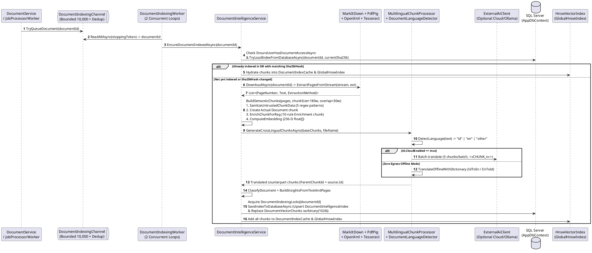
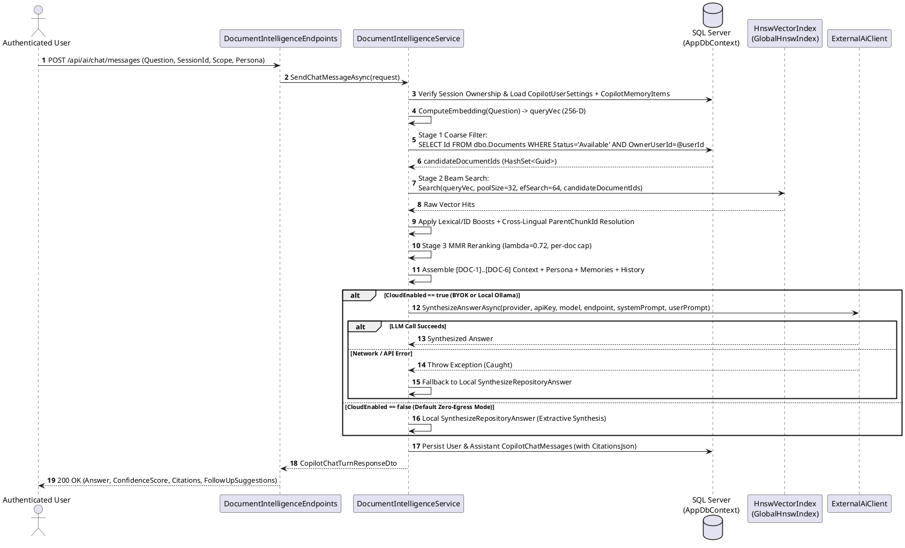

# RAG Technical Documentation

**Purpose:** Provide an exhaustive, code-verified technical specification of the platform's Retrieval-Augmented Generation (RAG) and Document Intelligence pipeline across all 17 architectural dimensions required by Deliverable F, accompanied by separate ingestion and query sequence diagrams.  
**Scope:** `DocumentIntelligenceService.cs`, `HnswVectorIndex.cs`, `MultilingualChunkProcessor.cs`, `DocumentLanguageDetector.cs`, `ExternalAiClient.cs`, `DocumentIndexingChannel.cs`, `DocumentIndexingWorker.cs`, `CopilotDossierExporter.cs`, and `EnterpriseAiChatService.cs`.  
**Evidence status:** `Code-verified` & `Runtime-verified` (`DocumentIntelligenceTests`).  
**Last reviewed:** 2026-11-05

---

## 1. Document Ingestion Pipeline

Ingestion into the RAG store occurs through three distinct triggers (`Code-verified`):

1. **Automatic Asynchronous Ingestion on Upload & Conversion:**
   - `DocumentService.UploadAsync` (`src/DocumentConverter.Infrastructure/Documents/DocumentService.cs`, line 172) and `JobProcessorWorker.ProcessNextJobAsync` (`src/DocumentConverter.Web/HostedServices/JobProcessorWorker.cs`, line 229) invoke `_indexingQueue?.TryQueueDocument(docId)` on `DocumentIndexingChannel`.
   - `DocumentIndexingChannel` (`src/DocumentConverter.Infrastructure/AI/DocumentIndexingChannel.cs`) wraps a `Channel.CreateBounded<Guid>(capacity: 10_000)` (`FullMode = BoundedChannelFullMode.DropWrite`) paired with a `ConcurrentDictionary<Guid, byte>` deduplication set so the same `DocumentId` is not queued multiple times concurrently.
   - `DocumentIndexingWorker` (`src/DocumentConverter.Web/HostedServices/DocumentIndexingWorker.cs`) runs inside `DocumentConverter.Web`:
     - On startup, after a 2-second delay, it calls `HydrateExistingDatabaseIndicesAsync` to load all persisted vectors from `dbo.DocumentVectorChunks` and `dbo.DocumentIntelligenceIndices` into the static in-memory `DocumentIndexCache` and `GlobalHnswIndex`.
     - It then spawns `ConcurrencyDegree = 2` parallel consumer loops (`RunConsumerLoopAsync`) calling `IDocumentIntelligenceService.EnsureDocumentIndexedAsync(documentId)`.
2. **Lazy On-Demand Ingestion during Querying:**
   - `AnalyzeDocumentAsync`, `AskQuestionAsync`, and `SemanticSearchAsync` automatically index a target document on first access if it is not yet in `DocumentIndexCache` or `dbo.DocumentIntelligenceIndices`.
   - `SemanticSearchRepositoryAsync` (Stage 1) primes up to `maxSyncPrime = 40` unindexed candidate documents synchronously during repository queries (`DocumentIntelligenceService.cs`, lines 616–645).
3. **Explicit Manual Re-Indexing & Corpus Pre-Warming:**
   - `POST /api/ai/documents/{id:guid}/reindex` (`ReindexDocumentAsync`) evicts `DocumentIndexCache` and re-computes all chunks and vectors.
   - `POST /api/ai/corpus/prewarm` (`PrewarmCorpusIndexAsync`) indexes up to `maxDocumentsToIndex = 20` unindexed repository documents in a single call.

### Ingestion Sequence Diagram



**Diagram Explanation & Evidence**
- Verified from `DocumentIndexingChannel.cs`, `DocumentIndexingWorker.cs`, `DocumentIntelligenceService.cs` (`EnsureDocumentIndexedAsync` L982–1034, `AnalyzeDocumentStreamInternalAsync` L178–326, `BuildSemanticChunks` L2075–2185), and `MultilingualChunkProcessor.cs`.

---

## 2. Text Extraction (`ExtractPagesFromStream`)

Implemented in `DocumentIntelligenceService.cs` (lines 1711–2072), text extraction preserves page/slide/sheet provenance (`PageNumber`) and records the exact `ExtractionMethod`:

1. **`ManagedCode.MarkItDown` Pre-Processor (`ExtractWithMarkItDownProcessor`):**
   - Instantiates `MarkItDownClient` configured with a custom `CustomOcrImageCaptioner` (`IImageCaptioner`) that routes embedded images to `ExtractTextFromImageBytesWithOcr`.
2. **Format-Specific Extraction Strategies:**
   - **PDF (`.pdf`):** Uses `UglyToad.PdfPig.PdfDocument.Open` to extract per-page text. For each page:
     - Inspects `page.GetImages()` (`ExtractTextFromPdfPageImagesWithOcr`) to OCR embedded diagrams/charts (`"[Embedded Image OCR]: ..."`).
     - If `rawPageText.Length < 25` (scanned page detection), runs `ExtractScannedPdfPageOcrFallback` and tags provenance as `"PdfPig + MarkItDown + OCR"` (otherwise `"PdfPig + MarkItDown"`).
   - **PowerPoint Presentations (`.pptx`, `.ppt` — `ExtractPptxSlides`):** Uses `PresentationDocument.Open` to extract each slide as a separate `PageNumber` (`Slide 1`, `Slide 2`, ...), extracting paragraph text, slide tables (`A.Table`), speaker notes (`NotesSlidePart`), and running OCR on embedded slide `ImagePart` streams (`"MarkItDown + OCR"`).
   - **Word Documents (`.docx`, `.doc` — `ExtractDocxPages`):** Extracts paragraphs and tables via `MarkItDownClient` / `WordprocessingDocument.Open`, iterates over all `mainPart.ImageParts` to run `ExtractTextFromImageBytesWithOcr`, and segments text into ~400-word logical pages.
   - **Excel Spreadsheets (`.xlsx`, `.xls` — `ExtractXlsxSheets`):** Uses `SpreadsheetDocument.Open` and `SharedStringTablePart` to extract each worksheet as a logical page (`Sheet 1: {Name}`) and runs OCR on any `DrawingsPart.ImageParts`.
   - **HTML (`.html`, `.htm` — `ExtractHtmlWithEmbeddedImagesOcr`):** Strips HTML tags while locating `` elements, decoding the Base64 image bytes and appending `[Embedded Diagram OCR]: ...`.
   - **Standalone Images (`.png`, `.jpg`, `.jpeg`, `.webp`, `.bmp`, `.tiff`):** Passes image bytes to `ExtractTextFromImageBytesWithOcr` (`TesseractEngine` with `tessdata/eng.traineddata`, falling back to `ExtractPrintableTextFromBytesFallback` if native Tesseract binaries cannot initialize).

---

## 3. Chunking Strategy (`BuildSemanticChunks`)

Implemented in `DocumentIntelligenceService.BuildSemanticChunks` (lines 2075–2185):
- **Window Parameters:** Sliding window of **`chunkSize = 180` words** with **`overlap = 30` words** (stride of `150` words: `i += chunkSize - overlap`).
- **Minimum Length Threshold:** Windows whose joined text is `< 25` characters are discarded (`if (chunkText.Length < 25) continue`).
- **Heading Detection (`DetectSectionHeading`):** Scans the first 3 lines of each window for Markdown headings (`# ...`), numbered clauses (`Section 4.2`, `Article III`, `1.2 ...`), or all-caps headers (`<= 80` chars) to populate `SectionTitle` (defaulting to `"Page {PageNumber}"`).
- **Dual-Vector Emission per Window:** For every valid 180-word window, `BuildSemanticChunks` emits **two** base chunks before cross-lingual expansion:
  1. **Actual Document Chunk (`IsEnriched = false`, `VectorSource = "Actual Document"`):** Contains the prompt-injection-sanitized source passage.
  2. **RAG Enrichment Chunk (`IsEnriched = true`, `VectorSource = "RAG Enrichment"`, `ExtractionMethod = "RAG Enrichment Engine"`):** Contains the synthesized enrichment text (`BuildEnrichedVectorText`: `[RAG_ENRICHED_SUMMARY] ... [FACTS] ... [QUESTIONS] ... [TERMS] ...`) so user questions phrasing a query as a question or technical abbreviation match directly against the enrichment vector.

---

## 4. Chunk Metadata and 10-Rule RAG Enrichment (`EnrichChunkForRag`)

Implemented in `DocumentIntelligenceService.EnrichChunkForRag` (lines 2190–2395) and verified by `DocumentIntelligenceTests.EnrichChunkForRag_ShouldFollowAllTenRagEnrichmentRulesAndSerializeValidJson`:

Every chunk carries a JSON-serialized `ChunkEnrichmentMetadataDto` (`dbo.DocumentVectorChunks.EnrichmentJson`) enforcing 10 deterministic rules:
1. **Rule 1 (Untrusted Data & Prompt-Injection Sanitization — `SanitizeUntrustedChunkData`):** Applies 5 compiled regex patterns (`PromptInjectionPatterns`, lines 2423–2436) to redact directives such as `"ignore all previous instructions"`, `"system prompt:"`, `"you are now a..."`, `"jailbreak"`, `"bypass safety"`, and `[INST]`/`<|im_start|>` tokens into `"[UNTRUSTED_DIRECTIVE_REDACTED]"`, setting `SanitizedUntrustedDirectives = true`.
2. **Rule 2 & Rule 8 (Concise Contextual Summary):** Generates `ContextualSummary` (`[{fileName} • {sectionTitle} (p.{pageNumber})] ...`) guaranteed to be shorter than the source chunk without duplicating the full passage.
3. **Rule 3, Rule 4 & Rule 10 (Explicit Facts Paired with Verbatim Evidence):** Populates `ExplicitFacts` (`List<EnrichedFactItemDto(Claim, SourceEvidence)>`) from sentences containing numbers, currency, percentages, dates, or binding modal verbs (`shall`, `must`, `required`, `wajib`), pairing each claim with its verbatim sentence quote.
4. **Rule 4 (Separation of Interpretations):** Populates `ReasonableInterpretations` separately from explicit facts (e.g., `"Contains binding contractual, regulatory, or operational obligations"`).
5. **Rule 5 (Ambiguities & Unknowns):** Scans for `TBD`, `to be determined`, `pending`, `subject to`, `Exhibit [A-Z]`, `Schedule [0-9]`, or unstated financial/temporal context, recording them in `AmbiguitiesOrUnknowns`.
6. **Rule 6 (Generated Search Questions):** Generates 2–4 natural-language search questions answerable by the chunk (`GeneratedSearchQuestions`).
7. **Rule 7 (Technical Identifiers & Domain Terms):** Extracts uppercase acronyms, standard codes, and invoice/contract IDs (`\b(?:[A-Z]{2,6}-\d{2,8}|[A-Z]{3,10}|\d+(?:\.\d+)?%|\$[\d,]+(?:\.\d{2})?)\b`) into `TechnicalIdentifiersAndTerms`.
8. **Rule 9 (Schema-Validated JSON Serialization):** Serialized into `dbo.DocumentVectorChunks.EnrichmentJson`.

### Cross-Lingual Chunk Projection (`MultilingualChunkProcessor`)
- `DocumentLanguageDetector.DetectLanguage` (`src/DocumentConverter.Infrastructure/AI/DocumentLanguageDetector.cs`) tokenizes text and scores stopword frequency against curated Indonesian (`IndonesianStopWords`: `yang`, `dan`, `perjanjian`, `pasal`, `pihak`, `biaya`, `denda`, ...) and English (`EnglishStopWords`: `the`, `and`, `shall`, `pursuant`, `agreement`, ...) lexicons, returning `"id"`, `"en"`, or `"other"`.
- `MultilingualChunkProcessor.GenerateCrossLingualChunksAsync` (`src/DocumentConverter.Infrastructure/AI/MultilingualChunkProcessor.cs`) translates base `"Actual Document"` chunks (`<= 60` chunks per document):
  - If `sourceLang == "id"`, generates an `"en"` chunk; if `"en"`, generates an `"id"` chunk; if `"other"`, generates both `"en"` and `"id"` chunks.
  - When `AI.CloudEnabled == true`, batches up to `MaxBatchSize = 5` chunks per LLM call using `<<<CHUNK_1>>>` delimiters (`TranslateBatchWithLlmAsync`).
  - When offline (`AI.CloudEnabled == false` or on LLM fallback), applies bidirectional phrase/word dictionary projection (`IdToEnDictionary` / `EnToIdDictionary`, e.g., `"denda keterlambatan" <-> "late payment penalty"`, `"perjanjian kerjasama" <-> "cooperation agreement"`).
  - Each translated chunk stores `ParentChunkId = sourceChunk.Id` so citations always resolve back to the authentic original-language text snippet while surfacing `TranslatedSnippet` in the UI (`DocumentIntelligenceService.cs`, lines 686–697).

---

## 5. Embedding Model (`ComputeEmbedding`)

Implemented in `DocumentIntelligenceService.ComputeEmbedding` (lines 2502–2615):
- **Architecture:** Deterministic, zero-egress in-process feature-hashing and concept-projection embedding engine (no external neural model weights or GPU required).
- **Signal Composition:**
  1. **Unigram BM25-Style Saturation:** Tokenizes text on non-alphanumeric boundaries, removes stopwords (`StopWords`), and computes sublinear term weight:
     $$w(t) = \frac{\text{count}(t)}{\text{count}(t) + 1.2}$$
     Projects each unigram into two signed hash buckets (`u0_{term}` with weight $w(t)$ and `u1_{term}` with weight $w(t) \times 0.7$).
  2. **Character 3-Grams (Subword / Stemming Resilience):** For tokens with length $\ge 4$, hashes all sliding 3-character substrings (`ng_{trigram}`) with weight $w(t) \times 0.45$.
  3. **Bilingual Domain Concept Projection (`ConceptClusters`):** Maps 5 bilingual (English + Indonesian) domain lexicons (`concept_finance`, `concept_legal`, `concept_hr`, `concept_tech`, `concept_medical`) into shared semantic buckets at weight $w(t) \times 0.85$ so synonyms and cross-lingual domain terms (e.g., `"invoice"`, `"remittance"`, `"faktur"`, `"tagihan"`, `"pembayaran"`) align in vector space.
  4. **Adjacent Word Bigrams:** Hashes consecutive non-stopword token pairs (`bg_{w1}_{w2}`) with weight $0.75$.
- **Hashing & Normalization:** Each feature string is hashed via 32-bit **MurmurHash3** (`MurmurHash3`, seed `0x9747b28c`). Bit `0..7` selects the dimension index (`hash & 255`), and bit `8` determines the sign (`+1` or `-1`). Finally, the 256-element vector is L2-normalized to unit length ($\|\mathbf{v}\|_2 = 1.0$).

---

## 6. Vector Representation and Dimensionality

- **Dimensionality:** **`EmbeddingDimensions = 256`** (`float[256]`).
- **Binary Serialization (`FloatsToBytes` / `BytesToFloats`):** Serialized via `Buffer.BlockCopy` into exactly **`1,024` bytes** (`256 * sizeof(float)`) and stored in SQL Server column `dbo.DocumentVectorChunks.Embedding` (`varbinary(1024)`).

---

## 7. Vector Database and Storage Mechanism

The system employs a **Dual-Tier Hybrid Vector Architecture**:
1. **Persistent Relational + Binary Vector Store (`dbo.DocumentVectorChunks` & `dbo.DocumentIntelligenceIndices` in SQL Server):** Ensures durability across container restarts so documents do not need to be re-OCR'd or re-embedded when the web app restarts.
2. **In-Memory Hierarchical Navigable Small World Graph (`HnswVectorIndex` in `src/DocumentConverter.Infrastructure/AI/Hnsw/HnswVectorIndex.cs`):**
   - Maintained in `DocumentIntelligenceService.GlobalHnswIndex` and hydrated at startup by `DocumentIndexingWorker`.
   - **Verified Graph Hyperparameters:**
     - `M = 16` (bidirectional links per node in layers $l \ge 1$)
     - `MaxM0 = 32` (`M * 2` bidirectional links per node in base layer $l = 0$)
     - `EfConstruction = 64` (dynamic candidate beam size during graph construction)
     - `LevelLambda` $= 1 / \ln(16) \approx 0.36067$
   - **Thread Safety:** Synchronized via `ReaderWriterLockSlim` (`EnterWriteLock` on `Add`/`Clear`, `EnterReadLock` on `Search` allowing concurrent multi-user search).

---

## 8. Similarity Search and Scoring (`Search` & Hybrid Re-Scoring)

1. **Cosine Similarity (`HnswVectorIndex.CosineSimilarity` & `DocumentIntelligenceService.CosineSimilarity`):**
   - Computes the dot product of L2-normalized 256-D vectors clamped to $[0, 1]$:
     $$\text{sim}(\mathbf{q}, \mathbf{d}) = \max\left(0, \min\left(1, \sum_{i=0}^{255} q_i \cdot d_i\right)\right)$$
2. **HNSW Multi-Layer Greedy Descent + Layer-0 Beam Search (`HnswVectorIndex.Search`):**
   - Greedily traverses from `_maxLayer` down to layer `1` (`SearchLayerClosest`), then executes beam search at layer `0` with `ef = Math.Max(efSearch, topK)` (`efSearch = 64` in repository search, `32` in single-document search).
   - Evaluates `candidateDocumentIds` (`HashSet<Guid>`) filter during candidate collection while still traversing non-matching graph neighbors so graph connectivity is preserved.
3. **Hybrid Lexical & Provenance Boosting (`SemanticSearchRepositoryAsync`, lines 660–682):**
   - Combines vector cosine similarity with exact query keyword overlap (`overlapRatio`), exact technical identifier matches (`exactIdBoost` up to `+0.15`), and a slight preference for `"Actual Document"` chunks over `"RAG Enrichment"` chunks (`sourceWeightBonus = +0.02f` vs. `-0.01f`).
   - Deduplicates hits when both a source chunk and its cross-lingual translated counterpart match the same passage (`dedupKey = (DocumentId, effectiveChunkId)`), retaining the higher-scoring match and resolving the display snippet from the original parent chunk.

---

## 9. Retrieval Configuration and MMR Diversity Reranking

- **Default `topK` Values:**
  - Single-document Q&A (`AskQuestionAsync`): `topK = 4`
  - Single-document search (`SemanticSearchAsync`): `topK = 5`
  - Repository search (`SemanticSearchRepositoryAsync`): `topK = 8` (`candidatePoolSize = Math.Max(topK * 4, 32)`)
  - Repository Q&A (`AskRepositoryAsync` / `SendChatMessageAsync`): `topK = 6`
- **Maximal Marginal Relevance (`ApplyMultiDocumentDiversityAndMmr`, lines 2678–2765):**
  - Prevents a single long document from monopolizing all retrieved citations by enforcing:
    - **Per-document chunk cap:** `maxChunksPerDocument = distinctDocsInPool > 1 ? Math.Max(2, (int)Math.Ceiling(topK / 2.0)) : topK` (caps at 2–3 chunks per document when multiple documents match).
    - **MMR Selection Criterion ($\lambda = 0.72$):**
      $$\text{MMR}(c) = \lambda \cdot \text{Relevance}(c, q) + (1 - \lambda) \cdot \text{Novelty}(c, S) + \text{UnseenDocumentBonus}(c, S)$$
      where $\text{Novelty}(c, S) = 1 - \max_{s \in S} \text{CosineSim}(\mathbf{v}_c, \mathbf{v}_s)$ and $\text{UnseenDocumentBonus} = +0.18$ if $c.\text{DocumentId} \notin S$.

---

## 10. Permission Filtering in RAG (`Code-verified`)

In accordance with Mandatory Analysis Rule 4.F (*"Do not claim that RAG retrieval is permission-aware unless the backend implementation demonstrates it"*), here is the exact code-verified enforcement analysis:

1. **Repository-Wide Search & Copilot (`SemanticSearchRepositoryAsync`, lines 582–610):**
   - **Permission-Aware (`Code-verified` & `Runtime-verified`):** Calls `ResolveCurrentUserId()`. When `_dbContext != null` and `currentUserId.HasValue`, Stage 1 queries `dbo.Documents` with `.Where(d => d.Status == DocumentStatus.Available && d.OwnerUserId == currentUserId.Value)`. If the user owns zero matching documents, `SemanticSearchRepositoryAsync` immediately returns `[]`. Otherwise, `candidateDocumentIds` is passed into `GlobalHnswIndex.Search(..., candidateDocumentIds)`, restricting vector retrieval strictly to documents owned by the caller.
2. **Single-Document Intelligence (`EnsureUserHasDocumentAccessAsync`, lines 501–521):**
   - **Permission-Aware for Ownership (`Code-verified` & `Runtime-verified`):** Verifies `await _dbContext.Documents.AsNoTracking().AnyAsync(d => d.Id == documentId && d.OwnerUserId == currentUserId.Value)` and throws `UnauthorizedAccessException` if the caller is not the document owner.
   - **Verified Nuance / Gap:** `EnsureUserHasDocumentAccessAsync` does not check `d.Status == DocumentStatus.Available`, so a document owner can still query cached/DB single-document insights for their own soft-deleted (`Deleted`) or purged (`Purged`) document ID. Additionally, if `_userContext?.UserId` is `null` (which occurs in background worker scopes or unit tests constructed without an `IUserContext`), `EnsureUserHasDocumentAccessAsync` returns without throwing.

---

## 11. Context Construction and Prompt Construction

When `AskRepositoryAsync` (`lines 730–895`) or `AskQuestionOnStreamAsync` (`lines 410–490`) prepares context for synthesis:
1. **Low-Confidence Guard:** If no chunks score $\ge 0.16$ (repository) or $\ge 0.18$ (single document), returns a deterministic low-confidence explanation (`ConfidenceScore = 0.12f`) without invoking the LLM.
2. **Context Block Formatting:** Takes the top `Math.Min(6, relevantChunks.Count)` chunks and formats each as:
   ```text
   [DOC-1] Document: "{DocumentName}" (Category: {DocumentCategory}, Page {PageNumber}, Section: {SectionTitle}, Relevance: {SimilarityScore:P0}):
   {Snippet}
   ```
3. **System & User Prompt Assembly:**
   - **System Prompt:** Combines the base grounding directive (*"Answer ONLY using facts present in the excerpts. Cite sources explicitly by document title and page number... If the excerpts do not contain the answer, state clearly what is missing"*), the active **Specialist Persona** prompt (`BuildPersonaSystemInstruction` for `LegalCounsel`, `FinancialAuditor`, `TechnicalArchitect`, `ExecutiveBriefing`, or `EnterpriseAnalyst`), the user's **Custom Standing Instructions**, and up to 15 active **Long-Term User Memories** (`dbo.CopilotMemoryItems`).
   - **User Prompt:** Combines up to the last 6 turns of `ConversationHistory`, the numbered `[DOC-1]...[DOC-6]` excerpts, and the user's question.

---

## 12. Local and External LLM Integration (`ExternalAiClient`)

Implemented in `src/DocumentConverter.Infrastructure/AI/ExternalAiClient.cs`:
- **Supported Providers (`AiProviders`):**
  1. **`OpenAI`:** `https://api.openai.com/v1/chat/completions` (`Bearer {apiKey}`, `temperature = 0.2`, `max_tokens = 1024`).
  2. **`Claude` (Anthropic):** `https://api.anthropic.com/v1/messages` (`x-api-key`, `anthropic-version: 2023-06-01`).
  3. **`Gemini` (Google):** `https://generativelanguage.googleapis.com/v1beta/models/{model}:generateContent?key={apiKey}` (`systemInstruction` + `contents`).
  4. **`Groq`:** `https://api.groq.com/openai/v1/chat/completions` (`Bearer {apiKey}`).
  5. **`Custom` (Local Ollama / vLLM / LM Studio / Azure OpenAI):** Defaults to **`http://localhost:11434/v1/chat/completions`** (auto-appending `/chat/completions` if a base `/v1` URL is supplied). API key is optional (`if (!string.IsNullOrWhiteSpace(apiKey))`).

### Query Sequence Diagram



**Diagram Explanation & Evidence**
- Verified from `DocumentIntelligenceService.cs` (`SendChatMessageAsync`, `AskRepositoryAsync`, `SemanticSearchRepositoryAsync`) and `ExternalAiClient.cs`.

---

## 13. Response Generation and Source References

- **Local Zero-Egress Synthesis (`SynthesizeRepositoryAnswer` & `SynthesizeGroundedAnswer`):** When `AI.CloudEnabled = false`, sentences from the top-ranked chunks are scored by query term overlap, numeric/financial relevance (boosted when the query asks `"how much"`, `"cost"`, `"when"`, `"deadline"`, etc.), deduplicated, and formatted with Markdown headers, persona perspective framing (`ApplyPersonaFraming`), and explicit document/page attribution.
- **Source Reference Structure (`GlobalSemanticCitationDto` & `DocumentCitationDto`):** Every answer includes structured citations containing `DocumentId`, `DocumentTitle`, `PageNumber`, `Snippet` (verbatim excerpt), `SimilarityScore`, and `DocumentCategory`.

---

## 14. Error Handling and Verified Limitations

1. **Automatic Local Fallback on LLM Failure:** Any `HttpRequestException`, timeout (`60s`), or `401`/`429` error from `ExternalAiClient` is caught in `AskQuestionOnStreamAsync`, `AskRepositoryAsync`, and `CompareDocumentsAsync`, transparently falling back to local zero-egress synthesis (`Runtime-verified` in `DocumentIntelligenceTests.AskQuestionOnStreamAsync_WhenExternalAiThrows_ShouldGracefullyFallbackToLocalZeroEgress`).
2. **Verified Limitations:**
   - **Feature-Hashing vs. Dense Neural Embeddings:** `ComputeEmbedding` uses 256-D MurmurHash3 feature hashing + curated bilingual domain concept clusters rather than a pre-trained transformer embedding model.
   - **Offline Translation Coverage:** When `AI.CloudEnabled = false`, `MultilingualChunkProcessor` relies on a static dictionary (`IdToEnDictionary` / `EnToIdDictionary` with ~80 legal/financial/technical phrases and words) rather than full neural machine translation.
   - **Static In-Memory Caches (`DocumentIndexCache` & `GlobalHnswIndex`):** As noted in Module 08, soft-deleting or purging a document does not evict its vectors from `DocumentIndexCache` or `GlobalHnswIndex`, and adding a new document version requires calling `/reindex` to refresh vectors.

---

## 15. Related Documentation

- [Module 09: RAG Knowledge Management](../04-modules/09-rag-knowledge-management.md)
- [Database Documentation](../05-database/database-documentation.md)
- [API Documentation](../06-api/api-documentation.md)
- [Testing and Evaluation](../09-testing/testing-and-evaluation.md)

