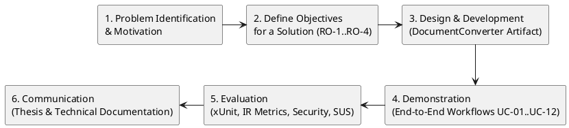

# Academic Research Mapping (Information Systems Final Project / Tugas Akhir)

- **Purpose:** Map the reverse-engineered `DocumentConverter` implementation (`DocumentConverter.slnx`) to an undergraduate Information Systems Final Project (*Tugas Akhir*) research structure using Design Science Research Methodology (DSRM).
- **Scope:** Research problem formulation, research objectives (`RO-*`), research questions (`RQ-*`), artifact description, system-integration contribution statement, evaluation framework, and objective-to-metric traceability.
- **Evidence status:** `Code-verified` (artifact capabilities and architecture) and `Inferred / Proposed` (academic framing, DSRM mapping, and research questions — **subject to confirmation by the researcher and academic supervisor**).
- **Last reviewed:** 2026-11-05

---

## 1. Methodological Framing: Design Science Research Methodology (DSRM)

> **Important Academic Notice:** The Design Science Research Methodology (DSRM) framing below is a **proposed research structure** grounded in the verified software artifact (`DocumentConverter.slnx`). Final selection of the methodology, organizational case-study site, literature review references, and empirical sample sizes **requires confirmation by the student researcher and academic supervisor**. No literature citations or empirical survey results are fabricated in this document.

Following the standard 6-activity DSRM process model (Peffers et al.), the repository artifact maps to Information Systems research as follows:

| DSRM Activity | Mapping to Verified Repository Artifact and Documentation | Verification Status |
|---|---|---|
| **1. Problem Identification & Motivation** | Organizational fragmentation across standalone document converters, unstructured file shares lacking version/encryption governance, and cloud-based AI assistants that introduce data-egress and prompt-injection risks. | `Inferred` (from implemented system capabilities; requires organizational case-study confirmation) |
| **2. Define Objectives of a Solution** | Formulated as `RO-1` through `RO-4` (Section 2.2), targeting unified conversion/OCR/PDF signing, owner-isolated RBAC + `DCE1` encrypted versioned lifecycle governance, zero-egress bilingual RAG retrieval, and usability/architectural maintainability. | `Inferred / Proposed` |
| **3. Design & Development** | Implemented as the 11-project .NET 10 solution (`DocumentConverter.slnx`): `Domain`, `Contracts`, `Processing.Abstractions`, `Security`, `Application`, `Infrastructure`, `Web`, and `DocumentWorker` (see [System Architecture](../03-system-design/system-architecture.md)). | `Code-verified` |
| **4. Demonstration** | Demonstrated through 12 end-to-end functional use cases (`UC-01` to `UC-12`) across 10 integrated modules (see [Requirements Analysis](../02-requirements/requirements-analysis.md) and [Module Documentation Index](../04-modules/README.md)). | `Code-verified` |
| **5. Evaluation** | Evaluated via 130 automated xUnit tests (`129/130` passing, `Runtime-verified`), IDOR/security analysis, quantitative RAG Information Retrieval metrics ($P@K$, $R@K$, $MRR$, Faithfulness, Latency), and System Usability Scale (SUS) testing (see [Testing and Evaluation](../09-testing/testing-and-evaluation.md)). | `Runtime-verified` (xUnit) / `Not executed` (empirical IR benchmark & SUS survey) |
| **6. Communication** | Documented in this 12-part technical and academic documentation repository (`docs/01-overview/` through `docs/12-evidence/`). | `Code-verified` |

---

## 2. Research Problem, Objectives, and Questions

### 2.1 Research Problem Mapping

In many small-to-medium enterprises (SMEs) and institutional departments, document-intensive workflows suffer from three interconnected governance challenges:
1. **Fragmented Document Processing:** Staff rely on external, unmonitored online tools to convert formats (`PDF`, `DOCX`, `XLSX`, `PPTX`, `CSV`, `HTML`, `MD`, `EPUB`), perform OCR on scanned records, or merge/split/edit/sign PDFs—exposing sensitive documents outside organizational boundaries and losing version lineage.
2. **Weak Document Lifecycle and Data Governance:** Shared network folders lack multi-stage ingestion validation (magic-byte checks, ZIP-bomb/macro guards, ClamAV scanning), cryptographic integrity hashes (`SHA-256`), transparent at-rest envelope encryption (`DCE1` AES-256-GCM), non-destructive version control with line-level diffing, strict per-user ownership isolation, and immutable audit logging.
3. **Knowledge Retrieval Bottlenecks vs. Cloud AI Data-Privacy Risks:** Filename search fails to locate cross-lingual (Indonesian/English) clauses across multi-document repositories, while sending confidential documents to commercial cloud LLM APIs violates internal data-sovereignty policies and exposes systems to untrusted document prompt injection.

### 2.2 Research Objectives (`RO-*`)

- **`RO-1` (Integrated Document Processing, Editing & Signing):** Design and implement an integrated document processing platform supporting asynchronous multi-format conversion (17 converter definitions across 7 processor engines), Tesseract OCR with scanned-PDF detection, interactive PDF editing (`PdfEngine`), and PAdES (`adbe.pkcs7.detached`) cryptographic digital signatures.
- **`RO-2` (Organizational Data Governance & Defense-in-Depth Security):** Enforce organizational data governance through multi-stage upload validation (`FileSignatureDetector`, `ZipBombGuard`, `EicarSignatureDetector`, `ClamAvScanner`), `DCE1` (`AES-256-GCM`) envelope encryption at rest, per-user ownership isolation (`OwnerUserId`), non-destructive document versioning with LCS diffing, and append-only `AuditEvent` logging.
- **`RO-3` (Zero-Egress Bilingual RAG Knowledge Retrieval):** Implement a zero-egress default (`AI.CloudEnabled = false`), bilingual (Indonesian and English) Retrieval-Augmented Generation (RAG) subsystem combining `MarkItDown`/OCR extraction, 180-word sliding-window chunking, 10-rule deterministic RAG enrichment with prompt-injection sanitization, 256-D MurmurHash3 + BM25 + concept embeddings, HNSW graph indexing with MMR diversification, and extractive/optional-LLM synthesis with verifiable page citations.
- **`RO-4` (System Quality, Retrieval Effectiveness, and Usability Evaluation):** Evaluate the integrated artifact's functional suitability, security and data-lifecycle boundaries, RAG retrieval accuracy ($P@K$, $R@K$, $MRR$, Faithfulness), and end-user usability (SUS).

### 2.3 Research Questions (`RQ-*`)

- **`RQ-1`:** How can multi-format document conversion, OCR, interactive PDF manipulation, PAdES digital signing, and versioned document management be architected into a unified, Clean Architecture .NET 10 system that preserves auditability and strict user data isolation?
- **`RQ-2`:** How effectively does a local, zero-egress hybrid lexical-semantic RAG pipeline (combining 10-rule chunk enrichment, 256-D feature-hashing embeddings, HNSW graph indexing, BM25/MMR ranking, and bilingual ID-EN chunk projection) retrieve relevant passages and generate grounded page-level citations across organizational documents?
- **`RQ-3`:** What security and data-lifecycle governance controls—and what derived-data lifecycle gaps (such as vector retention after document purge)—emerge when integrating encrypted versioned document management with repository-wide RAG semantic search?
- **`RQ-4`:** To what extent does the integrated platform satisfy functional requirements (`FR-*`), non-functional requirements (`NFR-*`), and acceptable end-user usability (`SUS >= 68`)?

---

## 3. Research Contribution and Scope Positioning

### 3.1 Statement of Contribution (System Integration & Governance Focus)

In accordance with Mandatory Analysis Rule 5, **this research does not claim algorithmic novelty** in cryptography, OCR, HNSW graph theory, or neural language modeling. Instead, the contribution of this Information Systems Final Project lies in:

1. **End-to-End Architectural Integration for Data Governance:** Demonstrating how four traditionally separate enterprise capabilities—(a) asynchronous document conversion & OCR (`JobProcessorWorker` / `DocumentWorker`), (b) interactive PDF manipulation & PAdES PKCS#7 digital signing (`PdfEngine`, `PdfDigitalSignatureService`), (c) `DCE1` envelope-encrypted versioned document lifecycle management (`FileSystemDocumentStorage`, `AesGcmStorageEncryptionService`, `DocumentService`), and (d) local RAG knowledge management (`DocumentIntelligenceService`)—can be unified under a single .NET 10 Clean Architecture solution (`DocumentConverter.slnx`).
2. **Zero-Egress Bilingual RAG with Deterministic 10-Rule Chunk Enrichment:** Engineering and evaluating a self-contained, CPU-friendly hybrid retrieval pipeline (`HnswVectorIndex` + 256-D MurmurHash3/BM25 embeddings + 10-rule `EnrichChunkForRag` metadata synthesis + prompt-injection regex sanitization + bilingual ID/EN `MultilingualChunkProcessor`) that operates entirely on-premises without mandatory third-party API keys or external network egress (`dc-internal` network with `internal: true`).
3. **Lifecycle & Security Governance Analysis of RAG-Derived Data:** Providing a rigorous, code-verified governance analysis of how primary document operations (upload, versioning, soft-delete, and permanent purge) interact with derived AI artifacts (`dbo.DocumentVectorChunks`, `dbo.DocumentIntelligenceIndices`, and in-memory `GlobalHnswIndex`), identifying both verified anti-IDOR controls and concrete lifecycle synchronization requirements (`TD-01`, `TD-02`).

---

## 4. Artifact Description (`DocumentConverter.slnx`)

The constructed DSRM artifact is an **Enterprise Document Converter, Management, and Local RAG Knowledge Governance Platform** comprising 8 source projects and 3 test projects:

| Artifact Layer / Project | Key Implemented Components | Primary Governance / Functional Role |
|---|---|---|
| **Domain Layer (`DocumentConverter.Domain`)** | 20 domain entities (`Document`, `DocumentVersion`, `DocumentIntelligenceIndex`, `DocumentVectorChunk`, `ProcessingJob`, `BatchJob`, `AuditEvent`, `CopilotChatSession`, `CopilotMemoryItem`, etc.) and 7 enums | Enforces core domain invariants, state transitions, and versioning/soft-delete/purge lifecycle rules |
| **Contracts & Building Blocks (`DocumentConverter.Contracts`, `Processing.Abstractions`, `Security`)** | Request/response DTOs, `IDocumentProcessor`, `FileSignatureDetector`, `ZipBombGuard`, `EicarSignatureDetector`, `FileNameSanitizer` | Provides shared DTO contracts, processor plugin interfaces, and defense-in-depth upload guards |
| **Application Layer (`DocumentConverter.Application`)** | Service interfaces (`IDocumentService`, `IDocumentIntelligenceService`, `IPdfEngine`, `IPdfDigitalSignatureService`, `IOcrEngine`, `IProcessingService`, `IAdminService`, `IAuditService`, `IDocumentStorage`) | Defines technology-agnostic use-case contracts between presentation and infrastructure |
| **Infrastructure Layer (`DocumentConverter.Infrastructure`)** | `AppDbContext` (25 tables across `dbo` & `identity`), `FileSystemDocumentStorage`, `AesGcmStorageEncryptionService` (`DCE1`), `ClamAvScanner`, `DocumentIntelligenceService` + `HnswVectorIndex` + `MultilingualChunkProcessor`, `PdfEngine`, `PdfDigitalSignatureService`, `TesseractOcrEngine`, 7 `IDocumentProcessor` engines, `RabbitMqJobDispatcher` | Implements persistence, envelope encryption, malware scanning, conversion, OCR, hybrid RAG indexing/search, and messaging |
| **Presentation & API Host (`DocumentConverter.Web`)** | Blazor Interactive Server UI (`Radzen.Blazor`), 5 Minimal API endpoint groups (51 routes) + `/health` + SignalR `/hubs/processing`, `.DocConv.Auth` cookie + OIDC auth, rate limiters, `JobProcessorWorker`, `DocumentIndexingWorker` | Delivers interactive user workflows, administrative governance consoles, and REST endpoints |
| **Background Worker Host (`DocumentWorker`)** | Standalone .NET Worker Service (`Worker.cs`) isolated on the `dc-internal` (`internal: true`) Docker network | Executes CPU/memory-intensive format conversions and OCR jobs with zero external internet egress |

---

## 5. Mapping Research Objectives to Evaluation Metrics

| Research Objective | Research Question | Evaluation Dimension | Concrete Evaluation Metrics & Instruments | Verification Status in Repository |
|---|---|---|---|---|
| **`RO-1`:** Integrated Document Processing, Editing & Signing | `RQ-1` | Functional Suitability & Format Fidelity | - Automated xUnit pass rate across conversion, OCR, PDF engine, merge/split, compression, digital signatures, and batch suites (`57/57` tests passing) - End-to-end job completion and processing duration | `Runtime-verified` (`57/57` conversion/PDF/OCR/signature tests passed) |
| **`RO-2`:** Organizational Data Governance & Defense-in-Depth Security | `RQ-1`, `RQ-3` | Security Enforcement, Versioning, Audit & Retention | - `DCE1` AES-256-GCM encryption, magic-byte, ZIP-bomb, and `EICAR` rejection (`7/7` tests passing in `Milestone8SecurityHardeningTests`) - Version diff & rollback accuracy (`5/5` tests passing in `DocumentVersioningDiffTests`) - Owner-isolated anti-IDOR protection across documents, batches, and RAG (`7/7` in `DocumentSecurityAndIdorTests` + `BatchProcessingTests`, plus `DocumentQueriesAndIntelligence_ShouldEnforceStrictUserIsolation`) - Derived-data lifecycle audit on soft-delete/purge (`TD-01`, `TD-02`) | `Runtime-verified` (automated security & IDOR suites) & `Code-verified` (lifecycle governance audit) |
| **`RO-3`:** Zero-Egress Bilingual RAG Knowledge Retrieval | `RQ-2`, `RQ-3` | Retrieval Accuracy, Groundedness & Latency | - Automated RAG functional tests (`28/29` passing in `DocumentIntelligenceTests`; 1 static HNSW isolation failure `TC-RAG-02`) - Quantitative IR benchmark: **Precision@K ($P@3, P@5$)**, **Recall@K ($R@5$)**, **Mean Reciprocal Rank ($MRR$)** across monolingual (ID, EN) and cross-lingual (ID$\leftrightarrow$EN) queries - **Faithfulness / Groundedness** of `[Document, p.X]` citations and **Answer Relevance** (1–5 rubric) - **Latency:** `SearchDurationMs`, extractive query latency ($P_{50}, P_{95}$), and optional LLM synthesis latency | `Runtime-verified` (automated test suite); Quantitative IR benchmark dataset execution is `Not executed` (protocol defined in [Testing and Evaluation](../09-testing/testing-and-evaluation.md) §3) |
| **`RO-4`:** System Quality & End-User Usability | `RQ-4` | Architectural Integrity & Human Usability | - Clean Architecture dependency compliance (`3/3` tests passing in `ArchitectureTests`) - **System Usability Scale (SUS)** composite score ($\text{SUS} \in [0, 100]$, target $\ge 68.0$) across representative user roles (`TC-USAB-01`) | `Runtime-verified` (`ArchitectureTests`); SUS participant survey is `Not executed` (instrument defined in [Testing and Evaluation](../09-testing/testing-and-evaluation.md) §4) |

---

## 6. Evidence Traceability

**Evidence**
- [Project Overview](../01-overview/project-overview.md) and [Requirements Analysis](../02-requirements/requirements-analysis.md) — functional (`FR-*`) and non-functional (`NFR-*`) requirement baselines.
- [Security and Data Governance](../07-security-governance/security-and-data-governance.md) and [RAG Technical Documentation](../08-rag/rag-technical-documentation.md) — verified implementation of security, governance, and local RAG pipelines.
- [Testing and Evaluation](../09-testing/testing-and-evaluation.md) — `Runtime-verified` xUnit results (`129/130` passed), quantitative RAG evaluation equations, and SUS questionnaire.

**Status:** Artifact capabilities are `Code-verified` and `Runtime-verified`; DSRM academic framing is `Proposed — requires researcher and academic supervisor confirmation`.
