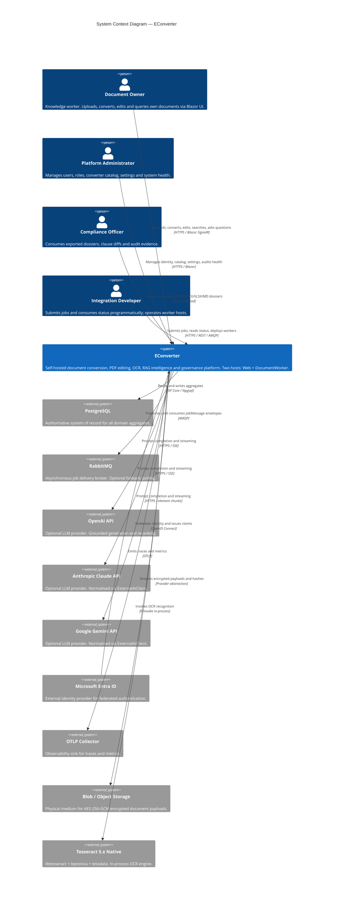
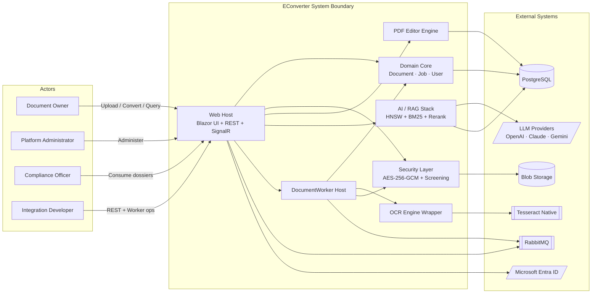
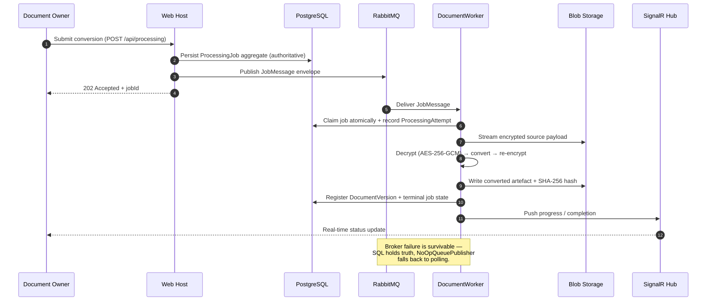
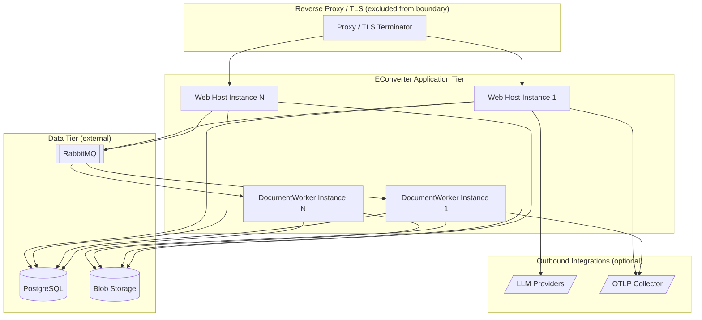

# EConverter — C4 Model Level 1: System Context Architecture

**Document Type:** C4 Model — Level 1 (System Context)
**System Under Analysis:** EConverter
**Classification:** Enterprise-grade, self-hosted document conversion and document-intelligence platform
**Analysis Confidence:** 0.88 (derived from domain-module and system-context research)

---

## 1. Project Introduction

### 1.1 Project Identity

| Attribute | Value |
|---|---|
| **System Name** | EConverter |
| **Project Type** | FullStackApp (.NET solution) |
| **Primary Technology** | ASP.NET Core + Blazor Server interactive UI |
| **Database** | PostgreSQL (via EF Core / Npgsql) |
| **Architecture Style** | Layered Clean Architecture with strict inward-facing dependency graph |
| **Executable Hosts** | `DocumentConverter.Web` (interactive host), `DocumentWorker` (headless background consumer) |
| **Deployment Model** | Self-hosted / on-premise capable, queue-backed, horizontally scalable workers |

### 1.2 What the System Is

EConverter is not a single-purpose file converter. It is an **integrated document lifecycle platform** that consolidates four capability clusters into one governed product boundary:

1. **Asynchronous, queue-backed format conversion** — Office and PDF document transformation (DOCX/XLSX/CSV/text → PDF and PDF → DOCX/XLSX) executed by dedicated background workers, decoupled from the interactive UI through a message broker, with authoritative job state held in SQL.
2. **AI document-intelligence stack** — OCR-assisted text extraction, multilingual semantic chunking, dense HNSW vector indexing, BM25 lexical indexing, hybrid retrieval with rank fusion and MMR diversification, and retrieval-augmented question answering over the user's own corpus.
3. **Server-side PDF editor** — a full operation dispatch engine applying text, highlighting, shapes, ink, digital signatures, stamps, redactions, watermarks, form fields and page-structure operations to PDF documents, driven from an in-browser pdf.js editor surface.
4. **Security and governance layer** — per-owner isolation enforced at the aggregate level, AES-256-GCM envelope encryption of documents at rest, content hashing, lifecycle state machines, audit event recording, ingress threat screening, and compliance-dossier export.

### 1.3 Core Business Value

The system converts document handling from a **manual, tool-fragmented chore** into a **governed platform capability**. Five value drivers define its strategic positioning:

| # | Value Driver | Mechanism in the System |
|---|---|---|
| 1 | **Cost and licensing consolidation** | One platform replaces standalone converters, PDF editors, OCR tools and ad-hoc RAG scripts. `IConverterCatalogService` makes supported input/output pairs a first-class, discoverable product surface rather than tribal knowledge. |
| 2 | **Confidentiality and data residency** | AES-256-GCM envelope encryption with per-document ephemeral DEKs wrapped by a master KEK. Ownership scoping enforced at the aggregate boundary. Retrieval runs in-process against locally held HNSW/BM25 indexes — no mandatory content egress. |
| 3 | **Knowledge extraction at scale** | Tesseract OCR → semantic chunking → HNSW vectors + BM25 inverted index → RRF fusion → MMR diversification → optional LLM reranking. A reproducible benchmark harness (`RagBenchmarkRunner`: Recall, Precision, MRR, nDCG, faithfulness) acts as the shipping quality gate. |
| 4 | **Defensible deliverables** | `CopilotDossierExporter` renders analysis into Executive Briefings, cross-document comparisons, clause diffs and audit dossiers in PDF, DOCX, XLSX and Markdown — artifacts executives, auditors and clients actually consume. |
| 5 | **Operational resilience** | Queue-backed worker model with job attempts, priority, progress tracking, cancellation, batch-completion detection, crash-safe recovery and independent horizontal worker scaling. |

### 1.4 Technical Characteristics Overview

- **Clean Architecture discipline:** `Domain` holds aggregates and invariants with zero outward references; `Contracts` carries DTOs; `Application` declares use-case ports; `Infrastructure` supplies all concrete adapters; `Web` is the single composition root (`Program.cs`).
- **Two-host deployment topology:** the interactive web host and the headless worker share the same `Domain`/`Application`/`Infrastructure` core through the `DocumentConverter.Processing.Abstractions` building block.
- **Ports-and-adapters throughout:** every business capability — conversion, editing, OCR, intelligence, governance — is decoupled from its delivery mechanism and can be hosted interactively or headlessly.
- **Privacy-oriented defaults:** in-process HNSW vector indexes and a thread-safe BM25 inverted index; external LLM providers are optional, explicitly routed outbound integrations behind `ExternalAiClient`.
- **Provider abstraction at the AI boundary:** OpenAI, Anthropic Claude and Google Gemini streaming dialects are normalised into one internal `ExternalAiStreamChunk` contract.

---

## 2. Target Users

EConverter serves four distinct personas. Each interacts with the system through a different surface, and each has a materially different trust relationship with document content.

### 2.1 Persona Catalogue

#### P1 — Document Owner / Knowledge Worker *(Primary End User)*

**Definition:** An authenticated professional — legal, finance, consulting, engineering or back-office — who uploads documents, organises them into folders, converts them between formats, annotates and edits PDFs, and queries them through the Copilot interface.

**Interaction surface:** Blazor web UI exclusively, under `AuthorizeRouteView` enforcement. Sees only documents they own.

**Needs:**
- Upload documents and track processing/scan lifecycle status transparently.
- Convert DOCX/XLSX/CSV/text → PDF and PDF → DOCX/XLSX without layout fidelity loss.
- Edit PDFs in-browser: highlight, stamp, sign, redact, watermark, form fields.
- Ask natural-language questions and receive answers grounded in their own corpus.
- Search semantically and lexically with relevance-ranked, source-attributed results.
- Recover accidentally deleted material via a recycle bin (restore, batch restore, purge, empty).
- Trust that content stays private and is encrypted at rest.

**Volumetric note:** This persona generates the dominant share of system load — every upload triggers screening, encryption, persistence and asynchronous indexing; every conversion creates a durable job; every Copilot query triggers a full hybrid retrieval pipeline.

---

#### P2 — Platform Administrator

**Definition:** An operations or IT administrator responsible for health, configuration and governance of the deployment.

**Interaction surface:** Dedicated Admin page area and its dialogs (`UsersAndDepartments.razor`, `ConvertersCatalog.razor`, `SystemSettings.razor`, `SecurityAuditLog.razor`, `ConverterLimitsDialog.razor`).

**Needs:**
- Manage users, roles and activation state across `Local` and `EntraId` authentication modes.
- Observe and troubleshoot the processing pipeline: queue state, job attempts, failures, batch jobs.
- Monitor system health through EF-backed health checks and OpenTelemetry traces/metrics.
- Configure external AI providers, storage providers and encryption key material safely.
- Audit document lifecycle events and purge operations.

---

#### P3 — Compliance Officer / Auditor

**Definition:** An internal or external reviewer who consumes EConverter's generated dossiers and requires evidence trails for document-handling decisions. Primarily a **consumer of exported artifacts** rather than an interactive operator.

**Interaction surface:** Exported files (PDF, DOCX, XLSX, Markdown) originating from `CopilotDossierExporter`.

**Needs:**
- Receive publication-ready audit dossiers and executive briefings in standard formats.
- Inspect substantive clause diffs and cross-document comparisons with traceable provenance.
- Verify documents are encrypted, hashed and access-scoped per owner.
- Demonstrate that AI answers are grounded in retrievable source context (faithfulness metrics).

---

#### P4 — Headless / API Consumer and Integration Developer

**Definition:** A developer or system integrating EConverter programmatically — submitting conversion jobs, polling job status, or triggering document operations. Also the persona operating the separate `DocumentWorker` host in scaled-out or on-premise deployments.

**Interaction surface:** `/documents`, `/api/documents`, `/api/processing` endpoint surfaces; `IProcessingService` and `IConverterCatalogService` contracts; the `DocumentWorker` host process.

**Needs:**
- Programmatic job submission (single and batch) with DTO-typed request/response contracts.
- Discover supported converter pairs from the catalog **before** submitting work.
- Consume asynchronous job status, progress and terminal-state notifications without polling the UI.
- Scale worker instances independently of the web front end.
- Integrate with queue infrastructure (RabbitMQ) and persistence without coupling to the UI.

### 2.2 Persona-to-Surface Matrix

| Persona | Web UI | REST Endpoints | SignalR Hub | Exported Files | Worker Host | Admin Console |
|---|:---:|:---:|:---:|:---:|:---:|:---:|
| P1 Document Owner | ● | ○ | ● | ○ | — | — |
| P2 Administrator | ● | ○ | ● | — | ○ (ops) | ● |
| P3 Compliance Officer | ○ | — | — | ● | — | — |
| P4 Integration Developer | — | ● | ● | ○ | ● | — |

● primary &nbsp;&nbsp; ○ secondary / optional &nbsp;&nbsp; — not applicable

---

## 3. System Boundaries

### 3.1 Scope Definition

The EConverter system boundary encloses **the complete .NET solution rooted at `src/`**: the Web host (Blazor UI, endpoints, hubs, hosted services, middleware, authentication, `wwwroot` including bundled pdf.js), the `DocumentWorker` background host, the Clean Architecture layers (`Domain`, `Contracts`, `Application`, `Infrastructure`, `BuildingBlocks`), and the in-process engines they own — conversion engines, the server-side PDF editor, the OCR engine wrapper, the AI/RAG stack, the security and storage-encryption layer, and the EF Core persistence model with its configurations and migrations.

**The boundary therefore defines the product as an integrated document conversion, editing, intelligence and governance platform — not merely a converter and not a RAG demonstration.**

### 3.2 Included Components

| # | Component | Role Within Boundary |
|---|---|---|
| 1 | `src/DocumentConverter.Web` | ASP.NET Core host and single composition root. DI wiring across Admin, AI, Documents, Editor, Processing, Security, Storage and Identity; EF Core/PostgreSQL registration; health checks; OpenTelemetry; endpoint routing; SignalR hubs; middleware; hosted services (`JobProcessorWorker`); authentication; Blazor component tree (routes, layout, Account/Admin/Copilot/Documents/Editor/Jobs/Tools pages). |
| 2 | `src/DocumentConverter.Web/Endpoints` | Document management and conversion API surface — upload, DOCX→PDF, rename, move, delete, folder CRUD, including the in-file OpenXml/PdfSharp DOCX-to-PDF renderer. |
| 3 | `src/DocumentConverter.Web/wwwroot/lib/pdfjs` | Bundled client-side PDF rendering library used for in-browser preview and editing. |
| 4 | `src/Workers/DocumentWorker` | Standalone background host executing the polling/RabbitMQ consumption loop and the full conversion job lifecycle with streamed storage I/O. |
| 5 | `src/DocumentConverter.Domain` | Domain model and invariants: `Document`, `User` (with `AuthenticationType` and role collection), `ProcessingJob` (with attempts/inputs/outputs), plus AI, Common, Security and System namespaces and the `Guard` helper. |
| 6 | `src/DocumentConverter.Application` | Application service contracts and use-case orchestration — AI (`IDocumentIntelligenceService`), Admin, Common, Documents, Editor, Processing (`IProcessingService`, `IConverterCatalogService`), Security, Storage. |
| 7 | `src/DocumentConverter.Contracts` | Outward-facing DTO contracts for AI, Admin, Documents, Editor, Messages and Processing, including `PdfEditOperationDto`. |
| 8 | `src/DocumentConverter.Infrastructure` | All concrete adapters: Persistence (`AppDbContext`, configurations, migrations), AI (`DocumentIntelligenceService`, `ExternalAiClient`, `RagRetrievalOrchestrator`, `Bm25InvertedIndex`, `Hnsw`, `CopilotDossierExporter`, `RagBenchmarkRunner`), Documents (`DocumentService`), Processing and Processing/Office (`ProcessingService`, `OfficeDocumentProcessor`, `ExcelPdfConverter`), Editor (`PdfEngine`), Ocr (`TesseractOcrEngine`), Security/StorageEncryption (`AesGcmStorageEncryptionService`), Identity, Messaging, Admin, Storage. |
| 9 | `src/BuildingBlocks/DocumentConverter.Processing.Abstractions` | Shared conversion abstraction contract consumed by both the web-hosted job processor and the standalone worker. |
| 10 | `src/BuildingBlocks/DocumentConverter.Security` | Shared security primitives used across web and worker hosts (`FileNameSanitizer`, `FileSignatureDetector`, `ZipBombGuard`, `EicarSignatureDetector`). |

### 3.3 Excluded Components

The following are **outside the boundary**. EConverter owns the contracts, adapters and behavioural expectations — not the underlying runtimes.

| Excluded Element | Rationale for Exclusion |
|---|---|
| **PostgreSQL database server** | External managed or self-hosted data service. EConverter owns schema and migrations, not the database engine. |
| **RabbitMQ broker** | External message-transport infrastructure. EConverter owns message contracts and client behaviour, not broker runtime. |
| **OpenAI / Anthropic Claude / Google Gemini public APIs** | Third-party LLM services reached through `ExternalAiClient` over authenticated HTTPS. |
| **Microsoft Entra ID** | External identity provider federated for authentication; its subject is mapped onto the internal `User` aggregate but the IdP itself is excluded. |
| **OpenTelemetry Collector / telemetry backends** | External observability sink; the product only emits OTLP. |
| **Blob / object storage service** | The physical storage medium is external. EConverter owns only the provider abstraction, key references and encryption envelope. |
| **Native Tesseract / libtesseract / leptonica + tessdata** | OS-level dependencies resolved and loaded by the application but shipped and maintained outside the solution. |
| **Third-party NuGet libraries** | PdfSharp, PdfPig, DocumentFormat.OpenXml, EF Core/Npgsql, Tesseract wrapper, HNSW implementation dependencies, ASP.NET Core runtime — consumed, not owned. |
| **Deployment infrastructure** | Reverse proxies, TLS terminators, container orchestration, CI/CD pipelines, network security controls — deployment concerns, absent from the delivered source tree. |
| **Corporate governance policies** | EConverter provides enforcement mechanisms (encryption, ownership scoping, purge) but retention, classification and data-governance policy definitions originate outside the system. |

### 3.4 Boundary Rationale

Two boundary decisions are architecturally significant and worth stating explicitly:

1. **The database is out of scope but its schema is in scope.** EConverter's migration history is a first-class product artifact. This means schema evolution, index design and vector-storage decisions are architectural responsibilities of the system — while availability, backup and replication are not.
2. **The LLM providers are out of scope but their dialects are in scope.** `ExternalAiClient` absorbs three divergent streaming protocols (OpenAI SSE, Claude SSE events, Gemini element chunks) and emits a single internal contract. This keeps the AI provider decision reversible at the operational layer without touching retrieval logic.

---

## 4. External System Interactions

### 4.1 External System Catalogue

#### EXT-1 — PostgreSQL Database

| Attribute | Detail |
|---|---|
| **Purpose** | Primary relational persistence for all domain aggregates — Documents, Users/Roles, ProcessingJobs and the AI, Security and System namespaces — through the EF Core `AppDbContext` with its configurations and migrations. |
| **Interaction Type** | Synchronous outbound — EF Core / Npgsql over TCP. Schema managed by EF Core migrations. Health checks read the database directly. |
| **Direction** | Outbound (system → database) |
| **Criticality** | **Critical** — the single system of record. No degraded mode exists. |
| **Failure Behaviour** | Total platform unavailability. Uploads, job creation, retrieval, authentication and audit all fail. |
| **Notes** | Configured centrally in `Program.cs`; consumed by every repository, service and seeder. Migration history covers initial creation, persistent vector/intelligence indexes, vector provenance, copilot chat and memory, tri-language chunk support and widened embedding storage. |

---

#### EXT-2 — RabbitMQ Message Broker

| Attribute | Detail |
|---|---|
| **Purpose** | Asynchronous work distribution carrying `JobMessage` envelopes from the web host's queue publisher to the `DocumentWorker` consumer. |
| **Interaction Type** | Asynchronous outbound and inbound — publish/consume of `JobMessage` payloads. A `NoOpQueuePublisher` fallback exists for environments without a broker. |
| **Direction** | Bidirectional (publish from web host; consume in worker) |
| **Criticality** | **High, but resiliently degraded** — SQL remains the authoritative job state; delivery is the broker's concern. |
| **Failure Behaviour** | `NoOpQueuePublisher` fallback degrades to polling/in-process execution. Jobs are not lost, but throughput and horizontal scaling are lost. |
| **Notes** | The explicit design decision: *SQL holds truth, the broker holds throughput, reconciliation is possible after broker or worker failure.* |

---

#### EXT-3 — OpenAI API

| Attribute | Detail |
|---|---|
| **Purpose** | LLM provider for prompt completion, streaming responses and reasoning/thinking payload extraction. Consumed by the RAG orchestrator for query preparation and reranking, and by the document-intelligence analysis pipeline. |
| **Interaction Type** | Synchronous and streaming outbound HTTPS — authenticated REST with incremental SSE parsing, normalised into the shared `ExternalAiStreamChunk` contract. |
| **Direction** | Outbound |
| **Criticality** | **Optional / configurable** — the system is designed to operate with in-process retrieval and no LLM egress. |
| **Failure Behaviour** | Copilot answering and optional reranking degrade; indexing, search, conversion and editing are unaffected. |

---

#### EXT-4 — Anthropic Claude API

| Attribute | Detail |
|---|---|
| **Purpose** | Second LLM provider supported by `ExternalAiClient`, with its own SSE event dialect normalised alongside OpenAI and Gemini into one internal contract. |
| **Interaction Type** | Synchronous and streaming outbound HTTPS — provider-specific authentication and event-stream dialect handling. |
| **Direction** | Outbound |
| **Criticality** | **Optional / configurable** |
| **Failure Behaviour** | Same as EXT-3. Provider substitution is a configuration change, not a code change. |

---

#### EXT-5 — Google Gemini API

| Attribute | Detail |
|---|---|
| **Purpose** | Third LLM provider, returning element-chunk-shaped streaming responses that the client flattens into the unified chunk contract. |
| **Interaction Type** | Synchronous and streaming outbound HTTPS — provider-specific payload construction and chunk parsing. |
| **Direction** | Outbound |
| **Criticality** | **Optional / configurable** |
| **Failure Behaviour** | Same as EXT-3. |

**Note on EXT-3/4/5 as a group:** the three providers are functionally interchangeable from the system's perspective. `ExternalAiClient` is the *single outbound AI transport*; provider selection, authentication headers, payload construction and streaming parsing are entirely encapsulated behind `IExternalAiClient`. This is the system's primary architectural insurance against vendor lock-in.

---

#### EXT-6 — Microsoft Entra ID (Azure AD)

| Attribute | Detail |
|---|---|
| **Purpose** | External identity provider supported as a first-class `AuthenticationType` on the `User` aggregate. |
| **Interaction Type** | Inbound identity federation — interactive/OpenID Connect sign-in surfaced through the Web Authentication folder and the Blazor authorisation pipeline. |
| **Direction** | Inbound (IdP → system) |
| **Criticality** | **Conditional** — only for deployments configured with federated authentication. |
| **Failure Behaviour** | Federated sign-in unavailable; `Local` authentication remains functional. |
| **Notes** | The domain deliberately decouples `Entity.Id` from any provider subject, allowing `EntraId` and `Local` authentication to coexist behind the same authorization model. This is a deliberate design decision with long-term consequences for multi-tenant migration. |

---

#### EXT-7 — OpenTelemetry Collector / OTLP Telemetry Backend

| Attribute | Detail |
|---|---|
| **Purpose** | Observability sink for distributed traces and metrics exported by the web host and worker — covering the conversion pipeline, RAG retrieval stages and general request flow. |
| **Interaction Type** | Asynchronous outbound OTLP exporters configured at host startup. |
| **Direction** | Outbound |
| **Criticality** | **Low (non-functional)** — no business capability depends on it. |
| **Failure Behaviour** | Telemetry silently buffered/dropped. Operations lose visibility but no functional degradation occurs. |

---

#### EXT-8 — Document Blob / Object Storage Provider

| Attribute | Detail |
|---|---|
| **Purpose** | Pluggable storage backend addressed through the `Storage` application abstractions. Documents are written and read as streams with streamed hashing performed during both directions. The `Document` aggregate records the storage provider and storage key. Used by both the web host and the `DocumentWorker`. |
| **Interaction Type** | Synchronous outbound stream I/O — provider-abstracted read/write of encrypted document payloads. |
| **Direction** | Outbound |
| **Criticality** | **Critical** — no document can be persisted or retrieved without it. |
| **Failure Behaviour** | Upload, download, conversion and preview all fail. Metadata survives in PostgreSQL but becomes orphaned. |
| **Notes** | Default adapter is `FileSystemDocumentStorage`; substituted freely through `IDocumentStorage`. Because the port is declared in `Application` and the adapter in `Infrastructure`, the dependency is inverted and remains swappable without touching document logic. |

---

#### EXT-9 — Tesseract 5.x Native OCR Engine (libtesseract / leptonica)

| Attribute | Detail |
|---|---|
| **Purpose** | Native, non-.NET dependency loaded by `TesseractOcrEngine`, which resolves and symlinks the native libraries cross-platform via a `DllImportResolver` and constructs a `TesseractEngine` from `tessdata`. |
| **Interaction Type** | In-process native interop — P/Invoke into native shared libraries with tessdata language packs resolved from the host filesystem. |
| **Direction** | In-process (loading/linking, not network) |
| **Criticality** | **High for scanned documents; graceful for digital-native documents.** |
| **Failure Behaviour** | Scanned-document OCR and OCR-assisted conversion fail. Digital-native extraction, conversion, editing and retrieval over text-layer documents continue normally. |
| **Notes** | A frequent source of deployment failure — treated as an external platform dependency rather than pure application code. |

### 4.2 Criticality and Failure Mode Matrix

| ID | External System | Direction | Protocol / Style | Criticality | Failure Impact |
|---|---|---|---|---|---|
| EXT-1 | PostgreSQL | Outbound | EF Core / Npgsql over TCP | **Critical** | Total unavailability |
| EXT-2 | RabbitMQ | Bidirectional | AMQP, message publish/consume | High (degradable) | Falls back to polling; throughput lost |
| EXT-3 | OpenAI | Outbound | HTTPS / REST + SSE | Optional | Copilot answering degraded |
| EXT-4 | Anthropic Claude | Outbound | HTTPS / REST + SSE | Optional | Copilot answering degraded |
| EXT-5 | Google Gemini | Outbound | HTTPS / REST + element chunks | Optional | Copilot answering degraded |
| EXT-6 | Microsoft Entra ID | Inbound | OpenID Connect | Conditional | Federated login lost; local auth survives |
| EXT-7 | OTLP Collector | Outbound | OTLP | Low | Telemetry dropped only |
| EXT-8 | Blob Storage | Outbound | Stream I/O via abstraction | **Critical** | All document I/O fails |
| EXT-9 | Tesseract Native | In-process | P/Invoke native interop | High (partial) | OCR paths fail; text-layer paths survive |

### 4.3 Dependency Relationship Analysis

**Hard synchronous coupling (zero tolerance for failure):** PostgreSQL and Blob Storage. Both are on the critical path of every document operation. The system has no meaningful degraded mode for either.

**Soft asynchronous coupling (designed for failure):** RabbitMQ. The `NoOpQueuePublisher` fallback is a deliberate architectural concession: it proves the designers treated delivery latency and delivery guarantee as separable concerns. The system remains correct without a broker; it merely becomes slower and vertically constrained.

**Optional outbound integrations (no core dependency):** OpenAI, Anthropic, Gemini. The entire retrieval stack — HNSW vectors, BM25 inverted index, RRF fusion, MMR diversification — operates in-process over locally indexed content. LLM invocation is the *last* stage of the pipeline, not the foundation of it. This is the single most consequential architectural decision in the system, because it is what makes the on-premise, no-egress deployment story credible rather than aspirational.

**Conditional inbound federation:** Entra ID. Because `User.Id` is decoupled from provider subject, `Local` and `EntraId` authentication coexist. This eliminates a class of migration risk: a customer running `Local` today can adopt federated authentication tomorrow without a data-model rewrite.

**Non-functional sink:** OTLP. Zero business-lane dependency. Its presence signals operational maturity; its absence would be survivable.

---

## 5. System Context Diagram

### 5.1 C4 Level 1 — System Context

### 5.2 Interaction Flow View — Four Primary Journeys

### 5.3 Key Interaction Flow — Conversion Job Lifecycle (Crossing the Boundary)

### 5.4 Architecture Decision Descriptions

| ID | Decision | Rationale | Consequence |
|---|---|---|---|
| **AD-1** | **SQL is the authoritative job state; the broker only carries delivery** | Crash-safe recovery, horizontal worker scaling, post-failure reconciliation | Duplicated state model — but correctness survives broker outage |
| **AD-2** | **In-process HNSW + BM25 indexes instead of an external vector database** | Zero-egress privacy posture; no additional infrastructure dependency; deployment simplicity | Vertical scaling ceiling on the index; single-node retrieval unless re-architected |
| **AD-3** | **Provider-abstracting `ExternalAiClient` over three LLM dialects** | Vendor neutrality; LLM selection becomes an operational decision | Accumulated normalisation complexity in one adapter |
| **AD-4** | **Two hosts sharing one core via `Processing.Abstractions`** | Interactive and headless execution from identical business logic | Requires disciplined port placement to avoid host-specific leakage |
| **AD-5** | **Per-document ephemeral DEK wrapped by master KEK, chunked AES-256-GCM** | Bounded memory for arbitrarily large documents; per-document key isolation limits blast radius | Key-rotation requires re-wrapping, not re-encryption, of data |
| **AD-6** | **Domain `User.Id` decoupled from IdP subject** | `Local` and `EntraId` coexist; federated migration without data rewrite | Requires claims transformation layer (`AppClaimsTransformation`) |
| **AD-7** | **Ownership scoping enforced at the aggregate, not the query layer** | Authorization cannot be bypassed by a new query path | Every mutation must pass through guarded aggregate methods |
| **AD-8** | **Reproducible benchmark harness as a shipping gate** | RAG quality becomes measurable, not anecdotal | Every retrieval change carries a regression-testing obligation |

---

## 6. Technical Architecture Overview

### 6.1 Technology Stack

| Layer | Technology | Role |
|---|---|---|
| **Presentation** | Blazor Server, ASP.NET Core, SignalR, bundled pdf.js | Interactive component tree, real-time job progress, in-browser PDF rendering |
| **API Surface** | Minimal API endpoints (`DocumentEndpoints`, `ProcessingEndpoints`, `DocumentIntelligenceEndpoints`, `EditorEndpoints`, `AccountEndpoints`) | Programmatic and AJAX consumers |
| **Application** | `Application` ports + `Infrastructure` orchestration services | Use-case orchestration across conversion, intelligence, editing, admin |
| **Domain** | Pure .NET aggregates with `Guard` clause helper | Invariants, lifecycle state machines, ownership enforcement |
| **Persistence** | EF Core + Npgsql + PostgreSQL; versioned migration history | Authoritative system of record |
| **Messaging** | RabbitMQ (AMQP) + `NoOpQueuePublisher` fallback | Asynchronous job delivery |
| **Conversion Engines** | PdfSharp, PdfPig, DocumentFormat.OpenXml | Office/PDF/spreadsheet bidirectional conversion |
| **OCR** | Tesseract 5.x native (libtesseract + leptonica), `DllImportResolver` | Scanned-document recognition with trust-region occlusion |
| **Retrieval** | In-process HNSW ANN index + thread-safe BM25 inverted index + RRF + MMR | Hybrid dense/lexical retrieval with rank fusion |
| **LLM Integration** | `ExternalAiClient` (OpenAI, Anthropic, Google Gemini dialects) | Provider-normalised streaming generation |
| **Security** | AES-256-GCM envelope encryption, ClamAV, EICAR detection, zip-bomb guard, file-signature detection | Ingress screening + at-rest confidentiality |
| **Observability** | OpenTelemetry (OTLP traces + metrics), EF-backed health checks | Operational visibility |
| **Authentication** | ASP.NET Core Identity pipeline + `AppClaimsTransformation` + OpenID Connect | Local and federated identity |

### 6.2 Architecture Patterns

- **Clean Architecture / Ports-and-Adapters** — dependency graph strictly inward-facing. `Domain` references nothing outward; `Application` declares ports; `Infrastructure` implements them; `Web` composes.
- **CQRS-lite via DTO projection** — aggregates are never serialised across the boundary; `Contracts` DTOs are produced by application services.
- **Aggregate-root state machines** — `Document` (lifecycle + recycle bin), `ProcessingJob` (queued → running → terminal), `BatchJob` (completes when all children terminal).
- **Transactional outbox by design intent** — job persistence and queue publish are separate steps, but SQL authority enables reconciliation.
- **Backpressure via channel** — `IDocumentIndexingChannel` decouples upload response latency from indexing cost.
- **Provider abstraction at every volatile edge** — storage (`IDocumentStorage`), LLM (`IExternalAiClient`), queue (`IJobQueuePublisher`), malware scanning (`IMalwareScanner`).
- **Hybrid retrieval with staged orchestration** — parallel dense + lexical candidate generation → rank fusion → MMR diversification → optional LLM reranking → context expansion → grounded generation.

### 6.3 Deployment Topology (Context-Level View)

**Scaling characteristics observed from the architecture:**
- Web hosts scale horizontally behind the proxy; Blazor Server circuits are sticky per-instance, so session affinity is a deployment requirement not visible in the code.
- Workers scale horizontally **independently** of web hosts — the central operational benefit of AD-1 and AD-4.
- PostgreSQL is a shared critical dependency for both tiers; it is the natural scaling bottleneck.
- Blob storage is stateless from the system's perspective — any provider implementing `IDocumentStorage` can be substituted.

### 6.4 Cross-Cutting Context Concerns

| Concern | Where It Lives | Notes |
|---|---|---|
| **Authorization** | `AuthorizeRouteView` (UI) + ownership checks inside aggregates (domain) + `DocumentIntelligenceService` access enforcement (AI) | Defence in depth — three independent layers |
| **Auditability** | `AuditEvent` domain entity + `AuditService` → `AppDbContext` | Audit is a domain concept, not a logging afterthought |
| **Encryption** | `AesGcmStorageEncryptionService` used by both upload and conversion paths | Symmetric application at ingress and egress |
| **Observability** | `Program.cs` OTLP wiring + EF-backed health checks | Both hosts instrument the same core |
| **Configuration** | `SystemSetting` domain entity + bound options (`StorageEncryptionOptions`, `RabbitMqOptions`) | Runtime-mutable vs deployment-fixed configuration are separated |

### 6.5 Architecture Insights and Forward Guidance

1. **The privacy posture is the differentiator, and it is architecturally load-bearing — not marketing.** In-process HNSW/BM25 retrieval with optional LLM egress is the single decision that makes regulated on-premise deployment credible. Any future move toward a hosted vector database must be treated as a boundary-changing decision requiring explicit re-justification against data-residency commitments.

2. **The two-host topology is the strongest scaling lever, and it is currently under-exploited at the context level.** Workers scale independently, but the retrieval index lives *in-process* inside the web host. If indexing volume grows, the HNSW index becomes a vertical-scaling constraint on the web tier specifically. This is the most likely future pressure point and should be anticipated in container-level planning.

3. **Provider abstraction is insurance, but it concentrates risk in one adapter.** `ExternalAiClient` is the sole outbound AI transport and absorbs three divergent streaming dialects. It is simultaneously the system's vendor-neutrality guarantee and its highest-complexity single component. It warrants disproportionate test coverage and explicit dialect-conformance fixtures.

4. **Ownership-scoped authorization at the aggregate level is a strong foundation, but its guarantee is only as good as the discipline of future contributors.** Because authorization is enforced inside guarded aggregate methods rather than at a query interceptor, a new code path that bypasses the aggregate bypasses authorization. An EF Core global query filter would convert this from a *convention* into a *structural guarantee* — a high-value investment.

5. **The retrieval quality gate is a maturity signal worth preserving.** `RagBenchmarkRunner` computes Recall, Precision, MRR, nDCG and context faithfulness against a fixed evaluation dataset. Systems that lack this degrade silently as chunking strategy, embedding model or reranking configuration drift. Treat any change to these metrics as a release blocker.

6. **The `NoOpQueuePublisher` fallback is a double-edged asset.** It guarantees the product runs in constrained environments (no broker), which is excellent for demos, air-gapped evaluations and small deployments. But it also means a production deployment can silently run without a broker and only discover the throughput ceiling under load. Health checks should explicitly surface which publish path is active.

---

## Appendix A — Context Fact Sheet

| Dimension | Value |
|---|---|
| System name | EConverter |
| Project type | FullStackApp |
| Primary runtime | ASP.NET Core (.NET) + Blazor Server |
| Executable hosts | 2 — `DocumentConverter.Web`, `DocumentWorker` |
| Domain modules identified | 10 (4 Core Business, 3 Supporting, 1 Infrastructure, 1 Presentation, +1 Core) |
| Business flows documented | 8 (highest importance: Asynchronous Conversion Job Lifecycle, 9.8) |
| External systems in context | 9 |
| Human personas | 4 |
| Analysis confidence | 0.88 |
| Highest-importance domain | Document Conversion and Job Processing (9.7) |
| Highest-density domain | Document Intelligence and RAG (complexity 9.5) |

## Appendix B — Domain-to-Context Boundary Mapping

| Domain | Type | Importance | Primary Boundary Role |
|---|---|---|---|
| Document Conversion and Job Processing | Core Business | 9.7 | Defines the asynchronous execution model and the broker boundary |
| Document Intelligence and RAG | Core Business | 9.6 | Defines the optional LLM egress boundary and the zero-egress retrieval core |
| Document Lifecycle and Storage Management | Core Business | 9.5 | Defines the blob-storage boundary and the ownership invariant |
| PDF Editing, OCR and Format Conversion Engines | Core Business | 9.2 | Defines the native Tesseract boundary |
| Security, Encryption and Compliance Governance | Supporting | 9.4 | Defines the cryptographic boundary and ingress screening contract |
| Identity, Access Control and Authorization | Supporting | 9.0 | Defines the federation boundary with Entra ID |
| Platform Administration, Configuration and Observability | Supporting | 7.8 | Defines the OTLP boundary and the health-check surface |
| Persistence, Storage and Messaging Infrastructure | Infrastructure | 8.8 | Defines the PostgreSQL and RabbitMQ boundaries |
| Web Experience and Real-Time Interaction | Presentation | 9.0 | Defines every human-facing interaction boundary |

---

*C4 Level 1 complete. Context locked: 9 external systems mapped, 4 personas characterised, 8 architecture decisions recorded, 6 forward-guidance insights issued.*