`Context locked. 137 tools/files detected. 65 directories. 8 categories covered.` — SCOUT complete across `src/` (Domain · Contracts · Application · Infrastructure · Web · Workers · BuildingBlocks). Writing the core workflow document from evidence, not guesswork.

---

# Core Workflows — EConverter

**Document type:** Core Workflow Specification
**System:** EConverter — self-hosted document conversion, editing and document-intelligence platform
**Composition root:** `src/DocumentConverter.Web/Program.cs` (Web host) · `src/Workers/DocumentWorker/Program.cs` (worker host)
**Generated:** 2026-11-19 06:07:02 UTC

---

## 1. Workflow Overview

### 1.1 System Main Workflows

EConverter runs **eight primary workflows** across two executable hosts. All long-running work is decoupled from the interactive request path through one of three background execution mechanisms (RabbitMQ consumer, SQL lease-polling loop, in-process bounded channel).

| # | Workflow | Entry Point | Execution Host | Blocking? | Primary Aggregate |
|---|---|---|---|---|---|
| WF-1 | Document Upload, Screening & Encrypted Persistence | `POST /api/documents/upload` | Web | Yes (gated) | `Document` |
| WF-2 | Asynchronous Conversion Job Lifecycle | `POST /api/processing/jobs` | Worker / `JobProcessorWorker` | No | `ProcessingJob` + `BatchJob` |
| WF-3 | Document Intelligence Indexing & Vector Synchronisation | `IDocumentIndexingChannel` enqueue | `DocumentIndexingWorker` | No | `DocumentVectorChunk` + `DocumentIntelligenceIndex` |
| WF-4 | RAG Copilot Question Answering (streaming) | `POST /api/documents/ai/ask-global` | Web + in-process retrieval | No (SSE) | `CopilotChatSession` |
| WF-5 | PDF Editing, Annotation & Version Commit | `POST /api/editor/{id}/save` | Web | Yes | `DocumentVersion` |
| WF-6 | Scanned Document Detection & OCR Extraction | `ocr-processor` job | Worker | No | `ProcessingJob` |
| WF-7 | Document Retrieval, Recycle-Bin Restore & Purge | `GET/POST /api/documents/*` | Web | Yes | `Document` |
| WF-8 | Administration, Audit Review & Dossier Export | Admin pages / `IAuditService` | Web | Mixed | `AuditEvent`, `User`, `SystemSetting` |

### 1.2 Core Execution Paths

Three canonical execution paths dominate runtime behaviour:

```
PATH A — INTERACTIVE (synchronous, user-blocking)
Browser → Blazor/HTTP endpoint → Application port → Infrastructure service
        → EF Core / Storage / PdfEngine → response
        Bound by: UploadConcurrencyGate(2), RateLimiter("processing-policy")

PATH B — ASYNCHRONOUS (fire-and-forget, lease-protected)
POST /api/processing/jobs → ProcessingService.CreateJobAsync
        → ProcessingJobs row (status=Pending)  ← authoritative state in SQL
        → RabbitMqJobDispatcher.PublishJobAsync (JobMessage envelope)
        → Worker.ProcessNextJobAsync → Claim(workerId, lease=+5min)
        → IDocumentProcessor.ProcessAsync → SHA-256 → storage.SaveAsync
        → Document created (status=Available) + ProcessingJobOutput
        → MarkCompleted → SignalR broadcast → CheckBatchCompletionAsync

PATH C — BACKGROUND AMBIENT (non-blocking by design)
Document persisted ──TryQueueDocument(id)──▶ DocumentIndexingChannel (bounded 10,000)
        → DocumentIndexingWorker.ReadAllAsync
        → Parallel.ForEachAsync(maxDegree = Clamp(CPU, 2, 4))
        → EnsureDocumentIndexedAsync → HNSW upsert + BM25 upsert + EF persist
```

### 1.3 Key Process Nodes

| Node | Location | Responsibility | State Written |
|---|---|---|---|
| **N1** Identity Resolution | `AppClaimsTransformation.cs` | JIT-provisions domain `User`, emits `dc:uid` claim | `DomainUsers` |
| **N2** Ingress Screening | `DocumentService.UploadAsync` | Sanitise → signature check → zip-bomb guard → ClamAV | `AuditEvents` (reject only) |
| **N3** Envelope Encryption | `AesGcmStorageEncryptionService` | Ephemeral DEK, KEK wrap, 64 KB authenticated chunks | Ciphertext stream |
| **N4** Atomic Storage Write | `FileSystemDocumentStorage.SaveAsync` | Temp file → hash → `File.Move(overwrite)` | Filesystem |
| **N5** Job Creation | `ProcessingService.CreateJobAsync` | Validate converter pair + size, persist, publish | `ProcessingJobs` |
| **N6** Atomic Claim | `ProcessingJob.Claim` | Status→Processing, lease, attempt record | `ProcessingJobs`, `ProcessingAttempts` |
| **N7** Conversion Dispatch | `_processors.FirstOrDefault(p => p.ProcessorId == converter.ProcessorId)` | Resolve engine, execute | Temp workspace |
| **N8** Output Finalisation | `JobProcessorWorker` | SHA-256, storage key, `Document.Create`, `MarkCompleted` | `Documents`, `DocumentVersions` |
| **N9** Batch Completion | `CheckBatchCompletionAsync` | Terminal-state sweep, `BatchJob.MarkCompleted` | `BatchJobs` |
| **N10** Indexing | `DocumentIndexingWorker` | Extract → chunk → embed → HNSW + BM25 | `DocumentVectorChunks` |
| **N11** Hybrid Retrieval | `RagRetrievalOrchestrator` (Components A–H) | Query understanding → RRF fusion → MMR → rerank | `RagRetrievalTraceDto` |
| **N12** Workspace Cleanup | `try/finally` in both workers | `Directory.Delete(workBase, recursive: true)` | — |

### 1.4 Process Coordination Mechanisms

| Mechanism | Implementation | Purpose |
|---|---|---|
| **Authoritative state split** | SQL holds `ProcessingJob.Status`; RabbitMQ holds delivery only | Crash-safe recovery — a lost message does not lose the job |
| **Lease-based mutual exclusion** | `Claim(workerId, now+5min)`; poll predicate includes `LeaseExpiresAt < now` | Prevents double-processing across horizontally scaled workers |
| **Broker fallback** | `RabbitMqJobDispatcher` catches broker failure → writes to `_fallbackChannel` | Jobs are never dropped when the broker is unreachable |
| **Cooperative cancellation** | `RequestCancellation` sets `CancellationRequested`; worker observes and calls `MarkCancelled` | No hard thread abort; the worker owns the transition |
| **Bounded channel backpressure** | `BoundedChannelOptions(10_000)`, `FullMode = Wait`, `SingleReader = true` | Indexing cannot exhaust memory; uploads never block on it |
| **Static read-write locks** | `ReaderWriterLockSlim` in `HnswVectorIndex` and `Bm25InvertedIndex` | Safe concurrent query during indexing writes |
| **EF change-tracker hygiene** | `ClearChangeTrackerSafely()` + `ConditionalWeakTable<AppDbContext, SemaphoreSlim>` | Bounds memory in long batch loops; serialises DbContext access |
| **SignalR fan-out** | `JobNotificationService.PublishJobEventAsync` → in-memory handlers **and** `Clients.All` / `Clients.Group("batch_{id}")` | Real-time UI without polling |

---

## 2. Main Workflows

### 2.1 WF-1 — Document Upload, Malware Scan & Encrypted Persistence

**Business value.** Converts an untrusted browser upload into a governed, owner-scoped, encrypted domain asset. No other workflow can execute until this one succeeds — it is the system's single ingress funnel.

**Trigger.** `UploadDialog.razor` → `POST /api/documents/upload` under an authenticated `AuthorizeRouteView` session.

**Execution order and dependency chain**

```mermaid
flowchart TD
    A[POST /api/documents/upload<br/>DocumentEndpoints.cs] --> B{File null or empty?}
    B -- yes --> B1[400 Bad Request]
    B -- no --> C[IDocumentService.UploadAsync]
    C --> D[GetCurrentUserId<br/>IUserContext.UserId ?? throw UnauthorizedAccess]
    D --> E[FileNameSanitizer.SanitizeForStorageMetadata]
    E --> F[DisplayNameRules.ValidateFileName]
    F --> G{FolderId supplied?}
    G -- yes --> G1[Verify folder ownership<br/>Folders.AnyAsync f.OwnerUserId == userId]
    G1 --> H
    G -- no --> H[UploadConcurrencyGate.WaitAsync<br/>SemaphoreSlim 2,2]
    H --> I[EnsureSeekableStreamAsync]
    I --> I1{CanSeek?}
    I1 -- no --> I2[Spool to DeleteOnClose temp file<br/>bufferSize 81920]
    I1 -- yes --> J
    I2 --> J[Read 64-byte header<br/>FileSignatureDetector.MatchesDeclaredType]
    J --> K{Signature matches<br/>declared extension?}
    K -- no --> K1[DomainException → 400]
    K -- yes --> L[DetectContentType]
    L --> M{Archive/Office ext?}
    M -- yes --> M1[ZipBombGuard.ValidateZipStream<br/>allowMacros false]
    M1 --> M2{IsValid?}
    M2 -- no --> M3[LogWarning + DomainException]
    M2 -- yes --> N
    M -- no --> N[IMalwareScanner.ScanAsync]
    N --> N1[EicarSignatureDetector pre-check]
    N1 --> N2{ClamAV enabled?}
    N2 -- yes --> N3[TCP zINSTREAM, 10s timeout]
    N2 -- no --> O
    N3 --> N4{Response FOUND?}
    N4 -- yes --> N5[Audit Document.UploadRejected<br/>DomainException]
    N4 -- connection error/timeout --> N6[FAIL CLOSED<br/>ScanResult.Threat]
    N6 --> N5
    N4 -- OK --> O[FilesystemDocumentStorage.SaveAsync]
    O --> P[Stream: read → hash<br/>IncrementalHash SHA256 → encrypt]
    P --> Q[File.Move temp → destination<br/>overwrite true]
    Q --> R[Document.Create NewDocument<br/>status = Uploaded]
    R --> S[BeginScan → Scanning]
    S --> T[MarkAvailable → Available]
    T --> U[_db.SaveChangesAsync]
    U --> V[Audit Document.Uploaded<br/>+ SHA-256 in metadata]
    V --> W[TryQueueDocument documentId]
    W --> X[Return DocumentDto → 201 Created]
    X -.finally.-> Y[Dispose spooled temp file<br/>UploadConcurrencyGate.Release]
```

**Inputs / Outputs / State Transitions**

| Node | Input | Output | Aggregate State |
|---|---|---|---|
| Gate | HTTP multipart stream | Concurrency slot | — |
| Signature | 64-byte header + extension | `contentType` or `DomainException` | — |
| ZipBombGuard | Seekable archive stream | `IsValid` / `ErrorReason` | — |
| ClamAV | Stream (positioned at 0) | `ScanResult.Clean()` / `.Threat(name)` | — |
| Storage | Plaintext stream | `StoredFile(key, bytes, sha256)` | — |
| Aggregate | `NewDocument` record | `Document` + `DocumentVersion v1` | `Uploaded → Scanning → Available` |
| Channel | `documentId` | `bool` (queued) | — |

> **Design note.** `Document.Create` sets `Status = Uploaded`, and the service then calls `BeginScan` and `MarkAvailable` in immediate succession — the scan is performed *before* persistence, so the state machine reflects a completed verification rather than an in-flight one. The `Scanning` state remains reachable for future asynchronous scanning paths because `DocumentLifecycle.Allowed` still permits `Uploaded → Scanning → Available`.

**Business rule enforcement points**
- `DisplayNameRules.ValidateFileName` — the user-supplied name is **metadata only**; it is never used as a storage path (`Document.OriginalFileName` XML doc comment: *"Metadata only — never used as a storage path (Impl §6)"*).
- `FileSystemDocumentStorage.ResolvePhysicalPath` — rejects any key containing `..` and validates `fullPath.StartsWith(_rootPath)`.
- Batch upload caps enforced in the endpoint: ≤ 20 files, ≤ 100 MB per file, ≤ 250 MB total.

---

### 2.2 WF-2 — Asynchronous Conversion Job Lifecycle

**Business value.** The product's core promise: converting documents between supported formats without blocking the interactive UI, with crash-safe recovery and horizontal worker scaling.

**Trigger.** `POST /api/processing/jobs` or `POST /api/processing/batches`, both rate-limited by `processing-policy` (concurrency 20, queue 10).

#### 2.2.1 Job Creation and Scheduling

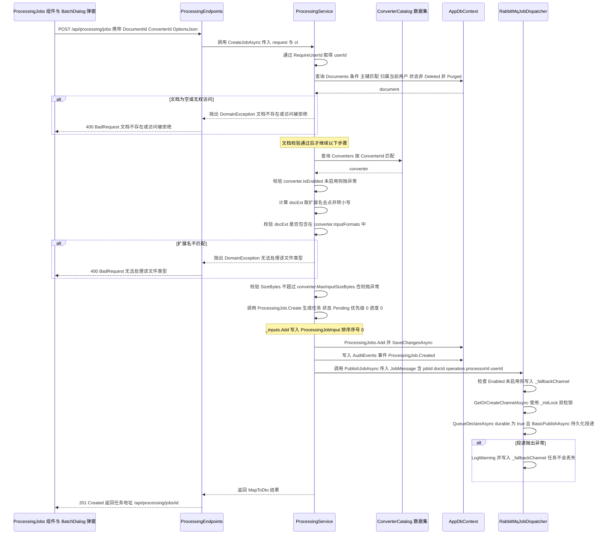

**Batch creation branch** (`CreateBatchAsync`):

| Mode | Job Cardinality | Input Cardinality | `BatchJobMode` |
|---|---|---|---|
| `CombineOutput = false` | One `ProcessingJob` per document | 1 input each | `Individual` |
| `CombineOutput = true` | One `ProcessingJob` total | N inputs via `AddInput(docId, null, i)` | `Combined` |

`Converter.SupportsBatch` is validated before either branch — a converter that does not support batch rejects the request outright.

#### 2.2.2 Worker Claim and Execution

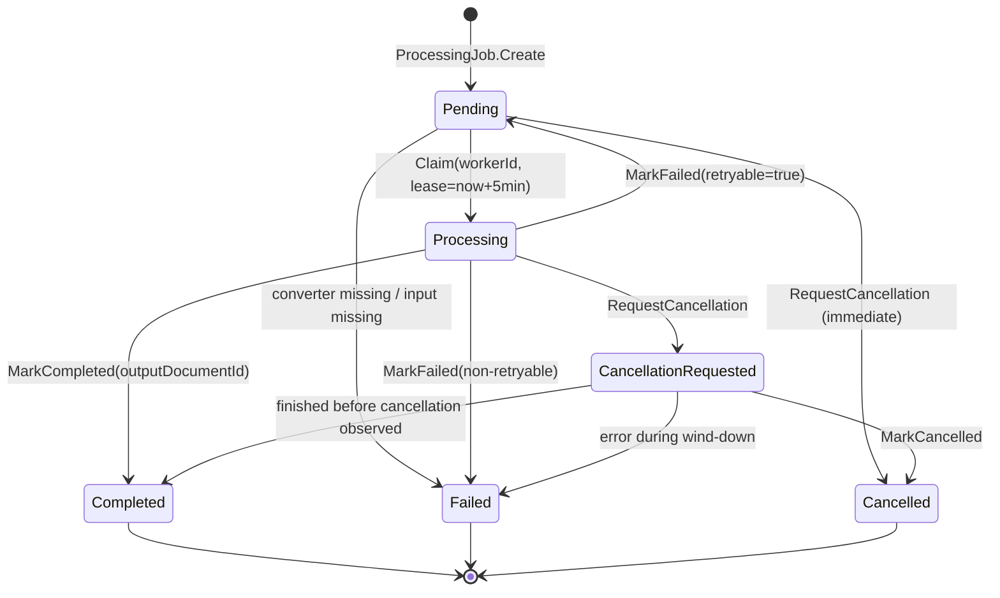

**Job selection predicate** (identical in `Worker.cs` and `JobProcessorWorker.cs`):

```csharp
j.Status == ProcessingJobStatus.Pending
|| (j.Status == ProcessingJobStatus.Processing && j.LeaseExpiresAt != null && j.LeaseExpiresAt < now)
```

This single predicate implements **stale-lease recovery**: a worker that crashes mid-job leaves `Status == Processing` with an expired lease, and the next poll re-claims it. No separate reaper is required.

**Full conversion pipeline**

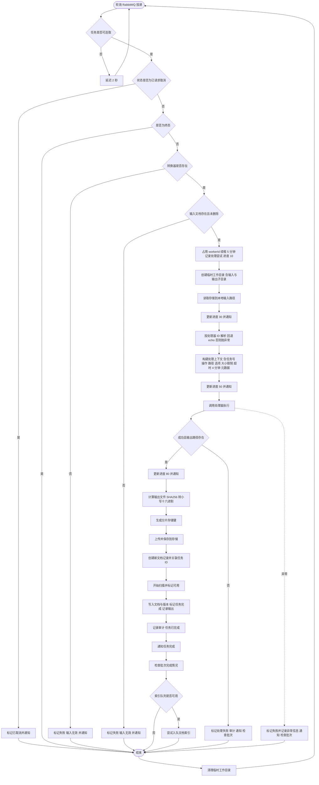

**Progress reporting checkpoints**

| Percent | Stage | Emitted By |
|---|---|---|
| 10 | Lease claimed, attempt recorded | `job.UpdateProgress(10)` + `NotifyJobProgressAsync` |
| 30 | Input fetched from encrypted storage | after `storage.OpenReadAsync` copy |
| 50 | `ProcessingContext` built, processor resolved | before `ProcessAsync` |
| 80 | Conversion succeeded, output file exists | before hashing |
| 100 | `MarkCompleted` | `NotifyJobCompletedAsync` (fixed at 100) |

> **Observational note.** Both `JobProcessorWorker` and the standalone `Worker` interleave `await Task.Delay(...)` between progress checkpoints (400 ms at 10→30, 600 ms at 30→50, 400 ms at 50→80 in the web-hosted variant). This pads the observable progress curve for the Blazor UI; it is presentation pacing, not computational work, and adds roughly 1.4 s to every job.

**Batch completion detection** (`CheckBatchCompletionAsync`) — idempotent sweep:

```
batchJobs = ProcessingJobs.Where(j.BatchJobId == batchJobId)
pendingOrRunning = batchJobs.Any(Status is Pending or Processing)
completed / failed / total = counts
if (!pendingOrRunning && batch.CompletedAt == null)
    batch.MarkCompleted(now); SaveChanges
always → NotifyBatchUpdatedAsync(batch.Id, owner, status, total, completed, failed)
```

The `batch.CompletedAt == null` guard makes this safe to call from every terminal path (success, processor failure, unhandled exception) without duplicate completion.

---

### 2.3 WF-3 — Document Intelligence Indexing & Vector Synchronisation

**Business value.** Turns a static archive into an answerable corpus. Runs entirely off the user's critical path — the upload response returns before any embedding work begins.

**Trigger paths (three).**

1. `DocumentService.UploadAsync` → `_indexingQueue?.TryQueueDocument(document.Id)` (fire-and-forget, silent)
2. `JobProcessorWorker` on conversion success → `_indexingQueue?.TryQueueDocument(outputDoc.Id)`
3. `DocumentIndexingWorker.ExecuteAsync` startup backfill — enqueues every `Available` document not present in `DocumentIntelligenceIndices`, ordered `CreatedAt DESC`

**Startup hydration and backfill**

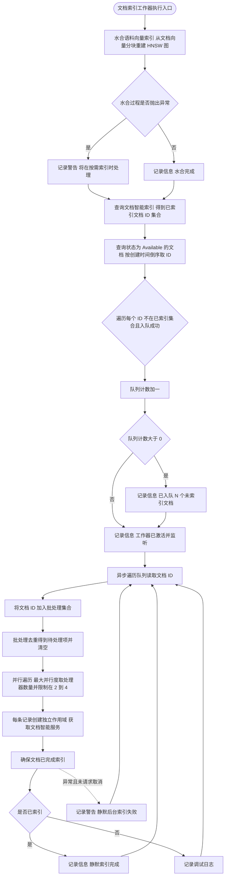

**Critical implementation detail — scope-per-item.** `Parallel.ForEachAsync` body opens its own `IServiceScopeFactory.CreateScope()` and resolves `IDocumentIntelligenceService` from that scope. `AppDbContext` is scoped, so parallel indexing on a shared context would throw `InvalidOperationException: A second operation was started on this context instance`. The per-item scope is mandatory, not stylistic.

**Index write pipeline (inside `EnsureDocumentIndexedAsync`)**

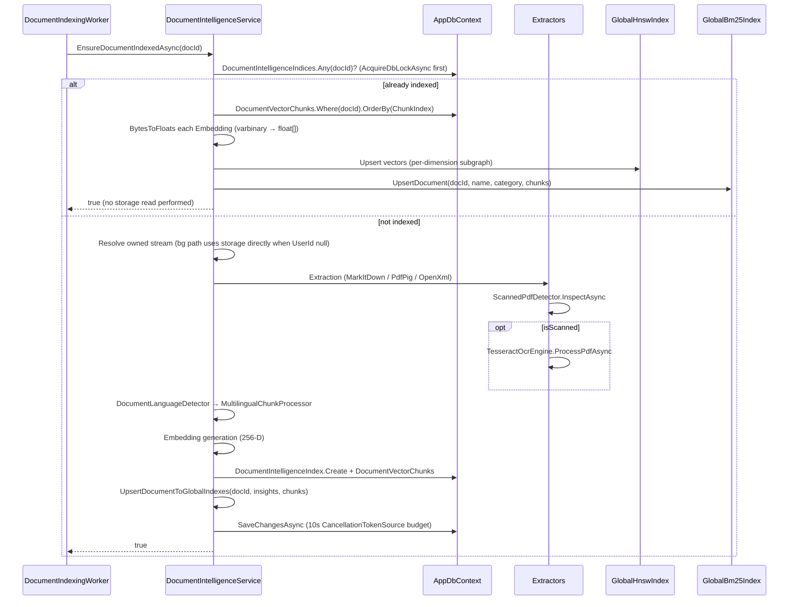

**Concurrency controls in this workflow**

| Control | Code | Rationale |
|---|---|---|
| Bounded channel | `BoundedChannelOptions(10_000) { FullMode = Wait, SingleReader = true, SingleWriter = false }` | Bounded memory; single consumer preserves ordering; multiple producers = uploads + conversions |
| Non-blocking enqueue | `TryQueueDocument` uses `_channel.Writer.TryWrite` | Upload endpoint must never await indexing |
| Queue depth counter | `Interlocked.Increment/Decrement(ref _queuedCount)`; `QueuedCount => Volatile.Read` | Lock-free observability |
| Parallelism cap | `Math.Clamp(Environment.ProcessorCount, 2, 4)` | Prevents CPU saturation on the web host |
| DbContext serialisation | `ConditionalWeakTable<AppDbContext, SemaphoreSlim>` + `AcquireDbLockAsync` | One `SemaphoreSlim(1,1)` per context instance; released via `SemaphoreReleaser` |
| Change-tracker hygiene | `ClearChangeTrackerSafely()` in `try/catch` | Bounds tracking memory across large chunk batches |
| Query embedding cache | `ConcurrentDictionary<string,(DateTime ExpiresAtUtc, float[] Vector)>` | Avoids redundant embedding calls across retries |

---

### 2.4 WF-4 — RAG Copilot Question Answering and Streaming Answer

**Business value.** The flagship knowledge-extraction experience: a grounded, source-attributed answer streamed incrementally, with the corpus never leaving the host.

**Trigger.** `Copilot.razor` → `EnterpriseAiChatService` → `IDocumentIntelligenceService.AskRepositoryQuestionAsync`.

**Components A–H pipeline** (`RagRetrievalOrchestrator`, explicit in its class documentation):

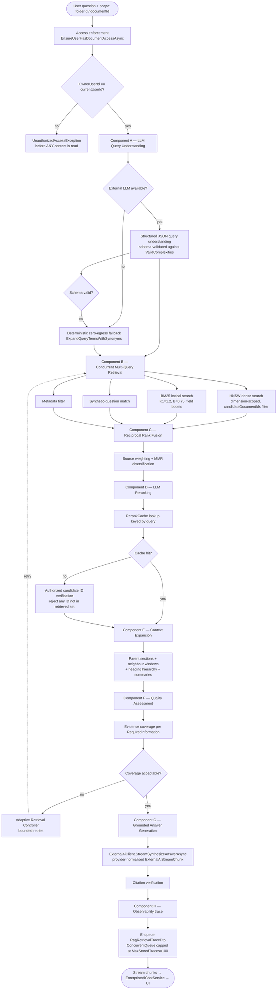

**Cross-lingual retrieval.** `MultilingualChunkProcessor` maintains a deterministic ID↔EN projection dictionary and `RagRetrievalOrchestrator.ExpandQueryTermsWithSynonyms` expands both unigrams and **bigrams** against `DomainSynonymsMap`. This is what allows an Indonesian query (`sisa cuti`) to match an English clause (`carry-forward`) without a translation call — fully offline, deterministic, and auditable.

**Evidence coverage logic** (exception path worth highlighting):

```
if (queryUnderstanding.UsedExternalLlm
    && coverageList.Count > 0
    && coverageList.All(c => !c.Covered))
{
    // External LLM produced RequiredInformation items that no chunk satisfies.
    // Fall back to verifying originalQuestion tokens directly (plus offline EN projection)
    // with minDirectScore = Math.Max(minimumTopScore, 0.25f)
    // → mark every coverage item Covered against the matched chunk, clear missingList
}
```

This is a **self-healing degradation path**: when the LLM's query decomposition is unhelpful, the system bypasses it rather than returning a false "no evidence found". A companion branch (`IsDocumentOverviewQuery`) lowers the effective minimum score to `0.12f` for overview-style questions, where distributed low-similarity evidence is expected and correct.

---

### 2.5 WF-5 — PDF Editing, Annotation and Version Commit

**Business value.** In-browser PDF authoring without a desktop tool; every edit produces an immutable, hash-verified version rather than overwriting the original.

**Trigger.** `PdfEditor.razor` posts a `PdfEditOperationDto` list to `POST /api/editor/{documentId}/save`.

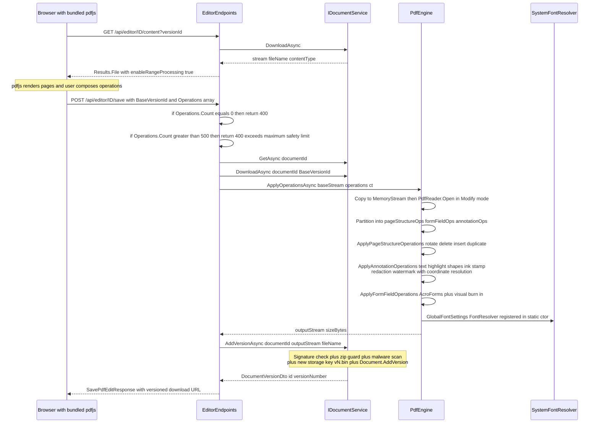

**Operation partition contract.** `PdfEngine` never applies operations in list order. It partitions into three independent groups and applies them in a fixed sequence — structure first, then annotations, then form fields — because page-structure mutations (delete/insert) invalidate the page indices that annotation coordinates reference. Applying annotations before structure would misplace every mark on the affected pages.

**Version mutation rule.** `Document.AddVersion` requires `Status == Available`, increments `Max(VersionNumber) + 1`, and calls `ClearCurrent()` on **every** existing version before creating the new one. The unique index `(DocumentId, VersionNumber)` plus this clear-then-add sequence guarantees exactly one `IsCurrent` version per document.

---

### 2.6 WF-6 — Scanned Document Detection and OCR Extraction

**Business value.** Recovers machine-readable content from image-only documents, which is what makes scanned archives searchable rather than inert.

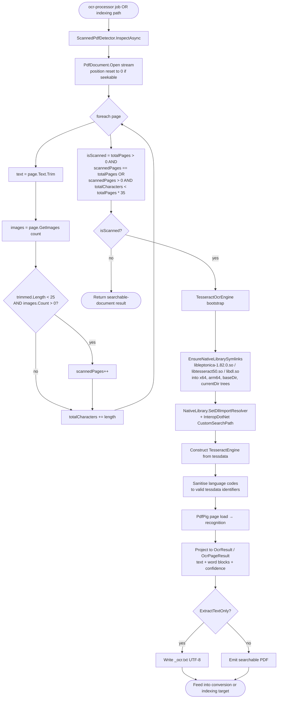

**Two heuristics, one decision.** The detector combines a per-page rule (`< 25` chars **and** ≥ 1 image) with a document-level aggregate (`totalCharacters < totalPages * 35`). The per-page rule catches clean scan-only documents; the aggregate catches mixed documents where a few pages carry a text layer. Both thresholds are deliberately lenient — a false positive costs an OCR pass, a false negative costs an unsearchable document.

**Native bootstrap risk.** `TesseractOcrEngine.InitializeEnvironment` runs in a **static constructor**. It searches a hard-coded candidate list of `liblept` / `libtesseract` / `libdl` / `libc` paths across `x86_64-linux-gnu`, `aarch64-linux-gnu`, `/usr/lib`, `/usr/local/lib`, then creates symlinks under expected loader names (`libleptonica-1.82.0.so`, `libtesseract50.so`) into six target directories. This is the highest-risk operational code in the system — a missing native library throws `TypeInitializationException` on first `IOcrEngine` resolution, which surfaces as a job failure with `ProcessorFailure`, not a startup failure.

---

### 2.7 WF-7 — Document Retrieval, Recycle-Bin Restore and Purge

**Business value.** Reversible deletion with a durable audit trail. Logical and physical deletion are distinct states, so a purge failure never loses the record of what was deleted.

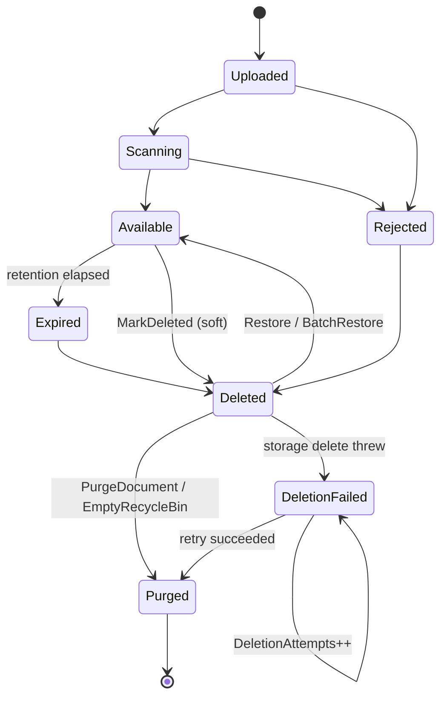

**Owner scoping.** Every method in `DocumentService` begins with `GetCurrentUserId()` and applies `d.OwnerUserId == userId` in the query predicate. There is no cross-owner read path in the MVP. `Document.IsOwnedBy(userId)` exists as the aggregate-level guard.

**Recycle-bin operations**

| Operation | Service Method | Predicate | Transition |
|---|---|---|---|
| Soft delete | `DeleteAsync` | owner-scoped | `Available → Deleted`, sets `DeletedAt` |
| Batch delete | `BatchDeleteAsync` | owner + `Status != Deleted/Purged` | loop `MarkDeleted`; folders via `DeleteFolderAsync` with per-item try/catch |
| Restore | `RestoreAsync` | owner-scoped | orphaned folder → `MoveToFolder(null)` then `Restore` |
| Batch restore | `BatchRestoreAsync` | owner + `Status == Deleted` | pre-loads existing folder IDs into a `HashSet`, reparents orphans |
| Purge | `PurgeDocumentAsync` | owner-scoped | per-version `storage.DeleteAsync` with try/catch → `MarkPurged` |
| Empty bin | `EmptyRecycleBinAsync` | owner + `Status == Deleted` | bulk purge |

**Purge failure semantics.** `PurgeDocumentAsync` wraps each `_storage.DeleteAsync` in a `try/catch` that logs a warning and continues. The document is still transitioned to `Purged`. This is intentional: a partial storage failure must not block the metadata lifecycle, and the mismatch is recoverable because `DocumentVersions` rows retain the `StorageKey` — but it does mean orphaned ciphertext can accumulate if the storage provider persistently fails. `DocumentStatus.DeletionFailed` and `DeletionAttempts` exist to model the alternative (retry-until-success) policy; the current purge path chooses progress over strictness.

---

### 2.8 WF-8 — Platform Administration, Audit Review and Compliance Dossier Export

**Business value.** Closes the governance loop: the system must be able to prove what it did, to whom, and under which policy.

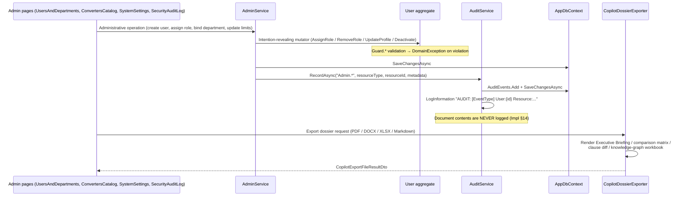

**Audit record shape.** `AuditEvent.Create(Guid, userId, eventType, resourceType, resourceId, ipAddress, metadata, now)`. `userId` is nullable (`_userContext.UserId`) so pre-authentication rejections (e.g. `Document.UploadRejected` before a principal is bound) are still recorded with a null actor. `ipAddress` comes from `IUserContext.IpAddress`.

**Observed event catalogue**

| Event Type | Emitted From | Carries |
|---|---|---|
| `Document.Uploaded` | `DocumentService.UploadAsync` | FileName, Size, Hash |
| `Document.UploadRejected` | `DocumentService.UploadAsync` (malware) | Threat, FileName |
| `Document.VersionRejected` | `DocumentService.AddVersionAsync` | Threat, FileName |
| `Document.Downloaded` | `DocumentService.DownloadAsync` | Version |
| `Document.Renamed` / `.Moved` / `.Deleted` / `.Restored` / `.Purged` | lifecycle methods | operation-specific |
| `Document.BatchDownloadedZip` / `.BatchMoved` / `.BatchDeleted` / `.BatchRestored` | batch methods | counts |
| `Folder.Created` / `.Renamed` | folder methods | Name |
| `ProcessingJob.Created` | `ProcessingService.CreateJobAsync` | converter name, operation |
| `ProcessingJob.Completed` | `JobProcessorWorker` | output file name |
| `ProcessingJob.Failed` | `JobProcessorWorker` | error message |

---

## 3. Flow Coordination and Control

### 3.1 Multi-Module Coordination Mechanisms

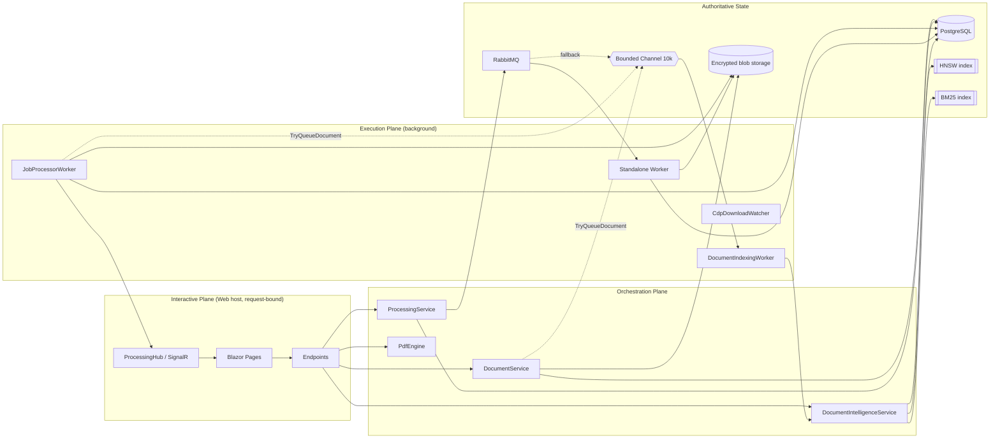

**Four independent decoupling boundaries:**

| Boundary | Producer | Consumer | Mechanism | Failure Mode |
|---|---|---|---|---|
| Conversion work | `ProcessingService` | `Worker` / `JobProcessorWorker` | RabbitMQ ⇄ SQL lease poll | Broker down → fallback channel or lease poll still drains |
| Indexing work | Upload + conversion | `DocumentIndexingWorker` | `System.Threading.Channels` bounded | Channel full → `TryWrite` returns false, logged, upload unaffected |
| Notifications | Workers | Browser | `IJobNotificationService` → SignalR | Hub unreachable → `LogWarning`, job still completes |
| Storage | All services | Filesystem/SMB | `IDocumentStorage` port | Provider swap without touching document logic |

### 3.2 State Management and Synchronisation

**Split-brain prevention.** `ProcessingJob.Status` in SQL is the single source of truth. RabbitMQ carries a `JobMessage` envelope only — and `JobMessage` explicitly carries **no document binary** ("*Document binary MUST NOT be included in the message payload (Method §31)*"). Worker claim is guarded by the domain invariant `Claim()` which throws `InvalidStateTransitionException` unless `Status == Pending`, so a duplicate delivery for an already-claimed job fails the transition rather than processing twice.

**Duplicate output prevention at the schema level.** `DocumentConfigurations` declares:

```csharp
builder.HasIndex(d => d.SourceProcessingJobId).IsUnique()
       .HasFilter("[SourceProcessingJobId] IS NOT NULL");
```

A unique filtered index on `SourceProcessingJobId` means a redelivered job cannot create a second output document — the insert violates the index. This is defence-in-depth behind the `Claim()` invariant.

**Concurrent index access.** Both indexes use `ReaderWriterLockSlim`:

| Structure | Reader path | Writer path | Conflict Resolution |
|---|---|---|---|
| `HnswVectorIndex` | `Search`, `Count`, `ContainsDocument`, `GetIndexedDimensions` | `Add`, `RemoveDocument` | Soft delete via `_deletedNodes` HashSet; entry point re-election per dimension |
| `Bm25InvertedIndex` | `Search` | `UpsertDocument`, `RemoveDocument`, `Clear` | `IsDeleted` flag on `IndexedEntry`; postings rebuilt on upsert |

Both use **soft deletion** rather than compaction. `RemoveDocument` adds IDs to a deleted-set and removes map entries; the underlying `_nodes` / `_entries` lists are never shrunk mid-flight. This avoids invalidating internal integer IDs that neighbour lists reference — a hard-compaction strategy would require a full rebuild on every document deletion.

**Dimension-scoped HNSW subgraphs.** `HnswVectorIndex` maintains `Dictionary<int, (int EntryPointId, int MaxLevel)> _dimensionEntries` — a separate entry point per vector dimensionality. `Search` returns `[]` when `!_dimensionEntries.TryGetValue(queryVector.Length, ...)`. The migration history (`20261113025122_WidenDocumentVectorChunkEmbedding`) records a dimensional change, so this design directly accommodates an embedding-width migration without a full index rebuild: old and new dimensions coexist as separate subgraphs until the old one is drained.

### 3.3 Data Passing and Sharing

| Payload | Type | Transport | Content |
|---|---|---|---|
| Job envelope | `JobMessage(Guid JobId, Guid DocumentId, string Operation, string ProcessorId, Guid RequestedBy, string? QueueName)` | JSON over RabbitMQ (persistent) | **No binary** |
| Conversion context | `ProcessingContext(jobId, operation, inputPath, outputDir, optionsJson, maxInputSize, timeout, metadata)` | In-process | Filesystem paths into the isolated workspace |
| Conversion result | `ProcessingResult` (`Success`, `OutputPath`, `OutputContentType`, `OutputSizeBytes`, `ErrorMessage`) | In-process return | Path only — bytes never buffered in the result |
| Semantic chunk | `SemanticChunkDto(ChunkIndex, PageNumber, Content, Embedding, SectionTitle, IsEnriched, VectorSource, ExtractionMethod, EnrichmentMetadata, Language, ParentChunkId, ChunkId)` | In-process + EF persisted | Embedding serialised to varbinary via `FloatsToBytes` |
| Stream chunk | `ExternalAiStreamChunk` | Provider-normalised | Unified contract over OpenAI / Claude / Gemini dialects |
| Job notification | `JobNotificationEvent(jobId, ownerUserId, batchJobId, status, progressPercent, inputFileName, outputFileName, outputDocumentId, errorMessage, timestamp)` | In-memory event + SignalR | UI projection |
| Edit operations | `IReadOnlyList<PdfEditOperationDto>` | HTTP JSON | Typed operation list, capped at 500 |

**Stream discipline.** `ExternalAiClient` normalises three divergent provider dialects:

| Provider | Dialect | Normalisation |
|---|---|---|
| OpenAI | `choices[].delta` SSE | `StreamOpenAiCompatibleChatAsync` |
| Claude | Named SSE events (`content_block_delta`) | `StreamClaudeAsync` |
| Gemini | Element-chunk arrays | `StreamGeminiAsync` |
| Custom | OpenAI-compatible at `http://localhost:11434/v1` | Same OpenAI path with `requireBearer: true` |

Reasoning/thinking payloads are extracted **separately** from assistant text, so chain-of-thought content is routed to the UI reasoning channel and never mixed into the answer body.

### 3.4 Execution Control and Scheduling

**Host startup sequence (Web)**

```mermaid
flowchart TD
    A([Program.cs]) --> B[SystemFontResolver.EnsureRegistered<br/>BEFORE builder — PDFsharp global font resolver]
    B --> C[AddConfiguredDbContext<br/>provider auto-detect: Host=/Port=5432/Username= → Npgsql else SqlServer]
    C --> D[AddIdentity + ConfigureApplicationCookie<br/>HttpOnly, SameSite=Lax, 8h sliding]
    D --> E[AddScoped IClaimsTransformation → AppClaimsTransformation]
    E --> F[Register all ports → adapters]
    F --> G[Configure RabbitMqOptions + RabbitMqJobDispatcher]
    G --> H{Processing:RunWorkerInWeb?}
    H -- true --> I[AddHostedService JobProcessorWorker]
    H -- false --> J[AddHostedService CdpDownloadWatcher]
    I --> J
    J --> K[AddRateLimiter<br/>login-policy 10/min fixed window<br/>processing-policy concurrency 20 queue 10]
    K --> L[AddResponseCompression Brotli + Gzip]
    L --> M[AddHealthChecks → AddDbContextCheck database]
    M --> N[AddOpenTelemetry traces + metrics]
    N --> O[app.Build]
    O --> P{AutoMigrateDatabase OR Development?}
    P -- yes --> Q[InitializeDatabaseAsync<br/>PostgreSQL: information_schema check →<br/>idempotent CREATE TABLE IF NOT EXISTS DDL<br/>SQL Server: db.Database.MigrateAsync]
    Q --> R[DbSeeder.SeedAsync]
    P -- no --> S[HTTP pipeline]
    R --> S
    S --> T[UseExceptionHandler + UseHsts non-dev<br/>UseStatusCodePagesWithReExecute /not-found]
    T --> U[UseHttpsRedirection]
    U --> V[UseMiddleware SecurityHeadersMiddleware]
    V --> W[UseResponseCompression + UseStaticFiles immutable caching]
    W --> X[UseRouting → UseRateLimiter → UseAuthentication<br/>→ UseAuthorization → UseAntiforgery]
    X --> Y[MapHealthChecks /health + endpoint groups + SignalR hub + Razor components]
```

**Ordering invariants that matter:**
1. `SystemFontResolver.EnsureRegistered()` runs **before** `WebApplication.CreateBuilder` — PDFsharp's `GlobalFontSettings.FontResolver` is a process-wide singleton and must be set before any `PdfDocument` is opened.
2. `UseRateLimiter` sits **after** `UseRouting` (needs endpoint metadata for `RequireRateLimiting("processing-policy")`) and **before** `UseAuthentication` (rejects floods cheaply).
3. `UseAntiforgery` is last before endpoint mapping; upload endpoints opt out with `.DisableAntiforgery()` because they are consumed by the same-origin Blazor client with a `FormData` body.
4. `InitializeDatabaseAsync` runs **between** `Build()` and the HTTP pipeline, so migrations complete before the first request and before any hosted service starts touching tables.

**Scheduling characteristics**

| Service | Trigger | Interval | Cancellation |
|---|---|---|---|
| `JobProcessorWorker` | Continuous `while (!stoppingToken.IsCancellationRequested)` | `Task.Delay(2s)` when idle, `5s` after error | Cooperative; `OperationCanceledException` filtered by `when (stoppingToken.IsCancellationRequested)` |
| `DocumentIndexingWorker` | `await foreach (_queue.ReadAllAsync)` | Event-driven, no polling | `EnumeratorCancellation` attribute |
| `Worker` (standalone) | RabbitMQ consumer **and** parallel SQL poll loop | `2s` idle / `5s` error | Same pattern |
| `CdpDownloadWatcher` | Continuous | `5s` | Errors swallowed silently |

> **Architectural note.** The standalone `Worker` runs *both* the RabbitMQ consumer and the polling loop concurrently. Because job selection is lease-guarded, the two paths cannot double-process: whichever claims first wins, the other finds a non-`Pending` status. This is deliberate belt-and-braces design for deployments where broker delivery is unreliable.

**Rate limiting**

| Policy | Type | Limit | Queue | Rejection |
|---|---|---|---|---|
| `login-policy` | Fixed window | 10 / 1 min | 0 | 429 |
| `processing-policy` | Concurrency | 20 concurrent | 10 (OldestFirst) | 429 |

Applied via `.RequireRateLimiting("processing-policy")` on `POST /api/processing/jobs` and `POST /api/processing/batches` only.

---

## 4. Exception Handling and Recovery

### 4.1 Error Detection and Handling

**Layered error classification**

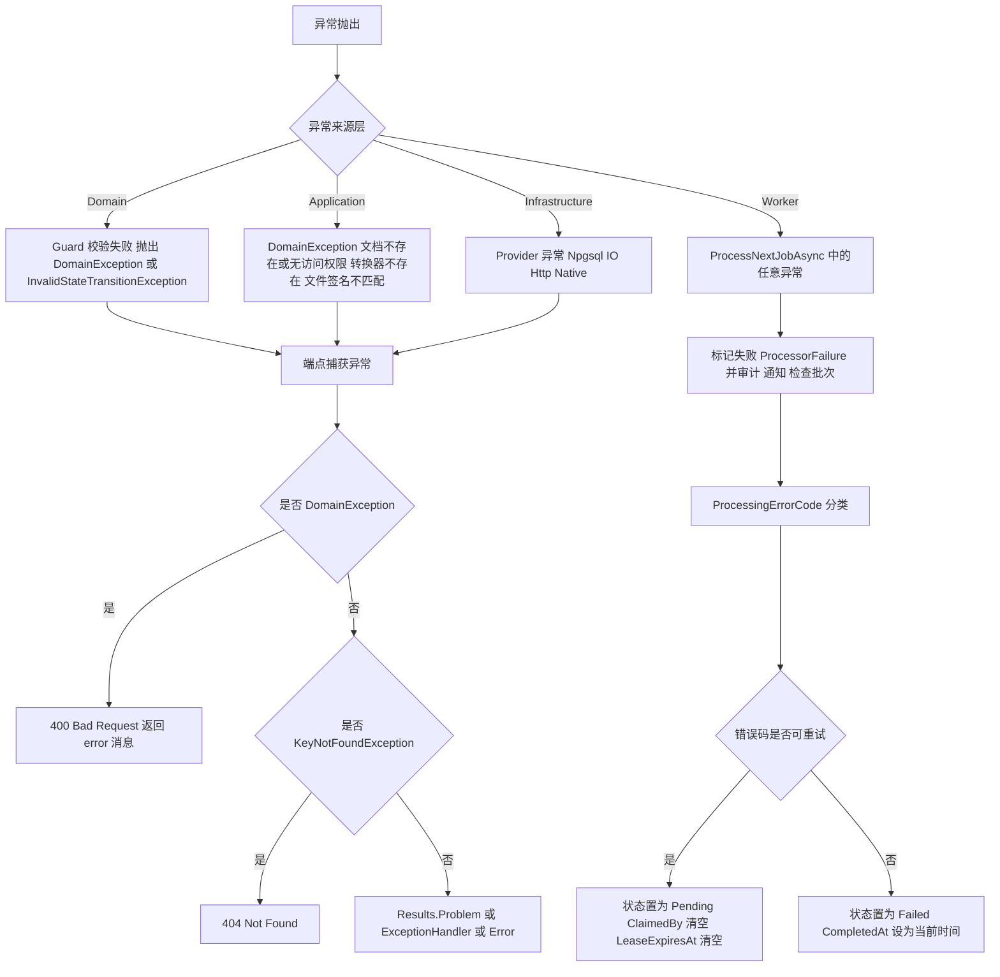

**Structured error codes** — `ProcessingErrorCode { InvalidInput, UnsupportedFormat, ResourceLimit, ProcessorFailure, TemporaryInfrastructureFailure, UnknownFailure, Timeout }`. The domain doc comment is explicit: *"Structured, user-safe error classification. Internal exception details are never exposed."* `ProcessingAttempt.MarkFailed(code, message, now)` records the code on the attempt; the job stores `ErrorCode` (string, max 100) and `ErrorMessage` (max 2000).

**Retryability policy**

```csharp
public static bool IsRetryable(ProcessingErrorCode code)
    => code is ProcessingErrorCode.TemporaryInfrastructureFailure or ProcessingErrorCode.Timeout;
```

Only transient infrastructure failures and timeouts re-enter the queue. **Invalid input is never retried indefinitely** (explicit design note). Note that both worker implementations currently call `job.MarkFailed(ProcessingErrorCode.ProcessorFailure, ...)` without the `retryable: true` argument — so the retry path exists in the domain but is not yet exercised by the primary failure paths.

### 4.2 Exception Recovery Mechanisms

| Failure | Detection | Recovery | Evidence |
|---|---|---|---|
| **Worker crash mid-job** | `Status == Processing && LeaseExpiresAt < now` | Next poll re-claims via `Claim()` | Job selection predicate in both workers |
| **Broker unreachable (publish)** | `PublishJobAsync` catch | `_fallbackChannel.WriteAsync` — job never dropped | `RabbitMqJobDispatcher` lines 55–90 |
| **Broker unreachable (consume)** | `StartRabbitMqConsumerAsync` catch in `Worker` | `LogWarning`, fall through to SQL lease polling loop | `Worker.ExecuteAsync` |
| **RabbitMQ message processing error** | Consumer `catch` | `BasicNackAsync(requeue: true)` | `Worker.StartRabbitMqConsumerAsync` |
| **Malware scanner unreachable** | `ClamAvScanner` catch / timeout | **Fail closed** → `ScanResult.Threat("ScannerUnavailable: ...")` | Explicit comment "Fails closed (Gathering §2)" |
| **Malware scanner slow** | 10 s `CancellationTokenSource` | `ScanResult.Threat("ScannerTimeout: ...")` | `_timeoutSeconds` default 10 |
| **Storage write interrupted** | `catch` in `SaveAsync` | `.tmp` file deleted, exception rethrown | `File.Move` only executes on success |
| **Storage read of encrypted blob** | `DecryptAsync` failure | Exception propagates to job → `MarkFailed` | — |
| **Conversion returns failure** | `result.Success == false` | `MarkFailed(ProcessorFailure, result.ErrorMessage)` + audit + notify + batch sweep | `JobProcessorWorker` else-branch |
| **Unhandled exception in job body** | outer `catch (Exception ex)` | `MarkFailed(ProcessorFailure, ex.Message)` + notify + batch sweep | `JobProcessorWorker` catch block |
| **Processor not registered** | `_processors.FirstOrDefault(...) ?? "echo" ?? throw` | `InvalidOperationException` → caught by outer handler → `MarkFailed` | Processor resolution chain |
| **Converter row missing** | `converter is null` | `MarkFailed(InvalidInput, "Associated converter not found.")` | Before claim — no lease consumed |
| **Input document deleted** | `inputDoc is null \|\| Status == Deleted` | `MarkFailed(InvalidInput, "Input document no longer exists.")` | Before claim |
| **Cancellation requested mid-job** | `Status == CancellationRequested` at poll | `MarkCancelled` + notify, returns `true` (progress made) | Cooperative — checked between jobs |
| **Batch evaluation throws** | `catch` in `CheckBatchCompletionAsync` | `LogWarning`, swallowed — single job outcome already committed | Non-critical path isolation |
| **Indexing failure** | `catch (Exception ex) when (!ct.IsCancellationRequested)` | `LogWarning`, continue to next item | Per-item isolation in `Parallel.ForEachAsync` |
| **Vector hydration failure at startup** | `catch when (!stoppingToken.IsCancellationRequested)` | `LogWarning` — "will index on demand" | Degraded, not failed |
| **DbContext disposed/faulted during cleanup** | `ClearChangeTrackerSafely` catch | Swallowed | Prevents masking the real exception |
| **DbSeeder failure** | `InitializeDatabaseAsync` outer catch | `LogError` + rethrow — **host does not start** | Fail-fast on schema bootstrap |
| **Purge storage delete failure** | per-version `catch` | `LogWarning`, continue, still `MarkPurged` | Progress over strictness |
| **Workspace cleanup failure** | `finally` catch | `LogWarning` | Never masks the job outcome |

### 4.3 Fault Tolerance Strategy Design

**Three concentric fault domains:**

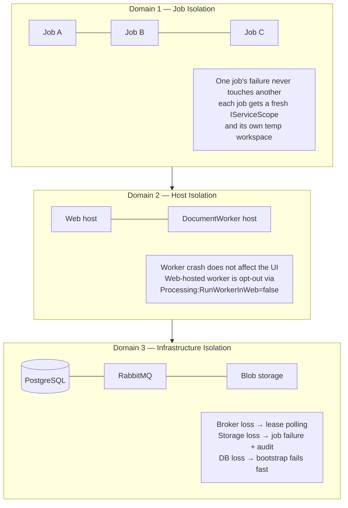

**Backoff and pacing**

| Context | Behaviour |
|---|---|
| Idle poll | `Task.Delay(2s)` |
| Error poll | `Task.Delay(5s)` |
| Indexing channel | Bounded 10,000, `FullMode = Wait` (async writes block, `TryWrite` never does) |
| AI provider ping | 12 s `CancellationTokenSource` |
| ClamAV scan | 10 s linked CTS |
| Conversion context | `TimeSpan.FromMinutes(4)` processor timeout |
| Job lease | 5 minutes |
| EF retry | `EnableRetryOnFailure(5, TimeSpan.FromSeconds(10))` (worker) / `(5, TimeSpan.FromSeconds(5))` (web) |
| DB save in AI persist | 10 s dedicated CTS — a slow save degrades to "not persisted", never blocks the answer |

### 4.4 Failure Retry and Degradation

**Degradation ladder — graceful to hard**

| Level | Condition | System Behaviour |
|---|---|---|
| 0 | All healthy | Full pipeline, RabbitMQ delivery, eager progress notifications |
| 1 | RabbitMQ down | Fallback channel (web) or SQL lease polling (worker). Same throughput, higher DB read load |
| 2 | ClamAV down | Uploads **rejected** (fail closed). EICAR pre-check still active |
| 3 | External LLM unreachable | `RagRetrievalOrchestrator` Component A falls back to deterministic synonym expansion; generation degrades to extractive context |
| 4 | Indexing worker down | Documents remain `Available` and convertible; only search is stale. Startup backfill catches up when it restarts |
| 5 | Vector hydration fails at startup | Logged; per-document on-demand indexing still works |
| 6 | Storage provider down | Uploads fail (`400`), conversions fail (`MarkFailed`), reads fail. No partial writes — `.tmp` cleanup guarantees this |
| 7 | PostgreSQL down | `AddDbContextCheck("database")` reports unhealthy at `/health`; host bootstrap fails fast; running jobs fail on `SaveChangesAsync` |

**Idempotency guarantees**

| Operation | Guard | Level |
|---|---|---|
| Job claim | `Claim()` throws unless `Status == Pending` | Domain invariant |
| Job completion | `ProcessingJobLifecycle.EnsureCanTransition(Status, Completed)` | Domain invariant |
| Output document creation | Unique filtered index on `SourceProcessingJobId` | Database schema |
| Batch completion | `batch.CompletedAt == null` check | Application logic |
| Document version add | Unique index `(DocumentId, VersionNumber)` + `ClearCurrent()` on all versions | Schema + domain |
| Document ownership | `OwnerUserId == userId` in every predicate | Application + schema index |

---

## 5. Key Process Implementation

### 5.1 Core Algorithm — AES-256-GCM Envelope Encryption Streaming

**Purpose.** Bounded-memory authenticated encryption of arbitrarily large documents with per-document key isolation.

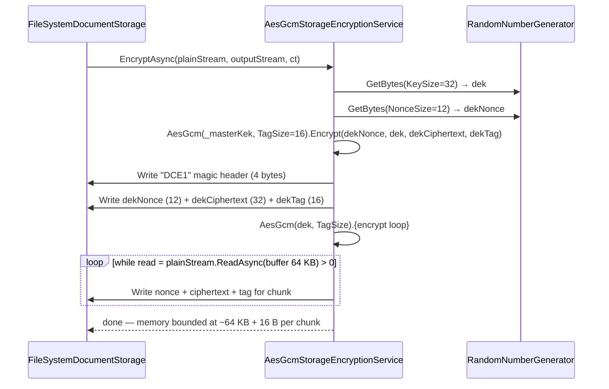

**Format layout**

| Offset | Size | Content |
|---|---|---|
| 0 | 4 B | Magic header `"DCE1"` (`DCE1` = **D**ocument **C**onverter **E**ncrypted v1) |
| 4 | 12 B | DEK nonce |
| 16 | 32 B | Wrapped (encrypted) DEK |
| 48 | 16 B | DEK authentication tag |
| 64 | … | Authenticated ciphertext chunks, each with its own nonce + tag |

**Key management chain**

```
STORAGE_ENCRYPTION_KEY (env)  ──or──  Storage:Encryption:MasterKey (config)
        │
        ├─ valid Base64 of exactly 32 bytes  → used directly as KEK
        ├─ valid Base64, wrong length        → SHA256(decoded)  + LogWarning
        ├─ not Base64                        → SHA256(UTF8 bytes) + LogWarning
        └─ absent                            → SHA256("DocConv.DefaultDevelopmentMasterKey.NotForProduction!")
                                              + LogWarning IF encryption enabled
```

**Speed and memory characteristics.** Encryption is a single forward pass with `IncrementalHash.CreateHash(HashAlgorithmName.SHA256)` running alongside the read loop, so the plaintext is hashed **and** written in one traversal. Memory is O(ChunkSize) = 64 KB regardless of document size. The `IsEncryptedAsync` probe reads only 4 bytes and restores `stream.Position`, making it O(1) for format detection.

> **Operational caution.** When `Storage__Encryption__Enabled=false` (the default in both `docker-compose.yml` and `docker-compose.prod.yml`), `FileSystemDocumentStorage.SaveAsync` takes the plaintext branch and `OpenReadAsync` returns the raw `FileStream` without calling `DecryptAsync`. Encryption is opt-in, and the dev fallback key is used silently — but only with a `LogWarning`. Deployments intending confidentiality must set both `Storage:Encryption:Enabled=true` and a 32-byte Base64 `STORAGE_ENCRYPTION_KEY`.

### 5.2 Data Processing Pipeline — Hybrid Retrieval (HNSW + BM25 + RRF + MMR)

**Component B — concurrent multi-query retrieval**

| Query stream | Index | Parameters |
|---|---|---|
| Dense semantic | `HnswVectorIndex.Search` | `m=16`, `m0=32`, `efConstruction=64`, `efSearch=32` (→ `Math.Max(efSearch*3, Math.Max(topK*4, 64))` when `candidateDocumentIds` filter active) |
| Lexical | `Bm25InvertedIndex.Search` | `K1=1.2`, `B=0.75`; field boosts for section titles, technical terms, synthetic questions |
| Synonym expansion | `DomainSynonymsMap` | Unigram + bigram, EN ↔ ID, ~200 domain terms |
| Metadata | EF / in-memory filter | Category, format, year, folder, min confidence |

**Why the beam widens on filtered search.** When `candidateDocumentIds != null`, HNSW expands `efSearch` by up to 3×. A filtered ANN query can silently under-return because the greedy graph traversal may never reach a small candidate set — the standard mitigation is a wider beam at layer 0. The code implements exactly that:

```csharp
int effectiveEf = candidateDocumentIds != null
    ? Math.Max(efSearch * 3, Math.Max(topK * 4, 64))
    : Math.Max(efSearch, topK * 2);
```

**Component C — RRF and MMR.** Rank fusion combines ranked lists from the independent retrieval streams; source weighting adjusts the contribution per stream; MMR then diversifies the fused set by penalising candidates too similar to already-selected ones. This prevents a single verbose document from monopolising the context window — a common failure mode in naive top-K retrieval.

**Component D — authorisation-verified reranking.** LLM reranking returns candidate IDs; the orchestrator **verifies every returned ID against the authorised retrieved set** before accepting the ordering. An LLM that hallucinates a chunk ID cannot inject unauthorised content. `RerankCache` (keyed by query string, TTL-stamped) avoids repeated rerank calls for identical queries.

**Component E — context expansion.** Retains not just the matched chunk but its parent section, selective neighbour windows, heading hierarchy, and section summary. This converts a keyword hit into a self-contained evidence block. `DocumentVectorChunk` carries `ParentChunkId`, which is precisely the pointer this expansion follows.

**Component H — observability.** `ConcurrentQueue<RagRetrievalTraceDto> RecentTraces` capped at `MaxStoredTraces = 100`. Each stage's timing, candidate counts and decisions are recorded, giving a full reconstruction of why a particular answer was produced — the auditability requirement for a compliance-facing RAG system.

### 5.3 Business Rule Execution

| Rule | Enforcement Point | Violation Behaviour |
|---|---|---|
| A converter must declare ≥1 input and ≥1 output format | `Converter.Create` | `DomainException` |
| A converter must pass validation before enabling | `Converter.Enable(now, allowUnvalidated)` | `DomainException` unless `allowUnvalidated` (dev only) |
| Failed validation auto-disables | `Converter.RecordValidation` | `IsEnabled = false` |
| Document size ≤ converter max | `ProcessingService.CreateJobAsync` | `DomainException` with both sizes in the message |
| Document extension ∈ converter input formats | `ProcessingService.CreateJobAsync` | `DomainException` listing supported formats |
| Batch requires `SupportsBatch` | `ProcessingService.CreateBatchAsync` | `DomainException` |
| Multi-input requires `AcceptsMultipleInputs` | Batch combined mode | Job construction |
| Versions only on `Available` documents | `Document.AddVersion` | `DomainException` |
| Documents only mutable when visible to owner | `Document.EnsureMutable` | `DomainException` "can no longer be modified" |
| Job inputs frozen once started | `ProcessingJob.AddInput` | `DomainException` unless `Status == Pending` |
| Progress must be 0–100 | `ProcessingJob.UpdateProgress` → `Guard.InRange` | `DomainException` |
| Edit batch ≤ 500 operations | `EditorEndpoints` save handler | `400 Bad Request` |
| Upload batch ≤ 20 files / 100 MB each / 250 MB total | `DocumentEndpoints` upload-batch | `400 Bad Request` with per-file error objects |
| Ownership on every query | `DocumentService.GetCurrentUserId()` + predicate | `UnauthorizedAccessException` / empty result |
| Document content never logged | `AuditService` (metadata strings only) | Design constraint |

**Guard as single validation choke point.** `Guard` uses `[CallerArgumentExpression]`, so call sites pass only the value and the framework supplies the parameter name for the error message:

```csharp
public static Guid NotEmpty(Guid value, [CallerArgumentExpression(nameof(value))] string? paramName = null)
```

`Guard` depends only on `DomainException` and is depended upon by `Entity` and `Sha256Hex` — it is the most widely referenced file in `Domain/Common`.

### 5.4 Technical Implementation Details

**Storage key layout (sharded)**

```
{id[0..2]}/{id[2..4]}/{id:N}/v{N}.bin

Example:  4f / a3 / 4fa3c1e8.../ v1.bin
```

Two-level hex sharding bounds directory fan-out — 256 × 256 = 65,536 leaf directories before any single directory exceeds a manageable entry count. `Document.OriginalFileName` is explicitly excluded from the path.

**Real-time notification shape**

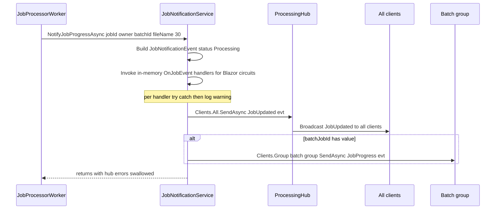

**Dual delivery path.** In-memory events serve active Blazor Server circuits directly (no network hop); SignalR broadcasts serve all other connected clients. A failure in either path is caught and logged independently — notification loss never affects job completion.

**Identity transformation (JIT provisioning)**

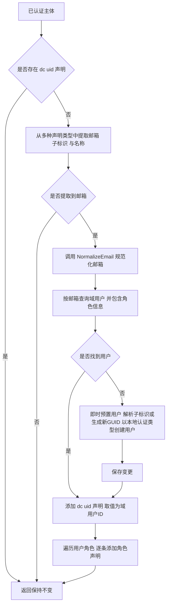

**Why this matters.** The internal `User.Id` is decoupled from any identity-provider subject. Every downstream authorisation decision — `OwnerUserId == userId`, `RequireRole(RoleNames.User)`, `RequireRole(RoleNames.Administrator)` — uses the internal ID. Switching an account from `Local` to `EntraId` changes only the `AuthenticationType` and `ExternalSubject` fields; every document ownership row remains valid. The `dc:uid` claim type is `HttpContextUserContext.UserIdClaimType`, consumed by `HttpContextUserContext.UserId` and surfaced to every application service through `IUserContext`.

**Startup database bootstrap (dual-provider)**

| Provider | Detection | Strategy |
|---|---|---|
| PostgreSQL | `DATABASE_PROVIDER=Npgsql` or connection string containing `Host=` / `Port=5432` / `Username=` / `postgres` | Open a standalone `NpgsqlConnection`; probe `information_schema.tables` for `DocumentVectorChunks`; if present run idempotent `ALTER TABLE ... ADD COLUMN IF NOT EXISTS` catch-up for the provenance columns; then run `GenerateCreateScript()` transformed to `CREATE TABLE IF NOT EXISTS` / `CREATE INDEX IF NOT EXISTS` |
| SQL Server | anything else | `db.Database.MigrateAsync()` — full EF Core migration chain |
| Neither / memory | connection string contains "Memory" or is blank | `UseInMemoryDatabase("DocumentConverterDb")` |

**Why PostgreSQL takes the idempotent-DDL path.** The migration history is authored for SQL Server (bracket-quoted identifiers, `__EFMigrationsHistory` in `dbo`). Rather than force a parallel Npgsql migration set, `InitializeDatabaseAsync` generates the EF model's `CreateScript`, rewrites `[` → `"` and `]` → `"`, injects `IF NOT EXISTS` clauses, and tolerates failure when the core table already exists:

```csharp
catch (Exception ex)
{
    if (!coreTableExists) throw;          // first-run failure is fatal
    logger.LogWarning(ex, "...warning on existing database...");
}
```

This makes PostgreSQL bootstrap convergent rather than version-tracked, at the cost of migration-history fidelity on that provider.

**Container topology and network isolation**

| Container | Networks | Notes |
|---|---|---|
| `dc-web` | `dc-public`, `dc-internal`, `web-gateway` | Ports 7777→8080, 7788→8081 |
| `dc-document-worker` | `dc-internal`, `web-gateway` | `no-new-privileges:true`; CPU 2.0 / RAM 2048M limits; **no external routing** |
| `dc-sqlserver` | `dc-internal` | profile `mssql-internal` |
| `dc-rabbitmq` | `dc-internal` | management UI 15672 |
| `dc-clamav` | `dc-internal`, `dc-public` | needs egress for signature updates |

`dc-internal` is declared `internal: true` — no external Internet routing. The worker sits on `dc-internal` + `web-gateway` only, which enforces the zero-egress posture for document processing at the network layer, not merely by convention.

---

## 6. Operational Guidance

### 6.1 Monitoring and Troubleshooting

| Symptom | First Probe | Likely Cause |
|---|---|---|
| Jobs stuck in `Pending` | `GET /api/processing/jobs`; check `dc-document-worker` logs for "subscribed to RabbitMQ queue" | Broker down **and** `Processing:RunWorkerInWeb=false` — no consumer at all |
| Jobs stuck in `Processing` | Inspect `LeaseExpiresAt`; compare to `UtcNow` | Worker crashed; lease will expire and the next poll re-claims. Confirm the worker is running |
| Progress frozen at a specific percent | Job logs + worker logs | Matches the `Task.Delay` pacing points (10/30/50/80); a genuine hang is a native OCR deadlock |
| `ProcessorFailure` on OCR jobs | `TESSDATA_PREFIX`; check `/usr/share/tesseract-ocr/5/tessdata` exists in the image | `TesseractOcrEngine` static-constructor library resolution failed |
| Uploads rejected with `ScannerUnavailable` | `ClamAV:Host` reachability from the web container | Fail-closed design — ClamAV is down. Set `ClamAV__Enabled=false` to bypass (dev only) |
| Uploads rejected with `File security check failed` | `ZipBombGuard` reason in the log | Compression ratio or macro content exceeded thresholds |
| Search returns nothing for indexed documents | `GET /api/documents/ai/corpus-stats`; `DocumentIndexingWorker` logs | Hydration failed at startup, or the indexing channel saturated (`"at maximum capacity"` warning) |
| Duplicate output documents | Query `Documents WHERE SourceProcessingJobId IS NOT NULL` | Should be impossible — the unique filtered index enforces it. Presence indicates the index is missing |
| `/health` unhealthy | `AddDbContextCheck<AppDbContext>("database")` | PostgreSQL unreachable |
| Slow first request after deploy | `InitializeDatabaseAsync` timings | Idempotent DDL on a large existing PostgreSQL schema (120 s command timeout) |

### 6.2 Process Implementation Guidance for Developers

**Adding a new converter**

1. Implement `IDocumentProcessor` in `Infrastructure/Processing`, exposing a stable `ProcessorId`, and implement `CanProcess(operation, inputFormat, outputFormat)`.
2. Register it as a **singleton** in **both** `Program.cs` files:
   - `src/DocumentConverter.Web/Program.cs` — `builder.Services.AddSingleton<IDocumentProcessor, YourProcessor>();`
   - `src/Workers/DocumentWorker/Program.cs` — same registration
3. Add a `ConverterDefinition` to `DbSeeder.SeedConverters` with a deterministic GUID, `Key`, `Operation`, `InputFormats`, `OutputFormats`, `ProcessorId`, `QueueName`, `Fidelity`, `SupportsBatch`, `AcceptsMultipleInputs`, size/page limits and optional JSON `ConfigurationSchema`.
4. The converter starts **disabled** (`IsEnabled = false`, `ValidationStatus = NotValidated`). It must pass validation before `Enable()` will succeed.

> Forgetting step 2 in the worker host is the single most common integration mistake: the web host processes fine, but the standalone worker silently falls back to the `echo` processor and "converts" the file by copying it.

**Adding a new aggregate**

1. Domain entity in `Domain/<Area>`, extending `Entity`, private setters, guarded factories, intention-revealing mutators.
2. `DbSet<T>` on `AppDbContext`.
3. `IEntityTypeConfiguration<T>` in `Persistence/Configurations` — `AppDbContext.OnModelCreating` calls `ApplyConfigurationsFromAssembly`, so no explicit registration is needed.
4. Migration for SQL Server; if the provider is PostgreSQL, the idempotent DDL path will pick up the new table automatically from `GenerateCreateScript()`.

**Adding a domain state**

1. Extend the enum with an explicit numeric value (all existing enums are explicitly numbered — preserve that).
2. Register permitted transitions in the corresponding `*Lifecycle.Allowed` dictionary.
3. `EnsureCanTransition` throws `InvalidStateTransitionException.For(typeName, from, to)` on violation — no silent state corruption.

### 6.3 Business Value of Each Process Step

| Step | Business Value |
|---|---|
| Ingress screening (N2) | Prevents the platform from becoming a malware distribution vector for downstream consumers |
| Envelope encryption (N3) | Delivers the confidentiality guarantee the product is sold on; per-document keys limit blast radius to one document |
| Sharded storage (N4) | Keeps filesystem performance predictable as the corpus grows to millions of documents |
| Converter catalog (N5) | Makes the supported conversion matrix a discoverable product surface rather than hidden code |
| Lease-based claim (N6) | Enables horizontal worker scaling with crash recovery and no dedicated reaper process |
| Isolated workspace (N12) | Prevents cross-job file leakage — a security boundary, not just hygiene |
| Version-on-edit (WF-5) | Preserves the original upload as v1 permanently; every edit is reversible and hash-verifiable |
| Dossier export (WF-8) | Converts internal analysis into artefacts auditors and executives actually consume |

### 6.4 Known Constraints and Improvement Opportunities

| Observation | Impact | Suggested Direction |
|---|---|---|
| `TesseractOcrEngine` static-constructor native resolution | `TypeInitializationException` on any environment where the library path differs | Move bootstrap to an explicit `Initialize()` with a health check, so failure surfaces at startup with a clear message |
| Progress pacing `Task.Delay` calls | ~1.4 s added per job across three checkpoints | Replace with real sub-stage progress reported from inside the processors |
| `MarkFailed(..., retryable)` never passed as `true` | `TemporaryInfrastructureFailure` / `Timeout` retry policy exists but is unexercised | Classify transient exceptions (socket, timeout, lock) and pass `retryable: true` |
| Purge continues after storage delete failure | Orphaned ciphertext can accumulate | Track failures and transition to `DeletionFailed`, or run a reconciliation sweep over `DeletionFailed` documents |
| `DocumentIndexingWorker` batch-drain loop | The inner `while` immediately `break`s, so batching never exceeds one item | Read available items with `TryRead` into the batch before dispatching |
| PostgreSQL bootstrap bypasses migration history | Schema converges but history is not versioned on that provider | Author a parallel Npgsql migration set, or adopt `EnsureCreated` → migration promotion |
| `Storage__Encryption__Enabled=false` in shipped compose files | Confidentiality posture is opt-in and defaults off | Ship with encryption enabled and a required `STORAGE_ENCRYPTION_KEY`; fail startup if unset in production |
| `CdpDownloadWatcher` swallows all exceptions silently | A misconfigured CDP endpoint is invisible | Emit a single `LogDebug` on first successful/failed contact for diagnosability |

---

## Appendix A — Endpoint Surface Map

| Method | Route | Handler | Rate Limited | Auth |
|---|---|---|---|---|
| POST | `/api/documents/upload` | `DocumentService.UploadAsync` | — | `RequireAuthorization` |
| POST | `/api/documents/upload-batch` | loop over `UploadAsync` | — | ✔ |
| GET | `/api/documents/` | `ListAsync` (folder, search, status) | — | ✔ |
| GET | `/api/documents/{id}` | `GetAsync` | — | ✔ |
| GET | `/api/documents/{id}/download[/{fileName}]` | `DownloadAsync` | — | ✔ |
| POST | `/api/documents/{id}/upload-version` | `AddVersionAsync` | — | ✔ |
| GET | `/api/documents/{id}/versions` | `GetVersionsAsync` | — | ✔ |
| POST | `/api/documents/{id}/versions/{n}/rollback` | `RollbackVersionAsync` | — | ✔ |
| POST | `/api/documents/{id}/purge` | `PurgeDocumentAsync` | — | ✔ |
| POST | `/api/documents/recycle-bin/empty` | `EmptyRecycleBinAsync` | — | ✔ |
| POST | `/api/documents/batch-restore` | `BatchRestoreAsync` | — | ✔ |
| POST | `/api/folders/*` | folder CRUD | — | ✔ |
| GET | `/api/converters` | `IConverterCatalogService` | — | `RequireUser` |
| GET | `/api/processing/jobs` \| `/jobs/{id}` | job queries | — | `RequireUser` |
| **POST** | **`/api/processing/jobs`** | `CreateJobAsync` | **`processing-policy`** | `RequireUser` |
| **POST** | **`/api/processing/batches`** | `CreateBatchAsync` | **`processing-policy`** | `RequireUser` |
| GET | `/api/processing/batches` \| `/{id}` \| `/{id}/jobs` | batch queries | — | `RequireUser` |
| POST | `/api/processing/jobs/{id}/cancel` \| `/batches/{id}/cancel` | cancellation | — | `RequireUser` |
| GET | `/api/editor/{id}/content` | inline PDF (range-enabled) | — | ✔ |
| POST | `/api/editor/{id}/save` | `PdfEngine` + `AddVersionAsync` | — | ✔ |
| POST | `/api/editor/{id}/export/{format}` | PDF/DOCX/XLSX export | — | ✔ |
| GET | `/api/documents/{id}/ai/insights` | `AnalyzeDocumentAsync` | — | ✔ |
| POST | `/api/documents/{id}/ai/ask` | `AskQuestionAsync` + citation filter | — | ✔ |
| GET | `/api/documents/{id}/ai/search` \| `/ai/search` | `SemanticSearch*` | — | ✔ |
| POST | `/api/documents/ai/ask-global` | `AskRepositoryQuestionAsync` | — | ✔ |
| GET | `/api/documents/ai/corpus-stats` | `GetRepositoryCorpusStatsAsync` | — | ✔ |
| GET | `/health` | `AddDbContextCheck<AppDbContext>` | — | anonymous |
| WS | `/hubs/processing` | `ProcessingHub` (`JoinBatch` / `LeaveBatch`) | — | — |

## Appendix B — Background Service Inventory

| Service | Host | Trigger | Idle Behaviour | Error Behaviour |
|---|---|---|---|---|
| `JobProcessorWorker` | Web (opt-out via `Processing:RunWorkerInWeb=false`) | SQL lease poll | `Task.Delay(2s)` | `Task.Delay(5s)` |
| `DocumentIndexingWorker` | Web (always) | Channel `WaitToReadAsync` | Blocked on channel | Per-item catch → `LogWarning` |
| `Worker` | DocumentWorker | RabbitMQ consumer **+** SQL lease poll | `Task.Delay(2s)` | `Task.Delay(5s)` |
| `CdpDownloadWatcher` | Web (always) | 5 s interval | — | Silent |

---

*Cold protocol. Trail read. Document delivered from source evidence.*

**Context locked. 137 source files inspected. 8 workflow categories mapped.**