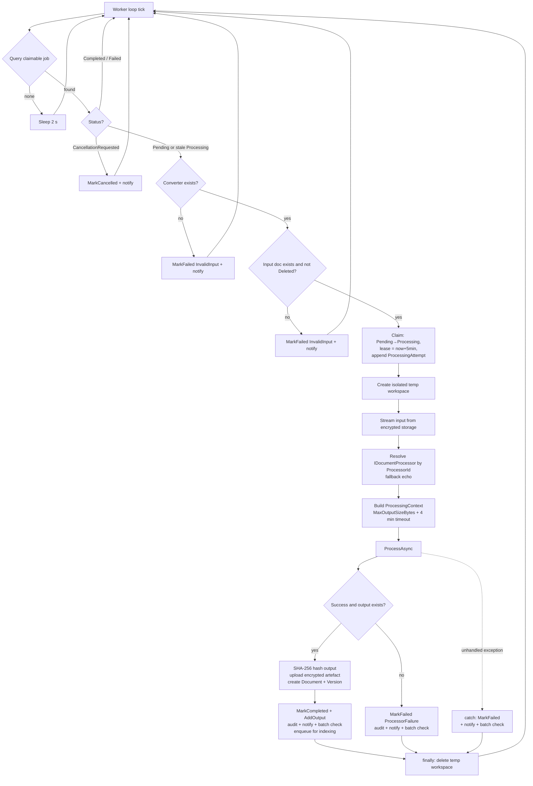
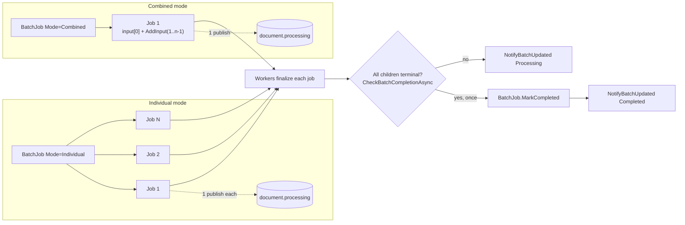

# Document Conversion and Job Processing
### Module Architecture & Implementation Documentation — EConverter Platform

**Document type:** Domain module deep-dive (Core Business Domain)
**Scope:** `DocumentConverter.Domain.Processing`, `DocumentConverter.Application.Processing`, `DocumentConverter.Contracts.Processing` / `.Messages`, `DocumentConverter.Infrastructure.Processing` / `.Messaging`, `DocumentConverter.Web.HostedServices`, `Workers/DocumentWorker`, `BuildingBlocks/DocumentConverter.Processing.Abstractions`
**Generated:** 2026-11-19 06:11 UTC
**Confidence basis:** direct source inspection of the solution tree (≈92 C# source files across 5 layers and 2 hosts)

---

## 1. Executive Overview

Document Conversion and Job Processing is the asynchronous execution backbone of EConverter. It answers a single architectural question: *how does a long-running, resource-intensive document transformation become a durable, observable, cancellable unit of work that survives process restarts and scales horizontally?*

The module's answer is a deliberate split of responsibilities:

| Concern | Owner | Rationale |
|---|---|---|
| **Truth** (what work exists, in what state) | Relational database via `AppDbContext` | Survives crashes, broker outages, worker restarts |
| **Throughput** (how work gets to a worker) | RabbitMQ (or an in-process channel fallback) | Decouples producers from consumers, enables fan-out |
| **Invariants** (what transitions are legal) | `ProcessingJob` aggregate + `ProcessingJobLifecycle` | Illegal states become unrepresentable |
| **Transformation** (how bytes become other bytes) | `IDocumentProcessor` plugin boundary | Isolated, swappable, dependency-free |

The design is explicitly **at-least-once**, **crash-recoverable**, and **horizontally scalable**. Authoritative job state lives in SQL; the broker is an accelerator, not a system of record. If RabbitMQ disappears entirely, the system degrades in latency but loses no work — the worker's polling loop drains `Pending` and stale-lease jobs directly from the database.

Two executable hosts share one abstraction contract:

- **`JobProcessorWorker`** — a `BackgroundService` hosted inside `DocumentConverter.Web`
- **`DocumentWorker`** — a standalone `Microsoft.NET.Sdk.Worker` container

The only difference between them is dependency-injection wiring and the notification implementation. This "same contract, two hosts" property is what makes co-located small deployments and distributed scaled-out deployments interchangeable without code changes.

---

## 2. Position in the Layered Architecture

EConverter follows a strict Clean Architecture dependency graph with inward-facing references. The module respects it precisely:

```
┌──────────────────────────────────────────────────────────────┐
│ Presentation   DocumentConverter.Web                         │
│                Endpoints/ProcessingEndpoints.cs              │
│                HostedServices/JobProcessorWorker.cs          │
│                Hubs/ProcessingHub.cs                         │
│                Services/JobNotificationService.cs            │
│                Components/Pages/Jobs/ProcessingJobs.razor    │
│                Components/.../BatchConversionDialog.razor    │
└───────────────────────────┬──────────────────────────────────┘
                            │ depends on
┌───────────────────────────▼──────────────────────────────────┐
│ Infrastructure  ProcessingService, ConverterCatalogService,  │
│                 RabbitMqJobDispatcher, all IDocumentProcessor│
│                 implementations, PdfCapabilityAnalyzer,      │
│                 CompressionEstimatorService                  │
└───────────────────────────┬──────────────────────────────────┘
                            │ implements ports of
┌───────────────────────────▼──────────────────────────────────┐
│ Application     IProcessingService, IConverterCatalogService,│
│                 IJobQueuePublisher, IJobNotificationService, │
│                 IPdfCapabilityAnalyzer,                      │
│                 ICompressionEstimatorService                 │
└───────────────────────────┬──────────────────────────────────┘
                            │ orchestrates
┌───────────────────────────▼──────────────────────────────────┐
│ Domain          ProcessingJob, BatchJob, ProcessingAttempt,  │
│                 ProcessingJobInput/Output, Converter,        │
│                 ProcessingJobStatus, ProcessingJobLifecycle  │
│                 DomainException, Guard, Entity              │
└──────────────────────────────────────────────────────────────┘
                            ▲
                            │ consumed by (zero outward refs)
┌───────────────────────────┴──────────────────────────────────┐
│ BuildingBlocks  DocumentConverter.Processing.Abstractions    │
│                 IDocumentProcessor, ProcessingContext,       │
│                 ProcessingResult — no project/package refs   │
└──────────────────────────────────────────────────────────────┘
```

**Dependency rule compliance.** `Domain` references no project. `Processing.Abstractions` is deliberately empty of both project and package references, which is what makes it a viable isolation seam for out-of-process plugins. `RabbitMqJobDispatcher` imports only `Application` and `Contracts` abstractions, so the transport remains swappable without touching orchestration. The only place where concrete adapters are bound to ports is the composition root (`Web/Program.cs` and `DocumentWorker/Program.cs`).

---

## 3. Domain Model

### 3.1 The `ProcessingJob` Aggregate

`src/DocumentConverter.Domain/Processing/ProcessingJob.cs` — a sealed `Entity` subclass that serves as the transactional boundary for one logical unit of conversion work.

**Length constants (schema-enforced):**

| Constant | Value | Purpose |
|---|---|---|
| `ErrorCodeMaxLength` | 100 | Bounded error code storage |
| `ErrorMessageMaxLength` | 2000 | Bounded, user-safe error text |
| `ClaimedByMaxLength` | 200 | Worker identity/lease owner |

**State surface.** All properties are `private set`. Nothing outside the aggregate can assign a state field. Mutable state includes `Status`, `Priority`, `ProgressPercent`, `ClaimedBy`, `LeaseExpiresAt`, `ErrorCode`, `ErrorMessage`, timestamps (`StartedAt`, `CompletedAt`, `CancellationRequestedAt`, `CancelledAt`), and a `byte[]? RowVersion` optimistic-concurrency token.

**Identity references.** `OwnerUserId`, `BatchJobId?`, `InputDocumentId`, `InputVersionId?`, `OutputDocumentId?`, `ConverterId` — all by ID rather than navigation, keeping the aggregate's transactional boundary coherent and avoiding accidental graph loading.

**Collections.** Three private backing lists exposed read-only:

```csharp
public IReadOnlyCollection<ProcessingAttempt> Attempts => _attempts.AsReadOnly();
public IReadOnlyCollection<ProcessingJobInput>  Inputs   => _inputs.AsReadOnly();
public IReadOnlyCollection<ProcessingJobOutput> Outputs  => _outputs.AsReadOnly();
```

**Factory.** `ProcessingJob.Create(...)` applies guard clauses (`Guard.NotEmpty` on owner/document/converter, `Guard.Utc` on the timestamp), initialises `Status = Pending`, `ProgressPercent = 0`, and — critically — **implicitly registers the primary input** as `ProcessingJobInput(..., order: 0)` so that a single-input job is never represented with an empty input collection:

```csharp
job._inputs.Add(new ProcessingJobInput(id, inputDocumentId, inputVersionId, 0));
```

**Mutation API — intention-revealing methods only:**

| Method | Guard | Effect |
|---|---|---|
| `AddInput(documentId, versionId, order)` | `Status == Pending` | Appends an ordered input; throws `DomainException` once started |
| `Claim(workerId, leaseExpiresAt, now)` | `Status == Pending` | → `Processing`; sets `ClaimedBy`, `LeaseExpiresAt`; `StartedAt ??=`; appends attempt #N |
| `RenewLease(newLeaseExpiresAt)` | `Status == Processing` | Extends the lease window |
| `UpdateProgress(percent)` | — | `Guard.InRange(0, 100)` |
| `RequestCancellation(now)` | not terminal | `Pending` → `Cancelled` immediately; otherwise → `CancellationRequested` |
| `MarkCompleted(outputDocumentId, now)` | lifecycle-checked | → `Completed`; progress 100; closes attempt; appends output; clears lease |
| `AddOutput(documentId, order)` | — | Appends an additional ordered output reference |
| `MarkFailed(code, message, now, retryable)` | — | Records error; closes attempt; either requeues (`Pending`, clears claim) or terminal `Failed` |
| `MarkCancelled(now)` | lifecycle-checked | → `Cancelled`; clears lease |

Note the two-phase output recording: `MarkCompleted` both transitions state **and** appends the primary `ProcessingJobOutput` at order 0 in a single transactional step, while `AddOutput` exists for multi-output operations (split, page extraction).

### 3.2 Job State Machine — `ProcessingJobLifecycle`

`src/DocumentConverter.Domain/Processing/ProcessingJobStatus.cs` encodes the entire transition legality table in one place rather than scattering `if` statements across services and workers — a single source of truth for state validity.

```csharp
public enum ProcessingJobStatus
{
    Pending               = 1,
    Processing            = 2,
    CancellationRequested = 3,
    Completed             = 4,
    Failed                = 5,
    Cancelled             = 6,
}
```

```
                 ┌───────────┐
                 │  Pending  │◄──────────────┐
                 └─────┬─────┘               │ retryable failure
       ┌───────────────┼───────────────┐     │ (transient codes only)
       │               │               │     │
       ▼               ▼               │     │
 ┌───────────┐   ┌──────────┐    ┌─────┴─────┴──┐
 │ Cancelled │   │  Failed  │    │  Processing  │
 └───────────┘   └──────────┘    └──┬───────┬───┘
       ▲                             │       │
       │              ┌──────────────┘       └──────────────┐
       │              ▼                                     ▼
       │      ┌──────────────────────┐              ┌────────────┐
       │      │ CancellationRequested│              │ Completed  │
       │      └───────┬──────────────┘              └────────────┘
       │              │
       └──────────────┤ (Cancelled)
                      ├──► Completed  (finished before cancellation observed)
                      └──► Failed
```

**Allowed transition table (verbatim from source):**

| From | Allowed targets |
|---|---|
| `Pending` | `Processing`, `Cancelled`, `Failed` |
| `Processing` | `Completed`, `Failed`, `Pending` (retryable), `CancellationRequested` |
| `CancellationRequested` | `Cancelled`, `Completed`, `Failed` |
| `Completed` / `Failed` / `Cancelled` | *(terminal — empty set)* |

**Helper predicates:**

- `CanTransition(from, to)` — table lookup
- `EnsureCanTransition(from, to)` — throws `InvalidStateTransitionException.For("ProcessingJob", from, to)`
- `IsTerminal(status)` — `Completed | Failed | Cancelled`
- `IsRetryable(code)` — **only** `TemporaryInfrastructureFailure` and `Timeout`

That last predicate is a deliberate policy statement: *transient infrastructure faults are retried; invalid input is never retried indefinitely*, because an unsupported format will remain unsupported no matter how many times it is attempted.

### 3.3 Error Classification — `ProcessingErrorCode`

Internal exception detail is never surfaced to end users. Failures are projected into a closed, user-safe taxonomy:

| Code | Value | Semantics | Auto-retryable |
|---|---|---|---|
| `InvalidInput` | 1 | Malformed, missing, or deleted source document | No |
| `UnsupportedFormat` | 2 | No processor can handle the pair | No |
| `ResourceLimit` | 3 | Size/page/time budget exceeded | No |
| `ProcessorFailure` | 4 | Plugin reported a conversion failure | No |
| `TemporaryInfrastructureFailure` | 5 | Storage/broker/DB transient fault | **Yes** |
| `UnknownFailure` | 6 | Unhandled exception path | No |
| `Timeout` | 7 | Plugin exceeded its time budget | **Yes** |

### 3.4 Child Entities

**`ProcessingAttempt`** (`ProcessingAttempt.cs`) — sealed `Entity`, tracks retries independently of logical job state.

```
ProcessingJobId (FK) | AttemptNumber | WorkerId | Status | StartedAt
                     | CompletedAt?  | ErrorCode? | ErrorMessage?
```

- Created exclusively via `internal static Create(...)`, which validates `AttemptNumber ∈ [1, int.MaxValue]` and forces `Status = Processing`
- `internal void MarkCompleted(now)` / `internal void MarkFailed(code, message, now)` — internal visibility keeps attempt mutation inside the aggregate boundary
- **Unique composite index** `(ProcessingJobId, AttemptNumber)` — a database-level guarantee that attempt numbering cannot collide across concurrent workers

**`ProcessingJobInput`** (`ProcessingJobInput.cs`) — plain sealed class (not an `Entity`), with a private parameterless constructor for ORM materialisation and an internal identity constructor. Composite key `(JobId, Order)`.

**`ProcessingJobOutput`** (`ProcessingJobOutput.cs`) — same shape, composite key `(JobId, Order)`, ordered so that multi-output operations (split, extraction) are representable without schema changes.

### 3.5 The `BatchJob` Aggregate

```csharp
public enum BatchJobMode { Individual = 1, Combined = 2 }

public sealed class BatchJob : Entity
{
    public Guid OwnerUserId { get; private set; }
    public Guid ConverterId { get; private set; }
    public BatchJobMode Mode { get; private set; }
    public string? Options { get; private set; }
    public DateTime CreatedAt { get; private set; }
    public DateTime? CompletedAt { get; private set; }

    public void MarkCompleted(DateTime now) => CompletedAt = Guard.Utc(now);
}
```

**Design decision worth flagging.** `BatchJob` deliberately does **not** hold a child collection of `ProcessingJob` instances. The completion invariant ("all children terminal") is therefore *not* computable inside the aggregate; it is evaluated externally by the workers' `CheckBatchCompletionAsync`, which queries `AppDbContext` for the batch's children and then calls `MarkCompleted`. This is a pragmatic read-model decision that keeps batch creation cheap and avoids loading N jobs into memory — but it places a cross-aggregate invariant in the application/worker layer, which is discussed under Risks (§15).

### 3.6 The `Converter` Catalog Entity

`Converter.cs` makes the supported conversion matrix a **first-class, database-driven product surface** rather than hard-coded UI logic. The catalog — not a `switch` statement — decides which operations users can request and which worker queue processes them.

| Property | Constraint | Purpose |
|---|---|---|
| `Key` | 100 chars, unique index | Stable slug, e.g. `word-to-pdf` |
| `Name` | 200 chars | Display name |
| `Operation` | 100 chars | Verb passed to the plugin (`convert`, `merge`, `split`, `ocr`, `render`, `compress`, `extract-tables`) |
| `InputFormats` / `OutputFormats` | JSON in `varchar(1000)` | Normalised (trimmed, de-dotted, lowercased, distinct) |
| `ProcessorId` | 100 chars | **Plugin routing key** |
| `QueueName` | 100 chars | **Queue routing key** |
| `ConfigurationSchema` | nullable text | JSON Schema, rendered as a dynamic options form in the UI |
| `IsEnabled` | bool | Gates job creation |
| `Fidelity` | `Supported \| BestEffort \| Unsupported` | The UI never claims lossless when it is not |
| `SupportsBatch` | bool | Gates batch creation |
| `AcceptsMultipleInputs` | bool | Merge / combined image→PDF |
| `MaxInputSizeBytes`, `MaxPages?` | guards | Enforcement in the orchestration service |
| `ValidationStatus` | `NotValidated \| Passed \| Failed` | Pre-production validation gate |

**The validation gate is enforced in the domain, not the UI:**

```csharp
public void Enable(DateTime now, bool allowUnvalidated = false)
{
    if (ValidationStatus != ConverterValidationStatus.Passed && !allowUnvalidated)
        throw new DomainException("A converter must pass validation before it can be enabled.");
    IsEnabled = true; UpdatedAt = Guard.Utc(now);
}
```

`RecordValidation` additionally forces `IsEnabled = false` for any status other than `Passed`. The `allowUnvalidated` escape hatch exists solely for development seeding (see §12).

**Format matching** is case- and dot-insensitive via `AcceptsInput(extension)` and is mirrored by the orchestration service's own extension check at job-creation time.

---

## 4. Application Layer Contracts (Ports)

All ports live in `DocumentConverter.Application.Processing` and depend only on `Contracts` DTOs and `Domain` types.

### 4.1 `IProcessingService` — job and batch lifecycle

```csharp
Task<ProcessingJobDto> CreateJobAsync(CreateProcessingJobRequest, CancellationToken = default);
Task<BatchJobDto>     CreateBatchAsync(CreateBatchProcessingRequest, CancellationToken = default);
Task<ProcessingJobDto?> GetJobAsync(Guid jobId, CancellationToken = default);
Task CancelJobAsync(Guid jobId, CancellationToken = default);
Task<IReadOnlyList<ProcessingJobDto>> ListJobsAsync(int take = 50, CancellationToken = default);
Task<BatchJobDto?> GetBatchAsync(Guid batchId, CancellationToken = default);
Task<IReadOnlyList<BatchJobDto>> ListBatchesAsync(int take = 50, CancellationToken = default);
Task<IReadOnlyList<ProcessingJobDto>> GetBatchJobsAsync(Guid batchId, CancellationToken = default);
Task CancelBatchAsync(Guid batchId, CancellationToken = default);
```

This is the **only** entry point the HTTP layer needs. Controllers never touch `AppDbContext` for job creation — the API surface is a thin adapter over nine methods.

### 4.2 `IConverterCatalogService` — discovery

```csharp
Task<IReadOnlyList<ConverterDto>> GetAvailableConvertersAsync(CancellationToken = default);
Task<ConverterDto?>               GetByKeyAsync(string key, CancellationToken = default);
```

Read-only, injects `AppDbContext` directly, projects via a static `MapToDto`, and applies `AsNoTracking()` with `OrderBy(c => c.Name)`. There is **no caching layer** — catalog reads hit the database per request. Acceptable given the table's size and read-mostly nature, but worth noting for hot-path optimisation.

### 4.3 `IJobQueuePublisher` — transport port

```csharp
Task PublishJobAsync(JobMessage message, CancellationToken cancellationToken = default);
```

A single-method port. The contract carries **no file bytes** — a documented invariant enforced by convention in the message record's XML documentation (`MUST NOT contain document binary content`).

### 4.4 `IJobNotificationService` — status fan-out port

```csharp
Task NotifyJobProgressAsync(jobId, ownerUserId, batchJobId, inputFileName, progressPercent, ct);
Task NotifyJobCompletedAsync(jobId, ownerUserId, batchJobId, inputFileName, outputFileName, outputDocumentId, ct);
Task NotifyJobFailedAsync(jobId, ownerUserId, batchJobId, inputFileName, errorMessage, ct);
Task NotifyJobCancelledAsync(jobId, ownerUserId, batchJobId, inputFileName, ct);
Task NotifyBatchUpdatedAsync(batchJobId, ownerUserId, status, total, completed, failed, ct);

event Func<JobNotificationEvent, Task>? OnJobEvent;
event Func<BatchNotificationEvent, Task>? OnBatchEvent;
```

The event pair supports in-process subscribers (Blazor circuits) alongside the out-of-process SignalR broadcast.

```csharp
public record JobNotificationEvent(
    Guid JobId, Guid OwnerUserId, Guid? BatchJobId, string Status,
    int ProgressPercent, string? InputFileName, string? OutputFileName,
    Guid? OutputDocumentId, string? ErrorMessage, DateTime Timestamp);

public record BatchNotificationEvent(
    Guid BatchJobId, Guid OwnerUserId, string Status,
    int TotalJobs, int CompletedJobs, int FailedJobs, DateTime Timestamp);
```

The `OwnerUserId` field is the telemetry hook that *would* enable per-user SignalR group targeting (`Clients.User(...)`); the shipped implementation broadcasts to `Clients.All` instead — see §15.

### 4.5 Supporting Ports

**`IConverterCatalogService`'s siblings on the pre-flight path:**

- **`IPdfCapabilityAnalyzer`** — `AnalyzeAsync(string pdfPath | Stream, ct) → PdfCapabilityReport`. Structural pre-flight inspection (text layer presence, column/table signals, image density, encryption) yielding a `ConversionFidelityVerdict` of `Supported | BestEffort | Unsupported`. Called *before* dispatch so low-fidelity jobs are flagged rather than silently produced.
- **`ICompressionEstimatorService`** — `EstimateAsync(documentId, versionId?, request, ct)` and `EstimateStreamAsync(stream, fileName, contentType, request, ct)` → `CompressionPreviewResponse`. Produces fast in-memory previews (SkiaSharp for images, zero-disk structural estimation for PDFs) so the UI can display projected savings **without creating a job**.

```csharp
public sealed record CompressionPreviewResponse(
    long OriginalSizeBytes, long EstimatedSizeBytes, long SavedSizeBytes,
    int PercentReduction, string PreviewMode, string OutputFormat,
    int? OutputWidth = null, int? OutputHeight = null);
```

These two ports are what make the platform *advisory* rather than merely *executive*: the user sees the fidelity verdict and the expected compression ratio before committing compute.

---

## 5. Orchestration: Job Creation

`src/DocumentConverter.Infrastructure/Processing/ProcessingService.cs` (457 lines, 9 public methods) is the seam where the authenticated user context meets the domain.

### 5.1 Single-job creation — validated gate sequence

```
CreateJobAsync(request)
  │
  ├─ 1. userId   ← _userContext.RequireUserId()                      (identity binding)
  ├─ 2. document ← Document WHERE Id = request.DocumentId
  │                AND OwnerUserId = userId
  │                AND Status NOT IN (Deleted, Purged)               (ownership + liveness)
  ├─ 3. converter← Converter WHERE Id = request.ConverterId          (existence)
  ├─ 4.         → if !converter.IsEnabled  ⇒ DomainException        (enablement gate)
  ├─ 5.         → if !converter.AcceptsInput(document.FileExtension)
  │                 ⇒ DomainException listing supported formats      (format gate)
  ├─ 6.         → if document.SizeBytes > converter.MaxInputSizeBytes
  │                 ⇒ DomainException with both values               (size gate)
  ├─ 7. job = ProcessingJob.Create(Guid.NewGuid(), userId, document.Id,
  │                               request.VersionId, converter.Id,
  │                               request.OptionsJson, now)
  ├─ 8. _db.ProcessingJobs.Add(job); await SaveChanges()             ★ AUTHORITATIVE WRITE
  ├─ 9. await _auditService.RecordAsync("ProcessingJob.Created", ...) (audit trail)
  └─10. await _queuePublisher.PublishJobAsync(new JobMessage(...))    (best-effort dispatch)
```

**Step 8 before step 10 is the single most important ordering decision in the module.** The database commit happens *before* the publish. The queue message is therefore a *notification of already-durable work*, not the source of truth. Consequences:

- A broker outage between steps 8 and 10 loses latency, never work — the polling loop recovers it.
- A publish that succeeds but a client that never receives a response still leaves a valid, resumable job.
- Duplicate publishes (at-least-once delivery) are absorbed by the claim/lease check.

### 5.2 Batch creation — two modes

`CreateBatchAsync` adds converter-level gates (`SupportsBatch`) and an all-or-nothing document ownership check (`documents.Count != request.DocumentIds.Count ⇒ DomainException`), then branches:

**`Individual` mode** — one `ProcessingJob` per document, each created with `batchJobId` linkage, persisted in a single `SaveChangesAsync`, then one publish per job.

**`Combined` mode** — one `ProcessingJob` whose primary input is `documents[0]`; documents `1..n-1` are appended via `AddInput(doc.Id, null, i)`:

```csharp
var job = ProcessingJob.Create(Guid.NewGuid(), userId, primaryDoc.Id, null,
                               converter.Id, request.OptionsJson, now, batchJob.Id);
for (var i = 1; i < documents.Count; i++)
    job.AddInput(documents[i].Id, null, i);
```

This is how a merge operation is expressed without a distinct aggregate: one job, N ordered inputs. The operation name (`merge`) and the plugin's `CanProcess` predicate decide what happens with them.

### 5.3 The `NoOpQueuePublisher` degradation path

`ProcessingService` embeds a private nested publisher and a convenience constructor that injects it:

```csharp
private sealed class NoOpQueuePublisher : IJobQueuePublisher
{
    public Task PublishJobAsync(JobMessage message, CancellationToken ct = default)
        => Task.CompletedTask;
}
```

When the broker is unavailable or disabled, publishing becomes a no-op and the worker's polling loop is solely responsible for draining `Pending` jobs from SQL. This is the graceful-degradation contract that keeps the system functional with `RabbitMQ:Enabled = false` — which is in fact the **default** in the worker's `appsettings.json`.

### 5.4 Query-side ownership scoping

Every read path repeats the ownership predicate — `GetJobAsync`, `ListJobsAsync`, `GetBatchAsync`, `ListBatchesAsync`, `GetBatchJobsAsync`, `CancelJobAsync`, `CancelBatchAsync`. There is no ambient "current tenant" filter; scoping is explicit and per-query. Two additional properties:

- `AsNoTracking()` on all read paths (no change-tracker pollution from list endpoints)
- `CancelBatchAsync` filters to `Pending | Processing` children only, so already-terminal jobs are never disturbed

---

## 6. Worker Execution Model

### 6.1 Dual-Host Topology

| Aspect | `JobProcessorWorker` (web-hosted) | `Worker` (standalone) |
|---|---|---|
| File | `Web/HostedServices/JobProcessorWorker.cs` | `Workers/DocumentWorker/Worker.cs` |
| Base class | `BackgroundService` | `BackgroundService` |
| Intake mode | Polling only | RabbitMQ consumer **+** polling |
| Worker ID | `worker-{MachineName}-{Guid:N}` | `standalone-worker-{MachineName}-{Guid:N}` |
| Notification impl | `JobNotificationService` (SignalR) | `ConsoleJobNotificationService` (structured logs) |
| User context | HTTP-derived `IUserContext` | Singleton system snapshot (no HTTP) |
| Indexing enqueue | Yes (`_indexingQueue?.TryQueueDocument`) | **No** |
| Progress pacing | Artificial `Task.Delay` 400/600/400 ms | None |
| Content-type fallback | `application/octet-stream` | Extension-based MIME switch |
| Batch completion check | Yes (transactional read-then-write) | Yes (same helper, local copy) |
| Activation | Gated by `Processing:RunWorkerInWeb` (default `true`) | Always on (its host's only hosted service) |

### 6.2 Claim and Lease — Crash Recovery Primitive

Both hosts select with the same predicate:

```csharp
var job = await db.ProcessingJobs
    .Include(j => j.Inputs).Include(j => j.Attempts).Include(j => j.Outputs)
    .FirstOrDefaultAsync(j =>
        (j.Status == ProcessingJobStatus.Pending ||
        (j.Status == ProcessingJobStatus.Processing && j.LeaseExpiresAt != null && j.LeaseExpiresAt < now)),
        cancellationToken);
```

Two classes of claimable work: **fresh** (`Pending`) and **abandoned** (`Processing` with an expired lease). Then:

```csharp
var leaseExpiresAt = now.AddMinutes(5);
job.Claim(_workerId, leaseExpiresAt, now);
var currentAttempt = job.Attempts.Last();
db.ProcessingAttempts.Add(currentAttempt);
job.UpdateProgress(10);
await db.SaveChangesAsync(cancellationToken);
```

The aggregate's `Claim` simultaneously:

1. Transitions `Pending → Processing`
2. Stamps `ClaimedBy = workerId` and `LeaseExpiresAt = now + 5 min`
3. Sets `StartedAt ??=` (first claim wins; retries preserve original start)
4. Appends `ProcessingAttempt` with `AttemptNumber = _attempts.Count + 1`, `WorkerId`, `StartedAt`

**Crash recovery semantics.** A worker that dies mid-run leaves its lease to expire; the job becomes re-claimable and a surviving worker picks it up with an incremented attempt number. A live worker renews its lease (`RenewLease`) and is never stolen. `RowVersion` provides an additional optimistic-concurrency guard at the persistence layer: the second of two concurrent `SaveChangesAsync` calls on the same row fails with `DbUpdateConcurrencyException`.

**Pre-claim validation.** Both hosts perform cheap fail-fast checks *before* claiming, so that a defective job does not consume a lease or produce a spurious attempt:

| Condition | Action |
|---|---|
| Converter row missing | `MarkFailed(InvalidInput, "Associated converter not found.")` + notify |
| Input document missing or `Deleted` | `MarkFailed(InvalidInput, "Input document no longer exists.")` + notify |
| Job already terminal | Return `false` (skip) |
| `Status == CancellationRequested` | `MarkCancelled` + notify (cooperative cancellation) |

### 6.3 The Execution Pipeline

Once claimed, both hosts execute an identical eight-stage pipeline. Stages and their observable side effects:

**Stage 1 — Isolated workspace (Method §35/§36 invariant)**

```csharp
var workBase   = Path.Combine(Path.GetTempPath(), "docconv_work", job.Id.ToString("N"));
var inputDir   = Path.Combine(workBase, "input");
var outputDir  = Path.Combine(workBase, "output");
Directory.CreateDirectory(inputDir);
Directory.CreateDirectory(outputDir);
```

Per-job, per-GUID, never shared. Guarantees that two concurrent jobs cannot collide on a filename, and that a failed job cannot leak inputs into a sibling job's working set.

**Stage 2 — Input materialisation**

```csharp
var localInputPath = Path.Combine(inputDir, inputDoc.OriginalFileName);
await using (var storageStream = await storage.OpenReadAsync(inputDoc.StorageKey, ct))
await using (var localFileStream = File.Create(localInputPath))
{
    await storageStream.CopyToAsync(localFileStream, ct);
}
```

Nested `await using` scopes ensure the encrypted storage stream is disposed deterministically. Note the important architectural consequence: the storage abstraction transparently decrypts on read (AES-256-GCM envelope, §13), so the processor plugin receives **plaintext on local disk inside an isolated temp directory**, never the ciphertext and never a storage credential.

**Stage 3 — Processor resolution**

```csharp
var processor = _processors
    .FirstOrDefault(p => p.ProcessorId.Equals(converter.ProcessorId, StringComparison.OrdinalIgnoreCase))
    ?? _processors.FirstOrDefault(p => p.ProcessorId == "echo")
    ?? throw new InvalidOperationException($"No processor registered for {converter.ProcessorId}");
```

Catalog-driven lookup by `ProcessorId` with a diagnostic `echo` fallback. `IEnumerable<IDocumentProcessor>` is injected by DI, so adding a plugin is a one-line registration.

**Stage 4 — Context construction**

```csharp
var metadata = new Dictionary<string, string>(StringComparer.OrdinalIgnoreCase)
{
    ["ConverterKey"] = converter.Key,
    ["TargetFormat"] = converter.OutputFormats.Length > 0 ? converter.OutputFormats[0] : "",
    ["Operation"]    = converter.Operation
};

var context = new ProcessingContext(
    job.Id, converter.Operation, localInputPath, outputDir,
    job.Options, converter.MaxInputSizeBytes,
    TimeSpan.FromMinutes(4), metadata);
```

Two guardrails are host-supplied and plugin-honoured by contract: `MaxOutputSizeBytes` (from `Converter.MaxInputSizeBytes`) and `Timeout`. **The 4-minute timeout is deliberately shorter than the 5-minute lease**, so a plugin that respects its timeout can never outlive the lease that protects it.

**Stage 5 — Progress reporting.** Progress is reported at **10 → 30 → 50 → 80 → 100**, each accompanied by a `SaveChangesAsync` and a `NotifyJobProgressAsync` fan-out. The web-hosted worker additionally inserts `Task.Delay(400/600/400 ms)` around these milestones — demo pacing that produces visibly stepped progress in the UI. The standalone worker omits these delays.

**Stage 6 — Invocation**

```csharp
var result = await processor.ProcessAsync(context, cancellationToken);

if (result.Success && result.OutputPath != null && File.Exists(result.OutputPath))
{ /* success path */ }
else
{ /* result.ErrorMessage ?? "Conversion failed." → MarkFailed(ProcessorFailure) */ }
```

**Stage 7 — Output hashing, storage, and document creation**

```csharp
// Streaming SHA-256 — no full-file buffering
await using (var hashStream = File.OpenRead(result.OutputPath))
{
    var hashBytes = await SHA256.HashDataAsync(hashStream, cancellationToken);
    sha256 = Convert.ToHexString(hashBytes).ToLowerInvariant();
}

// Sharded, opaque storage key
var outputDocId = Guid.NewGuid();
var prefix1 = outputDocId.ToString("N")[..2];
var prefix2 = outputDocId.ToString("N").Substring(2, 2);
var outputStorageKey = $"{prefix1}/{prefix2}/{outputDocId:N}/v1{Path.GetExtension(result.OutputPath)}";

await using (var uploadStream = File.OpenRead(result.OutputPath))
    await storage.SaveAsync(uploadStream, outputStorageKey, cancellationToken);
```

The output is registered as a **new `Document`**, not as a version of the input, and carries `SourceProcessingJobId = job.Id` for provenance traceability:

```csharp
var outputDoc = Document.Create(new NewDocument(
    outputDocId, Guid.NewGuid(), job.OwnerUserId, inputDoc.FolderId,
    outputFileName, Path.GetFileName(outputStorageKey),
    result.OutputContentType ?? outputMime,
    outputExt.TrimStart('.'), result.OutputSizeBytes ?? new FileInfo(result.OutputPath).Length,
    "LocalSharded", outputStorageKey, sha256, null, job.Id), now);

outputDoc.BeginScan(now);
outputDoc.MarkAvailable(now);
db.Documents.Add(outputDoc);
db.DocumentVersions.AddRange(outputDoc.Versions);

job.MarkCompleted(outputDoc.Id, now);
db.ProcessingJobOutputs.Add(job.Outputs.Last());
await db.SaveChangesAsync(cancellationToken);
```

The output is placed in the **same folder as its input**, which is a deliberate UX decision: a conversion result appears next to its source rather than in a separate "outputs" bucket.

**Stage 8 — Terminal side effects**

| Side effect | Purpose |
|---|---|
| `audit.RecordAsync("ProcessingJob.Completed"/".Failed", ...)` | Governance trail |
| `_notificationService.NotifyJobCompletedAsync(...)` | Real-time fan-out |
| `CheckBatchCompletionAsync(db, job.BatchJobId, ct)` | Batch invariant evaluation |
| `_indexingQueue?.TryQueueDocument(outputDoc.Id)` | Silent RAG indexing (**web host only**) |

**Workspace cleanup — guaranteed in `finally`:**

```csharp
finally
{
    try
    {
        if (Directory.Exists(workBase)) Directory.Delete(workBase, recursive: true);
    }
    catch (Exception ex)
    {
        _logger.LogWarning(ex, "Failed to clean up temporary workspace {WorkDir}", workBase);
    }
}
```

Cleanup failure is logged, never thrown — a leaked temp directory must not fail an otherwise-completed job.

**Exception handling.** The outer `catch` classifies any unhandled exception:

```csharp
catch (Exception ex)
{
    _logger.LogError(ex, "Exception while processing job {JobId}", job.Id);
    job.MarkFailed(ProcessingErrorCode.ProcessorFailure, ex.Message, DateTime.UtcNow);
    await db.SaveChangesAsync(cancellationToken);
    await _notificationService.NotifyJobFailedAsync(...);
    await CheckBatchCompletionAsync(db, job.BatchJobId, cancellationToken);
    return true;
}
```

### 6.4 Batch Completion Detection

Both hosts carry an equivalent `CheckBatchCompletionAsync`, executed after every terminal job transition:

```csharp
var batchJobs = await db.ProcessingJobs
    .Where(j => j.BatchJobId == batchJobId.Value).ToListAsync(ct);

var pendingOrRunning = batchJobs.Any(j =>
    j.Status == ProcessingJobStatus.Pending || j.Status == ProcessingJobStatus.Processing);

var completed = batchJobs.Count(j => j.Status == ProcessingJobStatus.Completed);
var failed    = batchJobs.Count(j => j.Status == ProcessingJobStatus.Failed);
var total     = batchJobs.Count;

if (!pendingOrRunning && batch is not null && batch.CompletedAt == null)
{
    batch.MarkCompleted(DateTime.UtcNow);
    await db.SaveChangesAsync(ct);
}

await _notificationService.NotifyBatchUpdatedAsync(
    batch.Id, batch.OwnerUserId,
    !pendingOrRunning ? "Completed" : "Processing",
    total, completed, failed, ct);
```

Note the `batch.CompletedAt == null` idempotency guard, and that the whole method sits in its own `try/catch` that logs a warning rather than propagating — a batch bookkeeping failure must not fail the child job that triggered it.

### 6.5 RabbitMQ Consumption (Standalone Host)

`StartRabbitMqConsumerAsync` connects, declares the durable queue, sets prefetch to 1, and registers an async consumer:

```csharp
await channel.BasicQosAsync(prefetchSize: 0, prefetchCount: 1, global: false, ct);

consumer.ReceivedAsync += async (sender, ea) =>
{
    try
    {
        var json = Encoding.UTF8.GetString(ea.Body.ToArray());
        var message = JsonSerializer.Deserialize<JobMessage>(json);
        if (message != null) await ProcessNextJobAsync(message.JobId, ct);
        await channel.BasicAckAsync(ea.DeliveryTag, multiple: false, ct);
    }
    catch (Exception ex)
    {
        await channel.BasicNackAsync(ea.DeliveryTag, multiple: false, requeue: true, ct);
    }
};
```

`prefetchCount: 1` implements worker-level flow control — one unacknowledged job per consumer channel, which prevents a single worker from hoarding messages while others idle. `requeue: true` on failure hands the message back for another worker. And critically: **`ExecuteAsync` starts the polling loop regardless of whether the consumer connected** — if `StartRabbitMqConsumerAsync` throws, the host logs a warning and falls through to SQL lease polling. The message path is an optimisation, never a dependency.

---

## 7. The Plugin Abstraction Layer

`src/BuildingBlocks/DocumentConverter.Processing.Abstractions/` is the module's isolation seam. Its `.csproj` carries **zero package and zero project references** — only `net10.0`, nullable enabled. That emptiness is the feature: any processor, whether an in-process .NET class, a headless CLI wrapper, or a containerised worker, can consume this contract at negligible cost.

```csharp
public sealed record ProcessingContext(
    Guid JobId,
    string Operation,
    string InputPath,
    string OutputDirectory,
    string? OptionsJson,
    long MaxOutputSizeBytes,
    TimeSpan Timeout,
    IReadOnlyDictionary<string, string>? Metadata = null);

public sealed record ProcessingResult(
    bool Success, string? OutputPath, string? OutputContentType,
    long? OutputSizeBytes, string? ErrorCode, string? ErrorMessage)
{
    public static ProcessingResult Succeeded(string outputPath, string contentType, long sizeBytes)
        => new(true, outputPath, contentType, sizeBytes, null, null);

    public static ProcessingResult Failed(string errorCode, string errorMessage)
        => new(false, null, null, null, errorCode, errorMessage);
}

public interface IDocumentProcessor
{
    string ProcessorId { get; }
    bool CanProcess(string operation, string inputFormat, string outputFormat);
    Task<ProcessingResult> ProcessAsync(ProcessingContext context, CancellationToken ct);
}
```

**Design properties worth emphasising:**

1. **Capability predicate over type explosion.** `CanProcess(operation, inputFormat, outputFormat)` lets one processor serve many format pairs. `OfficeDocumentProcessor` declares six conversion families (Word↔PDF, Excel/CSV↔PDF, PowerPoint→PDF, Markdown/HTML→PDF, EPUB/MOBI→PDF) in a single predicate — the host selects a processor without a `switch` statement.
2. **Factory-only result construction.** `ProcessingResult` has no public constructor; only `Succeeded` and `Failed` factories exist. The success/failure states are exhaustive and self-consistent by construction.
3. **Deliberate exclusion of ambient authority.** `ProcessingContext` carries everything a plugin needs and nothing it should not have: no `DbContext`, no storage handle, no broker client, no connection string. The XML documentation states this explicitly. The seam is therefore also the **privilege boundary** for future out-of-process sandboxing.
4. **Guardrails travel with the invocation.** `MaxOutputSizeBytes` and `Timeout` are supplied by the host and honoured by convention, so a plugin cannot silently produce an unbounded artefact.

**Registered processor inventory** (from both composition roots):

| `ProcessorId` | Implementation | Domain |
|---|---|---|
| `office-processor` | `OfficeDocumentProcessor` | Word, Excel, CSV, PowerPoint, Markdown, HTML, EPUB, MOBI |
| `pdf-processor` | `PdfDocumentProcessor` | Merge, split, render to image |
| `image-processor` | `ImageDocumentProcessor` | Image → PDF/document |
| `pdf-compress-processor` | `PdfCompressProcessor` | PDF compression |
| `image-compress-processor` | `ImageCompressProcessor` | SkiaSharp image re-encoding |
| `ocr-processor` | `OcrDocumentProcessor` | Tesseract OCR / searchable PDF |
| `echo` | `EchoDocumentProcessor` | Pipeline validation and integration tests |

All are registered as **singletons** (`AddSingleton<IDocumentProcessor, ...>`), which is only safe because processors are stateless with respect to jobs — all per-job state travels through `ProcessingContext`.

---

## 8. Transport Layer

### 8.1 `RabbitMqJobDispatcher`

`Infrastructure/Messaging/RabbitMqJobDispatcher.cs` implements both `IJobQueuePublisher` and `IAsyncDisposable`:

```csharp
public sealed class RabbitMqJobDispatcher : IJobQueuePublisher, IAsyncDisposable
{
    private readonly Channel<JobMessage> _fallbackChannel;   // unbounded
    private IConnection? _connection;
    private IChannel? _channel;
    private readonly SemaphoreSlim _initLock = new(1, 1);
    ...
}
```

**Three-level failure strategy in `PublishJobAsync`:**

| Level | Condition | Behaviour |
|---|---|---|
| 1 | `!_options.Enabled` | Debug log, write to in-memory fallback channel |
| 2 | Broker reachable | `QueueDeclareAsync` (durable, non-exclusive, non-autodelete) → JSON serialize → `BasicPublishAsync` with `DeliveryMode = Persistent` |
| 3 | Any exception | `LogWarning` + write to fallback channel — **"so jobs are never dropped"** |

Connection management uses a double-checked lock (`_initLock`) to lazily establish the channel with `AutomaticRecoveryEnabled = true`, returning `null` (never throwing) if the connection cannot be established — the caller then falls through to the channel.

**Routing mechanics.** Publishing uses the **default exchange** with the queue name as routing key:

```csharp
var queueName = string.IsNullOrWhiteSpace(message.QueueName) ? _options.QueueName : message.QueueName;
await channel.QueueDeclareAsync(queue: queueName, durable: true, exclusive: false, autoDelete: false, ...);

await channel.BasicPublishAsync(
    exchange: string.Empty,      // default exchange
    routingKey: queueName,
    mandatory: false,
    basicProperties: props,
    body: body, cancellationToken: cancellationToken);
```

The per-message `QueueName` override exists in the contract and is honoured when present — but `ProcessingService` constructs `JobMessage` without it, so messages currently land on the single configured `document.processing` queue. The per-converter `QueueName` values in the catalog (`document.office`, `document.ocr`, `document.image`) are therefore declarative at present rather than operative (§15).

**`RabbitMqOptions`** (`SectionName = "RabbitMQ"`):

| Property | Default | Notes |
|---|---|---|
| `Enabled` | `false` (both apsettings) | Opt-in broker |
| `Host` | `localhost` | |
| `Port` | `5672` | |
| `UserName` / `Password` | `guest` / `guest` | **Replaced by `dc_user` + secret in `docker-compose.prod.yml`** |
| `QueueName` | `document.processing` | |
| `ExchangeName` | `document.exchange` | Configured but unused by the default-exchange publish path |

### 8.2 The Dual `JobMessage` Envelope

Two distinct records share the name `JobMessage` in two namespaces — an intentional taxonomy that has drifted into a mapping burden:

**`Contracts.Processing.JobMessage`** — the one actually published and consumed by the worker:

```csharp
public sealed record JobMessage(
    Guid JobId, Guid DocumentId, string Operation,
    string ProcessorId, Guid RequestedBy, string? QueueName = null);
```

**`Contracts.Messages.JobMessage`** — the richer dispatch shape:

```csharp
public sealed record JobMessage(
    Guid JobId, Guid DocumentId, Guid? VersionId, Guid ConverterId,
    string Operation, string ProcessorId, Guid RequestedByUserId,
    int AttemptNumber, DateTime CreatedAt);
```

**`Contracts.Messages.JobProgressEventMessage`** — the reverse-direction record, allowing a worker to report live progress back to the web host even when the two are separate processes with no shared memory:

```csharp
public sealed record JobProgressEventMessage(
    Guid JobId, Guid OwnerUserId, string Status, int ProgressPercent,
    string? ErrorCode, string? ErrorMessage, DateTime Timestamp);
```

| Envelope | Serialized by | Deserialized by | Wire status |
|---|---|---|---|
| `Contracts.Processing.JobMessage` | `RabbitMqJobDispatcher` | `DocumentWorker.Worker` | **Active path** |
| `Contracts.Messages.JobMessage` | — | — | Declared, unexercised |
| `Contracts.Messages.JobProgressEventMessage` | — | — | Declared; live progress currently travels via shared SQL + SignalR instead |

The `Contracts.Messages` trio documents the *intended* full-duplex contract; only the first is wired. Consolidating or explicitly documenting the boundary is a recommended hygiene task (§15).

---

## 9. Real-Time Notification

### 9.1 Hub

```csharp
public class ProcessingHub : Hub
{
    public async Task JoinBatch(string batchId)
    {
        if (!string.IsNullOrWhiteSpace(batchId))
            await Groups.AddToGroupAsync(Context.ConnectionId, $"batch_{batchId}");
    }

    public async Task LeaveBatch(string batchId)
    {
        if (!string.IsNullOrWhiteSpace(batchId))
            await Groups.RemoveFromGroupAsync(Context.ConnectionId, $"batch_{batchId}");
    }
}
```

Mapped at `/hubs/processing` in the composition root. Batch-scoped groups (`batch_{id}`) let a client subscribe to a single batch's progress.

### 9.2 `JobNotificationService` — dual dispatch

Each notify method performs a two-stage fan-out:

**Stage 1 — in-process event dispatch** (for active Blazor circuits):

```csharp
if (OnJobEvent != null)
{
    var invocationList = OnJobEvent.GetInvocationList().Cast<Func<JobNotificationEvent, Task>>();
    foreach (var handler in invocationList)
    {
        try { await handler(evt); }
        catch (Exception ex) { _logger.LogWarning(ex, "Error executing in-memory job event handler."); }
    }
}
```

Invocation-list iteration with per-handler exception isolation — one faulty subscriber cannot suppress delivery to the others.

**Stage 2 — SignalR broadcast:**

```csharp
await _hubContext.Clients.All.SendAsync("JobUpdated", evt, cancellationToken);
if (evt.BatchJobId.HasValue)
    await _hubContext.Clients.Group($"batch_{evt.BatchJobId.Value}")
        .SendAsync("JobProgress", evt, cancellationToken);
```

Batch updates use `"BatchUpdated"` to all clients plus `"BatchProgress"` to the batch group.

**Client event names:** `JobUpdated`, `JobProgress`, `BatchUpdated`, `BatchProgress`.

**Fire-and-forget semantics are intentional.** A dropped broadcast degrades UX; it never corrupts job state, because SQL remains authoritative and the jobs page re-queries on load. This is exactly the correct separation of concerns for a notification channel.

### 9.3 `ConsoleJobNotificationService` (standalone worker)

Defined inside `Workers/DocumentWorker/Program.cs` as an `internal sealed class`. Each method emits a structured log line and returns `Task.CompletedTask`:

```
[Job {JobId}] Progress: {Percent}% ('{FileName}')
[Job {JobId}] Completed: '{Input}' -> '{Output}' (DocId: {DocId})
[Job {JobId}] Failed: '{Input}' - Error: {Error}
[Job {JobId}] Cancelled: '{Input}'
[Batch {BatchId}] Status: {Status}, Progress: {Completed}/{Total} (Failed: {Failed})
```

Its two `event` members are explicitly `#pragma warning disable CS0067`-suppressed (declared, never raised). This class is the single reason the identical pipeline runs in a host with no web hub — polymorphism at the port, zero branching in the workers.

---

## 10. Persistence Model

### 10.1 `AppDbContext` DbSets (processing-relevant subset)

```csharp
public DbSet<Converter>            Converters            => Set<Converter>();
public DbSet<ProcessingJob>        ProcessingJobs        => Set<ProcessingJob>();
public DbSet<ProcessingAttempt>    ProcessingAttempts    => Set<ProcessingAttempt>();
public DbSet<ProcessingJobInput>   ProcessingJobInputs   => Set<ProcessingJobInput>();
public DbSet<ProcessingJobOutput>  ProcessingJobOutputs  => Set<ProcessingJobOutput>();
public DbSet<BatchJob>             BatchJobs             => Set<BatchJob>();
```

### 10.2 `ProcessingConfigurations` — model mapping

**`Converter`**
- Table `Converters`, key `Id`
- `Key` unique index; `IsEnabled` index
- `Fidelity` and `ValidationStatus` stored as **strings** (`HasConversion<string>()`, max 50)
- `InputFormats` / `OutputFormats` serialized to JSON into `varchar(1000)` with a custom `ValueComparer<string[]>` (sequence-equality + aggregate hash) — required so EF correctly detects changes to the array contents rather than only reference changes

**`ProcessingJob`**
- Table `ProcessingJobs`, key `Id`, **`ValueGeneratedNever()`** — IDs are always client-generated, never database-assigned
- `Status` stored as string (max 50)
- **`RowVersion` configured as `IsRowVersion()`** → optimistic concurrency token
- Indexes: `(OwnerUserId, CreatedAt)`, `(Status, CreatedAt)`, `(BatchJobId)`
- FKs with `DeleteBehavior.Restrict`: `OwnerUserId → User`, `InputDocumentId → Document`, `InputVersionId → DocumentVersion`, `OutputDocumentId → Document`, `ConverterId → Converter`
- Child collections `Cascade`: `Attempts`, `Inputs`, `Outputs`

The `(Status, CreatedAt)` index is precisely the claim query's access path — a deliberate index designed for the worker's hot loop. The `Restrict` behaviours on document references mean a document cannot be hard-deleted while a job still references it, preserving provenance integrity.

**`ProcessingAttempt`**
- Table `ProcessingAttempts`, key `Id`, `ValueGeneratedNever()`
- **Unique index `(ProcessingJobId, AttemptNumber)`** — the database-level guarantee that attempt numbering is collision-free across concurrent workers
- `WorkerId`, `Status`, error fields all length-bounded

**`ProcessingJobInput` / `ProcessingJobOutput`**
- Composite primary keys `(JobId, Order)`
- `Restrict` FKs to `Document` / `DocumentVersion`

**`BatchJob`**
- Table `BatchJobs`; `Mode` stored as string; index `(OwnerUserId, CreatedAt)`; `Restrict` FKs to `User` and `Converter`

### 10.3 Physical Schema

`init-postgres.sql` (643 lines) contains the complete PostgreSQL DDL, including the `identity` schema for ASP.NET Identity tables. Relevant fragments confirming the domain mapping:

```sql
CREATE TABLE IF NOT EXISTS "ProcessingJobs" (
    "Id" uuid NOT NULL,
    "OwnerUserId" uuid NOT NULL,
    "BatchJobId" uuid,
    "InputDocumentId" uuid NOT NULL,
    "InputVersionId" uuid,
    "OutputDocumentId" uuid,
    "ConverterId" uuid NOT NULL,
    "Status" character varying(50) NOT NULL,
    "Priority" integer NOT NULL,
    "ProgressPercent" integer NOT NULL,
    "Options" text,
    "ClaimedBy" character varying(200),
    "LeaseExpiresAt" timestamp with time zone,
    "ErrorCode" character varying(100),
    "ErrorMessage" character varying(2000),
    "CreatedAt" timestamp with time zone NOT NULL,
    "StartedAt" timestamp with time zone,
    "CompletedAt" timestamp with time zone,
    "CancellationRequestedAt" timestamp with time zone,
    "CancelledAt" timestamp with time zone,
    "RowVersion" bytea,
    CONSTRAINT "PK_ProcessingJobs" PRIMARY KEY ("Id"),
    CONSTRAINT "FK_ProcessingJobs_Converters_ConverterId"
        FOREIGN KEY ("ConverterId") REFERENCES "Converters" ("Id") ON DELETE RESTRICT,
    ...
);
```

Note `"RowVersion" bytea` — PostgreSQL has no native `rowversion`, so EF Core's Npgsql provider maps the concurrency token to a `bytea` column maintained by the provider. The domain abstracts the difference, so the same aggregate runs on both SQL Server and PostgreSQL without change.

`DocumentVersions` carries `"SourceProcessingJobId" uuid`, and `Documents` carries the same column — the provenance link from artefact back to the job that produced it.

---

## 11. API Surface and UI Surfaces

### 11.1 HTTP Endpoints — `ProcessingEndpoints.cs`

All routes require the `RequireUser` authorization policy; creation routes additionally carry the `processing-policy` concurrency limiter.

| Method | Route | Handler | Notes |
|---|---|---|---|
| GET | `/api/converters` | `IConverterCatalogService.GetAvailableConvertersAsync` | Catalog discovery for UI dropdowns |
| GET | `/api/processing/jobs` | `ListJobsAsync(take: 50)` | Owner-scoped |
| GET | `/api/processing/jobs/{id:guid}` | `GetJobAsync` | `404` when not found or not owned |
| POST | `/api/processing/jobs` | `CreateJobAsync` | `201 Created` + `Location`; `400` on `DomainException`; **rate-limited** |
| POST | `/api/processing/batches` | `CreateBatchAsync` | `201 Created`; **rate-limited** |
| GET | `/api/processing/batches` | `ListBatchesAsync(take: 50)` | Owner-scoped |
| GET | `/api/processing/batches/{id:guid}` | `GetBatchAsync` | |
| GET | `/api/processing/batches/{id:guid}/jobs` | `GetBatchJobsAsync` | Child job listing |
| POST | `/api/processing/batches/{id:guid}/cancel` | `CancelBatchAsync` | `204 No Content` |
| POST | `/api/processing/jobs/{id:guid}/cancel` | `CancelJobAsync` | `204 No Content` |

The error contract is uniform: `DomainException` messages are surfaced as `{ error: "..." }` with `400 Bad Request`. Because the domain messages are already written in user-safe language ("Converter 'X' is currently disabled.", "Document size … exceeds maximum allowable size …"), no exception-detail leakage occurs.

### 11.2 Rate Limiting

Configured in `Program.cs`:

```csharp
options.AddConcurrencyLimiter("processing-policy", limiter =>
{
    limiter.PermitLimit = 20;
    limiter.QueueProcessingOrder = QueueProcessingOrder.OldestFirst;
    limiter.QueueLimit = 10;
});
```

Twenty concurrent job submissions with a ten-deep wait queue; excess requests receive `429 Too Many Requests` (`options.RejectionStatusCode`). A separate `login-policy` fixed-window limiter (10/min) protects authentication.

### 11.3 Jobs Monitoring UI — `ProcessingJobs.razor` (`/jobs`)

Page-level attributes: `@attribute [Authorize]`, `@implements IDisposable`. Injected services: `IProcessingService`, `IConverterCatalogService`, `IDocumentService`, `IJobNotificationService`, Radzen `NotificationService`, `DialogService`.

Capabilities observed in the markup and code-behind:

- **Tabbed queue view** — "Individual Jobs (N)" and batch view, rendered client-side
- **`RadzenDataGrid`** over `ProcessingJobDto` with paging (15/page), sorting, loading state, and empty text
- **Job ID column** showing an 8-character prefix with a full ID tooltip, plus a clickable "Batch" badge that opens the parent batch
- **Document column** resolving `InputDocumentId` to a display name with a "Doc ID" subtitle
- **Converter column** resolving `ConverterId` to the catalog name
- **Status badges** with severity mapping:
  ```csharp
  "Pending" => BadgeStyle.Warning,
  "Processing" => BadgeStyle.Info,
  "Completed" => BadgeStyle.Success,
  "Failed" => BadgeStyle.Danger,
  "Cancelled" or "CancellationRequested" => BadgeStyle.Light,
  ```
- **Progress column** with a `RadzenProgressBar` coloured by state (success/danger/primary)
- **Actions column** — download output, show error dialog, cancel job
- **Real-time subscription** wired via `NotificationPublisher.OnJobEvent` / `OnBatchEvent` with `Dispose()` unhooking both handlers and disposing the refresh timer
- **Batch ZIP download** — collects distinct completed `OutputDocumentId` values, then navigates to `/api/documents/batch-download-zip?ids=...`
- **Error dialog** surfacing `job.ErrorMessage` under a `job.ErrorCode ?? "FAILED"` title

### 11.4 Batch Progress Dialog — `BatchProgressDialog.razor`

A dedicated dialog with: gradient status header, batch ID prefix, pipeline (converter name) and mode display, overall progress bar (`DoneCount / TotalCount`), and metric badges for Total / Completed / Active / Processing / Queued / Failed. `CloseDialogOnOverlayClick = false` prevents accidental dismissal of a live batch monitor.

### 11.5 Batch Conversion Dialog — `BatchConversionDialog.razor`

Configuration surface with: error alert region, gradient header with a `DynamicFeed` icon, selected-documents summary badge (`N files selected (total bytes)`), a scrollable selected-file list with per-format icons and colour coding, an async "Discovering compatible conversion pipelines..." spinner, and converter-pipeline selection driven by `IConverterCatalogService`.

### 11.6 Tools Catalog — `Tools.razor` (`/tools`, `/tools/{ToolSlug}`)

The catalog as a browsable product surface: category filter tabs with per-category counts, full-text search, "Reload Catalog" and "View Active Jobs" actions, and the blunt product statement in the page copy — *"Select a high-fidelity internal document processor. All processing occurs strictly within the server boundary."*

---

## 12. Configuration and Deployment

### 12.1 Composition Root — `DocumentConverter.Web/Program.cs`

```csharp
// Engines and converters
builder.Services.AddSingleton<IOcrEngine, TesseractOcrEngine>();
builder.Services.AddSingleton<IScannedPdfDetector, ScannedPdfDetector>();
builder.Services.AddSingleton<IPdfCapabilityAnalyzer, PdfCapabilityAnalyzer>();
builder.Services.AddSingleton<ExcelPdfConverter>();
builder.Services.AddSingleton<PresentationPdfConverter>();
builder.Services.AddSingleton<MarkdownHtmlPdfConverter>();
builder.Services.AddSingleton<EbookPdfConverter>();
builder.Services.AddSingleton<IDocumentProcessor, OfficeDocumentProcessor>();
builder.Services.AddSingleton<IDocumentProcessor, PdfDocumentProcessor>();
builder.Services.AddSingleton<IDocumentProcessor, ImageDocumentProcessor>();
builder.Services.AddSingleton<IDocumentProcessor, PdfCompressProcessor>();
builder.Services.AddSingleton<IDocumentProcessor, ImageCompressProcessor>();
builder.Services.AddSingleton<IDocumentProcessor, OcrDocumentProcessor>();
builder.Services.AddSingleton<IDocumentProcessor, EchoDocumentProcessor>();

// Orchestration
builder.Services.AddScoped<IConverterCatalogService, ConverterCatalogService>();
builder.Services.AddScoped<IProcessingService, ProcessingService>();
builder.Services.AddScoped<ICompressionEstimatorService, CompressionEstimatorService>();

// Transport & notification
builder.Services.AddSignalR();
builder.Services.AddSingleton<IJobNotificationService, JobNotificationService>();
builder.Services.Configure<RabbitMqOptions>(builder.Configuration.GetSection(RabbitMqOptions.SectionName));
builder.Services.AddSingleton<RabbitMqJobDispatcher>();
builder.Services.AddSingleton<IJobQueuePublisher>(sp => sp.GetRequiredService<RabbitMqJobDispatcher>());

// Worker activation gate
if (builder.Configuration.GetValue<bool>("Processing:RunWorkerInWeb", true))
    builder.Services.AddHostedService<JobProcessorWorker>();

app.MapHub<ProcessingHub>("/hubs/processing");
```

Note the singleton lifetime asymmetry, which is intentional and correct:

- **`IDocumentProcessor` and engines** → singleton (stateless transformation logic)
- **`IProcessingService`, `ConverterCatalogService`, `ICompressionEstimatorService`** → scoped (they hold a scoped `AppDbContext`)
- **`RabbitMqJobDispatcher`** → singleton (holds a long-lived connection and channel)
- **`JobNotificationService`** → singleton (holds `IHubContext`, which is itself singleton-safe)

### 12.2 Standalone Worker — `Workers/DocumentWorker/Program.cs`

```csharp
var (connectionString, isPostgreSql) = DatabaseExtensions.ResolveDatabaseConfiguration(builder.Configuration);
if (!string.IsNullOrWhiteSpace(connectionString) && !connectionString.Contains("Memory", StringComparison.OrdinalIgnoreCase))
{
    builder.Services.AddDbContext<AppDbContext>(options =>
    {
        if (isPostgreSql)
            options.UseNpgsql(connectionString, npgsql => npgsql.EnableRetryOnFailure(5, TimeSpan.FromSeconds(10), null));
        else
            options.UseSqlServer(connectionString, sql =>
            {
                sql.EnableRetryOnFailure(5, TimeSpan.FromSeconds(10), null);
                sql.MigrationsHistoryTable("__EFMigrationsHistory", "dbo");
            });
    });
}
else
{
    builder.Services.AddDbContext<AppDbContext>(options => options.UseInMemoryDatabase("DocumentConverterDb"));
}

// Headless ambient identity — no HTTP context exists in a worker
builder.Services.AddSingleton<IUserContext>(_ => new UserContextSnapshot(
    UserId: null,
    Email: "system@documentconverter.local",
    DisplayName: "System Background Worker",
    IsAuthenticated: true,
    IsAdministrator: true,
    IpAddress: "127.0.0.1"));

builder.Services.AddSingleton<IJobNotificationService, ConsoleJobNotificationService>();
builder.Services.AddHostedService<Worker>();
```

**Provider resolution** (`DatabaseExtensions.ResolveDatabaseConfiguration`) is env-var-first (`DATABASE_CONNECTION_STRING`, `DATABASE_PROVIDER`) with heuristic auto-detection from connection-string keywords (`Host=`, `Port=5432`, `Username=`, `postgres`). Three providers are supported: PostgreSQL, SQL Server, and in-memory (used only when the connection string is absent or contains "Memory"). Both real providers enable `EnableRetryOnFailure(5, 10s)` — transient-fault resilience at the persistence layer, complementing the retry/lease machinery at the job layer.

### 12.3 Deployment Topologies

**`docker-compose.yml` (development/single-node, 156 lines)**

| Service | Role | Key settings |
|---|---|---|
| `init-storage` | One-shot volume preparation | `mkdir -p /data/storage && chown 1654:1654 && chmod 775` |
| `web` | Web host | `Processing__RunWorkerInWeb=false`, `RabbitMQ__Enabled=true`, `Storage__Encryption__Enabled=false` |
| `document-worker` | Standalone worker container | CPU 2.0 / memory 2048M limits, `no-new-privileges:true` |
| `sqlserver` | Database (profile `mssql-internal`) | `mcr.microsoft.com/mssql/server:2025-latest`, healthcheck via `sqlcmd` |
| `rabbitmq` | Broker | `rabbitmq:4-management`, healthcheck via `rabbitmq-diagnostics -q ping` |
| `clamav` | Malware scanner | `clamav/clamav:latest`, healthcheck via `clamdcheck.sh` |

**Network segmentation is a first-class security control:**

```yaml
networks:
  dc-public:  { driver: bridge }
  dc-internal: { driver: bridge, internal: true }   # Zero external Internet routing
  web-gateway: { driver: bridge }
```

The worker is attached to `dc-internal` **only** (plus the gateway), so the container that processes untrusted document bytes has **no internet egress** — the enforcement point for the platform's privacy posture. The `web` service additionally joins `dc-public` for inbound user traffic.

**`docker-compose.prod.yml` (169 lines) — hardening deltas over the dev compose:**

| Delta | Value |
|---|---|
| `ASPNETCORE_ENVIRONMENT` | `Production` |
| `restart` policy | `unless-stopped` on every service |
| Storage encryption | **Enabled by default** (`Storage__Encryption__Enabled=${STORAGE_ENCRYPTION_ENABLED:-true}`) with `STORAGE_ENCRYPTION_KEY` injected |
| Broker credentials | `dc_user` + `RABBITMQ_PASSWORD` secret (no `guest`) |
| Database credentials | `SQLSERVER_SA_PASSWORD` secret |
| ClamAV | Enabled by default (`${CLAMAV_ENABLED:-true}`) plus `CLAMAV_TIMEOUT_SECONDS` |
| ClamAV port | Not published to the host (internal only) |
| RabbitMQ ports | Not published to the host |
| Web healthcheck | `curl -f http://localhost:8080/health` at 15s intervals |
| `web-gateway` network | `external: true` — supplied by the operator's ingress layer |
| TLS | Commented Kestrel certificate configuration for native HTTPS on port 8081 |

**`DocumentWorker` Dockerfile** — two-stage build with aggressive layer caching:

```
FROM mcr.microsoft.com/dotnet/runtime:10.0 AS base
FROM mcr.microsoft.com/dotnet/sdk:10.0 AS build
  COPY global.json, Directory.Build.props, Directory.Packages.props   ← central package management + pinned SDK
  COPY each .csproj                                                    ← restore before source copy
  RUN dotnet restore DocumentWorker.csproj
  COPY src/ src/
  RUN dotnet publish -c Release -o /app/publish /p:UseAppHost=false
FROM base AS final
  RUN apt-get install fonts-dejavu-core fonts-liberation fontconfig \
      tesseract-ocr tesseract-ocr-eng tesseract-ocr-ind tesseract-ocr-osd \
      libtesseract-dev libleptonica-dev libc6-dev
  ENV TESSDATA_PREFIX=/usr/share/tesseract-ocr/5/tessdata
  RUN <symlink native libs into /app/x64, /app/arm64, /app, /usr/lib>
  USER $APP_UID       ← non-root execution
```

Two details merit emphasis. First, the `csproj`-before-source copy order maximises Docker layer cache reuse — the restore layer invalidates only when dependencies change. Second, the **native library symlink farm** (`libtesseract50.so`, `libleptonica-1.82.0.so`, `libdl.so`) is placed *before* the source copy so it caches independently; it exists because the Tesseract .NET wrapper P/Invokes a fixed soname that does not match the Debian package's versioned filename. The `libc6-dev` dependency is present specifically to supply the `libdl.so`/`libc.so` symlinks that modern glibc no longer ships by default. The container runs as a non-root UID with `/data/storage` pre-chowned to that UID.

### 12.4 Seeding the Converter Catalog

`DbSeeder.cs` seeds a **14-entry** catalog on first run, and in `isDevelopment` additionally bypasses the validation gate:

```csharp
if (isDevelopment)
{
    converter.RecordValidation(ConverterValidationStatus.Passed, now);
    converter.Enable(now, allowUnvalidated: true);
}
```

| # | Key | Operation | In → Out | ProcessorId | QueueName | Fidelity | Batch | MultiInput | MaxSize |
|---|---|---|---|---|---|---|---|---|---|
| 1 | `image-to-pdf` | convert | jpg/jpeg/png/bmp/webp/tif/tiff → pdf | `image-processor` | `document.image` | Supported | ✓ | ✓ | 50 MB |
| 2 | `pdf-to-image` | render | pdf → png/jpg | `pdf-processor` | `document.processing` | Supported | ✓ | – | 100 MB |
| 3 | `pdf-merge` | merge | pdf → pdf | `pdf-processor` | `document.processing` | Supported | ✓ | ✓ | 200 MB |
| 4 | `pdf-split` | split | pdf → pdf | `pdf-processor` | `document.processing` | Supported | – | – | 200 MB |
| 5 | `word-to-pdf` | convert | docx/doc/odt → pdf | `office-processor` | `document.office` | Supported | ✓ | – | 100 MB |
| 6 | `pdf-to-word` | convert | pdf → docx | `office-processor` | `document.office` | **BestEffort** | ✓ | – | 100 MB |
| 7 | `ocr` | ocr | pdf/jpg/jpeg/png/tif/tiff → pdf/txt | `ocr-processor` | `document.ocr` | Supported | ✓ | – | 100 MB |
| 8 | `excel-to-pdf` | convert | xlsx/xls/csv → pdf | `office-processor` | `document.office` | Supported | ✓ | – | 100 MB |
| 9 | `pdf-to-excel` | extract-tables | pdf → xlsx/csv | `office-processor` | `document.office` | **BestEffort** | ✓ | – | 100 MB |
| 10 | `presentation-to-pdf` | convert | pptx/ppt/odp → pdf | `office-processor` | `document.office` | Supported | ✓ | – | 150 MB |
| 11 | `markdown-html-to-pdf` | convert | md/markdown/html/htm → pdf | `office-processor` | `document.office` | Supported | ✓ | – | 50 MB |
| 12 | `ebook-to-pdf` | convert | epub/mobi → pdf | `office-processor` | `document.office` | Supported | ✓ | – | 100 MB |
| 13 | `pdf-compress` | compress | pdf → pdf | `pdf-compress-processor` | `document.processing` | Supported | ✓ | – | 200 MB |
| 14 | `image-compress` | compress | jpg/jpeg/png/webp/bmp/tif/tiff/gif → jpg/jpeg/png/webp | `image-compress-processor` | `document.image` | Supported | ✓ | – | 100 MB |

**The `Fidelity` column is honest product engineering.** `pdf-to-word` and `pdf-to-excel` are declared `BestEffort` because PDF→structured reconstruction is inherently lossy — the `PdfCapabilityAnalyzer` exists precisely to communicate that verdict pre-flight rather than let a user discover it post-conversion.

**Representative `ConfigurationSchema` entries** (rendered as dynamic option forms via Radzen):

- `pdf-to-image`: `dpi` (integer, default 150, range 72–600), `format` (enum png/jpg, default png)
- `pdf-split`: `pageRanges` (string, e.g. `"1-3, 4, 5-8"`)
- `ocr`: `language` (enum eng/ind/jpn/chi_sim, default eng), `outputMode` (enum searchable_pdf/text_only)
- `pdf-compress`: `preset` (screen/standard/print/lossless), `maxDpi` (150), `quality` (10–100, default 75), `stripMetadata` (bool, default true)
- `presentation-to-pdf`: `layout` (slides / handouts-2 / handouts-3-notes)
- `excel-to-pdf`: `orientation` (auto/landscape/portrait)

**Also seeded:** default system settings — `Retention.Days` (90), `Upload.MaxSizeBytes` (104857600), `OCR.EnabledLanguages` (`eng,ind,jpn,chi_sim`), `Processing.MaxConcurrentJobsPerUser` (5). The last of these is declared configuration whose enforcement would belong in `CreateJobAsync`; the current implementation validates size and format but does not yet read this setting (§15).

---

## 13. Observability, Governance, and Security Posture

### 13.1 Audit Trail

Both hosts record governance events through `IAuditService` at the critical transitions:

| Event | Emitted by | Payload |
|---|---|---|
| `ProcessingJob.Created` | `ProcessingService.CreateJobAsync` | `Created processing job for {converter.Name} (operation: {converter.Operation})` |
| `ProcessingJob.Completed` | Both workers | `Converted '{input}' to '{output}' via {converter.Name}` |
| `ProcessingJob.Failed` | Both workers | `Job failed with error {code}: {message}` |

Audit events are persisted as first-class `AuditEvent` domain entities and surfaced through the admin audit log page. Note that `ProcessingJob.Created` carries **no byte payload and no user content** — only identifiers, operation names, and converter names, which keeps the audit trail itself free of sensitive document content.

### 13.2 Health and Telemetry

```csharp
builder.Services.AddHealthChecks().AddDbContextCheck<AppDbContext>("database");

builder.Services.AddOpenTelemetry()
    .WithTracing(t => t.AddAspNetCoreInstrumentation().AddHttpClientInstrumentation())
    .WithMetrics(m => m.AddAspNetCoreInstrumentation().AddRuntimeInstrumentation());
```

`/health` is mapped in the HTTP pipeline and consumed by the production compose healthcheck. Database connectivity is the one dependency-health signal that gates the web container, which is correct: a web host without a database can neither create nor serve jobs.

### 13.3 Data-at-Rest Protection

The module never handles plaintext at rest. The chain is:

1. **Upload** → `FileSystemDocumentStorage.SaveAsync` transparently encrypts via `AesGcmStorageEncryptionService` (AES-256-GCM envelope: per-document ephemeral DEK wrapped by a master KEK, chunked authenticated streaming for bounded memory)
2. **Storage key** is opaque and sharded — `aa/bb/{guid:N}/v{version}.ext` — and never derived from a user-supplied filename. `FileSystemDocumentStorage.ResolvePhysicalPath` additionally rejects `..` sequences and verifies the resolved path remains under the storage root.
3. **Worker read** → `OpenReadAsync` decrypts transparently into the isolated temp workspace
4. **Worker write** → `SaveAsync` re-encrypts the produced artefact under a fresh per-document key
5. **Workspace cleanup** → temp directory deleted in `finally`

Consequence: a processor plugin implementation cannot accidentally persist plaintext to the document store, because it has no access to the store at all — it only has filesystem paths in a temp directory that the host destroys.

### 13.4 Worker Identity and Authorization Boundary

The standalone worker declares a **system identity** with `IsAdministrator: true` and `UserId: null`. This is architecturally necessary (there is no HTTP context in a background process) and is safe because the worker does not perform any authorization decisions — it acts on jobs that were already authorized at creation time, scoped to `job.OwnerUserId`, and it writes outputs under that same owner. The privilege boundary is established at the *entry* point (`ProcessingService.CreateJobAsync` with `IUserContext.RequireUserId()`), not at the execution point.

### 13.5 Network Isolation

The `dc-internal` Docker network is declared `internal: true`, and the worker container joins it without `dc-public`. This is the strongest available control for the platform's core privacy claim: the process that opens untrusted document bytes has no route to the internet. External AI providers are reached only from the web host through the provider-abstracting `ExternalAiClient`, and the retrieval stack is designed to run against in-process indexes — so conversion work itself never needs egress.

---

## 14. End-to-End Flows

### 14.1 Sequence — Full Conversion Lifecycle

```mermaid
sequenceDiagram
    autonumber
    participant U as Client UI
    participant API as Web API
    participant PS as ProcessingService
    participant DB as AppDbContext (SQL)
    participant QP as IJobQueuePublisher
    participant MQ as RabbitMQ or Channel
    participant W as JobProcessorWorker or DocumentWorker
    participant ST as Encrypted Storage
    participant P as IDocumentProcessor
    participant N as IJobNotificationService
    participant H as SignalR Hub

    U->>API: POST /api/processing/jobs
    API->>PS: CreateJobAsync(request)
    PS->>PS: validate owner, converter enabled, format, size
    PS->>DB: persist ProcessingJob (Pending) + primary input
    DB-->>PS: committed row (AUTHORITATIVE)
    PS->>QP: PublishJobAsync(JobMessage)
    QP->>MQ: serialize JSON, publish persistent (no binaries)
    PS-->>API: ProcessingJobDto
    API-->>U: 201 Created + Location

    MQ-->>W: deliver JobMessage (or polling picks it up)
    W->>DB: claim (5 min lease) + insert ProcessingAttempt
    W->>N: NotifyJobProgressAsync(10%)
    N->>H: broadcast JobUpdated
    H-->>U: live progress

    W->>ST: OpenReadAsync (transparent decrypt)
    ST-->>W: plaintext stream
    W->>W: copy into isolated temp workspace
    W->>DB: progress 30%
    W->>P: ProcessAsync(ProcessingContext)
    P-->>W: ProcessingResult.Succeeded | Failed

    alt success
        W->>W: streaming SHA-256 over output
        W->>ST: SaveAsync (transparent encrypt, sharded key)
        W->>DB: create output Document + Version, MarkCompleted, AddOutput
        W->>DB: CheckBatchCompletionAsync(parent batch)
        W->>N: NotifyJobCompletedAsync
        N->>H: broadcast terminal event
        H-->>U: completed + output document id
    else failure
        W->>DB: MarkFailed(code, message) + attempt MarkFailed
        W->>N: NotifyJobFailedAsync
        N->>H: broadcast failure event
        H-->>U: failure + user-safe message
    end

    W->>W: finally: delete temp workspace

    Note over W,DB: Expired lease ⇒ job re-claimable after worker crash
    Note over PS,DB: SQL is authoritative; broker delivery is best-effort
    Note over QP,MQ: Broker down ⇒ NoOp / channel fallback; polling still drains Pending jobs
```

### 14.2 Flow — Claim Decision and Terminal Handling



### 14.3 Flow — Batch Composition



---

## 15. Known Risks, Gaps, and Recommended Remediation

The following observations are drawn from source inspection. Each is classified by verification status using an evidence-first standard: **SOLID** (read directly in code), **PLAUSIBLE** (consistently implied by multiple code paths, not directly exercised).

| ID | Finding | Severity | Status | Evidence | Recommended action |
|---|---|---|---|---|---|
| **R-01** | **`ProcessingHub` has no `[Authorize]` attribute and is mapped without an authorization requirement.** `JobNotificationService` additionally broadcasts every job event to `Clients.All`. Any client that can reach `/hubs/processing` can receive job IDs, `OwnerUserId` values, input file names, output file names, output document IDs, and error messages for **all** users. | **HIGH** | SOLID | `Hubs/ProcessingHub.cs` declares no attribute; `Program.cs` maps `app.MapHub<ProcessingHub>("/hubs/processing")` with no `.RequireAuthorization()`; `JobNotificationService.PublishJobEventAsync` uses `_hubContext.Clients.All.SendAsync("JobUpdated", evt, …)` | Add `.RequireAuthorization()` to the hub mapping and add `[Authorize]` to the hub class. Replace `Clients.All` with `Clients.User(evt.OwnerUserId.ToString())` for job events, keeping batch-group broadcasts for the batch membership only. Combine with per-group membership validation in `JoinBatch`. |
| **R-02** | **Lease renewal is defined but never invoked.** `ProcessingJob.RenewLease` exists and is guarded, but neither worker calls it. A conversion exceeding the fixed 5-minute lease becomes re-claimable by a second worker while the first is still executing. | **HIGH** | SOLID | `RenewLease` defined in `ProcessingJob.cs`; no call site in `JobProcessorWorker.cs` (372 lines) or `Worker.cs` (413 lines); both claim with `now.AddMinutes(5)` | Add a heartbeat task inside the execution window that calls `RenewLease(now.AddMinutes(5))` plus `SaveChangesAsync` at ~1-minute intervals, cancelled in the same `finally` that deletes the workspace. Alternatively raise `Timeout`-alignment guarantees by deriving the lease from the configured timeout with headroom. |
| **R-03** | **Batch completion is a read-then-write race.** `CheckBatchCompletionAsync` loads all children, evaluates "all terminal", then calls `BatchJob.MarkCompleted` in a separate scope. Two workers finalizing the last two children concurrently can both observe "all terminal". | **MEDIUM** | SOLID | `JobProcessorWorker.cs` / `Worker.cs` `CheckBatchCompletionAsync` — `ToListAsync` followed by `MarkCompleted` + `SaveChangesAsync`, with no transaction or conditional update | Wrap the read and the parent update in an explicit transaction with row locking, or make the parent update conditional on a computed count (e.g. an `UPDATE ... WHERE CompletedAt IS NULL` with an affected-rows check). The existing `CompletedAt == null` guard is a partial mitigation only. |
| **R-04** | **Claim is read-then-write rather than a conditional UPDATE.** Two consumers can both read a `Pending` job before either writes. Corruption is prevented by the `RowVersion` optimistic-concurrency token, but the losing worker absorbs a `DbUpdateConcurrencyException` in the outer loop's generic handler rather than a purposeful "lost the race, move on" path. | **MEDIUM** | SOLID | Claim query is `FirstOrDefaultAsync` with no `WHERE Status = Pending` predicate in an UPDATE statement; `ProcessingJob.RowVersion` is configured `IsRowVersion()`; neither worker catches `DbUpdateConcurrencyException` specifically | Implement an atomic claim as a single conditional `ExecuteUpdateAsync` (`SET Status='Processing', ClaimedBy=…, LeaseExpiresAt=… WHERE Id=… AND Status='Pending'`) and treat an affected-rows count of 0 as a benign skip. Remove the throwaway `RowVersion` write contention. |
| **R-05** | **`Priority` is stored but never honoured.** `ProcessingJob.Create` accepts a `priority` parameter (default 0) and persists it, but neither worker's claim query orders by it, and no caller passes a non-default value. | **LOW** | SOLID | `Priority` property + index; claim query has no `OrderBy`; `ProcessingService.CreateJobAsync` calls `Create(...)` without a priority argument | Add `OrderByDescending(j => j.Priority).ThenBy(j => j.CreatedAt)` to both claim queries and surface priority selection through the request DTO/admin UI. |
| **R-06** | **Per-converter `QueueName` routing is declarative, not operative.** The catalog declares `document.office`, `document.ocr`, `document.image`, `document.processing`, but `ProcessingService` constructs `JobMessage` without `QueueName`, so every publish falls back to the single configured `document.processing` queue. | **MEDIUM** | SOLID | `Converter.QueueName` seeded distinctly; `CreateJobAsync` publishes `new JobMessage(job.Id, document.Id, converter.Operation, converter.ProcessorId, userId)` (no `QueueName` argument); dispatcher falls back to `_options.QueueName` | Pass `converter.QueueName` into the `JobMessage` — the dispatcher, `QueueDeclareAsync` path, and message contract already support it end to end. This immediately enables per-workload worker scaling by queue. |
| **R-07** | **`Converter.ExchangeName` is configured but unused.** The dispatcher publishes via the default exchange (`exchange: string.Empty`) with the queue name as routing key. | **LOW** | SOLID | `RabbitMqJobDispatcher.BasicPublishAsync(exchange: string.Empty, routingKey: queueName, …)`; `RabbitMqOptions.ExchangeName` declared with default `document.exchange` | Either remove the option or implement a topic/fanout exchange with bound queues — the latter is a prerequisite for multiple specialised worker pools. |
| **R-08** | **`OptionsJson` is opaque and unvalidated on ingress.** The string is persisted and passed straight to the plugin; malformed options surface as plugin failures rather than `400` responses, and each plugin re-parses JSON independently (`JsonDocument.Parse` in `OcrDocumentProcessor`, custom `ParseOptions` in `ImageCompressProcessor`). | **MEDIUM** | SOLID | `CreateProcessingRequest.OptionsJson` is `string?`; `ProcessingService` performs no schema validation; `Converter.ConfigurationSchema` exists but is not consulted at creation time | Validate `OptionsJson` against `converter.ConfigurationSchema` in `CreateJobAsync` before persisting, returning a `400` with the validation failure. Cache deserialized schemas. |
| **R-09** | **Two `JobMessage` envelopes with different shapes.** `Contracts.Processing.JobMessage` (6 fields) is the active wire format; `Contracts.Messages.JobMessage` (9 fields) is declared but unused. A mapping burden and a source of confusion for integrators. | **LOW** | SOLID | Both records present; `RabbitMqJobDispatcher` and `Worker` both bind to the `Contracts.Processing` variant | Consolidate to one envelope (the richer shape carries `VersionId`, `ConverterId`, `AttemptNumber`, `CreatedAt` — all useful for idempotency and diagnostics), or delete the unused record and document the boundary explicitly. |
| **R-10** | **Automatic retry is implemented in the domain but not wired by the workers.** `MarkFailed(..., retryable: true)` correctly requeues a job, and `IsRetryable` recognises `TemporaryInfrastructureFailure` and `Timeout` — but no worker call site passes `retryable: true` or emits those codes. In practice the only retry mechanism is lease expiry after a crash. | **MEDIUM** | SOLID | `MarkFailed` signature and requeue branch; grep of both workers shows only `InvalidInput`, `ProcessorFailure`, and `UnknownFailure` are ever emitted, always with `retryable` defaulting to `false` | Classify transient storage/broker/DB exceptions in the worker catch blocks as `TemporaryInfrastructureFailure` with `retryable: true`, and cap retries via a `maxAttempts` check against `_attempts.Count`. |
| **R-11** | **Cooperative cancellation of a running job is not observable by the polling loop.** `CancelJobAsync` on a `Processing` job sets `CancellationRequested`; the claim query matches only `Pending` or stale-`Processing`, so a worker never observes that state. The in-worker `CancellationRequested` branch is reachable only via a message-addressed invocation. A job cancelled mid-flight therefore runs to completion (the lifecycle permits `CancellationRequested → Completed`). | **MEDIUM** | SOLID | Claim predicate in both workers excludes `CancellationRequested`; the branch `if (job.Status == ProcessingJobStatus.CancellationRequested)` sits after selection and is therefore unreachable from the polling path; lifecycle table permits `CancellationRequested → Completed` | Extend the claim query to include `CancellationRequested` so a worker can finalise the cancellation, and have running workers poll their own job status during the progress heartbeat to honour the `CancellationToken` passed to `ProcessAsync`. |
| **R-12** | **`Cancelled` is reachable only from `Pending`.** Because the in-worker cancellation branch is unreachable from polling, no code path leads a `Processing` job to `Cancelled`; it terminates as `Completed` or `Failed`. | **LOW** | SOLID | `MarkCancelled` is called only inside the unreachable branch; `RequestCancellation` on `Pending` jumps straight to `Cancelled` | Resolve together with R-11, or adjust the lifecycle documentation to state that mid-flight cancellation is advisory and terminal state is determined by the plugin outcome. |
| **R-13** | **Host behaviour divergence for indexing and content-type resolution.** The web-hosted worker enqueues converted outputs for RAG indexing (`_indexingQueue?.TryQueueDocument`); the standalone worker does not, and resolves content types via a different strategy (extension switch vs `application/octet-stream` fallback). Deployments that disable `Processing:RunWorkerInWeb` (as both compose files do) therefore get **no automatic indexing of conversion outputs**, and slightly different `ContentType` values on produced documents. | **MEDIUM** | SOLID | `JobProcessorWorker` constructor accepts `IDocumentIndexingChannel?` and calls `TryQueueDocument`; `Worker` constructor has no such dependency and contains no call; content-type resolution differs between the two success paths | Add `IDocumentIndexingChannel` to the standalone worker's DI and enqueue on completion (the `DocumentIndexingWorker` also performs a startup sweep of unindexed `Available` documents, which partially compensates but only at web-host restart). Extract content-type resolution into a shared helper consumed by both hosts. |
| **R-14** | **`Combined`-mode batch publishes the `BatchJobId` in the `JobId` field.** `CreateBatchAsync` publishes `new JobMessage(batchJob.Id, primaryDoc.Id, …)` while the actual `ProcessingJob` has a different generated ID. A message-driven worker resolving that ID finds no job, returns `false`, and the job is recovered by the polling loop. | **LOW** | SOLID | `CreateBatchAsync` combined branch constructs the message with `batchJob.Id` as the first argument; `Worker.ProcessNextJobAsync(specificJobId)` performs `FirstOrDefaultAsync(j => j.Id == specificJobId)` and returns `false` when null | Capture the created `ProcessingJob` reference and pass `job.Id`. Currently masked by the polling fallback, so this is a correctness/hygiene issue rather than data loss. |
| **R-15** | **Development-grade credentials are committed in configuration.** `appsettings.json` (both hosts) and both compose files carry default database and broker credentials; the dev compose also disables storage encryption and ClamAV. | **MEDIUM** | SOLID | `appsettings.json` connection strings and `RabbitMQ` guest credentials; `docker-compose.yml` sets `Storage__Encryption__Enabled=false` and `ClamAV__Enabled=false` | Development-only defaults are deliberate, but ensure the deployment documentation makes the production override mandatory (the prod compose already does this correctly via `${…}` secret substitution). Consider failing fast at startup in `Production` when encryption is disabled or the broker password equals the default. |
| **R-16** | **`Processing.MaxConcurrentJobsPerUser` is seeded but not enforced.** The setting exists in the seeded `SystemSettings` table with a value of 5, but `CreateJobAsync` does not consult it. A single user can enqueue unbounded jobs (the endpoint rate limiter is a concurrency limiter on request handling, which returns `429` rather than bounding the queue depth). | **LOW** | SOLID | `DbSeeder` seeds the setting; `CreateJobAsync` validates document ownership, converter enablement, format, and size only | Read the setting in `CreateJobAsync` and reject with a clear `DomainException` when the user's active (`Pending | Processing`) job count reaches the ceiling. |

### 15.1 What the Module Gets Right

For balance, the following design decisions are notably sound and worth preserving through refactoring:

1. **Authoritative-write-before-publish ordering** — the single decision that makes the whole system crash-safe and broker-independent.
2. **Lease-based crash recovery** — an expired lease is a self-healing recovery signal that requires no supervisor, no dead-letter queue, and no external coordination service.
3. **Guardrailed plugin boundary** — `ProcessingContext` grants a plaintext input path in an isolated temp directory and nothing else: no database, no storage credentials, no network configuration. This is a genuine privilege boundary, not merely a code-organisation device.
4. **Timeout strictly inside the lease window** — 4-minute plugin timeout under a 5-minute lease means a compliant plugin can never outlive its own protection.
5. **Dependency-free abstraction project** — the seam is cheap enough that a future out-of-process or containerised plugin host can consume it with no transitive baggage.
6. **Polymorphic notification port** — SignalR in the web host, structured logs in the container, identical workers.
7. **Honest fidelity declarations** — `BestEffort` is a first-class catalog value, backed by a pre-flight analyser, rather than a marketing claim contradicted by output quality.
8. **Network-isolated worker** — the process touching untrusted bytes has no internet route.
9. **Database-level attempt uniqueness** — `UNIQUE (ProcessingJobId, AttemptNumber)` makes concurrent-worker attempt numbering correct by construction rather than by convention.
10. **Fire-and-forget notifications over authoritative SQL** — a dropped broadcast is a UX degradation, never a state inconsistency.

---

## 16. Extension Playbook — Adding a Converter End-to-End

The module's central design goal is that adding a conversion capability is a **declarative** act plus an **isolated** implementation. The full checklist:

**Step 1 — Implement the plugin** (`IDocumentProcessor`):

```csharp
public sealed class MyFormatProcessor : IDocumentProcessor
{
    public string ProcessorId => "my-format-processor";

    public bool CanProcess(string operation, string inputFormat, string outputFormat)
    {
        var inFmt  = inputFormat.TrimStart('.').ToLowerInvariant();
        var outFmt = outputFormat.TrimStart('.').ToLowerInvariant();
        return operation.Equals("convert", StringComparison.OrdinalIgnoreCase)
            && inFmt == "xyz" && outFmt == "pdf";
    }

    public async Task<ProcessingResult> ProcessAsync(ProcessingContext context, CancellationToken ct)
    {
        if (!File.Exists(context.InputPath))
            return ProcessingResult.Failed("INPUT_NOT_FOUND", "Source document not found.");

        Directory.CreateDirectory(context.OutputDirectory);
        var outputPath = Path.Combine(context.OutputDirectory,
            Path.ChangeExtension(Path.GetFileName(context.InputPath), ".pdf"));

        // ... transformation using context.OptionsJson, honouring context.Timeout
        //     and context.MaxOutputSizeBytes ...

        var fi = new FileInfo(outputPath);
        if (fi.Length > context.MaxOutputSizeBytes)
            return ProcessingResult.Failed("OUTPUT_TOO_LARGE", "Produced artefact exceeds the configured size limit.");

        return ProcessingResult.Succeeded(outputPath, "application/pdf", fi.Length);
    }
}
```

**Constraints the plugin must respect:** never touch a `DbContext`, a storage handle, or a broker client; write only inside `context.OutputDirectory`; treat `context.OptionsJson` as untrusted; honour `context.Timeout` and `context.MaxOutputSizeBytes`; use `ct` for cancellation.

**Step 2 — Register it in both composition roots** (`Web/Program.cs` and `Workers/DocumentWorker/Program.cs`):

```csharp
builder.Services.AddSingleton<IDocumentProcessor, MyFormatProcessor>();
```

**Step 3 — Add a catalog definition** to `DbSeeder.SeedConverters` (or insert the row administratively):

```csharp
new(
    Id: new("a0000001-0000-0000-0000-000000000015"),
    Key: "xyz-to-pdf",
    Name: "XYZ to PDF",
    Operation: "convert",
    InputFormats: ["xyz"],
    OutputFormats: ["pdf"],
    ProcessorId: "my-format-processor",
    QueueName: "document.processing",
    Fidelity: ConverterFidelity.Supported,
    SupportsBatch: true,
    AcceptsMultipleInputs: false,
    MaxInputSizeBytes: 50 * 1024 * 1024,
    MaxPages: 500,
    ConfigurationSchema: """{"type":"object","properties":{"pageSize":{"type":"string","enum":["a4","letter"],"default":"a4"}}}""")
```

The seeder is idempotent by `Key` (`AnyAsync(c => c.Key == def.Key)`), so adding an entry is safe on an existing database. In production the converter lands `NotValidated` and disabled; an administrator enables it through the catalog UI only after validation passes (or after calling `RecordValidation(Passed)`).

**Step 4 — Nothing else.** No endpoint changes, no UI changes, no worker changes. The catalog drives the Tools page, the conversion dialog, the batch dialog, the validation gate, and the routing lookup.

**Extension points beyond a new processor:**

| Goal | Change required |
|---|---|
| Per-workload queue scaling | Pass `converter.QueueName` into `JobMessage` (R-06) and launch workers bound to that queue |
| Out-of-process plugin isolation | Implement an `IDocumentProcessor` that marshals `ProcessingContext` to a containerised worker — the abstraction project already carries no dependencies |
| Priority scheduling | Populate `Priority` in the request DTO and add the ordering clause to the claim query (R-05) |
| Retry policy | Emit transient error codes with `retryable: true` plus an attempt ceiling (R-10) |
| Compression pre-flight for a new format | Implement `ICompressionEstimatorService` handling for the extension in `EstimateStreamAsync` |

---

## 17. Contracts Reference Appendix

### 17.1 Request and Response DTOs

```csharp
public sealed record CreateProcessingJobRequest(
    Guid DocumentId, Guid? VersionId, Guid ConverterId, string? OptionsJson);

public sealed record CreateBatchProcessingRequest(
    IReadOnlyList<Guid> DocumentIds, Guid ConverterId,
    bool CombineOutput, string? OptionsJson);

public sealed record ProcessingJobDto(
    Guid Id, Guid OwnerUserId, Guid? BatchJobId,
    Guid InputDocumentId, Guid? InputVersionId, Guid? OutputDocumentId,
    Guid ConverterId, string Status, int ProgressPercent,
    string? ErrorCode, string? ErrorMessage,
    DateTime CreatedAt, DateTime? StartedAt, DateTime? CompletedAt);

public sealed record BatchJobDto(
    Guid Id, Guid OwnerUserId, Guid ConverterId, string? ConverterName,
    string Mode, DateTime CreatedAt, DateTime? CompletedAt,
    int TotalJobs, int CompletedJobs, int FailedJobs,
    int PendingJobs, int ProcessingJobs);

public sealed record ConverterDto(
    Guid Id, string Key, string Name, string Operation,
    IReadOnlyList<string> InputFormats, IReadOnlyList<string> OutputFormats,
    string ProcessorId, string Fidelity, bool SupportsBatch,
    bool AcceptsMultipleInputs, long MaxInputSizeBytes, int? MaxPages,
    bool IsEnabled, string? ConfigurationSchema);
```

Note `ProcessingJobDto` carries no `ClaimedBy`, no `LeaseExpiresAt`, and no `RowVersion`. Lease and claim internals are deliberately excluded from the outward contract — an API consumer has no legitimate use for worker-internal coordination state, and its absence removes a targeted-attack surface.

### 17.2 Fidelity Analysis Contracts

```csharp
public enum ConversionFidelityVerdict { Supported, BestEffort, Unsupported }

public sealed record PdfCapabilityReport(
    ConversionFidelityVerdict Verdict,
    bool HasTextLayer, bool IsEncrypted, bool RequiresOcrFallback,
    int TotalPages, int ScannedPageCount, int EstimatedWordCount,
    string LayoutComplexity,
    IReadOnlyList<string> PositiveSignals,
    IReadOnlyList<string> Warnings,
    string Summary);
```

`PdfCapabilityAnalyzer` populates this by opening the PDF with PdfPig (`ParsingOptions { SkipMissingFonts = true }`), checking `IsEncrypted` first (short-circuiting to `Unsupported` with a "credentials required" warning), then walking pages accumulating word counts and image counts, and recording structural signals (`hasMultiColumn`, `hasTables`).

`ScannedPdfDetector` applies the complementary heuristic used by the indexing pipeline: a page is "scanned" when its extractable text is under 25 characters **and** it contains at least one embedded raster image; the document is "scanned" when all pages qualify or when aggregate characters fall below `totalPages × 35`.

### 17.3 Glossary

| Term | Definition |
|---|---|
| **Aggregate** | Transactional consistency boundary; here `ProcessingJob` and `BatchJob` |
| **Claim** | Atomic reservation of a job by a worker, establishing a lease window |
| **Lease** | Time-bounded ownership of a job by one worker; expiry makes the job re-claimable |
| **Attempt** | One execution try of a job, tracked independently of logical job state |
| **Converter** | Catalog entry binding an operation + format pair to a `ProcessorId` and `QueueName` |
| **Processor** | Plugin implementing `IDocumentProcessor`; performs the actual byte transformation |
| **Envelope** | Serialised message payload placed on the transport (`JobMessage`) |
| **Fallback channel** | In-memory `System.Threading.Channels` queue used when the broker is unavailable |
| **BestEffort fidelity** | Conversion is attempted but lossy output is expected and disclosed pre-flight |
| **Terminal state** | `Completed`, `Failed`, or `Cancelled` — no further transitions are legal |
| **Combined batch** | Batch mode producing one job with N ordered inputs (merge semantics) |
| **Individual batch** | Batch mode producing one job per document |
| **Silent indexing** | Background vector-indexing intake that never blocks or fails a conversion |

---

## 18. Summary

Document Conversion and Job Processing is a textbook ports-and-adapters implementation of an asynchronous work pipeline, and its quality comes from a small number of decisions made correctly and then held consistently:

- **SQL owns truth; the broker owns throughput.** The commit-before-publish ordering is the load-bearing decision that makes every other resilience property possible.
- **The aggregate owns invariants.** `ProcessingJob` exposes intention-revealing methods with private setters, and `ProcessingJobLifecycle` centralises transition legality. Illegal states are unrepresentable from outside.
- **Leases provide self-healing recovery.** Crash detection requires no supervisor — an expired timestamp is sufficient.
- **The plugin boundary is a privilege boundary.** `ProcessingContext` grants a plaintext path in an isolated temp directory and nothing more.
- **Two hosts, one contract.** SignalR in-process or structured logs in a container; the pipeline code is identical.
- **The catalog is the product.** Supported conversions are data, not code — discoverable, gateable, limit-able, and admin-editable without deployment.

The remediation table in §15 identifies where implementation has not yet caught up with design intent: hub authorization, lease renewal, retry wiring, priority scheduling, queue routing, and options-schema validation are all cases where the machinery exists and the last connection is missing. None of them require architectural change — which is itself the strongest evidence that the architecture is sound.

*End of document.*