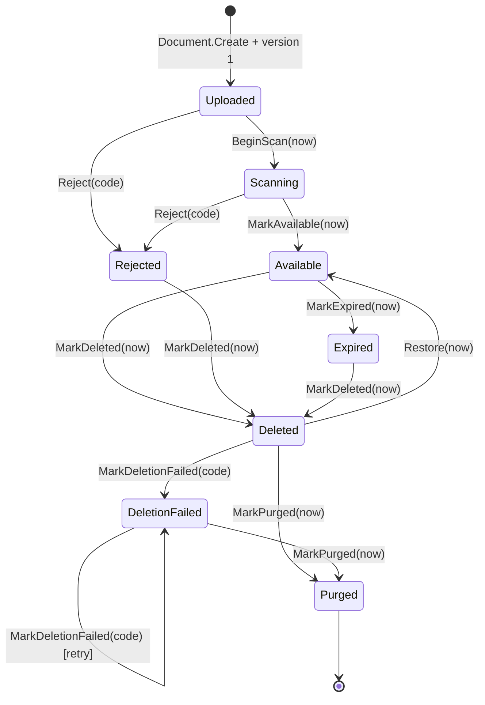
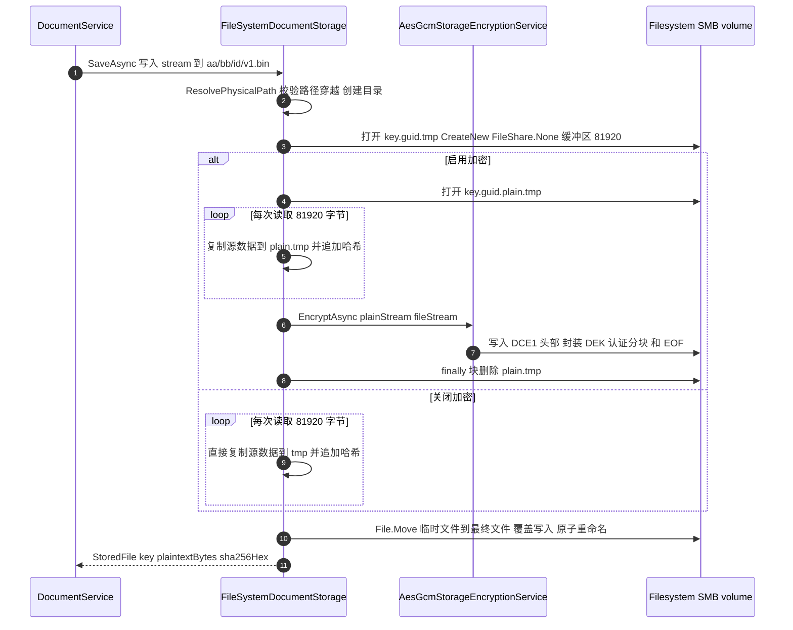
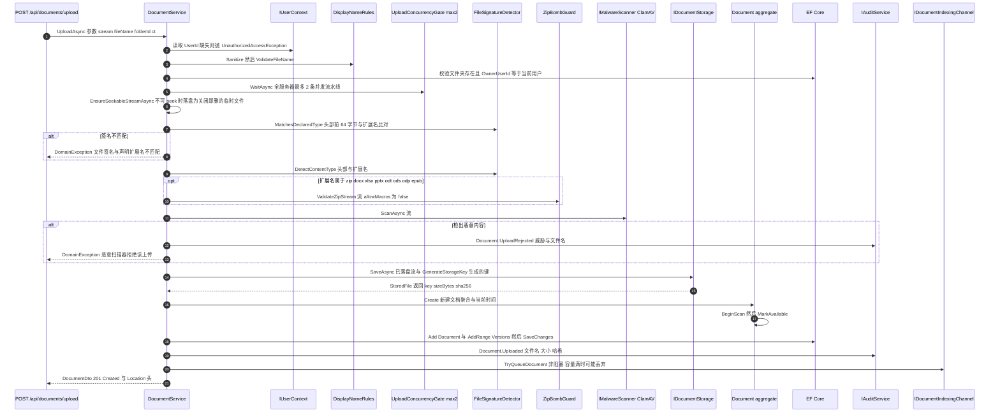
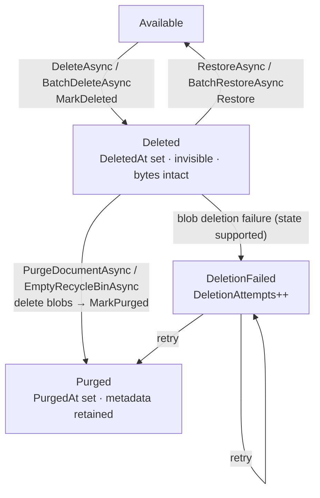

# Document Lifecycle and Storage Management

**Domain:** Core Business Domain · **Importance:** 9.5/10 · **Complexity:** 8.0/10
**Analysis date:** 2026-11-19 · **Evidence basis:** direct source inspection of `src/DocumentConverter.Domain/Documents`, `src/DocumentConverter.Application.{Documents,Storage}`, `src/DocumentConverter.Infrastructure.{Documents,Storage,Security/StorageEncryption,Persistence}`, `src/DocumentConverter.Web.{Endpoints,HostedServices}`, plus `init-postgres.sql` and `docker-compose.yml`.

---

## 1. Purpose and Scope

The **Document Lifecycle and Storage Management** domain owns the document as a governed business asset from the instant its first byte arrives to the instant its last byte is destroyed. Every other capability in EConverter — conversion, OCR, PDF editing, semantic intelligence, digital signature, audit — ultimately mutates or reads an object defined here.

The domain answers five questions that no other domain is allowed to answer on its own:

| Question | Owned answer |
|---|---|
| *What is a document?* | The `Document` aggregate root with ownership, storage metadata, integrity hash and lifecycle status |
| *Where do the bytes live?* | `IDocumentStorage` port + `FileSystemDocumentStorage` adapter with opaque, sharded, encrypted keys |
| *How does a document change over time?* | Append-only `DocumentVersion` chain with an `IsCurrent` promotion invariant |
| *How does a document die?* | Three-stage reversible deletion: soft delete → restore → permanent purge |
| *Who may touch it?* | Owner-scoped application service; no method accepts a foreign user identifier |

Three non-negotiables define the domain's contract with the rest of the system:

1. **User-supplied names never become paths.** `OriginalFileName` is metadata; the physical location is derived exclusively from a server-generated UUID.
2. **Ownership is enforced in the application service, not the endpoint.** No `IDocumentService` method takes a `userId` parameter, so an IDOR cannot even be expressed at a call site.
3. **Integrity is produced at write time, not recomputed later.** The SHA-256 returned by the storage adapter is the value persisted on both the `Document` and its `DocumentVersion`.

---

## 2. Architectural Position and Dependency Direction

The domain participates in a strict Clean/Onion layering where the dependency arrows point inward only:

```
Contracts   →  nothing (pure DTO records)
Application →  Domain + Contracts        (ports only: IDocumentService, IDocumentStorage, IPdfDigitalSignatureService)
Domain      →  System only               (entities, value policies, state machine; no I/O, no ORM, no ASP.NET)
Infrastructure → Application + Domain    (DocumentService, FileSystemDocumentStorage, PdfDigitalSignatureService)
Web         →  Application               (endpoints and Blazor pages; holds zero document state)
```

| Layer | Artifacts | Character |
|---|---|---|
| **Domain** | `Document`, `DocumentVersion`, `Folder`, `DocumentStatus` + `DocumentLifecycle`, `DisplayNameRules`, `DocumentIntelligenceIndex`, `DocumentVectorChunk` | Private constructors, static guarded factories, intention-revealing mutators, clock passed as parameter |
| **Application** | `IDocumentService`, `IDocumentStorage` (+ `StoredFile` record), `IPdfDigitalSignatureService` | Declarations only — no implementation, no persistence or HTTP coupling |
| **Contracts** | `DocumentDto`, `DocumentVersionDto`, `FolderDto`, batch request records, `DocumentDiffResultDto`, `SplitPdfRequest`, `MergePdfRequest`, `DigitalSignatureInfoDto` | Flat, immutable positional records; serialization-shaped |
| **Infrastructure** | `DocumentService` (27 operations), `FileSystemDocumentStorage`, `PdfDigitalSignatureService`, `DocumentConfigurations` | The only place where EF Core, the filesystem and cryptography appear |

The dependency inversion that matters most: `IDocumentStorage` is declared in **Application** but implemented in **Infrastructure**, and the AES-GCM encryption service is injected **into the storage adapter** rather than into the service. The application layer therefore never handles ciphertext semantics, and swapping `FileSystemDocumentStorage` for an S3 or Azure Blob adapter requires no change to any document logic — only a new adapter registration and a different `StorageProvider` label.

---

## 3. Domain Model

### 3.1 `Document` — the aggregate root

`Document` is a `sealed` class extending `Entity`; **both constructors are private**. The single legal construction path is the static factory:

```csharp
public static Document Create(NewDocument data, DateTime now)
```

`Create` accepts a `NewDocument` parameter record rather than a long positional argument list, which keeps the construction contract readable and testable:

```
NewDocument(Id, InitialVersionId, OwnerUserId, FolderId,
            OriginalFileName, StoredFileName, ContentType, FileExtension,
            SizeBytes, StorageProvider, StorageKey, Sha256Hash,
            ExpiresAt, SourceProcessingJobId = null)
```

Inside the factory: guards run (non-empty owner, non-empty document id, `now` must be UTC), the display name is normalised through `DisplayNameRules.ValidateFileName`, the SHA-256 is normalised through `Sha256Hex.Normalize`, status is fixed to `Uploaded`, and **version 1 is created and attached in the same operation** — the original upload is structurally preserved, not optionally preserved.

| Property | Type | Constraint | Semantics |
|---|---|---|---|
| `Id` | `Guid` | client-generated (`ValueGeneratedNever`) | Available before persistence so storage keys can be derived |
| `OwnerUserId` | `Guid` | FK → `Users`, `ON DELETE RESTRICT` | Security-critical; privacy boundary of the aggregate |
| `FolderId` | `Guid?` | FK → `Folders`, `ON DELETE SET NULL` | Nullable = root level; no sentinel value required |
| `OriginalFileName` | `string` | max 500, validated | Metadata only — never a path |
| `StoredFileName` | `string` | max 100 | Server-generated physical name (`v1.bin`) |
| `ContentType` | `string` | max 255 | Derived from magic bytes, not from the client header |
| `FileExtension` | `string?` | max 50 | Lowercase, without dot; drives editable/previewable classification |
| `SizeBytes` | `long` | `Guard.NotNegative` | **Plaintext** byte count, even when the blob is encrypted |
| `StorageProvider` | `string` | max 50 | `FileSystem` on the upload path, `LocalSharded` on the worker path |
| `StorageKey` | `string` | max 1000, unique index | Opaque, non-guessable, sharded |
| `Sha256Hash` | `string` | 64 lowercase hex, fixed length | Integrity produced at write time |
| `Status` | `DocumentStatus` | stored as **string** (max 50) | Governed lifecycle position |
| `StatusReason` | `string?` | max 200 | Structured reason code — never document content |
| `CreatedAt` / `UpdatedAt` | `DateTime` | UTC enforced | Every mutator restamps `UpdatedAt` |
| `ExpiresAt` | `DateTime?` | — | Retention deadline input |
| `DeletedAt` / `PurgedAt` | `DateTime?` | — | Audit timestamps for logical and physical death |
| `DeletionAttempts` | `int` | incremented on failure | Makes repeated delete calls observable, not silently idempotent |
| `SourceProcessingJobId` | `Guid?` | **unique filtered index** | Prevents duplicate job deliveries from producing duplicate outputs |

Ownership is expressed as a **domain predicate**, not a public setter:

```csharp
public bool IsOwnedBy(Guid userId) => userId != Guid.Empty && OwnerUserId == userId;
```

The `_versions` collection is a private `List<DocumentVersion>` exposed only as `IReadOnlyCollection<DocumentVersion>`, and EF Core is configured with `PropertyAccessMode.Field` — the collection cannot be mutated from outside the aggregate boundary.

### 3.2 `DocumentVersion` — append-only revision

`DocumentVersion` is immutable by construction: `Create` is `internal`, `ClearCurrent()` is the single `internal` mutation, and every other property is `get; private set;`.

```
DocumentVersion(Id, DocumentId, VersionNumber, StorageKey, SizeBytes,
                Sha256Hash, CreatedByUserId, CreatedAt, IsCurrent, SourceProcessingJobId)
```

| Invariant | Enforcement |
|---|---|
| Version numbers are 1-based and monotonic per document | `Guard.InRange(versionNumber, 1, int.MaxValue)`; unique index `(DocumentId, VersionNumber)` |
| Exactly one current version | `AddVersion` calls `ClearCurrent()` on **all** existing versions before appending a new one — explicit demotion, never a timestamp heuristic |
| Each revision carries its own integrity hash | `Sha256Hash` per row, independent of the document-level hash |
| Revision authorship is attributable | `CreatedByUserId` with FK `RESTRICT` |

Because versions are append-only and each is a distinct physical artefact, `DocumentVersion` is the unit of *tamper detection*; `Document` is the unit of *access control*.

### 3.3 `Folder` — owner-scoped hierarchy

`Folder` models a parent-child tree through a self-referential `ParentFolderId` rather than a join table:

- `Create(id, ownerUserId, parentFolderId, name, now)` rejects self-parenting and normalises the name.
- `Rename(name)` and `MoveTo(parentFolderId)` are the only mutators; both re-validate the name and reject self-parenting.
- The schema enforces `FK_Folders_Folders_ParentFolderId … ON DELETE RESTRICT`, so a folder with children cannot be orphaned by a cascading delete.
- Documents reference folders **by `Guid`**, not by navigation object — the loaded object graph for any mutation stays small and no lazy-loading surprises appear.

Folders are **organizational metadata only**. There is no code path in which a folder name or a document name participates in a filesystem path.

### 3.4 `DisplayNameRules` — one shared policy, two entry points

```
FileNameMaxLength   = 255
FolderNameMaxLength = 200
Forbidden           = [ '/' '\' ':' '*' '?' '"' '<' '>' '|' ]
```

`ValidateFileName` and `ValidateFolderName` both funnel into a single private `Validate(name, maxLength, label)`. Two public entry points over one shared core means document and folder rules **cannot drift**, while the caller still receives a domain-specific error label. The guard rejects:

- empty or whitespace-only input,
- `.` and `..` outright,
- any forbidden path/control character,
- any `char.IsControl` character (defends against header and UI injection),
- over-length input.

It **returns the normalised string** rather than `void`, which makes it composable — the entity constructor consumes the sanitised value directly instead of trusting the caller to have done so.

### 3.5 Derived artefacts inside the aggregate boundary

Two entities live in the `Documents` namespace and reference the document by `DocumentId`, keeping AI-derived data inside the same transactional boundary as the document it describes:

| Entity | Role | Key constraints |
|---|---|---|
| `DocumentIntelligenceIndex` | Persisted semantic analysis (category, confidence, executive summary, entities/topics JSON, word/page/chunk counts) enabling cold-start retrieval without re-parsing | **Unique** index on `DocumentId`; cascade delete with the document |
| `DocumentVectorChunk` | Localised passage with dense embedding, page number, section title, language (`orig`/`en`/`id`), provenance (`VectorSource`, `ExtractionMethod`), enrichment metadata, `ParentChunkId` for derived translations | Indexes on `DocumentId`, `(DocumentId, ChunkIndex)`, `(DocumentId, IsEnriched)`, `(DocumentId, Language)`, `ParentChunkId`; cascade delete |

The cascade rules are the practical guarantee that **purging a document also purges its retrieval footprint** at the persistence layer.

---

## 4. Lifecycle State Machine

### 4.1 States

`DocumentStatus` is a plain enum with **explicit numeric values** — a deliberate choice that keeps serialized data stable against enum reordering.

| Value | State | Meaning |
|---|---|---|
| 1 | `Uploaded` | Bytes received and hashed; not yet scanned |
| 2 | `Scanning` | Malware/content scan in progress |
| 3 | `Available` | Passed validation; usable by its owner |
| 4 | `Rejected` | Failed validation or scan; never processed or downloadable |
| 5 | `Expired` | Retention period elapsed; awaiting deletion |
| 6 | `Deleted` | Logically deleted (invisible to users); bytes still on disk |
| 7 | `DeletionFailed` | Physical deletion attempted and failed; retried by cleanup |
| 8 | `Purged` | Bytes removed; metadata retained for audit (**terminal**) |

### 4.2 Transition matrix (authoritative, from `DocumentLifecycle.Allowed`)

| From | Allowed targets |
|---|---|
| `Uploaded` | `Scanning`, `Rejected` |
| `Scanning` | `Available`, `Rejected` |
| `Available` | `Expired`, `Deleted` |
| `Rejected` | `Deleted` |
| `Expired` | `Deleted` |
| `Deleted` | `Available`, `Purged`, `DeletionFailed` |
| `DeletionFailed` | `Purged`, `DeletionFailed` (retry) |
| `Purged` | — (terminal) |



### 4.3 Policy vs. vocabulary

The enum is the **vocabulary**; `DocumentLifecycle` is the **policy**. Two named methods remove every inline conditional from consumers:

```csharp
public static bool CanTransition(DocumentStatus from, DocumentStatus to)
public static void EnsureCanTransition(DocumentStatus from, DocumentStatus to)  // throws InvalidStateTransitionException
```

`EnsureCanTransition` is the enforcing gate used by the aggregate; `CanTransition` is the boolean query a UI or command layer uses to grey out an action instead of provoking an exception. Both consult one dictionary, so the answer cannot diverge between layers.

```csharp
public static bool IsVisibleToOwner(DocumentStatus status)
    => status is Uploaded or Scanning or Available or Rejected;
```

This is the single definition of owner visibility — `Expired`, `Deleted`, `DeletionFailed` and `Purged` are invisible. Note the sharp distinction it encodes: **a logically deleted document is invisible but still readable by the service internals** (`DownloadAsync` trusts `Available`, not visibility), and physical death is a separate state entirely.

### 4.4 Mutators — every state change is a named intention

| Method | Guard | Side effects |
|---|---|---|
| `BeginScan(now)` | transition legal | `Status = Scanning` |
| `MarkAvailable(now)` | transition legal | `Status = Available` |
| `Reject(code, now)` | transition legal | `Status = Rejected`, `StatusReason = code` |
| `Rename(newName, now)` | `EnsureMutable()` | normalised name, `UpdatedAt` |
| `MoveToFolder(folderId, now)` | `EnsureMutable()` | `FolderId`, `UpdatedAt` |
| `AddVersion(...)` | `Status == Available` | demotes all versions, appends next, `UpdatedAt` |
| `RevertToVersion(n, ...)` | `EnsureMutable()` + `Available` | appends a **new** version pointing at version *n*'s storage key |
| `SetExpiry(expiresAt, now)` | none | `ExpiresAt`, `UpdatedAt` |
| `MarkExpired(now)` | transition legal | `Status = Expired` |
| `MarkDeleted(now)` | transition legal | `Status = Deleted`, `DeletedAt` |
| `Restore(now)` | transition legal | `Status = Available`, `DeletedAt = null` |
| `MarkPurged(now)` | transition legal | `Status = Purged`, `PurgedAt`, clears `StatusReason` |
| `MarkDeletionFailed(code, now)` | transition legal | `DeletionAttempts++`, `StatusReason = code` |

`EnsureMutable()` refuses rename/move/revert whenever `IsVisibleToOwner(Status)` is false, which is what makes a deleted document **read-only to the API** without any endpoint-level special case.

---

## 5. Storage Subsystem

### 5.1 The port

```csharp
public sealed record StoredFile(string StorageKey, long SizeBytes, string Sha256Hash);

public interface IDocumentStorage
{
    Task<StoredFile> SaveAsync(Stream content, string storageKey, CancellationToken ct = default);
    Task<Stream>     OpenReadAsync(string storageKey, CancellationToken ct = default);
    Task             DeleteAsync(string storageKey, CancellationToken ct = default);
    Task<bool>       ExistsAsync(string storageKey, CancellationToken ct = default);
}
```

Four deliberate constraints are baked into this signature:

- **Stream-in, metadata-out.** The port never buffers a whole payload and never returns a path or URL — only an opaque key plus integrity metadata. No layer above it can accidentally serve a file directly.
- **The hash comes from the write.** Callers persist what storage computed; integrity is not a later recomputation that could diverge.
- **`SizeBytes` counts plaintext.** `FileSystemDocumentStorage` counts bytes read from the source stream before encryption, so `Document.SizeBytes` and `DocumentVersion.SizeBytes` describe the user's document, not the ciphertext. This is what makes size display and download expectations correct in an encrypted deployment.
- **Keys are caller-supplied and opaque.** The service derives them deterministically; the adapter never invents one.

### 5.2 Key derivation and sharding

```csharp
public static string GenerateStorageKey(Guid documentId, int versionNumber = 1)
{
    var idStr = documentId.ToString("N");     // 32 hex chars, no dashes
    return $"{idStr[..2]}/{idStr[2..4]}/{idStr}/v{versionNumber}.bin";
}
```

Example: `7a/3f/7a3f9c04e1b24d8fa1c6…/v2.bin`

| Property | Why it matters |
|---|---|
| Two-level two-character hex prefix | Bounds per-directory file count at roughly *n*/65536 — prevents directory scans degrading on multi-million-file volumes |
| UUID-derived, 122 bits of entropy | Non-guessable: knowing a document id is required before the path can be derived, and the id itself is only obtainable through an owner-scoped query |
| Deterministic from `(documentId, versionNumber)` | Storage and database can be reconciled after a crash: the key is recomputable, not stored as a mystery |
| Filename is fixed (`v{n}.bin`) | **Zero user input reaches the filesystem.** Rename changes metadata only; the blob is never moved |
| Extension-free blob name | The stored artefact never advertises its type to the filesystem or to any intermediary that might infer handling from it |

Root resolution order (first match wins):

```
DOCUMENT_STORAGE_ROOT  →  Storage:RootPath  →  {AppContext.BaseDirectory}/app_data/storage
```

The root is passed through `Path.GetFullPath` and created at construction. In the container topology, `DOCUMENT_STORAGE_ROOT=/data/storage` is a shared named volume mounted into both `dc-web` and `dc-document-worker`, initialised by a dedicated `init-storage` container that fixes ownership (`1654:1654`, mode `775`) before either service starts.

### 5.3 Write path and atomicity



Three properties follow from this shape:

1. **No partially written blob is ever visible.** Readers either see the previous complete file or the new complete file — never a truncated one — because the rename is the publication step.
2. **Failure leaks nothing.** The `catch` block deletes the temp file; the plaintext scratch file is removed in a `finally` regardless of outcome.
3. **The hash is streamed, not deferred.** `IncrementalHash.CreateHash(SHA256)` consumes the same buffer loop that writes the ciphertext, so hashing costs one pass and zero extra I/O.

### 5.4 Encryption envelope format (`DCE1`)

`AesGcmStorageEncryptionService` implements envelope encryption with per-document key separation:

```
Buffer layout
──────────────────────────────────────────────────────────────────────────
Magic header        "DCE1"                        4 bytes
Wrapped DEK         nonce                         12 bytes
                    ciphertext (AES-256-GCM)       32 bytes
                    authentication tag            16 bytes
──────────────────────────────────────────────────────────────────────────
Chunk record        plaintext length (int32 LE)    4 bytes
                    nonce                         12 bytes
                    authentication tag            16 bytes
                    ciphertext                    N bytes   (N ≤ 64 KB)
──────────────────────────────────────────────────────────────────────────
Terminator          length = 0                     4 bytes
```

| Aspect | Implementation |
|---|---|
| DEK lifecycle | Fresh 256-bit DEK per document write; wrapped by the master KEK; zeroised via `CryptographicOperations.ZeroMemory` on both encrypt and decrypt |
| Chunk size | 64 KB — bounded working set independent of document size |
| Nonces | Randomly generated per chunk (96-bit), never reused |
| Authentication | Per-chunk 128-bit GCM tag — a corrupted chunk fails verification locally rather than silently altering output |
| Corruption defence | `0 < chunkLength ≤ 128 KB` validation rejects malformed length prefixes before allocation |
| Terminator discipline | A zero length prefix is the only legal end-of-stream marker; truncation surfaces as `EndOfStreamException` |
| Backward/forward compatibility | `DecryptAsync` checks for `DCE1`; absent header ⇒ rewind and return the stream untouched, so plaintext legacy blobs and mixed-mode volumes remain readable |
| Key hygiene | `IsEncryptedAsync` preserves stream position — probing never consumes bytes |

**Key resolution policy:**

| Configuration | Behaviour |
|---|---|
| `Storage:Encryption:Enabled = false` | Pass-through: bytes written unencrypted; `IsEncryptionEnabled` short-circuits both paths |
| `STORAGE_ENCRYPTION_KEY` or `Storage:Encryption:MasterKey`, valid Base64 of exactly 32 bytes | Used directly as KEK |
| Configured key of any other length | `SHA256`-derived to 256 bits, with a warning |
| Non-Base64 configuration value | `SHA256`-derived from UTF-8 bytes, with a warning |
| No key configured at all | Deterministic fallback development key + explicit warning when encryption is enabled |

Professional note on deployment: the fallback path exists so the product boots without ceremony, but a production deployment that enables encryption *without* supplying a key is running on a publicly known KEK. This belongs in the deployment checklist, not in the code path.

### 5.5 Read path

```
OpenReadAsync(key)
  → ResolvePhysicalPath(key)                      [traversal check]
  → FileNotFoundException if absent
  → FileStream(Open, Read, FileShare.Read, 81920, useAsync)
  → DecryptAsync(stream)                          [returns plaintext stream]
```

`DecryptAsync` unwraps the DEK using the master KEK, then decrypts chunk-by-chunk, verifying each tag, into a seekable `MemoryStream`. A single implementation detail carries operational weight: **encryption is streamed through temporary files, but decryption materialises the plaintext in memory**. This is invisible for the typical document envelope but is the first thing to change when very large (multi-hundred-MB) documents become a supported class — see §19.

### 5.6 Deletion and idempotency

```
DeleteAsync(key)
  → ResolvePhysicalPath(key)      [traversal check — deletion cannot be aimed outside the root either]
  → if File.Exists → File.Delete → log
  → return (no exception when absent)
```

The absence of an exception for a missing blob is a considered choice: purge is a *desired state*, not a *command*. A version whose bytes were already removed (or whose storage key is shared with a rollback version, §7) must not abort a batch operation.

### 5.7 Traversal defence

`ResolvePhysicalPath` is the only place a key becomes a path, and it applies three independent checks:

```csharp
var normalizedKey = storageKey.Replace('\\', '/').TrimStart('/');
if (normalizedKey.Contains("..", StringComparison.Ordinal)) throw ArgumentException(...);
var fullPath = Path.GetFullPath(Path.Combine(_rootPath, normalizedKey));
if (!fullPath.StartsWith(_rootPath, StringComparison.OrdinalIgnoreCase))
    throw new InvalidOperationException("Attempted directory traversal outside storage root.");
```

The final containment test — not the textual one — is the real guarantee: even if a future key format introduced an unexpected construct, the resolved absolute path must still live beneath the configured root. Combined with the fact that keys are never derived from user input, this is defence in depth rather than the sole barrier.

### 5.8 Configuration surface

| Key | Consumed by | Effect |
|---|---|---|
| `DOCUMENT_STORAGE_ROOT` | `FileSystemDocumentStorage` | Blob volume root (preferred in containers) |
| `Storage:RootPath` | `FileSystemDocumentStorage` | Same, configuration-file equivalent |
| `Storage:Encryption:Enabled` | `AesGcmStorageEncryptionService` | Master switch for the `DCE1` envelope |
| `STORAGE_ENCRYPTION_KEY` / `Storage:Encryption:MasterKey` | `AesGcmStorageEncryptionService` | Base64 256-bit master KEK |

Note that `docker-compose.yml` ships `Storage__Encryption__Enabled=false` for both `web` and `document-worker`. The consequence must be stated plainly: **the shipped container profile stores documents unencrypted**. Encryption at rest is a supported, implemented, production-intended capability that is off by default in the provided compose files.

---

## 6. Ingestion Pipeline

`DocumentService.UploadAsync(Stream content, string fileName, Guid? folderId, CancellationToken ct)` is the sole ingress for new documents. Its shape encodes three architectural decisions before a single line of logic runs: stream-based (multi-hundred-MB uploads never materialise in memory), `folderId` optional with `null` default (root upload needs no sentinel), and **no `userId` parameter** — the implementation resolves identity itself.



### Stage by stage

| # | Stage | Implementation detail | Failure semantics |
|---|---|---|---|
| 1 | **Identity** | `GetCurrentUserId()` → `IUserContext.UserId ?? throw UnauthorizedAccessException` | 500-equivalent; endpoint is already `RequireAuthorization()` |
| 2 | **Name normalisation** | `FileNameSanitizer.SanitizeForStorageMetadata` then `DisplayNameRules.ValidateFileName` | `DomainException` → HTTP 400 |
| 3 | **Folder authorisation** | `AnyAsync(f => f.Id == folderId && f.OwnerUserId == userId)` | `DomainException` "destination folder was not found" — deliberately indistinguishable from "not yours" |
| 4 | **Concurrency gate** | `static SemaphoreSlim(2, 2)` — bounds concurrent inspect-and-store pipelines server-wide | Callers queue; a multi-file upload cannot exhaust CPU, RAM or I/O |
| 5 | **Seekability** | Non-seekable streams (Blazor `BrowserFileStream` over SignalR) spool to `FileOptions.DeleteOnClose` temp file rather than `MemoryStream` | Prevents Large Object Heap growth during batch uploads |
| 6 | **Magic-byte validation** | 64-byte header probe; `FileSignatureDetector.MatchesDeclaredType` — the declared extension must agree with the actual content signature | Reject before a byte reaches storage |
| 7 | **Content type** | `DetectContentType(header, extension)` — derived from content, never trusted from the client header | Persisted as authoritative |
| 8 | **Archive screening** | For archive and OOXML containers: `ZipBombGuard.ValidateZipStream(allowMacros: false)` — compression-ratio and macro inspection | `DomainException` with the guard's reason |
| 9 | **Malware scan** | `IMalwareScanner.ScanAsync` (ClamAV adapter), stream rewound afterwards | Rejection is **audited with the threat name and file name** before throwing |
| 10 | **Persistence of bytes** | `IDocumentStorage.SaveAsync` under a key derived from the freshly generated document id | Temp file cleaned on failure |
| 11 | **Aggregate creation** | `Document.Create` + `BeginScan` + `MarkAvailable` | Status reaches `Available` because screening already happened inline |
| 12 | **Durability** | `SaveChangesAsync` writes `Document` and its `Versions` in one unit of work | — |
| 13 | **Audit** | `Document.Uploaded` with `FileName`, `Size`, `Hash` — never content | Fire-and-forget semantics are *not* used; the audit save is awaited |
| 14 | **Indexing hand-off** | `_indexingQueue?.TryQueueDocument(document.Id)` | Non-blocking; a saturated channel logs a warning and the document is picked up later by the startup backfill sweep |

The final ordering point deserves emphasis: **the upload response never waits for intelligence indexing**. Searchability is eventually consistent by design, and the `DocumentIndexingWorker` compensates at startup by scanning for `Available` documents that have no `DocumentIntelligenceIndex` row and re-queueing them.

Two honest observations about the state machine in practice:

- `BeginScan` and `MarkAvailable` are invoked back-to-back, so `Uploaded → Scanning → Available` is traversed but never *observed* — no persisted intermediate state exists. The asynchronous scanning stage implied by `Scanning` is not present in this path; screening is synchronous.
- The `Rejected` state is **not** reached by this pipeline. A rejected upload throws before a document row exists, leaving only an audit event. `Rejected` therefore describes an externally produced or legacy state, and any consumer rendering a status badge must not assume it will appear for new uploads.

---

## 7. Version Management

### 7.1 Append semantics

`AddVersion(versionId, storageKey, sizeBytes, sha256Hash, createdByUserId, sourceProcessingJobId, now)`:

1. Rejects if `Status != Available` — you cannot version a document that is deleted, expired or rejected.
2. Computes `next = max(VersionNumber) + 1` (or 1 when the collection is empty).
3. Calls `ClearCurrent()` on **every** existing version.
4. Creates the new version with `IsCurrent = true` and appends it.

Nothing is overwritten at any layer: a new `DocumentVersions` row, a new blob at `v{n}.bin`, and a new hash. The old revision remains fully addressable by `(documentId, versionNumber)` — which is exactly what the diff, rollback and download-by-version features depend on.

### 7.2 Who produces versions

| Producer | Call | Notes |
|---|---|---|
| User replacement upload | `AddVersionAsync` → `POST /api/documents/{id}/versions` | Full screening pipeline re-applied (signature, zip bomb, malware) |
| Conversion job completion | Worker writes a **new document** with `SourceProcessingJobId = job.Id` | Idempotency via the unique filtered index; a redelivered job cannot create a second output |
| PDF edit / OCR / signature | `AddVersion` on the source document | The edited artefact becomes the new current revision |
| Rollback | `RevertToVersion(n)` | Creates a **new** version referencing version *n*'s storage key |

### 7.3 Rollback: append, never rewind

```csharp
public DocumentVersion RevertToVersion(int versionNumber, Guid createdByUserId, DateTime now)
```

Rollback does **not** flip `IsCurrent` back to the old row. It appends a brand-new version whose `StorageKey`, `SizeBytes` and `Sha256Hash` are copied from the target — a "truth is monotonic" design. Consequences worth documenting for operators:

- History remains a linear audit trail: version 5 can never silently become version 2 again.
- Two version rows share one storage key. `PurgeDocumentAsync` and `EmptyRecycleBinAsync` iterate every version and call `DeleteAsync`; the adapter's `File.Exists` guard makes the second call a no-op rather than an exception. The design is only safe because deletion is idempotent — the two choices are coupled, not independent.
- Storage cost of a rollback is zero bytes; the cost of *editing after* a rollback is a normal new blob.

### 7.4 Comparison

`CompareVersionsAsync(documentId, versionA, versionB)` and `CompareDocumentsAsync(docA, docB)` both return `DocumentDiffResultDto`:

| Field | Source |
|---|---|
| `SizeDeltaBytes` | `vB.SizeBytes - vA.SizeBytes` |
| `HasContentChanged` | SHA-256 inequality (ordinal ignore-case) — byte-identical content is reported unchanged regardless of timestamp |
| `IsTextComparable` | Extension ∈ {txt, csv, json, xml, md, html, htm, css, js, ts, log, yaml, yml, ini, sql} **and** both blobs < 2 MB **and** diff computation succeeded |
| `TextDiffLines` | LCS dynamic-programming diff producing `Unchanged` / `Added` / `Deleted` rows with line numbers on each side |
| `PreviewUrlA` / `PreviewUrlB` | Constructed preview routes keyed by `versionId`, with `#` replaced by `_` in the file name |

The diff is guard-railed twice: by extension (binary content is never decoded) and by size (a 2 MB ceiling). The DP table is `int[n+1, m+1]` — memory cost is quadratic in line count, which is why the size ceiling exists rather than a time-out. A 2 MB log file with very short lines can still produce a large matrix; §19 records this.

### 7.5 PDF structural operations

Two operations in this domain manipulate PDF structure rather than merely storing bytes, and both **re-enter the upload pipeline** for their outputs — so every produced document is screened, hashed, encrypted and indexed exactly like a first-generation upload:

| Operation | Modes / rules | Output |
|---|---|---|
| `SplitPdfAsync` | `divide_two` (default split at `totalPages/2`), `extract_range` (e.g. `1-3,5`), `burst_all` (one file per page) | N documents named `{base}_part1_p1-{n}.pdf`, `{base}_{range}.pdf`, `{base}_p{i}.pdf` |
| `MergeDocumentsAsync` | ≥ 2 sources; per-source optional page ranges; output name defaults to `{firstBase}_merged.pdf` and gains `.pdf` if missing | One merged document |

`MergeDocumentsAsync` builds a `Dictionary<Guid, Document>` from a single owner-filtered query and then validates every requested id against it before touching storage — a structural IDOR defence: a foreign id simply is not in the dictionary and produces "not found or access is denied". Page-range parsing accepts forward and reverse ranges, clamps to `1..totalPages`, deduplicates via `HashSet`, and returns page indices in ascending order.

---

## 8. Deletion, Restore and Purge

Deletion is deliberately three-stage and reversible, giving recycle-bin semantics without ever losing the record of what was deleted and when.



### 8.1 Soft delete

`DeleteAsync` loads the document scoped to the current user, calls `MarkDeleted(now)`, saves, and audits `Document.Deleted`. The bytes are untouched. `DocumentLifecycle.IsVisibleToOwner` returns false, and `ListAsync`'s default filter excludes `Deleted` and `Purged` — the document vanishes from the explorer while remaining fully intact on disk.

Two deliberate details:

- `MarkDeleted` is only legal from `Available`, `Rejected` or `Expired`. Deleting an already-deleted document throws an invalid-transition exception rather than being silently accepted — repeated intent is made visible instead of masked.
- `BatchDeleteAsync` swallows per-folder failures and logs them, then saves once. A single problematic folder cannot abort an entire multi-select delete.

### 8.2 Restore

`RestoreAsync` and `BatchRestoreAsync` both re-check the destination folder before restoring:

```csharp
if (doc.FolderId.HasValue && !folderExists) doc.MoveToFolder(null, now);
doc.Restore(now);
```

This is the **orphan reconciliation** step: a document deleted from inside a folder that was subsequently removed would otherwise be restored into a dangling `FolderId`. It is moved to root instead — the user recovers their file, and the FK never dangles. `BatchRestoreAsync` pre-loads the owner's folder ids into a `HashSet` so the check costs one query for the whole batch, not one per document.

### 8.3 Permanent purge — a two-plane operation

```csharp
public async Task PurgeDocumentAsync(Guid documentId, CancellationToken ct)
{
    // owner-scoped load with versions
    if (doc.Status != DocumentStatus.Deleted) doc.MarkDeleted(now);   // purge implies delete
    foreach (var version in doc.Versions)
        try { await _storage.DeleteAsync(version.StorageKey, ct); }
        catch (Exception ex) { _logger.LogWarning(ex, "Failed to delete storage blob …"); }
    doc.MarkPurged(now);
    await _db.SaveChangesAsync(ct);
    // audit "Document.Purged"
}
```

The design intent is a single place that performs **both planes** of deletion — bytes and metadata — so no code path can destroy one without the other being at least recorded. The metadata row survives with `Status = Purged` and `PurgedAt` populated: this is intentional, because the audit trail of *what was destroyed and when* is a compliance artefact, and the document's own row is part of it.

Storage-side failures are logged and stepped over so the transition still completes. Note the honest gap: the `DocumentStatus.DeletionFailed` state and `MarkDeletionFailed` mutator exist precisely to model "physical deletion attempted and failed", but this path logs and continues to `Purged` instead of using them. A stricter implementation would call `MarkDeletionFailed(errorCode, now)` when any blob delete throws and let a retry sweep drive `DeletionFailed → Purged`. Flagging this in §19; the mechanism is built, the caller is not wired.

### 8.4 Empty recycle bin

`EmptyRecycleBinAsync` loads **all** owner-scoped documents in `Deleted` status with their versions, deletes every blob, and marks each `Purged` in one `SaveChanges`. It returns early when the bin is already empty, and audits `RecycleBin.Emptied` with the count. One transaction, one audit record, no partial visibility.

### 8.5 Deletion of a folder

`DeleteFolderAsync` is not a deletion of contents — it is a **dissolution** with reassignment:

1. Every document in the folder is `MoveToFolder(folder.ParentFolderId)`.
2. Every subfolder is `MoveTo(folder.ParentFolderId)`.
3. The folder row is removed.

Documents are never deleted as a side effect of deleting a folder, and subfolders are re-parented rather than cascaded away — consistent with the `ON DELETE RESTRICT` self-referencing FK.

---

## 9. Ownership and Authorization Model

Authorization in this domain is **structural**, which makes it far more durable than a set of endpoint attributes.

| Mechanism | Location | Effect |
|---|---|---|
| No `userId` parameter on any port method | `IDocumentService` | Acting as another user cannot be expressed; IDOR is not "prevented", it is *unrepresentable* |
| Identity resolved inside the service | `GetCurrentUserId()` | Endpoints and Blazor components cannot forget to pass it |
| Every query filtered by owner | `Where(d => d.OwnerUserId == userId)` on all reads | Cross-tenant reads return "not found", not "forbidden" — no existence oracle |
| Ownership predicate on the aggregate | `Document.IsOwnedBy(Guid)` | The question "is this mine?" is answered by the domain object, not by a scattered conditional |
| Folder existence validated with owner in the predicate | `AnyAsync(f => f.Id == folderId && f.OwnerUserId == userId)` | Prevents planting a document into someone else's folder |
| Merge/split re-entry through `UploadAsync` | PDF operations | Derived documents inherit the same owner and screening |
| Claims transformation | `HttpContextUserContext`, `AppClaimsTransformation` | Internal `dc:uid` claim or `NameIdentifier`, resolvable in both HTTP and Blazor circuits |

The authorisation ordering rule is uniform and observable in every method: **authorise, then mutate**. `IsOwnedBy`/owner-scoped load precedes every write. `DownloadAsync` adds a second gate — the document must be in `Available`, so a deleted document cannot be fetched even by its owner via a direct download call, and a `Rejected` one is unreachable entirely.

Missing-resource semantics are deliberately split upstream: the service throws `KeyNotFoundException` (mapped to HTTP 404) and `DomainException` (mapped to HTTP 400 with the message), while `GetAsync` returns `null` (mapped to 404). This keeps the outward contract stable while separating "does not exist" from "cannot be operated on in this state".

---

## 10. Retrieval, Projection and Download Surfaces

| Operation | Behaviour | Notable constraint |
|---|---|---|
| `ListAsync(folderId, searchTerm, status)` | Owner-scoped, `AsNoTracking`, includes versions, ordered `CreatedAt DESC` | Default filter excludes `Deleted` and `Purged`; `folderId == Guid.Empty` means root; `searchTerm` is a substring match on `OriginalFileName` only |
| `GetAsync(id)` | Owner-scoped detail with full version list | Returns `null` rather than throwing |
| `DownloadAsync(id, versionId)` | Returns `(Stream, FileName, ContentType)` | Requires `Available`; explicit version or `CurrentVersion`; audits `Document.Downloaded` with version number |
| `DownloadBatchZipAsync(ids)` | One zip of all `Available` owned documents | Entry names sanitised, deduplicated as `name (1).ext`, `CompressionLevel.Optimal`, `LastWriteTime` from `UpdatedAt`; archives buffered in a `MemoryStream` |
| `GetPdfMetadataAsync(id)` | `PageCount` + `IsEncrypted` via PdfSharp import-mode reader | Rejects non-PDF with `InvalidOperationException` |
| `GetVersionsAsync(id)` | All versions, `VersionNumber DESC` | — |
| `SplitPdfAsync` / `MergeDocumentsAsync` | See §7.5 | — |
| `SignStoredDocumentAsync` (via `IPdfDigitalSignatureService`) | Signs and commits a **new version** containing the signed PDF | PAdES / ISO 32000 byte-range verification |

DTO projection is centralised in `MapToDto` / `MapVersionToDto` inside the infrastructure service, which is what allows `Contracts` to stay a pure data shape and guarantees entities never leak to the HTTP boundary. `DocumentDto` carries identity, ownership, storage metadata, integrity hash, status and timestamps plus the nested version list; `DocumentVersionDto` links back by `DocumentId`.

**A visibility divergence worth naming.** `DocumentLifecycle.IsVisibleToOwner` excludes `Expired`, `Deleted`, `DeletionFailed` and `Purged`. `ListAsync`'s default branch excludes only `Deleted` and `Purged`. In practice an `Expired` document is therefore visible in the explorer list while the domain policy considers it invisible to the owner. This is a real inconsistency between the two definitions of "visible", not a bug in either — and it is exactly the kind of divergence that becomes a defect the moment a retention sweeper starts producing `Expired` rows. See §19.

---

## 11. Persistence Mapping

`DocumentConfigurations` implements `IEntityTypeConfiguration<>` for all five document-namespace entities and is applied automatically via `builder.ApplyConfigurationsFromAssembly`.

**`Documents`**

| Element | Definition |
|---|---|
| Key | `Id`, `ValueGeneratedNever` (client GUIDs) |
| Status column | `HasConversion<string>().HasMaxLength(50)` — readable in SQL, stable across enum edits |
| `Sha256Hash` | `HasMaxLength(64).IsFixedLength()` |
| Indexes | `(OwnerUserId, CreatedAt)` — the explorer's primary access path · `Status` · **unique** `StorageKey` · **unique filtered** `SourceProcessingJobId WHERE NOT NULL` (job-delivery idempotency) |
| FKs | `OwnerUserId → Users` **RESTRICT** (a user with documents cannot be deleted out from under them) · `FolderId → Folders` **SET NULL** · `Versions` **CASCADE** |
| Navigation | `UsePropertyAccessMode(PropertyAccessMode.Field)` — the private `_versions` list is the only writer |

**`DocumentVersions`** — unique index `(DocumentId, VersionNumber)`, fixed-length hash, `CreatedByUserId → Users` RESTRICT.

**`Folders`** — index `(OwnerUserId, ParentFolderId, Name)` for tree rendering; `OwnerUserId → Users` CASCADE; `ParentFolderId → Folders` RESTRICT.

**`DocumentVectorChunks`** — five supporting indexes (document, chunk order, enrichment flag, language, parent chunk), defaults applied at the database (`IsEnriched=false`, `VectorSource='Actual Document'`, `ExtractionMethod='MarkItDown'`, `Language='orig'`), `DocumentId → Documents` CASCADE.

**`DocumentIntelligenceIndices`** — unique `DocumentId`, cascade delete.

The schema is materialised both by EF Core migrations and by `init-postgres.sql` (643 lines, idempotent `CREATE TABLE IF NOT EXISTS`, `identity` schema for ASP.NET Identity tables, `timestamp with time zone` throughout, `character(64)` fixed-length hashes, `bytea` embeddings). The container profile also documents a deliberate network split: `dc-internal` is an **internal** Docker network with no external routing, and the worker is attached only to `dc-internal` and `web-gateway` — the storage and database plane has no internet egress.

---

## 12. HTTP Surface (`/api/documents`, `/api/folders`)

Both groups are declared with `RequireAuthorization()` at map time.

| Method | Route | Purpose |
|---|---|---|
| POST | `/api/documents/upload` | Single upload (201 + `Location`) |
| POST | `/api/documents/upload-batch` | Multi-upload: ≤ 20 files, ≤ 100 MB each, ≤ 250 MB total; per-file error collection |
| GET | `/api/documents` | List with `folderId`, `searchTerm`, `status` filters |
| GET | `/api/documents/{id}` | Detail |
| GET | `/api/documents/{id}/download` | 302 to the named download route |
| GET | `/api/documents/{id}/download/{fileName}` | Streamed file, `enableRangeProcessing` |
| GET | `/api/documents/{id}/preview` / `.../preview/{fileName}` | Inline render; DOCX is converted to PDF on the fly, text/HTML get corrected content types |
| POST | `/api/documents/{id}/versions`, `/upload-version` | Append a version |
| GET | `/api/documents/{id}/versions` | Version history |
| POST | `/api/documents/{id}/versions/{n}/rollback` | Append a rollback version |
| GET | `/api/documents/{id}/diff?versionA&versionB` | Version diff |
| GET | `/api/documents/diff?docA&docB` | Cross-document diff |
| DELETE | `/api/documents/{id}` | Soft delete |
| POST | `/api/documents/{id}/rename`, `/move` | Rename / re-parent |
| POST | `/api/documents/batch-move`, `/batch-delete`, `/batch-restore` | Batch mutations |
| GET | `/api/documents/batch-download-zip?ids=` | Multi-document zip |
| POST | `/api/documents/{id}/restore`, `/purge`, `/recycle-bin/empty` | Recycle bin |
| GET | `/api/documents/{id}/metadata` | PDF page count / encryption state |
| POST | `/api/documents/{id}/split`, `/api/documents/merge` | PDF structural operations |
| POST | `/api/documents/{id}/sign`, `/verify-signatures`; GET `/{id}/signatures` | Digital signature |
| POST | `/api/documents/{id}/compression-preview` | Compression estimate |
| GET/POST/DELETE | `/api/folders…` | Folder CRUD (create, rename, delete) |

Error mapping is uniform: `KeyNotFoundException` → 404, `DomainException` → 400 with `{ error: message }`, `ArgumentException`/`InvalidOperationException` → 400. Upload, version, batch and verify routes carry `DisableAntiforgery()` because they are consumed programmatically or from Blazor with `FormData`.

---

## 13. Runtime Characteristics

| Concern | Mechanism | Consequence |
|---|---|---|
| **Upload concurrency** | `static SemaphoreSlim UploadConcurrencyGate = new(2, 2)` | At most two inspect-and-store pipelines server-wide; multi-file uploads queue rather than exhaust CPU/RAM/I/O |
| **Non-seekable streams** | Spool to `FileOptions.DeleteOnClose` temp file, 81,920-byte buffer | Prevents LOH growth from `MemoryStream` on large Blazor uploads |
| **Streaming I/O** | All payload movement is stream-to-stream | Multi-GB handling without whole-file buffers |
| **Hashing** | `IncrementalHash` fed by the same copy loop | One pass, no extra I/O, no second read of the blob |
| **Encryption memory** | Streamed through temp files for writes | Bounded regardless of document size |
| **Decryption memory** | Materialises into `MemoryStream` | Read-side peak memory equals plaintext size — the scale limit of the current implementation |
| **Batch zip** | Built in a `MemoryStream` | Peak memory equals total archive size; fine for tens of files, wrong for hundreds of large ones |
| **Diff memory** | `int[linesA+1, linesB+1]` LCS table | Guarded by a 2 MB per-side ceiling and text-extension allow-list |
| **Indexing channel** | `BoundedChannel(10_000)`, `FullMode = Wait`, single reader, multi-writer | Backpressure by default; `TryQueueDocument` returns `false` at capacity so upload never blocks |
| **Indexing parallelism** | `Parallel.ForEachAsync`, degree clamped to `[2, 4]`, per-item DI scope | Bounded CPU use, no shared `DbContext` across parallel items |
| **Startup reconciliation** | Worker hydrates HNSW, then re-queues `Available` documents lacking an index row | A dropped queue item self-heals on next process start |
| **Job idempotency** | Unique filtered index on `SourceProcessingJobId` | Redelivered conversion messages cannot duplicate outputs |

Failure discipline is consistent across the service: guards throw typed domain exceptions *before* any write; storage failures clean up temp artefacts; batch operations isolate per-item failures; audit records are written before the exception escapes so a rejected attempt is never invisible.

---

## 14. Observability and Audit Trail

Every lifecycle mutation emits a structured audit event through `IAuditService`, which persists an `AuditEvent` entity **and** writes a structured log line — with a strict rule that document *contents* are never recorded.

| Event type | Triggered by |
|---|---|
| `Document.Uploaded` | Successful ingestion (with size + hash) |
| `Document.UploadRejected` | Malware rejection during upload (with threat name) |
| `Document.VersionAdded` / `Document.VersionRejected` | Version append, and malware rejection during append |
| `Document.Downloaded` | Every download, annotated with version number |
| `Document.BatchDownloadedZip` | Zip export with file count |
| `Document.Renamed` / `Document.Moved` / `Document.BatchMoved` | Metadata mutations |
| `Document.Deleted` / `Document.BatchDeleted` / `Document.Restored` / `Document.BatchRestored` | Recycle bin |
| `Document.Purged` / `RecycleBin.Emptied` | Physical destruction |
| `Document.Rollback` | Version rollback (target number + new number) |
| `Document.Split` / `Document.Merge` | Structural PDF operations (mode, files created, page counts) |
| `Folder.Created` / `Folder.Renamed` / `Folder.Deleted` | Folder lifecycle |

Each event carries `UserId`, `ResourceType`, `ResourceId`, `IpAddress` (from `IUserContext.IpAddress`) and a `metadata` string of key-value pairs. The index `IX_AuditEvents_EventType_CreatedAt` supports the administrative review surface. Operational visibility is completed at the host level by an EF-backed health check (`database`) and OpenTelemetry traces/metrics, so storage and lifecycle failures surface in the same telemetry plane as requests.

---

## 15. Domain Interactions

| Counterpart | Relation | Strength | Substance |
|---|---|---|---|
| **Web Experience** | Service Call (inbound) | 9.5 | Pages and endpoints hold no document state; every mutation passes through `IDocumentService` |
| **Security & Encryption** | Service Call (outbound) | 9.2 | Ingress screening primitives gate persistence; the encryption envelope wraps every write and read; audit events are emitted for every transition |
| **Persistence & Messaging** | Data Dependency | 9.8 | Heaviest `DbContext` consumer: owner-scoped queries, mutation, DTO projection; payloads delegated to `IDocumentStorage` |
| **Document Intelligence** | Event Notification (outbound) | 8.5 | `TryQueueDocument` on successful persistence → asynchronous indexing; keeps the upload response fast while guaranteeing eventual searchability |
| **Conversion & Job Processing** | Data Dependency (inbound) | 9.3 | Jobs capture `InputDocumentId`/`InputVersionId` and produce outputs; completion registers versions and drives guarded transitions |
| **Identity & Authorization** | Tool Support (inbound) | 9.0 | `IUserContext` supplies the owner; claims transformation bridges the external IdP into internal roles |

The round trip is closed by the cascade rules: deleting a document cascades away its vector chunks and intelligence index, so a purge in this domain is simultaneously a purge of the retrieval footprint.

---

## 16. Extension Points

| Point | How to extend | What stays untouched |
|---|---|---|
| **Alternative blob backend** | Implement `IDocumentStorage` (S3, Azure Blob, MinIO, SMB share) with the same stream-in/metadata-out contract; register it in the composition root and set a new `StorageProvider` label | `Document`, `DocumentVersion`, `DocumentService`, all endpoints |
| **Alternative encryption** | Implement `IStorageEncryptionService` (KMS-backed KEK, per-tenant keys) and inject it into the storage adapter | Every layer above the adapter |
| **Retention sweeper** | A hosted service calling `SetExpiry` / `MarkExpired` / `DeleteAsync` on schedules | Domain transitions already exist and are guarded |
| **Deletion retry** | A hosted service driving `DeletionFailed → Purged` via `MarkDeletionFailed` / `MarkPurged` | Enum and mutators already model the state |
| **Additional lifecycle states** | Add the enum member and its row in `DocumentLifecycle.Allowed` | Every consumer already consults the single transition table |
| **New integrity algorithm** | Generalise `Sha256Hex` alongside a hash-algorithm field | Storage adapter already produces the digest at write time |

---

## 17. Known Gaps and Recommendations

Ranked by consequence. Each item is a real observation from the inspected code, not a hypothetical.

| # | Priority | Observation | Recommendation |
|---|---|---|---|
| 1 | **HIGH** | Encryption at rest is **off** in the shipped container profile (`Storage__Encryption__Enabled=false` on both hosts) while the capability is fully implemented | Enable it in `docker-compose.prod.yml` with `STORAGE_ENCRYPTION_KEY` sourced from a secret store; add a startup assertion that refuses to boot in Production with encryption enabled but no configured KEK (the current fallback derives a deterministic, publicly known key) |
| 2 | **HIGH** | No retention execution path: `ExpiresAt`, `SetExpiry`, `MarkExpired` and the `Expired → Deleted` transition are fully modelled but **no hosted service drives them**; the `DeletionFailed` retry state is likewise unwired (purge logs blob failures and proceeds to `Purged`) | Add a `DocumentRetentionWorker` that sweeps expired documents and a purge retry sweep that uses `MarkDeletionFailed` |
| 3 | **MEDIUM** | Visibility divergence: `DocumentLifecycle.IsVisibleToOwner` excludes `Expired`/`DeletionFailed`, while `ListAsync`'s default filter excludes only `Deleted`/`Purged` | Route the list filter through `IsVisibleToOwner` (or express it as an explicit set of visible statuses in one place) so the two definitions cannot drift |
| 4 | **MEDIUM** | Decryption materialises the full plaintext into a `MemoryStream`; batch zip builds the entire archive in memory | Introduce a decrypting `Stream` wrapper over the chunk reader for read paths, and stream the zip directly to the response body |
| 5 | **MEDIUM** | Storage provider labels are inconsistent between producers: `"FileSystem"` on the upload path, `"LocalSharded"` on the worker path | Define a provider-name constant set and use it everywhere; the field is currently a diagnostic string without a contract |
| 6 | **LOW** | `ListAsync` search is a substring match on `OriginalFileName` with no index support and no full-text alternative | Add a trigram/GIN index or delegate to the intelligence layer for content search; keep filename search as the fast path |
| 7 | **LOW** | Text diff uses an O(n·m) DP matrix bounded only by a 2 MB input ceiling | Switch to a linear-space LCS or Myers diff for large line counts |
| 8 | **LOW** | `Purged` metadata rows are retained indefinitely, and no archival or partitioning strategy exists for the `Documents` table | Add retention/partitioning for purged rows if volume becomes significant |
| 9 | **INFO** | The `Rejected` status is unreachable through the current upload pipeline (rejection throws before persistence) | Either persist a `Rejected` document so the state has a producer, or document its external-only origin and remove it from UI affordances |

---

## 18. Code Map

| Concern | Path |
|---|---|
| Aggregate root | `src/DocumentConverter.Domain/Documents/Document.cs` |
| Version entity | `src/DocumentConverter.Domain/Documents/DocumentVersion.cs` |
| Folder entity | `src/DocumentConverter.Domain/Documents/Folder.cs` |
| Status enum + transition policy | `src/DocumentConverter.Domain/Documents/DocumentStatus.cs` |
| Display-name policy | `src/DocumentConverter.Domain/Documents/DisplayNameRules.cs` |
| Intelligence index / vector chunk | `src/DocumentConverter.Domain/Documents/DocumentIntelligenceIndex.cs`, `DocumentVectorChunk.cs` |
| Guard clauses, hash normalisation, base entity | `src/DocumentConverter.Domain/Common/{Guard,Sha256Hex,Entity,DomainException}.cs` |
| Service port (27 operations) | `src/DocumentConverter.Application/Documents/IDocumentService.cs` |
| Signature port | `src/DocumentConverter.Application/Documents/IPdfDigitalSignatureService.cs` |
| Storage port | `src/DocumentConverter.Application/Storage/IDocumentStorage.cs` |
| Orchestration service | `src/DocumentConverter.Infrastructure/Documents/DocumentService.cs` |
| Filesystem/SMB adapter | `src/DocumentConverter.Infrastructure/Storage/FileSystemDocumentStorage.cs` |
| Envelope encryption | `src/DocumentConverter.Infrastructure/Security/StorageEncryption/{AesGcmStorageEncryptionService,IStorageEncryptionService,StorageEncryptionOptions}.cs` |
| Signature implementation | `src/DocumentConverter.Infrastructure/Documents/PdfDigitalSignatureService.cs` |
| EF configurations | `src/DocumentConverter.Infrastructure/Persistence/Configurations/DocumentConfigurations.cs` |
| DbContext | `src/DocumentConverter.Infrastructure/Persistence/AppDbContext.cs` |
| Indexing channel + worker | `src/DocumentConverter.Infrastructure/AI/DocumentIndexingChannel.cs`, `src/DocumentConverter.Web/HostedServices/DocumentIndexingWorker.cs` |
| HTTP surface | `src/DocumentConverter.Web/Endpoints/DocumentEndpoints.cs` (902 lines) |
| DTO contracts | `src/DocumentConverter.Contracts/Documents/{DocumentDtos,DigitalSignatureDtos}.cs` |
| Composition root | `src/DocumentConverter.Web/Program.cs` (DI registrations for storage, encryption, document service) |
| Schema reference | `init-postgres.sql` (`Documents`, `DocumentVersions`, `Folders`, `DocumentVectorChunks`, `DocumentIntelligenceIndices`) |
| Deployment topology | `docker-compose.yml` (shared `documents_storage` volume, `dc-internal` zero-egress network) |

---

## Summary Verdict

**The domain is well-engineered at its core and under-finished at its edges.**

*Solid and verified:* the aggregate is genuinely sealed (private constructors, guarded factory, field access mode); the lifecycle is a single authoritative transition table consulted by both enforcement and UI paths; storage keys are opaque, sharded, deterministic and path-traversal-hardened with a containment check as the last line of defence; integrity hashes are produced at write time and travel with every version; ownership is enforced structurally so IDOR is unrepresentable at the call site; deletion is three-stage and reversible with orphaned-folder reconciliation on restore; the encryption envelope is correct AES-256-GCM with per-document DEKs, per-chunk authentication, nonce randomness, key zeroisation, corruption bounds and legacy-plaintext tolerance.

*Open at the edges:* retention and deletion-retry orchestration are modelled but not driven; encryption is implemented but disabled in the shipped profile; visibility has two definitions in two places; and the read path trades memory for streaming simplicity. None of these is a design flaw — each is a wiring gap that the existing structures already anticipate.

*Executable.*