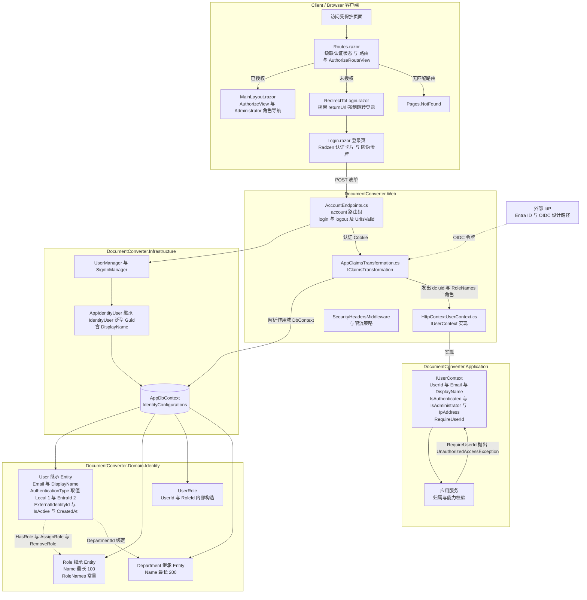
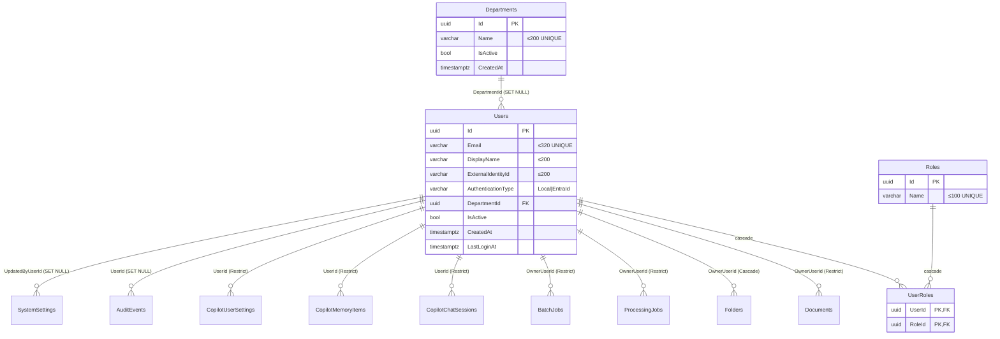
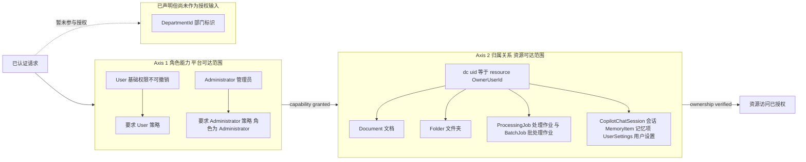
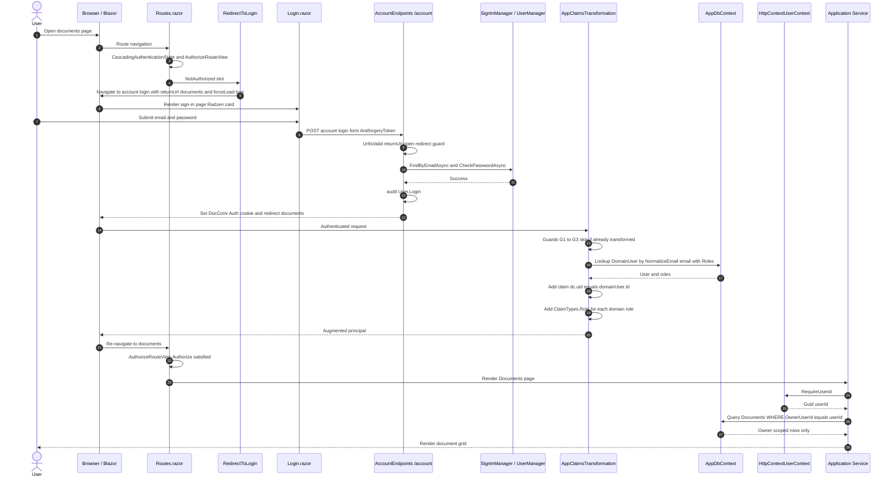
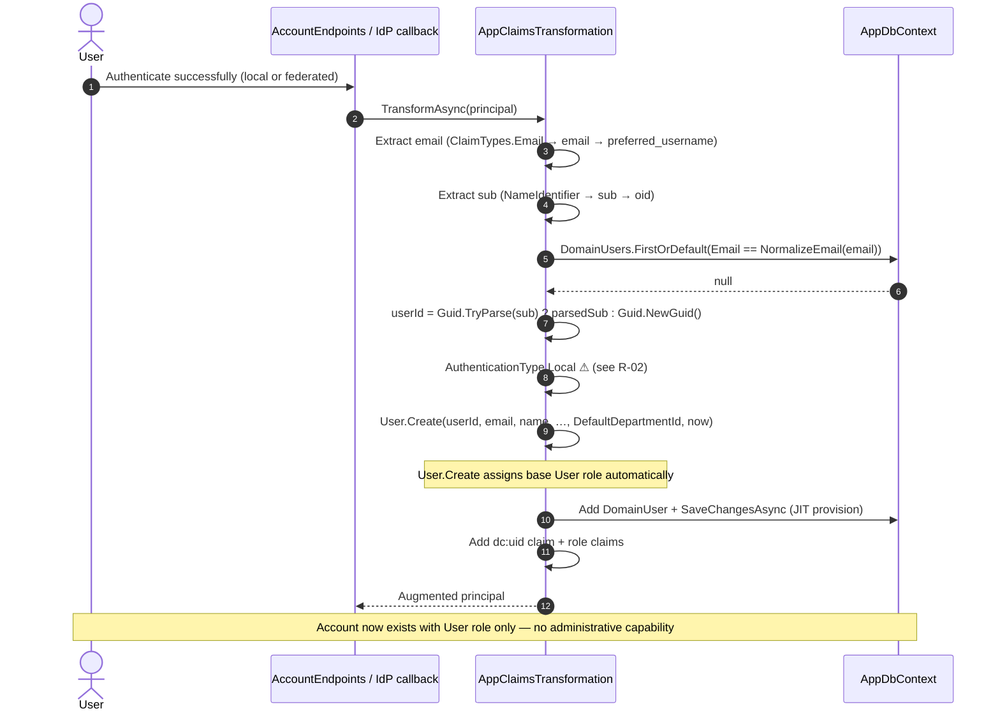
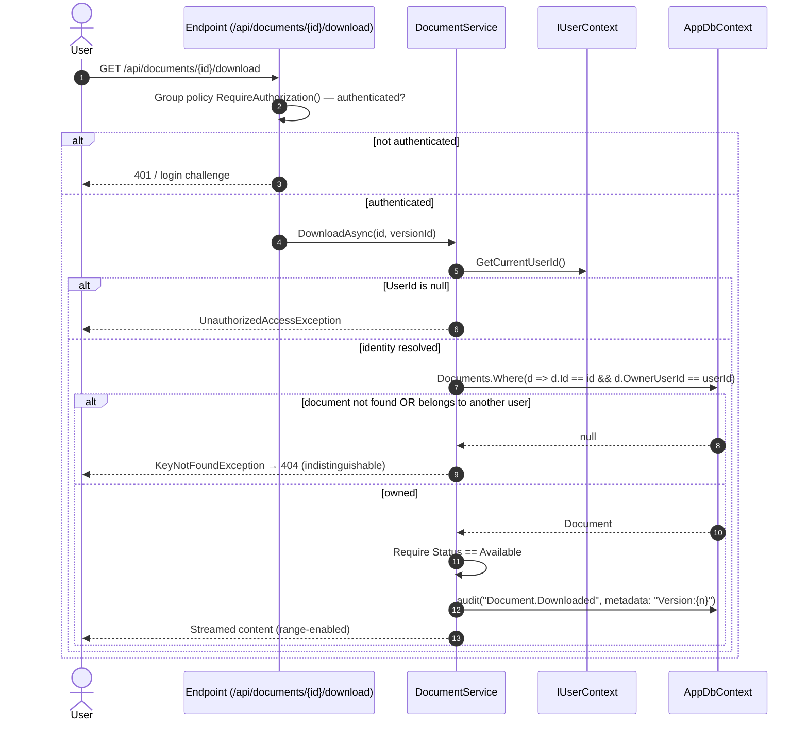
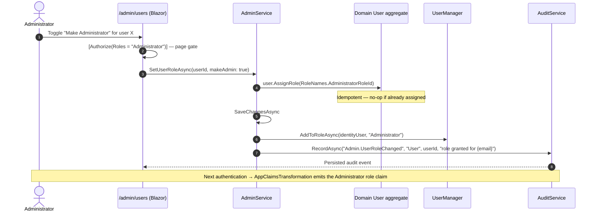

# Identity, Access Control and Authorization
### EConverter Platform — Module Architecture & Technical Reference

---

## 1. Module Identity Card

| Attribute | Value |
|---|---|
| **Module name** | Identity, Access Control and Authorization |
| **Domain classification** | Supporting Business Domain |
| **Importance score** | 9.0 / 10 |
| **Complexity score** | 7.5 / 10 |
| **Primary namespace** | `DocumentConverter.Domain.Identity` |
| **Supporting namespaces** | `DocumentConverter.Application.Common`, `DocumentConverter.Infrastructure.Identity`, `DocumentConverter.Web.Authentication` |
| **Aggregate roots owned** | `User`, `Role`, `Department` (+ `UserRole` join entity) |
| **Contracts exposed** | `IUserContext`, `IClaimsTransformation` (ASP.NET Core), `IEntityTypeConfiguration<…>` × 4 |
| **Consumed by** | Every application service, every endpoint group, every Blazor page, the administrative console, the audit subsystem |
| **Upstream security dependency** | ASP.NET Core Identity (credential store), Entra ID/OIDC (designed federation path) |
| **Downstream security dependency** | `Security, Encryption and Compliance Governance` (audit), `Persistence, Storage and Messaging Infrastructure` (EF Core) |

---

## 2. Executive Overview

The Identity, Access Control and Authorization module is the **single source of truth for "who the user is" and "what the user may do"** across the entire EConverter platform. It is deliberately small in code surface and disproportionately large in authority: every document query, every conversion job submission, every PDF edit, every RAG retrieval and every administrative mutation passes through a decision that originates here.

The central architectural decision of this module is a **deliberate decoupling between the internal application identity and any external identity-provider subject**. The platform treats external providers — ASP.NET Core Identity for local credentials, Microsoft Entra ID for federated sign-in — as *credential transports only*. The moment authentication succeeds, a claims transformation replaces the provider's claim vocabulary with the application's own: the internal `User.Id` is emitted as the `dc:uid` claim, and the application's role vocabulary (`RoleNames`) is emitted as standard role claims. From that point forward, **no authorization decision anywhere in the codebase reads a provider subject**.

This yields three separable layers:

1. **Domain layer** — pure, persistence-ignorant aggregates whose invariants are enforced at the point of mutation. An invalid `User` cannot exist in memory, let alone in the database.
2. **Bridge layer** — `AppClaimsTransformation` + `HttpContextUserContext`, the only two components in the system that understand both worlds.
3. **Enforcement layer** — server-side endpoint authorization, Blazor route authorization, and owner-scoped resource queries inside application services.

The model implements a **two-axis authorization scheme**: *role-based administrative capability* (a small closed set: `User`, `Administrator`) combined with *owner-scoped resource access* (a per-resource attribute check that is not expressible as a role). The `Role` aggregate documents this explicitly: *"Roles determine administrative capability only — never document ownership."*

> **Key insight:** in EConverter, a Platform Administrator cannot read another user's document. Role grants administrative reach over *platform configuration*, not over *document content*. This separation is the module's most important security property.

---

## 3. Design Principles

| # | Principle | Concrete manifestation |
|---|---|---|
| P1 | **Internal identity is the only authorization key** | `AppClaimsTransformation` emits `dc:uid`; `HttpContextUserContext` and `IUserContext` read only that claim. Provider subjects (`sub`, `oid`, `NameIdentifier`) are never consulted for authorization downstream. |
| P2 | **Guarded mutators, never public setters** | All identity state transitions are intention-revealing methods (`AssignRole`, `RecordLogin`, `Deactivate`, `Rename`) with private property setters. |
| P3 | **Fail-closed defaults** | `IUserContext.RequireUserId()` throws `UnauthorizedAccessException` rather than returning a sentinel. Any handler that forgets an explicit null check still cannot proceed anonymously. |
| P4 | **Single normalization point** | `User.NormalizeEmail` is the canonical normalization used by factories, uniqueness checks, administrative creation and claims-transformation lookup — guaranteeing `User@X.com` and `user@x.com` resolve to one identity. |
| P5 | **Single authorization vocabulary** | `RoleNames` holds the canonical constants. Policies, `[Authorize(Roles=…)]` attributes, Blazor `AuthorizeView` and `IUserContext.IsAdministrator` all consume the same strings. |
| P6 | **Persistence ignorance in the domain** | `IdentityConfigurations` lives in Infrastructure. The domain exposes the constants (`EmailMaxLength`, `NameMaxLength`) that drive schema constraints, but never references EF Core. |
| P7 | **Two-boundary enforcement** | Authorization is enforced server-side (endpoint filters/policies) **and** client-side (`AuthorizeRouteView`). Neither is trusted as the sole gate. |

---

## 4. Architecture Overview



---

## 5. Domain Model

### 5.1 `User` — the identity aggregate

`src/DocumentConverter.Domain/Identity/User.cs` — `public sealed class User : Entity`

| Member | Type | Purpose |
|---|---|---|
| `Email` | `string` | Normalized login identity; max 320 (`EmailMaxLength`) |
| `DisplayName` | `string` | Human-facing name; max 200 (`DisplayNameMaxLength`) |
| `ExternalIdentityId` | `string?` | Identity-provider subject: ASP.NET Identity user id (Local) or Entra object id (EntraId); max 200 |
| `AuthenticationType` | `enum` | `Local = 1`, `EntraId = 2` |
| `DepartmentId` | `Guid?` | Organizational binding; nullable, `OnDelete(SetNull)` |
| `IsActive` | `bool` | Soft-delete switch — deactivated users remain referentially intact for audit |
| `CreatedAt` / `LastLoginAt` | `DateTime` / `DateTime?` | Lifecycle timestamps; UTC-enforced by `Guard.Utc` |
| `Roles` | `IReadOnlyCollection<UserRole>` | Exposes the backing list as read-only |
| `_roles` | `private readonly List<UserRole>` | Encapsulated membership collection |

**Constructors.** Two private constructors exist — parameterless (EF materialization) and `User(Guid id)` (factory path). There is **no public constructor**: the only legal creation route is the static factory.

**Factory semantics (`User.Create`).**

```
User.Create(id, email, displayName, authenticationType,
            externalIdentityId, departmentId, now)
  ├─ Email            = NormalizeEmail(email)
  ├─ DisplayName      = Guard.NotNullOrWhiteSpace(…, 200)
  ├─ ExternalIdentityId = null | Guard.NotNullOrWhiteSpace(…, 200)
  ├─ DepartmentId     = departmentId
  ├─ IsActive         = true
  ├─ CreatedAt        = Guard.Utc(now)
  └─ AssignRole(RoleNames.UserRoleId)      ← every user receives the base role
```

The final line is security-relevant: **no `User` can exist without the base `User` role**, which guarantees that the `RequireUser` authorization policy is satisfied by construction for every provisioned identity.

**Email normalization (`User.NormalizeEmail`).**

- Trims and rejects null/whitespace; enforces the 320-character ceiling.
- Requires a single `@` at a non-terminal position (`at > 0 && at < Length - 1`).
- Rejects any internal space.
- Throws `DomainException("Email must be a valid address.")` on violation.
- Case-insensitive uniqueness is delegated to the database collation, mirrored by a unique index.

This is a *structural* validator, not an RFC 5322 parser — the design intent is to guarantee a stable, comparable login key rather than to validate mailbox syntax exhaustively.

**Membership methods.**

| Method | Behaviour | Invariant enforced |
|---|---|---|
| `HasRole(Guid roleId)` | Linear membership test over `_roles` | — |
| `AssignRole(Guid roleId)` | `Guard.NotEmpty`; adds `UserRole` only if absent | **Idempotent** — repeated assignment is a no-op |
| `RemoveRole(Guid roleId)` | Removes matching entries | **Throws `DomainException` when `roleId == RoleNames.UserRoleId`** — the base role is irrevocable |

The irrevocable base role is a deliberate guard rail: administrative demotion cannot leave an account in a role-less limbo state where `RequireUser` would reject it.

**Lifecycle methods.**

| Method | Behaviour | Guard |
|---|---|---|
| `RecordLogin(DateTime now)` | Sets `LastLoginAt` | Throws `DomainException("Inactive users cannot sign in.")` when `!IsActive` |
| `UpdateProfile(string displayName, Guid? departmentId)` | Updates display name + department | Re-validates display name |
| `Deactivate()` / `Activate()` | Toggles `IsActive` | — |

`RecordLogin`'s guard is the domain's last line of defence against a deactivated account continuing to operate after a stale credential is presented.

---

### 5.2 `Role` and `RoleNames`

`src/DocumentConverter.Domain/Identity/Role.cs`

```csharp
public sealed class Role : Entity
{
    public const int NameMaxLength = 100;
    public string Name { get; private set; } = string.Empty;
    private Role() { }
    private Role(Guid id, string name) : base(id)
        => Name = Guard.NotNullOrWhiteSpace(name, NameMaxLength);
    public static Role Create(Guid id, string name) => new(id, name);
}
```

**The authorization vocabulary.**

```csharp
public static class RoleNames
{
    public const string User          = "User";
    public const string Administrator = "Administrator";

    public static readonly Guid UserRoleId          = new("3f1c7a52-6a1e-4b8e-9a52-0c2f4a1d0001");
    public static readonly Guid AdministratorRoleId = new("3f1c7a52-6a1e-4b8e-9a52-0c2f4a1d0002");
}
```

The identifiers are **fixed, hard-coded seed GUIDs** — not generated. This makes role membership reproducible across environments, deterministic in migration scripts and safe to reference from seed data, tests and configuration alike.

The class comment states the containment rule explicitly: *"Roles determine administrative capability only — never document ownership."* The role axis grants platform-level reach; the ownership axis is evaluated separately, per resource, against a non-role attribute (`Document.OwnerUserId`, `ProcessingJob.OwnerUserId`, `Folder.OwnerUserId`, `CopilotChatSession.UserId`).

---

### 5.3 `UserRole` — explicit join entity

```csharp
public sealed class UserRole
{
    public Guid UserId { get; private set; }
    public Guid RoleId { get; private set; }
    public Role? Role { get; private set; }
    private UserRole() { }
    internal UserRole(Guid userId, Guid roleId) { … }
}
```

The join is modelled as a **first-class, queryable entity** rather than an EF Core shadow table — which is precisely what allows `AppClaimsTransformation` to write `.Include(u => u.Roles).ThenInclude(ur => ur.Role)` and materialize role *names* in a single round trip.

The constructor is `internal`, so `UserRole` instances can only be minted by `User.AssignRole` inside the same assembly. This makes the aggregate the sole authority over membership.

---

### 5.4 `Department`

`src/DocumentConverter.Domain/Identity/Department.cs`

| Member | Constraint |
|---|---|
| `Name` | Max 200 (`NameMaxLength`), unique index, required |
| `IsActive` | Defaults to `true` on creation |
| `CreatedAt` | UTC-enforced |
| `Rename` / `Deactivate` / `Activate` | Guarded mutators |

The comment fixes the tenancy scope: *"Organizational unit. The MVP is single-tenant: one organization, many departments."*

**Authorization relevance — stated honestly:** the department binding is currently **organizational metadata only**. It is displayed in the administrative console, counted in `DepartmentDto.UserCount`, and used as a soft grouping signal — but **no authorization policy, endpoint filter or service query references `DepartmentId`**. The aggregate exists as a documented extension point for departmental ABAC (see §16), not as an active access-control input. This is confirmed by exhaustive review of `Program.cs` policy definitions and every endpoint group.

---

### 5.5 Aggregate invariant summary

| Aggregate | Invariant | Enforced at | Failure mode |
|---|---|---|---|
| `User` | Email non-empty, ≤320, single `@`, no spaces | `NormalizeEmail` (factory) | `DomainException` |
| `User` | Display name non-empty, ≤200 | `Guard.NotNullOrWhiteSpace` | `DomainException` |
| `User` | Base `User` role always present | `Create` + `RemoveRole` guard | `DomainException` on removal |
| `User` | Inactive users cannot record sign-in | `RecordLogin` | `DomainException` |
| `User` | Role assignment idempotent | `AssignRole` | Silently no-ops |
| `Role` | Name non-empty, ≤100, unique | `Role.Create` + DB unique index | `DomainException` / SQL |
| `Department` | Name non-empty, ≤200, unique | `Department.Create` + unique index | `DomainException` / SQL |
| `Entity` (base) | Id never `Guid.Empty` | `Guard.NotEmpty` in `Entity(Guid)` | `DomainException` |

---

## 6. Persistence Model

### 6.1 Mapping configuration

`src/DocumentConverter.Infrastructure/Persistence/Configurations/IdentityConfigurations.cs` implements `IEntityTypeConfiguration` for all four identity types. Every `Configure` begins with an explicit `builder.ToTable(...)`.

```csharp
// Department
ToTable("Departments");  HasKey(d => d.Id);
Property(d => d.Name).HasMaxLength(Department.NameMaxLength).IsRequired();
HasIndex(d => d.Name).IsUnique();

// User
ToTable("Users");  HasKey(u => u.Id);
Property(u => u.Email).HasMaxLength(User.EmailMaxLength).IsRequired();
Property(u => u.DisplayName).HasMaxLength(User.DisplayNameMaxLength).IsRequired();
Property(u => u.ExternalIdentityId).HasMaxLength(User.ExternalIdentityIdMaxLength);
Property(u => u.AuthenticationType).HasConversion<string>().HasMaxLength(50).IsRequired();
HasIndex(u => u.Email).IsUnique();
HasIndex(u => u.ExternalIdentityId);
HasOne<Department>().WithMany().HasForeignKey(u => u.DepartmentId)
    .OnDelete(DeleteBehavior.SetNull);
HasMany(u => u.Roles).WithOne().HasForeignKey(ur => ur.UserId)
    .OnDelete(DeleteBehavior.Cascade);

// Role
ToTable("Roles");  HasKey(r => r.Id);
Property(r => r.Name).HasMaxLength(Role.NameMaxLength).IsRequired();
HasIndex(r => r.Name).IsUnique();

// UserRole
ToTable("UserRoles");  HasKey(ur => new { ur.UserId, ur.RoleId });
HasOne(ur => ur.Role).WithMany().HasForeignKey(ur => ur.RoleId)
    .OnDelete(DeleteBehavior.Cascade);
```

Note the enum storage strategy: `AuthenticationType` is persisted as a **string** (`"Local"` / `"EntraId"`), not an integer. This trades a few bytes for schema readability and immunity to enum renumbering — a deliberate trade-off in an audit-facing table.

### 6.2 Physical schema

| Table | Key | Notable indexes | Notes |
|---|---|---|---|
| `Departments` | `Id` | `IX_Departments_Name` (unique) | `Name` ≤ 200 |
| `Users` (dbo) | `Id` | `IX_Users_Email` (unique), index on `ExternalIdentityId` | Domain identity; `AuthenticationType` as `varchar(50)` |
| `Roles` (dbo) | `Id` | `IX_Roles_Name` (unique) | Domain role catalog |
| `UserRoles` (dbo) | composite `(UserId, RoleId)` | `IX_UserRoles_RoleId` | Join; cascade from both sides |
| `identity.Users` | `Id` | `RoleNameIndex` on normalized name | ASP.NET Core Identity credential store (+ `DisplayName`) |
| `identity.Roles` | `Id` | `RoleNameIndex` (unique) | Identity-side role mirror |
| `identity.UserRoles` | composite | `IX_UserRoles_RoleId1` | Identity-side membership mirror |

**Dual identity stores — explicit design.** `AppDbContext.OnModelCreating` isolates the ASP.NET Core Identity tables into a dedicated `identity` schema, while the domain tables remain in the default (`dbo` / `public`) schema:

```csharp
builder.Entity<AppIdentityUser>().ToTable("Users", "identity");
builder.Entity<IdentityRole<Guid>>().ToTable("Roles", "identity");
builder.Entity<IdentityUserRole<Guid>>().ToTable("UserRoles", "identity");
// … UserClaims, UserLogins, RoleClaims, UserTokens
builder.ApplyConfigurationsFromAssembly(typeof(AppDbContext).Assembly);
```

The two stores serve strictly different purposes:

- `identity.*` — **credential material**: password hashes, security stamps, lockout counters, tokens. Never queried by domain code paths for authorization.
- `dbo.Users` — **authorization subject**: the stable internal identity that `dc:uid` points at.

### 6.3 Entity relationship view



Note the deliberate asymmetry in delete behaviour: deleting a `Department` nulls the binding (`SetNull`) so users are never orphaned, whereas deleting a `User` is **restricted** by documents, jobs, chat sessions and memory items — the identity retains referential gravity for audit and provenance.

---

## 7. Authentication

### 7.1 The credential store — `AppIdentityUser`

`src/DocumentConverter.Infrastructure/Identity/AppIdentityUser.cs` is twelve lines:

```csharp
public sealed class AppIdentityUser : IdentityUser<Guid>
{
    public string DisplayName { get; set; } = string.Empty;
}
```

It adds **exactly one property**. Its class comment names its role precisely: *"ASP.NET Core Identity user entity used for development/testing authentication. In production with Entra ID/OIDC, external claims are mapped directly to domain Users."*

This minimalism is the migration strategy: because `AppIdentityUser` contributes one column, retiring the local credential store in favour of federated authentication is a **configuration and claims-mapping change, not a domain change**.

### 7.2 Registration and credential policy

`src/DocumentConverter.Web/Program.cs`:

```csharp
builder.Services.AddIdentity<AppIdentityUser, IdentityRole<Guid>>(options =>
{
    options.Password.RequireDigit           = true;
    options.Password.RequireLowercase       = true;
    options.Password.RequireUppercase       = true;
    options.Password.RequireNonAlphanumeric = false;
    options.Password.RequiredLength         = 8;
    options.User.RequireUniqueEmail         = true;
})
.AddEntityFrameworkStores<AppDbContext>()
.AddDefaultTokenProviders();
```

| Policy | Setting | Rationale |
|---|---|---|
| Digit required | ✔ | Entropy floor |
| Lowercase required | ✔ | Entropy floor |
| Uppercase required | ✔ | Entropy floor |
| Non-alphanumeric required | ✘ | Deliberately relaxed — reduces reset-support load |
| Minimum length | 8 | Baseline |
| Unique email | ✔ | Mirrors the `User.Email` unique index; prevents divergent login identities |

`AddDefaultTokenProviders()` enables the token infrastructure used by password reset, email confirmation and 2FA flows (available but not surfaced in the current UI).

### 7.3 Authentication cookie configuration

```csharp
builder.Services.ConfigureApplicationCookie(options =>
{
    options.LoginPath         = "/account/login";
    options.LogoutPath        = "/account/logout";
    options.AccessDeniedPath  = "/account/login?errorMessage=Access+Denied";
    options.Cookie.Name       = ".DocConv.Auth";
    options.Cookie.HttpOnly   = true;
    options.Cookie.SameSite   = SameSiteMode.Lax;
    options.ExpireTimeSpan    = TimeSpan.FromHours(8);
    options.SlidingExpiration = true;
});
```

| Setting | Value | Security implication |
|---|---|---|
| `Cookie.Name` | `.DocConv.Auth` | Explicit, non-default name — avoids framework fingerprinting |
| `HttpOnly` | `true` | Blocks `document.cookie` exfiltration; removes the primary XSS session-hijack vector |
| `SameSite` | `Lax` | Cross-site POST with cookies suppressed → mitigates CSRF while preserving top-level navigation sign-in |
| `ExpireTimeSpan` | 8 hours | Bounded by a work shift |
| `SlidingExpiration` | `true` | Active sessions extend — reduces re-authentication friction on long editing sessions |
| `LoginPath` / `LogoutPath` | `/account/*` | Challenge and sign-out route through the custom endpoint group |
| `AccessDeniedPath` | `…?errorMessage=Access+Denied` | Distinguished from the unauthenticated path — an authenticated-but-unauthorized user gets an explicit denial message rather than a silent login prompt |

`Cookie.SecurePolicy` is **not explicitly configured**, meaning the framework default (`SameAsRequest`) applies. Under the production deployment topology — behind the TLS-terminating gateway declared in `docker-compose.prod.yml` — this should be reviewed (see §17, R-07).

### 7.4 The unauthenticated entry point — `AccountEndpoints`

`src/DocumentConverter.Web/Endpoints/AccountEndpoints.cs` defines the `/account` route group and is the **only unauthenticated mutation surface in the entire application**.

**Login handler (`POST /account/login`).**

```
POST /account/login
  ├─ 1. Bind [FromForm] email, password, returnUrl
  ├─ 2. Empty-check  → redirect /account/login?errorMessage=Email+and+password+are+required
  ├─ 3. userManager.FindByEmailAsync(email)
  │       null → audit("User.LoginFailed", metadata:"Email:…")
  │            → redirect ?errorMessage=Invalid+credentials
  ├─ 4. userManager.CheckPasswordAsync(user, password)
  │       false → audit("User.LoginFailed", resourceId:user.Id, metadata:"Email:…")
  │             → redirect ?errorMessage=Invalid+credentials
  ├─ 5. signInManager.SignInAsync(user, isPersistent: true)
  ├─ 6. audit("User.Login", resourceId:user.Id, metadata:"Email:…")
  ├─ 7. destination = UrlIsValid(returnUrl) ? returnUrl : "/"
  └─ 8. Results.Redirect(destination)

Endpoint modifiers:
  .RequireRateLimiting("login-policy")
  .DisableAntiforgery()
```

Three properties of this handler deserve emphasis:

1. **Uniform failure response.** Both "user not found" and "wrong password" produce the identical `Invalid+credentials` message. This prevents account enumeration through response differentiation.
2. **Both failure paths are audited.** `User.LoginFailed` is recorded with the attempted email (or the resolved user id when the account exists) — providing a brute-force detection substrate without leaking whether the account is valid to the caller.
3. **`isPersistent: true`** — sign-in survives browser restart, bounded by `ExpireTimeSpan` and sliding expiration.

**Open-redirect defence.**

```csharp
private static bool UrlIsValid(string url)
    => url.StartsWith('/')
        && !url.StartsWith("//", StringComparison.Ordinal)
        && !url.StartsWith("/\\", StringComparison.Ordinal);
```

This is a correct and minimal allow-list: a valid return target must be a **base-relative path**. The three conditions defeat the classic bypasses — absolute URLs (`https://evil.tld`), protocol-relative URLs (`//evil.tld`) and the backslash normalization trick (`/\evil.tld`, which some browsers historically collapsed to `//evil.tld`).

**Logout handler (`POST` and `GET /account/logout`).**

```
1. audit("User.Logout")
2. signInManager.SignOutAsync()
3. redirect /account/login
```

Both verbs are mapped — the `GET` mapping supports a plain link, while the `POST` mapping (used by `MainLayout.razor`) carries an `AntiforgeryToken`, giving the form-based path CSRF protection.

**Rate limiting.**

```csharp
options.RejectionStatusCode = StatusCodes.Status429TooManyRequests;
options.AddFixedWindowLimiter("login-policy", limiter =>
{
    limiter.PermitLimit          = 10;
    limiter.Window               = TimeSpan.FromMinutes(1);
    limiter.QueueProcessingOrder = QueueProcessingOrder.OldestFirst;
    limiter.QueueLimit           = 0;
});
```

Ten attempts per minute per partition, **with a zero queue** — throttled requests are rejected immediately with `429` rather than queued, so a brute-force attempt cannot build a backlog and amplify load.

### 7.5 The login page — `Login.razor`

`src/DocumentConverter.Web/Components/Pages/Account/Login.razor`

| Aspect | Implementation |
|---|---|
| Route | `@page "/account/login"` |
| Layout | `@layout AuthLayout` (minimal, unauthenticated shell) |
| Page title | `Sign In • E-Converter` |
| Branding | Centered `RadzenCard` with light/dark logo variants |
| Error surface | `RadzenAlert` bound to `[SupplyParameterFromQuery] ErrorMessage` |
| Form | Plain HTML `<form action="/account/login" method="post">` |
| Antiforgery | `<AntiforgeryToken />` rendered inside the form |
| Return URL | `<input type="hidden" name="ReturnUrl" value="@ReturnUrl" />` |
| Field binding | `[SupplyParameterFromQuery] ReturnUrl`, `ErrorMessage`, `Email` |
| Help card | Renders default credentials for the demo environment |

The page uses a **native form POST rather than a Blazor circuit callback**. This is architecturally correct: issuing an authentication cookie requires a full server round trip, which an interactive circuit cannot perform.

### 7.6 Federated authentication — designed path

The domain models federation as a first-class concept:

```csharp
public enum AuthenticationType { Local = 1, EntraId = 2 }
```

`User.ExternalIdentityId` is documented as *"Identity-provider subject: ASP.NET Identity user id (Local) or Entra object id (EntraId)"*, and `AppClaimsTransformation` is explicitly written to accept claims from either source — reading `ClaimTypes.Email` / `"email"` / `"preferred_username"` and `ClaimTypes.NameIdentifier` / `"sub"` / `"oid"`.

**Current wiring state.** No `AddOpenIdConnect(...)`, `AddMicrosoftIdentityWebApp(...)` or equivalent handler is registered in `Program.cs`; cookie authentication is the only active scheme. The federated path is therefore **architecturally prepared and claims-compatible, but not enabled in the delivered host configuration**. This is stated plainly rather than presented as an active capability (see §17, R-01).

---

## 8. Claims Transformation — The Bridge

`src/DocumentConverter.Web/Authentication/AppClaimsTransformation.cs` is described in its own header as the component that *"maps external or local identity claims to the internal domain User.Id"*. It is the **single pivot point of the entire module**.

```csharp
public sealed class AppClaimsTransformation : IClaimsTransformation
{
    public AppClaimsTransformation(IServiceProvider serviceProvider,
                                   ILogger<AppClaimsTransformation> logger) { … }

    public async Task<ClaimsPrincipal> TransformAsync(ClaimsPrincipal principal) { … }
}
```

### 8.1 Why `IServiceProvider` and not direct injection

`IClaimsTransformation` is registered **transient**, while `AppDbContext` is **scoped**. Injecting the context directly would either fail (captive dependency) or force an incorrect lifetime. The transformation therefore receives the root `IServiceProvider` and creates an explicit scope per invocation:

```csharp
using var scope = _serviceProvider.CreateScope();
var db = scope.ServiceProvider.GetRequiredService<AppDbContext>();
```

This is the canonical pattern for claims transformation and is the reason the class does not take a `DbContext` constructor parameter.

### 8.2 Execution guard ladder

The method exits early on four conditions — each a deliberate short-circuit:

| Guard | Condition | Effect |
|---|---|---|
| G1 | `principal.Identity?.IsAuthenticated != true` | Anonymous principals pass through untouched |
| G2 | `principal.HasClaim(c => c.Type == HttpContextUserContext.UserIdClaimType)` | **Idempotence** — prevents duplicate `dc:uid` and duplicate role claims when the transformation runs more than once per request/circuit |
| G3 | `principal.Identity as ClaimsIdentity` is `null` | Non-`ClaimsIdentity` principals are unmodifiable |
| G4 | `string.IsNullOrWhiteSpace(email)` | No resolvable email → no `dc:uid` emitted (see §8.4) |

G2 is operationally essential: `IClaimsTransformation` is invoked after *every* successful authentication on every request, and without the guard the principal would accumulate a duplicate claim set on each pass.

### 8.3 Claim extraction precedence

| Target | Source precedence |
|---|---|
| **Email** | `ClaimTypes.Email` → `"email"` → `"preferred_username"` |
| **Subject** | `ClaimTypes.NameIdentifier` → `"sub"` → `"oid"` |
| **Display name** | `ClaimTypes.Name` → `"name"` → `email` → `"User"` |

The precedence chain is what makes the transformation **provider-agnostic**. Cookie authentication populates `ClaimTypes.*`; Entra ID populates short-name claims (`sub`, `oid`, `preferred_username`). Both resolve through the same ladder, and the resulting principal is indistinguishable to downstream code.

### 8.4 Identity resolution and just-in-time provisioning

```
normalizedEmail = User.NormalizeEmail(email)

domainUser = db.DomainUsers
    .Include(u => u.Roles).ThenInclude(ur => ur.Role)
    .FirstOrDefaultAsync(u => u.Email == normalizedEmail)

if (domainUser is null)
{
    logger.LogInformation("JIT provisioning domain user for {Email}", email);
    var userId = Guid.TryParse(sub, out var parsedSub) ? parsedSub : Guid.NewGuid();

    domainUser = User.Create(
        userId,
        normalizedEmail,
        name,
        AuthenticationType.Local,          // ← see §17, R-02
        sub,                               // ExternalIdentityId
        DbSeeder.DefaultDepartmentId,
        now);

    db.DomainUsers.Add(domainUser);
    await db.SaveChangesAsync();
}
```

**Join key = normalized email.** The lookup matches on `Email`, not on `ExternalIdentityId`. For locally provisioned accounts this is harmless because `AdminService.CreateUserAsync` and `DbSeeder` construct the identity user and the domain user with the **same `Guid`**; for JIT-provisioned federated users the email is the only stable correlation available at that moment.

**JIT provisioning semantics.** A successful authentication against *any* provider creates a domain identity on first sight, binding it to the `General` department seed and granting it the base `User` role (via `User.Create` → `AssignRole(UserRoleId)`). The user id is derived from the provider subject when it parses as a `Guid` (true for ASP.NET Identity ids and for Entra `oid`), otherwise a fresh `Guid` is minted.

### 8.5 Claim emission

```csharp
// 1. Stable internal identity
identity.AddClaim(new Claim(HttpContextUserContext.UserIdClaimType,
                            domainUser.Id.ToString()));
// → claim type: "dc:uid"

// 2. Application roles from the domain aggregate
foreach (var userRole in domainUser.Roles)
{
    if (userRole.Role is not null && !principal.IsInRole(userRole.Role.Name))
        identity.AddClaim(new Claim(ClaimTypes.Role, userRole.Role.Name));
}
```

Two things are emitted and nothing else: the internal user id under a namespaced claim type, and the domain-derived role claims. **Provider roles are not forwarded.** If an external IdP asserted a role named `Administrator`, it would be ignored — administrative capability can only be granted through the domain `UserRole` table. This closes the entire class of "IdP misconfiguration → privilege escalation" attacks.

### 8.6 Post-transformation contract

| Claim | Type | Consumed by |
|---|---|---|
| Internal identity | `dc:uid` | `HttpContextUserContext.UserId`, endpoint ownership checks |
| Application roles | `ClaimTypes.Role` | `IsInRole`, `RequireRole`, `[Authorize(Roles=…)]`, `AuthorizeView Roles` |
| Email | `ClaimTypes.Email` / `"email"` / `"preferred_username"` | `IUserContext.Email`, `MainLayout` user menu |
| Display name | `ClaimTypes.Name` | `IUserContext.DisplayName` |

Downstream, **nobody reads the provider's subject claim** — the design statement in the class documentation, verified against `HttpContextUserContext`, every endpoint group and every administrative page.

---

## 9. Ambient User Context

### 9.1 The application contract — `IUserContext`

`src/DocumentConverter.Application/Common/IUserContext.cs` (24 lines) is the abstraction every application service depends on.

```csharp
public interface IUserContext
{
    Guid?   UserId          { get; }
    string? Email           { get; }
    string? DisplayName     { get; }
    bool    IsAuthenticated { get; }
    bool    IsAdministrator { get; }
    string? IpAddress       => null;

    Guid RequireUserId()
        => UserId ?? throw new UnauthorizedAccessException("User is not authenticated.");
}
```

| Member | Default | Purpose |
|---|---|---|
| `UserId` | — | Internal domain identity; the ownership key |
| `Email` | — | Display and audit correlation |
| `DisplayName` | — | UI personalization |
| `IsAuthenticated` | — | Composite: principal authenticated **and** id resolvable |
| `IsAdministrator` | — | Role capability check |
| `IpAddress` | `null` | **Defaulted interface member** — overridden by the web implementation; keeps non-HTTP hosts (workers, tests) compiling |
| `RequireUserId()` | throws | Fail-closed accessor |

The interface carries a companion DTO for non-HTTP and test contexts:

```csharp
public sealed record UserContextSnapshot(
    Guid? UserId, string? Email, string? DisplayName,
    bool IsAuthenticated, bool IsAdministrator, string? IpAddress = null) : IUserContext;
```

A two-line test double is therefore always available — this is what keeps the Application layer host-agnostic and unit-testable without spinning up an HTTP pipeline.

**The fail-closed default.** `RequireUserId()` is the single most-invoked identity primitive in the codebase. Its expression-bodied default throws rather than returning `Guid.Empty` or `null`. The consequence is architectural: a developer who forgets an explicit authentication check still cannot produce an anonymous data access — they get an exception instead of a silent leak.

### 9.2 The web implementation — `HttpContextUserContext`

`src/DocumentConverter.Web/Authentication/HttpContextUserContext.cs`

```csharp
public sealed class HttpContextUserContext : IUserContext
{
    public const string UserIdClaimType = "dc:uid";

    private readonly IHttpContextAccessor _httpContextAccessor;
    private readonly AuthenticationStateProvider? _authStateProvider;
    private ClaimsPrincipal? _cachedPrincipal;
```

**Validity predicate.**

```csharp
private static bool HasValidUserId(ClaimsPrincipal? principal)
{
    var claim = principal?.FindFirst(UserIdClaimType)?.Value
             ?? principal?.FindFirst(ClaimTypes.NameIdentifier)?.Value;
    return Guid.TryParse(claim, out var guid) && guid != Guid.Empty;
}
```

A principal represents a usable identity only when it carries a parseable, non-empty GUID under `dc:uid` — or, as a fallback, under `ClaimTypes.NameIdentifier`. The fallback keeps the context functional in scenarios where the transformation has not run (for example a manually constructed principal in a test harness), but it also widens the accepted identity surface (see §17, R-04).

**Principal resolution ladder.**

```
GetPrincipal()
  ├─ 1. HttpContext.User  — if IsAuthenticated AND HasValidUserId
  │       → cache and return                    ← normal HTTP request path
  ├─ 2. _cachedPrincipal  — if previously resolved
  │       → return                              ← circuit re-render, no HttpContext
  ├─ 3. HttpContext.User  — as-is (identity present but id not yet valid)
  │       → return                              ← allows the caller to observe the raw principal
  ├─ 4. _authStateProvider.GetAuthenticationStateAsync()
  │       → validates and caches on success     ← Blazor Interactive Server circuit
  │       catch (InvalidOperationException) { } ← not inside a component scope
  └─ 5. _cachedPrincipal (null if never resolved)
```

This ladder is what allows **one implementation to serve both HTTP requests and Blazor Interactive Server circuits**. In the Blazor Server hosting model the original `HttpContext` is frequently unavailable during component re-render, but the circuit's `AuthenticationStateProvider` remains authoritative. `_cachedPrincipal` bridges the transition so the identity is resolved once and reused for the lifetime of the circuit.

**Member projections.**

| Member | Source | Notes |
|---|---|---|
| `UserId` | `dc:uid` → `ClaimTypes.NameIdentifier` | `Guid.TryParse`; `null` when unresolvable |
| `Email` | `ClaimTypes.Email` | — |
| `DisplayName` | `ClaimTypes.Name` | Populated by the transformation from the `name` / `email` fallback chain |
| `IsAuthenticated` | `principal.Identity.IsAuthenticated == true && UserId.HasValue` | **Composite** — an authenticated principal without a resolvable id is *not* authenticated for application purposes |
| `IsAdministrator` | `principal.IsInRole(RoleNames.Administrator)` | Reads the `ClaimTypes.Role` claims emitted by the transformation |
| `IpAddress` | `HttpContext?.Connection.RemoteIpAddress?.ToString()` | Feeds `AuditEvent.IpAddress` |

The `IsAuthenticated` composite is a subtle but important detail: it prevents the module from ever operating in a state where "authenticated" is true but no ownership key exists — which would otherwise let ownership checks silently compare against a default value.

### 9.3 Registration

```csharp
builder.Services.AddScoped<IClaimsTransformation, AppClaimsTransformation>();
builder.Services.AddHttpContextAccessor();
builder.Services.AddScoped<IUserContext, HttpContextUserContext>();
```

Both are **scoped** — one transformation and one user context per request or circuit scope.

---

## 10. Authorization Model

### 10.1 The two-axis scheme



**Axis 1 — Role capability.** Answer the question *"may this principal reach this class of functionality?"* Implemented as role claims + policies/attributes. Closed vocabulary of exactly two roles.

**Axis 2 — Ownership.** Answers *"does this principal own *this specific* resource?"* Implemented as an equality check against a persisted owner column, executed inside the application service. Not expressible as a role, and never bypassable by role — an `Administrator` fails this check exactly like any other user.

**Department.** A declared organizational attribute that is currently not consulted by any authorization decision (§5.4, §17 R-08).

### 10.2 Policy definitions

```csharp
builder.Services.AddAuthorization(options =>
{
    options.AddPolicy("RequireUser",          policy => policy.RequireRole(RoleNames.User));
    options.AddPolicy("RequireAdministrator", policy => policy.RequireRole(RoleNames.Administrator));
});
```

| Policy | Requirement | Satisfied by |
|---|---|---|
| *default* | Authenticated principal | Any successfully authenticated request (endpoint groups call the parameterless `RequireAuthorization()`) |
| `RequireUser` | Role claim `User` | **Every** domain user — guaranteed by `User.Create` → `AssignRole(UserRoleId)` and the irrevocability of the base role |
| `RequireAdministrator` | Role claim `Administrator` | Users holding the Administrator role in the domain `UserRole` table |

### 10.3 Route-level enforcement (Blazor client boundary)

**`Components/Routes.razor`** — the authorization shell for the entire component tree:

```razor
<CascadingAuthenticationState>
    <Router AppAssembly="typeof(Program).Assembly" NotFoundPage="typeof(Pages.NotFound)">
        <Found Context="routeData">
            <AuthorizeRouteView RouteData="routeData" DefaultLayout="typeof(Layout.MainLayout)">
                <NotAuthorized>
                    <RedirectToLogin />
                </NotAuthorized>
            </AuthorizeRouteView>
            <FocusOnNavigate RouteData="routeData" Selector="h1" />
        </Found>
    </Router>
</CascadingAuthenticationState>
```

Four responsibilities in twelve lines:

| Element | Function |
|---|---|
| `CascadingAuthenticationState` | Supplies a cascading `Task<AuthenticationState>` to every descendant component |
| `Router` + `NotFoundPage` | Assembly-scanned routing with an explicit fallback page |
| `AuthorizeRouteView` | **Evaluates the `[Authorize]` attribute on each routable component**; authorized routes render through `MainLayout` |
| `NotAuthorized` slot → `RedirectToLogin` | Unauthenticated navigation is funnelled into the login flow |
| `FocusOnNavigate Selector="h1"` | Accessibility: after navigation, keyboard/screen-reader focus lands on the page heading — a genuine requirement for a document-manipulation UI |

**`Components/RedirectToLogin.razor`** — nine lines, and the `forceLoad: true` is the critical one:

```csharp
protected override void OnInitialized()
{
    var returnUrl = Uri.EscapeDataString(Navigation.ToBaseRelativePath(Navigation.Uri));
    Navigation.NavigateTo($"/account/login?returnUrl={returnUrl}", forceLoad: true);
}
```

`forceLoad: true` forces a **full browser round trip** instead of a client-side route change. Without it, the Blazor circuit would attempt an in-place navigation that cannot trigger an authentication challenge or refresh the auth state — the user would simply bounce. The return URL is escaped and base-relative, and is subsequently validated server-side by `UrlIsValid`.

**`Components/Layout/MainLayout.razor`** — the authenticated shell:

```razor
<AuthorizeView>
    <Authorized>   … full layout, header, sidebar, body … </Authorized>
    <NotAuthorized> <main role="main" class="auth-clean-layout">@Body</main> </NotAuthorized>
</AuthorizeView>
```

Administrative navigation is gated twice within the layout:

```razor
@{
    var isAdmin = context.User.IsInRole("Administrator") || UserContext.IsAdministrator;
}
…
@if (isAdmin) { … /admin/users, /admin/converters, /admin/settings, /admin/audit … }

<AuthorizeView Roles="Administrator">
    <Authorized Context="adminContext"> … Administration menu group … </Authorized>
</AuthorizeView>
```

The sidebar menu is rendered inside `AuthorizeView Roles="Administrator"`, and the user dropdown independently recomputes `isAdmin` by combining the claims principal with the ambient `IUserContext`. Both are **presentation-only** filters — they hide links, they do not protect routes.

**Page-level attributes — the actual route gate.**

| Page | Route | Attribute |
|---|---|---|
| `Home.razor` | `/` | `[Authorize]` |
| `Documents.razor` | `/documents` | `[Authorize]` |
| `PdfEditor.razor` | `/editor/{DocumentId:guid}` | `[Authorize]` |
| `Copilot.razor` | `/copilot` | `[Authorize]` |
| `AiChatPage.razor` | `/ai-chat` | `[Authorize]` |
| `Tools.razor` | `/tools`, `/tools/{ToolSlug}` | `[Authorize]` |
| `ProcessingJobs.razor` | `/jobs` | `[Authorize]` |
| `UsersAndDepartments.razor` | `/admin/users` | **`[Authorize(Roles = "Administrator")]`** |
| `ConvertersCatalog.razor` | `/admin/converters` | **`[Authorize(Roles = "Administrator")]`** |
| `SystemSettings.razor` | `/admin/settings` | **`[Authorize(Roles = "Administrator")]`** |
| `SecurityAuditLog.razor` | `/admin/audit` | **`[Authorize(Roles = "Administrator")]`** |

Every functional page carries an explicit attribute — there is no "protected by default" assumption resting on the shell alone.

### 10.4 Endpoint-level enforcement matrix

Authorization on the HTTP surface is applied through **route groups**, so the policy is declared once per functional area rather than per handler.

| Route group | Declaration | Policy applied | Notable exceptions |
|---|---|---|---|
| `/account` | `app.MapGroup("/account")` | **None** (deliberate — the unauthenticated entry point) | `POST /login` carries `.RequireRateLimiting("login-policy")` |
| `/api/documents` | `MapGroup("/api/documents").RequireAuthorization()` | Default authenticated | — |
| `/api/folders` | `MapGroup("/api/folders").RequireAuthorization()` | Default authenticated | — |
| `/api/documents` (intelligence) | `MapGroup("/api/documents").RequireAuthorization()` | Default authenticated | `POST /ai/benchmark` → `RequireRole("Administrator")` |
| `/api/editor` | `MapGroup("/api/editor").RequireAuthorization()` | Default authenticated | — |
| `/api/processing` | `MapGroup("/api/processing").RequireAuthorization("RequireUser")` | `RequireUser` | `POST /jobs`, `POST /batches` → `RequireRateLimiting("processing-policy")` |
| `/api/converters` | mapped standalone | `RequireAuthorization("RequireUser")` | — |
| `/api/ai` | `MapGroup("/api/ai").RequireAuthorization()` | Default authenticated | `POST /config` and `POST /test-connection` → `RequireRole("Administrator")` |
| `/health` | `MapHealthChecks("/health")` | **None** (probe endpoint) | — |
| `/hubs/processing` | `MapHub<ProcessingHub>(...)` | **None declared** | See §17, R-09 |

**Three distinct authorization strengths appear on the API surface:** authenticated (default), `RequireUser` (role-backed), and `RequireRole("Administrator")` (administrative). The intelligence and AI-configuration surfaces use `RequireRole("Administrator")` inline rather than the pre-defined `RequireAdministrator` policy — functionally equivalent, but a consistency observation (§17, R-12).

**Administrative-only API operations.**

| Operation | Endpoint | Requirement |
|---|---|---|
| RAG evaluation benchmark | `POST /api/documents/ai/benchmark` | `RequireRole("Administrator")` |
| Read AI provider configuration | `GET /api/ai/config` | Authenticated (API key masked to `abcd...wxyz`) |
| Write AI provider configuration | `POST /api/ai/config` | `RequireRole("Administrator")` |
| Test AI provider connectivity | `POST /api/ai/test-connection` | `RequireRole("Administrator")` |

The masking logic on configuration read is a deliberate secondary control:

```csharp
var maskedApiKey = string.IsNullOrEmpty(config.ApiKey)
    ? string.Empty
    : config.ApiKey.Length > 8
        ? string.Concat(config.ApiKey.AsSpan(0, 4), "...", config.ApiKey.AsSpan(config.ApiKey.Length - 4))
        : "********";
```

### 10.5 Resource-level (ownership) enforcement

Authorization for actual document content is enforced **inside application services**, not at the transport boundary. The pattern is identical everywhere: resolve the internal user id, then constrain every query by owner.

**`DocumentService` — the canonical implementation** (`src/DocumentConverter.Infrastructure/Documents/DocumentService.cs`):

```csharp
private Guid GetCurrentUserId()
{
    return _userContext.UserId
        ?? throw new UnauthorizedAccessException("User is not authenticated.");
}
```

Every read and every mutation then composes the owner predicate into the query itself:

| Operation | Ownership predicate |
|---|---|
| `GetAsync` | `d.Id == documentId && d.OwnerUserId == userId` |
| `DownloadAsync` | `d.Id == documentId && d.OwnerUserId == userId`, then requires `Status == DocumentStatus.Available` |
| `DeleteAsync` | `d.Id == documentId && d.OwnerUserId == userId` |
| `RenameAsync` | `d.Id == documentId && d.OwnerUserId == userId` |
| `UploadAsync` (folder target) | `f.Id == folderId && f.OwnerUserId == userId` — rejects writes into a folder the caller does not own |

Because the predicate is part of the SQL query, a foreign identifier produces **"not found"**, not "forbidden". An attacker enumerating GUIDs cannot distinguish a non-existent document from someone else's document — a deliberate anti-enumeration property. The interface documentation states the intent without ambiguity: *"Authorization checks occur at the service layer so IDOR attempts are rejected."*

**`ProcessingService` — ownership before job creation** (`src/DocumentConverter.Infrastructure/Processing/ProcessingService.cs`):

```csharp
var userId = _userContext.RequireUserId();

var document = await _db.Documents
    .FirstOrDefaultAsync(d => d.Id == request.DocumentId
                           && d.OwnerUserId == userId
                           && d.Status != DocumentStatus.Deleted
                           && d.Status != DocumentStatus.Purged, cancellationToken);

if (document is null)
    throw new DomainException("Document not found or access denied.");
```

Batch creation enforces ownership on the **entire set**:

```csharp
var documents = await _db.Documents
    .Where(d => request.DocumentIds.Contains(d.Id)
             && d.OwnerUserId == userId
             && d.Status != DocumentStatus.Deleted
             && d.Status != DocumentStatus.Purged)
    .ToListAsync(cancellationToken);

if (documents.Count != request.DocumentIds.Count)
    throw new DomainException("One or more documents could not be found or access is unauthorized.");
```

The cardinality comparison is the key line: **a single foreign identifier fails the whole batch**, closing the partial-success enumeration channel.

**`DocumentIntelligenceService` — ownership before any content read** (`src/DocumentConverter.Infrastructure/AI/DocumentIntelligenceService.cs`):

```csharp
private async Task EnsureUserHasDocumentAccessAsync(Guid documentId, CancellationToken ct)
{
    if (documentId == Guid.Empty) return;

    var currentUserId = _userContext?.UserId;
    if (!currentUserId.HasValue) return;            // ← see §17, R-03

    if (_dbContext != null)
    {
        bool isOwner;
        using (await AcquireDbLockAsync(ct))
        {
            isOwner = await _dbContext.Documents.AsNoTracking()
                .AnyAsync(d => d.Id == documentId && d.OwnerUserId == currentUserId.Value, ct);
        }
        if (!isOwner)
            throw new UnauthorizedAccessException(
                $"Access denied: Document '{documentId}' does not belong to the current user.");
    }
    else if (_documentService != null)
    {
        var doc = await _documentService.GetAsync(documentId, ct);
        if (doc == null || doc.OwnerUserId != currentUserId.Value)
            throw new UnauthorizedAccessException(…);
    }
}
```

This guard runs **before any content is read** — it is invoked at the top of `AnalyzeDocumentInternalAsync` and on every intelligence entry point. The RAG retrieval path inherits the same guarantee: vector chunks and intelligence indexes are keyed to `DocumentId`, and the document itself is ownership-checked first.

**Ownership enforcement summary.**

| Resource | Owner column | Enforcement site | Failure mode |
|---|---|---|---|
| `Document` | `OwnerUserId` | `DocumentService` (all ops), `ProcessingService`, `DocumentIntelligenceService` | "not found" / `UnauthorizedAccessException` |
| `DocumentVersion` | Inherited via `Document` | Reached only through an ownership-scoped `Document` | — |
| `Folder` | `OwnerUserId` | `DocumentService.CreateFolderAsync` / upload target validation | `DomainException` |
| `ProcessingJob` / `BatchJob` | `OwnerUserId` | `ProcessingService` query scoping | Empty result set |
| `CopilotChatSession` / `MemoryItem` / `UserSettings` | `UserId` | Intelligence service, indexed by `(UserId, …)` | Scoped query |
| `AuditEvent` | `UserId` | Administrative read only (Admin role) | — |

### 10.6 Administrative authorization

Administrative capability is granted exclusively through the domain role, and the administrative surface is protected at three layers:

1. **Route** — `[Authorize(Roles = "Administrator")]` on all four `/admin/*` pages.
2. **Navigation** — `AuthorizeView Roles="Administrator"` in the sidebar and `isAdmin` checks in the user dropdown.
3. **API** — `RequireRole("Administrator")` on the sensitive intelligence and AI-configuration endpoints.

Administrative operations available behind this gate (`IAdminService`, `src/DocumentConverter.Infrastructure/Admin/AdminService.cs`):

| Method | Effect | Audit event |
|---|---|---|
| `CreateUserAsync` | Creates mirrored identity + domain user; validates email, display name, password ≥ 8; rejects duplicate normalized email | `Admin.UserCreated` |
| `SetUserRoleAsync(userId, makeAdmin)` | **Dual write**: mutates the domain role collection *and* mirrors to ASP.NET Identity roles | `Admin.UserRoleChanged` |
| `SetUserDepartmentAsync` | `user.UpdateProfile(displayName, departmentId)` | `Admin.UserDepartmentChanged` |
| `ToggleUserStatusAsync` | `Deactivate()` / `Activate()` | `Admin.UserStatusToggled` |
| `CreateDepartmentAsync` | `Department.Create` | `Admin.DepartmentCreated` |
| `UpdateSettingAsync` | Creates or updates a `SystemSetting`, recording `UpdatedByUserId` | `Admin.SettingChanged` |
| `ToggleConverterAsync` | `Enable(allowUnvalidated: true)` / `Disable()` | `Admin.ConverterToggled` |
| `UpdateConverterLimitsAsync` | `converter.UpdateLimits(...)` | `Admin.ConverterLimitsUpdated` |

**The dual-write in `SetUserRoleAsync`** deserves explicit attention, because it is the one place where the two identity stores are kept manually in sync:

```csharp
if (makeAdmin) user.AssignRole(RoleNames.AdministratorRoleId);
else           user.RemoveRole(RoleNames.AdministratorRoleId);
await _db.SaveChangesAsync(ct);

if (_userManager != null)
{
    var identityUser = await _userManager.FindByIdAsync(userId.ToString());
    if (identityUser != null)
    {
        if (makeAdmin) await _userManager.AddToRoleAsync(identityUser, RoleNames.Administrator);
        else           await _userManager.RemoveFromRoleAsync(identityUser, RoleNames.Administrator);
    }
}
```

The domain write is **authoritative** — it is what `AppClaimsTransformation` reads when it emits role claims. The Identity write keeps the credential-store mirror consistent for framework-level role checks. The two writes are not transactional (see §17, R-10).

**Administrative user creation** establishes the identity linkage by construction:

```csharp
var userId = Guid.NewGuid();

// 1. Credential store
identityUser = new AppIdentityUser {
    Id = userId,                      // ← same Guid
    UserName = normalizedEmail,
    Email = normalizedEmail,
    DisplayName = request.DisplayName.Trim(),
    EmailConfirmed = true,
};

// 2. Domain identity
var domainUser = User.Create(
    userId,                           // ← same Guid
    normalizedEmail,
    request.DisplayName.Trim(),
    AuthenticationType.Local,
    userId.ToString(),                // ExternalIdentityId = same Guid
    request.DepartmentId,
    now);
```

**Identity and domain use the same primary key.** This is why the claims transformation can correlate on email without ambiguity for locally provisioned accounts, and why administrative operations can address a single user through one identifier.

---

## 11. Audit & Traceability of Identity Events

`src/DocumentConverter.Infrastructure/Security/AuditService.cs` records identity-relevant events as first-class domain entities.

```csharp
public async Task RecordAsync(string eventType, string? resourceType = null,
    Guid? resourceId = null, string? metadata = null, CancellationToken ct = default)
{
    var now = DateTime.UtcNow;
    var userId = _userContext.UserId;

    var auditEvent = AuditEvent.Create(
        Guid.NewGuid(), userId, eventType, resourceType, resourceId,
        ipAddress: _userContext.IpAddress,
        metadata: metadata,
        now);

    _db.AuditEvents.Add(auditEvent);
    await _db.SaveChangesAsync(ct);

    _logger.LogInformation("AUDIT: [{EventType}] User:{UserId} Resource:{ResourceType}/{ResourceId}",
        eventType, userId, resourceType, resourceId);
}
```

Note that the audit principal is resolved from `IUserContext` — the **ambient identity contract**, not the raw HTTP principal. On the login-failure path this means the event carries `UserId = null` (no authenticated context yet) with the attempted email captured in `metadata`, which is exactly the forensic shape needed for brute-force detection.

**`AuditEvent` schema** (`src/DocumentConverter.Domain/Security/AuditEvent.cs`):

| Field | Constraint | Purpose |
|---|---|---|
| `UserId` | `Guid?`, FK `SetNull` | Actor; null for pre-authentication events |
| `EventType` | ≤ 100, required | Event vocabulary |
| `ResourceType` | ≤ 100, optional | Target entity class |
| `ResourceId` | `Guid?` | Target entity identifier |
| `IpAddress` | ≤ 45 (fits IPv6), optional | Source address from `IUserContext.IpAddress` |
| `Metadata` | free text | Structured context (`"Email:…"`, `"Version:…"`) |
| `CreatedAt` | UTC-enforced | Immutable timestamp |

The class carries a hard prohibition in its documentation: *"Logs MUST NOT contain document binary or extracted textual contents."* The `IAuditService` interface repeats it: *"Never logs document contents, tokens, or credentials."* This is the boundary that keeps the audit ledger usable as a compliance artifact without becoming a secondary data-leak surface.

**Identity event catalogue.**

| Event type | Emitted by | Trigger |
|---|---|---|
| `User.Login` | `AccountEndpoints` | Successful password sign-in |
| `User.LoginFailed` | `AccountEndpoints` | Unknown email **or** invalid password |
| `User.Logout` | `AccountEndpoints` | Sign-out (POST or GET) |
| `Admin.UserCreated` | `AdminService` | Administrative account creation |
| `Admin.UserRoleChanged` | `AdminService` | Administrator role granted or revoked |
| `Admin.UserDepartmentChanged` | `AdminService` | Department rebinding |
| `Admin.UserStatusToggled` | `AdminService` | Activation/deactivation |
| `Admin.DepartmentCreated` | `AdminService` | New organizational unit |
| `Admin.SettingChanged` | `AdminService` | System setting mutation |
| `Document.Downloaded` | `DocumentService` | Ownership-checked content read |
| `Document.Uploaded` / `Document.UploadRejected` | `DocumentService` | Ingestion outcomes |
| `ProcessingJob.Created` | `ProcessingService` | Job submission |

**Administrative audit review.** `AdminService.GetAuditLogsAsync(AuditFilterRequest)` supports filtering by event type, free-text search term (matching `EventType`, `ResourceType`, `Metadata`, `IpAddress`), and date range, with the result set clamped to 1–1000 rows. User emails are resolved through a batched dictionary lookup rather than a per-row query — avoiding the N+1 pattern that would otherwise make this page unusable at scale.

```csharp
var limit = Math.Clamp(filter.Take, 1, 1000);
```

The audit surface is exposed through `SecurityAuditLog.razor` (`/admin/audit`), gated by `[Authorize(Roles = "Administrator")]`, with CSV export.

---

## 12. Bootstrap, Seeding and Defaults

`src/DocumentConverter.Infrastructure/Persistence/DbSeeder.cs` establishes the deterministic baseline.

**Seeding order.**

```
1. Domain roles      → RoleNames.UserRoleId / AdministratorRoleId (fixed GUIDs)
2. Identity roles    → "User", "Administrator" via RoleManager
3. Default department→ 11111111-1111-1111-1111-111111111111, name "General"
4. Converter catalog → 14 converter definitions
5. System settings   → Retention, upload limits, OCR languages, job concurrency
6. Default accounts  → Platform Administrator + Demo user
```

**Default department identifier.**

```csharp
public static readonly Guid DefaultDepartmentId = new("11111111-1111-1111-1111-111111111111");
```

This constant is referenced from three places: seeding, `AdminService`, and JIT provisioning in `AppClaimsTransformation` — a single, well-known anchor for every identity that has no explicit organizational binding.

**Platform Administrator creation.**

```csharp
var adminEmail = Environment.GetEnvironmentVariable("ADMIN_DEFAULT_EMAIL");
if (string.IsNullOrWhiteSpace(adminEmail)) adminEmail = "admin@internal.local";

var adminPassword = Environment.GetEnvironmentVariable("ADMIN_DEFAULT_PASSWORD");
if (string.IsNullOrWhiteSpace(adminPassword)) adminPassword = "Admin123!*";
```

Credentials are **environment-overridable**, with documented development fallbacks. On creation the account receives both roles in both stores:

```csharp
await userManager.AddToRoleAsync(identityAdmin, RoleNames.Administrator);
await userManager.AddToRoleAsync(identityAdmin, RoleNames.User);

var domainAdmin = User.Create(identityAdmin.Id, adminEmail, "Platform Administrator",
                              AuthenticationType.Local, identityAdmin.Id.ToString(),
                              DefaultDepartmentId, now);
domainAdmin.AssignRole(RoleNames.AdministratorRoleId);
domainAdmin.AssignRole(RoleNames.UserRoleId);
```

**Demo user.** `demo@mail.com` / `Demo123456789!` with the base `User` role only — the non-administrative reference account for exercising the ownership boundary.

**Seed system settings (identity-relevant subset).**

| Key | Default | Relationship to identity/access |
|---|---|---|
| `Retention.Days` | `90` | Governs lifecycle, not access |
| `Upload.MaxSizeBytes` | `104857600` | Resource policy |
| `OCR.EnabledLanguages` | `eng,ind,jpn,chi_sim` | Resource policy |
| `Processing.MaxConcurrentJobsPerUser` | `5` | **Per-user resource quota** — the only setting whose key is user-scoped |

**Database initialization strategy** (`DatabaseExtensions.cs`): the platform auto-detects PostgreSQL vs SQL Server. SQL Server runs standard EF Core migrations; PostgreSQL executes an idempotent, `IF NOT EXISTS`-rewritten creation script plus targeted column catch-up DDL. Identity tables are created under the dedicated `identity` schema alongside the `dbo`/`public` domain tables, as also visible in `init-postgres.sql`.

---

## 13. Security Controls Summary

| Control | Implementation | Location |
|---|---|---|
| Password policy | Digit + upper + lower, length ≥ 8, unique email | `Program.cs` |
| Authentication cookie | HttpOnly, SameSite=Lax, 8h sliding, explicit name `.DocConv.Auth` | `Program.cs` |
| Login rate limit | `login-policy`: 10/min fixed window, queue 0, HTTP 429 | `Program.cs` |
| Processing rate limit | `processing-policy`: concurrency 20, queue 10 | `Program.cs` |
| Open-redirect defence | `UrlIsValid` — base-relative only, rejects `//` and `/\` | `AccountEndpoints.cs` |
| Account enumeration defence | Identical error for unknown-email and bad-password | `AccountEndpoints.cs` |
| Anti-forgery (logout) | `<AntiforgeryToken />` in the layout logout form; `UseAntiforgery()` in pipeline | `MainLayout.razor`, `Program.cs` |
| Security headers | `X-Content-Type-Options: nosniff`, `X-Frame-Options: SAMEORIGIN`, `Referrer-Policy: strict-origin-when-cross-origin`, `Permissions-Policy: geolocation=(), microphone=(), camera=()` | `SecurityHeadersMiddleware.cs` |
| Content Security Policy | `default-src 'self'`; `img-src 'self' data: blob:`; `frame-ancestors 'self'`; `form-action 'self'`; `base-uri 'self'`; `connect-src 'self' ws: wss:` — all assets self-hosted, no external CDN | `SecurityHeadersMiddleware.cs` |
| Transport security | `UseHttpsRedirection()`; `UseHsts()` in non-development | `Program.cs` |
| Secrets masking | AI provider API key masked on read (`abcd...wxyz`) | `DocumentIntelligenceEndpoints.cs` |
| Audit trail | `AuditEvent` domain entity, no document content ever logged | `AuditService.cs`, `AuditEvent.cs` |
| Fail-closed access | `RequireUserId()` throws rather than returning a sentinel | `IUserContext.cs` |
| IdP privilege isolation | Provider-asserted roles are discarded; only domain roles become claims | `AppClaimsTransformation.cs` |

The CSP is notably restrictive for a Blazor application: `default-src 'self'` with zero approved external origins. `'unsafe-inline'` and `'unsafe-eval'` remain permitted in `script-src` — a Blazor Server requirement for the SignalR circuit bootstrap and component hydration — and `connect-src 'self' ws: wss:` admits the WebSocket channel. These are documented framework constraints rather than oversights, and the middleware comment records the design intent explicitly: *"Zero unapproved external CDNs. All assets and Fluent icons are self-hosted."*

---

## 14. End-to-End Flows

### 14.1 Unauthenticated navigation → login → authorized render



### 14.2 First-time login of an unknown identity (JIT provisioning)



### 14.3 Protected resource access with ownership enforcement



### 14.4 Administrative operation with audit



---

## 15. Cross-Module Integration

| Direction | Counterpart module | Relation type | Strength | Description |
|---|---|---|---|---|
| → | Persistence, Storage and Messaging Infrastructure | Data Dependency | 8.0 | Users, Roles, Departments and UserRoles persist through `AppDbContext` with dedicated configurations; the ambient context resolves principals backed by persisted records |
| ← | Web Experience and Real-Time Interaction | Service Call | 9.2 | The routing shell wraps every page in a cascading authentication state; `HttpContextUserContext` supplies identity to application services. No page is reachable without crossing this boundary |
| ← | Platform Administration, Configuration and Observability | Service Call | 8.5 | Administrative operations are the primary mutation path for the User aggregate — creation, role assignment, department binding, activation — while invariants remain owned by the identity aggregate |
| → | Security, Encryption and Compliance Governance | Tool Support | 7.5 | `AuditService` resolves its actor from `IUserContext`, making identity the audit chain's principal source |
| ← | Document Lifecycle and Storage Management | Data Dependency | 9.5 | Every document query and mutation is scoped by `OwnerUserId` derived from `IUserContext.RequireUserId()` |
| ← | Document Conversion and Job Processing | Data Dependency | 9.0 | Job creation resolves `RequireUserId()` and verifies document ownership before persisting a job |
| ← | Document Intelligence and RAG | Data Dependency | 9.0 | `EnsureUserHasDocumentAccessAsync` verifies ownership before any content is read or retrieved |

**The identity module has no upstream business dependency.** It depends on infrastructure (persistence) and framework contracts (ASP.NET Core Identity, Blazor authorization), but nothing depends on documents, jobs or AI. This acyclic position is what allows it to serve as the authorization root for every other domain.

---

## 16. Extension Points and Migration Path

| Extension | Required change | Domain impact |
|---|---|---|
| **Enable Entra ID / OIDC** | Register an OIDC handler and callback endpoint; the claims ladder already reads `sub`/`oid`/`preferred_username` | None — `AppClaimsTransformation` already accommodates the claim shapes |
| **Correct federated `AuthenticationType`** | Parameterize the transformation's `AuthenticationType.Local` to reflect the actual source | None — enum value already exists |
| **Department-scoped authorization (ABAC)** | Add a policy requirement reading `User.DepartmentId`; bind `Document.OwnerUserId` → owner's department | None — the aggregate already carries `DepartmentId` |
| **Document sharing / delegation** | Add an explicit grant aggregate; compose into the ownership predicate with `OR` | Ownership predicate extension only |
| **Per-user resource quotas** | Consume `Processing.MaxConcurrentJobsPerUser` in `ProcessingService` | Settings key already seeded |
| **MFA / step-up authentication** | `AddDefaultTokenProviders()` already registered; surface the enrolment UI | None |
| **Additional roles** | Add a `RoleNames` constant + seed GUID + policy | Requires a new constant only — the vocabulary is centralized by design |
| **Replace the credential store** | Register an external IdP; retire `AppIdentityUser` | None — the domain `User` is the authorization subject regardless of credential source |
| **Externalize the audit sink** | Replace the `IAuditService` adapter | None — the port is declared in Application |

The consistent theme: **the identity domain's boundaries are drawn to absorb these changes without modification.** The two designed-for-but-unwired capabilities (federation, departmental ABAC) are precisely the two where the domain model already exists and only the wiring is absent.

---

## 17. Known Constraints, Risks and Review Items

Findings below are classified by evidence strength. `SOLID` = reproducible from source; `PLAUSIBLE` = consistent with observed configuration; `UNVERIFIABLE` = requires a running deployment or credentials to confirm.

| ID | Finding | Class | Evidence | Impact | Recommended action |
|---|---|---|---|---|---|
| **R-01** | Federated authentication is not wired | SOLID (absence) | No `AddOpenIdConnect` / `AddMicrosoftIdentityWebApp` in `Program.cs`; cookie is the only scheme | The Entra ID path is designed and claim-compatible but inactive. Deployments expecting SSO will fall back to local credentials | Register and validate an OIDC handler before claiming federated capability |
| **R-02** | JIT provisioning hardcodes `AuthenticationType.Local` | SOLID | `AppClaimsTransformation`: `AuthenticationType.Local,` in the JIT branch | Federated users are recorded as local, weakening the audit distinction between authentication sources | Derive the type from the active scheme at transformation time |
| **R-03** | `EnsureUserHasDocumentAccessAsync` returns silently when no user id is present | SOLID | `if (!currentUserId.HasValue) return;` | Where the caller is not an authenticated service path, the ownership check is skipped. Current endpoints all require authentication, so this is a defence-in-depth gap rather than an open vector | Throw `UnauthorizedAccessException` instead of returning |
| **R-04** | `HasValidUserId` falls back to `ClaimTypes.NameIdentifier` | SOLID | `?? principal?.FindFirst(ClaimTypes.NameIdentifier)?.Value` | Any principal carrying a GUID `NameIdentifier` yields a `UserId` even without `dc:uid`. Under the current pipeline the transformation always runs first, so exposure is limited | Restrict the accepted claim to `dc:uid` and treat the fallback as a test-only affordance |
| **R-05** | Demo credentials are rendered on the login page | SOLID | `Login.razor` help card: `demo@mail.com` / `Demo123456789!` | Credential disclosure if deployed outside development | Gate the help card behind an environment check |
| **R-06** | Login page prefills `admin@internal.local` | SOLID | `[SupplyParameterFromQuery] public string? Email { get; set; } = "admin@internal.local";` | Discloses the administrative account name, aiding targeted credential attacks | Default to empty |
| **R-07** | Login endpoint disables antiforgery | SOLID | `.DisableAntiforgery()` with the inline note that the token is supplied | Enables login CSRF (an attacker forcing a victim into an attacker-controlled session). The form *does* post a token, so the mechanism is available but not enforced | Enable antiforgery validation on the login POST |
| **R-08** | `Cookie.SecurePolicy` is not configured | PLAUSIBLE | Absent from `ConfigureApplicationCookie`; framework default is `SameAsRequest` | Behind a TLS-terminating gateway the framework may not observe the original scheme, risking a cookie without `Secure` | Set `Cookie.SecurePolicy = CookieSecurePolicy.Always` for production |
| **R-09** | `ProcessingHub` has no authorization attribute | SOLID | `public class ProcessingHub : Hub` with no `[Authorize]`; `MapHub<ProcessingHub>` without a policy | The hub's only methods are `JoinBatch`/`LeaveBatch` operating on caller-supplied batch id strings — group membership could be joined without an authenticated principal | Add `[Authorize]` to the hub and validate batch ownership in `JoinBatch` |
| **R-10** | Role mutation is a non-transactional dual write | SOLID | `SetUserRoleAsync` writes the domain collection, saves, then writes the Identity mirror | Failure between the two writes leaves the stores divergent. The domain write is authoritative, so authorization remains correct, but the credential-store mirror drifts | Wrap both writes in a transaction or make the Identity mirror derived |
| **R-11** | Department is not an authorization input | SOLID | No policy, endpoint filter or service query references `DepartmentId` | Organizational structure is metadata only; expectations of departmental isolation are not met | Either implement department-scoped policies or document the omission for stakeholders |
| **R-12** | `RequireAdministrator` policy appears unused | PLAUSIBLE | Defined in `Program.cs`; administrative endpoints and pages use `RequireRole("Administrator")` / `[Authorize(Roles=…)]` inline | Two equivalent mechanisms invite drift; a future policy change would apply inconsistently | Standardize on one mechanism |
| **R-13** | Rate limiting covers only login and processing | SOLID | Only `login-policy` and `processing-policy` are registered and applied | Document, editor, intelligence and audit endpoints are unthrottled. The processing concurrency limit and the 500-operation editor cap provide partial mitigation | Add limits to high-cost surfaces (intelligence, export, search) |
| **R-14** | Deactivated users are not blocked at the authentication boundary | SOLID | `RecordLogin` throws for inactive users, but no reference to `RecordLogin` or `User.IsActive` exists in the login handler or claims transformation | Deactivating a domain user does not revoke an existing credential or block a fresh sign-in; the flag currently affects administrative reporting only | Enforce `IsActive` in `AppClaimsTransformation` (refuse to emit `dc:uid`) and reject sign-in for inactive domain users |

**Note on R-03, R-04 and R-14:** each sits behind an authenticated endpoint group, so none of them constitutes an open access path in the delivered configuration. They are reported because the module's stated design principle is *fail-closed*, and these three code paths fail open. Closing them is a matter of a few lines each and would bring implementation fully into line with the documented intent.

---

## 18. Verification Checklist

Use this matrix to validate the module in any deployment.

| # | Test | Expected result |
|---|---|---|
| 1 | Navigate to `/documents` while unauthenticated | Redirect to `/account/login?returnUrl=documents`, full page load |
| 2 | Log in with valid credentials | `User.Login` audit row; `.DocConv.Auth` cookie set; redirect to return URL |
| 3 | Log in with an unknown email | `Invalid credentials` message; `User.LoginFailed` audit; **no** account-existence disclosure |
| 4 | Log in with a valid email and wrong password | Byte-identical response to test 3; `User.LoginFailed` audit **with** `resourceId` |
| 5 | Submit login 11 times within 60 seconds | 11th request returns **HTTP 429** |
| 6 | `POST /account/login?returnUrl=https://evil.tld` | Rejected by `UrlIsValid`; redirect to `/` |
| 7 | `POST /account/login?returnUrl=//evil.tld` | Rejected; redirect to `/` |
| 8 | Inspect the authentication cookie | `HttpOnly` set; `SameSite=Lax`; name `.DocConv.Auth` |
| 9 | Decode the authentication cookie claims | `dc:uid` present and equal to the domain `Users.Id`; `ClaimTypes.Role` claims match `UserRoles`; **no** provider subject claim used downstream |
| 10 | Request `GET /api/documents/{otherUsersDocumentId}` | `404` — indistinguishable from a non-existent id |
| 11 | Request `GET /api/documents/{nonExistentGuid}` | `404` — identical response to test 10 |
| 12 | As Administrator, request another user's document | `404` — administrative role does **not** bypass ownership |
| 13 | Navigate to `/admin/users` as a non-administrator | `NotAuthorized` → login redirect or access-denied message; `Administration` menu group absent |
| 14 | `POST /api/ai/config` as a non-administrator | `403` |
| 15 | `POST /api/documents/ai/benchmark` as a non-administrator | `403` |
| 16 | `GET /api/documents` without an authentication cookie | `401` |
| 17 | `GET /health` unauthenticated | `200` — health probe remains open by design |
| 18 | Inspect response headers on any page | `X-Content-Type-Options`, `X-Frame-Options`, `Referrer-Policy`, `Permissions-Policy`, `Content-Security-Policy` all present |
| 19 | Submit a batch job containing one foreign document id | Entire batch rejected; no partial job creation |
| 20 | Authenticate as a brand-new identity | Domain `User` row created JIT with the base `User` role and `General` department |
| 21 | Grant `Administrator` then re-authenticate | `Administrator` role claim appears in the transformed principal |
| 22 | Review `/admin/audit` after tests 2–4 | `User.Login`, `User.LoginFailed` rows present with `IpAddress` populated |

---

## 19. Reference Index

| File | Responsibility |
|---|---|
| `src/DocumentConverter.Domain/Identity/User.cs` | Identity aggregate; `AuthenticationType` enum; factory, normalization, membership, lifecycle |
| `src/DocumentConverter.Domain/Identity/Role.cs` | Role aggregate, `RoleNames` vocabulary, `UserRole` join entity |
| `src/DocumentConverter.Domain/Identity/Department.cs` | Organizational unit aggregate |
| `src/DocumentConverter.Domain/Common/Entity.cs` | Base entity with non-empty GUID guard |
| `src/DocumentConverter.Domain/Common/Guard.cs` | Guard-clause helpers: `NotEmpty`, `NotNullOrWhiteSpace`, `NotNegative`, `InRange`, `Utc` |
| `src/DocumentConverter.Domain/Common/DomainException.cs` | Domain invariant violation type |
| `src/DocumentConverter.Domain/Security/AuditEvent.cs` | Immutable security event entity |
| `src/DocumentConverter.Application/Common/IUserContext.cs` | Ambient identity contract + `UserContextSnapshot` |
| `src/DocumentConverter.Application/Admin/IAdminService.cs` | Administrative operation contract |
| `src/DocumentConverter.Application/Security/IAuditService.cs` | Audit recorder port |
| `src/DocumentConverter.Infrastructure/Identity/AppIdentityUser.cs` | ASP.NET Core Identity credential entity |
| `src/DocumentConverter.Infrastructure/Persistence/Configurations/IdentityConfigurations.cs` | Relational mapping for `User`, `Role`, `UserRole`, `Department` |
| `src/DocumentConverter.Infrastructure/Persistence/AppDbContext.cs` | Context; `identity` schema isolation; `DomainUsers` DbSet |
| `src/DocumentConverter.Infrastructure/Persistence/DbSeeder.cs` | Roles, department, converters, settings, admin + demo accounts |
| `src/DocumentConverter.Infrastructure/Persistence/DatabaseExtensions.cs` | Provider detection, migration/idempotent DDL, seeding orchestration |
| `src/DocumentConverter.Infrastructure/Admin/AdminService.cs` | Administrative user/role/department/settings operations |
| `src/DocumentConverter.Infrastructure/Security/AuditService.cs` | Audit event persistence |
| `src/DocumentConverter.Infrastructure/Documents/DocumentService.cs` | Owner-scoped document operations |
| `src/DocumentConverter.Infrastructure/Processing/ProcessingService.cs` | Owner-scoped job creation |
| `src/DocumentConverter.Infrastructure/AI/DocumentIntelligenceService.cs` | Pre-retrieval access enforcement |
| `src/DocumentConverter.Web/Program.cs` | Identity, cookie, policy, rate-limit, and pipeline composition |
| `src/DocumentConverter.Web/Authentication/AppClaimsTransformation.cs` | External/local claims → internal identity + roles |
| `src/DocumentConverter.Web/Authentication/HttpContextUserContext.cs` | `IUserContext` implementation; `dc:uid` claim constant |
| `src/DocumentConverter.Web/Endpoints/AccountEndpoints.cs` | Login/logout; open-redirect guard; audit emission |
| `src/DocumentConverter.Web/Components/Routes.razor` | Authorization shell; `AuthorizeRouteView` |
| `src/DocumentConverter.Web/Components/RedirectToLogin.razor` | Unauthenticated navigation → login with return URL |
| `src/DocumentConverter.Web/Components/Layout/MainLayout.razor` | Authenticated shell; role-gated navigation and logout |
| `src/DocumentConverter.Web/Components/Pages/Account/Login.razor` | Sign-in surface |
| `src/DocumentConverter.Web/Components/Pages/Admin/*.razor` | Administrative console (users, converters, settings, audit) |
| `src/DocumentConverter.Web/Middleware/SecurityHeadersMiddleware.cs` | CSP and defensive response headers |
| `src/DocumentConverter.Web/Hubs/ProcessingHub.cs` | SignalR job notification hub |
| `init-postgres.sql` | Authoritative DDL for identity and domain schemas |

---

## 20. Closing Assessment

The Identity, Access Control and Authorization module achieves a clean separation that many enterprise platforms fail to reach: **the identity of the user and the reach of the user are two independent axes.** Role membership governs administrative capability over platform configuration; ownership governs access to document content; and the two never collapse into each other. A Platform Administrator genuinely cannot read another user's document — this is enforced in the SQL predicate, not merely by convention.

The domain layer is disciplined: sealed aggregates, guarded mutators, private constructors, factory-only creation, and invariants enforced at the point of mutation rather than at a distant validation layer. The bridge layer is genuinely provider-agnostic: `AppClaimsTransformation` normalizes three different claim vocabularies into one internal contract and then discards the provider's authority entirely, closing the IdP-misconfiguration privilege-escalation class outright. The enforcement layer applies policy at three independent boundaries — Blazor route, HTTP endpoint group, and service-level ownership query — so no single failure opens the system.

The principal gaps are not structural but compositional: a federation path that is modelled and claim-compatible but not wired (R-01, R-02), three code paths that fail open where the documented principle is fail-closed (R-03, R-04, R-14), and a set of development-oriented conveniences — prefilled administrator email, rendered demo credentials, disabled login antiforgery — that must be closed before production exposure (R-05, R-06, R-07). Each is a targeted, low-effort remediation. The architecture itself requires no change; the module is one wiring pass and one hardening pass away from meeting its own stated standard.

*Module documentation — Identity, Access Control and Authorization · EConverter Platform*