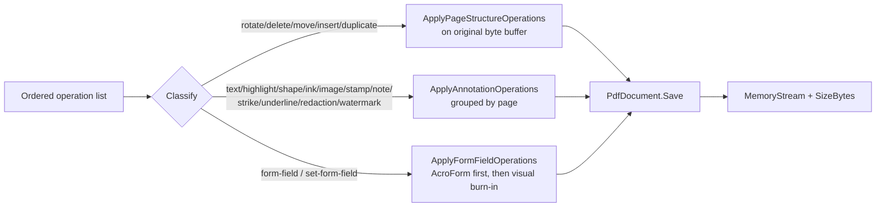
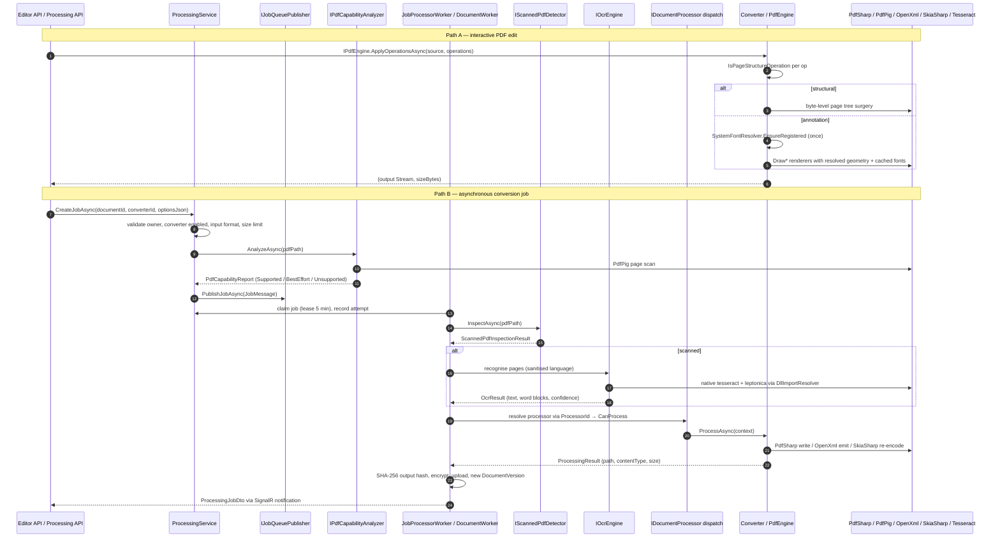

# PDF Editing, OCR and Format Conversion Engines
## EConverter — Module Technical Documentation

**Document type:** Domain module reference (Core Business Domain)
**Scope:** `src/DocumentConverter.Infrastructure/{Editor,Ocr,Processing}` + Application/Contracts ports
**Audience:** platform engineers, integrators, deployment/ops, reviewers

---

## 1. Executive Summary

The **PDF Editing, OCR and Format Conversion Engines** domain is the pure transformation core of EConverter. It contains no delivery concerns — no HTTP, no authorization, no storage policy, no persistence — only deterministic **bytes-in / bytes-out** document processing. Everything the product promises ultimately executes here: converting DOCX/XLSX/CSV/text, PDF↔Word, PDF↔Excel, presentations, e-books, Markdown/HTML and images; recovering machine-readable text from scanned documents through Tesseract; and applying an ordered list of edit, annotation, redaction and page-structure operations to a PDF.

The domain's architectural payoff is **reuse through decoupling**: every component is expressed against an Application-layer port (`IPdfEngine`, `IOcrEngine`, `IScannedPdfDetector`, `IPdfCapabilityAnalyzer`, `ICompressionEstimatorService`, `IDocumentProcessor`), and every DTO lives in a separate `Contracts` assembly. The same engine set is therefore invoked byte-identically by the **interactive editor request path** (via `EditorEndpoints`) and by the **headless background workers** (`JobProcessorWorker` inside the web host, and the standalone `DocumentWorker`).

Four submodules cover the surface:

| # | Submodule | Responsibility |
|---|---|---|
| 1 | Server-Side PDF Editing Engine | Applies ordered edit/annotation/page-structure operations to PDFs |
| 2 | OCR Engine and Scanned Document Detection | Detects image-only documents; performs Tesseract 5.x recognition |
| 3 | Office and Spreadsheet Conversion Engines | DOCX↔PDF, XLSX/CSV↔PDF, PPTX, EPUB/MOBI, MD/HTML |
| 4 | Auxiliary Converters and Compression | Image, compression, capability analysis, estimation, echo |

---

## 2. Position in the System Architecture

The module sits in the **Infrastructure** layer as a set of concrete adapters, bound at the single composition root (`src/DocumentConverter.Web/Program.cs`). It consumes nothing from the Web layer and is consumed by two hosts.

### 2.1 Registration and lifetimes (composition root)

```
builder.Services.AddSingleton<IOcrEngine, TesseractOcrEngine>();
builder.Services.AddSingleton<IScannedPdfDetector, ScannedPdfDetector>();
builder.Services.AddSingleton<IPdfCapabilityAnalyzer, PdfCapabilityAnalyzer>();
builder.Services.AddSingleton<ExcelPdfConverter>();
builder.Services.AddSingleton<PresentationPdfConverter>();
builder.Services.AddSingleton<MarkdownHtmlPdfConverter>();
builder.Services.AddSingleton<EbookPdfConverter>();
builder.Services.AddSingleton<IDocumentProcessor, OfficeDocumentProcessor>();
builder.Services.AddSingleton<IDocumentProcessor, PdfDocumentProcessor>();
builder.Services.AddSingleton<IDocumentProcessor, ImageDocumentProcessor>();
builder.Services.AddSingleton<IDocumentProcessor, PdfCompressProcessor>();
builder.Services.AddSingleton<IDocumentProcessor, ImageCompressProcessor>();
builder.Services.AddSingleton<IDocumentProcessor, OcrDocumentProcessor>();
builder.Services.AddSingleton<IDocumentProcessor, EchoDocumentProcessor>();
builder.Services.AddScoped<IPdfEngine, PdfEngine>();
builder.Services.AddScoped<ICompressionEstimatorService, CompressionEstimatorService>();
```

**Lifetime rationale.** Processors are **stateless per call** and therefore registered as singletons — safe to reuse concurrently from multiple worker threads and cheaper to construct. `PdfEngine` is scoped because it participates in the editor request pipeline. `TesseractOcrEngine` is a singleton whose expensive part (native bootstrap, tessdata resolution) happens once in a static initializer and per-instance construction respectively.

### 2.2 Dependency direction

```
Contracts  ←  Application (ports)  ←  Infrastructure (this module)
     ↑                                        ↑
     └──────────── Web / Workers ─────────────┘
```

The module has **zero references to HTTP, EF Core, RabbitMQ or storage**. That inversion is exactly what allows the query "does this work in the worker the same way it works in the editor?" to be answered structurally: yes, it is the same code path.

### 2.3 Runtime invocation paths

```mermaid
flowchart TD
    subgraph Contracts
        DTO[PdfEditorDtos / PdfEditOperationDto]
        FID[FidelityDtos / PdfCapabilityReport]
    end
    subgraph Application
        IPDF[IPdfEngine]
        IOCR[IOcrEngine]
        IDET[IScannedPdfDetector]
        ICAP[IPdfCapabilityAnalyzer]
        ICMP[ICompressionEstimatorService]
        IPROC[IDocumentProcessor CanProcess / ProcessAsync]
    end
    subgraph Editor
        PE[PdfEngine]
        FR[SystemFontResolver]
        PS[Page-Structure Ops]
        AN[Annotation Renderers]
    end
    subgraph OCR
        TE[TesseractOcrEngine]
        NL[Native library resolution + symlinks]
        SD[ScannedPdfDetector]
    end
    subgraph Processors
        OD[OfficeDocumentProcessor]
        EX[ExcelPdfConverter]
        PD[PdfDocumentProcessor]
        PR[PresentationPdfConverter]
        EB[EbookPdfConverter]
        MD[MarkdownHtmlPdfConverter]
        IM[ImageDocumentProcessor]
        IC[ImageCompressProcessor]
        PC[PdfCompressProcessor]
        OCP[OcrDocumentProcessor]
        EC[EchoDocumentProcessor]
    end
    subgraph Libs
        SHARP[PdfSharp 6.x]
        PIG[PdfPig]
        OXML[DocumentFormat.OpenXml]
        SKIA[SkiaSharp]
        TESS[Tesseract 5.x native]
    end
    DTO --> IPDF --> PE
    FID --> ICAP
    IOCR --> TE
    IDET --> SD
    IPROC --> OD & EX & PD & PR & EB & MD & IM & IC & PC & OCP & EC
    PE --> PS & AN & FR
    PS & AN & FR --> SHARP
    TE --> NL --> TESS
    TE --> PIG
    SD --> PIG
    OD --> OXML & SHARP & PIG
    OD -. OCR needed .-> OCP
    EX --> OXML & SHARP
    PC --> SHARP & SKIA
    IC --> SKIA
    CA[PdfCapabilityAnalyzer] --> PIG
```



---

## 3. Technology Stack and Library Responsibilities

| Library | Role | Used by |
|---|---|---|
| **PdfSharp 6.x** | PDF writing, page-tree surgery, content drawing, security settings, compression options | `PdfEngine`, `PdfCompressProcessor`, all `*PdfConverter`, `OcrDocumentProcessor`, `PdfDocumentProcessor` |
| **PdfPig (UglyToad)** | PDF reading: text, word bounding boxes, embedded images, page geometry, encryption flag | `PdfCapabilityAnalyzer`, `ScannedPdfDetector`, `TesseractOcrEngine`, `ExcelPdfConverter`, `OfficeDocumentProcessor` |
| **DocumentFormat.OpenXml** | WordprocessingML / SpreadsheetML / PresentationML parse + emit | `OfficeDocumentProcessor`, `ExcelPdfConverter`, `PresentationPdfConverter` |
| **SkiaSharp** | Raster decode, resize, re-encode, quantization, pixel-format conversion | `ImageCompressProcessor`, `PdfCompressProcessor`, `CompressionEstimatorService` |
| **Tesseract 5.x (native)** | Optical character recognition, invisible-text searchable PDF rendering | `TesseractOcrEngine` |

**Why this split matters:** PdfSharp is a *writer/structurer*, PdfPig is a *reader/extractor*. Fidelity in this module comes from never asking one library to do the other's job — extraction always goes through PdfPig, emission always through PdfSharp or OpenXml.

---

## 4. Submodule 1 — Server-Side PDF Editing Engine

### 4.1 Purpose

Applies an ordered list of editor operations to a PDF and produces final output bytes plus their byte length — the length is returned so the versioning/download layer does not have to re-buffer the stream to compute it.

### 4.2 The `IPdfEngine` contract

`src/DocumentConverter.Application/Editor/IPdfEngine.cs`

| Method | Signature purpose |
|---|---|
| `ApplyOperationsAsync` | Apply `IReadOnlyList<PdfEditOperationDto>` to a source stream → `(Stream OutputPdf, long SizeBytes)` |
| `ExtractPagesAsync` | Extract a page subset into a standalone PDF |
| `ExportToDocxAsync` | PDF → WordprocessingML package |
| `ExportToXlsxAsync` | PDF → SpreadsheetML package (one worksheet per page) |
| `MergePagesAsync` | Insert pages from a source PDF into a base PDF at an index |
| `ProtectDocumentAsync` | Standard security handler: user/owner passwords + six permission flags |
| `CompressPdfAsync` | Structural compaction + embedded-image downsampling, returns optimized bytes |

The signature is deliberately narrow: **validation of the operation list is the caller's responsibility**. The engine trusts an already-validated, ordered list. That contract keeps the engine free of policy and makes it trivially testable.

### 4.3 The wire contract — `PdfEditOperationDto`

`src/DocumentConverter.Contracts/Editor/PdfEditorDtos.cs`

A single flat positional `sealed record` with **required `Type` and `Page`** and 33 nullable members: geometry (`X`, `Y`, `Width`, `Height`, `Degrees`, `Rotation`), page-structure targets (`FromPage`, `ToPage`, `TargetIndex`), typography (`Text`, `FontSize`, `FontFamily`, `FontColor`, `IsBold`, `IsItalic`, `IsUnderline`, `IsStrikethrough`, `TextAlign`, `LineSpacing`, `BackgroundColor`), vector/fill (`ShapeType`, `StrokeColor`, `FillColor`, `StrokeWidth`, `Opacity`, `PointsJson`), media (`ImageBase64`, `SignerName`, `Timestamp`), and form fields (`FieldName`, `FieldValue`).

**Design note.** A flat shape is intentional: the operation list must survive a JSON round-trip from the browser and preserve ordering exactly. A polymorphic hierarchy would require discriminators and reordering risk for no functional gain.

Supporting contracts include `FormFieldDto`, `SavePdfEditRequest/Response`, `ExportPdfRequest`, `MergeDocumentPagesRequest/Response`, and `ProtectPdfDocumentRequest/Response`.

### 4.4 The three-phase execution model

`PdfEngine.ApplyOperationsAsync` partitions the operation list into three disjoint classes and applies them in a fixed order:

```
1. pageStructureOps  → IsPageStructureOperation(op) == true
2. annotationOps     → not structural AND not form
3. formFieldOps      → Type ∈ { "form-field", "set-form-field" }
```



**Why this ordering is load-bearing.** Structural operations are *byte-level page-tree surgery* and are not re-drawable — once a page is deleted, an annotation that targeted it has nowhere to land. Annotation operations are *coordinate drawing* on top of an already-corrected page set. Form operations come last because they may need to fall back to visible text drawing at supplied coordinates, which must reflect the final page layout. The engine therefore short-circuits an arbitrary ordered list correctly rather than naively replaying it top-to-bottom.

### 4.5 Page-structure operations

Recognized types (case-insensitive): `rotate-page`/`rotate`, `delete-page`/`delete`, `move-page`/`move`/`reorder`, `insert-page`/`insert`/`insert-blank-page`, `duplicate-page`/`duplicate`.

| Operation | Implementation detail |
|---|---|
| Rotate | Additive: `page.Rotate = (page.Rotate + deg) % 360`; default 90° |
| Delete | Guarded by `doc.PageCount > 1` — a document can never be reduced to zero pages |
| Insert blank | `doc.InsertPage(targetIndex)` then explicit `Width`/`Height` in points; defaults to A4 (595 × 842 pt); index clamped to `[0, PageCount]` |
| Move/reorder | `doc.Pages.MovePage(fromIdx, toIdx)`; skipped when source == target |
| Duplicate | Re-opens the **original byte buffer** in `Import` mode and inserts `Pages[dupIndex]` at `dupIndex + 1` — the pristine copy is required because the in-memory document is already mutated |

Page indices arrive **1-based** from the client and are converted to 0-based internally. Rotations are applied in a first pass; mutations in a second pass, preserving client order within mutation classes.

### 4.6 Annotation renderers

Annotations are grouped by `Page` and rendered through a single `XGraphics` surface created with `XGraphicsPdfPageOptions.Append` — append mode preserves existing page content instead of replacing it.

| Renderer | Behaviour |
|---|---|
| `DrawText` | Multi-line split on `\r\n`, `\r`, `\n`; per-line measurement via `gfx.MeasureString`; auto-widening of the box to the widest measured line; `LineSpacing` multiplier (default 1.3); left/center/right alignment; optional background fill rectangle; underline at 85 % of line height and strikethrough at 52 % |
| `DrawHighlight` | Opaque-free rectangle, default fill `#FFF176` at 0.35 opacity |
| `DrawShape` | `rect`, `ellipse`/`circle`, `line`, `arrow`; fill auto-derived from stroke colour when `FillColor` absent; optional `StrokeWidth` |
| `DrawArrow` | Line plus a two-stroke arrowhead computed trigonometrically (12 pt head, 30° half-angle) |
| `DrawInk` | Parses `PointsJson` with `System.Text.Json` as `[{x,y},…]`; requires ≥ 2 points; draws a polyline segment-by-segment; malformed JSON is silently ignored |
| `DrawImageOrSignature` | Base64 decode (strips any `data:` prefix), `XImage.FromStream`, draws at given or intrinsic point size; when `SignerName` present emits a caption `"Digitally verified: {name} • {timestamp}"` in 8 pt DimGray |
| `DrawStamp` | Rotated −5°; rounded outer border + inner hairline border; uppercase title (default `APPROVED`) at 16 pt bold; footer `"BY: {author} • {dd/MM/yyyy}"` at 6.5 pt |
| `DrawStickyNote` | 140 × 75 pt minimum; soft drop shadow; yellow body (`#FFF9C4`); darker header strip with `"Note • {author}"` |
| `DrawStrikethrough` / `DrawUnderline` | Straight lines across the middle / bottom of the supplied bounding box |
| `DrawRedaction` | 100 % opaque rectangle; whiteout variant when `FillColor` is `#FFFFFF`/`white`; optional centred exemption label whose font size scales with box height, clamped 6–11 pt, drawn only when it fits |
| `DrawWatermark` | Applied page-wide for `watermark`/`add-watermark` types; default text `CONFIDENTIAL`, 48 pt bold, −45° rotation about page centre, default opacity 0.15 |

**Per-operation rotation.** When `Rotation` (or `Degrees` on a non-page-structure op) is a non-zero non-multiple-of-360, the renderer saves graphics state, translates to the bounding-box centre, rotates, translates back, draws, and restores in a `finally` block. This guarantees a failed renderer cannot leak a transform into subsequent operations.

**Colour parsing.** `ParseColor` accepts: `transparent`; `rgb(r,g,b)` and `rgba(r,g,b,a)` (values from modern browser colour pickers); `#RGB`; `#RRGGBB`; `#AARRGGBB` (alpha composed multiplicatively with the operation opacity). Unparseable input falls back to a caller-supplied default rather than throwing.

**Watermark scope.** Watermarks are handled outside the per-page grouping loop because their semantic page target is *all pages*; each page receives a fresh `XGraphics` surface and a save/restore pair around the centred rotation.

### 4.7 Form field operations

`ApplyFormFieldOperations` implements a **two-tier strategy**:

1. **Native AcroForm mutation** — if the document has an AcroForm dictionary and a field with a matching name exists (case-insensitive match against `acroForm.Fields.Names`), the engine sets `/NeedAppearances true` and writes the value: `PdfTextField.Text`, `PdfCheckBoxField.Checked`, or a generic `PdfString` for other field kinds.
2. **Visual burn-in fallback** — when the field is absent from the AcroForm *and* coordinates are supplied, the engine draws the value directly onto the page: a checkmark polyline for checkbox/boolean values, or left-aligned vertically-centred text in a `Segoe UI` font otherwise.

Missing AcroForm dictionaries, malformed field names and per-field exceptions are all caught and degrade to the fallback rather than failing the whole edit. This is what allows the editor to "fill" both genuine interactive forms and flat scanned forms with one operation type.

### 4.8 Metadata sanitization on redaction

When any operation in the batch is a redaction (`add-redaction`, `redaction`, `redact`) or an explicit `sanitize-metadata`, the engine clears document metadata as part of the same save:

```
doc.Info.Author   = ""
doc.Info.Subject  = ""
doc.Info.Keywords = ""
doc.Info.Creator  = "Document Converter Platform (Sanitized)"
```

**Fidelity caveat — state it plainly.** Redaction in this implementation is **draw-based**: an opaque fill is composited over the region in append mode, and document metadata is scrubbed. It does **not** rewrite or remove the underlying content stream operators. Text beneath a redaction mark may therefore remain extractable by a tool that reads content streams directly (PdfPig, `pdftotext`, `qpdf --qdf`). For adversarial-disclosure or legal-redaction use cases, a content-stream-scrubbing pass must be added; for internal-marking and metadata-hygiene use cases the current behaviour is sufficient and is deliberately paired with metadata clearing.

### 4.9 Font resolution — `SystemFontResolver`

`src/DocumentConverter.Infrastructure/Editor/SystemFontResolver.cs` implements PdfSharp's `IFontResolver`.

- **Exactly-once global registration.** PdfSharp's `GlobalFontSettings.FontResolver` is process-global; setting it twice throws. A static readonly lock object plus a double-checked null test in `EnsureRegistered()` makes registration idempotent from any entry point. `PdfEngine` registers it in its static constructor; every converter and the OCR processor call `EnsureRegistered()` in theirs.
- **Font byte cache.** A `ConcurrentDictionary<string, byte[]>` keyed case-insensitively by face name avoids repeated disk reads under concurrent worker load.
- **Directory probe chain.** Windows `SpecialFolder.Fonts`, Windows per-user font store, then application-relative `assets/font`, `assets/fonts`, `wwwroot/assets/font(s)`, and source-tree paths.
- **Family mapping.** `ResolveTypeface` maps family name fragments to concrete files: Courier/mono/code, Times/serif, Georgia, Verdana, Trebuchet, Segoe UI, defaulting to Arial with bold/italic variants.
- **Four-level fallback.** (1) exact face name in a known directory; (2) Arial-family fallback chosen by bold/italic; (3) cross-platform substitutes (`LiberationSans`, `DejaVuSans`, `FreeSans`, `SF-Pro`); (4) any `.ttf` found recursively in a font directory. Only if all four fail does `GetFont` return `null`.

**Why this file is critical.** PdfSharp emits real glyph data; a missing resolver means text either renders as blanks or the process throws on the first `DrawString`. This resolver is the difference between a container that renders typography correctly and one that fails on every deployment that lacks Arial.

### 4.10 Editor HTTP surface

`src/DocumentConverter.Web/Endpoints/EditorEndpoints.cs` — group `/api/editor`, all routes `RequireAuthorization()`.

| Route | Function |
|---|---|
| `GET /{documentId}/content` | Stream the base PDF for the pdf.js canvas; filename sanitized (`#` → `_`); `enableRangeProcessing` for progressive load |
| `POST /{documentId}/save` | **Guard:** rejects empty lists and batches exceeding **500 operations**; applies ops, commits a new document version, returns `SavePdfEditResponse` with download URL |
| `POST /{documentId}/export/{format}` | `docx`/`word`, `xlsx`/`excel`, or `pdf`; uncommitted operations are applied first; `pdf` may be compressed by preset |
| `POST /{documentId}/merge` | Merges another document's pages, optionally applying the client's uncommitted operations first; returns new page count |
| `POST /{documentId}/protect` | Applies user/owner password and six permission flags; `SaveAsNewVersion` toggles version commit vs one-off download |

Every handler traps `DomainException` → 400, `KeyNotFoundException` → 404, and generic exceptions → `Problem`, keeping failure classification consistent with the rest of the platform.

---

## 5. Submodule 2 — OCR Engine and Scanned Document Detection

### 5.1 The problem being solved

A scanned PDF has pictures of glyphs, not glyphs. It looks correct to a human and is completely opaque to search, indexing, RAG retrieval, and format conversion. The OCR submodule exists to (a) decide *cheaply* whether that is the case, and (b) perform recognition only where it is needed.

### 5.2 Scanned document detection — `ScannedPdfDetector`

`IScannedPdfDetector.InspectAsync` returns `ScannedPdfInspectionResult(IsScanned, TotalPages, ScannedPagesCount, TotalCharacterCount, TotalImagesCount, Summary)`.

Algorithm, per page, via PdfPig:

```
text = page.Text.Trim()          // accumulated into TotalCharacterCount
images = page.GetImages()        // counted into TotalImagesCount
if text.Length < 25 && images.Count > 0 → scannedPages++
```

Document verdict:

```
IsScanned = TotalPages > 0 && ( ScannedPagesCount == TotalPages
                             || (ScannedPagesCount > 0 && TotalCharacterCount < TotalPages * 35) )
```

**Design properties.** It is a **heuristic gate, not a rasteriser** — it never renders a page, so it costs milliseconds and can run before any OCR work is scheduled. It is deliberately fail-soft: a missing file returns `IsScanned = false` with `Summary = "File not found"`, and any parse exception returns `IsScanned = false` with the exception message in the summary rather than throwing. The `Summary` string is written for humans and is surfaced as the reason a document was routed to OCR.

Overloads accept either a path or a seekable stream; the stream overload rewinds to position 0 first.

### 5.3 Native engine bootstrap — the hardest part of the module

`TesseractOcrEngine` performs three bootstrap steps in a static initializer, executed once per process on Linux/macOS:

**1. `EnsureNativeLibrarySymlinks()`** — the .NET Tesseract wrapper (via `InteropDotNet`) probes for *specific filenames*, while distro packaging ships *different* names. The engine searches a candidate list for `liblept`/`libleptonica` (including `.so.5`), `libtesseract` (including `.so.5`), and `libdl`, then creates symlinks with the expected aliases — `libleptonica-1.82.0.so`, `libtesseract50.so`, `libdl.so`, `libdl.so.2` — into `{BaseDirectory}/x64`, `{BaseDirectory}/arm64`, `{BaseDirectory}`, and the equivalent current-directory locations. Existing links and permission errors are ignored.

**2. `NativeLibrary.SetDllImportResolver`** — resolves `libdl` on glibc ≥ 2.34 (Debian Bookworm, Ubuntu 22.04+), where `dlopen`/`dlerror` live in `libdl.so.2` or `libc.so.6` and plain `libdl.so` may not exist without `libc6-dev`. The resolver tries a multi-arch candidate list spanning x86-64 and aarch64 for `libdl`, then `libc.so.6`; a second branch resolves `tesseract50`/`libtesseract`/`libtesseract.so.5`/`.dylib`; a third resolves `leptonica-1.82.0`/`liblept`. Registration is wrapped in a try/catch because the resolver may only be registered once per assembly.

**3. `InteropDotNet.LibraryLoader.Instance.CustomSearchPath = AppContext.BaseDirectory`** — points the loader at the application directory where step 1 planted the symlinks.

The engine also calls `EnsureNativeLibrarySymlinks()` again inside each recognition call as a belt-and-braces measure, and catches the three failure modes explicitly with actionable messages: `DllNotFoundException` (native packages missing — names `tesseract-ocr`, `libtesseract-dev`, `libleptonica-dev`, `libc6-dev`), `TargetInvocationException` (inner message surfaced), and generic exceptions.

### 5.4 Tessdata resolution

`ResolveTessdataPath()` probes in order and returns the first directory that actually **contains at least one `*.traineddata` file**, additionally exporting it as `TESSDATA_PREFIX`:

```
$TESSDATA_PREFIX  →  $TESSDATA_PREFIX/tessdata
/usr/share/tesseract-ocr/5/tessdata
/usr/share/tesseract-ocr/4.00/tessdata
/usr/share/tessdata
/usr/local/share/tessdata
{BaseDirectory}/tessdata
{CurrentDirectory}/tessdata
{CurrentDirectory}/src/DocumentConverter.Web/tessdata
{CurrentDirectory}/src/DocumentConverter.Infrastructure/tessdata
```

If nothing resolves, the engine logs a warning at construction and every recognition call returns `OcrResult.Failed("OCR engine initialization failed: tessdata directory not found.")` — a clean, diagnosable failure instead of a native crash.

### 5.5 Language sanitization

`SanitizeLanguage()` validates each requested code against the filesystem **before** the engine is constructed:

- Splits compound specifications on `+` (e.g. `ind+eng`).
- Keeps only parts where `{part}.traineddata` exists in the resolved tessdata directory.
- Logs and drops unknown parts, then rejoins the survivors.
- Falls back to `eng` when nothing requested exists but `eng` does; returns the original string unchanged only when the tessdata directory itself is unresolvable.

This prevents two failure classes at once: a hard engine-construction crash on an unknown model, and any attempt to steer the language code outside the tessdata directory.

### 5.6 Recognition paths

| Method | Behaviour |
|---|---|
| `ProcessImageAsync` | Locks : `TesseractEngine(tessdata, lang, EngineMode.Default)` → `Pix.LoadFromFile` → `engine.Process` → `page.GetText()` + `page.GetMeanConfidence()`; then iterates `page.GetIterator()` at `PageIteratorLevel.Word`, extracting text, per-word confidence and the bounding rectangle into `OcrWordBlock(Text, Confidence, X, Y, Width, Height)`. Iterator failure is caught and logged while page text is still returned. Executed on a `Task.Run` worker with the caller's cancellation token. |
| `ProcessPdfAsync` | Opens with PdfPig and processes page by page. **Existing digital text is preserved and its words are emitted at confidence `1.0`** with Y flipped into top-down coordinates (`page.Height - rect.Top`). Only when `text.Trim().Length < 25` and the page has embedded images does it extract those images to a temp directory, run `ProcessImageAsync` per image, and replace the page text with the concatenated OCR result. Pages with no words get a nominal confidence of `0.85`; per-page confidence is the mean of word confidences and the result carries the page average. Output text is delimited with `--- PAGE n ---` markers. |
| `RenderSearchablePdfAsync` | Uses Tesseract's own `PdfResultRenderer(baseTempPath, tessdata, false)` writing into `renderer.BeginDocument(...)` / `renderer.AddPage(page)`, then moves the generated `{tempBase}.pdf` to the requested output path. This is the path that yields a PDF with an *invisible* text layer over the original raster — the "searchable PDF" deliverable. |

### 5.7 The OCR pipeline stage — `OcrDocumentProcessor`

`OcrDocumentProcessor` implements `IDocumentProcessor`, so OCR is a **pipeline stage, not a special case**.

```
CanProcess:  input ∈ {pdf, jpg, jpeg, png, tif, tiff}  &&  output ∈ {pdf, txt}
```

Options are read from the job's `OptionsJson`: `outputFormat`/`outputMode` ∈ {`txt`, `text`, `text_only`} selects text-only mode; `language` selects the recognition language. A JSON parse failure degrades to a substring check on the raw options string rather than aborting.

**Text-only mode** writes `{base}_ocr.txt` in UTF-8 and returns `text/plain`.

**Searchable-PDF mode** is where the fidelity policy lives. The processor opens the source in `Import` mode with PdfSharp *and* in PdfPig, then walks pages one by one:

```
for each page i:
    pageText = pdfPig.GetPage(i+1).Text
    1. if pageText.Trim().Length > 30   → outPdf.AddPage(inPdf.Pages[i])   // PRESERVE UNTOUCHED
    2. else if page has images:
           mainImg     = largest image by WidthInSamples * HeightInSamples
           pngBytes    = mainImg.TryGetPng(...)
           rendered    = RenderSearchablePdfAsync(png, tempPagePdf, options)
           if rendered → append the rendered searchable page
    3. else → outPdf.AddPage(inPdf.Pages[i])                                // PRESERVE ORIGINAL
```

**Why the 30-character threshold matters.** Overlaying recognised text on a page that already has a digital text layer would duplicate every character in the document's text layer, breaking copy-paste, search relevance and downstream retrieval. The processor instead treats the document as *per-page heterogeneous*: digital pages pass through byte-identical, scanned pages are rebuilt with Tesseract's invisible GlyphLessFont renderer. The result is a single output PDF whose text layer is exactly correct on both kinds of page.

Temp artefacts are created under `{temp}/dc_ocr_pdf_{guid}` and deleted in a `finally` block that swallows deletion errors.

### 5.8 OCR data contracts

```
OcrWordBlock (string Text, float Confidence, int X, int Y, int Width, int Height)
OcrPageResult(int PageNumber, string Text, IReadOnlyList<OcrWordBlock> Words,
              int Width, int Height, double Confidence)
OcrResult(string FullText, IReadOnlyList<OcrPageResult> Pages,
          double AverageConfidence, bool Success, string? ErrorMessage)
    static OcrResult.Failed(string message)   // non-throwing error projection

OcrOptions { Language = "eng"; OutputSearchablePdf = true; ExtractTextOnly; PageRange }
```

Word-level bounding boxes are not decoration — they are what makes a future coordinate-accurate "text layer only" or highlight-over-OCR feature possible without re-running recognition. `OcrResult.Failed` is the module's consistent substitute for exceptions in the recognition path.

---

## 6. Submodule 3 — Office and Spreadsheet Conversion Engines

This is the highest-complexity area of the module. `OfficeDocumentProcessor` is the largest processor and dispatches across six families.

### 6.1 Capability matrix

`OfficeDocumentProcessor.CanProcess` (extensions normalized by trimming leading `.` and lowercasing):

| Family | Input | Output |
|---|---|---|
| Word / Text | `pdf` | `docx`, `doc`, `txt` |
| Word / Text | `docx`, `doc`, `odt`, `txt` | `pdf` |
| Spreadsheet | `xlsx`, `xls`, `csv` | `pdf` |
| Spreadsheet | `pdf` | `xlsx`, `csv` |
| Presentation | `pptx`, `ppt`, `odp` | `pdf` |
| Markdown / HTML | `md`, `markdown`, `html`, `htm` | `pdf` |
| E-Book | `epub`, `mobi` | `pdf` |

Dispatch inside `ProcessAsync` is by input extension with a target format resolved from (in priority order) `ProcessingContext.Metadata["TargetFormat"]`, `Metadata["ConverterKey"]` (`*excel*` → `xlsx`, `*word*` → `docx`), or a substring probe of `OptionsJson`. Specialized converters are injected with sensible defaults (`?? new ExcelPdfConverter()`), so the processor is constructible with zero DI and still fully functional — useful for tests and tooling.

### 6.2 PDF → DOCX reconstruction

`ConvertPdfToDocxAsync` opens the PDF with PdfPig and emits a `WordprocessingDocument` per page:

1. **Per-page branch:** pages with words *and* (no images or ≥ 10 words) go through `EmitTextPage`. Image-heavy, low-text pages attempt OCR fallback via the injected `IOcrEngine` on the largest extractable image (`TryGetPng` first, then `RawBytes`); on success the reconstructed text is written under an italic grey 9 pt provenance header `"[Page n: Text reconstructed via Optical Character Recognition (OCR)]"` at 11 pt body. If OCR also fails, a placeholder `"[Page n: Scanned Content (N image(s))]"` is emitted so the reconstruction is honest about its gaps.
2. **`EmitTextPage`** clusters words into lines by baseline proximity (tolerance 3.5 pt), sorts top-to-bottom, then classifies blocks: a line yielding ≥ 2 columns (column gap > 20 pt) followed by further lines with a column count within ±2 is treated as a **table** and emitted as `EmitWordTable`; otherwise it is emitted as a paragraph via `EmitWordParagraph`.
3. **`EmitWordTable`** builds a `Table` at 100 % width with a subtle border set (single 4-eighths-pt top/bottom, `EEEEEE` inside horizontals, no verticals), bold 10 pt first row, 10 pt body cells, and a trailing spacer paragraph.
4. **`EmitWordParagraph`** infers heading hierarchy from mean letter font size: ≥ 15 pt → Heading 1 (bold, 16 pt, navy `1F497D`); ≥ 12.5 pt → Heading 2 (bold, 13 pt, `365F91`); otherwise 11 pt body with bold/italic inferred from the source font *name* (`bold`/`heavy`/`black` → bold; `italic`/`oblique` → italic). Body text is emitted as one `Run` per word to preserve source word boundaries.
5. A page break (`BreakValues.Page`) is inserted between pages.

### 6.3 DOCX / text → PDF

`ConvertDocxOrTextToPdfAsync` reads paragraphs from an OpenXml `WordprocessingDocument` (or plain lines from a text file) and flows them onto PdfSharp pages, paginating on `yPos + lineHeight > pageHeight - margin` (40 pt margins, 16 pt line height), instantiating a fresh `XGraphics` per page and disposing the previous one.

**Note the asymmetry, and it is deliberate:** PDF→DOCX is structure-aware (tables, headings, OCR fallback); DOCX→PDF is a faithful *text-flow* emitter that does not re-implement Word's layout engine. Doing so is out of scope for a pure-managed stack; the converter catalogue therefore publishes `word-to-pdf` as `Supported` for content fidelity while making no claim about typographic identity with Word.

### 6.4 Spreadsheet → PDF — `ExcelPdfConverter`

**Parsing.** CSV is parsed with a quote-aware state machine handling doubled quotes (`""` → `"`). XLSX is parsed via OpenXml with a **shared-string table** lookup, per-sheet worksheet parts resolved through relationship IDs, and ragged rows normalized against the widest row; per-column maximum lengths are captured for auto-sizing.

**Rendering.** One PDF page is emitted per sheet region with:

- Page overflow guard: when `yPos + rowHeight > pageHeight - margin - 20`, the footer is drawn, graphics disposed, a **new page created with the same orientation and dimensions**, and the header redrawn — the sheet chrome repeats on every page break.
- **Zebra striping** on odd data rows.
- Per-cell borders and clipped text via `TruncateString` (ellipsis when the string exceeds the column's character estimate).
- **Numeric detection with `CultureInfo.InvariantCulture`** driving right-alignment — this is the correct call: a `de-DE` server must not emit `1,5` for `1.5` in a report destined for a `en-US` reader, and invariant formatting makes output byte-deterministic across hosts.
- Running header (with a `false` flag on continuation pages) and a footer of the form `"Document Converter Platform • Internal Corporate Report"` plus `Generated yyyy-MM-dd` right-aligned.
- Empty-workbook handling: a single page containing `"(Empty spreadsheet or no readable data)"` is produced rather than a zero-page PDF.

**Reverse direction — PDF → XLSX/CSV.** `ExtractTablesFromPdf` builds row buckets by vertical centre with a **4.0 pt tolerance**, sorts top-to-bottom, sorts words left-to-right within each row, and splits columns where the horizontal gap between consecutive words exceeds **18 pt**. `WriteXlsx` emits one worksheet per PDF page (`Page_1`, `Page_2`, …) using **inline strings** (no shared-string table, so the file is self-describing and cheap to produce) with A1-style references from a base-26 `GetColumnLetters` helper. `WriteCsvAsync` writes RFC-style quoting: fields containing `,`, `"` or newline are wrapped in quotes with `"` doubled.

### 6.5 Presentation → PDF — `PresentationPdfConverter`

`ParsePresentation` walks `PresentationDocument.SlideIdList`, resolves each `SlidePart`, and extracts text shapes. Placeholder type drives classification: `Title`/`CenteredTitle` becomes the slide title; other text bodies become bullets with **level-based prefixes** (`•`, `    ○ `, `        ▪ `). A short early text run is promoted to title when no title placeholder exists. Slide numbering fallback is `"Slide n"`. The first embedded image part is extracted as the slide's primary visual.

Layout selection comes from `OptionsJson["layout"]`: slide-per-page, 2-up handout, 3-up handout with ruled note-taking lines (plus the fourth grid variant named in the class documentation). An empty deck produces a single placeholder overview page.

### 6.6 E-Book → PDF — `EbookPdfConverter`

- **EPUB:** opens the ZIP container, reads `META-INF/container.xml` to resolve the OPF `rootfile` `full-path`, parses the OPF package for title/author/manifest/spine, resolves relative hrefs against the OPF directory (with `/`-compatibility normalization), and dispatches to OPF/NCX/HTML extraction to build an ordered `EbookChapter` list. HTML is cleaned with tag stripping and entity decoding.
- **MOBI:** binary record parsing with text decoding — no external dependency.
- **Rendering:** title page, cover page where available, chapter dividers, running headers/footers and pagination chrome via `CheckNewPage` and `DrawRunningHeaderFooter`.

An unreadable book yields a single `"Introduction"` chapter containing `"(Empty e-book or no readable chapters found)"` rather than an empty PDF.

### 6.7 Markdown / HTML → PDF — `MarkdownHtmlPdfConverter`

A **block-classification pipeline**, not a regex substitution:

1. Split into lines, then classify: fenced code blocks (``` toggles), pipe tables (accumulated and flushed by `FlushTable`), headings (`# ` … `###### `), blockquotes, lists, horizontal rules, and paragraphs.
2. HTML input takes the parallel `ParseHtml` path with tag stripping.
3. `RenderDocumentToPdf` lays out a `List<DocumentBlock>` with `(BlockType, Content, Level)` semantics: headings, styled tables, blockquotes, code blocks in bordered monospace boxes, and body paragraphs, using `CheckNewPage(neededHeight)` before each block and `DrawPageHeaderFooter` from the deserialized options.
4. Empty input degrades to a single `"(Empty document or no readable content)"` block.

### 6.8 Images

| Processor | Behaviour |
|---|---|
| `ImageDocumentProcessor` | Supported inputs `jpg, jpeg, png, bmp, webp, tif, tiff, gif` → `pdf`. Page size is set to the image's **point** dimensions (falling back to pixel dimensions), then the image is drawn at origin at full size — i.e. the PDF page *is* the image, with no re-sampling. |
| `ImageCompressProcessor` | Supported inputs `jpg, jpeg, png, webp, bmp, gif, tif, tiff`; outputs `jpg, jpeg, png, webp`; operations `compress`, `optimize`, `convert`. Proportional dimension capping via `SKBitmap.Resize` with `SKFilterMode.Linear`/`SKMipmapMode.Linear`, quality-tuned `SKImage.Encode`, and a fall-through to the original bytes when compression would enlarge the file. |

### 6.9 PDF compression — `PdfCompressProcessor` and `PdfEngine.CompressPdfAsync`

`PdfCompressProcessor` performs **two independent reductions**:

1. **Structural stream compaction** — the page tree is rebuilt into a fresh document (pruning orphaned objects and revision history chains), then `CompressContentStreams = true`, `FlateEncodeMode = BestCompression`, and `UseFlateDecoderForJpegImages = Never` (JPEG streams are already compressed; re-deflating them wastes CPU for no gain).
2. **Embedded raster optimization** — `OptimizeEmbeddedImages` walks each page's `/Resources` → `/XObject` dictionary, filters `/Subtype /Image`, skips streams under 2048 bytes (icons, logos, alpha masks) and *also* skips re-encoding small payloads under 8192 bytes, reads `/Width` and `/Height`, then decides per image:
   - **resize** when either dimension exceeds `MaxPixelDimension`;
   - **re-encode** when `Quality < 95` and the payload exceeds 8192 bytes.
   
   Decode is attempted with `SKBitmap.Decode`; if that fails the code falls back to a **manual 24-bit RGB path** that reads raw samples of length ≥ `width × height × 3` and writes BGR→RGB byte order into an `Rgb888x`/`Opaque` bitmap — this is what allows compression of image streams that Skia cannot sniff on its own. On success the XObject dictionary is rewritten with the new `/Width`, `/Height`, `/Filter /DCTDecode`, `/BitsPerComponent 8`, `/ColorSpace /DeviceRGB`, and the stale `/DecodeParms` entry is removed. Unsupported encodings (e.g. JBIG2) are left untouched inside a catch.

**Presets and derived parameters:**

| Preset | Quality | Max pixel dimension |
|---|---|---|
| `screen` | 65 | 1024 |
| `standard` (default) | 75 | 1600 |
| `print` | 85 | 2400 |
| `lossless` | 100 | 0 (resizing disabled; image pass skipped entirely) |

`maxDpi` is converted to a pixel dimension as `round(dpi × 8.5)` — a standard US Letter width assumption. Explicit `quality` and `maxPixelDimension` keys override the preset values; `quality` is clamped to `[10, 100]` and `maxPixelDimension` to `≥ 0`. `stripMetadata` (default `true`) blanks Title/Author/Subject/Keywords and sets Creator to `"Document Converter Enterprise"`.

**Guaranteed non-bloat safeguard.** After saving, if the output file is larger than the input, the code **copies the original over the output** and reports the original's length. Compression can therefore never make a document worse; the worst case is a no-op. The same guarantee is implemented in `ImageCompressProcessor` and in `CompressionEstimatorService` (estimates are clamped to the original size).

`PdfEngine.CompressPdfAsync` is the editor-facing entry point: it materializes the source to a temp file under `DocConverter_PdfCompress_{guid}`, constructs a `PdfCompressProcessor` directly, builds a `ProcessingContext` with a **500 MB max output** and a **5-minute timeout**, converts the file result back into a `MemoryStream`, and deletes the temp directory in a `finally`. This is the one place in the editor path that deliberately routes through a processor rather than raw library calls — compression needs the full preset/quality/downsample policy that only the processor owns.

---

## 7. Submodule 4 — Analysis, Estimation and Pipeline Verification

### 7.1 `PdfCapabilityAnalyzer`

`IPdfCapabilityAnalyzer.AnalyzeAsync(path|stream)` returns `PdfCapabilityReport` **before** any job is queued, so user expectations are set honestly in advance.

Detection logic (PdfPig, `SkipMissingFonts = true` so broken font data cannot abort analysis):

| Signal | Rule |
|---|---|
| Encrypted | `pdf.IsEncrypted` → immediate `Unsupported` report with warning *"The document is password-protected or encrypted; credentials are required to convert."* |
| Scanned page | `words.Count < 20 && images.Count > 0` |
| Multi-column | `words.Count > 35` **and** > 12 words fully left of 42 % page width **and** > 12 words fully right of 58 % **and** centre-straddling words < 15 % of total |
| Tables | ≥ 3 distinct quantized X-positions (rounded to 10 pt) each holding ≥ 4 words |
| Zero pages | → `Unsupported`, reason `"PDF contains 0 pages."` |

Verdict resolution (`Supported` / `BestEffort` / `Unsupported`) and the accompanying signal lists:

| Condition | Verdict | `RequiresOcrFallback` | Reported complexity |
|---|---|---|---|
| `scannedPages == totalPages` or `totalWords < 15` | BestEffort | **true** | "Scanned / Image Only" |
| `scannedPages > 0` | BestEffort | **true** | "Mixed Text & Scans" |
| Tables or multi-column, clean text | BestEffort | false | "Tables & Structured Data" / "Multi-Column Layout" |
| Otherwise | Supported | false | "Single Column Flow" |

Additional warnings are appended for large documents (> 100 pages) and for table-border formatting variance. `CreateUnsupportedReport` is the shared reason-coded factory for unsupported outcomes. This is the mechanism behind the product claim that *the UI never claims lossless fidelity when it isn't* — `ConverterFidelity` in the domain and `ConversionFidelityVerdict` in the report are the two sides of the same promise.

### 7.2 `CompressionEstimatorService`

`ICompressionEstimatorService` provides **interactive preview without committing a job**:

```
EstimateAsync(documentId, versionId, request)   → resolves the stored document then delegates
EstimateStreamAsync(stream, fileName, contentType, request) → routes by extension
```

- **Image path:** decode with `SKBitmap`, apply the same proportional resize policy as the real processor, encode at the requested quality to the target format (WebP / PNG / JPEG, defaulting to the source), and report `EstimatedSizeBytes`, `SavedSizeBytes`, `PercentReduction`, plus `OutputWidth`/`OutputHeight`.
- **PDF path:** fast in-memory structural estimation — zero disk I/O.
- **Unsupported extension:** a neutral response with `PreviewMode = "None"` and no claimed savings.
- **`FallbackEstimate`** computes size from original size + quality + extension when real simulation is infeasible.
- Estimates are clamped so a preview can never advertise a size larger than the original.

`CompressionPreviewRequest(Preset, Quality = 75, MaxDimension = 0, TargetFormat)` / `CompressionPreviewResponse(...)` live in `Contracts/Processing/ProcessingDtos.cs`.

### 7.3 `EchoDocumentProcessor`

`ProcessorId = "echo"`, `CanProcess` returns `true` unconditionally, and processing is a byte-for-byte copy with an extension chosen from the options string (`.pdf` default, `.docx`/`.txt` when named). Its purpose is **plumbing verification**: it proves the job queue, workspace isolation, storage round-trip, hashing, versioning and notification chain work end to end without any library-specific behaviour in the way. `JobProcessorWorker` also uses it as the last-resort resolution target when no processor matches a converter's `ProcessorId`.

### 7.4 `PdfDocumentProcessor`

Handles merge, split and page-to-image extraction for a PDF input:

| Operation | Behaviour |
|---|---|
| `render` (or `format` ∈ {png, jpg} in options) | Iterates pages and embedded images; `TryGetPng` preferred, otherwise raw bytes classified as JPEG when the image dictionary contains `DCTDecode`, else PNG. When no raster image exists, a minimal valid 1×1 PNG is emitted so the caller always receives a real image file. |
| `split` | `ParsePageRanges` understands `"1-3, 4, 5-8"`; defaults to page 1 when options are absent; falls back to the first page if nothing matched. |
| `merge` (default) | Imports all pages of the input into a fresh document. |

---

## 8. The Conversion Catalogue and Job Pipeline Integration

### 8.1 The `Converter` aggregate

`src/DocumentConverter.Domain/Processing/Converter.cs` makes the supported conversion matrix a **first-class, discoverable product surface** rather than a hard-coded UI list. Key fields: `Key` (stable slug), `Name`, `Operation`, `InputFormats`/`OutputFormats` (normalized: trim leading `.`, lowercase, distinct), `ProcessorId`, `QueueName`, `ConfigurationSchema` (JSON Schema rendered as an admin form), `Fidelity`, `SupportsBatch`, `AcceptsMultipleInputs`, `MaxInputSizeBytes`, `MaxPages`, `IsEnabled`, `ValidationStatus`.

**Lifecycle invariant:** a converter is created **disabled and `NotValidated`**. `Enable()` throws unless `ValidationStatus == Passed`, with `allowUnvalidated` existing only for development. `RecordValidation` with a non-`Passed` status forcibly disables the converter. This is the domain enforcing "nothing goes live that hasn't been proven".

### 8.2 Seeded catalogue (14 converters)

| Key | Operation | Input → Output | Processor | Fidelity | Batch | Multi-input | Max size | Max pages |
|---|---|---|---|---|---|---|---|---|
| `image-to-pdf` | convert | jpg/jpeg/png/bmp/webp/tif/tiff → pdf | `image-processor` | Supported | ✔ | ✔ | 50 MB | — |
| `pdf-to-image` | render | pdf → png/jpg | `pdf-processor` | Supported | ✔ | ✘ | 100 MB | 500 |
| `pdf-merge` | merge | pdf → pdf | `pdf-processor` | Supported | ✔ | ✔ | 200 MB | 1000 |
| `pdf-split` | split | pdf → pdf | `pdf-processor` | Supported | ✘ | ✘ | 200 MB | 1000 |
| `word-to-pdf` | convert | docx/doc/odt → pdf | `office-processor` | Supported | ✔ | ✘ | 100 MB | 500 |
| `pdf-to-word` | convert | pdf → docx | `office-processor` | **BestEffort** | ✔ | ✘ | 100 MB | 200 |
| `ocr` | ocr | pdf/jpg/jpeg/png/tif/tiff → pdf/txt | `ocr-processor` | Supported | ✔ | ✘ | 100 MB | 300 |
| `excel-to-pdf` | convert | xlsx/xls/csv → pdf | `office-processor` | Supported | ✔ | ✘ | 100 MB | 500 |
| `pdf-to-excel` | extract-tables | pdf → xlsx/csv | `office-processor` | **BestEffort** | ✔ | ✘ | 100 MB | 200 |
| `presentation-to-pdf` | convert | pptx/ppt/odp → pdf | `office-processor` | Supported | ✔ | ✘ | 150 MB | 500 |
| `markdown-html-to-pdf` | convert | md/markdown/html/htm → pdf | `office-processor` | Supported | ✔ | ✘ | 50 MB | 300 |
| `ebook-to-pdf` | convert | epub/mobi → pdf | `office-processor` | Supported | ✔ | ✘ | 100 MB | 1000 |
| `pdf-compress` | compress | pdf → pdf | `pdf-compress-processor` | Supported | ✔ | ✘ | 200 MB | 1000 |
| `image-compress` | compress | jpg/jpeg/png/webp/bmp/tif/tiff/gif → jpg/jpeg/png/webp | `image-compress-processor` | Supported | ✔ | ✘ | 100 MB | — |

**Fidelity honesty in practice:** `pdf-to-word` and `pdf-to-excel` are the only two entries declared `BestEffort` — precisely the two directions that depend on heuristics (line clustering, table detection, OCR fallback). Everything else is declared `Supported`.

### 8.3 Configuration schemas

Converters publish a JSON Schema that the admin UI renders as a form and the worker passes through verbatim as `OptionsJson`. Examples:

```jsonc
// ocr
{"language": {"type":"string","default":"eng","enum":["eng","ind","jpn","chi_sim"]},
 "outputMode": {"type":"string","default":"searchable_pdf","enum":["searchable_pdf","text_only"]}}

// pdf-compress
{"preset":{"enum":["screen","standard","print","lossless"],"default":"standard"},
 "maxDpi":{"type":"integer","default":150},
 "quality":{"type":"integer","default":75,"minimum":10,"maximum":100},
 "stripMetadata":{"type":"boolean","default":true}}

// presentation-to-pdf
{"layout":{"enum":["slides","handouts-2","handouts-3-notes"],"default":"slides"}}

// pdf-split
{"pageRanges":{"type":"string","description":"e.g. 1-3, 4, 5-8"}}
```

Options are serialized as **JSON strings** and deserialized per processor. This decouples the queue message schema from engine internals — adding an option never requires a message contract change — at the cost of per-processor rather than centralized validation. Processors are written defensively accordingly: every `ParseOptions` falls back to defaults on malformed input.

### 8.4 The processor abstraction

`src/BuildingBlocks/DocumentConverter.Processing.Abstractions/IDocumentProcessor.cs`:

```csharp
public sealed record ProcessingContext(
    Guid JobId, string Operation, string InputPath, string OutputDirectory,
    string? OptionsJson, long MaxOutputSizeBytes, TimeSpan Timeout,
    IReadOnlyDictionary<string,string>? Metadata = null);

public sealed record ProcessingResult(
    bool Success, string? OutputPath, string? OutputContentType,
    long? OutputSizeBytes, string? ErrorCode, string? ErrorMessage)
{
    public static ProcessingResult Succeeded(string outputPath, string contentType, long sizeBytes);
    public static ProcessingResult Failed(string errorCode, string errorMessage);
}

public interface IDocumentProcessor
{
    string ProcessorId { get; }
    bool CanProcess(string operation, string inputFormat, string outputFormat);
    Task<ProcessingResult> ProcessAsync(ProcessingContext context, CancellationToken ct);
}
```

The XML doc comment on `ProcessingContext` states the security property explicitly: it **does not contain database connection strings or unrelated platform credentials**. Processors are sandboxed from platform secrets by contract, not by convention.

Dispatch is by **capability query**, never by a switch statement. Adding a format means adding a processor and a catalogue row; no existing code changes.

### 8.5 End-to-end job flow



### 8.6 Worker execution and workspace isolation

Both `JobProcessorWorker` (web-hosted, optionally disabled via `Processing:RunWorkerInWeb`) and `DocumentWorker` (standalone) implement the same lifecycle:

1. **Atomic claim / lease recovery** — select the first job that is `Pending`, or `Processing` with an **expired lease** (`LeaseExpiresAt < now`); `Claim(workerId, now + 5 minutes, now)` records a `ProcessingAttempt`.
2. **Cooperative cancellation** — a job in `CancellationRequested` is transitioned to `Cancelled`, persisted, and its owner notified.
3. **Isolated workspace** — `{temp}/docconv_work/{jobId:N}/input` and `/output`. Every job's filesystem footprint is disjoint from every other job's.
4. **Storage I/O** — the encrypted payload is streamed from storage into the input workspace; the produced artefact is hashed with **SHA-256 over a stream** and uploaded.
5. **Processor resolution** — by `ProcessorId` (case-insensitive), falling back to `echo`, and throwing only if neither resolves.
6. **Context construction** — metadata (`ConverterKey`, `TargetFormat`, `Operation`) is passed so processors can resolve target formats without string-sniffing options; timeout is 4 minutes in the web-hosted worker.
7. **Progress reporting** — `UpdateProgress` at 10/30/50/80 with `NotifyJobProgressAsync` pushes to SignalR, and batch completion is detected when all child jobs reach a terminal state.

`DocumentWorker` additionally consumes RabbitMQ (`BasicQosAsync(prefetchCount: 1)`, manual ack, `BasicNack` with requeue on handler failure, automatic recovery) and **degrades to SQL lease polling** when the broker is unreachable — the stated design that *SQL holds truth, the broker holds throughput*.

### 8.7 Processing HTTP surface

`ProcessingEndpoints` — group `/api/processing` plus `/api/converters`, all `RequireAuthorization("RequireUser")`; job and batch creation are additionally gated by `RequireRateLimiting("processing-policy")` (concurrency limiter, 20 permits, queue 10).

| Route | Purpose |
|---|---|
| `GET /api/converters` | Enumerate the converter catalogue (discovery before submission) |
| `GET /api/processing/jobs` · `/jobs/{id}` | List (top 50) / single job status |
| `POST /api/processing/jobs` | Create a single job |
| `POST /api/processing/batches` | Create a batch job |
| `GET /api/processing/batches` · `/{id}` · `/{id}/jobs` | Batch listing, status, member jobs |
| `POST /api/processing/jobs/{id}/cancel` · `/batches/{id}/cancel` | Cooperative cancellation |

---

## 9. Error Model and Failure Semantics

The module converges on three failure styles, applied consistently:

| Style | Used by | Rationale |
|---|---|---|
| **`ProcessingResult.Failed(errorCode, message)`** | All `IDocumentProcessor` implementations | Structured, loggable, surfaceable to the job record as `ErrorCode` + `ErrorMessage`; a failed job is a first-class domain state, not an exception |
| **`OcrResult.Failed(message)`** | `IOcrEngine` | Recognition failure is an expected outcome (missing tessdata, unsupported image), not an exceptional one |
| **Soft-degrade with a `Summary`/warning** | `ScannedPdfDetector`, `PdfCapabilityAnalyzer` | Analysis must never be the thing that breaks a document |

Representative error codes: `INPUT_NOT_FOUND`, `UNSUPPORTED_FORMAT`, `CONVERSION_FAILED`, `OCR_FAILED`, `IMAGE_DECODE_FAILED`, `IMAGE_ENCODE_FAILED`, `IMAGE_CONVERSION_FAILED`, `PDF_PROCESSING_ERROR`, `PDF_COMPRESSION_FAILED`.

**Silent-failure policy inside renderers.** Malformed ink JSON, corrupt base64 image data and unsupported embedded stream encodings are caught and ignored rather than aborting the batch. The rationale is that one bad annotation should not lose a user's entire editing session; the cost is that a malformed operation produces no visible artefact and no error. This is a deliberate trade and should be understood as such.

---

## 10. Cross-Cutting Engineering Properties

| Property | Implementation |
|---|---|
| **Delivery-agnostic** | No HTTP, EF Core, RabbitMQ or storage types appear in any signature; processors take a path/context and return bytes |
| **Statelessness** | Processors and renderers hold no per-call state; instances are safe for concurrent reuse from multiple worker threads |
| **Bounded global state** | Only two process-wide singletons exist: `PdfSharp.GlobalFontSettings.FontResolver` (guarded by a lock object + double-checked null test) and the Tesseract native bootstrap. Both use exactly-once registration |
| **Thread-safe caching** | `ConcurrentDictionary` for font bytes; immutable records for all result types |
| **Culture determinism** | Invariant culture used explicitly for numeric parsing and formatting in spreadsheet rendering, spreadsheets-to-PDF extraction and PDF metadata date strings |
| **Memory discipline** | `MemoryStream` used for in-flight payloads, `using` on every `PdfDocument`/`XGraphics`/`SKBitmap`/`SKImage`, temp directories deleted in `finally`, and unit-of-work scoped `DbContext` per job |
| **Parameterized options** | Every processor implements a defensive `ParseOptions` with preset-derived defaults and clamped ranges |
| **Non-bloat guarantee** | Compression paths compare output against input and return the original when the "optimized" artefact is larger |
| **Fidelity honesty** | `ConverterFidelity` (domain) and `ConversionFidelityVerdict` (report) both express Supported / BestEffort / Unsupported and are surfaced in the catalogue and pre-flight analysis |

---

## 11. Fidelity Characteristics and Known Limitations

State these plainly; they define what the module can and cannot be trusted to do.

| # | Limitation | Detail | Impact |
|---|---|---|---|
| 1 | **Redaction is draw-based, not stream-scrubbing** | An opaque rectangle is composited in append mode and document metadata is cleared, but the underlying content-stream operators are not rewritten | Text beneath a redaction mark may remain extractable by content-stream readers. Acceptable for internal marking + metadata hygiene; **not** acceptable for adversarial-disclosure redaction without an additional scrubbing pass |
| 2 | **DOCX→PDF is a text-flow emitter** | Paragraphs are read from OpenXml and flowed onto pages with fixed 40 pt margins and 16 pt line height | Content fidelity is preserved; typographic identity with Microsoft Word is not claimed |
| 3 | **PDF→DOCX/WORD and PDF→XLSX are heuristic** | Line clustering (3.5–4.0 pt baseline tolerance), column splitting (18–20 pt gap), heading inference by font size (≥ 15 pt H1, ≥ 12.5 pt H2) | Correctly declared `BestEffort` in the catalogue. Complex multi-column or borderless tables may reconstruct imperfectly |
| 4 | **Page image extraction returns the first decodable image** | `PdfDocumentProcessor.ConvertPdfToImage` returns on the first successfully extracted image, and substitutes a 1×1 PNG when none is found | "PDF to image" here means *embedded image extraction*, not page rasterisation. A true page-render path would require a rendering engine (Pdfium/pdf.js server-side) |
| 5 | **Scan detection is a threshold heuristic** | `< 25` characters plus ≥ 1 image per page; document verdict also uses `TotalCharacterCount < TotalPages * 35` | Very sparse text pages (e.g. cover sheets) can be misclassified as scanned. Thresholds are stable constants and easy to tune |
| 6 | **OCR language coverage depends on installed traineddata** | `SanitizeLanguage` drops any language without a `{lang}.traineddata` file, silently falling back to `eng` | Deployment must ship the required models (seeded setting `OCR.EnabledLanguages = eng,ind,jpn,chi_sim` names the intended set) |
| 7 | **OCR word confidence is 1.0 for pre-existing digital text** | `ProcessPdfAsync` assigns confidence `1.0` to words read from an existing text layer | Confidence values are a **relative** recognition signal, not a uniform quality measure — consumers must not compare digital and recognised words on the same scale |
| 8 | **Web-hosted worker uses simulated progress steps** | `JobProcessorWorker` emits progress at 10/30/50/80 with short `Task.Delay` calls and a fixed 4-minute processor timeout | Progress is a UX affordance, not a measurement of work performed; very large documents may require the standalone worker configuration |
| 9 | **Editor save batch is capped at 500 operations** | Enforced in `EditorEndpoints` | Prevents pathological payloads; a legitimate 501-operation session must be saved in stages |
| 10 | **Native OCR has a hard external dependency** | `libtesseract`, `leptonica`, `libdl`/`libc` and tessdata must exist in the container image | The most common deployment failure mode in the module; failure is diagnosable via explicit `DllNotFoundException` messaging naming the required packages |

---

## 12. Extension Guide — Adding a Format or Capability

The design goal is that adding a conversion never requires editing existing dispatch logic. The procedure:

1. **Implement `IDocumentProcessor`** — expose a unique `ProcessorId`, implement `CanProcess(operation, inputFormat, outputFormat)` as a pure capability check over normalized extensions, and implement `ProcessAsync` returning `ProcessingResult.Succeeded(...)` or `ProcessingResult.Failed(code, message)`.
2. **Call `SystemFontResolver.EnsureRegistered()`** in a static constructor if the processor writes text through PdfSharp.
3. **Parse options defensively** — deserialize `OptionsJson` with defaults, clamp numeric ranges, and never throw on malformed input.
4. **Register in DI** as a singleton `IDocumentProcessor` in `Program.cs` — and in the standalone worker's composition root so both hosts see it.
5. **Add a `ConverterDefinition`** to `DbSeeder.SeedConverters` with `Key`, `Operation`, `InputFormats`, `OutputFormats`, `ProcessorId`, `QueueName`, `Fidelity`, batch/multi-input flags, size/page limits, and a `ConfigurationSchema` if it takes options.
6. **Declare fidelity honestly** — if the conversion is heuristic, seed it as `ConverterFidelity.BestEffort`.
7. **Validation gate** — the new converter seeds disabled and `NotValidated`; it must record `Passed` before `Enable()` will succeed (development seeding auto-passes for convenience).
8. **Verify plumbing** — run the job through `EchoDocumentProcessor` first to prove the queue, workspace, storage, hashing, versioning and notification chain; then swap in the real processor.

Cross-host checklist: a processor added only to the web host will work in single-node mode and silently fail in scaled-out mode when `Processing:RunWorkerInWeb=false` and the standalone worker lacks the registration. Both composition roots must be updated.

---

## 13. Deployment and Operational Considerations

### 13.1 Native dependencies (OCR)

The OCR path requires, at container-image level:

- `libtesseract` (5.x, with `.so.5`)
- `leptonica` (`liblept.so.5`)
- `libdl`/`libc` — note the **glibc ≥ 2.34 relocation**: `dlopen` lives in `libdl.so.2` or `libc.so.6`, and plain `libdl.so` may be absent without `libc6-dev`. The engine's resolver handles this, but the libraries must exist.
- **tessdata models** at a resolvable location, with `TESSDATA_PREFIX` pointing at it.

Reference configuration from `docker-compose.yml`:

```
TESSDATA_PREFIX=/usr/share/tesseract-ocr/5/tessdata
```

The documented package set when native loading fails: `tesseract-ocr`, `libtesseract-dev`, `libleptonica-dev`, `libc6-dev`.

### 13.2 Fonts

`SystemFontResolver` probes OS and application font directories. A minimal container without Arial-family fonts will still render via the Liberation/DejaVu/FreeSans/SF-Pro fallback chain, and finally via any `.ttf` found. **Best practice:** ship a known font set in `wwwroot/assets/fonts` or `assets/fonts` so typography is deterministic and independent of the base image — this also makes PDF output reproducible across environments.

### 13.3 Topology

`docker-compose.yml` places the standalone worker on `dc-internal` (bridge with `internal: true`) plus `web-gateway`, with the explicit comment *"Zero external Internet egress"*. That is the deployment expression of the module's design property: **the transformation core needs no network at all**. Conversion, editing, OCR and compression are entirely local operations — no cloud API is invoked anywhere in this domain.

Worker resource limits are expressed in the compose file (`cpus: 2.0`, `memory: 2048M`) and `no-new-privileges: true` is applied to the worker, database, broker and scanner containers.

### 13.4 Sizing and limits

Effective per-conversion ceilings from the seeded catalogue: 50–200 MB input size, 200–1000 pages depending on operation, plus the worker-level `MaxOutputSizeBytes` (500 MB for the editor's compression path) and a 4–5 minute processor timeout. These are the knobs to raise first when large-document jobs fail.

---

## 14. Module Reference Index

### Application ports
| File | Contract |
|---|---|
| `src/DocumentConverter.Application/Editor/IPdfEngine.cs` | PDF editing, extraction, export, merge, protect, compress |
| `src/DocumentConverter.Application/Processing/IPdfCapabilityAnalyzer.cs` | Pre-conversion structural analysis |
| `src/DocumentConverter.Application/Processing/ICompressionEstimatorService.cs` | Interactive compression preview |
| `src/BuildingBlocks/DocumentConverter.Processing.Abstractions/IDocumentProcessor.cs` | Polyglot processor contract + `ProcessingContext` / `ProcessingResult` |
| `src/DocumentConverter.Infrastructure/Ocr/IOcrEngine.cs` | OCR recognition and searchable-PDF synthesis |
| `src/DocumentConverter.Infrastructure/Ocr/IScannedPdfDetector.cs` | Scanned-document inspection |

### Contracts
| File | Contents |
|---|---|
| `src/DocumentConverter.Contracts/Editor/PdfEditorDtos.cs` | `PdfEditOperationDto`, `FormFieldDto`, save/export/merge/protect request-response pairs |
| `src/DocumentConverter.Contracts/Processing/FidelityDtos.cs` | `ConversionFidelityVerdict`, `PdfCapabilityReport` |
| `src/DocumentConverter.Contracts/Processing/ProcessingDtos.cs` | Job/batch/converter DTOs, compression preview request/response |

### Implementations
| File | Role |
|---|---|
| `src/DocumentConverter.Infrastructure/Editor/PdfEngine.cs` | Editing engine: three-phase dispatch, 11 renderers, page-structure ops, form ops, colour parsing |
| `src/DocumentConverter.Infrastructure/Editor/SystemFontResolver.cs` | `IFontResolver` with idempotent global registration, byte cache, four-level fallback |
| `src/DocumentConverter.Infrastructure/Ocr/TesseractOcrEngine.cs` | Native bootstrap, tessdata resolution, language sanitization, three recognition paths |
| `src/DocumentConverter.Infrastructure/Ocr/ScannedPdfDetector.cs` | Character/image heuristic gate |
| `src/DocumentConverter.Infrastructure/Processing/OfficeDocumentProcessor.cs` | Six conversion families, table/heading reconstruction, OCR fallback |
| `src/DocumentConverter.Infrastructure/Processing/Office/ExcelPdfConverter.cs` | XLSX/CSV parsing, paginated zebra-striped rendering, PDF → XLSX/CSV extraction |
| `src/DocumentConverter.Infrastructure/Processing/Office/PresentationPdfConverter.cs` | Slide/handout layouts, notes extraction |
| `src/DocumentConverter.Infrastructure/Processing/Office/EbookPdfConverter.cs` | EPUB/OPF/NCX + MOBI parsing, book rendering |
| `src/DocumentConverter.Infrastructure/Processing/Office/MarkdownHtmlPdfConverter.cs` | Block classifier and styled corporate PDF renderer |
| `src/DocumentConverter.Infrastructure/Processing/PdfDocumentProcessor.cs` | Merge, split, embedded page-image extraction |
| `src/DocumentConverter.Infrastructure/Processing/ImageDocumentProcessor.cs` | Image → PDF at native point size |
| `src/DocumentConverter.Infrastructure/Processing/ImageCompressProcessor.cs` | SkiaSharp compression, resizing, format conversion |
| `src/DocumentConverter.Infrastructure/Processing/PdfCompressProcessor.cs` | Structural compaction + XObject image optimisation with RGB fallback |
| `src/DocumentConverter.Infrastructure/Processing/CompressionEstimatorService.cs` | In-memory preview estimation |
| `src/DocumentConverter.Infrastructure/Processing/PdfCapabilityAnalyzer.cs` | Pre-flight fidelity verdict |
| `src/DocumentConverter.Infrastructure/Processing/OcrDocumentProcessor.cs` | OCR pipeline stage, hybrid per-page searchable PDF assembly |
| `src/DocumentConverter.Infrastructure/Processing/EchoDocumentProcessor.cs` | Pipeline verification pass-through |
| `src/DocumentConverter.Infrastructure/Processing/ConverterCatalogService.cs` | DB-backed catalogue projection |
| `src/DocumentConverter.Infrastructure/Processing/ProcessingService.cs` | Job/batch creation, validation, dispatch, DTO projection |
| `src/DocumentConverter.Domain/Processing/Converter.cs` | Catalogue aggregate with validation-gated enablement |
| `src/DocumentConverter.Web/Endpoints/EditorEndpoints.cs` | `/api/editor` routes |
| `src/DocumentConverter.Web/Endpoints/ProcessingEndpoints.cs` | `/api/processing` + `/api/converters` routes |
| `src/Workers/DocumentWorker/Worker.cs` | Standalone worker: RabbitMQ consumer + SQL lease-polling fallback |
| `src/DocumentConverter.Web/HostedServices/JobProcessorWorker.cs` | In-web background worker with lease claim and progress fan-out |

---

## 15. Summary Assessment

The domain delivers exactly what a document platform needs from a transformation core and nothing it does not:

- **Complete bidirectional coverage** of the formats enterprises actually hold — Word, Excel, CSV, PowerPoint, PDF, Markdown, HTML, EPUB, MOBI and images — behind one capability-query contract.
- **Genuine deliverable quality** rather than toy conversions: zebra-striped paginated spreadsheet reports with repeated headers and invariant numeric formatting; DOCX reconstruction with detected tables and inferred heading hierarchy; OCR-assisted paths for scanned sources; searchable PDFs whose digital pages pass through untouched.
- **A security-conscious posture** appropriate to the artefact type — redaction with mandatory metadata sanitization, password/owner encryption with granular permission flags, PAdES digital signing with incremental-update revision preservation, and processors that are contractually denied platform credentials.
- **Honest engineering** — `BestEffort` is declared where heuristics are used, the pre-flight analyzer sets expectations before a job is queued, compression can never enlarge a file, and scanned-document detection is a documented heuristic rather than a boast.

The principal items a reviewer should weigh are the draw-based redaction semantics (§4.8, §11.1) and the heuristic nature of PDF→Word/Excel reconstruction (§11.3) — both are correctly declared in the product surface rather than hidden, which is the correct treatment. The heaviest operational risk is not logic but environment: native Tesseract resolution and font availability are the two deployment conditions that must be verified before this module can be declared production-ready.