## Database Overview

### Summary

| Metric | Count |
|--------|-------|
| Database Projects | 0 |
| Tables | 28 |
| Views | 0 |
| Stored Procedures | 0 |
| Functions | 0 |
| Relationships | 38 |

### Tables

#### identity.AspNetUsers

ASP.NET Core Identity user store table (IdentityDbContext). Holds credential material, security stamp, lockout and 2FA state for local sign-in; distinct from the domain User aggregate which carries application profile and authorization data.

**Source:** `src/DocumentConverter.Infrastructure/Persistence/Migrations/20261006101055_InitialCreate.cs`

| Column | Type | Nullable | Identity |
|--------|------|----------|----------|
| Id | uuid | No | No |
| UserName | varchar(256) | Yes | No |
| NormalizedUserName | varchar(256) | Yes | No |
| Email | varchar(256) | Yes | No |
| NormalizedEmail | varchar(256) | Yes | No |
| EmailConfirmed | boolean | No | No |
| PasswordHash | text | Yes | No |
| SecurityStamp | text | Yes | No |
| ConcurrencyStamp | text | Yes | No |
| PhoneNumber | text | Yes | No |
| PhoneNumberConfirmed | boolean | No | No |
| TwoFactorEnabled | boolean | No | No |
| LockoutEnd | timestamptz | Yes | No |
| LockoutEnabled | boolean | No | No |
| AccessFailedCount | integer | No | No |

**Primary Key:** Id

#### identity.AspNetRoles

ASP.NET Core Identity role store used by the framework-level authorization pipeline.

**Source:** `src/DocumentConverter.Infrastructure/Persistence/Migrations/20261006101055_InitialCreate.cs`

| Column | Type | Nullable | Identity |
|--------|------|----------|----------|
| Id | uuid | No | No |
| Name | varchar(256) | Yes | No |
| NormalizedName | varchar(256) | Yes | No |
| ConcurrencyStamp | text | Yes | No |

**Primary Key:** Id

#### identity.AspNetUserRoles

Many-to-many join table linking Identity users to Identity roles.

**Source:** `src/DocumentConverter.Infrastructure/Persistence/Migrations/20261006101055_InitialCreate.cs`

| Column | Type | Nullable | Identity |
|--------|------|----------|----------|
| UserId | uuid | No | No |
| RoleId | uuid | No | No |

**Primary Key:** UserId, RoleId

#### identity.AspNetRoleClaims

Claims granted to Identity roles; consumed by AppClaimsTransformation when building the principal.

**Source:** `src/DocumentConverter.Infrastructure/Persistence/Migrations/20261006101055_InitialCreate.cs`

| Column | Type | Nullable | Identity |
|--------|------|----------|----------|
| Id | integer | No | Yes |
| RoleId | uuid | No | No |
| ClaimType | text | Yes | No |
| ClaimValue | text | Yes | No |

**Primary Key:** Id

#### identity.AspNetUserClaims

Claims attached directly to Identity users.

**Source:** `src/DocumentConverter.Infrastructure/Persistence/Migrations/20261006101055_InitialCreate.cs`

| Column | Type | Nullable | Identity |
|--------|------|----------|----------|
| Id | integer | No | Yes |
| UserId | uuid | No | No |
| ClaimType | text | Yes | No |
| ClaimValue | text | Yes | No |

**Primary Key:** Id

#### identity.AspNetUserLogins

External login provider links (EntraId federation path, AuthenticationType.EntraId).

**Source:** `src/DocumentConverter.Infrastructure/Persistence/Migrations/20261006101055_InitialCreate.cs`

| Column | Type | Nullable | Identity |
|--------|------|----------|----------|
| LoginProvider | varchar(128) | No | No |
| ProviderKey | varchar(128) | No | No |
| ProviderDisplayName | text | Yes | No |
| UserId | uuid | No | No |

**Primary Key:** LoginProvider, ProviderKey

#### identity.AspNetUserTokens

Persisted authentication tokens (refresh/2FA provider tokens) for Identity users.

**Source:** `src/DocumentConverter.Infrastructure/Persistence/Migrations/20261006101055_InitialCreate.cs`

| Column | Type | Nullable | Identity |
|--------|------|----------|----------|
| UserId | uuid | No | No |
| LoginProvider | varchar(128) | No | No |
| Name | varchar(128) | No | No |
| Value | text | Yes | No |

**Primary Key:** UserId, LoginProvider, Name

#### identity.Users

Domain identity aggregate. Stable application user record used for every authorization decision (document ownership, job ownership, audit attribution). Decoupled from the identity-provider subject via AuthenticationType (Local=1, EntraId=2).

**Source:** `src/DocumentConverter.Domain/Identity/User.cs`

| Column | Type | Nullable | Identity |
|--------|------|----------|----------|
| Id | uuid | No | No |
| Email | varchar(320) | No | No |
| DisplayName | varchar(200) | No | No |
| AuthenticationType | integer | No | No |
| IsActive | boolean | No | No |
| CreatedAt | timestamptz | No | No |
| LastLoginAt | timestamptz | Yes | No |
| ExternalSubject | varchar(200) | Yes | No |
| DepartmentId | uuid | Yes | No |

**Primary Key:** Id

#### identity.Roles

Application role catalog (RoleNames constants). Roles express administrative capability only and never document ownership.

**Source:** `src/DocumentConverter.Domain/Identity/Role.cs`

| Column | Type | Nullable | Identity |
|--------|------|----------|----------|
| Id | uuid | No | No |
| Name | varchar(100) | No | No |

**Primary Key:** Id

#### identity.UserRoles

Join entity maintained by the User aggregate (AssignRole/RemoveRole) for the many-to-many user-role relationship.

**Source:** `src/DocumentConverter.Domain/Identity/Role.cs`

| Column | Type | Nullable | Identity |
|--------|------|----------|----------|
| UserId | uuid | No | No |
| RoleId | uuid | No | No |

**Primary Key:** UserId, RoleId

#### identity.Departments

Organizational unit used to group users for administrative views (UsersAndDepartments admin page).

**Source:** `src/DocumentConverter.Domain/Identity/Department.cs`

| Column | Type | Nullable | Identity |
|--------|------|----------|----------|
| Id | uuid | No | No |
| Name | varchar(150) | No | No |
| CreatedAt | timestamptz | No | No |

**Primary Key:** Id

#### documents.Folders

Hierarchical folder containers scoping document visibility per owner. Self-referencing tree via ParentFolderId.

**Source:** `src/DocumentConverter.Domain/Documents/Folder.cs`

| Column | Type | Nullable | Identity |
|--------|------|----------|----------|
| Id | uuid | No | No |
| OwnerUserId | uuid | No | No |
| ParentFolderId | uuid | Yes | No |
| Name | varchar(255) | No | No |
| CreatedAt | timestamptz | No | No |
| UpdatedAt | timestamptz | Yes | No |

**Primary Key:** Id

#### documents.Documents

Aggregate root for uploaded documents. Stores ownership, storage key, SHA-256 integrity hash, lifecycle status (Uploaded/Scanning/Available/Deleted) and soft-delete tracking. Client-generated Guid Id allows the storage key to be derived before persistence.

**Source:** `src/DocumentConverter.Domain/Documents/Document.cs`

| Column | Type | Nullable | Identity |
|--------|------|----------|----------|
| Id | uuid | No | No |
| OwnerUserId | uuid | No | No |
| FolderId | uuid | Yes | No |
| OriginalFileName | varchar(255) | No | No |
| StoredFileName | varchar(255) | No | No |
| DisplayName | varchar(255) | No | No |
| ContentType | varchar(150) | No | No |
| SizeBytes | bigint | No | No |
| StorageProvider | varchar(50) | No | No |
| StorageKey | varchar(512) | No | No |
| Sha256Hash | char(64) | No | No |
| Status | integer | No | No |
| IsDeleted | boolean | No | No |
| DeleteAttempts | integer | No | No |
| CreatedAt | timestamptz | No | No |
| UpdatedAt | timestamptz | Yes | No |
| DeletedAt | timestamptz | Yes | No |

**Primary Key:** Id

#### documents.DocumentVersions

Append-only revision history. Every edit creates a new row rather than overwriting bytes; exactly one row per document has IsCurrent = true (enforced by ClearCurrent() promotion).

**Source:** `src/DocumentConverter.Domain/Documents/DocumentVersion.cs`

| Column | Type | Nullable | Identity |
|--------|------|----------|----------|
| Id | uuid | No | No |
| DocumentId | uuid | No | No |
| VersionNumber | integer | No | No |
| StorageKey | varchar(512) | No | No |
| SizeBytes | bigint | No | No |
| Sha256Hash | char(64) | No | No |
| CreatedByUserId | uuid | No | No |
| CreatedAt | timestamptz | No | No |
| IsCurrent | boolean | No | No |

**Primary Key:** Id

#### documents.DocumentVectorChunks

Persisted RAG chunk store: chunk text, page/anchor metadata and the dense embedding (widened to bytea by the WidenDocumentVectorChunkEmbedding migration; tri-language columns added by AddTriLanguageChunkSupport). Backs the persistent HNSW index rebuild on startup.

**Source:** `src/DocumentConverter.Infrastructure/Persistence/Migrations/20261113025122_WidenDocumentVectorChunkEmbedding.cs`

| Column | Type | Nullable | Identity |
|--------|------|----------|----------|
| Id | uuid | No | No |
| DocumentId | uuid | No | No |
| VersionId | uuid | Yes | No |
| ChunkIndex | integer | No | No |
| PageNumber | integer | Yes | No |
| SectionTitle | varchar(500) | Yes | No |
| Content | text | No | No |
| ContentEnglish | text | Yes | No |
| ContentIndonesian | text | Yes | No |
| Language | varchar(10) | Yes | No |
| Embedding | bytea | Yes | No |
| EmbeddingDimension | integer | Yes | No |
| IsEnriched | boolean | No | No |
| VectorSource | varchar(50) | Yes | No |
| ExtractionMethod | varchar(50) | Yes | No |
| CreatedAtUtc | timestamptz | No | No |

**Primary Key:** Id

#### documents.DocumentIntelligenceIndexes

One-to-one AI enrichment record per document: summary, classification label, extracted keywords/entities and index freshness. Produced by DocumentIntelligenceService and consumed by search and Copilot features.

**Source:** `src/DocumentConverter.Domain/Documents/DocumentIntelligenceIndex.cs`

| Column | Type | Nullable | Identity |
|--------|------|----------|----------|
| Id | uuid | No | No |
| DocumentId | uuid | No | No |
| Summary | text | Yes | No |
| Category | varchar(150) | Yes | No |
| Keywords | jsonb | Yes | No |
| Entities | jsonb | Yes | No |
| IndexedAtUtc | timestamptz | Yes | No |

**Primary Key:** Id

#### processing.Converters

Catalog of supported conversion operations (input format / output format pairs) with per-converter enablement and size limits, edited through the admin ConvertersCatalog page.

**Source:** `src/DocumentConverter.Infrastructure/Persistence/Configurations/ProcessingConfigurations.cs`

| Column | Type | Nullable | Identity |
|--------|------|----------|----------|
| Id | uuid | No | No |
| Name | varchar(200) | No | No |
| InputFormat | varchar(50) | No | No |
| OutputFormat | varchar(50) | No | No |
| IsEnabled | boolean | No | No |
| MaxFileSizeBytes | bigint | Yes | No |
| OptionsSchema | jsonb | Yes | No |

**Primary Key:** Id

#### processing.ProcessingJobs

Aggregate root for a logical conversion job. Authoritative state lives here while RabbitMQ only handles delivery; claim/lease columns implement the competing-consumer pattern used by JobProcessorWorker and DocumentWorker.

**Source:** `src/DocumentConverter.Domain/Processing/ProcessingJob.cs`

| Column | Type | Nullable | Identity |
|--------|------|----------|----------|
| Id | uuid | No | No |
| OwnerUserId | uuid | No | No |
| DocumentId | uuid | No | No |
| VersionId | uuid | Yes | No |
| ConverterId | uuid | No | No |
| BatchJobId | uuid | Yes | No |
| Status | integer | No | No |
| Priority | integer | No | No |
| Progress | integer | No | No |
| OptionsJson | jsonb | Yes | No |
| ErrorCode | varchar(64) | Yes | No |
| ErrorMessage | varchar(2048) | Yes | No |
| ClaimedBy | varchar(128) | Yes | No |
| ClaimedAtUtc | timestamptz | Yes | No |
| LeaseExpiresAtUtc | timestamptz | Yes | No |
| CreatedAtUtc | timestamptz | No | No |
| StartedAtUtc | timestamptz | Yes | No |
| CompletedAtUtc | timestamptz | Yes | No |
| CancelledAtUtc | timestamptz | Yes | No |

**Primary Key:** Id

#### processing.ProcessingAttempts

Per-execution retry ledger for a job; records which worker ran which attempt and why it failed, enabling failure diagnostics without mutating the aggregate's primary error fields.

**Source:** `src/DocumentConverter.Domain/Processing/ProcessingAttempt.cs`

| Column | Type | Nullable | Identity |
|--------|------|----------|----------|
| Id | uuid | No | No |
| ProcessingJobId | uuid | No | No |
| AttemptNumber | integer | No | No |
| WorkerId | varchar(128) | Yes | No |
| Status | integer | No | No |
| ErrorMessage | varchar(2048) | Yes | No |
| StartedAtUtc | timestamptz | No | No |
| CompletedAtUtc | timestamptz | Yes | No |

**Primary Key:** Id

#### processing.ProcessingJobInputs

Ordered input references for a job (single document for standard jobs, multiple for merge operations).

**Source:** `src/DocumentConverter.Infrastructure/Persistence/Configurations/ProcessingConfigurations.cs`

| Column | Type | Nullable | Identity |
|--------|------|----------|----------|
| Id | uuid | No | No |
| ProcessingJobId | uuid | No | No |
| DocumentId | uuid | No | No |
| VersionId | uuid | Yes | No |
| StorageKey | varchar(512) | Yes | No |
| OrderIndex | integer | No | No |

**Primary Key:** Id

#### processing.ProcessingJobOutputs

Produced artifacts of a job: storage key, size and SHA-256 hash of the converted file (streamed-hash computed by JobProcessorWorker/Worker before upload).

**Source:** `src/DocumentConverter.Domain/Processing/ProcessingJobOutput.cs`

| Column | Type | Nullable | Identity |
|--------|------|----------|----------|
| Id | uuid | No | No |
| ProcessingJobId | uuid | No | No |
| FileName | varchar(255) | No | No |
| ContentType | varchar(150) | Yes | No |
| StorageKey | varchar(512) | No | No |
| SizeBytes | bigint | No | No |
| Sha256Hash | char(64) | Yes | No |
| CreatedAtUtc | timestamptz | No | No |

**Primary Key:** Id

#### processing.BatchJobs

Parent aggregate grouping many ProcessingJobs. Aggregated counters are advanced by CheckBatchCompletionAsync until every child job reaches a terminal state.

**Source:** `src/DocumentConverter.Domain/Processing/BatchJob.cs`

| Column | Type | Nullable | Identity |
|--------|------|----------|----------|
| Id | uuid | No | No |
| OwnerUserId | uuid | No | No |
| ConverterId | uuid | No | No |
| Status | integer | No | No |
| TotalJobs | integer | No | No |
| CompletedJobs | integer | No | No |
| FailedJobs | integer | No | No |
| CombineOutput | boolean | No | No |
| OptionsJson | jsonb | Yes | No |
| CreatedAtUtc | timestamptz | No | No |
| CompletedAtUtc | timestamptz | Yes | No |

**Primary Key:** Id

#### ai.CopilotChatSessions

Persistent Copilot conversation thread owned by a user, optionally scoped to a folder so retrieval is restricted to that subtree. Aggregate root for chat persistence.

**Source:** `src/DocumentConverter.Infrastructure/Persistence/Migrations/20261029141045_AddCopilotChatAndMemoryPersistence.cs`

| Column | Type | Nullable | Identity |
|--------|------|----------|----------|
| Id | uuid | No | No |
| UserId | uuid | Yes | No |
| Title | varchar(200) | No | No |
| IsPinned | boolean | No | No |
| FolderScopeId | uuid | Yes | No |
| FolderScopeName | varchar(150) | Yes | No |
| CreatedAtUtc | timestamptz | No | No |
| UpdatedAtUtc | timestamptz | No | No |

**Primary Key:** Id

#### ai.CopilotChatMessages

Individual chat turn (role, content, model provenance) with a SavedToMemory flag linking the message into the long-term memory pipeline.

**Source:** `src/DocumentConverter.Domain/AI/CopilotChatMessage.cs`

| Column | Type | Nullable | Identity |
|--------|------|----------|----------|
| Id | uuid | No | No |
| SessionId | uuid | No | No |
| Role | varchar(20) | No | No |
| Content | text | No | No |
| ModelUsed | varchar(100) | Yes | No |
| QuestionAsked | varchar(1000) | Yes | No |
| TimestampUtc | timestamptz | No | No |
| SavedToMemory | boolean | No | No |

**Primary Key:** Id

#### ai.CopilotMemoryItems

Long-term memory entries extracted from saved chat messages; embedded and indexed so Copilot can recall prior conclusions across sessions.

**Source:** `src/DocumentConverter.Domain/AI/CopilotMemoryItem.cs`

| Column | Type | Nullable | Identity |
|--------|------|----------|----------|
| Id | uuid | No | No |
| UserId | uuid | No | No |
| Content | text | No | No |
| Embedding | bytea | Yes | No |
| Tags | jsonb | Yes | No |
| CreatedAtUtc | timestamptz | No | No |

**Primary Key:** Id

#### ai.CopilotUserSettings

Per-user Copilot preferences (external reasoning allowance, provider selection, retrieval defaults) stored as a JSON document.

**Source:** `src/DocumentConverter.Domain/AI/CopilotUserSettings.cs`

| Column | Type | Nullable | Identity |
|--------|------|----------|----------|
| Id | uuid | No | No |
| UserId | uuid | No | No |
| SettingsJson | jsonb | Yes | No |
| UpdatedAtUtc | timestamptz | No | No |

**Primary Key:** Id

#### security.AuditEvents

Append-only security audit trail written by AuditService and surfaced in the admin SecurityAuditLog page: actor, action, target entity and request context.

**Source:** `src/DocumentConverter.Domain/Security/AuditEvent.cs`

| Column | Type | Nullable | Identity |
|--------|------|----------|----------|
| Id | uuid | No | No |
| UserId | uuid | Yes | No |
| EventType | varchar(100) | No | No |
| EntityType | varchar(100) | Yes | No |
| EntityId | uuid | Yes | No |
| Action | varchar(100) | Yes | No |
| IpAddress | varchar(45) | Yes | No |
| UserAgent | text | Yes | No |
| Details | jsonb | Yes | No |
| OccurredAtUtc | timestamptz | No | No |

**Primary Key:** Id

#### system.SystemSettings

Key/value configuration overrides editable through the admin SystemSettings page (converter limits, AI provider flags, retention policy).

**Source:** `src/DocumentConverter.Domain/System/SystemSetting.cs`

| Column | Type | Nullable | Identity |
|--------|------|----------|----------|
| Id | uuid | No | No |
| Key | varchar(200) | No | No |
| Value | text | Yes | No |
| UpdatedAtUtc | timestamptz | No | No |
| UpdatedByUserId | uuid | Yes | No |

**Primary Key:** Id

### Table Relationships

```mermaid
erDiagram
    Users }o--|| Departments : "FK_Users_Departments_DepartmentId"
    UserRoles }o--|| Users : "FK_UserRoles_Users_UserId"
    UserRoles }o--|| Roles : "FK_UserRoles_Roles_RoleId"
    AspNetUserRoles }o--|| AspNetUsers : "FK_AspNetUserRoles_AspNetUsers_UserId"
    AspNetUserRoles }o--|| AspNetRoles : "FK_AspNetUserRoles_AspNetRoles_RoleId"
    AspNetUserClaims }o--|| AspNetUsers : "FK_AspNetUserClaims_AspNetUsers_UserId"
    AspNetRoleClaims }o--|| AspNetRoles : "FK_AspNetRoleClaims_AspNetRoles_RoleId"
    AspNetUserLogins }o--|| AspNetUsers : "FK_AspNetUserLogins_AspNetUsers_UserId"
    AspNetUserTokens }o--|| AspNetUsers : "FK_AspNetUserTokens_AspNetUsers_UserId"
    Folders }o--|| Users : "FK_Folders_Users_OwnerUserId"
    Folders }o--|| Folders : "FK_Folders_Folders_ParentFolderId"
    Documents }o--|| Users : "FK_Documents_Users_OwnerUserId"
    Documents }o--|| Folders : "FK_Documents_Folders_FolderId"
    DocumentVersions }o--|| Documents : "FK_DocumentVersions_Documents_DocumentId"
    DocumentVersions }o--|| Users : "FK_DocumentVersions_Users_CreatedByUserId"
    DocumentVectorChunks }o--|| Documents : "FK_DocumentVectorChunks_Documents_DocumentId"
    DocumentIntelligenceIndexes }o--|| Documents : "FK_DocumentIntelligenceIndexes_Documents_DocumentId"
    ProcessingJobs }o--|| BatchJobs : "FK_ProcessingJobs_BatchJobs_BatchJobId"
    ProcessingJobs }o--|| Documents : "FK_ProcessingJobs_Documents_DocumentId"
    ProcessingJobs }o--|| Converters : "FK_ProcessingJobs_Converters_ConverterId"
    ProcessingJobs }o--|| Users : "FK_ProcessingJobs_Users_OwnerUserId"
    ProcessingAttempts }o--|| ProcessingJobs : "FK_ProcessingAttempts_ProcessingJobs_ProcessingJobId"
    ProcessingJobInputs }o--|| ProcessingJobs : "FK_ProcessingJobInputs_ProcessingJobs_ProcessingJobId"
    ProcessingJobInputs }o--|| Documents : "FK_ProcessingJobInputs_Documents_DocumentId"
    ProcessingJobOutputs }o--|| ProcessingJobs : "FK_ProcessingJobOutputs_ProcessingJobs_ProcessingJobId"
    BatchJobs }o--|| Converters : "FK_BatchJobs_Converters_ConverterId"
    BatchJobs }o--|| Users : "FK_BatchJobs_Users_OwnerUserId"
    CopilotChatMessages }o--|| CopilotChatSessions : "FK_CopilotChatMessages_CopilotChatSessions_SessionId"
    CopilotChatSessions }o--|| Users : "FK_CopilotChatSessions_Users_UserId"
    CopilotChatSessions }o--|| Folders : "FK_CopilotChatSessions_Folders_FolderScopeId"
    CopilotMemoryItems }o--|| Users : "FK_CopilotMemoryItems_Users_UserId"
    CopilotUserSettings }o--|| Users : "FK_CopilotUserSettings_Users_UserId"
    AuditEvents }o--|| Users : "FK_AuditEvents_Users_UserId"
    SystemSettings }o--|| Users : "FK_SystemSettings_Users_UpdatedByUserId"
    DocumentVectorChunks }o--|| DocumentVersions : "references"
    ProcessingJobs }o--|| DocumentVersions : "references"
    ProcessingJobInputs }o--|| DocumentVersions : "references"
    AuditEvents }o--|| Documents : "references"
```

| From Table | From Columns | To Table | To Columns | Type |
|------------|--------------|----------|------------|------|
| identity.Users | DepartmentId | identity.Departments | Id | ForeignKey |
| identity.UserRoles | UserId | identity.Users | Id | ForeignKey |
| identity.UserRoles | RoleId | identity.Roles | Id | ForeignKey |
| identity.AspNetUserRoles | UserId | identity.AspNetUsers | Id | ForeignKey |
| identity.AspNetUserRoles | RoleId | identity.AspNetRoles | Id | ForeignKey |
| identity.AspNetUserClaims | UserId | identity.AspNetUsers | Id | ForeignKey |
| identity.AspNetRoleClaims | RoleId | identity.AspNetRoles | Id | ForeignKey |
| identity.AspNetUserLogins | UserId | identity.AspNetUsers | Id | ForeignKey |
| identity.AspNetUserTokens | UserId | identity.AspNetUsers | Id | ForeignKey |
| documents.Folders | OwnerUserId | identity.Users | Id | ForeignKey |
| documents.Folders | ParentFolderId | documents.Folders | Id | ForeignKey |
| documents.Documents | OwnerUserId | identity.Users | Id | ForeignKey |
| documents.Documents | FolderId | documents.Folders | Id | ForeignKey |
| documents.DocumentVersions | DocumentId | documents.Documents | Id | ForeignKey |
| documents.DocumentVersions | CreatedByUserId | identity.Users | Id | ForeignKey |
| documents.DocumentVectorChunks | DocumentId | documents.Documents | Id | ForeignKey |
| documents.DocumentIntelligenceIndexes | DocumentId | documents.Documents | Id | ForeignKey |
| processing.ProcessingJobs | BatchJobId | processing.BatchJobs | Id | ForeignKey |
| processing.ProcessingJobs | DocumentId | documents.Documents | Id | ForeignKey |
| processing.ProcessingJobs | ConverterId | processing.Converters | Id | ForeignKey |
| processing.ProcessingJobs | OwnerUserId | identity.Users | Id | ForeignKey |
| processing.ProcessingAttempts | ProcessingJobId | processing.ProcessingJobs | Id | ForeignKey |
| processing.ProcessingJobInputs | ProcessingJobId | processing.ProcessingJobs | Id | ForeignKey |
| processing.ProcessingJobInputs | DocumentId | documents.Documents | Id | ForeignKey |
| processing.ProcessingJobOutputs | ProcessingJobId | processing.ProcessingJobs | Id | ForeignKey |
| processing.BatchJobs | ConverterId | processing.Converters | Id | ForeignKey |
| processing.BatchJobs | OwnerUserId | identity.Users | Id | ForeignKey |
| ai.CopilotChatMessages | SessionId | ai.CopilotChatSessions | Id | ForeignKey |
| ai.CopilotChatSessions | UserId | identity.Users | Id | ForeignKey |
| ai.CopilotChatSessions | FolderScopeId | documents.Folders | Id | ForeignKey |
| ai.CopilotMemoryItems | UserId | identity.Users | Id | ForeignKey |
| ai.CopilotUserSettings | UserId | identity.Users | Id | ForeignKey |
| security.AuditEvents | UserId | identity.Users | Id | ForeignKey |
| system.SystemSettings | UpdatedByUserId | identity.Users | Id | ForeignKey |
| documents.DocumentVectorChunks | VersionId | documents.DocumentVersions | Id | Implicit |
| processing.ProcessingJobs | VersionId | documents.DocumentVersions | Id | Implicit |
| processing.ProcessingJobInputs | VersionId | documents.DocumentVersions | Id | Implicit |
| security.AuditEvents | EntityId | documents.Documents | Id | Implicit |

### Data Flows

#### Database bootstrap and schema creation

- **Source:** init-postgres.sql / docker-compose postgres init hook
- **Destination:** documents, processing, ai, security, system schemas
- **Operations:** CREATE SCHEMA, CREATE TABLE, SEED
- **Procedures:** DatabaseExtensions.AddConfiguredDbContext, DatabaseExtensions.InitializeDatabaseAsync

#### EF Core schema evolution

- **Source:** Persistence/Migrations (InitialCreate → WidenDocumentVectorChunkEmbedding)
- **Destination:** all schemas
- **Operations:** CREATE TABLE, CREATE INDEX, ADD FOREIGN KEY, ALTER TABLE, EnsureSchema
- **Procedures:** AppDbContext, DatabaseExtensions.InitializeDatabaseAsync

#### Default data seeding

- **Source:** DbSeeder
- **Destination:** identity.Users, identity.Roles, identity.UserRoles, system.SystemSettings
- **Operations:** INSERT, UPSERT
- **Procedures:** DbSeeder, Program.cs (Web composition root)

#### Document upload persistence

- **Source:** POST /documents upload handler (multipart stream)
- **Destination:** documents.Documents, documents.DocumentVersions
- **Operations:** INSERT
- **Procedures:** DocumentEndpoints.MapDocumentEndpoints, DocumentService, FileSystemDocumentStorage

#### Document lifecycle mutation

- **Source:** documents.Documents
- **Destination:** documents.Documents, documents.DocumentVersions
- **Operations:** UPDATE, INSERT
- **Procedures:** DocumentService.RenameAsync, DocumentService.MoveAsync, DocumentService.SoftDeleteAsync, DocumentService.RestoreAsync, DocumentService.PurgeAsync

#### Recycle bin state transition

- **Source:** documents.Documents (IsDeleted flag)
- **Destination:** documents.Documents
- **Operations:** UPDATE, DELETE
- **Procedures:** DocumentService.EmptyRecycleBinAsync, DocumentService.BatchRestoreAsync

#### Conversion job creation

- **Source:** CreateProcessingJobRequest / CreateBatchProcessingRequest
- **Destination:** processing.ProcessingJobs, processing.ProcessingJobInputs, processing.BatchJobs
- **Operations:** INSERT
- **Procedures:** ProcessingService.CreateJobAsync, ProcessingService.CreateBatchAsync, RabbitMqJobDispatcher

#### Job claim and lease renewal (competing consumers)

- **Source:** processing.ProcessingJobs.Status = Queued
- **Destination:** processing.ProcessingJobs
- **Operations:** UPDATE, SELECT FOR UPDATE
- **Procedures:** JobProcessorWorker.ExecuteAsync, Worker.ProcessNextJobAsync, ProcessingJob.Claim, ProcessingJob.RenewLease

#### Attempt bookkeeping

- **Source:** processing.ProcessingJobs execution
- **Destination:** processing.ProcessingAttempts
- **Operations:** INSERT, UPDATE
- **Procedures:** JobProcessorWorker, Worker

#### Conversion output persistence

- **Source:** IDocumentProcessor output stream → FileSystemDocumentStorage
- **Destination:** processing.ProcessingJobOutputs, documents.Documents, documents.DocumentVersions
- **Operations:** INSERT, UPDATE
- **Procedures:** JobProcessorWorker.ExecuteAsync, Worker.ProcessNextJobAsync, AesGcmStorageEncryptionService.EncryptAsync, ProcessingService.MapToDto

#### Job terminal state transition

- **Source:** processing.ProcessingJobs
- **Destination:** processing.ProcessingJobs, processing.BatchJobs
- **Operations:** UPDATE
- **Procedures:** ProcessingJob.MarkCompleted, ProcessingJob.MarkFailed, ProcessingJob.RequestCancellation, CheckBatchCompletionAsync

#### AI indexing ingestion

- **Source:** IDocumentIndexingChannel queue
- **Destination:** documents.DocumentVectorChunks, documents.DocumentIntelligenceIndexes
- **Operations:** INSERT, UPDATE, DELETE
- **Procedures:** DocumentIndexingWorker.ExecuteAsync, DocumentIndexingChannel, DocumentIntelligenceService.EnsureDocumentIndexedInternalAsync, DocumentIntelligenceService.UpsertDocumentToGlobalIndexes

#### Vector retrieval read path

- **Source:** documents.DocumentVectorChunks (Embedding bytea)
- **Destination:** In-memory HNSW index + BM25 index (process memory)
- **Operations:** SELECT
- **Procedures:** RagRetrievalOrchestrator, HnswVectorIndex, Bm25InvertedIndex, DocumentIntelligenceService

#### Tri-language chunk enrichment

- **Source:** chunk content (original language)
- **Destination:** documents.DocumentVectorChunks (ContentEnglish, ContentIndonesian, Language)
- **Operations:** UPDATE
- **Procedures:** MultilingualChunkProcessor, DocumentIndexingWorker

#### Copilot chat persistence

- **Source:** EnterpriseAiChatService session state
- **Destination:** ai.CopilotChatSessions, ai.CopilotChatMessages
- **Operations:** INSERT, UPDATE
- **Procedures:** EnterpriseAiChatService.GetOrCreateSession, EnterpriseAiChatService.SyncSessionMessages, CopilotChatSession.AddMessage, CopilotChatSession.Touch

#### Chat-to-memory promotion

- **Source:** ai.CopilotChatMessages (SavedToMemory = true)
- **Destination:** ai.CopilotMemoryItems
- **Operations:** INSERT, UPDATE
- **Procedures:** CopilotChatMessage.MarkSavedToMemory, EnterpriseAiChatService.CacheMessageReasoning

#### Audit trail write

- **Source:** Document, Processing and Admin operations
- **Destination:** security.AuditEvents
- **Operations:** INSERT
- **Procedures:** AuditService, DocumentService, AdminService, ProcessingService

#### Administrative configuration write

- **Source:** Admin UI (ConvertersCatalog, SystemSettings, UsersAndDepartments)
- **Destination:** processing.Converters, system.SystemSettings, identity.Users, identity.Roles, identity.UserRoles
- **Operations:** INSERT, UPDATE, DELETE
- **Procedures:** AdminService, ConverterCatalogService

#### Malware verdict gating document availability

- **Source:** uploaded byte stream
- **Destination:** documents.Documents.Status
- **Operations:** UPDATE, SELECT
- **Procedures:** ClamAvScanner.ScanAsync, EicarSignatureDetector, FileSignatureDetector, Document.BeginScan

