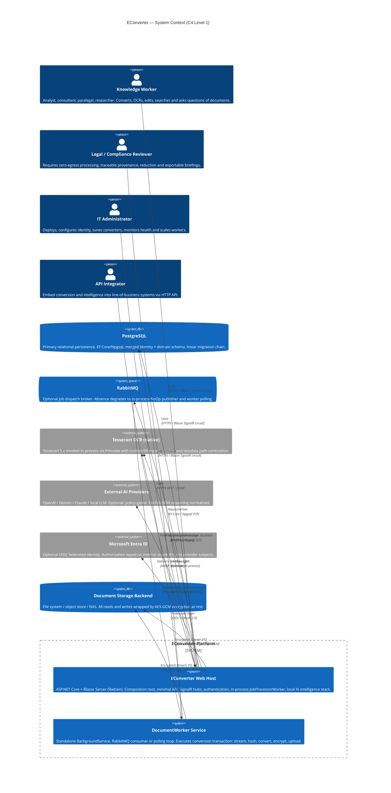
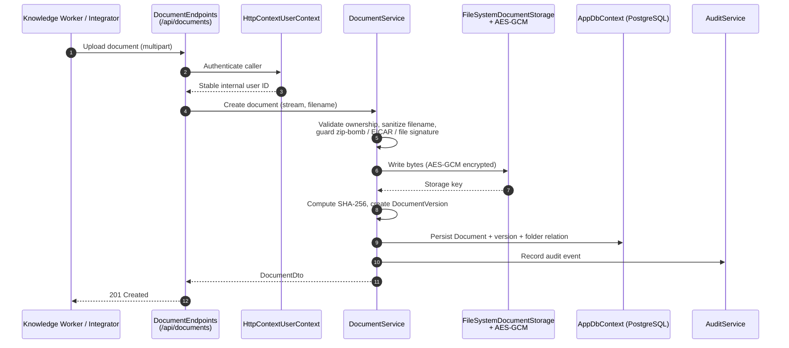
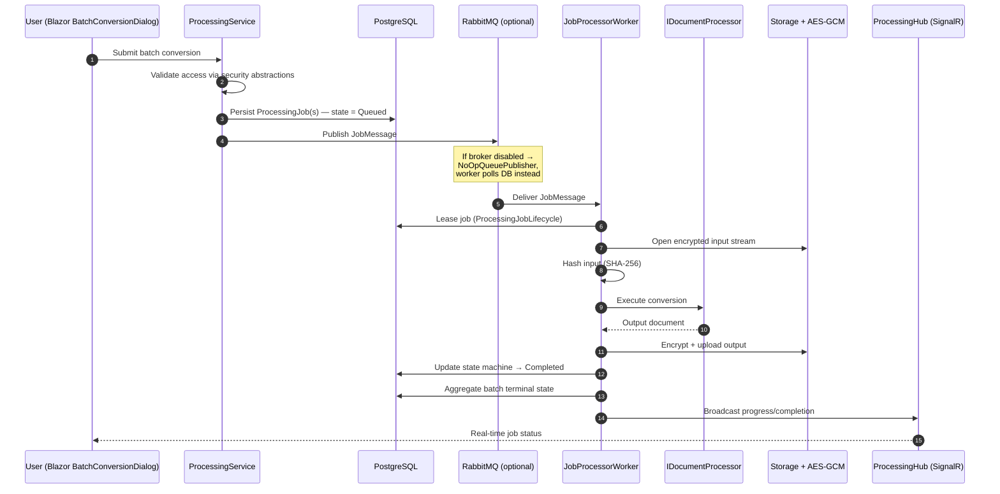
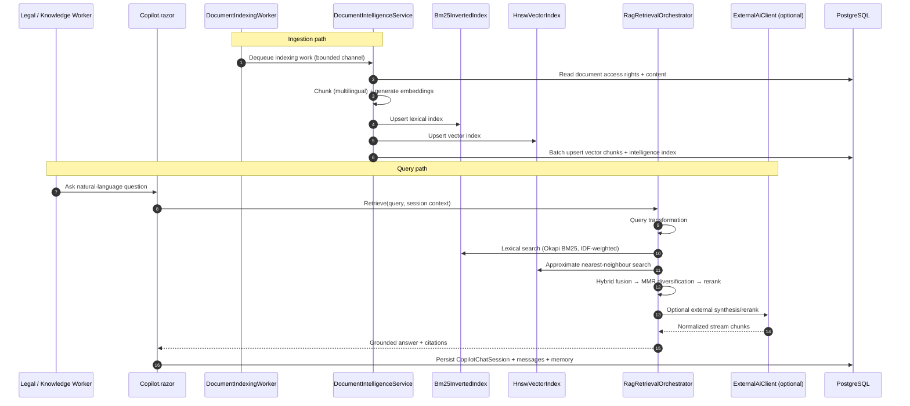
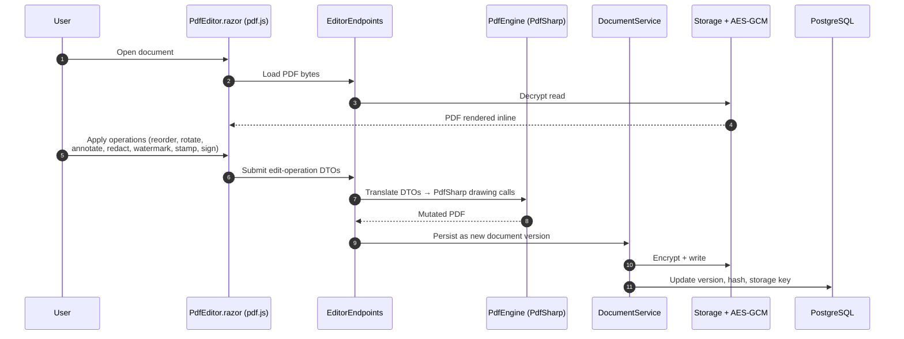
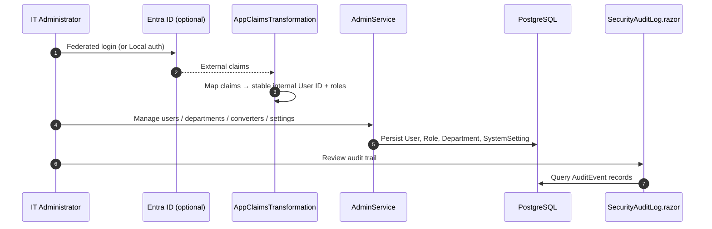

# EConverter — C4 Level 1 System Context Architecture

**Document type:** C4 Model — Level 1 (System Context)
**System:** EConverter — Enterprise Document Conversion & Intelligence Platform
**Generated:** 2026-11-19 09:11:11 (UTC) (`1795079471`)
**Research basis:** Domain Modules Research Report (confidence 9.0) · System Context Research Report (confidence 0.93)

---

## 1. Project Introduction

### 1.1 What EConverter Is

EConverter is a **self-hosted, enterprise-grade document conversion and intelligence platform** built on ASP.NET Core with a Blazor Server (Radzen) presentation layer and an optional standalone worker microservice. It consolidates the fragmented document toolchain most organisations operate — format converters, OCR utilities, PDF editors, and AI document assistants — into a single governed platform with one identity model, one audit surface, and one storage model.

The system is not merely a converter. It spans five distinct capabilities under a unified architecture:

| Capability | Description |
|---|---|
| **Document Lifecycle** | Upload, folder organisation, versioning, SHA-256 provenance hashing, rename/move, soft delete, restore, purge |
| **Asynchronous Conversion** | Lease-based `ProcessingJob` state machine, batch semantics, RabbitMQ dispatch with polling fallback, horizontally scalable workers |
| **Conversion & OCR** | PDF ↔ Office (DOCX/XLSX/PPTX/Markdown/EPUB), image processing, compression, Tesseract 5.x OCR with cross-platform native loading |
| **Document Intelligence** | Local zero-egress BM25 lexical index, HNSW vector index, RAG retrieval orchestration with MMR + rerank, copilot Q&A, dossier export |
| **PDF Authoring** | Page structure manipulation, annotation, form fields, redaction, watermark, ink/signature, digital signatures |

### 1.2 Core Value Proposition

The platform's value runs on four axes, each grounded in a concrete architectural decision:

**(1) Data Sovereignty & Compliance.** The intelligence stack — BM25 inverted index, HNSW vector index, RAG retrieval, classification — executes **in-process with zero mandatory egress**. Documents containing confidential material never leave the operator's infrastructure. This directly addresses the dominant blocker for AI adoption in regulated sectors (legal, healthcare, finance, public sector). The optional external AI gateway preserves freedom to use frontier models *where policy permits*, without re-architecting.

**(2) Operational Consolidation.** Conversion, OCR, editing, retrieval, and briefing generation operate under one identity (`User` aggregate with stable internal IDs), one audit surface (`AuditEvent` persistence), and one storage model (AES-GCM encrypted, pluggable backend).

**(3) Scalability.** Asynchronous leased jobs with batch semantics and independently deployable workers absorb large conversion backlogs without blocking interactive users. Critically, the message broker is an **accelerator, not a hard dependency** — the web host falls back to `NoOpQueuePublisher` and the worker degrades to a polling loop.

**(4) Accelerated Knowledge Work.** RAG-grounded Q&A, cross-document comparison, clause finding, and one-click executive dossiers (PDF/DOCX/XLSX/Markdown) turn a static archive into queryable institutional knowledge.

### 1.3 Technical Characteristics

- **Clean Architecture / DDD** across seven projects: Domain, Contracts, Application, Infrastructure, Web, Workers/DocumentWorker, and BuildingBlocks (Processing.Abstractions + Security).
- **Persistence:** Single EF Core `AppDbContext` over Npgsql, merging ASP.NET Core Identity tables with the domain schema through a linear migration chain.
- **Security-first:** Authorization keyed on **stable internal entity IDs** rather than identity-provider subjects; dual authentication (Local + EntraId); domain-enforced document ownership; AES-GCM storage encryption; malware/zip-bomb/file-signature guarding; language-code sanitization against tessdata path injection.
- **Graceful degradation:** Every external dependency has an in-process fallback path.

---

## 2. Target Users

EConverter serves four distinct actor roles. Each is a **human actor** crossing the system boundary — represented as a C4 Person, not an internal component.

### 2.1 Knowledge Workers and Business Professionals

> *Individual contributors who handle documents daily — analysts, consultants, paralegals, administrators, researchers.*

| Scenario | Interaction Surface | Need Addressed |
|---|---|---|
| Convert a DOCX report to PDF for distribution | Blazor Documents page → `BatchConversionDialog` | Reliable, layout-preserving conversion |
| Turn a scanned contract into searchable text | Editor → OCR dialog → `TesseractOcrEngine` | OCR of image-only PDFs |
| Ask "what did we agree on payment terms?" | Copilot chat workspace | Semantic search + natural-language Q&A |
| Annotate and redact a draft before circulation | `PdfEditor.razor` with bundled pdf.js | Direct PDF editing |
| Monitor a 40-document batch conversion | SignalR progress via `ProcessingHub` | Real-time job tracking |

**Primary pain removed:** context-switching across a dozen disconnected tools with inconsistent identity and no unified record.

### 2.2 Legal, Compliance and Audit Teams

> *Professionals in regulated functions who must keep sensitive documents on-premises while still benefiting from AI-assisted review.*

| Scenario | Interaction Surface | Need Addressed |
|---|---|---|
| Query a confidential case archive with AI | Copilot (local intelligence stack, zero egress) | Guaranteed on-premises processing |
| Compare two contract versions clause-by-clause | RAG retrieval + dossier export | Grounded, citable cross-document analysis |
| Produce a board briefing | `CopilotDossierExporter` → PDF/DOCX/XLSX | Publication-ready deliverables |
| Prove a document was never altered | `Document` aggregate SHA-256 + version history | Immutable provenance |
| Redact privileged material | Editor redaction primitives | Redaction within the governed platform |
| Review who accessed what | `SecurityAuditLog.razor` over `AuditEvent` | Compliance-grade audit trail |

**Critical requirement:** zero-egress execution is not a preference — it is a procurement condition. The architecture treats it as a contract: `DocumentIntelligenceService` mandates local execution of core analysis, vector search, classification, and RAG.

### 2.3 Enterprise IT Administrators and Platform Operators

> *Operations staff who deploy, configure, secure and monitor the platform.*

| Scenario | Interaction Surface | Need Addressed |
|---|---|---|
| Onboard a department | `UsersAndDepartments.razor` → `AdminService` | Central user/role/department management |
| Enable SSO for the organisation | EntraId OIDC configuration | Dual authentication integration |
| Tune converter availability and limits | `ConvertersCatalog.razor` | Governed converter catalog |
| Monitor job backlog health | OpenTelemetry + health checks + job state queries | Observability |
| Scale conversion throughput | Deploy additional `DocumentWorker` instances | Horizontal worker scaling |
| Change storage backend or encryption keys | `IDocumentStorage` / `StorageEncryptionOptions` | Pluggable infrastructure |

**Architectural guarantees this role relies on:** health checks, OpenTelemetry export, queue-or-polling job consumption, and configuration-driven storage/encryption — none of which require code changes.

### 2.4 Software Integrators and API Consumers

> *Internal development teams and automation engineers embedding capabilities into line-of-business systems.*

| Scenario | Interaction Surface | Need Addressed |
|---|---|---|
| Submit a conversion from an ERP system | `POST /api/...` → `ProcessingEndpoints` | Programmatic job submission |
| Upload documents from a scanner pipeline | `/api/documents` (`DocumentEndpoints`) | Stable, typed document API |
| Poll job status or cancel a stuck job | `IProcessingService` contract via HTTP | Predictable status/cancellation semantics |
| Authenticate service-to-service | Bearer token / authenticated minimal API | Predictable authorization per endpoint |

**Trade-off acknowledged:** the research identifies one structural tension — `DocumentEndpoints.cs` mixes transport with inline conversion logic, and several high-value orchestrators live in Infrastructure rather than Application. Integrators are therefore coupled to endpoint contracts that should remain stable while the internal layering is refactored.

---

## 3. System Boundaries

### 3.1 Scope Definition

The EConverter system boundary at C4 Level 1 encompasses **the entire self-hosted document conversion and intelligence platform**:

- The ASP.NET Core web host — Blazor Server UI, minimal API endpoints, SignalR hubs, hosted background job processor, authentication and middleware pipeline
- The `DocumentWorker` service — RabbitMQ consumer / polling worker executing the conversion transaction
- Domain and Application layers — business rules and use-case orchestration (document lifecycle, processing jobs and batches, AI intelligence, editor operations, security, storage)
- Contracts layer — API/DTO surface
- Building blocks — processing abstractions and security primitives
- Infrastructure adapters binding these to PostgreSQL, RabbitMQ, storage, native OCR, and optional external AI providers
- **The process-local AI intelligence stack** — BM25, HNSW, RAG orchestration, dossier export — explicitly inside the boundary because it executes in-process without external egress

### 3.2 Included Core Components

| Component | Responsibility |
|---|---|
| `DocumentConverter.Web` | Composition root, HTTP/Blazor pipeline, middleware, authentication, SignalR hubs, minimal API endpoints |
| `DocumentConverter.Web.HostedServices` | `JobProcessorWorker` and related background services driving the in-process conversion pipeline and batch completion |
| `DocumentConverter.Web.Components` | Blazor/Radzen UI pages for Documents, Editor, Copilot, Jobs, Tools, Admin, Account |
| `DocumentConverter.Application` | Use-case contracts: AI, Admin, Documents, Editor, Processing, Security, Storage |
| `DocumentConverter.Domain` | Aggregates and invariants: `Document`, `User`, `ProcessingJob`, `JobLifecycle` state machine, AI/Processing/Security/System models |
| `DocumentConverter.Contracts` | Transport DTOs and messages: AI, Admin, Documents, Editor, Messages, Processing |
| `DocumentConverter.Infrastructure` | Adapters: persistence (EF Core/Npgsql + migrations), AI (`ExternalAiClient`, `DocumentIntelligenceService`, BM25, HNSW, `RagRetrievalOrchestrator`, `CopilotDossierExporter`, `RagBenchmarkRunner`), OCR (`TesseractOcrEngine`), Office processing, Editor rendering (`PdfEngine`), Identity, Messaging, Security/StorageEncryption, Storage |
| `BuildingBlocks.Processing.Abstractions` | Converter/processor contracts shared by host and worker |
| `BuildingBlocks.Security` | Authorization and security primitives used across layers |
| `Workers.DocumentWorker` | Standalone `BackgroundService` microservice consuming queued jobs, streaming and hashing documents, encrypting and uploading outputs |

### 3.3 Excluded External Dependencies

Everything **outside** the boundary is either a human actor or an external system. These are **not** project code and are represented as external dependencies:

| Excluded | Rationale |
|---|---|
| PostgreSQL database server | Operator-managed infrastructure |
| RabbitMQ broker | External infrastructure; optional, with `NoOpQueuePublisher` and polling fallbacks *inside* the boundary |
| Microsoft Entra ID / any IdP | Consumed via OIDC; outside the boundary |
| OpenAI / Gemini / Claude / third-party LLM APIs | Optional external services, not required for core intelligence |
| Underlying file system / object store / NAS | Operator-managed storage substrate |
| Tesseract native binaries, tessdata packs, other native libraries | Vendored third-party dependencies, not project code |
| Radzen, PdfPig, PdfSharp, OpenXml, SkiaSharp, other NuGet libraries | Third-party runtime dependencies |
| pdf.js browser assets | Third-party front-end library served to clients |
| OpenTelemetry backend / observability collector | External monitoring platform |
| End-user browsers, OS, client devices | Outside the system |
| Reverse proxies, TLS terminators, load balancers, container orchestration | Hosting infrastructure |

### 3.4 Boundary Rationale — The Zero-Egress Decision

The most consequential boundary decision is the **placement of the AI intelligence stack inside the boundary**. Conventional architectures would treat "AI" as an external SaaS call. EConverter instead treats it as a process-local capability:

```
┌─────────────────────────── SYSTEM BOUNDARY ───────────────────────────┐
│                                                                       │
│   DocumentIntelligenceService ── BM25InvertedIndex                    │
│            │                    HnswVectorIndex                       │
│            ├── chunk + embed     │                                    │
│            └── RagRetrievalOrchestrator ── MMR ── rerank              │
│                                                                       │
│   ⟶ NO EGRESS REQUIRED for: classification, vector search,            │
│      RAG retrieval, copilot grounding, dossier synthesis              │
│                                                                       │
└───────────────────────────────────────────────────────────────────────┘
              │ optional, policy-gated
              ▼
     External AI Providers (OpenAI / Gemini / Claude / Local LLM)
```

**Consequence:** the operator can satisfy a "no data leaves our network" mandate **without disabling the AI features**. The external gateway is additive, not foundational.

---

## 4. External System Interactions

### 4.1 External System Inventory

| # | External System | Interaction Type | Protocol / Mechanism | Mandatory? |
|---|---|---|---|---|
| E1 | **PostgreSQL Database** | Synchronous | EF Core ORM over Npgsql TCP; migrations on startup | **Yes** |
| E2 | **RabbitMQ Message Broker** | Asynchronous | Publish/subscribe `JobMessage` payloads | No — degrades to polling |
| E3 | **Tesseract OCR Engine (native)** | In-process interop | P/Invoke with custom `DllImport` resolver | Yes (for OCR capability) |
| E4 | **External AI Providers** | Sync + streaming | HTTPS REST with SSE/NDJSON chunked responses | No — local stack is primary |
| E5 | **Microsoft Entra ID** | Synchronous | OpenID Connect / OAuth 2.0 | No — Local auth available |
| E6 | **Document Storage Backend** | Synchronous | Stream-based read/write via storage abstraction + AES-GCM | **Yes** |
| E7 | **Blazor Server Clients (Browsers)** | Bidirectional | SignalR/WebSocket circuit + HTTP static assets | **Yes** |
| E8 | **API Clients and Integrators** | Synchronous | HTTP/HTTPS REST with JSON | **Yes** |

### 4.2 Detailed Interaction Analysis

#### E1 — PostgreSQL Database *(mandatory, single source of truth)*

- **Contract:** One `AppDbContext` merges ASP.NET Core Identity tables with the domain schema. Startup provisioning performs PostgreSQL-specific checks (`to_regclass`) and applies the linear migration chain (baseline: `InitialCreate`, through vector provenance, copilot persistence, tri-language chunk support, and embedding-column widening).
- **Coupling strength:** highest in the system. Jobs, batches, documents, folders, versions, vector chunks, audit events, users, and system settings all persist here.
- **Failure mode:** total unavailability. No in-process fallback exists for relational persistence.
- **Architectural note:** the merge of Identity schema and domain schema into one context simplifies transactions and migration ordering at the cost of tighter coupling between identity infrastructure and business schema.

#### E2 — RabbitMQ Message Broker *(optional, accelerator)*

- **Contract:** `RabbitMqJobDispatcher` publishes `JobMessage` payloads; workers in both the web host (`JobProcessorWorker`) and the standalone `DocumentWorker` consume them.
- **Graceful degradation — two independent fallbacks:**
  - **Publisher side:** `NoOpQueuePublisher` — job is persisted, no message emitted.
  - **Consumer side:** worker polling loop against the `ProcessingJob` table.
- **Lease-based state machine:** `ProcessingJobLifecycle` is the single authority on legal transitions, worker leasing, lease renewal, terminal states, cancellation, and retry eligibility.
- **Architectural insight:** because the database is the authoritative job store and the broker is only a notification accelerator, **broker loss degrades latency, not correctness**. This is what permits a single-node deployment with zero messaging infrastructure.

#### E3 — Tesseract OCR Engine *(native, in-process)*

- **Contract:** `TesseractOcrEngine` resolves tessdata paths, creates platform-specific native symlinks (`.so`/`.dylib`/`.dll`), and installs a custom `DllImport` resolver for cross-platform loading.
- **Security hardening:** language codes are sanitized to prevent tessdata traversal or language injection — a genuine path-injection vector in naive Tesseract wrappers.
- **Output:** word-level bounding boxes, confidence scores, page dimensions, aggregated per page.
- **Companion:** `ScannedPdfDetector` determines whether OCR is required at all, avoiding wasted compute on text-bearing PDFs.
- **Deployment consequence:** the container image must carry native binaries and language packs; this is a **build-time dependency**, not a runtime network dependency.

#### E4 — External AI Providers *(optional, policy-gated)*

- **Contract:** `ExternalAiClient` builds provider-specific completion requests and headers, then **normalizes streaming SSE/NDJSON responses into a single provider-agnostic chunk model**. Supports connectivity pings and timeout management.
- **Providers:** OpenAI, Google Gemini, Anthropic Claude, or local LLM endpoints.
- **Architectural constraint:** the `DocumentIntelligenceService` contract *mandates* local, zero-egress execution of core analysis, vector search, classification, and RAG. External providers are used for optional synthesis or reranking.
- **Configuration surface:** provider selection, endpoint, credentials, and policy are operator-controlled. Disabling egress entirely leaves all retrieval, classification, and copilot grounding functional.

#### E5 — Microsoft Entra ID *(optional, dual-auth)*

- **Contract:** OIDC/OAuth 2.0 federated authentication. `AppClaimsTransformation` maps external claims onto the **stable internal identity**.
- **Critical design decision:** the `User` aggregate records `AuthenticationType` (Local or EntraId) but authorization is keyed on the **internal stable entity ID**, not the external subject claim. This decouples application permissions from provider-side identity churn — renaming, migrating, or replacing an IdP does not orphan document ownership.
- **Fallback:** Local authentication works with no IdP configured.

#### E6 — Document Storage Backend *(mandatory, encrypted)*

- **Contract:** `IDocumentStorage` is a stream-based contract with a file-system implementation (`FileSystemDocumentStorage`). Storage provider and key are recorded on the `Document` aggregate.
- **Encryption:** `AesGcmStorageEncryptionService` wraps every operation transparently — AES-GCM on write, decrypt on read.
- **Provenance:** inputs hashed with SHA-256 before conversion; outputs encrypted before upload.
- **Substitution:** object stores or NAS can be introduced without touching callers.
- **Coupling strength:** 9.0 — every document byte entering or leaving the system passes through this domain.

#### E7 — Blazor Server Clients *(mandatory)*

- **Contract:** persistent SignalR circuit for interactive UI. pdf.js assets bundled in `wwwroot` and served statically for client-side PDF rendering.
- **Real-time channel:** `JobNotificationService` → `ProcessingHub` broadcasts progress and completion events, eliminating API polling from the browser.
- **Latency sensitivity:** Blazor Server holds server-side state per circuit; long-running conversions must remain asynchronous (which they are) to avoid circuit starvation.

#### E8 — API Clients and Integrators *(mandatory)*

- **Contract:** minimal API surface — `/api/documents` for document management, plus job and batch endpoints for conversion submission, status query, and cancellation. JSON payloads over HTTP/HTTPS.
- **Authorization semantics:** consistent per-endpoint enforcement through `HttpContextUserContext`, resolving the stable internal user ID before any application service executes.

### 4.3 Dependency Relationship Analysis

Categorising external dependencies by criticality reveals the system's deployment posture:

| Class | Systems | Implication |
|---|---|---|
| **Hard dependencies** | PostgreSQL, Storage Backend | System cannot operate without them. Provisioned in every deployment. |
| **Capability dependencies** | Tesseract natives | Required only for OCR/scanning features; build-time provisioning. |
| **Client dependencies** | Browsers, API clients | Required for *user* interaction, not for background processing. |
| **Soft dependencies (accelerators)** | RabbitMQ, External AI providers | Absence degrades latency or synthesis quality — never correctness. |
| **Soft dependencies (federation)** | Entra ID | Absence requires Local auth to be enabled. |

**Deployment posture unlocked by this classification:** a fully functional, entirely offline single-node installation is achievable with only PostgreSQL, the storage backend, and Tesseract natives — no broker, no IdP, no cloud AI. This is the architecture's most valuable property for regulated buyers.

---

## 5. System Context Diagram

### 5.1 C4 Level 1 — System Context



### 5.2 Key Interaction Flows

#### Flow A — Document Upload & Lifecycle (highest business importance: 9.5)



**Boundary crossings:** User (actor) → Web Host → PostgreSQL (E1) / Storage (E6).

#### Flow B — Asynchronous Conversion Job (importance: 9.5)



**Boundary crossings:** User → Web Host → PostgreSQL (E1) → RabbitMQ (E2, optional) → Worker → Tesseract (E3, if OCR) → Storage (E6) → back to PostgreSQL (E1).

#### Flow C — Document Intelligence & RAG Q&A (importance: 9.0)



**Boundary crossings:** User → Web Host (local AI stack, **no egress**) → optional External AI Providers (E4) → PostgreSQL (E1). The query path is fully functional with E4 absent.

#### Flow D — PDF Editing & Annotation (importance: 7.5)



#### Flow E — Administration, Identity & Audit (importance: 7.0)



### 5.3 Architecture Decision Descriptions

Five context-level decisions shape everything downstream:

| # | Decision | Context-Level Rationale | Consequence |
|---|---|---|---|
| **AD-1** | **Local AI stack inside the boundary** | Regulated-sector adoption requires zero mandatory egress. | Enables offline deployment; mandates in-process index lifecycle management (BM25/HNSW memory footprint, rebuild strategy). |
| **AD-2** | **Broker is an accelerator, DB is authoritative** | Single-node deployments must not require RabbitMQ. | `NoOpQueuePublisher` + polling loop are permanent architectural features, not temporary fallbacks. Correctness depends on job state machine `ProcessingJobLifecycle`, not message delivery. |
| **AD-3** | **Authorization on internal stable IDs** | IdP churn must not orphan document ownership. | `User.AuthenticationType` distinguishes Local/EntraId, but every authorization decision resolves internal entity IDs. IdP migration becomes an identity-mapping exercise, not a data migration. |
| **AD-4** | **Single unified `AppDbContext`** | Transactional consistency across identity and domain, linear migration ordering. | Simplifies atomic operations; couples identity schema evolution to domain schema evolution. Migration chain is the schema authority. |
| **AD-5** | **Two deployables sharing one domain model** | Horizontal scaling of conversion throughput without scaling the interactive host. | `DocumentWorker` and the web host share Domain, Contracts, Infrastructure, and BuildingBlocks. Worker has its own Dockerfile and lifecycle. |

---

## 6. Technical Architecture Overview

### 6.1 Main Technology Stack

| Layer | Technology | Role |
|---|---|---|
| **Presentation** | Blazor Server, Radzen components, pdf.js | Interactive UI over persistent SignalR circuit |
| **Hosting** | ASP.NET Core, minimal APIs, SignalR hubs | Composition root, HTTP pipeline, real-time notifications |
| **Application** | C# use-case contracts (`IDocumentService`, `IProcessingService`, `IDocumentIntelligenceService`, `IPdfEngine`, `IAdminService`, `IAuditService`, `IUserContext`) | Transport-agnostic orchestration |
| **Domain** | Aggregates, invariants, `ProcessingJobLifecycle` state machine | Single authority on business rules |
| **Persistence** | EF Core + Npgsql, single `AppDbContext`, linear migrations | Merged Identity + domain schema |
| **Messaging** | RabbitMQ (`RabbitMqJobDispatcher`) + `NoOpQueuePublisher` + polling | Job dispatch with graceful degradation |
| **Document Processing** | PdfPig (extraction), PdfSharp (rendering), OpenXML (construction), SkiaSharp (imaging) | Format transformation and PDF authoring |
| **OCR** | Tesseract 5.x via P/Invoke, custom `DllImport` resolver | Cross-platform text extraction |
| **Intelligence** | Custom BM25 inverted index, custom HNSW vector index, RAG orchestrator | Local zero-egress retrieval and synthesis |
| **External AI** | `ExternalAiClient` — OpenAI / Gemini / Claude / local | Optional synthesis, streaming SSE/NDJSON normalized |
| **Security** | ASP.NET Core Identity, OIDC (EntraId), AES-GCM, ClamAV adapter | Authentication, authorization, encryption, malware scanning |
| **Observability** | OpenTelemetry, health checks | Telemetry and readiness |

### 6.2 Architecture Patterns

**Clean Architecture / Domain-Driven Design.** Dependency direction points inward: Web → Application → Domain, with Infrastructure implementing Application contracts. Seven projects enforce the layering, with two reusable building blocks (`Processing.Abstractions`, `Security`) shared between the host and the worker.

**Aggregate-root ownership enforcement.** `Document.IsOwnedBy` is a *domain invariant*, meaning no downstream feature — conversion, intelligence, editor — can bypass authorization. Security is not a cross-cutting filter bolted on; it is structural.

**State machine as single authority.** `ProcessingJobLifecycle` governs every transition, lease, retry, and terminal state. Both the in-process worker and the standalone worker obey the same state machine, which is why they are interchangeable.

**Bounded-channel background indexing.** `DocumentIndexingWorker` feeds `DocumentIntelligenceService` through a bounded channel, preventing unbounded memory growth from large ingestion bursts and applying backpressure naturally.

**Provider-agnostic external gateways.** `ExternalAiClient` normalizes four provider APIs into one chunk model; `IDocumentStorage` normalizes file system/object store/NAS into one stream model. Substitution is a configuration change.

### 6.3 Key Design Decisions at Runtime

**Graceful degradation as a first-class concern.** Every crossing of the boundary to a soft dependency has a defined fallback path. This is not defensive coding — it is an architectural property that determines deployment feasibility.

**Evidence-grade provenance.** SHA-256 content hashing at ingestion, version history, and audit events mean any document's state can be reconstructed and its integrity verified. For legal and compliance users, this is a hard requirement, not a feature.

**Input hardening before the pipeline.** Filename sanitization, file-signature detection, EICAR detection, zip-bomb guarding, and language-code sanitization all execute *before* documents reach conversion or OCR. The attack surface of the conversion pipeline is reduced at the boundary.

**Layered prioritisation of concerns.** Interactive user latency (Blazor circuits) is protected from conversion workloads by making all conversions asynchronous. Batch backlogs never block the explorer, the editor, or the copilot.

### 6.4 Structural Tensions — Honest Assessment

The research identifies two architectural tensions worth surfacing to stakeholders:

**Tension 1 — Orchestrator placement.** Several high-value orchestrators (`DocumentIntelligenceService`, `RagRetrievalOrchestrator`, `DocumentService`) live in `Infrastructure` rather than `Application`. This means the Application layer expresses contracts but not orchestration logic for these concerns, which weakens the layering's conceptual purity. *Impact at context level:* none on external behaviour; *impact on evolution:* refactoring these into Application would require interface additions and DI rewiring, but no contract changes.

**Tension 2 — Transport/logic bleed.** `DocumentEndpoints.cs` mixes minimal-API transport with inline document conversion logic, rather than delegating entirely to `IDocumentService`. *Impact at context level:* API contract stability becomes coupled to endpoint implementation details. *Mitigation:* integrators should target the documented DTO contracts, not infer behaviour from endpoint internals.

Neither tension affects the C4 Level 1 context — they are internal structural concerns that surface at Level 2 (Container) and Level 3 (Component) analysis.

---

## Appendix A — Deployment Posture Matrix

The context analysis yields three valid configurations, each satisfying the boundary definition:

| Configuration | E1 PostgreSQL | E3 Tesseract | E6 Storage | E2 RabbitMQ | E4 External AI | E5 Entra ID |
|---|---|---|---|---|---|---|
| **Air-gapped Sovereign** | required | required (for OCR) | required | omitted (polling) | omitted | omitted (Local auth) |
| **Standard Enterprise** | required | required | required | required | omitted | required |
| **Federated + Frontier** | required | required | required | required | required | required |

**Every configuration delivers:** document lifecycle, asynchronous conversion, OCR, PDF editing, local RAG retrieval, classification, and copilot grounding. Configurations differ only in scaling characteristics and synthesis quality.

## Appendix B — Interaction Summary by Boundary Crossing

| Actor / System | Primary Interaction | Boundary Entry Point |
|---|---|---|
| Knowledge Worker | Interactive UI, document operations, job monitoring | Blazor SignalR circuit |
| Legal / Compliance | Local AI Q&A, dossier export, audit review | Blazor SignalR circuit |
| IT Administrator | Identity, converter, settings, audit management | Blazor SignalR circuit |
| API Integrator | Document CRUD, job submission, status polling | `/api/documents`, job endpoints |
| PostgreSQL | Persistence and job leasing | EF Core/Npgsql |
| RabbitMQ | Job message dispatch | AMQP |
| Tesseract | Text extraction | P/Invoke |
| External AI | Optional synthesis / reranking | HTTPS SSE/NDJSON |
| Entra ID | Federated authentication | OIDC |
| Storage Backend | Encrypted document I/O | `IDocumentStorage` + AES-GCM |

---

*Document classification: C4 Level 1 — System Context*
*Derived from domain and system-context research; no inference beyond reported findings.*
*Generated 2026-11-19 09:11:11 (UTC)*