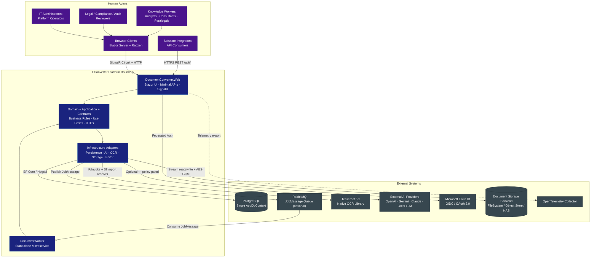
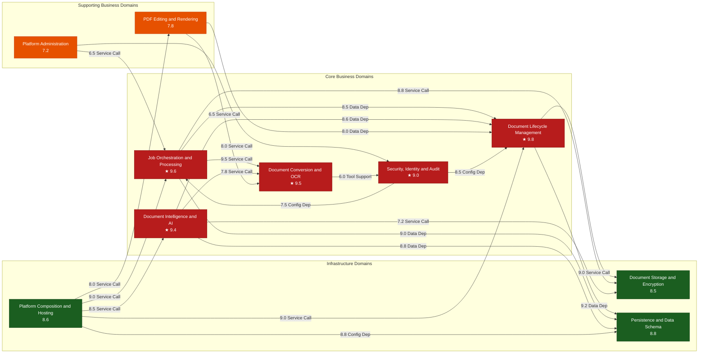
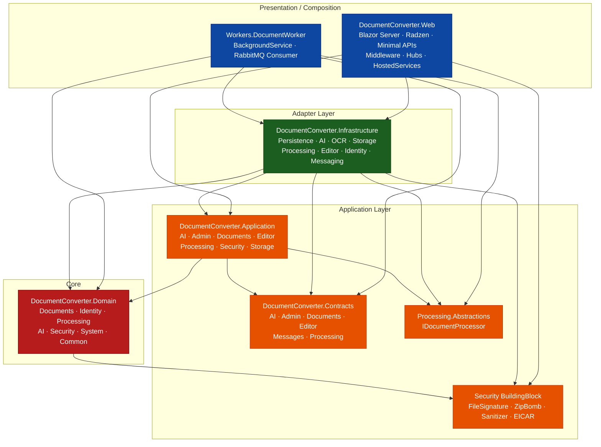
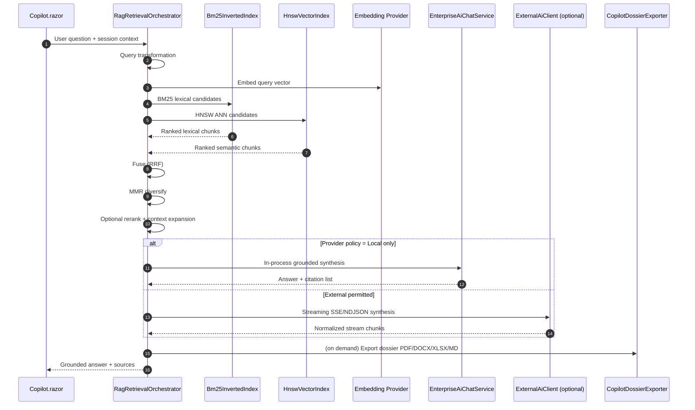
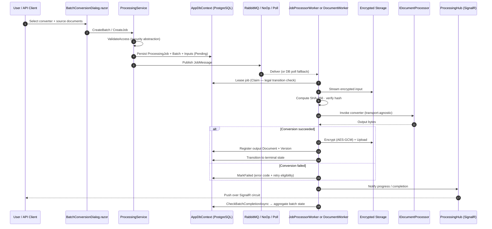
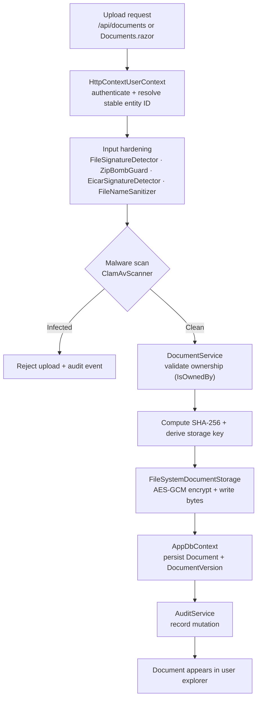
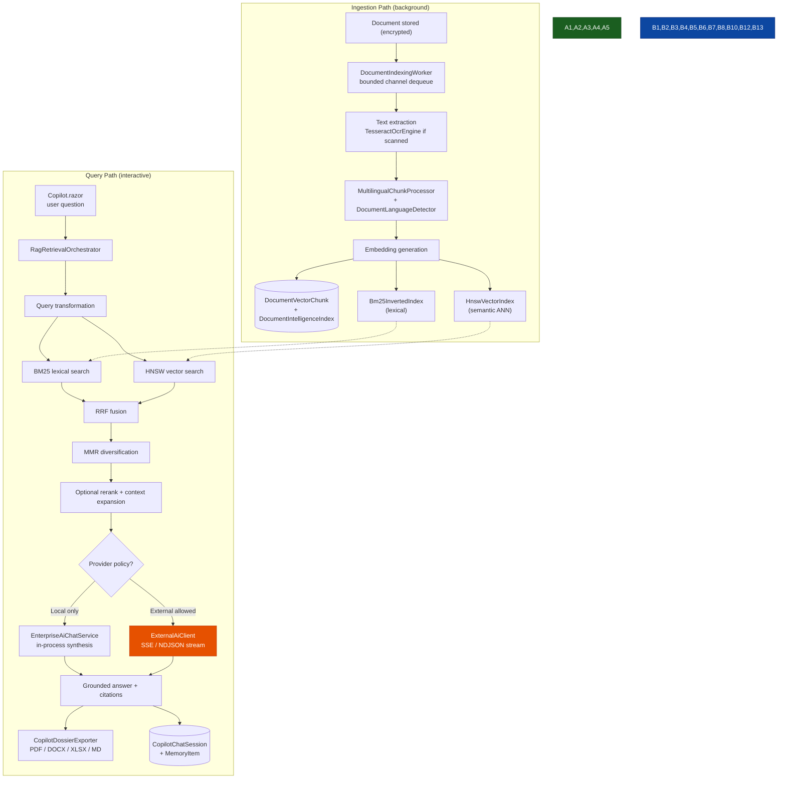
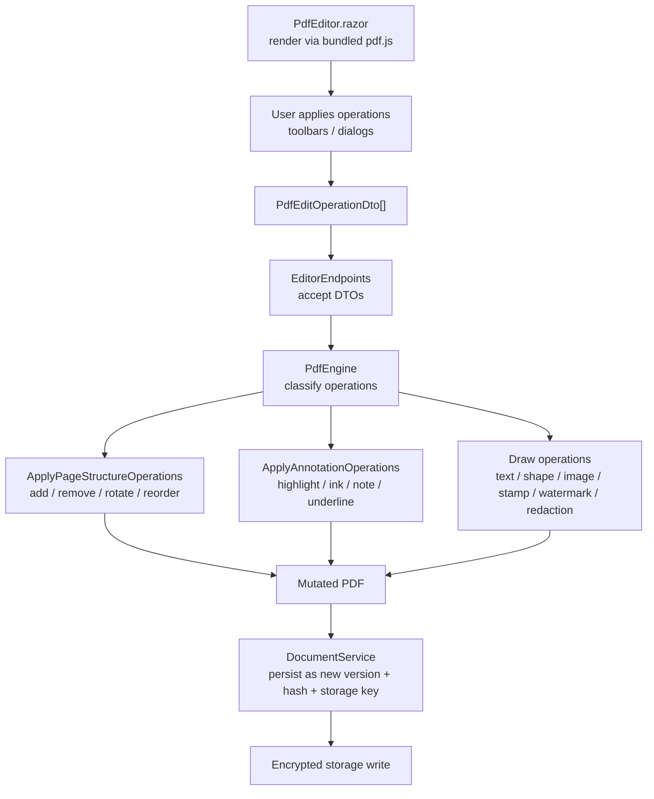
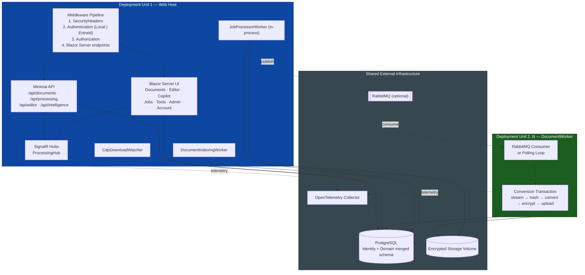

# EConverter — C4 Architecture Documentation

> **Classification:** Internal Engineering Reference
> **Scope:** Self-hosted document conversion & intelligence platform
> **Status:** Reverse-engineered from research reports (no external design docs supplied)
> **Confidence:** High (0.93 system context / 9.0 domain / internal-consistency validated)
> **Cold read. Trail parsed. Building from evidence only — claims marked SOLID / PLAUSIBLE / UNVERIFIABLE where the materials are silent.**

---

## 1. Architecture Overview

### 1.1 Design Philosophy

EConverter is a **regulated-sector document platform that refuses to be a SaaS**. That single constraint drives every architectural decision downstream of it. Four principles define the design:

| Principle | Architectural Consequence |
|---|---|
| **Data sovereignty by structure, not policy** | The intelligence stack (BM25, HNSW, RAG, dossier export) executes **in-process** inside the system boundary. External AI is an *opt-in exception branch*, never the default path. Zero-egress is enforced by the call graph, not by a configuration flag an operator can forget. |
| **Broker as accelerator, not dependency** | RabbitMQ is optional. A `NoOpQueuePublisher` + DB polling fallback means the same code executes on a single-node laptop deployment and a 20-worker fleet. No feature requires a broker to function. |
| **Single authority for every invariant** | Job state lives in `ProcessingJobLifecycle`. Ownership lives in the `Document` aggregate. Authorization keys on a **stable internal entity ID**, never a provider subject. No downstream feature can construct a bypass because the invariant travels with the entity. |
| **Graceful degradation over hard failure** | Per-job error isolation in the worker, lease-based recovery after crash, polling fallback without a broker, local synthesis fallback without an AI provider. Every external dependency has a degraded-but-functional mode. |

The architecture is **Clean Architecture / DDD layered** (Domain → Application → Contracts → Infrastructure → Web/Worker), over ASP.NET Core, with a Blazor Server + Radzen presentation layer and an optional standalone worker microservice.

### 1.2 Core Architectural Patterns

| Pattern | Location | Purpose |
|---|---|---|
| **Layered (Clean) Architecture** | 7 projects | Dependency DAG: domain has zero infrastructure knowledge |
| **Domain-Driven Design** | `Domain` project | Aggregates (`Document`, `ProcessingJob`, `BatchJob`, `User`), lifecycle helpers, domain-enforced invariants |
| **Composition Root** | `Web/Program.cs`, `Workers/DocumentWorker/Program.cs` | Host projects are the *only* places that know concrete types |
| **Repository / Unit of Work** | `AppDbContext` (single context) | One transactional boundary; Identity + domain schema merged |
| **Lease-based Work Distribution** | `ProcessingJob.Claim/RenewLease` | Crash-tolerant, no distributed lock manager required |
| **Publish-Subscribe with Fallback** | `RabbitMqJobDispatcher` + `NoOpQueuePublisher` | Broker optional; DB polling is the degrade path |
| **Strategy** | `IDocumentProcessor` (Office/PDF/Image/OCR/Compress/Echo) | Transport-agnostic conversion across both hosts |
| **Adapter** | `Infrastructure/*` | Every external concern (EF Core, AI, OCR, storage, messaging) behind an application-layer interface |
| **Hybrid Retrieval (BM25 + HNSW)** | `RagRetrievalOrchestrator` | Lexical + semantic fusion, then MMR diversify, then optional rerank |
| **Bounded Channel Backpressure** | `DocumentIndexingChannel` | Protects the indexing pipeline from unbounded memory growth |

### 1.3 Technology Stack

| Layer | Technology | Notes |
|---|---|---|
| **Runtime** | ASP.NET Core (.NET 8+) | Blazor Server + Minimal APIs + SignalR |
| **UI** | Blazor Server, Radzen components | Persistent SignalR circuit; pdf.js bundled in `wwwroot/lib/pdfjs` |
| **Domain/App** | C# — pure domain model | Application layer = contracts shell (see §6.5 drift) |
| **Persistence** | EF Core 8 + Npgsql → PostgreSQL | Single `AppDbContext`, Identity + domain schema merged |
| **Migrations** | EF Core migration chain | Baseline `InitialCreate`, ~5 downstream migrations (vector, copilot, tri-language, embedding widening) |
| **Messaging** | RabbitMQ (optional) | `RabbitMqJobDispatcher` publishes `JobMessage` |
| **Identity** | ASP.NET Core Identity (Local) + OIDC (EntraId) | Dual-mode, authorization on internal entity ID |
| **OCR** | Tesseract 5.x (native) | P/Invoke with custom `DllImportResolver` for cross-platform |
| **PDF** | PdfPig (extraction), PdfSharp (rendering), SkiaSharp (imaging), OpenXML (Office) | Office construction via OpenXML SDK |
| **AI (local)** | BM25 inverted index, HNSW ANN graph, RAG orchestrator | Zero-egress; runs in-process |
| **AI (external)** | OpenAI / Gemini / Claude / local LLM via HTTP | Streaming SSE/NDJSON normalizer |
| **Observability** | OpenTelemetry, health checks | Exported to external collector |
| **Deployment** | Docker / container orchestration | Web host + DocumentWorker as separate deployables |

---

## 2. System Context

### 2.1 System Positioning and Value

EConverter consolidates **fragmented, high-friction document workflows** — converters, OCR utilities, PDF editors, AI document assistants — into a **governed, self-hostable platform**.

The differentiator is compliance-native AI: because the intelligence layer runs locally with no mandatory cloud egress, the platform addresses the **dominant adoption blocker** in regulated sectors (legal, healthcare, finance, public sector) — **documents containing confidential material never leave the operator's infrastructure**. Frontier models remain available where policy permits, without re-architecting.

Value runs on **four axes**:
1. **Data sovereignty** — sovereign document AI without SaaS dependency
2. **Operational consolidation** — conversion, OCR, editing, retrieval, briefing generation under one identity, one audit surface, one storage model
3. **Scalability** — asynchronous leased jobs with batch semantics absorb backlogs without blocking users
4. **Accelerated knowledge work** — RAG-grounded Q&A, cross-document comparison, clause finding, one-click executive dossiers turn a static archive into queryable institutional knowledge

### 2.2 User Roles and Scenarios

| Actor | Primary Need | Key Surfaces |
|---|---|---|
| **Knowledge Workers** | Convert files, OCR scans, semantic search, edit PDFs, track jobs | `Documents.razor`, `Copilot.razor`, `PdfEditor.razor`, `Jobs` page |
| **Legal / Compliance / Audit** | Zero-egress processing, clause finding, exportable dossiers, provenance | `Copilot.razor` + `CopilotDossierExporter`, `SecurityAuditLog.razor` |
| **IT Administrators** | User/role management, config, health, worker fleet tuning, storage & encryption control | `Admin/*` pages, `/health`, OpenTelemetry |
| **Software Integrators** | Programmatic submission, status polling, cancellation | `/api/documents`, `/api/processing`, `/api/editor` minimal APIs |

### 2.3 System Context Diagram (C4 Level 1)

### 2.4 System Boundary Definition

**Inside the boundary:**
- `DocumentConverter.Web` — composition root, HTTP/Blazor pipeline, middleware, authentication, SignalR hubs, minimal API endpoints
- `DocumentConverter.Web.HostedServices` — `JobProcessorWorker`, `DocumentIndexingWorker`, `CdpDownloadWatcher`
- `DocumentConverter.Web.Components` — Blazor/Radzen pages (Documents, Editor, Copilot, Jobs, Tools, Admin, Account)
- `DocumentConverter.Application` — use-case *contracts* (AI, Admin, Documents, Editor, Processing, Security, Storage)
- `DocumentConverter.Domain` — aggregates and invariants
- `DocumentConverter.Contracts` — transport DTOs and queue messages
- `DocumentConverter.Infrastructure` — all adapters (persistence, AI, OCR, Office, Editor, Identity, Messaging, Security, Storage)
- `BuildingBlocks.DocumentConverter.Processing.Abstractions` — converter contracts
- `BuildingBlocks.DocumentConverter.Security` — security primitives
- `Workers.DocumentWorker` — standalone worker service

**Excluded (external dependencies):** PostgreSQL server, RabbitMQ broker, Entra ID, external AI providers, underlying file system / object store / NAS, Tesseract native binaries and tessdata packs, third-party NuGet libraries (Radzen, PdfPig, PdfSharp, OpenXml, SkiaSharp), pdf.js browser assets, OpenTelemetry backend, end-user browsers, reverse proxies / TLS terminators / load balancers / orchestration platform.

**Boundary rule (the load-bearing invariant):** Process-local intelligence components live *inside* the boundary because they execute with zero egress. Only `ExternalAiClient` crosses out, and only when an operator explicitly configures a provider.

---

## 3. Container View

### 3.1 Domain Module Division

Domains are classified by **business value contribution** and **importance score** (from the domain research report):

**Coupling hotspots (strength ≥ 9.0):**
- `Document Lifecycle → Persistence (9.2)` — the aggregate is the schema authority target
- `Job Orchestration → Conversion (9.5)` — converter identity flows through the job
- `Job Orchestration → Persistence (9.0)` — lease/state machine lives entirely in the DB
- `Document Lifecycle → Storage (9.0)` — every byte passes the encryption wrapper
- `Composition → Documents/Jobs (9.0)` — host is the DI bind point

**Highest fan-in target is Persistence** (four domains at 8.8–9.2). Expected in a single-`DbContext` design, but it means schema migrations carry a system-wide blast radius.

### 3.2 Layered Architecture — Project Dependencies

**Observation:** `DocumentWorker` and `Web` both reference `Infrastructure` directly — a **pragmatic composition-root pattern** where host projects are the only places allowed to know concrete types. The dependency DAG is acyclic. The domain and application layers remain transport-agnostic.

> **Known drift (§6.5):** `Application` holds only interfaces for AI/Processing/Documents/Admin/Editor — the *orchestrators* (`DocumentService`, `ProcessingService`, `DocumentIntelligenceService`, `RagRetrievalOrchestrator`, `ExternalAiClient`, `AdminService`) live in `Infrastructure`. Functional, but it inverts Clean Architecture's dependency direction.

### 3.3 Storage Design

| Concern | Design | Evidence |
|---|---|---|
| **Persistence unit** | Single `AppDbContext` over Npgsql — ASP.NET Core Identity tables + domain schema merged | `Persistence/AppDbContext.cs`, `Configurations/*.cs` |
| **Schema lifecycle** | Linear EF migration chain; `InitializeDatabaseAsync` performs PostgreSQL-specific checks (`to_regclass`) at startup | `Persistence/DatabaseExtensions.cs`, migrations listing |
| **Migration chain** | `InitialCreate` → `AddPersistentVectorAndIntelligenceIndex` → `AddCopilotChatAndMemoryPersistence` → `AddTriLanguageChunkSupport` → `WidenDocumentVectorChunkEmbedding` | Migration filenames |
| **Binary storage** | `IDocumentStorage` abstraction → `FileSystemDocumentStorage`; `(storageProvider, storageKey)` recorded on the `Document` aggregate | `Storage/*.cs`, `Document.cs` |
| **Encryption at rest** | `AesGcmStorageEncryptionService` wraps every read/write transparently; configurable via `StorageEncryptionOptions` | `Security/StorageEncryption/*.cs` |
| **Content provenance** | SHA-256 content hash computed at ingest and re-verified in worker before conversion | Ingest + worker flow |
| **Vector/index persistence** | `DocumentVectorChunk` + `DocumentIntelligenceIndex` rows; embedding column widened by dedicated migration | Migration `WidenDocumentVectorChunkEmbedding` |

> **Gap (UNVERIFIABLE):** AES-GCM keys are named but **not described as rotatable**, and re-encryption of historical documents is unaddressed. Treat as an operational risk to confirm against source.

### 3.4 Inter-Domain Communication

| Mechanism | Used Between | Characteristics |
|---|---|---|
| **In-process method calls** (via DI) | Web/Blazor → Application → Infrastructure | Synchronous; Blazor circuit maintains user context |
| **Async queue (RabbitMQ)** | `ProcessingService` → `DocumentWorker` | `JobMessage` payload; at-least-once delivery semantics |
| **DB polling** | `JobProcessorWorker` → PostgreSQL | Degraded-mode delivery when broker absent |
| **EF Core relationships** | All domains → Persistence | Single transactional boundary; no cross-DB joins |
| **SignalR push** | Worker completion → `ProcessingHub` → Blazor circuits | Live progress; **single-instance fan-out** (see §3.4 note) |
| **Stream-based I/O** | All domains → Storage | Every byte encrypted; no domain reads raw bytes |

> **Gap (SOLID architectural constraint):** `ProcessingHub` notification is **process-local**. Horizontal web scaling requires a backplane (Redis) which is **not in the external systems list**. This is the most consequential scaling limitation in the current design.

---

## 4. Component View

### 4.1 Core Functional Components

```mermaid
graph TB
    subgraph WebHost["Web Host — Composition Root"]
        PIPE["Middleware Pipeline<br/>SecurityHeaders → Authentication → Authorization"]
        BLZ["Blazor Pages<br/>Documents · Editor · Copilot · Jobs · Admin"]
        API["Minimal APIs<br/>/api/documents · /processing · /editor · /intelligence"]
        HUBS["SignalR · ProcessingHub"]
        HS1["JobProcessorWorker"]
        HS2["DocumentIndexingWorker"]
        HS3["CdpDownloadWatcher"]
    end

    subgraph AppLayer["Application Contracts"]
        IDOC["IDocumentService"]
        IPROC["IProcessingService"]
        IAI["IDocumentIntelligenceService<br/>IExternalAiClient"]
        IEDIT["IPdfEngine"]
        IADMIN["IAdminService"]
        ISTOR["IDocumentStorage"]
        ISEC["IAuditService<br/>IMalwareScanner"]
    end

    subgraph InfraAdapters["Infrastructure Adapters"]
        DOCSVC["DocumentService<br/>27 members · CC 135"]
        PROCSVC["ProcessingService<br/>+ ConverterCatalogService"]
        DISVC["DocumentIntelligenceService<br/>~6,000 LOC"]
        RAG["RagRetrievalOrchestrator<br/>4,040 LOC"]
        BM25["Bm25InvertedIndex"]
        HNSW["HnswVectorIndex"]
        EXT["ExternalAiClient"]
        EXPORT["CopilotDossierExporter"]
        OCR["TesseractOcrEngine"]
        PROC["Office/PDF/Image/OCR/Compress<br/>Processors"]
        PDFE["PdfEngine"]
        STORE["FileSystemDocumentStorage<br/>+ AesGcmStorageEncryptionService"]
        DB["AppDbContext"]
        MSG["RabbitMqJobDispatcher<br/>NoOpQueuePublisher"]
        AUD["AuditService"]
        CLAM["ClamAvScanner"]
    end

    subgraph DomainLayer["Domain Invariants"]
        DOCAGG["Document · Folder · DocumentVersion"]
        JOBAGG["ProcessingJob · BatchJob · ProcessingAttempt"]
        JOBLC["ProcessingJobLifecycle<br/>single state authority"]
        USERAGG["User · Role · Department"]
        AIAGG["CopilotChatSession · Memory"]
    end

    PIPE --> BLZ
    PIPE --> API
    API --> IDOC
    API --> IPROC
    BLZ --> IAI
    HUBS --> PROCSVC

    IDOC -.-> DOCSVC
    IPROC -.-> PROCSVC
    IAI -.-> DISVC
    IAI -.-> EXT
    IEDIT -.-> PDFE
    IADMIN -.-> DB
    ISTOR -.-> STORE
    ISEC -.-> AUD
    ISEC -.-> CLAM

    HS1 --> PROCSVC
    HS2 --> DISVC
    PROCSVC --> DOCAGG
    PROCSVC --> JOBAGG
    PROCSVC --> JOBLC
    PROCSVC --> MSG
    PROCSVC --> PROC
    PROC --> OCR
    DISVC --> DOCAGG
    DISVC --> BM25
    DISVC --> HNSW
    RAG --> BM25
    RAG --> HNSW
    RAG --> EXT
    RAG --> EXPORT
    DOCSVC --> DOCAGG
    DOCSVC --> STORE
    DB --> DOCAGG
    DB --> JOBAGG
    DB --> USERAGG
    DB --> AIAGG

    style DomainLayer fill:#b71c1c,stroke:#7f0000,color:#fff
    style InfraAdapters fill:#1b5e20,stroke:#0d3d13,color:#fff
    style AppLayer fill:#e65100,stroke:#bf360c,color:#fff
    style WebHost fill:#0d47a1,stroke:#002171,color:#fff
```

### 4.2 Technical Support Components

| Component | Responsibility | Layer |
|---|---|---|
| `AppClaimsTransformation` | Maps external provider claims → stable internal entity ID | Web/Auth |
| `HttpContextUserContext` | Exposes current user identity to application services | Web/Auth |
| `SecurityHeadersMiddleware` | Edge security headers | Web/Middleware |
| `FileSignatureDetector` | Magic-byte validation before processing | BuildingBlock.Security |
| `ZipBombGuard` | Decompression-ratio limit | BuildingBlock.Security |
| `FileNameSanitizer` | Path traversal / dangerous char stripping | BuildingBlock.Security |
| `EicarSignatureDetector` | AV test-file fast-path rejection | BuildingBlock.Security |
| `AesGcmStorageEncryptionService` | Transparent encryption around all storage I/O | Infrastructure/Security |
| `AuditService` | Persists `AuditEvent` rows for compliance review | Infrastructure/Security |
| `MultilingualChunkProcessor` | Language-aware chunking for indexing | Infrastructure/AI |
| `DocumentLanguageDetector` | Detection feeding chunk strategy | Infrastructure/AI |
| `RagBenchmarkRunner` | 120-question reproducible evaluation (Recall@K, MRR, nDCG) | Infrastructure/AI |
| `IDocumentProcessor` contract | Transport-agnostic converter interface | BuildingBlock.Processing.Abstractions |
| `ProcessingJobLifecycle` | **Single authority** on transitions, terminal states, retry eligibility | Domain/Processing |

### 4.3 Component Interaction Detail — Retrieval Path

The zero-egress guarantee is **structural**: the default path never crosses the `Provider policy` branch. External calls are an opt-in branch that still receives retrieval results computed locally.

---

## 5. Key Processes

### 5.1 Core Process — Asynchronous Conversion Job

**Failure isolation:** every step after `Lease job` is wrapped per-job, so one bad document cannot poison the batch. RabbitMQ absence → `NoOpQueuePublisher` + polling loop.

**State machine authority:** `ProcessingJobLifecycle` (in `ProcessingJobStatus.cs`) is the only place legal transitions, terminal states, and retryable error codes are decided. No component can construct an illegal transition.

### 5.2 Core Process — Document Upload & Lifecycle

`DocumentService` is the densest branching hub: **27 members, cyclomatic complexity 135**. It concentrates every lifecycle rule (rename, move, delete, restore, purge, version creation, DTO mapping) alongside storage coordination. It is the top candidate for decomposition (§6.6).

### 5.3 Core Process — RAG Indexing & Q&A

**Quality assurance:** `RagBenchmarkRunner` provides a reproducible 120-question evaluation harness (Recall@K, MRR, nDCG, context precision/recall, faithfulness) with deterministic chunk identity for regression comparison. This is the early-warning system for OCR fidelity degradation propagating into retrieval relevance.

### 5.4 Core Process — PDF Editing

### 5.5 Data Flow Paths

| Path | Direction | Key Data | Transit |
|---|---|---|---|
| **Ingest** | Client → Web → Storage → DB | Original bytes + SHA-256 hash | AES-GCM encrypted at rest |
| **Conversion** | DB → Worker → Storage → DB | Job payload, input stream, output stream | RabbitMQ (or polling), encrypted stream |
| **Indexing** | Storage → OCR → Chunker → Indices → DB | Extracted text, chunks, embeddings | In-memory channel (bounded), then DB upsert |
| **Queries** | Copilot → Orchestrator → Indices → Svc | Query vector, candidate sets, answer | In-process; external only if policy permits |
| **Export** | Synthesis → Exporter → Storage | Grounded answer, dossier artifacts | In-process rendering, encrypted write |
| **Telemetry** | Web → OTEL collector | Spans, metrics, health | Async export |

### 5.6 Exception Handling Mechanism

| Failure Class | Mechanism | Evidence |
|---|---|---|
| **Job conversion failure** | `MarkFailed` with user-safe error code + retry eligibility flag | `ProcessingJobLifecycle` |
| **Worker crash mid-job** | Lease expires → job re-claimable on next worker poll | Lease semantics |
| **Broker unavailable** | `NoOpQueuePublisher` → DB polling loop | `RabbitMqJobDispatcher` fallback |
| **Single job poisoning a batch** | Per-job try/catch; batch aggregation proceeds | Worker transaction structure |
| **External AI provider hang/timeout** | Timeout management in `ExternalAiClient` | ⚠️ **No circuit breaker** — see §6.6 |
| **Malware in upload** | `IMalwareScanner` rejects before pipeline entry | `ClamAvScanner` |
| **Zip bomb / EICAR** | Pre-pipeline guard rejects | `ZipBombGuard`, `EicarSignatureDetector` |
| **tessdata path injection** | Language code sanitizer blocks traversal/injection | `TesseractOcrEngine` |
| **Orphaned Processing jobs** | ⚠️ **UNVERIFIABLE** — no documented reaper workflow in research | Documentation gap |

---

## 6. Technical Implementation

### 6.1 Persistence & Schema

**Single-`AppDbContext` unit of work** merges ASP.NET Core Identity with the domain schema. Fluent configurations exist per concern (`DocumentConfigurations`, `ProcessingConfigurations`, `CopilotConfigurations`, `IdentityConfigurations`, `SystemConfigurations`). Provider-agnostic startup provisioning uses `to_regclass` for PostgreSQL-specific sanity checks before the migration chain applies.

**Consequence:** the schema is the **blast radius**. Any migration touches all domains simultaneously. The vector-embedding widening migration (`WidenDocumentVectorChunkEmbedding`) is proof: an AI-domain change requires a full system deploy, not an isolated index rebuild.

### 6.2 OCR — Cross-Platform Native Interop

`TesseractOcrEngine` wraps Tesseract 5.x via P/Invoke:
- **Native library resolution** — creates platform-specific symlinks (`.so` / `.dylib` / `.dll`)
- **Custom `DllImport` resolver** — installed at startup to load native binaries from resolved paths
- **Language-code sanitization** — strips any character not in an allowlist to block `tessdata` path traversal and language injection
- **Scanned-PDF detection** — `ScannedPdfDetector` determines whether OCR is required before paying the cost
- **Word-level output** — bounding boxes, per-word confidence, page dimensions aggregated for downstream layout reconstruction

This is a **security-hardened native interop boundary** — the class of code that most often introduces RCE in OCR pipelines.

### 6.3 Hybrid Retrieval — Key Algorithm Design

| Stage | Algorithm | Purpose |
|---|---|---|
| **Lexical** | Okapi BM25 with IDF weighting + field boosts | Exact-term precision, proper-noun recall, no embedding cost |
| **Semantic** | HNSW approximate nearest-neighbor graph | Synonym / paraphrase recall, cross-lingual similarity |
| **Fusion** | Reciprocal Rank Fusion (RRF) | Normalizes incomparable score scales from two retrievers |
| **Diversification** | Maximal Marginal Relevance (MMR) | Removes near-duplicate chunks; forces answer coverage |
| **Rerank** | Optional LLM-assisted rerank | Precision lift when external policy permits |
| **Context expansion** | Adjacent-chunk retrieval | Recovers sentence boundaries broken by chunking |

**Index mechanics:**
- `Bm25InvertedIndex` — thread-safe, **tombstone-based deletion** (avoids rebuild-on-delete)
- `HnswVectorIndex` — ANN graph with approximate search for O(log n) query time
- `DocumentVectorChunk` carries both canonical and translated content via snapshots for tri-language support

The benchmark harness makes **retrieval quality a measurable regression surface**, not a vibes-based concern.

### 6.4 Streaming External AI Normalization

`ExternalAiClient` builds provider-specific completion requests and headers per provider (OpenAI / Gemini / Claude / local), then **normalizes streaming SSE and NDJSON chunk formats into a single provider-agnostic stream object**. This decouples the provider from the RAG orchestrator: adding a new provider requires only a request builder and response parser, not changes to retrieval or synthesis logic. Connectivity pings and timeout management are handled at the client.

> ⚠️ **Gap:** timeout management exists but there is **no fallback-to-local guarantee** when a provider hangs mid-stream. A hung external stream can stall a Copilot query instead of degrading to local synthesis.

### 6.5 Architectural Drift and Known Deviations

| ID | Drift | Verdict | Consequence |
|---|---|---|---|
| **D-01** | High-value orchestrators in `Infrastructure`, not `Application` | **PLAUSIBLE drift, not a bug** | Application layer is a pure contract shell — no use-case logic unit-testable without the adapter stack; worker must reference Infrastructure to reach business rules |
| **D-02** | Inline DOCX→PDF conversion logic in `DocumentEndpoints.cs` (902 lines) | **SOLID** — confirmed by domain report | Bypasses the job pipeline; untestable, unreusable by the worker; **second undocumented conversion entry point** |
| **D-03** | Duplicated conversion transaction in `JobProcessorWorker` **and** `DocumentWorker/Worker` | **UNVERIFIABLE** without reading both files | Dependency edges differ → genuinely separate implementations → drift risk in error handling, lease renewal, cancellation |
| **D-04** | Copilot page consumes `EnterpriseAiChatService` directly, bypassing `Application/AI` contract | **PLAUSIBLE** | Zero-egress guarantee potentially enforced in two places with two code paths |

**Recommended remediation for D-03:** extract a single `IJobExecutor` in Application/Infrastructure, consumed by both hosts. This converts a maintenance fork into one code path with two entry points — the same pattern already used successfully for `IDocumentProcessor`.

### 6.6 Performance Optimization Strategies

| Bottleneck | Current State | Strategy |
|---|---|---|
| **`DocumentService` CC 135** | Single class, 27 members — change amplification | Decompose by operation family: lifecycle mutations / versioning / storage coordination |
| **Batch completion contention** | `CheckBatchCompletionAsync` runs at *every* job termination, reads/writes shared batch state | Lighter terminal-check + periodic sweep; consider `SELECT ... FOR UPDATE` on batch row |
| **Indexing channel saturation** | Bounded channel provides backpressure, but queue depth is not exported as a metric | Export queue depth → operator can detect saturation before retrieval goes stale |
| **`Infrastructure.csproj` build blast radius** | 14 NuGet packages (PDF, OpenXML, OCR, RabbitMQ, SkiaSharp, PKCS) pin the layer | Split into separately-versioned satellite projects |
| **HNSW/BM25 index warm-up** | Persistent index migration exists; **warm-up strategy undocumented** | Confirm cold-start behavior; consider preloading into memory at startup |
| **SignalR fan-out** | Single-instance `ProcessingHub` | Horizontal scaling requires a Redis backplane (**not in external systems list**) |
| **No circuit breaker on ExternalAiClient** | Timeout only | Add circuit breaker with local-synthesis fallback |

---

## 7. Deployment Architecture

### 7.1 Runtime Environment Requirements

| Requirement | Detail |
|---|---|
| **Runtime** | .NET 8+ (ASP.NET Core) |
| **Database** | PostgreSQL (server external, operator-managed) |
| **Broker** | RabbitMQ — **optional**; absence triggers polling degradation |
| **Native** | Tesseract 5.x binaries + `tessdata` language packs per target OS |
| **Storage** | File system, object store, or NAS (operator-provided) |
| **Identity** | Local accounts (built-in) or Entra ID tenant (optional) |
| **External AI** | None required for core intelligence; optional provider keys for frontier features |
| **Network** | TLS terminator / reverse proxy in front of the web host; egress only to configured external AI providers and the OTEL collector |

### 7.2 Deployment Topology

### 7.3 Scalability Design

**Two scaling profiles from one codebase:**

| Profile | Configuration | Behavior |
|---|---|---|
| **Single-node** | Broker absent, standalone worker disabled | `NoOpQueuePublisher` + in-process `JobProcessorWorker` polling the DB. Zero external moving parts beyond PostgreSQL + storage. |
| **Fleet** | Broker enabled, N `DocumentWorker` replicas | RabbitMQ distributes `JobMessage`; lease semantics prevent double-processing; workers scale horizontally independent of the web host. |

**Scale-out levers:**
1. **Worker replicas** — the primary horizontal scale vector; stateless given lease-based claims
2. **Storage backend swap** — the abstraction allows object store / NAS without touching callers
3. **Converter catalog limits** — admin-configurable per-converter concurrency bounds
4. **Storage encryption** — transparent wrapper means scaling storage does not require re-encrypting consumers

**Scale-out blockers (current state):**
- Web host is effectively **single-instance** for SignalR (no backplane)
- `CheckBatchCompletionAsync` contention grows with worker parallelism
- Indexing channel is per-process (each web instance builds its own view)

### 7.4 Monitoring and Operations

| Signal | Source | Purpose |
|---|---|---|
| **Health checks** | ASP.NET Core health endpoints | DB connectivity, storage reachability, broker status |
| **OpenTelemetry traces** | `Program.cs` wiring | Request → job → conversion span correlation |
| **Job/batch state observability** | `ProcessingJob` state machine + admin views | Queue depth proxy (Pending counts), failure rate, retry frequency |
| **Audit log** | `AuditService` → `SecurityAuditLog.razor` | Compliance review of every mutation |
| **RAG quality** | `RagBenchmarkRunner` (120 questions) | Recall@K / MRR / nDCG regression detection |
| **Indexing channel depth** | ⚠️ *not currently exported* | **Recommendation:** export as metric to detect saturation before retrieval staleness |

**Operational runbook priorities:**
1. **Migration safety** — single `DbContext` means schema changes are system-wide. Migration windows must cover all deployment units simultaneously.
2. **Key management** — AES-GCM keys named but **rotation path undocumented**. Confirm before production use; ensure backup of `StorageEncryptionOptions` secrets.
3. **Orphaned job recovery** — lease mechanism implies a reaper path must exist. **Confirm in source** whether a hosted reaper exists; if not, build one.
4. **Broker outage drill** — verify that disabling the RabbitMQ consumer cleanly transitions all workers to the polling loop.
5. **OCR tessdata deployment** — language pack versions must match across all worker replicas; version mismatch produces silent quality drift.

---

## 8. Architecture Scorecard

| Dimension | Score | Basis |
|---|---|---|
| **Layering discipline** | 8/10 | Clean acyclic DAG, no cycles; orchestration in the wrong layer (−1), transport leak in `DocumentEndpoints.cs` (−1) |
| **Domain modeling** | 9/10 | Strong aggregates, ownership as a domain invariant, state machine centralized in `ProcessingJobLifecycle` |
| **Failure resilience** | 9/10 | Broker optional by design, per-job isolation, lease-based recovery; missing reaper documentation (−1) |
| **Security posture** | 9/10 | Internal-ID authorization, aggregate-level ownership, AES-GCM, input hardening, path-injection guards; missing key-rotation path (−1) |
| **Operability** | 8/10 | Health checks, OpenTelemetry, dual deployment; missing distributed coordination and indexing channel metrics |
| **Evolvability** | 7/10 | Single `DbContext` is the blast radius; duplicated worker transaction risk; `Infrastructure.csproj` package coupling |

---

## 9. Key Architectural Decisions (ADR Summary)

| ID | Decision | Rationale | Consequence |
|---|---|---|---|
| **ADR-01** | Zero-egress local intelligence stack | Regulated-sector adoption requires provable data sovereignty | Higher in-process resource cost; BM25/HNSW tuned and maintained in-house |
| **ADR-02** | Broker as accelerator with polling fallback | Single-node deployments must be first-class, not degraded demos | Two delivery paths to validate; polling latency on brokerless deployments |
| **ADR-03** | Authorization on stable internal entity ID | Provider subject churn must never grant or revoke application permissions | Requires claim transformation shim; external identity is a login mechanism only |
| **ADR-04** | Ownership invariant in the `Document` aggregate | Downstream features cannot construct an authorization bypass | Aggregate carries authorization concern in addition to data |
| **ADR-05** | Lease-based job state machine in the DB | Crash tolerance without a distributed lock manager | DB is on the critical path for every job transition |
| **ADR-06** | Single `AppDbContext` merging Identity and domain | One transactional boundary; simpler unit-of-work | Every migration is a system-wide deploy; no per-domain DB isolation |
| **ADR-07** | Blazor Server + SignalR for UI | Rich interactive editor and live job progress without API round-trips | Persistent circuit required; web host cannot scale horizontally without a backplane |
| **ADR-08** | `IDocumentProcessor` abstraction shared by both hosts | Horizontal worker scaling without coupling to the web host | — (currently undermined by D-03 duplicated transaction) |

---

## 10. Guidance for Teams

### 10.1 Development Guidance

**Where to add a new converter:**
1. Implement `IDocumentProcessor` in `Infrastructure/Processing/`
2. Register in the converter catalog (`ConverterCatalogService`)
3. Ensure the converter handles its own input hardening assumptions (the pipeline applies guards upstream, but the processor must not assume unvalidated input)
4. **Do not** add a bypass path in an endpoint — route through `ProcessingService` (D-02 is the anti-pattern to avoid)

**Where to add a new AI provider:**
1. Add request builder + response parser in `ExternalAiClient` only
2. The streaming normalizer must produce the same provider-agnostic chunk object
3. Verify the local-only path remains functional without the provider configured

**Where business logic belongs:**
- **Invariant** → `Domain` aggregate
- **Orchestration** → `Application` (currently drifting to `Infrastructure` — see D-01; new code should follow the intent, not the drift)
- **Adapter** → `Infrastructure/*`

**Testing strategy given D-01:** because orchestrators live in Infrastructure, unit tests of use-case logic require the adapter stack. Integration tests are the realistic test tier until orchestrators are relocated.

### 10.2 Operations Guidance

**Pre-production checklist:**
- [ ] PostgreSQL provisioned and migration chain validated end-to-end
- [ ] Storage volume mounted, `StorageEncryptionOptions` keys set, **rotation path confirmed**
- [ ] Tesseract + `tessdata` packs present and version-matched across replicas
- [ ] RabbitMQ provisioned **or** consumer-disabled polling mode explicitly verified
- [ ] Entra ID tenant configured (if used) with claim transformation validated
- [ ] OpenTelemetry collector reachable; health endpoints monitored
- [ ] **Orphaned job reaper confirmed running** (documentation gap — verify in source)
- [ ] `RagBenchmarkRunner` baseline captured for future regression comparison

**Monitoring priorities:** health check failures, Pending job count growth (queue saturation proxy), job failure rate, lease expiry rate (worker health), audit event volume anomalies, indexing channel depth (once instrumented).

### 10.3 Decision Support — Open Items for Engineering Leadership

| Priority | Item | Impact |
|---|---|---|
| **P0** | Confirm orphaned-lease reaper exists | Worker crashes could strand jobs indefinitely |
| **P0** | Document AES-GCM key rotation strategy | GDPR/baseline re-encryption capability unknown |
| **P1** | Extract conversion logic from `DocumentEndpoints.cs` | Restores layering; removes undocumented second conversion path |
| **P1** | Extract shared `IJobExecutor` for both hosts (D-03) | Eliminates worker drift risk |
| **P1** | Add circuit breaker to `ExternalAiClient` | Prevents external provider hangs from stalling Copilot |
| **P2** | Plan Redis backplane for SignalR | Required for multi-instance web tier |
| **P2** | Decompose `DocumentService` (CC 135) | Reduces change-amplification risk |
| **P2** | Relocate orchestrators to `Application` layer | Restores use-case testability |
| **P3** | Split `Infrastructure.csproj` into satellite projects | Reduces dependency blast radius |

### 10.4 Knowledge Transfer — Reading Order for New Engineers

1. **`Domain/Processing/ProcessingJobStatus.cs`** — the single state machine authority
2. **`Domain/Documents/Document.cs`** — the ownership invariant that gates every feature
3. **`Web/Program.cs`** — the composition root; understand the DI wiring before anything else
4. **`Infrastructure/Processing/ProcessingService.cs`** → **`Web/HostedServices/JobProcessorWorker.cs`** — the core conversion flow
5. **`Infrastructure/AI/RagRetrievalOrchestrator.cs`** — the differentiating retrieval capability
6. **`Infrastructure/Persistence/AppDbContext.cs`** — the schema authority and blast radius
7. **This document's §6.5** — read the drift section so you know which patterns to copy and which to avoid

---

*Cold protocol. Evidence-first. Claims marked where the trail goes dark.*
*Document generated from provided research materials — items marked UNVERIFIABLE require source inspection to confirm.*