# Core Workflows

**System:** EConverter — Self-Hosted Document Conversion and Intelligence Platform
**Document Class:** Core Workflow Specification (CWS)
**Scope:** End-to-end execution paths, state machines, coordination, fault tolerance, and implementation mechanics
**Source Basis:** System Context Report, Domain Module Report, Workflow Research Report, Code Insight Data (25 files)

---

## 1. Workflow Overview

### 1.1 System Positioning as a Workflow Engine

EConverter is not a single-purpose converter. It is a **governed document lifecycle platform** whose value emerges from five interlocking workflow families. Each family is a bounded context with its own aggregate root, its own invariants, and its own failure semantics — but they all converge on one foundational spine: **Document Lifecycle → Encrypted Storage → EF Core Persistence**.

The platform's defining workflow characteristic is **temporal decoupling**. Interactive requests never perform heavy work. A conversion request returns in milliseconds with a job identity; the transformation happens minutes later in a worker process, potentially in a different container, potentially after a crash and retry. This is what allows the system to absorb backlog without blocking users, and it is the reason the state machine — not the HTTP response — is the authoritative record of what happened.

### 1.2 Workflow Inventory

| # | Workflow | Class | Trigger | Terminal Outcome | Criticality |
|---|---|---|---|---|---|
| WF-1 | Asynchronous Conversion Job Processing | Core value-producing | User submits conversion / API call | Converted, encrypted, versioned output document + terminal job state | **P0** |
| WF-2 | Document Upload and Lifecycle Management | Foundational | Upload / rename / move / delete / restore / purge | Stored, owner-scoped, versioned, audited document | **P0** |
| WF-3 | Document Intelligence Indexing and RAG Q&A | Differentiating | Document indexed / Copilot question | Dual-index entry + grounded answer with citations | P1 |
| WF-4 | PDF Editing and Annotation | Supporting | Editor save | New PDF version with deterministic operations applied | P2 |
| WF-5 | Administration, Identity and Audit | Governance | Admin action / login | Governed identity state + reviewable audit trail | P1 |

### 1.3 Global Execution Paths

Two distinct execution paths coexist and must be understood separately:

**Path A — Interactive (synchronous, request-scoped):**
Browser (SignalR circuit) or API client → middleware chain (security headers → auth → authorization) → endpoint or Blazor component → Application contract → Infrastructure adapter → EF Core / Storage → response.

Latency budget: tens to low hundreds of milliseconds. Must never touch OCR, PdfSharp rendering, or embedding generation.

**Path B — Deferred (asynchronous, worker-scoped):**
Producing request → `ProcessingJob` persisted as `Pending` → `JobMessage` published (or polling fallback) → worker `Claim` → conversion transaction → terminal state → SignalR notification → batch aggregation.

Latency budget: seconds to minutes. Must be crash-tolerant, idempotent at the job level, and isolated per-job so one poisoned document cannot stall the backlog.

### 1.4 Key Process Nodes (cross-workflow)

| Node | Location | Authority Held |
|---|---|---|
| `Program.cs` | Web composition root | Service graph, middleware order, endpoint map — a registration error breaks **all** workflows |
| `HttpContextUserContext` / `AppClaimsTransformation` | Web/Authentication | Stable internal user ID resolution — every authorization decision downstream depends on it |
| `DocumentService` | Infrastructure/Documents | All document lifecycle branching (cyclomatic complexity 135) — the densest decision hub |
| `ProcessingJobLifecycle` | Domain/Processing | Single source of truth for legal transitions, terminality, retryability |
| `ProcessingService` | Infrastructure/Processing | Access validation → persistence → dispatch; the admission control point |
| `JobProcessorWorker` / `Worker.cs` | Web/HostedServices, Workers/DocumentWorker | The conversion transaction executor and batch finalizer |
| `AppDbContext` | Infrastructure/Persistence | Single schema authority; unit-of-work boundary |
| `RagRetrievalOrchestrator` | Infrastructure/AI | Hybrid retrieval fusion, MMR diversification, context expansion |

### 1.5 Coordination Mechanisms (summary)

| Mechanism | Purpose | Where |
|---|---|---|
| Lease-based claiming | Crash-tolerant work distribution without a distributed lock manager | `ProcessingJob.Claim` / `RenewLease` |
| Queue-or-poll duality | RabbitMQ as accelerator, database as floor | `RabbitMqJobDispatcher` / `NoOpQueuePublisher` |
| Domain-level ownership | Authorization that cannot be bypassed by a new feature | `Document.IsOwnedBy` |
| Bounded channel | Backpressure for indexing without unbounded memory growth | `DocumentIndexingChannel` |
| SignalR broadcast | Push-based progress instead of client polling | `ProcessingHub` / `JobNotificationService` |
| Lifecycle helper | Illegal transitions impossible anywhere in the system | `ProcessingJobLifecycle` |

---

## 2. Main Workflows

### 2.1 WF-1 — Asynchronous Conversion Job Processing (P0, primary)

#### 2.1.1 Business Intent

A user needs a document transformed. The transformation is expensive (OCR, layout reconstruction, rasterization). The user must not wait, must be able to submit a batch of hundreds, must see progress, and must be able to cancel. The system must survive worker death mid-job and broker unavailability without losing work.

#### 2.1.2 Execution Order and Dependency Chain

The workflow has **strict sequential dependencies** with three parallel fan-out points:

1. Request collection (UI/API) — *must precede* contract invocation
2. Access validation + persistence — *must precede* dispatch (a job cannot be queued before it is durable)
3. Dispatch — *must follow* commit (otherwise a fast worker could claim a job that does not yet exist)
4. Claim + stream + hash — *must precede* conversion
5. Conversion — *must precede* output upload
6. Output registration — *must precede* `MarkCompleted`
7. Terminal state — *must precede* notification and batch aggregation
8. Batch aggregation — requires all sibling jobs terminal

#### 2.1.3 Flow Diagram — Full Pipeline

```mermaid
graph TD
    A["User / API client<br/>BatchConversionDialog.razor or ProcessingEndpoints"] --> B["IProcessingService<br/>CreateJob / CreateBatch"]
    B --> C["ProcessingService<br/>validate access via security abstractions"]
    C --> C1{"Authorized?"}
    C1 -->|No| C2["403 / rejection<br/>no job created"]
    C1 -->|Yes| D["ProcessingJob aggregate<br/>status = Pending"]
    D --> E["AppDbContext.SaveChanges<br/>unit of work committed"]
    E --> F{"IQueuePublisher<br/>messaging enabled?"}
    F -->|Yes| G["RabbitMqJobDispatcher<br/>publish JobMessage"]
    F -->|No| H["NoOpQueuePublisher<br/>(message dropped by design)"]
    G --> I["Worker consume loop"]
    H --> I2["Worker polling loop<br/>SELECT pending WHERE due"]
    I --> J
    I2 --> J["Claim: Pending → Processing<br/>lease token + expiry set"]
    J --> K{"Claim won?"}
    K -->|No - already leased| I
    K -->|Yes| L["Open encrypted input stream<br/>AES-GCM decrypt via IDocumentStorage"]
    L --> M["Compute SHA-256<br/>verify against expected hash"]
    M --> N{"Hash match?"}
    N -->|No| O["MarkFailed<br/>error code = integrity"]
    N -->|Yes| P["Resolve IDocumentProcessor<br/>via converter catalog"]
    P --> Q["Execute conversion<br/>Office / PDF / OCR / Image / Compress"]
    Q --> R["RenewLease + UpdateProgress<br/>(periodic, keeps lease alive)"]
    R --> S{"Conversion<br/>succeeded?"}
    S -->|No| O
    S -->|Yes| T["Encrypt output (AES-GCM)<br/>+ upload via IDocumentStorage"]
    T --> U["Register output document<br/>+ DocumentVersion row"]
    U --> V["MarkCompleted<br/>progress = 100"]
    O --> W["Classify error code<br/>+ retry eligibility"]
    V --> X["JobNotificationService<br/>broadcast over SignalR"]
    W --> X
    X --> Y["CheckBatchCompletionAsync<br/>read sibling states"]
    Y --> Z{"All siblings<br/>terminal?"}
    Z -->|No| Z1["wait for next job terminal"]
    Z -->|Yes| Z2["BatchJob → terminal<br/>Completed / Failed / Partial / Cancelled"]
    Z2 --> AA["Client renders final status"]
```

#### 2.1.4 Inputs, Outputs, and State Transitions per Node

| Node | Input | Output | State Transition |
|---|---|---|---|
| `ProcessingService.CreateJob` | Request record (converter ID, document IDs, options), resolved user ID | `ProcessingJob` row + optional `BatchJob` row | — → `Pending` |
| `RabbitMqJobDispatcher.Publish` | `JobMessage` (job ID, converter, storage keys) | Broker delivery; **at-least-once** semantics | `Pending` (unchanged) |
| Worker `Claim` | Job ID / polling query result, worker identity | Lease token + lease expiry on the aggregate | `Pending` → `Processing` |
| `RenewLease` | Lease token, new expiry | Extended lease | `Processing` → `Processing` |
| `UpdateProgress` | Progress percentage 0–100 | Persisted progress; SignalR event | `Processing` → `Processing` |
| `RequestCancellation` | User intent | Status set | `Processing` / `Pending` → `CancellationRequested` |
| Conversion | Input stream, converter identity, options | Output stream + metadata | `Processing` (unchanged) |
| `MarkCompleted` | Output storage key, size, hash | Output document + version | `Processing` → `Completed` |
| `MarkFailed` | Error code, message, retryable flag | Failure detail | `Processing` → `Failed` |
| Batch aggregation | Sibling terminal states | Batch terminal state | per `BatchJob` rules |

#### 2.1.5 State Machine (authoritative)

`ProcessingJobLifecycle` in `ProcessingJobStatus.cs` is the **single gate**. No component anywhere in the system may set `Status` directly; the aggregate funnels every change through `EnsureCanTransition`.

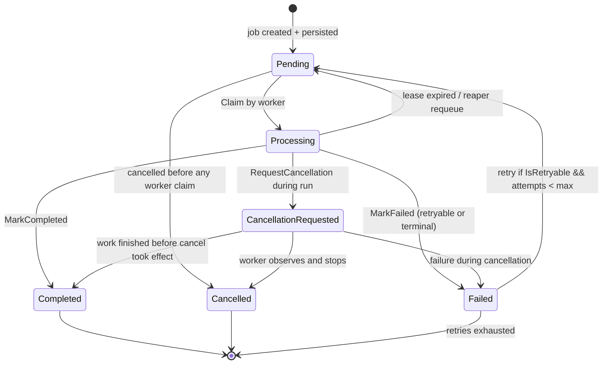

**Invariants enforced by the helper:**

| Invariant | Enforcement |
|---|---|
| Terminal states are absorbing | `IsTerminal` — `Completed`, `Failed` (exhausted), `Cancelled` accept no further transitions |
| No state skipping | `EnsureCanTransition` rejects `Pending → Completed` |
| Retry is conditional | `IsRetryable(errorCode)` — integrity failures and invalid input are non-retryable; transient I/O and worker faults are retryable |
| Cancellation is cooperative, not instantaneous | `CancellationRequested` is a *signal*; the worker observes it at a safe checkpoint |
| Progress is monotonic within a run | Reset only on requeue after lease expiry |

**Why one authority matters:** in a system where web host workers, standalone workers, and reaper services can all touch the same job row, distributed enforcement is impossible. Centralizing transition legality in a domain static class makes the rule *unbypassable* — any illegal transition throws at the aggregate, not silently corrupts the store.

#### 2.1.6 Data Flow Diagram — Conversion Transaction

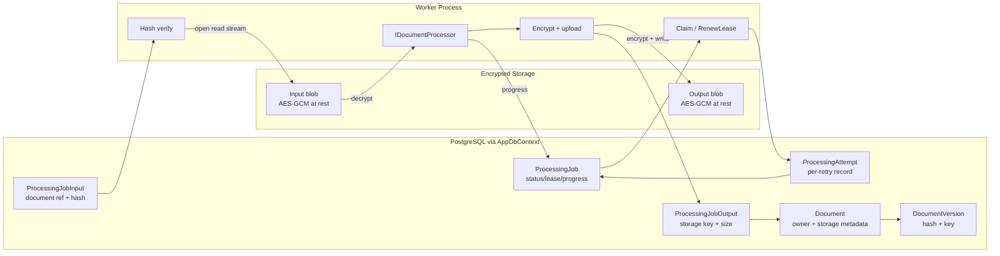

#### 2.1.7 Concurrency and Parallelism Model

| Dimension | Mechanism | Consequence |
|---|---|---|
| Multi-job parallelism | Multiple workers (web host + N standalone) each claim independent job rows | Horizontal scaling without coordination; throughput ∝ worker count |
| Same-job contention | Lease claim is a conditional update; only one claimer wins | Double-processing prevented at the database, not the application |
| Worker crash recovery | Lease expiry allows a reaper/other worker to requeue `Processing → Pending` | No lost jobs; at-most-once execution per attempt, at-least-once overall |
| Broker duplicate delivery | Job-level idempotency: `Claim` fails if already `Processing` with a live lease | At-least-once broker delivery becomes safe |
| Batch aggregation contention | `CheckBatchCompletionAsync` runs on every job termination | **Known hotspot** under high parallelism — see §5.5 |
| Progress updates | Periodic `UpdateProgress` + lease renewal in the same cadence | One round-trip serves both liveness and UX |

**Critical concurrency note:** the lease is the *only* synchronization primitive between worker fleet members. It must be implemented as an atomic conditional update (`WHERE Status = Pending AND (LeaseExpiry IS NULL OR LeaseExpiry < now)`), not a read-then-write in application code. Any worker that reads status, decides, then writes reintroduces a race.

---

### 2.2 WF-2 — Document Upload and Lifecycle Management (P0, foundational)

#### 2.2.1 Business Intent

Establish trustworthy custody of a document: it belongs to exactly one owner, its bytes are confidential at rest, its content is provably identifiable by hash, its history is versioned, and every mutation is auditable. **Every other workflow reads through this one.**

#### 2.2.2 Hardening Chain (ingress, before any business logic)

The order is deliberate and non-negotiable — each guard assumes the previous one has run:

| # | Guard | Component | Rejects |
|---|---|---|---|
| 1 | Authentication + stable ID | `AppClaimsTransformation`, `HttpContextUserContext` | Unauthenticated callers; resolves internal `Entity.Id` regardless of provider subject |
| 2 | Filename sanitization | `FileNameSanitizer` | Path traversal, control chars, reserved names, over-length |
| 3 | File signature detection | `FileSignatureDetector` | Extension/type spoofing (a `.exe` renamed `.pdf`) |
| 4 | Zip-bomb guard | `ZipBombGuard` | Decompression-ratio and absolute-size attacks in OOXML containers |
| 5 | EICAR detection | `EicarSignatureDetector` | Test-signature presence (also a scanner health probe) |
| 6 | Malware scan | `ClamAvScanner` via `IMalwareScanner` | Known malicious payloads |
| 7 | Ownership + lifecycle rules | `DocumentService` (`IsOwnedBy`, `BeginScan`) | Cross-tenant access; illegal state mutation |

#### 2.2.3 Flow Diagram — Upload with Hardening Gates

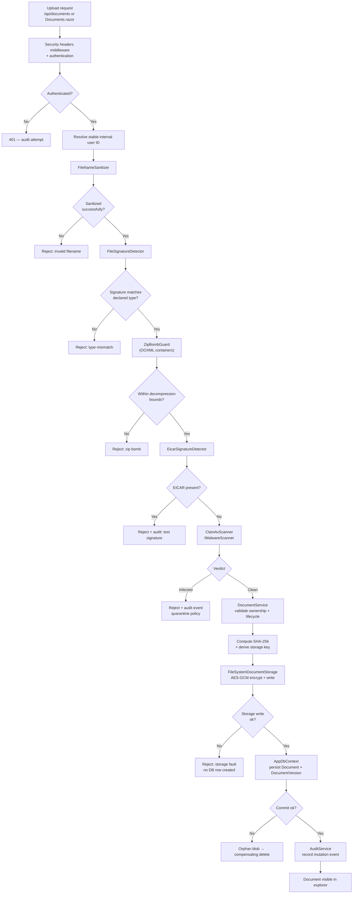

#### 2.2.4 Ordering Rationale — Why Storage Before DB Commit

The write order is **storage first, then database**. This deliberately chooses the recoverable failure mode: a committed DB row pointing at a missing blob makes a document permanently unreadable (silent corruption), whereas an orphan blob with no DB row is merely wasted bytes that a sweep can reclaim. The compensating action on commit failure is blob deletion; if that compensation itself fails, the result is a leak, not a corruption.

#### 2.2.5 Lifecycle Operations (same ownership-and-audit spine)

| Operation | Precondition | Storage Effect | Persistence Effect | Reversible |
|---|---|---|---|---|
| Upload | Authenticated, guards pass | Write new blob | Insert `Document` + `DocumentVersion` | — |
| Rename | Owner | None | Update display name (via `DisplayNameRules`) | Yes |
| Move | Owner, target folder exists | None | Update folder FK | Yes |
| Soft delete | Owner | None (blob retained) | Status → deleted; timestamp | Yes (`restore`) |
| Restore | Owner | None | Status → active | Yes |
| Purge | Owner | **Delete blob** | Remove rows permanently | **No** |
| New version | Owner | Write new blob | Insert `DocumentVersion`, update current | Yes (prior versions retained) |

#### 2.2.6 Known Structural Deviation

`DocumentEndpoints.cs` (902 lines, complexity 30) contains an **inline OpenXml/PdfSharp DOCX→PDF path** that bypasses `ProcessingService`, the queue, the worker, and the lease model entirely. This is a genuine second entry point into conversion with different failure semantics (synchronous, request-scoped, no retry, no progress, no batch aggregation). It is a documented layering violation and a maintenance fork against `OfficeDocumentProcessor`. See §5.6 for the consolidation recommendation.

---

### 2.3 WF-3 — Document Intelligence Indexing and RAG Question Answering (P1, differentiating)

#### 2.3.1 Two-Phase Workflow

**Phase A — Ingestion (background, write path):** document → text extraction → chunking → embedding → dual index upsert.
**Phase B — Retrieval (interactive, read path):** question → query transformation → hybrid retrieval → fusion → diversification → rerank → synthesis → citations.

The phases are coupled only through the indices. Phase A degradation is silent from the user's perspective but visible as retrieval staleness; Phase B failures are immediately visible as poor or missing answers.

#### 2.3.2 Phase A — Indexing Pipeline

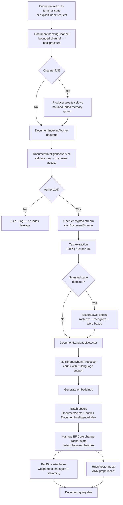

**Key implementation mechanics:**

| Concern | Mechanism | Why |
|---|---|---|
| Backpressure | Bounded `Channel` | A 10,000-document batch must not OOM the process |
| Extraction fidelity | OCR fallback only when `ScannedPdfDetector` fires | OCR is expensive; unneeded OCR degrades speed with no gain |
| Language handling | `DocumentLanguageDetector` + `MultilingualChunkProcessor` | Tri-language migrations exist in the schema — this is a first-class requirement |
| Change-tracker hygiene | Explicit detach between batches | EF Core tracking thousands of chunks exhausts memory and slows `SaveChanges` non-linearly |
| Lexical deletion | `Bm25InvertedIndex` tombstones (`IsDeleted` / `MarkEntryDeletedUnlocked`) | Delete without full rebuild keeps reindexing O(1)-ish |
| Thread safety | Reader/writer locking in the BM25 index | Concurrent query + ingest from multiple circuits |
| Idempotency | Deterministic chunk identity (GUID derivation) | Re-indexing must not duplicate chunks |

#### 2.3.3 Phase B — Retrieval Orchestration (Components A–H)

`RagRetrievalOrchestrator` (4,040 lines) executes a staged pipeline. Each stage is a distinct component with a distinct purpose:

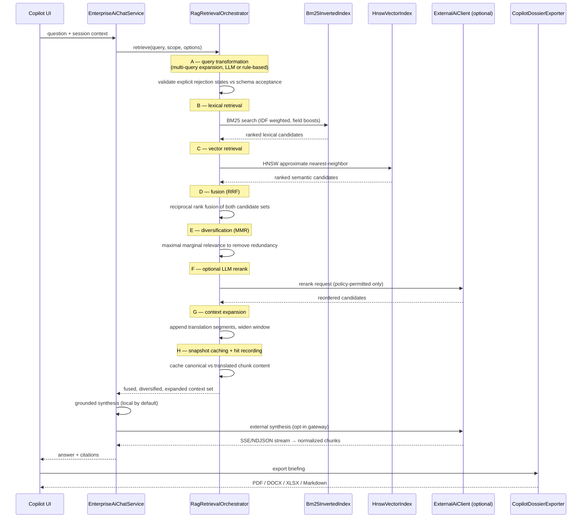

**Stage-by-stage rationale:**

| Stage | Component | Failure if omitted |
|---|---|---|
| A. Query transformation | LLM or rule-based expansion | Single-query retrieval misses paraphrased content |
| B. Lexical (BM25) | Inverted index | Exact terms, identifiers, clause numbers, and rare tokens are lost — vectors blur them |
| C. Vector (HNSW) | ANN graph | Pure lexical misses semantic paraphrase and cross-lingual matches |
| D. RRF fusion | Rank fusion | Naive score averaging is incomparable across lexical and cosine scales |
| E. MMR | Diversification | Top-K becomes K near-duplicate chunks — wasted context window |
| F. Rerank | Optional LLM | Precision at rank 1 degrades; citations become less defensible |
| G. Context expansion | Adjacency + translation | Answers lack surrounding clause structure; cross-language answers degrade |
| H. Snapshot cache | Canonical vs translated content | Re-translation churn; inconsistent citations across turns |

**Zero-egress guarantee:** `IDocumentIntelligenceService` explicitly constrains analysis, vector search, classification, and RAG to in-process execution. `ExternalAiClient` is an **opt-in** gateway. Stages A and F degrade to local implementations when the gateway is disabled — the pipeline must never hard-fail because a provider is unreachable.

**Quality harness:** `RagBenchmarkRunner` executes a reproducible 120-question evaluation measuring Recall@K, MRR, nDCG, context precision/recall, and faithfulness. Deterministic GUID chunk identity makes runs comparable across builds — this is the regression gate for retrieval quality and the early-warning system for degraded OCR (since bad OCR silently degrades retrieval).

---

### 2.4 WF-4 — PDF Editing and Annotation (P2, supporting)

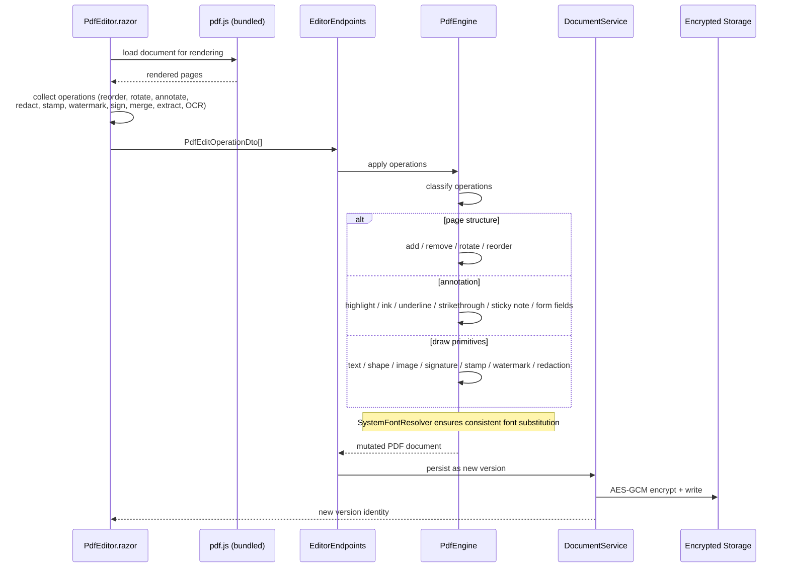

**Determinism requirement:** `PdfEngine` is a **sealed static** engine that translates DTOs into PdfSharp calls with no hidden state. This is deliberate — the same operation list applied to the same input must produce the same output, which is what makes version comparison and audit meaningful. `SystemFontResolver` exists because font substitution is the single largest source of non-determinism in PDF rendering across hosts.

**Operation classification** (`IsPageStructureOperation`) is not cosmetic: page-structure operations must be applied in a defined order relative to annotation operations, since an annotation anchored to page 3 is meaningless if page 3 is removed after annotation but before structural reindex.

---

### 2.5 WF-5 — Administration, Identity and Audit (P1, governance)

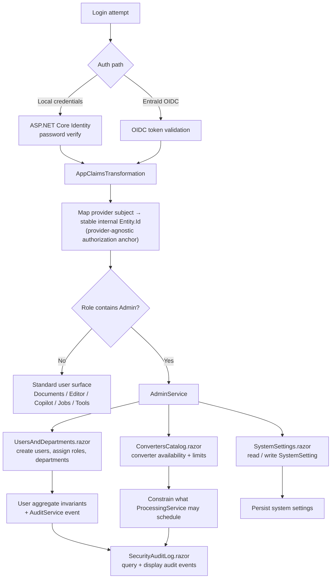

**The stable-ID decision:** authorization is keyed on the internal `Entity.Id`, never on the provider subject. The `User` aggregate models `AuthenticationType` as `Local` or `EntraId` while preserving one stable ID across both. Consequence: if EntraId re-provisions a user, deletes and recreates the account, or the tenant migrates, all existing document ownership remains valid. This is the single most consequential identity design decision in the system, and it is why every workflow's authorization depends on it.

**Soft governance dependency:** converter catalog limits and system settings propagate to job acceptance — administration constrains processing algorithmically, not just by convention.

---

## 3. Flow Coordination and Control

### 3.1 Multi-Module Coordination Matrix

| Producer | Consumer | Coordination Mechanism | Coupling Type |
|---|---|---|---|
| Web UI / API | `IProcessingService` | Strongly-typed request/DTO contracts | Contract |
| `ProcessingService` | `AppDbContext` | EF Core unit of work | Data |
| `ProcessingService` | `IQueuePublisher` | `JobMessage` payload; NoOp fallback | Asynchronous message |
| Queue / poll query | Worker | Lease claim (atomic conditional update) | Coordination primitive |
| Worker | `IDocumentProcessor` | Processing abstractions (shared host/worker) | Contract |
| Worker | `IDocumentStorage` | Stream in / stream out, AES-GCM wrapped | Service |
| Worker | `JobNotificationService` | SignalR broadcast via `ProcessingHub` | Event |
| Worker | `CheckBatchCompletionAsync` | Batch state read + terminal write | Shared state |
| `DocumentIndexingChannel` | `DocumentIndexingWorker` | Bounded channel (backpressure) | Producer/consumer |
| `DocumentIntelligenceService` | BM25 + HNSW | Dual index upsert | Data |
| `RagRetrievalOrchestrator` | Both indices | Hybrid query + fusion | Service |
| All mutating services | `AuditService` | Event emission | Cross-cutting |

### 3.2 State Management and Synchronization

**Authoritative state ownership:**

| State | Owner | Readers | Synchronization |
|---|---|---|---|
| Job status, lease, progress | `ProcessingJob` aggregate | Workers, UI, batch aggregator | DB-row atomic conditional updates |
| Document ownership, hash, status | `Document` aggregate | All workflows | DB transaction + domain invariant |
| User identity, roles | `User` aggregate | Authorization everywhere | Claims transformation cache per circuit |
| Batch terminal state | `BatchJob` | UI, API | Computed by aggregation on each job terminal |
| Index contents | BM25 / HNSW instances | Retrieval | Reader/writer lock + tombstones |
| Storage blobs | Storage backend | Workers, intelligence, editor | Content-addressed by storage key |
| Chat session + memory | `CopilotChatSession` | Copilot UI | EF Core persistence per turn |

**Synchronization principles:**

1. **One writer per state.** A job's status is written only by the worker holding a live lease, or by the reaper when the lease has provably expired. The UI never writes status.
2. **Conditional updates, not read-modify-write.** Claim and lease renewal must be single-statement conditional updates.
3. **Immutable-after-terminal.** Once a job reaches `Completed` or `Cancelled`, its attributes never change. New work creates a new job.
4. **Derived state is recomputed, not stored incrementally.** Batch status is derived from sibling jobs on each terminal event rather than incremented — an increment can drift under retry; a recomputation cannot.
5. **Index state is eventually consistent.** Nothing in the upload or conversion path blocks on index freshness. Staleness is bounded by channel depth and indexing throughput.

### 3.3 Data Passing and Sharing

| Boundary | Payload | Encoding | Notes |
|---|---|---|---|
| Client → API | Request records (`RenameDocumentRequest`, `MoveDocumentRequest`, `CreateFolderRequest`, …) | JSON over HTTP | Declared in `DocumentEndpoints.cs`, making it the contract boundary |
| Client ↔ Host | UI state, progress events | SignalR circuit messages | Bidirectional, per-circuit |
| Host → Broker | `JobMessage` | Serialized message | Contains identity, not payload — bytes stay in storage |
| Worker ↔ Storage | Document bytes | Streams, AES-GCM | Never fully materialized to memory for large files |
| Worker ↔ DB | Entities + aggregates | EF Core | Single `AppDbContext` per scope |
| Retrieval → Synthesis | Chunk content + scores + provenance | In-process objects | Snapshot-cached to keep citations stable |

**Design rule:** `JobMessage` carries **references, not payloads**. A 500 MB PDF is never serialized into a broker message. The worker resolves storage keys independently. This keeps broker memory bounded and allows message size to be independent of document size.

### 3.4 Execution Control and Scheduling

| Control | Mechanism | Scope |
|---|---|---|
| Priority | `ProcessingJob.Priority` field | Job ordering in polling query / broker priority |
| Backpressure | Bounded indexing channel; worker count cap | Indexing; conversion concurrency |
| Lease expiry | Time-bounded lease with periodic renewal | Per-job crash recovery |
| Cancellation | `RequestCancellation` → cooperative observation | Per-job, batch-wide propagation |
| Polling cadence | Configurable interval when consumer disabled | Degraded-mode throughput |
| Progress cadence | Tied to lease renewal interval | Balances UX freshness against DB write load |
| Concurrency limits | Worker-level (per process); no global coordinator | Throughput scales with replica count |

**Scheduling doctrine:** the system has **no central scheduler**. Work distribution is emergent from workers competing for leasable rows. This eliminates a single point of failure and a scalability bottleneck, at the cost of having no global throughput guarantee or fairness control — priority is advisory rather than enforced.

---

## 4. Exception Handling and Recovery

### 4.1 Failure Taxonomy

| Class | Example | Detection | Recovery |
|---|---|---|---|
| Input rejection | Malformed file, zip bomb, EICAR, wrong signature | Guards at ingress, synchronous | Synchronous 4xx; no job created; audit event |
| Authorization failure | Non-owner access, missing role | Ownership check / access validation | 403; audit event; no state change |
| Storage fault | Disk full, blob write timeout | IO exception on write | Compensating delete; job `Failed` retryable |
| Integrity failure | Input hash mismatch | SHA-256 comparison | `Failed`, **non-retryable** — content changed |
| Conversion failure | Unsupported structure, corrupt PDF, OCR engine fault | Processor exception | `Failed`; retryable only if transient |
| Worker crash | Process killed mid-conversion | Lease stops renewing | Lease expiry → requeue → different worker retries |
| Broker unavailable | RabbitMQ down | Publish failure | Degrade to polling; job still processed |
| AI provider unavailable | External LLM timeout | HTTP failure / timeout | Fall back to local synthesis; retrieval still served |
| Duplicate delivery | Broker redelivers message | Claim rejected (lease live) | Idempotent no-op |
| Batch aggregation fault | Concurrent terminal writes | Exception in `CheckBatchCompletionAsync` | Job already terminal; aggregation retried on next terminal or by sweep |

### 4.2 Error Encoding and User-Safe Classification

`ProcessingErrorCode` classifies errors so that a machine and a user see appropriate detail:

- **User-safe codes** — surfaced directly in the UI (unsupported format, encrypted source, page limit exceeded, corrupt input).
- **Infrastructure codes** — generic message to the user, full detail to logs and `ProcessingAttempt`.
- **Retryability** is a property of the *code*, not of the exception text. `IsRetryable(errorCode)` is a closed function — new codes must be classified at definition time, not at throw time.

Every failure writes a `ProcessingAttempt` row, so a job's retry history is preserved rather than overwritten. This is what makes post-hoc diagnosis of intermittent failures possible.

### 4.3 Recovery Mechanisms

**4.3.1 Lease Expiry Requeue (worker crash)**

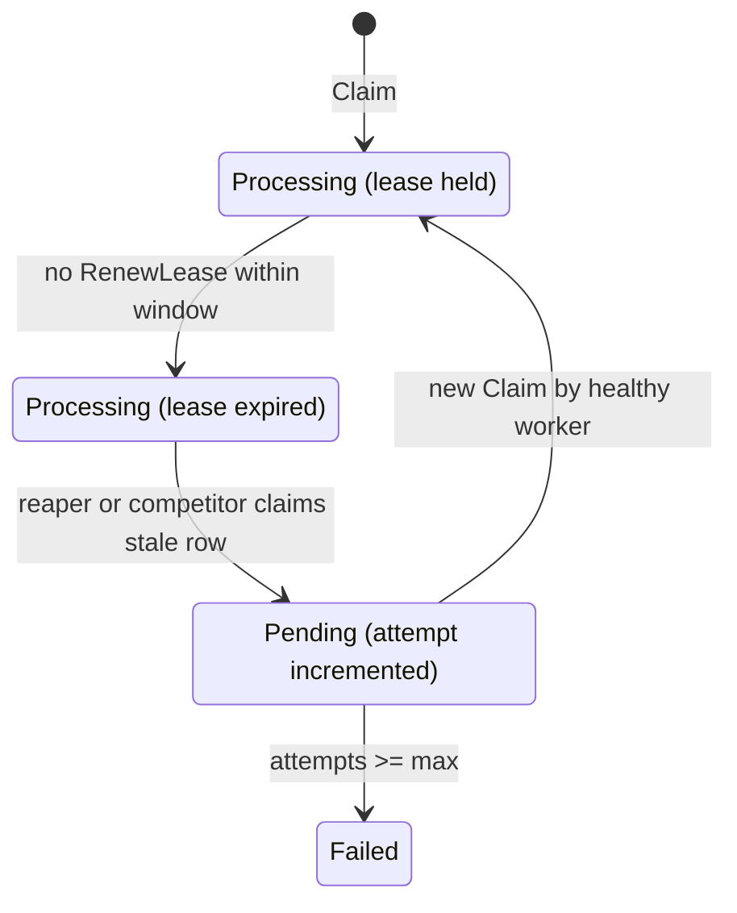

*Note: the research materials do not identify a named reaper service. The lease mechanism implies one must exist, either as a hosted service or as a lazy claim-time check (`WHERE LeaseExpiry < now`). A lazy check is sufficient for correctness; a dedicated sweeper improves recovery latency and makes orphaned jobs observable as a metric.*

**4.3.2 Cancellation (cooperative)**

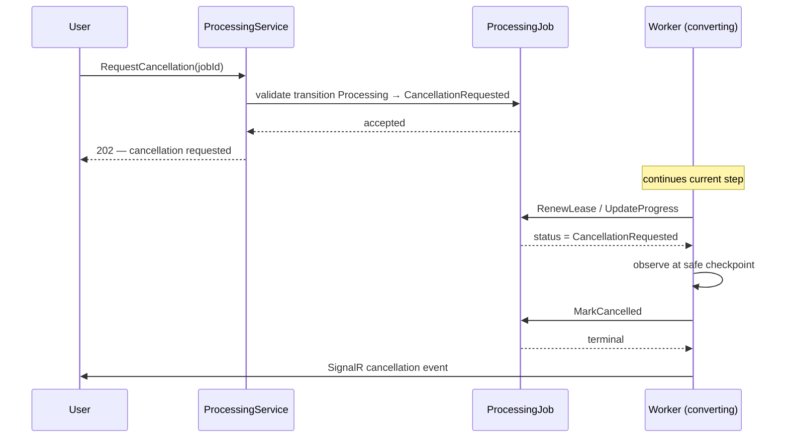

The checkpoint placement is the engineering decision that matters: a checkpoint inside OCR page iteration allows sub-second response; a checkpoint only between pipeline phases delays cancellation by minutes for large documents. Cancellation must also release the lease so the slot frees immediately rather than waiting for expiry.

**4.3.3 Broker Degradation**

| Broker state | Behavior | Trade-off |
|---|---|---|
| Available | Publish → immediate consumption | Lowest latency; requires infrastructure |
| Unavailable at publish | `NoOpQueuePublisher` swallows; job remains `Pending` | Job still processed, but only when a poller runs |
| Consumer disabled | Worker polling loop | Higher latency (poll interval), higher DB load, zero broker dependency |

This is the platform's most important resilience property: **the message broker is an accelerator, not a dependency.** A deployment with no RabbitMQ at all is fully functional, merely less responsive.

**4.3.4 AI Degradation**

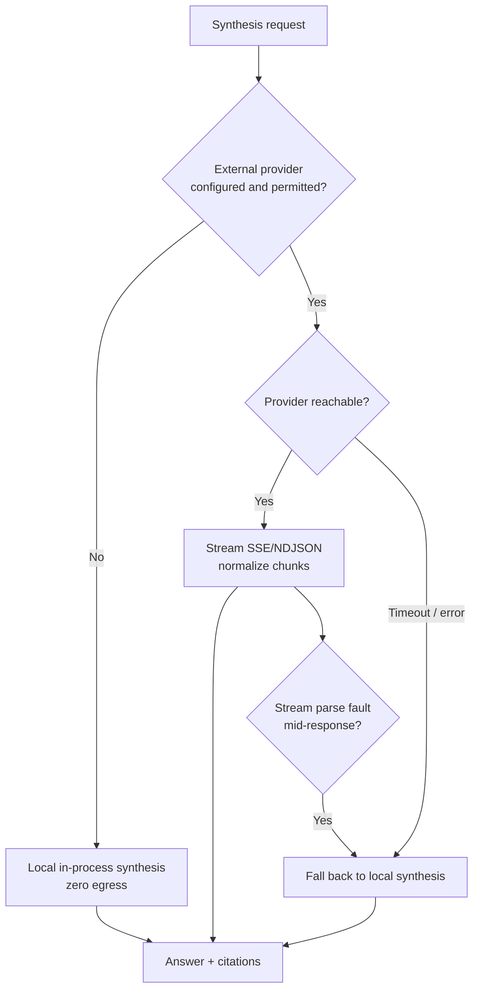

Retrieval is **never** dependent on an external provider. Even stage A (query transformation) and stage F (rerank) must have local implementations, because a zero-egress deployment is a supported, first-class configuration.

### 4.4 Fault Tolerance Strategy — Design Principles

| Principle | Implementation | Evidence in system |
|---|---|---|
| Isolate failure per job | Each job's exception is caught and converted to a terminal state; the worker loop survives | `ProcessNextJobAsync` per-job error isolation |
| Prefer recoverable failure modes | Storage-before-DB ordering; orphan blob over dangling reference | §2.2.4 |
| Idempotent at the job level | Lease claim rejects duplicates; output registration keyed to job | Claim semantics |
| No illegal state ever persists | Domain-enforced transitions; no direct status writes | `ProcessingJobLifecycle` |
| Degrade, never hard-fail | Polling fallback; local synthesis fallback; NoOp publisher | §4.3.3, §4.3.4 |
| Bounded resources | Bounded indexing channel; streaming I/O; channel depth as backpressure | `DocumentIndexingChannel` |
| Preserve forensics | `ProcessingAttempt` per retry; `AuditEvent` per mutation | Domain aggregates |

### 4.5 Operational Monitoring Guidance

| Signal | Healthy | Warning | Action |
|---|---|---|---|
| Jobs in `Processing` with expired lease | 0 | >0 sustained | Reaper not running, or workers dying |
| Jobs in `Pending` beyond expected latency | drains | monotonically growing | No consumer; broker down; poller disabled |
| Indexing channel depth | low/near-zero | sustained near capacity | Backlog — add indexing capacity; retrieval going stale |
| Failed jobs by error code | stable mix | spike in one code | Upstream input change or processor regression |
| Retry attempts per job | 1 | >2 | Transient fault being masked; investigate root cause |
| Batch aggregation latency | sub-second | growing with batch size | Contention hotspot — see §5.5 |
| Retrieval benchmark (Recall@K, nDCG) | at baseline | regression | OCR degradation or index staleness |

---

## 5. Key Process Implementation

### 5.1 Process — Conversion Transaction (worker execution)

The conversion transaction is the highest-integrity code path in the system. Its correct order is:

```
1. Claim job (atomic; fail fast if lost)
2. Open input stream (decrypt)
3. Compute SHA-256 while streaming (single pass — do not buffer)
4. Verify hash against recorded value
5. Resolve IDocumentProcessor by converter identity
6. Start lease-renewal cadence (background or interleaved)
7. Execute conversion (may be minutes for large PDFs)
8. Encrypt output; upload; capture storage key + size + hash
9. Register output Document + DocumentVersion
10. MarkCompleted (or MarkFailed with classified code)
11. Publish SignalR notification
12. CheckBatchCompletionAsync
```

**Implementation constraints:**

- **Single-pass hashing.** Hash during the read that feeds the converter, not in a separate pass. Two passes double I/O on large files.
- **Streaming discipline.** Never `ReadAllBytes` on a document. Memory must scale with chunk size, not document size, because N workers × large documents is the OOM vector.
- **Lease renewal must not block conversion.** If renewal is synchronous within the conversion loop, a slow renewal extends conversion time. Interleave at natural boundaries or run concurrently.
- **Compensation on output failure.** If encryption or upload fails, the output document row must not exist. Register the output only after successful upload.
- **Progress must be monotonic.** A late `UpdateProgress` from an older step must not decrease the displayed percentage.

### 5.2 Process — OCR Pipeline (TesseractOcrEngine)

The OCR engine is the most platform-fragile component (603 lines, complexity 58). Its implementation sequence:

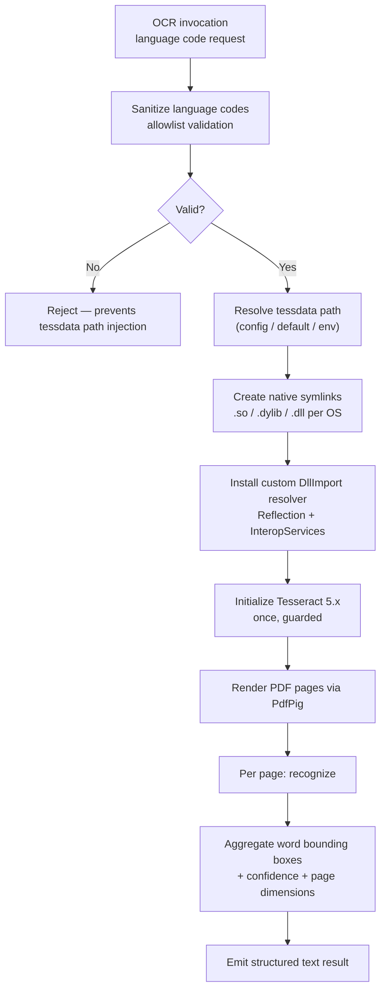

**Why each step exists:**

| Step | Failure it prevents |
|---|---|
| Language sanitization | A crafted language string escapes tessdata and loads arbitrary data files |
| Native symlinks + DllImport resolver | Tesseract's native loading is not consistent across Linux/macOS/Windows; a single load path fails on at least one |
| Single guarded initialization | Tesseract initialization is expensive and not thread-safe in all builds |
| PdfPig rasterization | OCR operates on images; PDFs contain text operators, not pixels |
| Word-level bounding boxes | Layout reconstruction (`EmitWordTable`, `EmitWordParagraph`) depends on coordinates, not just text order |

**Critical dependency chain:** degraded OCR is *silent*. It does not throw — it produces worse text, which produces worse chunks, which produces worse retrieval. This is why `RagBenchmarkRunner` is the operational canary for the whole extraction chain, not just the AI layer.

### 5.3 Process — Office Format Conversion (OfficeDocumentProcessor)

The largest, most complex processor (626 lines, complexity 69). Two directions with distinct mechanics:

**PDF → DOCX:** `PdfPig` extracts words with coordinates → helper classes reconstruct structure:
- `EmitWordParagraph` — groups words into lines/paragraphs using y-coordinate clustering and x-gaps
- `EmitWordTable` — detects tabular alignment from column-position regularity
- `EmitTextPage` — page-level emission with ordering discipline

**DOCX/text → PDF:** OpenXML reading → `PdfSharp` rendering, with **optional OCR enrichment** when source pages are image-based or when fidelity requires recovering text invisible to OpenXML extraction.

The complexity is inherent: layout reconstruction from absolute coordinates is heuristic by nature, and the branching reflects genuine format variation rather than incidental complexity.

### 5.4 Process — RAG Retrieval Orchestration (staged pipeline with explicit rejection states)

The orchestrator's most subtle mechanic is **explicit rejection state validation**: the pipeline validates its own outputs against the acceptance schema *before* returning them, so an implausible result (empty candidate set after fusion, candidate set below threshold) becomes a typed rejection rather than a degraded answer presented as confident. This is what keeps a zero-egress system honest — no provider-side guardrails exist, so the pipeline must police itself.

**MMR diversification mechanics:** candidates are selected iteratively, each step choosing the item maximizing `λ · relevance − (1−λ) · max_similarity_to_selected`. The effect is that top-K contains K *distinct* pieces of evidence rather than K paraphrases of one clause. For legal and compliance users this is the difference between a defensible answer and a circular one.

**Snapshot caching:** canonical and translated chunk content are tracked separately through the pipeline. Without this, a citation could reference the translated text in one turn and the canonical text in the next, making citations unstable across a conversation — unacceptable in an audit context.

### 5.5 Performance Analysis and Optimization Targets

| Hotspot | Mechanism | Current Cost | Recommendation |
|---|---|---|---|
| `CheckBatchCompletionAsync` | Runs on **every** job termination; reads all siblings; writes batch state | O(batch size) per job → O(n²) per batch | Replace with: terminal write + lightweight counter/deferred sweep. A periodic sweep decouples cost from job count. |
| `DocumentService` branching | Cyclomatic complexity 135, 27 members | High change amplification; every new lifecycle rule touches one file | Split by operation family: lifecycle mutations / versioning / storage coordination |
| `DocumentIntelligenceService` (~6,000 lines) | Orchestration + persistence + access control in one class | Hard to test without adapter stack; slow review | Relocate use-case logic to Application layer; extract persistence into a dedicated adapter |
| `RagRetrievalOrchestrator` (4,040 lines) | Eight stages in one type | Stage isolation impossible; cannot benchmark stages independently | Extract stages A–H into discrete collaborators behind a pipeline contract |
| `Infrastructure.csproj` (14 packages) | PDF + OpenXML + OCR + RabbitMQ + SkiaSharp + PKCS pinned together | Any version bump risks the entire layer; licensing review is monolith-wide | Split into separately-versioned satellite projects per adapter family |
| Indexing channel saturation | Bounded channel, depth not exposed | Saturation manifests as silent retrieval staleness | Export channel depth + indexing lag as metrics; alert on sustained depth |
| Inline conversion in `DocumentEndpoints.cs` | Second, synchronous conversion path duplicating `OfficeDocumentProcessor` | Divergent behavior; different failure semantics; unmonitored | Route through `ProcessingService`; delete the inline path |
| `PdfEngine` static + PdfSharp | Deterministic but single-threaded rendering per call | CPU-bound under concurrent editor saves | Bound concurrency explicitly; consider isolated render worker if contention appears |

### 5.6 Consolidation Recommendation — the Dual Conversion Path

The inline DOCX→PDF path in `DocumentEndpoints.cs` is the single clearest architectural debt. Concrete remediation:

1. Change the endpoint to enqueue a job via `ProcessingService` and return `202 Accepted` with a job identity, matching every other conversion entry point.
2. Delete the inline OpenXml/PdfSharp code; `OfficeDocumentProcessor` already owns that logic.
3. If synchronous conversion is genuinely required for a specific integrator, expose it as an explicitly labeled *synchronous* processor variant that reuses `OfficeDocumentProcessor` internals — not as a fork.
4. Result: one conversion code path, one failure model, one progress model, one audit model.

### 5.7 Implementation Guidance Summary

| For | Guidance |
|---|---|
| **Developers** | Never set `Job.Status` directly. Never bypass `IsOwnedBy`. Never materialize a document to memory. Never publish a payload instead of a reference. Never trust a filename or a language code. |
| **Adding a converter** | Implement `IDocumentProcessor` in Processing.Abstractions; register in the catalog; do not touch the worker or the endpoints. |
| **Adding an error code** | Classify retryability at definition time in `ProcessingErrorCode`, not at throw time. |
| **Operations** | Watch expired-lease count, `Pending` backlog age, indexing channel depth, and retrieval benchmark drift. A quiet OCR regression appears here first. |
| **New team members** | Read in this order: WF-2 (spine) → WF-1 (state machine) → WF-3 (two-phase) → WF-4/WF-5. Everything else depends on the first two. |

### 5.8 Business Value Mapping

| Workflow | Business Value Delivered |
|---|---|
| WF-2 Document Lifecycle | Custody, provenance, and confidentiality — the trust foundation that makes the platform viable in regulated sectors |
| WF-1 Job Processing | Throughput and responsiveness — large backlogs absorbed without degrading interactive experience; crash tolerance without operational babysitting |
| WF-3 Intelligence / RAG | Sovereign document AI — knowledge extraction with zero mandatory egress, the platform's primary compliance differentiator |
| WF-4 PDF Editing | Consolidation — removes the need for a separate PDF editor tool and keeps edits inside the same governed storage and audit model |
| WF-5 Admin / Identity / Audit | Governance — stable identity, role-based access, and a reviewable trail that satisfies audit requirements |

---

## Appendix A — Cross-Workflow Dependency Graph

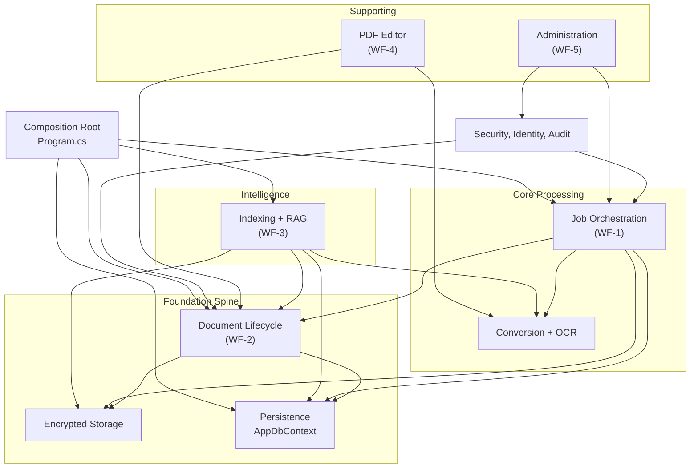

**Reading the graph:** the most dangerous dependency is `HOST → everything`. A DI registration error in `Program.cs` breaks all workflows simultaneously rather than one, which is why composition-root changes warrant the widest test surface. The second most dangerous is `SEC → DL` and `SEC → JP`: those are the *only* authorization gates in the system. Any bypass there compromises every downstream workflow.

---

## Appendix B — Process Quick Reference

| Question | Answer |
|---|---|
| Where is job legality enforced? | `ProcessingJobLifecycle` in `ProcessingJobStatus.cs` — nowhere else |
| What happens if RabbitMQ is down? | Jobs stay `Pending`; polling loop processes them. Broker is an accelerator |
| What happens if a worker dies mid-job? | Lease expires; job requeued to `Pending`; different worker retries |
| Can two workers process the same job? | No — atomic lease claim; duplicate broker delivery is a no-op |
| Where is authorization decided? | `Document.IsOwnedBy` + access validation in `ProcessingService`; anchored on stable internal entity ID |
| When does a document become searchable? | After indexing channel consumption + dual index upsert — asynchronous, eventually consistent |
| What happens if the AI provider is unreachable? | Local synthesis fallback; retrieval unaffected |
| What is the riskiest single file? | `DocumentEndpoints.cs` — inline conversion bypasses the entire job pipeline |
| What is the biggest performance hotspot? | `CheckBatchCompletionAsync` — O(n²) per batch |
| What is the earliest warning of OCR degradation? | `RagBenchmarkRunner` retrieval metrics drifting from baseline |