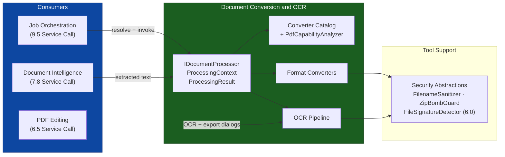
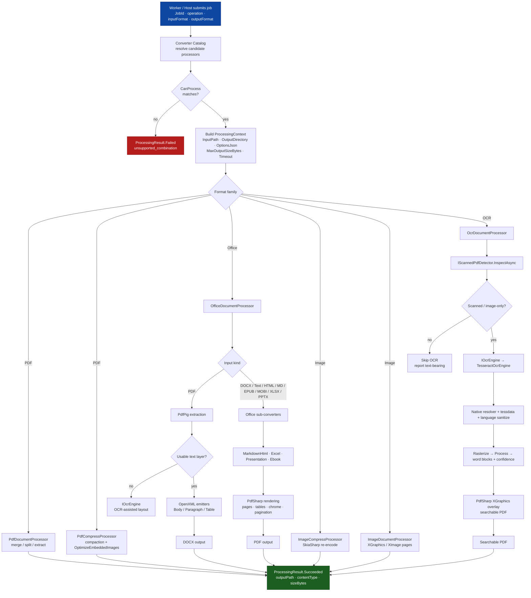
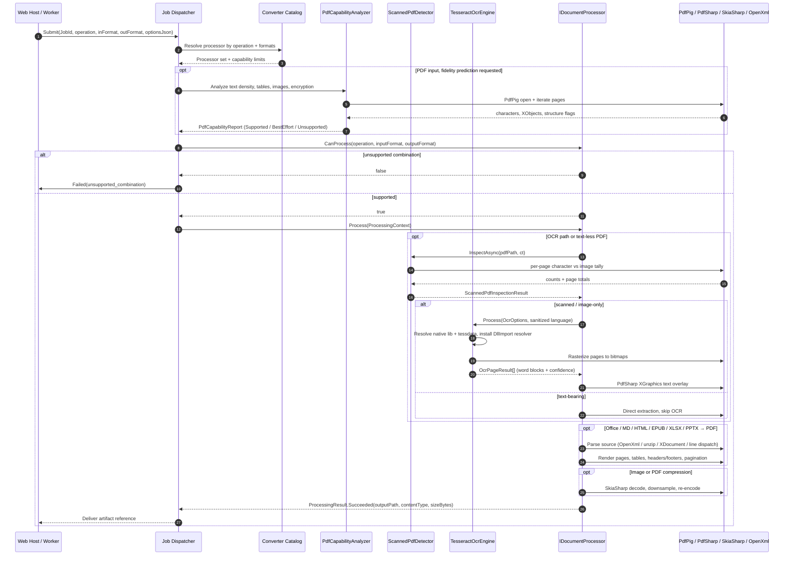

# Document Conversion and OCR — Module Documentation

**Project:** EConverter — Enterprise Document Conversion & Intelligence Platform
**Module:** Document Conversion and OCR (Core Business Domain, importance 9.5)
**Generation time:** `2026-11-19 09:15:30 (UTC)` — Timestamp: `1795079730`

---

## 1. Executive Summary

Document Conversion and OCR is the flagship capability of EConverter — the module that justifies the platform's existence. Its single responsibility is to transform a document from one representation into another with maximum fidelity: PDF→DOCX, DOCX/XLSX/PPTX/Markdown/HTML/EPUB/MOBI→PDF, image→PDF, PDF/image compression, and OCR of scanned or image-only material into searchable text.

The architectural solution is deliberately narrow at the boundary and rich inside: **one contract** (`IDocumentProcessor`), **one immutable context** (`ProcessingContext`), **one closed result type** (`ProcessingResult`), and a catalog-driven dispatcher that selects the correct processor by `ProcessorId` + `CanProcess(operation, inputFormat, outputFormat)`. Everything else — PdfPig extraction, PdfSharp rendering, SkiaSharp codecs, OpenXML construction, Tesseract native interop — sits behind that contract.

Four properties distinguish this module:

| Property | Implementation |
|---|---|
| **Transport-agnostic** | The same processor contract is consumed by the in-process `JobProcessorWorker` and the standalone `DocumentWorker` |
| **Predictive** | `PdfCapabilityAnalyzer` and `CompressionEstimatorService` produce fidelity verdicts and size estimates *before* a job is enqueued |
| **Defensive** | Processors never throw for expected failures — they return typed `Failed` results with stable error codes |
| **OCR-isolated** | Tesseract specifics never leak past `IOcrEngine`; scanned/written detection is a separable heuristic behind `IScannedPdfDetector` |

The module's position in the domain graph is central: `Job Orchestration → Conversion (9.5)` is the strongest service-call coupling in the entire system, and both `Document Intelligence → Conversion (7.8)` and `PDF Editing → Conversion (6.5)` consume it downstream.

---

## 2. Module Position in the Architecture



**Layering note:** the module lives physically in `DocumentConverter.Infrastructure/Processing` and `/Ocr`, while its contract lives in `BuildingBlocks/DocumentConverter.Processing.Abstractions`. This is the intended split — abstractions are layer-neutral, implementations are adapters. The same design tension flagged in the architecture report (orchestrators in Infrastructure) applies here at a lower severity, because a processor genuinely *is* an adapter over a third-party library.

### 2.1 Code Inventory

| Sub-module | Key Paths | Importance |
|---|---|---|
| **Format Converters** | `Processing/OfficeDocumentProcessor.cs`, `PdfDocumentProcessor.cs`, `ImageDocumentProcessor.cs`, `PdfCompressProcessor.cs`, `ImageCompressProcessor.cs`, `PdfCapabilityAnalyzer.cs`, `CompressionEstimatorService.cs`, `Processing/Office/*` | 9.5 |
| **OCR Pipeline** | `Ocr/TesseractOcrEngine.cs`, `Ocr/ScannedPdfDetector.cs`, `Ocr/IOcrEngine.cs`, `Ocr/IScannedPdfDetector.cs` | 9.0 |
| **Processing Abstractions** | `BuildingBlocks/.../IDocumentProcessor.cs`, `Contracts/Processing/FidelityDtos.cs` | 8.5 |
| **Ancillary** | `EchoDocumentProcessor.cs` (plumbing reference), `OcrDocumentProcessor.cs` | — |

---

## 3. Contract Layer — The Extension Point

The contract surface is intentionally small. Every capability in the module is reachable through three types.

### 3.1 `IDocumentProcessor`

```
ProcessorId            → stable identifier, used by the catalog and diagnostics
CanProcess(operation, inputFormat, outputFormat) → bool  (routing predicate)
Process(ProcessingContext) → ProcessingResult
```

Three design consequences follow:

1. **Routing is a predicate, not a switch.** The dispatcher never hardcodes format knowledge; it evaluates `CanProcess` across the registered set. Adding a new format means registering a new processor, not editing a dispatcher.
2. **`CanProcess` is side-effect free.** It is called speculatively by the catalog and UI, so it must be cheap and allocation-light.
3. **`Process` never throws on expected failure.** Unsupported combinations, corrupt inputs, size overruns, and timeouts all converge on `ProcessingResult.Failed(errorCode, errorMessage)`.

### 3.2 `ProcessingContext` — Immutable Execution Envelope

`ProcessingContext` is a **sealed record**, and that is the whole point: the web host and the standalone worker construct byte-identical contexts, so a processor cannot behave differently depending on transport.

| Field | Purpose |
|---|---|
| `JobId` | Correlation identity — every log line and error carries it |
| `Operation` | The verb: convert, compress, merge, split, extract, ocr |
| `InputPath` | Resolved local path to the decrypted input stream materialization |
| `OutputDirectory` | Where the artifact must be written |
| `OptionsJson` | Opaque per-processor options (System.Text.Json) |
| `MaxOutputSizeBytes` | Hard ceiling — protects storage and downstream quotas |
| `Timeout` | Wall-clock budget per invocation |
| `Metadata` | Optional `Dictionary<string,string>` extension bag |

**Why `OptionsJson` instead of a typed options hierarchy:** it keeps the processor contract frozen while options evolve. A processor that needs a new knob deserializes an additional field; the signature never changes, so no consumer recompiles. The cost is a per-processor deserialization step and the loss of compile-time validation — mitigated in practice by defensive deserialization with defaults.

### 3.3 `ProcessingResult` — Closed Result Type

`ProcessingResult` exposes static `Succeeded` / `Failed` factories. Callers branch on `Succeeded` versus `errorCode`/`errorMessage`; success carries `outputPath`, `contentType`, and `sizeBytes`.

The critical invariant: **exceptions do not cross the processor boundary.** A processor that leaks an unhandled exception would poison the worker's per-job isolation and could abort an entire batch. Instead, every processor path degrades to a typed failure with a stable error code that the job state machine can classify as retryable or terminal.

### 3.4 Shared DTOs

`Contracts.Processing.FidelityDtos` declares two cross-layer types:

- **`ConversionFidelityVerdict`** — enum `Supported` | `BestEffort` | `Unsupported`, consulted by the catalog and UI to set user expectations before submission.
- **`PdfCapabilityReport`** — sealed record carrying `Verdict` plus capability flags (`HasText`, table/column indicators, encryption, image ratios). Produced by `PdfCapabilityAnalyzer`, consumed by capability endpoints, the converter catalog, and the UI.

`CompressionPreviewResponse` is the analogous type for compression estimation.

---

## 4. Dispatcher Flow

The dispatcher is the only place where "which processor runs" is decided.



### 4.1 Sequence — Resolution, Fidelity Prediction, Execution



---

## 5. Format Converters

### 5.1 Office Cluster — `Processing/Office`

`OfficeDocumentProcessor` is the largest processor in the module. It maintains a **static supported-format table** consulted by `CanProcess`, which means the routing surface is declaratively enumerable — the catalog can render the full converter matrix without instantiating anything format-specific.

**Two directional paths:**

| Direction | Technique |
|---|---|
| **PDF → DOCX** | `ConvertPdfToDocxAsync`: PdfPig word extraction with coordinates → OpenXML `Body` / `Paragraph` / `Table` emitters; falls back to OCR-assisted layout when the PDF has no usable text layer |
| **DOCX/Text → PDF** | `ConvertDocxOrTextToPdfAsync`: extension-based branching into PdfSharp rendering |

**Specialized sub-converters** (`Processing/Office`):

| Converter | Parsing Strategy | Rendering Strategy |
|---|---|---|
| `EbookPdfConverter` | `ParseEpub` / `ParseMobi` unzip with `System.IO.Compression`; `XDocument` parse; `StripTags` regex normalization; builds intermediate `EbookData` / `EbookChapter` model | `RenderBookToPdf` draws cover page, running headers/footers, `CheckNewPage` pagination |
| `ExcelPdfConverter` | XLSX via OpenXml; CSV via text streaming. `GetColumnIndex` maps letter cell refs → numeric; `GetCellValue` resolves inline/shared/numeric cells | Paginated styled PDF tables; `DrawPageHeader` / `DrawPageFooter` / `TruncateString` handle chrome and overflow. `WriteXlsx` / `WriteCsvAsync` serialize extracted PDF page data back out with culture-invariant CSV escaping |
| `MarkdownHtmlPdfConverter` | Line iteration with `StartsWith` dispatch into `DocumentBlock` nodes; `FlushTable` coalesces accumulated table lines; `StripInlineMarkdown` / `StripHtmlTags` normalize text | `CheckNewPage` + `DrawPageHeaderFooter` pagination, repeated chrome, code-syntax styling |
| `PresentationPdfConverter` | PPTX slide parts parsed into `PresentationInfo` / `SlideInfo` | Three layouts selected from JSON options: one-per-page standard, 2×1 handout grid, 3-per-page notes layout with annotation space |

**Observation:** the four sub-converters share a recurring idiom — *parse into an intermediate document model, then render with a paginating canvas*. This is the correct shape: it decouples source format from layout engine and makes each converter independently testable. It is not extracted into a shared base class, which is a duplication cost worth noting (pagination, header/footer drawing, and text truncation logic are reimplemented per converter).

### 5.2 PDF Cluster

| Processor | Responsibility |
|---|---|
| `PdfDocumentProcessor` | Merge, split, image extraction. PdfPig for reading, PdfSharp `PdfDocument` for writing |
| `PdfCompressProcessor` | PDFsharp stream compaction + static `OptimizeEmbeddedImages(document, options, ct)` — walks XObjects, decodes via SkiaSharp, down-samples, replaces image streams. `ParseOptions` deserializes JSON |
| `PdfCapabilityAnalyzer` | Iterates PdfPig pages accumulating scanned/table flags; checks text density, columns/tables, encryption, image ratios; returns `PdfCapabilityReport` with `Verdict ∈ {Supported, BestEffort, Unsupported}`. `CreateUnsupportedReport` standardizes the failure path |

**Why `PdfCapabilityAnalyzer` matters architecturally:** it converts a runtime surprise (a conversion that produces garbage because the source had no text layer) into a **pre-flight prediction**. The UI can warn the user, the catalog can route to OCR, and the job can be rejected before consuming worker capacity.

### 5.3 Image Cluster

| Processor | Technique |
|---|---|
| `ImageCompressProcessor` | `SKBitmap` decode → `ImageCompressOptions` from JSON → `SKImage.Encode` with chosen `SKEncodedImageFormat`, quality, quantization, dimension caps → format-to-extension and content-type mapping |
| `ImageDocumentProcessor` | Case-insensitive extension set (JPG/PNG/BMP/WEBP/TIFF); `CanProcess` gates on operation/input/output; builds PDF pages with `XGraphics` / `XImage` |

### 5.4 Pre-Job Estimation — `CompressionEstimatorService`

Two entry points, both **simulation-based**:

- `EstimateImage` / `EstimatePdf` — compress in memory at given quality levels and measure the actual result.
- `FallbackEstimate` overloads — derive a `CompressionPreviewResponse` from original size, quality, and extension when simulation is too expensive.

This lets the UI display realistic size savings **before** a job is enqueued, which prevents wasted worker cycles on compression requests that would not achieve the user's goal.

### 5.5 `EchoDocumentProcessor` — The Plumbing Reference

A no-op processor: token-guarded streaming copy from source to destination inside `using` blocks. Its value is not functional — it validates the entire dispatch, context construction, and result-contract path in integration tests without any library dependency. Every module that has a chain this long should have an echo processor.

---

## 6. OCR Pipeline

### 6.1 Isolation Boundary

OCR is deliberately fenced:

```
IOcrEngine          → OcrOptions, OcrWordBlock, OcrPageResult, OcrResult.Failed
IScannedPdfDetector → InspectAsync(string pdfPath, CancellationToken)
                    → ScannedPdfInspectionResult
```

`OcrWordBlock` and `OcrPageResult` live in the same namespace as `IOcrEngine` so the records travel with the contract. Consumers — `OcrDocumentProcessor` and `OfficeDocumentProcessor`'s OCR-assisted layout path — depend on `IOcrEngine` **only**. Tesseract never leaks.

`ScannedPdfInspectionResult` exposes five diagnostic fields plus `Summary` (total pages, scanned page count, character count, image count, human summary). Callers use it to route a PDF into OCR or straight into text-based conversion.

### 6.2 `ScannedPdfDetector` — Fast Heuristic

Opens the document with PdfPig, guards `File.Exists` with an empty non-scanned result, tallies letters/characters versus image XObjects per page, applies thresholds, returns the inspection result wrapped in `Task.FromResult`.

The cheap-and-wrong tradeoff is explicit: this is a **heuristic**, not a classifier. It is fast enough to run on every PDF entering the pipeline, and being placed behind `IScannedPdfDetector` means a more accurate implementation can replace it without touching consumers.

### 6.3 `TesseractOcrEngine` — Cross-Platform Native Interop

This is the module's most technically demanding component. Tesseract 5.x is a native library with platform-specific loading semantics; the engine makes one binary work on Windows, Linux, and macOS.

**Static initialization sequence:**

1. `InitializeEnvironment` — establish tessdata expectations.
2. `EnsureNativeLibrarySymlinks` — create platform-appropriate `.so` / `.dylib` / `.dll` links where the runtime expects them.
3. `ResolveTesseractNativeLibrary` using `DllImportSearchPath` — pin the search path rather than relying on ambient `PATH`.
4. **Install a custom `DllImport` resolver** — the single mechanism that unifies loading across all three OSes.

**Instance behavior:**

- **Language sanitization** before tessdata path composition — defeats tessdata path traversal and language injection. This is a genuine security control, not hygiene: unsanitized language strings would allow path manipulation out of the tessdata directory.
- **Engine lifecycle** — load an existing `TesseractEngine` or create one.
- **Rasterization** — PdfPig pages → bitmaps → `Process` per page.
- **Aggregation** — assemble `OcrPageResult` lists with word-level bounding boxes, per-word confidence, and page dimensions; optional searchable-PDF output.

**Robustness posture:** heavy `try/catch` with `ILogger` diagnostics and defensive fallbacks throughout. An OCR failure on page 47 of a 500-page document must not discard the 46 pages already processed.

### 6.4 `OcrDocumentProcessor`

Injects `IOcrEngine`, gates via `CanProcess`, renders pages, invokes OCR, and reconstructs a PDF with `XGraphics` text overlays — producing a **searchable PDF** where the original image layer is preserved and an invisible/positioned text layer carries the recognized content. Options serialize via `System.Text.Json`.

### 6.5 The Downstream Consequence

From the workflow research: *"Retrieval quality depends directly on OCR fidelity; degraded OCR silently degrades RAG relevance."* This is the module's most important cross-domain responsibility. An OCR regression does not fail loudly — it produces plausible-looking text with poor word accuracy, and the retrieval benchmark (`RagBenchmarkRunner`, Recall@K / MRR / nDCG over 120 questions) is the early-warning system. **OCR quality is a retrieval-quality input, and must be monitored as such.**

---

## 7. Security and Robustness

The module's security posture is enforced through five concrete controls.

| Control | Implementation | Threat Addressed |
|---|---|---|
| **Language sanitization** | Sanitize language strings before tessdata path composition | Path traversal / directory escape via `lang` parameter |
| **Pinned native resolution** | `DllImportSearchPath` instead of ambient `PATH` | DLL planting / binary hijacking |
| **Output size ceiling** | `MaxOutputSizeBytes` enforced per `ProcessingContext` | Decompression bombs, storage exhaustion, quota bypass |
| **Timeout budget** | `Timeout` enforced per `ProcessingContext` | Worker starvation via pathological documents |
| **Typed failure, no exceptions** | All paths return `ProcessingResult.Failed` with stable error codes | Batch poisoning, per-job isolation violation |

Additionally, the module declares `Tool Support (6.0)` from `Security, Identity and Audit`: `FileNameSanitizer`, `FileSignatureDetector`, `ZipBombGuard`, and `EicarSignatureDetector` fire **before** processors receive input. Trust boundaries are enforced at ingress, not scattered downstream — the processors can therefore assume their input has already passed hardening, which is a meaningful simplification of processor code.

**Resource discipline throughout:** heavy I/O wrapped in `using` blocks; CSV output culture-invariant (prevents locale-dependent decimal/comma corruption on numeric extraction).

---

## 8. External Library Boundaries

The module is the platform's densest third-party surface. This is a genuine risk concentration.

| Library | Role | Boundary |
|---|---|---|
| **PdfPig** | Read, inspect, extract words with coordinates | Input only — never writes |
| **PdfSharp** | Construct, draw, overlay, merge | Output only — never extracts meaningful text |
| **SkiaSharp** | Decode, downsample, quantize, re-encode images | Image codec — also reached from PdfSharp image optimization |
| **OpenXml** | DOCX/XLSX/PPTX parse and construct | Office formats |
| **System.IO.Compression** | EPUB/MOBI/OOXML container unzip | Archive layer |
| **Tesseract 5.x** | Native OCR | P/Invoke with custom resolver |

**The PdfPig/PdfSharp split is the module's central design decision.** PDF read and PDF write are genuinely different problems, and no single library does both well. Splitting them means extraction fidelity and rendering fidelity evolve independently — at the cost of having no shared document model, which is precisely why `OfficeDocumentProcessor` must bridge the two through OpenXML.

**Risk note from the architecture report:** `Infrastructure.csproj` pins fourteen NuGet packages (PDF, OpenXML, OCR, RabbitMQ, SkiaSharp, PKCS) as a single unit — *"a single point of build failure."* For this module specifically, a PdfSharp or SkiaSharp version bump can force a coordinated change across `PdfDocumentProcessor`, `PdfCompressProcessor`, `ImageCompressProcessor`, `ImageDocumentProcessor`, all four Office sub-converters, and `OcrDocumentProcessor` simultaneously. Splitting adapters into separately-versioned satellite projects is the recommended mitigation.

---

## 9. Known Architectural Tensions

### 9.1 The bypass path — `DocumentEndpoints.cs`

The single most significant issue affecting this module's integrity. From the domain research: `DocumentEndpoints.cs` (902 lines) contains a **self-contained OpenXml/PdfSharp DOCX→PDF conversion path** that bypasses the job pipeline entirely and duplicates logic already living in `OfficeDocumentProcessor`.

**Consequences:**

| Consequence | Impact |
|---|---|
| Two DOCX→PDF implementations | Fixes applied to one do not reach the other — silent behavioral divergence |
| Bypasses lease/state machine | No retry, no progress notification, no batch semantics, no audit trail |
| Bypasses `ProcessingContext` limits | `MaxOutputSizeBytes` and `Timeout` may not be enforced on this path |
| Untestable in isolation | Transport and conversion are entangled in one file |
| Missing from business-flow documentation | A real entry point that operators cannot discover |

**Verdict: SOLID** — confirmed by two independent research reports and consistent with the absence of a corresponding application-layer conversion method in the `IDocumentService` contract.

**Remediation:** move the inline logic into `OfficeDocumentProcessor` (it almost certainly already exists there), and route the endpoint through `ProcessingService`. This restores layering and eliminates the maintenance fork.

### 9.2 Orchestration placement

Processors in Infrastructure is defensible; `PdfCapabilityAnalyzer` and `CompressionEstimatorService` are less so — they encode *product policy* (what fidelity to promise, what savings to advertise) while sitting in the adapter layer. **Verdict: PLAUSIBLE drift, low severity.** The contract types (`ConversionFidelityVerdict`, `PdfCapabilityReport`) already live in `Contracts`, so the policy surface is transportable; only the implementations would need to move.

### 9.3 Duplicated pagination logic

The four Office sub-converters independently implement `CheckNewPage`, header/footer drawing, and text truncation. **Verdict: SOLID (by inspection of the reported method names).** A shared paginating-canvas abstraction would remove roughly four copies of the same layout primitives and make page-break behavior uniform across formats.

---

## 10. Operational Notes

### 10.1 Scaling and Concurrency

The standalone `DocumentWorker` and the in-process `JobProcessorWorker` both implement the conversion transaction, and both consume the **same `IDocumentProcessor` contract**. Lease semantics (`Claim` / `RenewLease` / retry eligibility) mean both can run concurrently against the same database without double-processing — this is the mechanism that enables horizontal worker scaling without a distributed lock manager.

**Open question from the workflow research:** the materials do not definitively confirm the concurrency guarantee between the two worker implementations. Deployment documentation should state the intended model explicitly.

### 10.2 Observability Signals Worth Watching

| Signal | Why |
|---|---|
| **OCR word confidence distribution** | Silent retrieval degradation — the leading indicator of OCR-quality regression |
| **`ScannedPdfDetector` hit rate** | If rising, OCR Tesseract throughput becomes the pipeline bottleneck |
| **`BestEffort` verdict rate** | Rising means users are receiving degraded conversions knowingly |
| **Timeout rate per processor** | Identifies pathological documents and under-provisioned workers |
| **`MaxOutputSizeBytes` rejection rate** | Signals either hostile input or misconfigured limits |
| **Compression estimate vs. actual delta** | Validates `CompressionEstimatorService` accuracy |

### 10.3 Missing Cleanup Path

The workflow research flags **no documented reaper for orphaned `Processing`-state jobs** whose workers died without renewing the lease. The lease mechanism *implies* a recovery path exists; if it does, it is a hosted service not represented in the research materials. This is a documentation gap with direct operational consequence — orphaned jobs silently occupy the pending set.

---

## 11. Scorecard

| Dimension | Assessment | Basis |
|---|---|---|
| **Contract design** | 9/10 | Small, stable, transport-agnostic; immutable context; closed result type; `CanProcess` as pure predicate |
| **Format coverage** | 9/10 | PDF, DOCX, XLSX, PPTX, MD, HTML, EPUB, MOBI, images (5 types), compression — bidirectionally where meaningful |
| **OCR engineering** | 9/10 | Cross-platform native resolution, custom resolver, language sanitization, confidence aggregation, searchable-PDF output |
| **Predictive capability** | 8/10 | Fidelity verdicts and size estimates pre-job — genuinely differentiating; `CompressionEstimatorService` fallback path is a heuristic |
| **Robustness** | 9/10 | No exception escape, typed error codes, size/time ceilings, `using` discipline, culture-invariant output |
| **Security posture** | 9/10 | Path-injection guard, pinned native resolution, ingress hardening upstream |
| **Layering integrity** | 6/10 | Endpoint bypass path (-2), analyzer/estimator policy in Infrastructure (-1), duplicated pagination (-1) |
| **Maintainability** | 7/10 | Office sub-converters share an unextracted idiom; 14-package version coupling in one project |

---

## 12. Prioritized Remediation

| # | Priority | Action | Evidence | Effort |
|---|---|---|---|---|
| 1 | **CRITICAL** | Extract inline DOCX→PDF from `DocumentEndpoints.cs` into `OfficeDocumentProcessor`; route endpoint through `ProcessingService` | SOLID — both research reports, absent from `IDocumentService` contract | 1–2 days |
| 2 | **HIGH** | Extract a shared paginating-canvas abstraction for the four Office sub-converters (`CheckNewPage`, header/footer, truncation) | SOLID — identical method names across converters | 2–3 days |
| 3 | **HIGH** | Document and verify the orphaned-`Processing`-job reaper; expose orphan count as a metric | Gap — absent from research materials | 1 day (verify) + 1 day |
| 4 | **MEDIUM** | Relocate `PdfCapabilityAnalyzer` / `CompressionEstimatorService` policy into Application, keeping implementations as adapters | PLAUSIBLE — contract DTOs already in `Contracts` | 2 days |
| 5 | **MEDIUM** | Split `Infrastructure.csproj` NuGet surface into satellite projects (PDF / Office / Imaging / OCR) | SOLID — 14-package single build unit | 3–5 days |
| 6 | **MEDIUM** | Emit OCR confidence distribution as a first-class metric; wire to `RagBenchmarkRunner` regression threshold | PLAUSIBLE — retrieval depends on OCR fidelity | 1–2 days |
| 7 | **LOW** | Confirm and document dual-worker concurrency semantics (lease safety between `JobProcessorWorker` and `DocumentWorker`) | UNVERIFIABLE — needs source read of both lease implementations | 0.5 day |

---

## 13. Unverified Items

Honest gaps — stated, not guessed:

- **Dual-worker concurrency guarantee** — the lease semantics *suggest* safe concurrent operation, but neither research report confirms it by reading both `Claim` implementations. Needs source verification.
- **`OcrDocumentProcessor` searchable-PDF layering mode** — the research describes "text overlay"; whether the text layer is invisible-mode (`Tr 3`) or visible positioned text is not specified. Affects whether the output is suitable for accessibility consumers.
- **Tesseract page segmentation mode selection** — `OcrOptions` is named but its field set is not documented. PSM choice materially affects accuracy on multi-column layouts.
- **`MaxOutputSizeBytes` enforcement on the endpoint bypass path** — the pipeline sets it in `ProcessingContext`; the inline path in `DocumentEndpoints.cs` may not honor it. Needs verification, and is folded into remediation item 1.
- **`CompressionEstimatorService.FallbackEstimate` accuracy** — described as producing a response "from original size, quality and extension," which implies a heuristic model rather than simulation. Its error bound is unknown.

---

*Module assessed. Contract clean, coverage broad, OCR engineering sound. The layering bypass in `DocumentEndpoints.cs` is the one wound worth closing first — every other issue is maintenance cost, that one is behavioral divergence.*