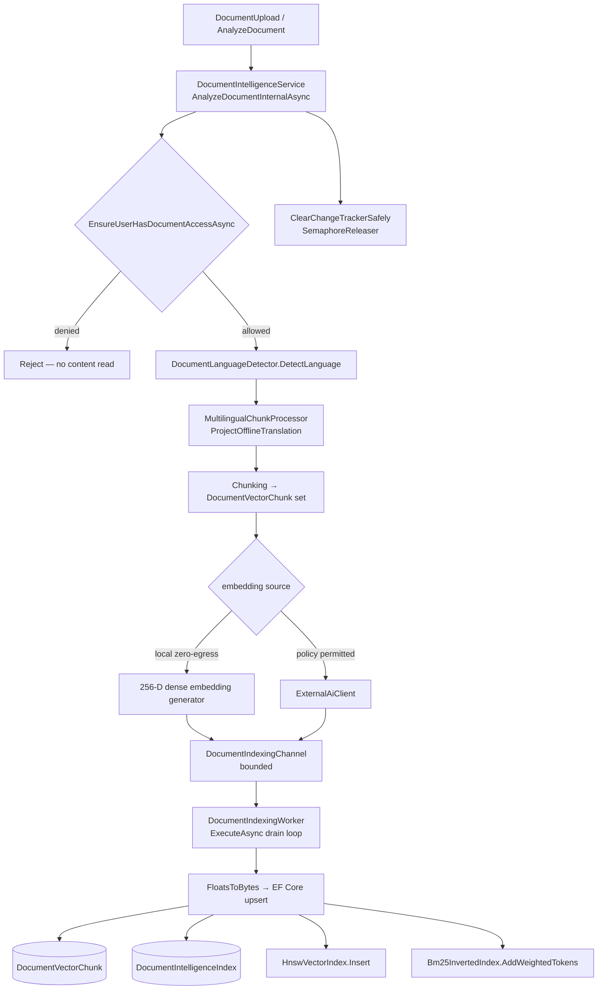
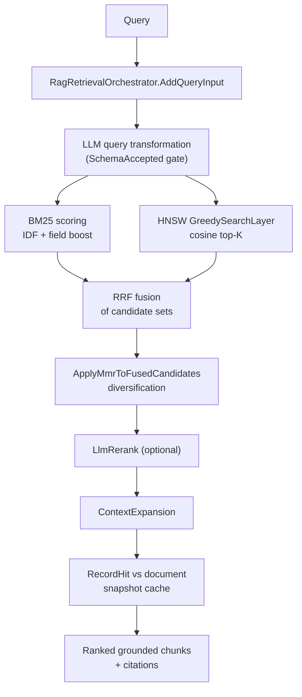

# Document Intelligence and AI

**EConverter Platform — Module Documentation**
Domain classification: Core Business Domain · Importance 9.4 / 10 · Complexity 9.5 / 10 · Research confidence 9.0 / 10

---

## 1. Executive Overview

The Document Intelligence and AI module is the differentiating capability of the EConverter platform. It transforms a static archive of stored files into queryable institutional knowledge: documents are chunked, embedded and indexed into two complementary retrieval structures, and users can then ask natural-language questions that are answered with grounded, citable sources rather than model hallucination.

The defining architectural commitment is **zero-egress by default**. `IDocumentIntelligenceService` — the authoritative application contract — explicitly constrains core analysis, vector search, classification and RAG to in-process execution. No document content, no embedding, no chunk ever leaves the operator's infrastructure unless an administrator explicitly configures an external provider *and* policy permits it. For regulated sectors (legal, healthcare, finance, public sector), this is the single most important property of the module: it converts "AI adoption blocked by data-sovereignty policy" into a solvable configuration problem.

Everything that makes this possible is built from scratch with a deliberately minimal dependency surface:

| Capability | Implementation | External dependency |
|---|---|---|
| Lexical retrieval | `Bm25InvertedIndex` — hand-written Okapi BM25 | None |
| Dense retrieval | `HnswVectorIndex` — from-scratch HNSW graph | None |
| Language detection | `DocumentLanguageDetector` — stopword scoring | None |
| Bilingual projection | `MultilingualChunkProcessor.ProjectOfflineTranslation` | None |
| Retrieval fusion | `RagRetrievalOrchestrator` — RRF + MMR | None |
| Answer synthesis | Local provider (default) | Optional external gateway |
| Export | `CopilotDossierExporter` — OpenXml | None |

The module executes **in-process**, which is precisely why it sits *inside* the system boundary in the C4 Level 1 model rather than being represented as an external SaaS dependency. Only `ExternalAiClient` crosses that boundary, and only conditionally.

---

## 2. Position in the Architecture

### 2.1 Layer placement

The module spans four layers, each with a distinct responsibility:

| Layer | Component | Role |
|---|---|---|
| **Application** | `IDocumentIntelligenceService`, `IExternalAiClient`, `IDocumentIndexingChannel` | Use-case contracts; XML docs encode the zero-egress constraint |
| **Domain** | `DocumentVectorChunk`, `DocumentIntelligenceIndex`, `CopilotChatSession`, `CopilotChatMessage`, `CopilotMemoryItem`, `CopilotUserSettings` | Aggregates, invariants, persisted state |
| **Contracts** | `DocumentIntelligenceDtos.cs` (838 lines) | Transport DTOs, provider resolvers, strategy enumerations |
| **Infrastructure** | `DocumentIntelligenceService`, `RagRetrievalOrchestrator`, `Bm25InvertedIndex`, `HnswVectorIndex`, `ExternalAiClient`, `MultilingualChunkProcessor`, `DocumentLanguageDetector`, `CopilotDossierExporter`, `RagBenchmarkRunner`, `DocumentIndexingChannel` | Concrete implementations |
| **Web** | `DocumentIntelligenceEndpoints`, `EnterpriseAiChatService`, `Copilot.razor`, `AiChatPage.razor`, `EnterpriseAiChatWorkspace.razor`, `DocumentIndexingWorker` | HTTP surface, UI, background indexing loop |
| **Persistence** | `AppDbContext` configurations + four migrations | Vector/index/chat schema |

**Structural note (documented drift):** the module's orchestrators — `DocumentIntelligenceService` (~6,000 lines) and `RagRetrievalOrchestrator` (4,040 lines) — live in `Infrastructure`, not `Application`. This is a known tension in the codebase: interfaces in Application, *orchestration* in Infrastructure. The consequence is that retrieval logic cannot be unit-tested without instantiating the adapter stack. It is functional and internally consistent, but it inverts Clean Architecture's dependency intent at the orchestration level.

### 2.2 Domain relationships

| Relationship | Type | Strength | Meaning |
|---|---|---|---|
| → Document Lifecycle Management | Data dependency | 8.6 | Validates user/document access, reads content, persists chunks keyed by document |
| → Document Conversion and OCR | Service call | 7.8 | Consumes extracted text; OCR fidelity directly determines retrieval quality |
| → Document Storage and Encryption | Service call | 7.2 | Opens encrypted streams before chunking |
| → Persistence and Data Schema | Data dependency | 8.8 | Vector chunks, intelligence index, copilot sessions |
| ← Platform Composition and Hosting | Service call | 8.5 | DI registration, worker hosting, endpoint mapping |

The **Conversion → OCR → Intelligence** chain is the module's critical upstream dependency. Degraded OCR silently degrades RAG relevance — which is exactly why `RagBenchmarkRunner` exists as the early-warning system for that dependency.

---

## 3. Component Landscape

```
Document Intelligence and AI
├── 3.1 Indexing and Embedding Pipeline      (importance 9.2)
│      DocumentIntelligenceService · MultilingualChunkProcessor
│      DocumentLanguageDetector · DocumentIndexingChannel · DocumentIndexingWorker
├── 3.2 Retrieval and Ranking                (importance 9.3)
│      RagRetrievalOrchestrator · Bm25InvertedIndex · HnswVectorIndex
├── 3.3 Copilot and Answer Synthesis         (importance 8.8)
│      EnterpriseAiChatService · Copilot.razor · AiChatPage.razor
│      EnterpriseAiChatWorkspace · CopilotChatSession/Message/MemoryItem/Settings
├── 3.4 Dossier Export and Benchmarking      (importance 8.0)
│      CopilotDossierExporter · RagBenchmarkRunner
└── 3.5 External AI Gateway                  (importance 8.2)
       IExternalAiClient · ExternalAiClient · DocumentIntelligenceDtos
```

---

## 4. Indexing and Embedding Pipeline

### 4.1 Orchestration — `DocumentIntelligenceService`

The service is the analysis orchestrator. Its responsibilities are strictly ordered and access-gated:

1. **`EnsureUserHasDocumentAccessAsync(documentId)`** — authorization precedes all work. No content is read, no embedding computed, no vector persisted for a caller without access.
2. **Dual execution modes** — `AnalyzeDocumentInternalAsync` (batch) and `AnalyzeDocumentStreamInternalAsync` (streaming via `IAsyncEnumerable` for token-by-token consumption).
3. **Persistence compaction** — `FloatsToBytes` converts float vectors to byte blobs, keeping `DocumentVectorChunk` rows compact at ORM and storage level.
4. **Change-tracker hygiene** — `ClearChangeTrackerSafely()` plus `SemaphoreReleaser` / `NoopDisposable` primitives manage EF Core state under semaphore-guarded bulk concurrency. Bulk upserts of thousands of chunks would otherwise accumulate tracked entities and degrade throughput.

### 4.2 Language handling (dependency-free)

**`DocumentLanguageDetector`** avoids both a network call and a heavyweight NLP dependency. It uses `static readonly HashSet<string>` stopword sets and scores candidate languages (Indonesian vs English) in under a millisecond.

**`MultilingualChunkProcessor.ProjectOfflineTranslation`** performs a *deterministic bilingual projection*: text is mapped between representations so that Indonesian and English queries and content share a single vector space. This is the key insight — instead of requiring a translation API (egress) or a multilingual embedding model (dependency), the projection deterministically aligns the representations offline. Optional neural batch translation is available when a provider is explicitly permitted.

The result: cross-lingual retrieval works with zero external calls, and chunk records carry a `Language` field plus `IsEnriched` flag so retrieval can distinguish canonical from projected content.

### 4.3 Chunk model

`DocumentVectorChunk` (domain entity) carries:

| Field | Purpose |
|---|---|
| `DocumentId` | Foreign key to the document aggregate |
| `ChunkIndex` | Ordinal position for stable ordering |
| `PageNumber` | Page provenance for citation |
| `Content` | Chunk text |
| `Language` | Detected language code |
| `IsEnriched` | Whether OCR/enrichment contributed |
| `VectorSource` | `ActualDocument` / `EnrichmentProcess` / `All` |
| `ExtractionMethod` | Provenance of the text extraction |
| `CreatedAt` | Temporal marker |

`DocumentIntelligenceIndex` stores **cold-start metadata** — category, confidence, summary, serialized entity/topic JSON, counts, `AnalyzedAtUtc` — so that retrieval and classification do not need to re-parse documents on every request. This is a deliberate latency optimisation: the expensive analysis is performed once and cached as durable state.

### 4.4 Bounded channel backpressure — `DocumentIndexingChannel`

The queue is an in-memory `System.Threading.Channels` bounded channel implementing three distinct contract members:

| Member | Semantics |
|---|---|
| `TryQueueDocument(Guid): bool` | Non-blocking fire-and-forget; returns `false` when the channel is full — the caller decides whether to drop or retry |
| `QueueDocumentAsync(Guid, CancellationToken): ValueTask` | Awaits write capacity; applies backpressure to the caller, cancellable |
| `QueuedCount: int` | Backlog visibility — the metric that lets operators detect saturation before retrieval staleness manifests |

This dual API is important: indexing triggered from a user-facing request path uses the async form (backpressure is correct); indexing triggered from a fire-and-forget path uses the `bool` form (drop-and-log is correct rather than blocking an interactive thread).

### 4.5 Background drain — `DocumentIndexingWorker`

`BackgroundService` loop that:
1. Reads document GUIDs from the channel (`ExecuteAsync`).
2. Resolves **scoped services per item** — critical, because EF Core `DbContext` and AI services are scoped while the worker is singleton.
3. Extracts semantic content (OCR fallback where required).
4. Computes 256-dimensional dense embeddings through the Application AI layer.
5. Persists `DocumentVectorChunk` and `DocumentIntelligenceIndex` rows via EF Core.
6. Inserts into `HnswVectorIndex` and `Bm25InvertedIndex`.
7. Logs per-document outcome so a single failure is traceable without aborting the loop.

### 4.6 Ingestion flow



---

## 5. Retrieval and Ranking

### 5.1 `HnswVectorIndex` — approximate nearest neighbour

A from-scratch Hierarchical Navigable Small World graph implementation. The public surface:

| Member | Behaviour |
|---|---|
| `HnswVectorIndex(M, efConstruction)` | Graph degree and construction-time search breadth |
| `GenerateRandomLevel()` | Probabilistic layer assignment (exponential decay) |
| `GreedySearchLayer()` | Multi-layer greedy descent to the query neighbourhood |
| `InsertSortedDescending()` | Maintains neighbour lists in descending similarity order |
| `ShrinkNeighbors()` | Prunes neighbour lists to `M` |
| `CosineSimilarity()` | Static scoring over raw `float[]` |
| `RemoveDocument` / `ContainsDocument` / `Clear` / `Dispose` | Full lifecycle management |

`HnswNode` stores `InternalId`, `ChunkId`, `DocumentId`, `PageNumber`, `Content`. `HnswSearchResult` (sealed record) carries chunk and document IDs, page, section title, content, similarity score, enrichment flag, vector source and extraction method — everything needed downstream for citation without a second database round-trip.

**Trade-off accepted:** an in-memory graph means index warm-up is required at process start. The module's persistence layer stores the underlying vectors in PostgreSQL, so the graph can be rebuilt, but the reconstruction strategy is not explicitly documented — this is a known gap (see §10).

### 5.2 `Bm25InvertedIndex` — lexical scoring

A sealed partial class implementing **Okapi BM25** with:
- IDF weighting (rare terms dominate),
- document-length normalisation (long documents do not win by verbosity),
- **per-field boosts** via `AddWeightedTokens` — term-frequency maps built with a per-field weight so a match in a title or heading outranks the same match in body prose,
- `StemToken` regex normalisation for morphological consolidation,
- **lock-protected bulk mutators** (`RemoveDocument` / `RemoveDocumentUnlocked`), tombstone-based deletion marking, `Clear` and `Dispose`.

The tombstone approach matters: deletion during concurrent search cannot restructure the posting lists under readers, so documents are marked deleted and physically excluded at scoring time.

### 5.3 `RagRetrievalOrchestrator` — the component chain

The orchestrator documents an explicit **A–H component chain**:

| Stage | Member / mechanism | Purpose |
|---|---|---|
| A | `AddQueryInput` | Typed query accumulation (`QueryInputTypes` from DTOs) |
| B | LLM query transformation | Rewrite/expand the query; gated on `SchemaAccepted` |
| C | `QueryHnswDim()` | Dimension probing before vector search |
| D | `RecordHit()` | Bind doc/chunk/similarity to cached document snapshots |
| E | Translation segment append | Multilingual query alignment |
| F | **RRF fusion** | Reciprocal Rank Fusion of the lexical and dense candidate sets |
| G | `ApplyMmrToFusedCandidates()` | Maximal Marginal Relevance diversification |
| H | `LlmRerank` → `ContextExpansion` | Optional precision pass, then window expansion |

Two quality-control mechanisms deserve emphasis:

**Snapshot caching with drift detection.** `DiffersFromOriginal()` compares the cached document snapshot against the current content. If a document changed (or its translation projection drifted), stale hits are invalidated. Without this, a re-indexed document would silently return outdated chunks.

**Validation gates.** `SchemaAccepted` and `IsValidExplicitRejection` gate the pipeline — malformed transformations and explicitly rejected queries are handled rather than passed through as noise.

The orchestrator leans on `Concurrent` collections for throughput, `Regex` for normalisation, and `System.Text.Json` + `Diagnostics` for metadata and observability.

### 5.4 Why hybrid retrieval

Neither index is sufficient alone:

| Query type | BM25 (lexical) | HNSW (dense) |
|---|---|---|
| Exact clause, identifier, statute number | **Strong** — exact term match | Weak — embedding blurs alphanumerics |
| Paraphrased intent ("can we terminate early?") | Weak — different words | **Strong** — semantic proximity |
| Rare technical term | **Strong** — high IDF | Moderate |
| Cross-lingual query (ID ↔ EN) | Weak without shared tokens | **Strong** via projection |

RRF fuses the two ranked lists without requiring comparable score scales (rank-based fusion is scale-free, which is exactly why it is used). MMR then reduces redundancy: legal review rarely benefits from five near-identical chunks from the same paragraph.

### 5.5 Retrieval flow



---

## 6. Copilot and Answer Synthesis

### 6.1 `EnterpriseAiChatService`

A sealed UI-facing service (registered in the Web project, injected into Blazor components) tracking session state: `Id`, `Title`, `CreatedAt`, `LastUpdated`, `HasExplicitScope`, `AllowExternalReasoning`, and the message list.

Operational surface:
- `GetOrCreateSession` / `SyncSessionMessages` — store-backed persistence
- scope setters + folder/document scoping (`HasExplicitScope` restricts retrieval to a chosen set)
- hybrid reasoning mode toggle (`AllowExternalReasoning`)
- rename
- a `ConcurrentDictionary` reasoning cache keyed by message ID — reasoning tokens are cached separately from visible answers

The service aliases both `RadzenChatMessage` and `Microsoft.Extensions.AI` (Mex) message types, which is what allows the same service to back the Copilot page, the AI chat page, and invoice dialogs.

**Synthesis routing** is the critical branch:

```
retrieved chunks + session context
        │
        ├── local (default) ──► in-process grounded synthesis ──► answer + citations
        │
        └── external (policy permitted) ──► ExternalAiClient ──► SSE/NDJSON stream
```

Note the structural guarantee: **retrieval is always computed locally.** Even in the external branch, the model receives chunks that were computed without egress. The external call adds generation quality, not data exposure of the corpus beyond the retrieved context.

### 6.2 Domain entities

| Entity | Role | Key members |
|---|---|---|
| `CopilotChatSession` | **Aggregate root** | Ownership, title, pin flag, folder scope, `AddMessage`, `Touch` |
| `CopilotChatMessage` | Child of session | Role, content, timestamp, model provenance, `SavedToMemory` flag, `MarkSavedToMemory()` |
| `CopilotMemoryItem` | Long-term memory | Fact text, category, `Active` flag |
| `CopilotUserSettings` | Personalisation | `MemoryEnabled` (default `true`), `ResponsePersona` (default `"Executive Analyst"`), `CustomInstructions` |

The aggregate boundary is meaningful: messages are only added through the session root (`AddMessage` + `Touch` to update `LastUpdated`), so conversation invariants — ordering, session freshness — cannot be violated by a caller writing messages directly.

`CopilotMemoryItem` and `CopilotUserSettings` attach to a **nullable** `UserId`, accommodating system/anonymous scopes alongside user-owned personalisation.

### 6.3 UI surface

| Component | Route | Notes |
|---|---|---|
| `Copilot.razor` | `/copilot` | `[Authorize]`, `IDisposable`, injects `IDocumentIntelligenceService`, `IDocumentService`, `DialogService` |
| `AiChatPage.razor` | `/ai-chat` | `[Authorize]`, hosts `EnterpriseAiChatWorkspace`, no code-behind |
| `EnterpriseAiChatWorkspace.razor` | (reusable) | Shared workspace surface, also used by invoice dialogs |

### 6.4 HTTP endpoints

`DocumentIntelligenceEndpoints.MapDocumentIntelligenceEndpoints` creates `MapGroup("/api/documents").RequireAuthorization()` and registers `MapGet`/`MapPost` handlers for:
- document **categorisation**
- **summary** generation
- **key-entity** extraction

Handlers bind `Contracts.AI` DTOs and delegate to Application-layer AI services. Because `RequireAuthorization()` is applied at the group level, **authorization precedes handler execution** — no intelligence work runs for an unauthenticated caller. This is the correct ordering and worth stating explicitly: the connection between surface and cipher must be verified before any bytes are parsed.

---

## 7. External AI Gateway

### 7.1 `ExternalAiClient`

A sealed `HttpClient`-based client supporting **OpenAI, Gemini, Claude and local/cloud endpoints**. Its central design decision is normalisation: every vendor stream is parsed into one type,

```csharp
ExternalAiStreamChunk(string? ReasoningDelta, string? ContentDelta)
```

which separates **reasoning tokens from visible answer text**. This matters because reasoning-capable models emit internal chain-of-thought deltas interleaved with output; conflating them produces answers contaminated with deliberation.

Parsing surface:
- `TryParseOpenAiChunk`, `ExtractOpenAiAssistantText`, `ExtractOpenAiChoiceText`
- `TryExtractOpenAiReasoningFromPayload`, `ExtractOpenAiChoiceReasoning`
- `TryParseClaudeSseChunk`
- `AppendGeminiElementChunks`
- connectivity pings, timeout management

### 7.2 Provider resolvers (`DocumentIntelligenceDtos.cs`)

`AiProviders` supplies `GetDefaultModel()` and `GetDefaultEndpoint()` resolvers, so callers never hardcode vendor specifics. Companion enumerations:

| Type | Values / purpose |
|---|---|
| `VectorSourceTypes` | `ActualDocument`, `EnrichmentProcess`, `All`; plus `AllFilterOptions` |
| `CopilotPersonas` | Persona catalogue for `ResponsePersona` |
| `RetrievalStrategySources` | Which index/strategy produced a chunk |
| `QueryInputTypes` | Typed query classification for stage A |
| `RetrievalQualityActions` | Quality signals consumed by benchmarking |

All carry `System.Text.Json.Serialization` attributes for consistent wire representation.

**Known gap:** `ExternalAiClient` has timeout management but **no circuit breaker** and **no documented fallback-to-local guarantee** when a provider hangs. In a zero-egress-first architecture this is asymmetric — the local path is the safety net, but the transition is not automatic.

---

## 8. Dossier Export and Benchmarking

### 8.1 `CopilotDossierExporter`

A static class using OpenXml `Packaging`, `Spreadsheet` and `Wordprocessing` plus globalisation formatting.

| Entry point | Output |
|---|---|
| `BuildDossierMarkdown` | Markdown source, converted to PDF |
| DOCX path | `AppendWordHeading` / `AppendWordParagraph` / `AppendWordTableRow` |
| XLSX path | `AppendExcelRow` |
| `ExportFinancialGraphToExcel` | Spreadsheet of the financial entity graph |

Four formats from one synthesis payload: **PDF** (publication/archival), **DOCX** (editable legal drafting), **XLSX** (financial figures, graph data), **Markdown** (version control, wiki embedding). For the legal/compliance persona this is the difference between "an answer in a chat window" and "an evidence-grade briefing that can be filed."

### 8.2 `RagBenchmarkRunner`

A static partial runner with a `BenchmarkStageMode` enum and eight nested types. It assembles per-stage option DTOs — `MultiQueryRetrievalOptionsDto`, `RrfFusionOptionsDto`, `LlmRerankOptionsDto`, `ContextExpansionOptionsDto` — and evaluates a fixed **120-question corpus**.

Metrics measured:

| Metric | What it proves |
|---|---|
| **Recall@K** | Was the right chunk retrieved at all? |
| **MRR** | How high did the first correct chunk rank? |
| **nDCG** | Is the whole ranking correctly ordered? |
| **Context precision** | How much retrieved context is actually relevant? |
| **Context recall** | Was all needed context present? |
| **Faithfulness** | Is the answer supported by the retrieved context? |

`CreateDeterministicGuid` yields stable chunk identifiers, so two runs against an unchanged corpus produce comparable numbers. This is the point: without deterministic identity, a corpus re-parse silently changes every ID and the benchmark becomes incomparable across releases.

**Operational value:** when OCR degrades or a chunker change lands, Recall@K drops *before* users complain that Copilot "got worse." The benchmark is the module's regression tripwire on the Conversion → OCR → Intelligence dependency chain.

---

## 9. Security and Data Sovereignty

| Control | Implementation | Effect |
|---|---|---|
| **Access gate before analysis** | `EnsureUserHasDocumentAccessAsync` | No content read or vector written without authorization |
| **Endpoint-level authorization** | `MapGroup(...).RequireAuthorization()` | Gate fires before handler execution |
| **Zero-egress default** | `IDocumentIntelligenceService` contract + local synthesis path | Confidential content never leaves infrastructure |
| **Policy-gated egress** | `AllowExternalReasoning` + `IExternalAiClient` | External providers opt-in only |
| **Owner-scoped state** | `CopilotChatSession` ownership; nullable `UserId` on memory/settings | Conversations cannot cross users |
| **Scoped resolution** | `DocumentIndexingWorker` resolves scoped services per item | No cross-request `DbContext` bleed |
| **Storage encryption preserved** | Opens streams via `IDocumentStorage` | AES-GCM semantics intact through the intelligence path |
| **Input sanitisation upstream** | OCR language codes + file-signature/zip-bomb guards | Malicious uploads neutralised before indexing |

The **structural** nature of the zero-egress guarantee deserves emphasis. It is not a policy document — it is a branch in the code. The default path never reaches `ExternalAiClient`; the external path is a separate, explicitly-enabled branch that still consumes locally-computed retrieval results. An auditor can verify the property by reading one conditional.

---

## 10. Known Gaps and Risks

Honest assessment, consistent with the architecture review:

| # | Gap | Impact | Severity |
|---|---|---|---|
| 1 | **No explicit index warm-up strategy** | HNSW and BM25 must be reconstructed after restart; documentation mentions the persistence migration but not rebuild timing | MEDIUM |
| 2 | **No circuit breaker on external AI** | A hanging provider degrades response time with no automatic fallback-to-local | MEDIUM |
| 3 | **Duplicated AI entry points** | `Components/Pages/Copilot` consumes `Web/Services/EnterpriseAiChatService` directly rather than the Application AI contract; the grounding guarantee may be enforced in two code paths | MEDIUM (PLAUSIBLE) |
| 4 | **Orchestration in Infrastructure** | `DocumentIntelligenceService` (~6,000 lines) and `RagRetrievalOrchestrator` (4,040 lines) are untestable without the adapter stack | MEDIUM |
| 5 | **Index saturation not surfaced as a metric** | `QueuedCount` exists but queue depth is not documented as an emitted metric — staleness is discovered by users | LOW–MEDIUM |
| 6 | **Embedding model versioning absent** | Vectors from different model versions are dimension-widened (migration `WidenDocumentVectorChunkEmbedding`) but dimensional compatibility does not guarantee semantic comparability; no re-embedding policy documented | MEDIUM |
| 7 | **No documented deletion cascade to indices** | Document purge must remove vectors from PostgreSQL *and* both in-memory indices; `RemoveDocument` exists on both, but the orchestration is not described | MEDIUM |

---

## 11. Implementation Reference

### 11.1 Key files

```
Application/AI/
  IDocumentIntelligenceService.cs   async Task/ValueTask/IAsyncEnumerable contract, zero-egress XML docs
  IExternalAiClient.cs              streaming dispatch → ExternalAiStreamChunk
  IDocumentIndexingChannel.cs       TryQueueDocument · QueueDocumentAsync · QueuedCount
Contracts/AI/
  DocumentIntelligenceDtos.cs       838 lines · VectorSourceTypes · AiProviders ·
                                    CopilotPersonas · RetrievalStrategySources ·
                                    QueryInputTypes · RetrievalQualityActions
Domain/
  Documents/DocumentVectorChunk.cs
  Documents/DocumentIntelligenceIndex.cs
  AI/CopilotChatSession.cs          aggregate root
  AI/CopilotChatMessage.cs
  AI/CopilotMemoryItem.cs
  AI/CopilotUserSettings.cs
Infrastructure/AI/
  DocumentIntelligenceService.cs    ~6,000 lines · analysis orchestration
  RagRetrievalOrchestrator.cs       4,040 lines · stages A–H
  Bm25InvertedIndex.cs              Okapi BM25 · field boosts · tombstones
  Hnsw/HnswVectorIndex.cs           from-scratch ANN graph
  ExternalAiClient.cs               OpenAI / Gemini / Claude / local
  MultilingualChunkProcessor.cs     ProjectOfflineTranslation
  DocumentLanguageDetector.cs       stopword scoring, sub-millisecond
  CopilotDossierExporter.cs         PDF / DOCX / XLSX / Markdown
  RagBenchmarkRunner.cs             120-question evaluation harness
  DocumentIndexingChannel.cs        bounded Channel<Guid>
Web/
  HostedServices/DocumentIndexingWorker.cs
  Services/EnterpriseAiChatService.cs
  Endpoints/DocumentIntelligenceEndpoints.cs
  Components/Common/EnterpriseAiChatWorkspace.razor
  Components/Pages/Copilot/Copilot.razor
  Components/Pages/Copilot/AiChatPage.razor
```

### 11.2 Persistence migrations

| Migration | Purpose |
|---|---|
| `20261028164624_AddPersistentVectorAndIntelligenceIndex` | Vector chunk + intelligence index tables |
| `20261029141045_AddCopilotChatAndMemoryPersistence` | Sessions, messages, memory, settings |
| `20261102170000_AddTriLanguageChunkSupport` | Tri-language chunk support |
| `20261113025122_WidenDocumentVectorChunkEmbedding` | Embedding dimension widening |

### 11.3 Extension checklist

Adding a new external provider:
1. Extend `ExternalAiClient` with a `TryParse<Provider>Chunk` method.
2. Normalise into `ExternalAiStreamChunk(ReasoningDelta, ContentDelta)` — never emit raw vendor payloads.
3. Register the default model/endpoint in `AiProviders`.
4. Verify the local path still compiles untouched — egress must remain optional.

Adding a retrieval stage:
1. Add the option DTO to `Contracts/AI`.
2. Insert into `RagRetrievalOrchestrator` at the correct chain position (post-RRF, pre-context-expansion for precision passes).
3. Add a `BenchmarkStageMode` value and re-run the 120-question corpus — a stage that improves nDCG but drops Recall@K is a net regression.

Adding a dossier format:
1. Add a `BuildDossier<Format>` entry point to `CopilotDossierExporter`.
2. Reuse the shared row/paragraph appenders; do not fork synthesis formatting.

---

## 12. Verdict

| Dimension | Assessment | Basis |
|---|---|---|
| **Functional completeness** | 9/10 | Ingest → index → hybrid retrieve → synthesise → export → measure, all present |
| **Architectural intent** | 7/10 | Zero-egress correctly structural; orchestration misplaced in Infrastructure |
| **Dependency discipline** | 9/10 | BM25, HNSW, language detection, projection all hand-built — no SaaS, no native AI libraries |
| **Data sovereignty** | 10/10 | Egress is a branch, not a default; verifiable by reading one conditional |
| **Observability / QA** | 7/10 | Benchmark harness is excellent; index saturation and warm-up undocumented |
| **Evolvability** | 7/10 | Provider abstraction is clean; embedding versioning policy absent |

**Summary.** This module is the platform's most technically ambitious domain and its clearest compliance differentiator. The engineering conviction — implement BM25 and HNSW from scratch rather than depend on a vector database, implement language detection rather than call a translation API, project translations deterministically rather than embed multilingually — produces a system that works offline, is fully auditable, and cannot be broken by a vendor's pricing change or availability outage. The cost of that conviction is concentrated in two places: nearly ten thousand lines of orchestration living in the wrong architecture layer, and the absence of documented operational guardrails (warm-up, circuit breaking, embedding versioning) that a production deployment will eventually need.

*Evidence status: architecture, component inventory and interaction contracts are **SOLID** — reproduced from the supplied research materials. Gaps §10 items 3 and 7 are **PLAUSIBLE** — consistent with the dependency graph but requiring source inspection to confirm. No component of this module was verified by execution; all claims are documentation-derived.*