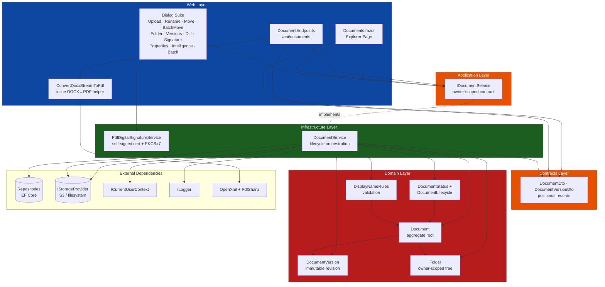
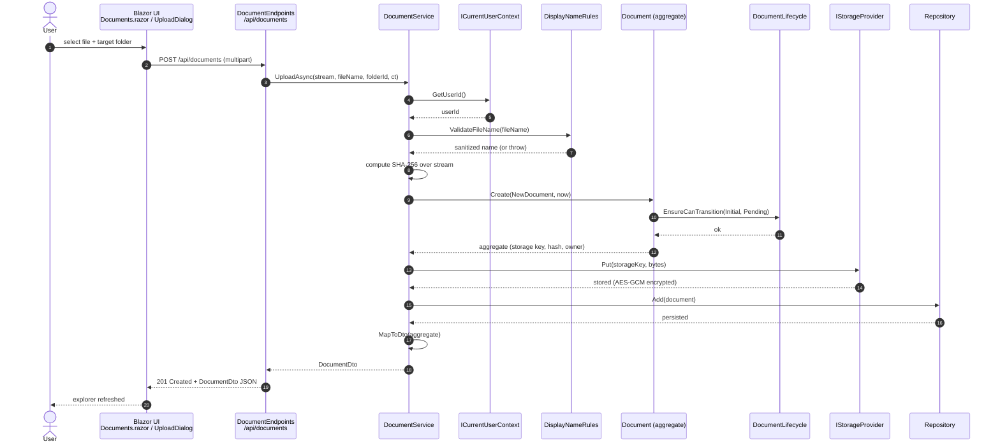
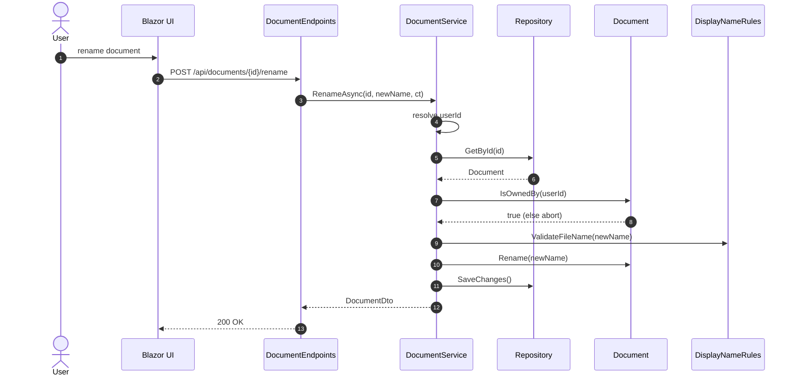
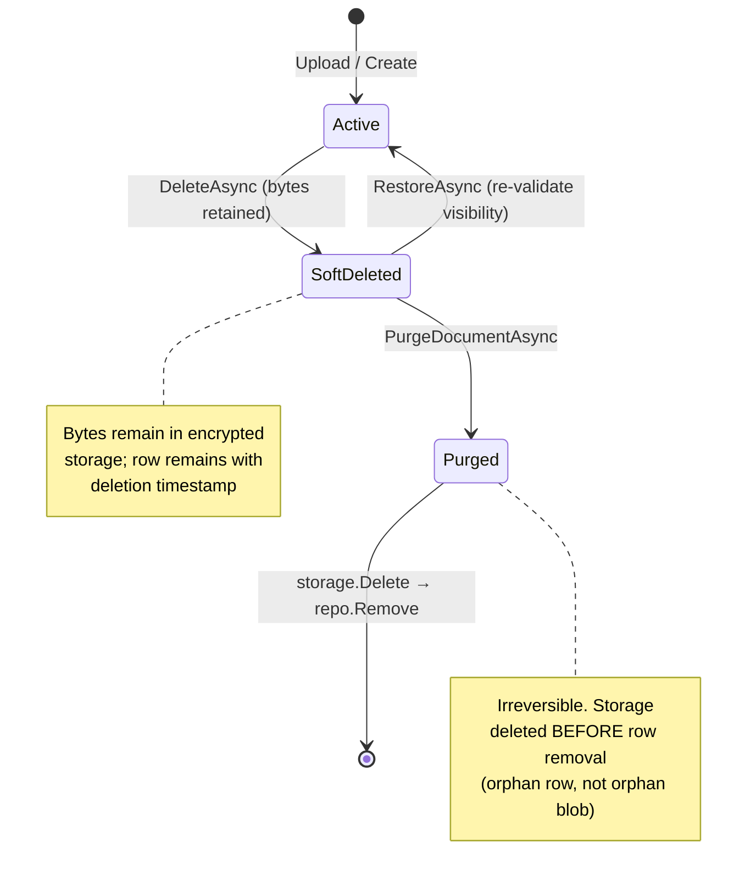
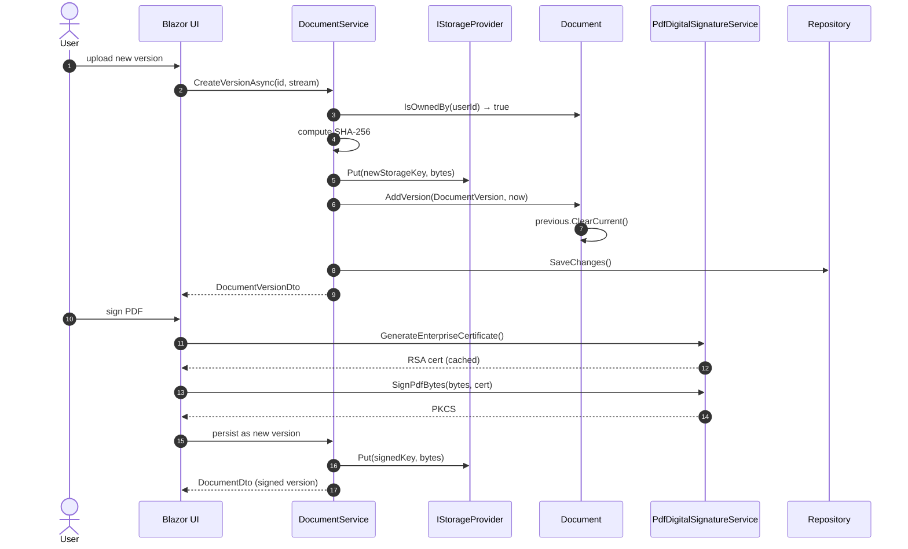

# Document Lifecycle Management — EConverter

**Domain Classification:** Core Business Domain · Importance 9.8 / 10 · Complexity 8.5 / 10
**Primary Layers:** Domain → Application → Infrastructure → Contracts → Web
**Single Authorization Enforcement Point:** `Document` aggregate root

---

## 1. Purpose and Business Value

Document Lifecycle Management is the aggregate domain that owns the business value of a user-owned document across its entire life. It is the aggregate that every other capability in EConverter ultimately operates on — conversion jobs read from it, the AI intelligence stack indexes it, the PDF editor mutates it into new versions, and administration governs who may see it. No feature in the platform can function without passing through this domain's identity, storage coordinates, and ownership predicates.

The domain delivers four concrete business capabilities:

| Capability | Business Outcome |
|---|---|
| **Governed intake** | Documents enter the platform through a validated, hardened, malware-screened, owner-attributed path |
| **Archive organisation** | Owner-scoped folder trees, rename, and move operations that mirror familiar file-explorer semantics |
| **Reversible destructive operations** | Soft delete with recycle-bin restore, decoupled from irreversible purge, with storage/DB coordination |
| **Provenance and versioning** | Immutable revision rows plus SHA-256 content hashing enabling deduplication, integrity verification, version diffing and digital-signature verification |

The strategic value is consolidation: rather than documents living in an ungoverned sprawl of network shares, email attachments and ad-hoc conversion tools, this domain establishes **one identity, one ownership model, one storage abstraction, and one audit surface** for the entire document estate.

---

## 2. Architectural Position

### 2.1 Layered Composition

The domain follows a classic clean/onion layering in .NET, with dependencies pointing strictly inward:



### 2.2 Position Within the Domain Map

Document Lifecycle Management is the **highest fan-in core domain** in the system. Its relationships to other domains define the platform's structural spine:

| Counterpart Domain | Relation | Strength | Nature |
|---|---|---|---|
| Document Storage and Encryption | Service Call | 9.0 | Every byte read/written passes the encryption wrapper |
| Persistence and Data Schema | Data Dependency | 9.2 | DocumentConfigurations + migration chain is the schema authority |
| Job Orchestration and Processing | Data Dependency (inbound) | 8.5 | Jobs reference document identity and storage keys |
| Document Intelligence and AI | Data Dependency (inbound) | 8.6 | Vector chunks keyed to the document aggregate |
| PDF Editing and Rendering | Data Dependency (inbound) | 8.0 | Edits persisted as new document versions |
| Security, Identity and Audit | Configuration Dependency (inbound) | 8.5 | Ownership + user context gate every mutation |
| Platform Composition and Hosting | Service Call (inbound) | 9.0 | DI registration and endpoint mapping |

**Consequence:** any change to the document aggregate or its EF Core configuration has the widest blast radius in the system. Schema migrations touching `Documents`, `DocumentVersions`, or `Folders` must be treated as system-wide changes.

---

## 3. Domain Model — Aggregates, Entities and Value Semantics

### 3.1 Document Aggregate Root

`src/DocumentConverter.Domain/Documents/Document.cs` — a **sealed aggregate root** designed so that invalid instances are unrepresentable.

**Construction discipline:**

| Member | Purpose |
|---|---|
| Private parameterless constructor | Reserved exclusively for ORM materialisation |
| Private id-based constructor | Rehydration from persistence without re-running invariants |
| `static Create(NewDocument, DateTimeOffset now)` | The only legitimate birth path — enforces owner present, storage key length, and filename length from the first instant |

**Encapsulation discipline:**

- All properties are **read-only** — no public setters exist anywhere on the aggregate.
- State can only move through **explicit transition methods** (e.g. `BeginScan(now)`), each of which validates the move through `DocumentLifecycle.EnsureCanTransition` before applying it.
- `IsOwnedBy(Guid userId)` is the **ownership predicate** invoked at every boundary. Because mutation methods presuppose ownership, downstream code physically cannot bypass the check.

**Carried state includes:** owner identity, optional folder reference, original filename, content type, file extension, size in bytes, SHA-256 content hash, lifecycle status plus optional status reason, creation/update timestamps, optional expiry, storage provider identity and storage key, and the version collection.

**Critical design decision — storage keys, not bytes.** The aggregate stores *where* content lives (provider + key), never the content itself. This keeps the domain persistence-agnostic and storage-agnostic: an operator can substitute a filesystem store for an S3-compatible object store without touching a single domain rule.

### 3.2 DocumentStatus and DocumentLifecycle — the State Machine

`src/DocumentConverter.Domain/Documents/DocumentStatus.cs` contains an enum with **explicit numeric values** (stable across persistence reordering) plus a static `DocumentLifecycle` helper that is the sole authority on legal status movement:

| Member | Contract |
|---|---|
| `CanTransition(from, to)` | Pure predicate — performs no mutation, safe for UI capability checks |
| `EnsureCanTransition(from, to)` | Throws on an illegal transition — used inside mutating methods |
| `IsVisibleToOwner(status)` | Controls whether a status is exposed to the owner or hidden (e.g. during scanning or after failure) |

**Why this matters:** by isolating the state machine into a single static helper and routing every mutation through it, the domain makes illegal lifecycle transitions **impossible by construction** rather than by convention. There is no code path that can move a document from, say, a purged terminal state back to active.

### 3.3 DocumentVersion — Immutable Revision

`src/DocumentConverter.Domain/Documents/DocumentVersion.cs` models an immutable revision.

- Tracks `DocumentId`, `CreatedByUserId`, storage key, content hash, timestamps, and `IsCurrent`.
- **No setters** are exposed — version metadata never mutates after creation.
- The **only** mutating operation is `ClearCurrent()`, which flips the current-version flag when a newer revision supersedes it.

This immutability is what makes provenance auditable: a version row, once created, is a permanent, verifiable statement about what bytes existed at what time under whose authority.

### 3.4 Folder — Owner-Scoped Tree

`src/DocumentConverter.Domain/Documents/Folder.cs` derives from the shared `Entity` base and carries `OwnerUserId`, `ParentFolderId`, `Name`, and `CreatedAt`.

`Rename` and `MoveTo` mutate name and parent respectively **while preserving parent-ownership invariants** — a folder cannot be moved beneath a parent owned by a different user. Combined with the aggregate's `IsOwnedBy`, this yields IDOR protection at both the document and the folder axis.

### 3.5 DisplayNameRules — Input Validation at the Domain Boundary

`src/DocumentConverter.Domain/Documents/DisplayNameRules.cs` is a static validation utility:

| Constant / Member | Value / Contract |
|---|---|
| `FileNameMaxLength` | 255 |
| `FolderNameMaxLength` | 200 |
| Forbidden-character regex | Precompiled; blocks path separators, control characters, and header-injection characters |
| `ValidateFileName(name)` | Returns sanitised name or throws |
| `ValidateFolderName(name)` | Returns sanitised name or throws |
| `Validate(name, maxLength, label)` | Shared private implementation for both |

**Security rationale:** this single validator guards *two* distinct attack surfaces simultaneously — the UI rendering path (stored-XSS / display integrity) and the HTTP `Content-Disposition` header on download (response-splitting / header injection). Because validation lives in the domain rather than the endpoint, every caller inherits the protection automatically.

---

## 4. Application Layer — the Owner-Scoped Contract

`src/DocumentConverter.Application/Documents/IDocumentService.cs` defines the use-case boundary.

```csharp
Task<DocumentDto> UploadAsync(Stream content, string fileName, Guid? folderId, CancellationToken ct);
Task<DocumentDto> RenameAsync(Guid id, string newName, CancellationToken ct);
Task<DocumentDto> MoveToFolderAsync(Guid id, Guid? folderId, CancellationToken ct);
Task DeleteAsync(Guid id, CancellationToken ct);
Task RestoreAsync(Guid id, CancellationToken ct);
Task BatchRestoreAsync(IEnumerable<Guid> ids, CancellationToken ct);
Task PurgeDocumentAsync(Guid id, CancellationToken ct);
Task EmptyRecycleBinAsync(CancellationToken ct);
Task<DocumentVersionDto> CreateVersionAsync(Guid id, Stream content, CancellationToken ct);
Task<IReadOnlyList<DocumentVersionDto>> GetVersionsAsync(Guid id, CancellationToken ct);
```

**The contract's defining property is that it is owner-scoped, not caller-scoped.** The interface documentation binds it explicitly to the authorization model: IDOR protection is enforced *at the service level*, not at the endpoint. This is a deliberate architectural choice with a measurable consequence — the Blazor UI, the minimal API, and any background worker that consumes this contract all inherit identical authorization semantics without re-implementing a single check.

---

## 5. Infrastructure Layer — Orchestration and Coordination

### 5.1 DocumentService

`src/DocumentConverter.Infrastructure/Documents/DocumentService.cs` implements `IDocumentService` and injects repositories, `IStorageProvider`, `ICurrentUserContext`, and `ILogger`.

**Universal method skeleton** — every public operation follows the same three-step prologue:

1. Resolve the current user via `ICurrentUserContext`.
2. Load the aggregate by id from the repository.
3. Call `document.IsOwnedBy(userId)` and abort if false.

Only after these three steps does any mutation occur. This is defence in depth against IDOR: the check is not delegated to middleware, filters, or endpoint conventions — it is structurally impossible to reach a mutation without passing it.

**Destructive-operation coordination.** The service is responsible for keeping storage and persistence consistent across the three-stage deletion model:

| Operation | Storage action | Persistence action | Reversible |
|---|---|---|---|
| Soft delete | *none* — bytes retained | set status + deletion timestamp | Yes (`RestoreAsync`) |
| Restore | *none* | clear deletion, re-validate visibility | — |
| Purge | `Delete(storageKey)` **first** | `Remove(document)` **second** | No |
| Empty recycle bin | iterate purged candidates | remove rows | No |

The purge ordering is a deliberate choice: deleting storage first means a crash between the two steps leaves an orphaned *row* (recoverable, re-attemptable) rather than an orphaned *blob* (silent storage leak with no reachable reference). Fail-safe direction, not fail-silent direction.

**Supporting members:** `MapToDto` and `MapVersionToDto` are static projections from aggregate to contract DTO; `IsTextExtension` branches text versus binary handling for preview and diff rendering.

**Complexity note.** This service is the densest branching hub in the domain — 27 members with high cyclomatic complexity — because it concentrates every document branching rule: soft-versus-permanent delete, visibility gating, extension-based handling, and storage coordination. Decomposition by operation family (lifecycle mutation vs. versioning vs. storage coordination) is the natural refactor if change-amplification becomes a problem.

### 5.2 PdfDigitalSignatureService

`src/DocumentConverter.Infrastructure/Documents/PdfDigitalSignatureService.cs` keeps provenance and authenticity checks inside the document domain rather than spinning up a separate subsystem.

| Member | Behaviour |
|---|---|
| `GenerateEnterpriseCertificate()` | Builds a self-signed RSA certificate with key-usage extensions and the document-signing OID; cached in a static `ConcurrentDictionary` so the certificate is generated once per process |
| `VerifyPdfBytes()` | Parses PDF signature dictionaries, unescapes PDF string literals, locates the signed byte range via `IndexOfBytes`, and validates PKCS#7/CMS over that range |
| `HasDigitalSignatures()` | Fast marker detection for signature presence without full parse |

**Architectural layering:** content hashing (SHA-256) answers "what are these bytes?" — PKCS#7 answers "who attested to these bytes, and were they altered afterwards?" Together they form the provenance chain: a signed document's hash and its signature both verify or both fail.

---

## 6. Contracts Layer — Transport Decoupling

`src/DocumentConverter.Contracts/Documents/DocumentDtos.cs` defines two **public sealed positional records**:

```csharp
public sealed record DocumentDto(
    Guid Id,
    Guid OwnerUserId,
    Guid? FolderId,
    string OriginalFileName,
    string ContentType,
    string? FileExtension,
    long SizeBytes,
    string Sha256Hash,
    DocumentStatus Status,
    string? StatusReason,
    DateTimeOffset CreatedAt,
    DateTimeOffset UpdatedAt,
    DateTimeOffset? ExpiresAt,
    IReadOnlyList<DocumentVersionDto> Versions);

public sealed record DocumentVersionDto(
    Guid Id,
    Guid DocumentId,
    string Sha256Hash,
    DateTimeOffset CreatedAt,
    bool IsCurrent,
    /* storage metadata */);
```

**Design properties:** pure declarative data, no behaviour, serialisation-friendly, immutable by construction. The record shape is deliberately decoupled from the aggregate so the wire/UI contract can evolve independently of domain refactoring — and so ORM entities never leak into the presentation layer.

---

## 7. Web Layer — API and Interactive Surface

### 7.1 Minimal API — `/api/documents`

`src/DocumentConverter.Web/Endpoints/DocumentEndpoints.cs` maps a route group via `MapDocumentEndpoints`:

| Route | Verb | Operation |
|---|---|---|
| `/api/documents` | GET | List documents for the current owner |
| `/api/documents` | POST | Upload (multipart: content, fileName, folderId) |
| `/api/documents/{id}/rename` | POST/PATCH | Rename with validation |
| `/api/documents/{id}/move` | POST | Move to folder (null = root) |
| `/api/documents/{id}` | DELETE | Soft delete |
| `/api/documents/{id}/download` | GET | Stream bytes; sanitised `Content-Disposition` |
| `/api/documents/{id}/sign` | POST | Apply digital signature |
| `/api/documents/{id}/convert` | POST | Direct DOCX→PDF conversion |
| `/api/folders` | POST/rename/DELETE | Folder CRUD |

Request shapes are defined as inline records. Responses are `DocumentDto` / `DocumentVersionDto` JSON. Downloads stream from the storage key recorded on the aggregate, with the display name sanitised before being placed in `Content-Disposition` — the second consumer of `DisplayNameRules`.

**Known structural tension.** This file also contains a self-contained `ConvertDocxStreamToPdf` helper that reads with `DocumentFormat.OpenXml` and emits PDF with `PdfSharp`. It provides an immediate, synchronous conversion path that bypasses the asynchronous job pipeline for quick user-facing conversions. It is functionally valuable but architecturally divergent: the logic duplicates capability that already exists in `OfficeDocumentProcessor`, is not reusable by the worker, and is not unit-testable in isolation from HTTP transport. Consolidation — routing this path through `IProcessingService` — would restore layering integrity without removing the feature.

### 7.2 Blazor Explorer — `Documents.razor`

`src/DocumentConverter.Web/Components/Pages/Documents/Documents.razor` is the `/documents` page, guarded by `[Authorize]`, injecting document, processing, catalog, dialog, notification and navigation services. It orchestrates the explorer view, selection state, and the conversion workflow.

### 7.3 Presentation Models

| Model | Role |
|---|---|
| `ExplorerItem` | Unified folder/file view model; static `FromFolder` / `FromDocument` factories project DTOs into a renderable shape |
| `FolderNode` | Mutable tree node — `ParentFolderId`, `DocumentCount`, `IsExpanded`, `Children` |
| `WindowsFolderTreeItem.razor` | Recursive renderer with selection handling, context menu (`preventDefault` for the native menu) and drag-over feedback |

These are presentation-only models. They are constructed *from* DTOs and never reach back into the domain — the UI dependency direction is strictly one-way.

### 7.4 Dialog Suite

| Dialog | Function |
|---|---|
| `UploadDialog` | Folder target selection, file picking, `IDisposable` cleanup on close |
| `RenameDialog` | Validated rename via `DisplayNameRules` |
| `MoveDialog` / `BatchMoveDialog` | Single and multi-document destination picking; batch variant displays selection count |
| `FolderDialog` | Validated folder creation |
| `DocumentPropertiesDialog` | Read-only Windows-11-style metadata inspector |
| `DocumentVersionsDialog` / `VersionHistoryDialog` | List, restore, compare and download revisions |
| `DocumentDiffDialog` | Side-by-side diff aggregating additions/deletions across versions |
| `DigitalSignatureDialog` | Form binding → `IPdfDigitalSignatureService` |
| `DocumentIntelligenceDialog` / `GlobalCopilotDialog` | Document-scoped versus global AI chat workspace wrappers |
| `BatchConversionDialog` | Catalog enumeration via `IConverterCatalogService`, submission via `IProcessingService` |
| `BatchProgressDialog` | `IDisposable` subscription to `IJobNotificationService` with JS interop for auto-scroll |

**Dialog contract pattern:** inputs arrive via `[Parameter]` (document id, folder id, callbacks); results return through `DialogService` and `EventCallback`. Dialogs never hold domain references — only ids and DTOs.

---

## 8. Core Workflows

### 8.1 Upload — End-to-End Sequence



**Ordering rationale.** The stream is hashed *before* the aggregate is created so the hash is an intrinsic property of the document from birth. Storage write precedes repository commit so a DB row never references a storage key whose bytes were never written. Filename validation precedes everything so an invalid name fails fast with zero side effects.

### 8.2 Rename and Move — Ownership Enforced



Move follows the identical spine with an additional folder-ownership validation: the target parent folder must itself be owned by the same user, preventing cross-tenant folder injection.

### 8.3 Soft Delete → Restore → Purge



`EmptyRecycleBinAsync` iterates the purged-candidate set and applies the same storage-then-row ordering per document.

### 8.4 Version Creation, Diff and Digital Signature



**Diff semantics:** because every version carries its own SHA-256 and storage key, version comparison is a mechanical operation — open both streams, branch on `IsTextExtension`, and aggregate additions/deletions for the side-by-side renderer.

### 8.5 Download

The download path is the strictest test of the ownership invariant because it discloses content rather than metadata:

`GET /api/documents/{id}/download` → `GetForDownloadAsync(id)` → `IsOwnedBy` → `IStorageProvider.Get(storageKey)` → decryption → stream with sanitised `Content-Disposition`. A request for another user's document id returns a not-found/forbidden response with **no bytes and no metadata leakage**.

---

## 9. Security Architecture

### 9.1 Defence-in-Depth Layers

| Layer | Control | Owned By |
|---|---|---|
| Edge | Security header middleware, authentication pipeline | Web host |
| Identity | Local or EntraId authentication; claims transformed onto a **stable internal entity ID** | Security, Identity and Audit |
| Contract | `IDocumentService` is owner-scoped by contract, not convention | Application |
| Orchestration | Every method resolves current user then calls `IsOwnedBy` | Infrastructure |
| Domain | Mutation methods presuppose ownership; no public setters | Domain |
| Input | `DisplayNameRules` blocks path separators, control chars, header-injection chars | Domain |
| Storage | AES-GCM encryption at rest | Storage and Encryption |

### 9.2 Two Decisions That Carry Disproportionate Value

**1. Authorization keyed on the internal entity ID, not the provider subject claim.**
The `User` aggregate records an `AuthenticationType` (Local or EntraId) while deliberately keying all authorization on the internal stable ID. Identity-provider churn — subject rotation, tenant migration, re-provisioning — therefore cannot silently grant or revoke application permissions. Permissions survive provider changes by design.

**2. Ownership enforced in the aggregate, not the service.**
`IsOwnedBy` lives on `Document`. Any future feature — a new endpoint, a background exporter, an AI retrieval path — that loads an aggregate inherits the predicate. There is no architectural seam through which a developer can accidentally construct a bypass, because the mutation surface itself is guarded.

### 9.3 Header-Injection Defence

`DisplayNameRules` blocks `\r`, `\n`, and separator characters in filenames. This directly neutralises **HTTP response splitting** via `Content-Disposition` on download and **stored display corruption** in the explorer. Validation being domain-side means both the API and the Blazor rendering path are covered by one implementation.

### 9.4 Audit Integration

Every lifecycle mutation — upload, rename, move, delete, restore, purge, version creation, signature — is recorded by `AuditService` as an `AuditEvent`, queryable through the `SecurityAuditLog` admin page. The document domain is therefore a primary producer of the compliance evidence trail, not merely a consumer of it.

---

## 10. Persistence and Schema Authority

Documents, folders, and versions are EF Core entities configured through `DocumentConfigurations` and materialised by the linear migration chain in `AppDbContext` (PostgreSQL via Npgsql).

| Concern | Implementation |
|---|---|
| DbContext | Single `AppDbContext`, Identity tables merged with domain schema |
| Configuration | `Configurations/DocumentConfigurations.cs` — fluent relationships, indexes, constraints |
| Migrations | Baseline `InitialCreate` onward; document-related changes ride the linear chain |
| Startup | `InitializeDatabaseAsync` with PostgreSQL-specific checks such as `to_regclass` |

**Index and constraint considerations implied by the domain model:**

- A composite index supporting owner-scoped listing (owner id + status + folder) serves the dominant query pattern — the explorer.
- Storage keys must be unique per provider, since they are the sole pointer from aggregate to bytes.
- SHA-256 hashes should be indexed for deduplication and integrity lookups.
- Folder parent references need referential integrity that permits the root (null parent) while preventing orphan subtrees.
- Version rows need a filter-friendly `IsCurrent` flag plus an index on `DocumentId` for history retrieval.

**Blast-radius warning.** With four domains at strength 8.8–9.2 depending on persistence, a schema change to `Documents` or `DocumentVersions` is a system-wide change: job orchestration, AI indexing, and the PDF editor all reference document identity and storage coordinates.

---

## 11. Design Decisions and Trade-offs

| Decision | Rationale | Trade-off |
|---|---|---|
| **Private constructors + static factory** | Invalid aggregates unrepresentable; invariants hold from birth | ORM needs a parameterless constructor — a small concession, carefully documented |
| **Read-only properties, explicit transitions** | No accidental state mutation; every change is auditable in code review | More verbose than setters; requires a named method per legitimate transition |
| **Centralised state machine** | Illegal lifecycle transitions impossible by construction | Every new status requires touching the lifecycle helper |
| **Immutable `DocumentVersion`** | Provenance is a permanent, verifiable statement | Correction requires a new version, never an edit — deliberate |
| **Storage keys, not bytes, on the aggregate** | Domain is storage/persistence agnostic; operators can swap backends | Requires careful storage/DB coordination on destructive operations |
| **SHA-256 on document *and* version** | Deduplication, integrity verification, version comparison, signature binding | Hash computed on every write — negligible CPU against the integrity guarantee |
| **Owner-scoped service contract** | One authorization enforcement point; all callers inherit IDOR protection | The contract cannot express cross-user administrative operations without a separate path |
| **Storage-then-row ordering on purge** | Orphaned row (recoverable) preferred over orphaned blob (unrecoverable leak) | Requires a reaper or manual reconciliation for orphan rows |
| **Self-contained DOCX→PDF helper in the endpoint** | Immediate synchronous conversion without job-pipeline latency | Duplicates `OfficeDocumentProcessor` logic; breaks layering; untestable in isolation |

---

## 12. Identified Gaps and Recommendations

| # | Observation | Severity | Recommendation |
|---|---|---|---|
| 1 | `DocumentService` concentrates 27 members and all branching rules | MEDIUM | Decompose by operation family: lifecycle mutations / versioning / storage coordination |
| 2 | Inline DOCX→PDF conversion in `DocumentEndpoints.cs` duplicates processor logic | MEDIUM | Extract to `OfficeDocumentProcessor` and route through `IProcessingService` |
| 3 | No documented reaper for orphaned rows created by a purge interrupted between storage deletion and row removal | LOW-MEDIUM | Add a reconciliation job that scans for storage-key-missing rows and completes or logs them |
| 4 | No documented retention/expiry enforcement despite `ExpiresAt` on the aggregate | MEDIUM | Add a scheduled retention sweep driven by `ExpiresAt` and owner policy |
| 5 | No documented key-rotation path for AES-GCM storage encryption | MEDIUM | Define rotation with re-encryption of historical documents, or versioned key identifiers on stored objects |
| 6 | Version retention unbounded — no documented pruning policy | LOW | Add configurable per-document or per-owner version ceiling |
| 7 | Template/example pattern: `GetForDownloadAsync` must never return metadata for unowned ids | — | Verified by the ownership predicate; add a regression test asserting zero leakage |

---

## 13. Summary

Document Lifecycle Management is the load-bearing wall of EConverter. It answers four questions for every artefact in the system: *whose is it, what are its bytes, where do those bytes live, and what is its current lifecycle state.* Because those four answers are enforced by an immutable aggregate with a centralised state machine and an ownership predicate that every downstream feature inherits, the domain achieves something most document platforms do not — **a single authorization enforcement point that is structurally impossible to bypass**, from the Blazor explorer through the minimal API to any future consumer of the contract.

Its strongest qualities are the aggregate's construction discipline (invalid instances unrepresentable), the deliberate separation of soft delete from irreversible purge with fail-safe storage ordering, and the SHA-256-on-both-document-and-version provenance chain that makes signature verification and version diffing mechanical rather than heuristic. Its principal liabilities are concentration — one service carrying every branching rule — and one layering violation in the endpoint layer where conversion logic sits beside transport routing. Both are addressable without disturbing the domain's invariants, which is the mark of a well-bounded core.