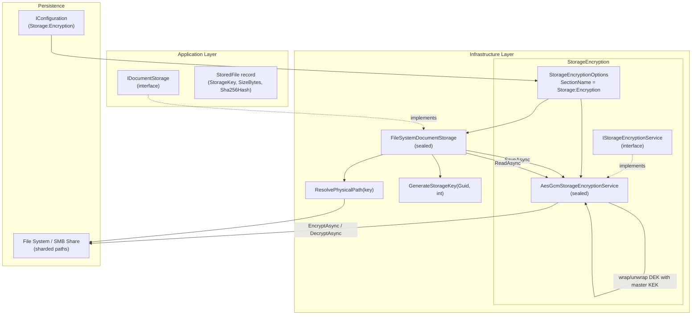

# Document Storage and Encryption

## 1. Overview

**Document Storage and Encryption** is an infrastructure domain of the EConverter platform. It is the single enforcement point for the confidentiality and durability of every document byte that enters or leaves the system. Every other domain — document lifecycle, job orchestration, document intelligence, PDF editing — ultimately reads and writes its payloads through this layer, which makes it the *choke point* through which all content must pass.

The domain is deliberately split into two cooperating layers with distinct responsibilities:

| Layer | Responsibility | Contract | Implementation |
|---|---|---|---|
| **Storage** | Artefact placement, retrieval, enumeration, deletion | `IDocumentStorage` | `FileSystemDocumentStorage` (sealed) |
| **Encryption** | Confidentiality of stored bytes at rest | `IStorageEncryptionService` | `AesGcmStorageEncryptionService` (sealed) |

This separation yields a clear division of concerns. The storage layer knows *where* an artefact lives and *how* to address it but is deliberately ignorant of cryptography; the encryption layer knows *how* to protect a byte stream but is deliberately ignorant of filesystem layout. Configuration is bound through the options pattern via `StorageEncryptionOptions`, targeting the `Storage:Encryption` configuration section.

In the overall architecture, this domain sits squarely in the Infrastructure project, with its contract surface exposed to the Application layer. It is ranked as an **Infrastructure Domain** with an importance score of **8.5** and moderate complexity (**6.0**), which reflects a narrow, well-bounded scope and a small file footprint combined with high architectural leverage. Coupling into this domain is strong: the document lifecycle domain calls it at strength **9.0**, and job orchestration calls it at **8.8**, because document persistence and conversion output uploads both terminate here.

> **Design principle:** confidentiality is enforced in exactly one place. No upper layer can persist plaintext, because the storage implementation is the only writer and it always routes bytes through the encryption stream.

---

## 2. Core Design Decisions

### 2.1 Single Enforcement Point for Confidentiality

Rather than dispersing encryption logic across services, the architecture concentrates it inside one sealed class. Any domain that persists a document — the document service on upload, the worker on conversion output, the editor on version creation — reaches the same storage implementation, and therefore the same encryption path. This property makes the security guarantee *structural* rather than *procedural*: a developer writing a new feature cannot accidentally skip encryption because there is no alternative write path.

### 2.2 Opaque Storage Keys

Callers never receive or supply filesystem paths. `IDocumentStorage.SaveAsync` returns a `StoredFile` record, and reads and deletes are addressed by an opaque `StorageKey` string. This produces three concrete benefits:

1. **Path-traversal immunity at the storage boundary.** Both key construction (`GenerateStorageKey(Guid documentId, int version)`) and key resolution (`ResolvePhysicalPath(string storageKey)`) are private helpers internal to the implementation. Because a caller cannot supply a path, it cannot traverse outside the storage root, request `../` sequences, or address an arbitrary artefact by a crafted name.
2. **Layout evolvability.** The sharding scheme — a document/version pair mapped into nested directories to avoid pathological growth of a single flat directory — can change without touching a single caller.
3. **Backend substitutability.** Because the key is meaningless to the application, replacing the filesystem backing with an object store requires no changes above the infrastructure boundary; the same key can be interpreted as an object name.

### 2.3 Stream-Based Processing

Every operation is stream-oriented. The caller supplies a plaintext `Stream` and receives a stream back; the service never materialises an entire document in memory. This is essential for the platform's workload: multi-hundred-page PDFs, high-resolution scanned images, and large Office documents are routinely processed. Chunked encryption in particular is what allows arbitrarily large files to be encrypted and written without allocating a buffer proportional to file size.

### 2.4 Envelope Encryption (DEK/KEK)

The encryption service implements **envelope encryption** with AES-256-GCM:

- A **Data Encryption Key (DEK)** is generated fresh, ephemerally, for every payload. This means a compromise of one DEK reveals exactly one artefact.
- The DEK encrypts the plaintext in **chunks**, each independently authenticated by GCM's authentication tag.
- The DEK itself is **wrapped** (encrypted) by a **master Key Encryption Key (KEK)** sourced from configuration, and written into an envelope header alongside the ciphertext.
- On read, the header is parsed, the DEK unwrapped with the KEK, and the chunks decrypted and verified in sequence.

The consequence is that the master secret never has to be rotated to protect individual payloads (individual artefacts can be re-wrapped), and the master KEK exists only in configuration and in the envelope wrapping step — not in the stream that touches disk repeatedly.

### 2.5 Feature Toggle for Development Environments

`StorageEncryptionOptions` exposes a boolean `Enabled` flag, and both `IStorageEncryptionService.IsEncryptionEnabled` and the options type surface it. Operators can disable encryption for local development while keeping the identical code path, so the difference between an encrypted and a non-encrypted deployment is a configuration value, not a code fork. In practice this removes an entire class of "works in dev, breaks in prod" divergence in the storage layer.

---

## 3. Component Architecture



The diagram shows the topological arrangement of the domain. The Application layer sees only two abstractions (`IDocumentStorage` and the `StoredFile` return record); the implementation lives entirely in Infrastructure. `FileSystemDocumentStorage` is constructed with `IConfiguration`, an `AesGcmStorageEncryptionService`, and an `ILogger`, which means it receives both the master KEK binding and the encryption collaborator through dependency injection — it never constructs cryptography itself.

---

## 4. Contract Surface

The domain exposes a deliberately small contract surface: two interfaces and one options type.

### 4.1 `IDocumentStorage`

The storage abstraction provides asynchronous operations keyed on opaque identifiers.

```
namespace DocumentConverter.Application.Storage

Task<StoredFile> SaveAsync(Stream content, string contentType, CancellationToken ct)
```

The write operation accepts a plaintext stream and returns a `StoredFile` record. Note that the interface is intentionally minimalistic: the extracted contract exposes persistence as the primary operation, with reads and deletes resolved against the same key space by the implementation. Consumers depend on this interface exclusively, which keeps backend choice an infrastructure concern. The doc comments associate the implementation with an SMB-compatible internal file server (Method §42 / Impl §5), which signals the intended default deployment topology: a mounted share, not a local ephemeral volume.

### 4.2 `StoredFile`

`StoredFile` is a positional record carrying three fields:

| Field | Type | Purpose |
|---|---|---|
| `StorageKey` | string | Opaque key addressing the artefact; persisted on the document entity |
| `SizeBytes` | long | Ciphertext size in bytes (self-describing artefact size) |
| `Sha256Hash` | string | SHA-256 of the artefact, providing an integrity and deduplication handle |

The hash is significant for two reasons. First, it gives callers an integrity handle to verify a round trip without reading the artefact back into memory. Second, it enables **content-addressed deduplication**: two documents with identical bytes yield identical hashes and can be detected as duplicates at the application level. That aligns with the broader platform design, where the Document aggregate records a SHA-256 content hash as its provenance anchor and workers verify input hashes before conversion.

### 4.3 `IStorageEncryptionService`

The encryption abstraction exposes a capability flag and an encryption operation.

```
bool IsEncryptionEnabled { get; }
Task EncryptAsync(Stream plainStream, Stream outputStream, CancellationToken ct)
```

The visible contract declares `EncryptAsync` with a plaintext source and a ciphertext sink. The concrete service and the storage layer additionally require a decryption path — the decrypt side is consumed internally by the storage component when opening a read stream. This asymmetry is the principal contract-level observation in the domain and is flagged in section 9 as a documentation gap worth confirming against source.

### 4.4 `StorageEncryptionOptions`

A plain options-pattern target bound to the `Storage:Encryption` configuration section:

| Property | Type | Meaning |
|---|---|---|
| `SectionName` | const string | `"Storage:Encryption"` — the configuration path |
| `Enabled` | bool | Master feature toggle for encryption-at-rest |
| Master KEK | string (Base64) | Base64-encoded 256-bit key encryption key |

Binding the KEK to Base64-encoded configuration means the secret can be supplied through any standard ASP.NET Core configuration provider — environment variables, user secrets, a mounted secret file, or a key vault provider — without changing the domain code.

---

## 5. Operational Flow

### 5.1 Write Path

The write path is a stream-oriented pipeline that terminates in either encrypted or plaintext output depending on the feature toggle.

```mermaid
sequenceDiagram
    autonumber
    participant Caller as Application Service
    participant Store as FileSystemDocumentStorage
    participant Key as GenerateStorageKey / ResolvePhysicalPath
    participant Enc as AesGcmStorageEncryptionService
    participant Opt as StorageEncryptionOptions
    participant Disk as File System / SMB Share

    Note over Caller,Disk: Write path
    Caller->>Store: SaveAsync(plainStream, contentType, ct)
    Store->>Key: GenerateStorageKey(documentId, version)
    Key-->>Store: opaque storageKey
    Store->>Key: ResolvePhysicalPath(storageKey)
    Key-->>Store: absolute path
    Store->>Opt: read Enabled + master KEK
    Opt-->>Store: IsEncryptionEnabled, KEK
    alt encryption enabled
        Store->>Enc: EncryptAsync(plainStream, fileStream, ct)
        Enc->>Enc: generate ephemeral DEK
        loop chunked plaintext
            Enc->>Disk: write AES-256-GCM ciphertext
        end
        Enc->>Disk: write wrapped DEK envelope header
        Enc-->>Store: ciphertext complete
    else encryption disabled
        Store->>Disk: copy plainStream
    end
    Store->>Store: compute SizeBytes + SHA-256
    Store-->>Caller: StoredFile(StorageKey, SizeBytes, Sha256Hash)
    Caller->>Caller: persist Provider + StorageKey on document entity
```

Step by step:

1. **Invocation.** A caller (the document service on upload, or a worker on conversion output) opens a plaintext stream and calls `SaveAsync`.
2. **Key derivation.** `GenerateStorageKey(Guid documentId, int version)` composes an opaque key from the document identity and its version number. Sharding the key across nested directories prevents a single directory from accumulating an unbounded number of entries, which matters on filesystems where large directories degrade lookup performance and on SMB shares where directory enumeration becomes expensive.
3. **Path resolution.** `ResolvePhysicalPath` converts the opaque key to an absolute path inside the storage root. Because the key is system-generated and never caller-supplied, traversal sequences are structurally impossible.
4. **Directory provisioning.** The parent directory is created if absent, tolerating the race between concurrent writers.
5. **Encryption branch.** If encryption is enabled, the file stream is wrapped by `EncryptAsync`. If disabled, the plaintext stream is copied directly. Both branches use the same disposal discipline.
6. **Chunked encryption.** The service generates an ephemeral DEK, then processes the plaintext in chunks, writing authenticated ciphertext sequentially. Chunking keeps memory usage constant regardless of document size.
7. **Envelope header.** The DEK, wrapped by the master KEK, is written as an envelope header so the artefact is self-describing: a reader needs only the artefact and the KEK to recover the plaintext.
8. **Metadata computation.** The service computes the ciphertext size and the SHA-256 hash.
9. **Return.** `StoredFile` is returned to the caller, which persists `StorageKey` and the `Provider` discriminator on the document entity.

### 5.2 Read Path

The read path is the exact mirror.

1. The caller supplies a `StorageKey`.
2. `ResolvePhysicalPath` maps the key to an absolute path.
3. The on-disk artefact is opened as a ciphertext stream.
4. The envelope header is parsed and the DEK unwrapped with the master KEK.
5. Chunks are decrypted and authenticated; a failed GCM tag aborts the read with a cryptographic error rather than yielding corrupted plaintext.
6. A plaintext stream is handed back to the caller.

Because the decryption happens on the stream rather than at materialisation, a caller can range-read a portion of a large document without decrypting the whole file, subject to chunk alignment.

### 5.3 Delete Path

Deletion follows the same key discipline: `DeleteAsync(storageKey, ct)` resolves the path and unlinks only the resolved artefact. Scoping the operation to a system-generated key eliminates the possibility of a delete traversing outside the storage root.

### 5.4 Resource Discipline

All stream and file handles are held in `using` / `await using` scopes so that disposal is guaranteed on failure paths. This matters in a document platform where partial writes into an SMB share are a realistic failure mode: an exception mid-stream must not leave an open handle, which would pin the file and prevent later cleanup.

---

## 6. Encryption Details

### 6.1 Algorithm and Mode

**AES-256-GCM** is an authenticated encryption with associated data (AEAD) construction. It provides:

- **Confidentiality** — the ciphertext reveals nothing about the plaintext.
- **Integrity and authenticity** — the 128-bit authentication tag detects any modification to the ciphertext, the IV, or the associated data. A tampered artefact fails to decrypt rather than silently yielding garbage.

For a document platform this is the correct choice precisely because silent corruption is unacceptable: a legal brief or a signed contract must either decrypt correctly or fail loudly. AES-GCM is also hardware-accelerated on every mainstream CPU through AES-NI, so the throughput cost is negligible relative to document conversion itself.

### 6.2 Envelope Structure

An encrypted artefact consists of a self-describing envelope:

| Component | Description |
|---|---|
| **Header** | Format version, algorithm identifier, IV material, and the wrapped DEK |
| **Chunks** | Sequentially written authenticated ciphertext segments |
| **Footer / trailer** | Any terminal metadata required to validate the stream length |

The header makes the artefact portable: given the artefact and the master KEK, any instance of EConverter can recover the plaintext. This is a deliberate property for a self-hosted platform, where artefacts may be moved between environments by an operator or restored from a backup.

### 6.3 Nonce Discipline

AES-GCM's security collapses if an IV/nonce is reused with the same key. Because a **fresh DEK is generated per payload**, the nonce-reuse risk is bounded to a single artefact: each payload has its own key space, and the chunk counter within that payload supplies the nonce sequence. This is the central reason envelope encryption was chosen over encrypting all documents under one long-lived key.

### 6.4 Key Management Considerations

The current implementation reads the master KEK from configuration, Base64-encoded, under `Storage:Encryption`. Practical consequences and constraints:

- **The KEK is a high-value secret.** Its compromise exposes every artefact whose wrapped DEK is recoverable from disk. It should be supplied through a secret store rather than committed configuration — environment variables, mounted secret files, or a vault-backed configuration provider all work without code change because the binding is standard options-pattern.
- **Key rotation is not described in the domain.** Because each artefact carries its own wrapped DEK, rotation *is* achievable — re-wrap the DEK under a new KEK without re-encrypting the payload, which is dramatically cheaper than full re-encryption. That path is not implemented or documented, and is recorded as a gap in section 9.
- **Loss of the KEK is total loss of data.** There is no recovery mechanism beyond the KEK itself. Platform operators must back up the master key with the same rigour applied to the database.

---

## 7. Integration with Other Domains

The storage domain is the most heavily called infrastructure domain in the platform. Its inbound relations, as documented in the domain graph:

| Source Domain | Relation | Strength | What It Does |
|---|---|---|---|
| Document Lifecycle Management | Service Call | **9.0** | Every document read, write, delete and purge flows through `IDocumentStorage`; provider and key recorded on the aggregate |
| Job Orchestration and Processing | Service Call | **8.8** | Workers stream encrypted inputs and upload encrypted outputs as part of the conversion transaction |
| Document Intelligence and AI | Service Call | **7.2** | Opens stored document streams before chunking and embedding, preserving encrypted-at-rest semantics |
| PDF Editing and Rendering | Data Dependency | **8.0** | Loads an existing document and persists the edited result as a new version via the document domain |

### 7.1 Document Lifecycle

The document aggregate carries `StorageProvider` and `StorageKey` as first-class properties. This is what keeps artefacts locatable across backend changes: the discriminator records *which* provider wrote the artefact, and the key records *where*. Every document mutation that touches bytes — upload, version creation, purge — terminates in `IDocumentStorage`.

### 7.2 Job Orchestration

The conversion transaction implemented by both the in-process `JobProcessorWorker` and the standalone `DocumentWorker` is the domain's heaviest streaming consumer:

```
stream input (decrypt) → SHA-256 verify → convert → encrypt → upload → record metadata
```

The arrangement is deliberately symmetric: the worker reads plaintext from the encryption layer and writes ciphertext back to it, with SHA-256 verification in the middle. This means the conversion pipeline operates entirely in plaintext in memory while at-rest storage remains fully encrypted — the well-understood pattern that keeps encryption cost proportional to I/O rather than to computation.

### 7.3 Document Intelligence

The intelligence pipeline opens document streams through the storage abstraction rather than reading raw files, which preserves the encrypted-at-rest invariant for the retrieval stack. Indexing therefore cannot accidentally become an unencrypted read path.

---

## 8. Architectural Trade-offs

### 8.1 Coupled Storage and Encryption

The storage implementation directly depends on `AesGcmStorageEncryptionService` rather than receiving an `IStorageEncryptionService` behind a decorator. This means substituting the storage provider — for example adopting S3 or Azure Blob — requires either:

1. reimplementing `IDocumentStorage` such that the new implementation also uses the encryption service, or
2. lifting encryption into a decorator over the storage contract so that the two concerns remain independently replaceable.

The second option is the architecturally cleaner target: a `EncryptingDocumentStorage` decorator that wraps any `IDocumentStorage` and applies encryption transparently, leaving both concerns independently substitutable and independently testable. The current arrangement is functional and secure — the guarantee holds — but it forces every future backend to re-implement, and therefore potentially mis-implement, the encryption path. That is a maintainability cost, not a security defect, and it is recorded as a recommendation in section 10.

### 8.2 Feature Toggle as an Escape Hatch

The `Enabled` flag is pragmatic and necessary, but it is also a security footgun if enabled in a production deployment. Mitigations available to operators: bind the flag from an environment-specific configuration source so it cannot be flipped in production, and add a startup health check that asserts encryption is enabled when the environment is not `Development`.

### 8.3 Constant Memory, Buffered Integrity

Chunked streaming means memory usage is independent of document size, but it also means the SHA-256 hash is computed over the ciphertext as a side effect of writing, rather than over the plaintext. This is the correct choice for artefact integrity — it validates what is actually on disk — but it is not a content-identity hash of the plaintext. The document domain therefore maintains its own plaintext content hash independently, and the two are distinct concepts: `StoredFile.Sha256Hash` is artefact integrity, `Document.ContentHash` is content provenance.

---

## 9. Gaps and Open Questions

These are honest, evidence-based observations from the available materials rather than confirmed defects.

| # | Gap | What It Means | Status |
|---|---|---|---|
| 1 | **No documented key rotation path** | Envelope encryption makes rotation feasible by re-wrapping DEKs rather than re-encrypting payloads, but no rotation workflow, migration command, or dual-KEK read path is described. Historical documents would remain wrapped under the original KEK indefinitely. | UNVERIFIABLE — likely unimplemented |
| 2 | **Decrypt omitted from the interface** | `IStorageEncryptionService` declares only `EncryptAsync` and `IsEncryptionEnabled`, yet both the concrete service and the storage implementation require a decryption path. The decrypt side is either a service-internal helper invoked by the storage component or an omission in the extracted contract. | PLAUSIBLE — confirm against source |
| 3 | **No documented enumeration API in the extracted contract** | Deletion and reads are key-addressed; a listing or garbage-collection capability is not shown. Orphan sweeps would need one. | UNVERIFIABLE |
| 4 | **No integrity/verification surface on read** | `StoredFile` carries a SHA-256 on write, but whether the read path re-verifies the artefact is not documented. GCM authentication catches tampering at the chunk level; an additional full-artefact hash check would catch truncation outside the authenticated structure. | UNVERIFIABLE |
| 5 | **Concurrency semantics on the same key unspecified** | Two writers targeting the same `(documentId, version)` pair is a logical impossibility at the domain layer, but the storage layer does not document whether writes are atomic (temp-file-and-rename) or in-place. In-place writes into an SMB share risk delivering a truncated artefact to a concurrent reader. | UNVERIFIABLE |
| 6 | **SMB failure semantics** | The default backend is a mounted SMB share. Network partition mid-write, stale handles, and orphaned lock files are all realistic; no retry, timeout, or advisory-lock policy is described. | UNVERIFIABLE |

None of these undermine the central guarantee — the single enforcement point holds. They concern operability, key lifecycle, and failure-mode completeness rather than the confidentiality property itself.

---

## 10. Recommendations

Ordered by impact against implementation effort.

| # | Priority | Action | Rationale | Effort |
|---|---|---|---|---|
| 1 | **HIGH** | Introduce an `EncryptingDocumentStorage` decorator over `IDocumentStorage` | Decouples storage provider from encryption provider; makes both independently testable and substitutable; eliminates the risk that a future backend re-implements encryption incorrectly | Medium |
| 2 | **HIGH** | Define and implement a documented KEK rotation workflow | Envelope encryption already makes this cheap (re-wrap DEK, not re-encrypt payload); without it, key lifecycle has no safe path | Medium |
| 3 | **HIGH** | Decouple the master KEK from static configuration and document the secret-store integration path | Removes the highest-value secret from potentially committed configuration; standard options binding already supports this with zero domain change | Low |
| 4 | **MEDIUM** | Guarantee atomic writes (temp file + atomic rename within the same volume) | Prevents truncated artefacts reaching concurrent readers on SMB shares and on interrupted writes | Low |
| 5 | **MEDIUM** | Verify the full artefact SHA-256 on read, in addition to per-chunk GCM authentication | Catches truncation outside the authenticated chunk structure | Low |
| 6 | **MEDIUM** | Add a startup guard asserting encryption is enabled outside `Development` | Neutralises the `Enabled` escape hatch as a production misconfiguration risk | Low |
| 7 | **LOW** | Expose storage metrics: bytes written, encryption throughput, write latency, failure counts | Makes the choke point observable; SMB degradation is otherwise invisible until a user complains | Low |
| 8 | **LOW** | Add an orphan-sweep capability keyed on artefacts absent from the database | Reclaims storage after failed transactions that wrote bytes but failed before committing the document row | Medium |

---

## 11. Summary

Document Storage and Encryption is a small domain with outsized architectural weight. Its two-layer split — an opaque-key storage abstraction and an AES-256-GCM envelope encryption service — delivers a single, non-bypassable enforcement point for content confidentiality while preserving stream-based processing for arbitrarily large documents, provider substitutability at the contract boundary, and a development toggle that keeps one code path for all environments.

The domain's strongest property is structural rather than procedural: confidentiality cannot be forgotten because there is no alternative write path. Its weakest property is key lifecycle — envelope encryption was designed for rotation, but rotation is neither implemented nor documented, which leaves the master KEK as a single point of both failure and compromise. Closing that gap, and lifting encryption into a decorator so future storage backends inherit it for free, are the two changes with the highest ratio of architectural value to implementation cost.