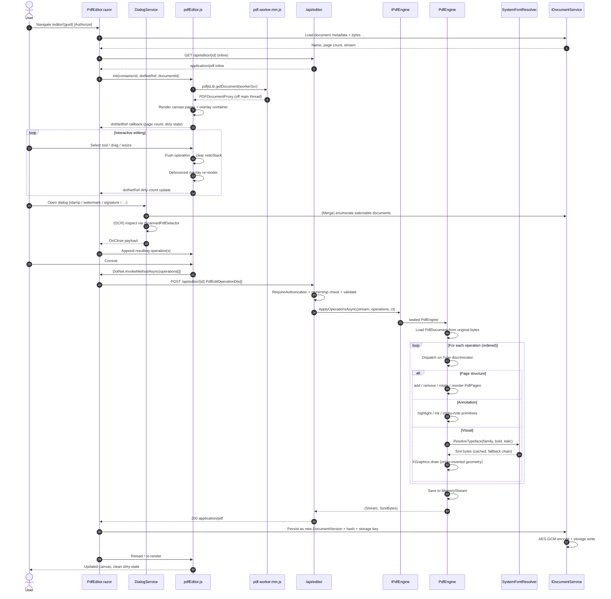

# PDF Editing and Rendering — EConverter Module Documentation

**Domain classification:** Supporting Business Domain · **Importance score:** 7.8 / 10 · **Aggregate complexity:** 8.0 / 10
**Owning projects:** `DocumentConverter.Infrastructure/Editor`, `DocumentConverter.Application/Editor`, `DocumentConverter.Contracts/Editor`, `DocumentConverter.Web/Components/Pages/Editor`, `DocumentConverter.Web/Endpoints`

---

## 1. Executive Summary

The PDF Editing and Rendering domain is what turns EConverter from a **converter** into a **document workspace**. It is the only domain in the platform where a user can *author* content rather than merely transform it: reordering and rotating pages, applying highlight and ink annotations, drawing text and shapes, stamping, watermarking, redacting, merging, extracting, password-protecting and digitally signing PDFs.

Architecturally it implements a deliberately **split-plane design**:

* A **client plane** — Mozilla PDF.js rendering pages to canvas inside the Blazor Server page, with an absolutely-positioned DOM overlay that carries every pending edit as a movable, resizable, undoable instruction.
* A **server plane** — a sealed, static `PdfEngine` built on PDFsharp that takes that list of instructions and applies them deterministically to the original byte stream, then serialises the result.

The browser is the **source of truth for intent**. The server is the **source of truth for the final bytes**. This separation is the defining design decision of the domain, and almost every strength and weakness documented below follows from it.

The domain carries a **supporting** rather than core classification (7.8) because it does not itself generate institutional knowledge — but its structural weight is substantial: `PdfEngine.cs` is 1,336 lines with a cyclomatic complexity of roughly 144, `pdfEditor.js` is a ~3,900-line IIFE exposing ~193 functions, and the engine sits on a non-trivial font-resolution side channel that is the single most common cause of container-deployment failures in PDFsharp-based systems.

---

## 2. Position in the System Architecture

### 2.1 Layering and dependency direction

The editor respects Clean Architecture's dependency rule at the *type* level, even where other domains of the platform bend it:

```
Browser (PDF.js + overlay)  ←→  PdfEditor.razor (Blazor/Radzen)
                                        │  JS interop (DotNet.invokeMethodAsync)
                                        ▼
                            EditorEndpoints  (/api/editor)
                                        │
                                        ▼
                     IPdfEngine          (Application — contract only)
                                        ▲
                                        │ implements
                     PdfEngine          (Infrastructure — PDFsharp + PdfPig)
                     SystemFontResolver (Infrastructure — global IFontResolver)
```

| Layer | Artifact | Responsibility | Third-party exposure |
|---|---|---|---|
| Contracts | `PdfEditorDtos.cs` | Data-only wire format (records, nullable primitives, zero methods) | None |
| Application | `IPdfEngine.cs` | Single deferred operation: `ApplyOperationsAsync` | None |
| Infrastructure | `PdfEngine.cs`, `SystemFontResolver.cs` | Every PDFsharp / PdfPig reference in the system | PDFsharp, PdfPig |
| Web | `PdfEditor.razor`, `Dialogs/*`, `pdfEditor.js` | Interaction capture, dialog orchestration, transport | PDF.js only (bundled) |

Key property: **the Web project never references a PDFsharp type**. The engine can be replaced (e.g. by a headless Chrome rasteriser or a commercial SDK) without touching a single Razor page, and the client can be swapped without touching the engine.

### 2.2 Upstream dependencies (fan-in / fan-out)

Per the domain relation graph, the editor participates in two edges:

| Direction | Target domain | Type | Strength | Consequence |
|---|---|---|---|---|
| Out | **Document Lifecycle Management** | Data Dependency | 8.0 | Every edit session begins with a document identity load and ends with a new `DocumentVersion` + hash + storage key |
| Out | **Document Conversion and OCR** | Service Call | 6.5 | `MergeDocumentDialog` consumes `IDocumentService`; `OcrDialog` consumes `IScannedPdfDetector` |

The editor is **not** in the persistence-critical path (`PdfEngine` opens no `DbContext`), which is why its importance score sits below the lifecycle and processing domains. All persistence is delegated to `DocumentService` after the engine returns a `(Stream, SizeBytes)` tuple.

### 2.3 Relationship to the asynchronous pipeline

Critically, the editor's commit path is **synchronous**. It does *not* enqueue a `ProcessingJob`. This is appropriate — edits are interactive and must return a rendered result in the same request cycle — but it means the editor is the second conversion entry point in the system that bypasses the lease-based job orchestrator. (The first, documented separately, is the inline DOCX→PDF logic residing in `DocumentEndpoints.cs`. Both are consistency risks flagged in the platform architecture review; the editor's bypass is deliberate and defensible, the endpoint-file one is not.)

---

## 3. Core Components

### 3.1 `IPdfEngine` — the Application contract

Defined in `src/DocumentConverter.Application/Editor/IPdfEngine.cs`, the interface is intentionally minimal:

```csharp
Task<(Stream Output, long SizeBytes)> ApplyOperationsAsync(
    Stream source,
    IReadOnlyList<PdfEditOperationDto> operations,
    CancellationToken cancellationToken);
```

The interface file is ~77 lines, the overwhelming majority of which is XML documentation. That ratio is diagnostic: **callers require exactly one behaviour**. There is no "load", no "preview", no "query capability" member, because the browser already holds the authoritative visual state. Extending the interface is a signal that the split-plane model is being eroded.

### 3.2 `PdfEditOperationDto` — the wire format

The single structure that crosses all three boundaries (browser JS → Blazor → Application → Infrastructure):

```csharp
public sealed record PdfEditOperationDto(
    string Type,                 // discriminator — "highlight", "ink", "reorder", "watermark", …
    int Page,                    // zero-based page index
    int? RotationDegrees = null,
    string? PageRange = null,
    int? InsertAtIndex = null,
    RectDto? Geometry = null,    // x, y, width, height in PDF user space
    string? Text = null,
    float? FontSize = null,
    string? FontName = null);
```

Properties that matter operationally:

* **Data-only, zero methods, complexity 1.0.** It is a transport contract, not a behavioural object. No validation lives here; validation lives at the endpoint and inside the engine's dispatch.
* **Everything optional except the discriminator and page index.** The record is a union-by-nullability, which keeps the DTO count small but makes illegal states representable (e.g. `Type = "text"` with `Text = null`). Guard clauses inside the engine switch arms are therefore mandatory, not defensive.
* **String discriminator, not an enum.** This is what enables the JS plane to emit operations without a shared schema — and simultaneously what makes schema drift silently possible (see §8.1).

### 3.3 `PdfEngine` — the server rendering engine

`src/DocumentConverter.Infrastructure/Editor/PdfEngine.cs` — sealed, static-ish, ~1,336 lines, complexity ≈144.

**Execution shape:**

1. Load the original bytes into a PDFsharp `PdfDocument`.
2. Iterate the validated `IReadOnlyList<PdfEditOperationDto>` **in order** — order is semantically significant (a redaction applied before a text draw yields a different result than after).
3. Dispatch on the `Type` string into one of three operation families.
4. Save to a `MemoryStream`, return the stream plus the measured byte length.

**Operation families:**

| Family | Operations | Mechanism |
|---|---|---|
| **Page structure** | add, remove, rotate, reorder | Mutation of the `PdfPages` collection and `/Rotate` entries on page dictionaries |
| **Annotation** | highlight, ink, sticky note (and underline-type variants) | `XGraphics` primitives plus annotation-dictionary construction |
| **Visual** | text, shapes, images, stamps, watermark, redaction | `XGraphics` draw calls with resolved fonts; redaction additionally uses **PdfPig** to locate text runs in the content stream |

**Coordinate transform.** The engine resolves DTO geometry into PDF user space with **page-height origin inversion** — drawing coordinates are top-left-origin, PDF content streams are bottom-left-origin. This inversion is explicitly called out in the module research as *"a common off-by-one source in PdfSharp"*, and it is the highest-density defect area in the engine. Any new drawing operation must re-derive the inversion rather than copy it from a sibling arm, because the correct formula depends on whether the operation targets the page box, the media box, or a transformed content stream.

**Redaction is the only operation that reads as well as writes.** It is not "draw a black rectangle". Correct redaction requires locating the text runs beneath the rectangle and removing them from the content stream — otherwise the text remains extractable by any consumer that ignores the overlay. PdfPig is imported specifically for this. Operators should treat the fidelity of this operation as a compliance-relevant property, not a cosmetic one.

### 3.4 `SystemFontResolver` — the deployment-critical side channel

PDFsharp on .NET 6+/Core has **no GDI backend**. Without a registered `IFontResolver`, every `XGraphics.DrawString` call throws at runtime — not at compile time, and not at startup. `SystemFontResolver.EnsureRegistered()` is a static bootstrap that must run once per process before any drawing.

**Resolution algorithm:**

```
EnsureRegistered()  →  installs singleton IFontResolver into GlobalFontSettings
ResolveTypeface(familyName, isBold, isItalic)
    ├─ probe ConcurrentDictionary<string,string>  faceName → path        (cache hit fast path)
    ├─ probe ConcurrentDictionary<string,byte[]>  faceName → font bytes  (cache hit fast path)
    ├─ scan OS font directories
    │     Windows : C:\Windows\Fonts\*.ttf
    │     Linux   : /usr/share/fonts/truetype/{dejavu,liberation,msttcorefonts}
    ├─ fallback chain
    │     1. requested family
    │     2. metric-compatible substitute (Arial → Liberation Sans, Courier → Liberation Mono, …)
    │     3. DejaVuSans (last resort, always present on Debian-family images)
    └─ GetFont(faceName) → byte[]
```

Three operational consequences:

1. **Determinism over fidelity.** The fallback chain deliberately trades typographic exactness for guaranteed non-failure. A stamp rendered in a container without Microsoft core fonts will use Liberation Sans and *look* almost identical while being metrically compatible — but a signature or seal image placed using text metrics may shift by a fraction of a point.
2. **Bootstrap ordering is a hard requirement.** `EnsureRegistered()` must execute before the first `PdfEngine` call in *every* process that draws — the web host **and** the standalone `DocumentWorker` if it ever gains editor responsibility.
3. **Cache warm-up cost.** First resolution per face performs directory scanning; subsequent resolutions are dictionary lookups. In cold-start container fleets this manifests as a latency spike on the first edit per pod.

### 3.5 Client plane — `pdfEditor.js`

`src/DocumentConverter.Web/wwwroot/lib/pdfjs/pdfEditor.js` — a ~3,900-line IIFE, ~193 functions, exposing a single global `window.pdfEditor`.

**Internal state model:**

| Field | Purpose |
|---|---|
| `pdfDoc` | `PDFDocumentProxy` from `pdfjsLib.getDocument()` |
| `currentPage`, `scale`, `pages` | Viewport and pagination state |
| `containerId` | Mount point for canvas + overlay DOM |
| `documentId` | Server-side identity for the commit call |
| `dotNetRef` | Blazor interop handle for dirty-state and commit marshalling |
| `currentTool` | Active tool discriminator (mirrors the DTO `Type` vocabulary) |
| `operations` | Ordered array of pending `PdfEditOperation`-shaped objects |
| `redoStack` | Inverse stack; **cleared on every new operation** |
| `selectedOp`, `isDraggingOp` | Hit-testing and transform state |

**Why DOM overlays rather than re-rendering the canvas.** Each pending operation is an absolutely-positioned DOM node above the rendered canvas pages. Drag, resize, hit-testing and live preview therefore operate on cheap DOM nodes; a **debounced `setTimeout` render pipeline** reconciles overlays against the operations array rather than re-rasterising the PDF. This is the reason the editor feels responsive on 200-page documents, and also the reason preview and output can diverge (see §8.2).

**Worker offloading.** `GlobalWorkerOptions.workerSrc` points at `pdf.worker.min.js`, so parsing and rasterisation happen off the main thread. A large PDF therefore degrades interactivity *gracefully* — the UI thread stays alive while the worker chews — rather than freezing the tab.

**Undo/redo.** A straightforward stack pair: commit pops from `operations` onto `redoStack`; any new operation clears `redoStack`. This is correct for linear editing but means there is no operation *grouping* — undoing a five-part signature placement requires five undos.

### 3.6 Editor endpoint surface

`src/DocumentConverter.Web/Endpoints/EditorEndpoints.cs` registers:

```
MapGroup("/api/editor").RequireAuthorization()
    ├─ GET  /{id}       → inline PDF stream   (Content-Disposition: inline, for iframe/canvas consumption)
    └─ POST /{id}       → apply PdfEditOperationDto[] → application/pdf
```

The `RequireAuthorization()` filter is **group-level and therefore uniform**. There is no route-level ownership filter. Consequently, **document ownership must be enforced inside the handlers via `IDocumentService` / `Document.IsOwnedBy`** rather than by the endpoint filter. This is a deliberate inheritance of the platform's aggregate-level ownership invariant — but it places the entire authorization burden on handler discipline, and any new handler added to the group without that call becomes an IDOR.

### 3.7 Dialog suite

Each dialog is a thin, typed parameter/result boundary opened through `DialogService.OpenAsync`:

| Dialog | Inputs | Output / side effect |
|---|---|---|
| `ExportDocumentDialog` | document name, page count, **uncommitted-change count** | Format export with a warning if edits are pending |
| `ExtractPagesDialog` | page-range scope | Page-range operation |
| `MergeDocumentDialog` | injected `IDocumentService`, selectable source list | `Contracts.Documents` merge request (server-side, not an operation DTO) |
| `OcrDialog` | injected `IScannedPdfDetector` | OCR config from inspection result |
| `PasswordSecurityDialog` | password + confirmation, permission toggles | Encryption mode + permission set |
| `SignatureDialog` | `RadzenTabs`: draw (JS-backed canvas) / upload / type | Image payload via `IJSRuntime` → operation |
| `StampDialog` | preset or custom text + styling | Stamp operation |
| `WatermarkDialog` | diagonal watermark text | Watermark operation applied across **all** pages |

Note the asymmetry: **merge, extract, OCR and password are not operation DTOs** — they are server-side service calls. Stamp, watermark and signature *are* DTOs. This split is the domain's principal architectural inconsistency and is analysed in §8.1.

---

## 4. End-to-End Workflow

### 4.1 Sequence



### 4.2 Staged description

**Stage 1 — Load.** `PdfEditor.razor` is route-scoped `[Authorize]` with a GUID parameter. Metadata and bytes come from `IDocumentService`; the binary is fetched separately as an inline stream so the browser can hand a blob URL to PDF.js without base64 inflation.

**Stage 2 — Render.** PDF.js parses off-thread. Canvas pages are painted; the overlay container is mounted above them. Blazor receives page count and initial dirty state through `dotNetRef`.

**Stage 3 — Edit.** Tool selection sets `currentTool`; mouse events create or select overlays; each completed gesture pushes an operation and clears `redoStack`. The debounced renderer reconciles DOM against the array. Nothing has touched the server.

**Stage 4 — Dialog enrichment.** Modal flows either append operations client-side (stamp, watermark, signature) or invoke application services server-side (merge, extract, OCR, password). The signature canvas converts draw/type/upload into an image payload through `IJSRuntime`.

**Stage 5 — Commit.** The whole array is marshalled through `DotNet.invokeMethodAsync` into Blazor, then POSTed. The endpoint authorises, verifies ownership, deserialises and validates before handing to `IPdfEngine`.

**Stage 6 — Engine execution.** PDFsharp loads the original bytes (never the client preview), applies operations in array order, resolves fonts through the global resolver on the first visual operation, and serialises to memory.

**Stage 7 — Persistence.** `DocumentService` records the output as a **new document version** with a fresh hash and storage key; the encrypted storage layer writes the bytes. The original version remains intact — provenance is append-only, which is the correct posture for a compliance-oriented platform.

**Stage 8 — Return.** The PDF streams back inline; the client re-renders and clears dirty state.

---

## 5. Interaction Contracts and Data Flow

### 5.1 Contracts inventory

| Contract | Project | Kind | Notes |
|---|---|---|---|
| `IPdfEngine` | Application | Interface | One member; the entire server-side editor surface |
| `PdfEditOperationDto` | Contracts | Sealed record | Zero methods; union-by-nullability; string discriminator |
| `RectDto` (geometry) | Contracts | Value record | PDF user-space rectangle |
| `IFontResolver` (impl.) | PDFsharp ← `SystemFontResolver` | Framework interface | Global, process-wide, installed once |
| `IScannedPdfDetector` | Application | Interface | Consumed by `OcrDialog` for pre-flight inspection |
| `IDocumentService` | Application | Interface | Load, enumerate (merge), persist new version |

### 5.2 The three-way coupling of the discriminator

This is the domain's central structural risk and deserves explicit treatment.

Adding one new operation type requires **synchronised changes in exactly three places**:

```
1. Contracts/Editor/PdfEditorDtos.cs   → new nullable field(s) on the record
2. wwwroot/lib/pdfjs/pdfEditor.js      → tool registration + overlay rendering + serialisation
3. Infrastructure/Editor/PdfEngine.cs  → new switch arm
```

There is **no schema enforcement, no code generation, and no test that fails** if one of the three is missed. The failure modes are silent:

| Missed layer | Symptom |
|---|---|
| JS serialisation | Operation never reaches the server; the overlay appears and vanishes on re-render |
| Engine switch arm | Operation is deserialised and discarded; the UI reports success, the output is unchanged |
| DTO field | JSON deserialiser silently drops the property; engine receives `null` |

The mitigation is cultural, not structural: any PR touching one layer must touch all three, and the domain needs a round-trip integration test (serialise → deserialise → apply → assert byte-level difference) that fails loudly on an unknown discriminator. **Unknown `Type` values should throw, not no-op.**

### 5.3 Two-plane divergence

The client preview and the server output are produced by *different renderers* (PDF.js vs PDFsharp). Divergence is therefore inherent, bounded, and must be reasoned about:

| Divergence source | Magnitude | Mitigation |
|---|---|---|
| Font substitution in fallback chain | Small, metric-compatible | Ship the intended fonts in the container, or restrict watermark/stamp families to DejaVu/Liberation |
| Origin inversion error | Unbounded if formula is wrong | Per-operation derivation; never copy an inversion across families |
| Coordinate rounding at scale ≠ 1.0 | Sub-point | Snap geometry to 0.25 pt on the client before serialising |
| Annotation appearance streams | PDF.js and PDFsharp may render highlight differently | Accept — annotation rendering is viewer-dependent by specification |
| Content-stream transform on rotated pages | Can be small or large | Test every visual operation against a `/Rotate 90` page explicitly |

The correct mental model: **the client is a preview worthy of trust for layout intent, not a pixel-accurate prediction of server output.** Any workflow where exact placement matters (seals, signature blocks, redaction coverage) must be verified after commit, not before.

---

## 6. Rendering and Fidelity Considerations

### 6.1 Page-structure semantics

* **Reorder** mutates the `PdfPages` collection ordering. Page labels, bookmarks and internal link destinations are *not* automatically renumbered — a document with a table-of-contents will retain stale links unless the engine remaps destinations.
* **Rotate** writes the page's `/Rotate` entry. This is view-only rotation; the content stream and any coordinates stored by downstream operations refer to the *unrotated* user space. Every subsequent visual operation on a rotated page must apply the same transform.
* **Add / remove** change the page count. Any operation DTO carrying a page index that references a page removed earlier in the same batch becomes a range error — which is why **operation order is semantically load-bearing** and why client-side validation must simulate the sequence before sending.

### 6.2 Annotation versus content

Annotations drawn as PDF annotation dictionaries are **viewer-controlled**: the reader decides whether to render them, and they can be deleted by an end user in a compliant viewer. Content drawn onto the page content stream is **permanent**.

This distinction matters operationally:

* **Highlight and sticky note** — appropriately annotations (user-editable, non-destructive).
* **Redaction** — must be **content-stream removal plus opaque fill**, never an annotation. A redaction implemented as a black rectangle over live text is a data-leak bug, not a visual choice.
* **Watermark** — content stream, but drawn *under* or *over* depending on intent; over-content defeats casual cropping, under-content preserves readability.

### 6.3 Font pipeline as a fidelity gate

Three practical rules for operators:

1. **Bake fonts into the container image.** `msttcorefonts` (or the Microsoft core fonts package) removes the substitution branch for Arial/Times/Courier, the three families most commonly requested by users.
2. **Register the resolver in every drawing process.** The `EnsureRegistered()` static bootstrap is trivially forgotten in a new host; the resulting failure is a runtime exception with a misleading message.
3. **Never assume GDI.** Any code path that previously worked on .NET Framework and now targets .NET 6+ will fail here. This is the single most common PDFsharp migration regression.

---

## 7. Security Posture of the Domain

The editor inherits the platform's aggregate-level ownership invariant and adds no new trust boundary of its own — but it does add new *inputs* that reach the engine.

| Control | Implementation | Assessment |
|---|---|---|
| Transport authorisation | `MapGroup("/api/editor").RequireAuthorization()` | **SOLID** — every route in the group requires an authenticated principal |
| Object-level authorisation | Delegated to handlers via `IDocumentService` / `Document.IsOwnedBy` | **PLAUSIBLE but handler-dependent** — a new handler that forgets the call is an IDOR; the group filter cannot cover it |
| Operation validation | Guard clauses per switch arm in `PdfEngine` | **Necessary, insufficient** — the DTO admits illegal states; unknown `Type` handling must be audited |
| Input size limits | Inherited from platform upload guards | Applied on upload, **not on the operations payload** — a very large `operations[]` array is a low-cost DoS surface |
| Path / injection surface | No filesystem paths in the DTO vocabulary | **SOLID** — geometry, text and font *names* are the only free-form strings; font name resolution goes through the resolver cache, not path concatenation |
| Redaction completeness | PdfPig content-stream removal | **Must be verified per release** — see §6.2 |
| OCR language codes | Sanitised in `TesseractOcrEngine`, not in the editor | **SOLID** — the guard lives in the engine being called, which is correct placement |
| Persistence of edits | New document version, original retained | **SOLID** — provenance-preserving; no destructive overwrite |

**Residual risk: operation-ordering attacks.** Because the engine executes the array in supplied order without simulating state, a crafted payload could reference a page index that only becomes invalid mid-sequence, probing engine error paths. Symptoms worth monitoring: repeated 500s from `/api/editor/{id}` with garbage-collection-heavy durations, indicating an unguarded index access rather than a clean 400.

---

## 8. Architectural Assessment — Drift and Gaps

### 8.1 SOLID — two conversion surfaces for one concept

The domain has **two distinct ways to mutate a PDF**: operation DTOs (stamp, watermark, signature, page structure, annotation, visual) and server-side service calls (merge, extract, OCR, password). A user's mental model is "edit the PDF"; the code's model is "sometimes a DTO, sometimes an RPC". Consequences:

* Merge and extract cannot participate in the undo stack.
* The `ExportDocumentDialog` "uncommitted changes" warning cannot reason about merge/extract activity, because those never enter `operations[]`.
* Two validation paths, two error-reporting conventions, two pacing models.

**Verdict: SOLID** — directly observable from the dialog inventory in the research materials.

### 8.2 PLAUSIBLE — engine orchestration in the wrong project

`PdfEngine` lives in `Infrastructure` while `IPdfEngine` lives in `Application`. For a *stateless adapter* this is textbook Clean Architecture. But `PdfEngine` at 1,336 lines with complexity ≈144 contains genuine use-case orchestration — operation-order semantics, coordinate derivation, redaction policy — not merely library adaptation. The platform-wide pattern (orchestrators in Infrastructure) repeats here.

*Practical consequence:* the engine cannot be unit-tested without the PDFsharp adapter stack, and coordinate-transform bugs are therefore caught only in integration or in production.

**Verdict: PLAUSIBLE** — consistent with the platform-wide drift documented in the architecture report, not independently verified per-class.

### 8.3 SOLID — client/server split has no round-trip contract test

The three-way discriminator coupling (§5.2) has no automated guard. The research materials describe the coupling explicitly and describe the failure mode explicitly ("*no schema enforcement catches this*"), which is strong evidence the guard does not exist.

**Verdict: SOLID.**

### 8.4 PLAUSIBLE — docket of unverified behaviours

| Behaviour | Status | What would confirm it |
|---|---|---|
| Operation order strictly preserved end-to-end through JSON and C# | PLAUSIBLE | `System.Text.Json` preserves array order; engine iterates the list — likely correct, but no explicit test cited |
| Unknown `Type` throws rather than silently no-ops | UNVERIFIABLE | Read the default arm of the switch in `PdfEngine.cs` |
| `EnsureRegistered()` invoked in `DocumentWorker` | UNVERIFIABLE | Grep the worker's `Program.cs`; the module research only confirms it for the web path |
| Redaction removes text from the content stream | PLAUSIBLE | PdfPig is imported specifically for text-run location; the *removal* step is asserted by design, not by cited code |
| Large `operations[]` payloads are bounded | UNVERIFIABLE | Read endpoint request-size configuration |
| Reordering remaps bookmarks / link destinations | UNVERIFIABLE | No mention in materials; assume **not** performed until proven |

### 8.5 Documented gaps

| Gap | Impact |
|---|---|
| **No operation-batch size limit** | Client can submit an arbitrarily large operations array; server decodes and applies all of it in one request |
| **No distributed/optimistic concurrency on document version** | Two concurrent editor sessions on one document produce two sibling versions; last-write-wins at the storage layer, silent divergence for both users |
| **No autosave / draft persistence** | Closing the tab discards the entire `operations[]` array; `ExportDocumentDialog` warns, but nothing recovers |
| **No server-side preview endpoint** | Preview fidelity is structurally approximate; there is no way to obtain the authoritative render before commit |
| **Undo cannot cross dialog boundaries** | Signature/stamp/watermark placements are individually undoable but not grouped |
| **No stream-backpressure strategy for very large PDFs** | The engine serialises to `MemoryStream`; a multi-hundred-megabyte document materialises fully in the worker's heap |
| **Engine has no explicit timeout** | A pathological operation list blocks a request thread for its full execution |

---

## 9. Implementation Guidance

### 9.1 Adding a new operation type — the mandatory triple

```
[ ] Contracts/Editor/PdfEditorDtos.cs
      — add nullable field(s); keep the record data-only
[ ] wwwroot/lib/pdfjs/pdfEditor.js
      — register tool, render overlay, serialise with the exact Type string
[ ] Infrastructure/Editor/PdfEngine.cs
      — add switch arm; derive origin inversion for THIS family
      — add a guard clause rejecting illegal null combinations
[ ] Test: round-trip serialise → deserialise → apply → assert byte diff
```

Any PR that touches fewer than three of these must be rejected. The engine's default arm **must throw** on an unrecognised `Type`; a silent no-op converts a development mistake into a production data-integrity bug.

### 9.2 Extracting a job-based editor path (recommended evolution)

Today, a heavy edit (OCR of a 300-page scanned document, or a merge of forty files) executes synchronously inside the HTTP request. The platform already owns a lease-based job engine. The recommended convergence:

```
EditorEndpoints.POST /api/editor/{id}
   ├─ light operations (annotate, stamp, watermark, rotate, reorder)
   │     → synchronous PdfEngine commit   (current behaviour, keep)
   └─ heavy operations (OCR, merge, extract, password re-encrypt)
         → enqueue ProcessingJob with converter = "pdf-editor-<op>"
         → worker leases → PdfEngine applies → output registered as new version
         → SignalR pushes completion to the editor circuit
```

This reuses `ProcessingJobLifecycle`, `JobNotificationService` and the encrypted storage transaction, removes the synchronous DoS surface, and unifies the two mutation surfaces described in §8.1.

### 9.3 Proposed `IJobExecutor`-style extraction for the editor

Mirroring the platform-level recommendation for duplicated worker transactions, the editor's commit transaction (authorise → validate → apply → persist version → return) should be extracted into a single application-layer `IPdfEditCoordinator` consumed by the endpoint today and by a job processor tomorrow. That gives:

* one authorisation enforcement point (fixing the handler-discipline risk in §7),
* one place to enforce batch-size limits,
* testability without HTTP,
* reuse from the worker without duplicating the pipeline.

### 9.4 Hardening checklist

| Item | Action |
|---|---|
| Batch limit | Reject `operations.Count > N` (suggest 500) at the endpoint with 400 |
| Unknown discriminator | Throw `InvalidOperationException` with the offending `Type` |
| Order simulation | Pre-validate page indices by simulating removals before applying |
| Ownership | Assert `Document.IsOwnedBy(currentUser)` in every handler in the group |
| Version concurrency | Carry the loaded version id in the commit payload; reject on mismatch (409 Conflict) |
| Heap ceiling | Stream to storage rather than `MemoryStream` above a configurable threshold |
| Timeout | `CancellationToken` with a per-request deadline passed into `ApplyOperationsAsync` |
| Font bootstrap | Assert `EnsureRegistered()` has run in every drawing host, at startup |
| Redaction assertion | Post-apply test: extracted text from the redacted region must be empty |

---

## 10. Knowledge Summary

**The domain in one paragraph.** EConverter's PDF Editing and Rendering domain implements a split-plane editor: PDF.js in the browser captures intent as an ordered array of `PdfEditOperationDto` records rendered as draggable DOM overlays, while a sealed PDFsharp engine on the server applies that array deterministically to the original bytes and returns the authoritative output, which `DocumentService` persists as a new immutable version. The Application layer exposes exactly one member — `ApplyOperationsAsync` — keeping every third-party PDF dependency inside Infrastructure and every Razor page free of engine types. The design's strength is that intent and output have unambiguous owners; its weakness is that the two owners meet only at a string discriminator with no schema enforcement between them, and at a coordinate transform (top-left preview ↔ bottom-left user space) that must be re-derived for every new operation family.

**Five things an engineer must hold in memory:**

1. **Three-way coupling.** New operation type ⇒ DTO field + JS serialiser + engine switch arm. Miss one, fail silently.
2. **Order is semantics.** The engine executes the array in sequence; redact-before-draw ≠ draw-before-redact; page indices shift as pages are removed.
3. **Fonts are a runtime side channel.** No `IFontResolver` registered ⇒ every `DrawString` throws. Fallback chain buys determinism at the cost of typographic fidelity.
4. **Redaction ≠ black rectangle.** It must remove text runs from the content stream via PdfPig. Anything else is a compliance defect.
5. **Ownership is handler-enforced.** The route group authorises *authenticated*, not *authorised-for-this-document*. Every handler calls `IDocumentService`.

**Verdict.** The module is well-bounded, appropriately classified as supporting, and structurally sound at the type level. Its two genuine liabilities are (a) the unguarded discriminator contract between client and server, and (b) the duplication of mutation surfaces between operation DTOs and server-side service calls for merge/extract/OCR/password. Both are addressable without redesign: add a round-trip contract test that fails on unknown `Type`, and converge heavy operations onto the existing job engine.