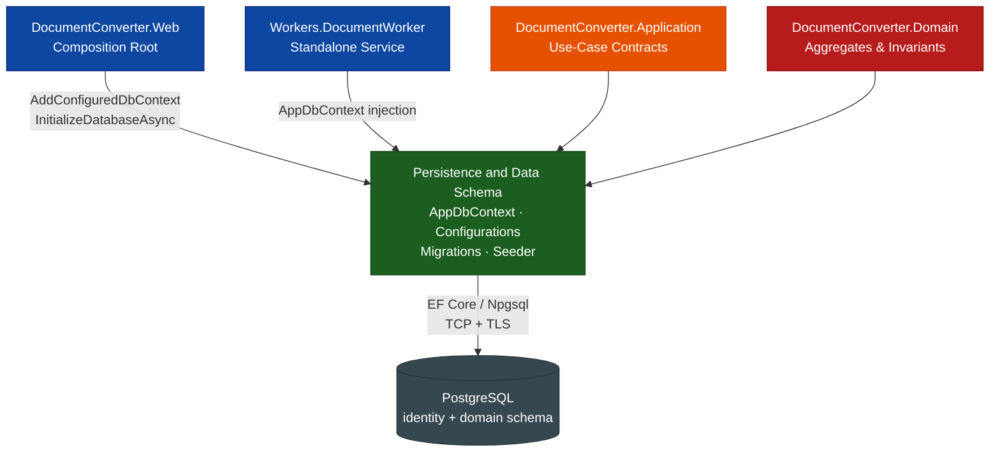
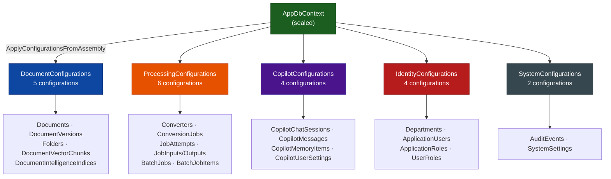
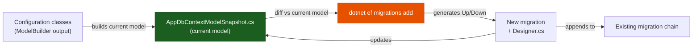
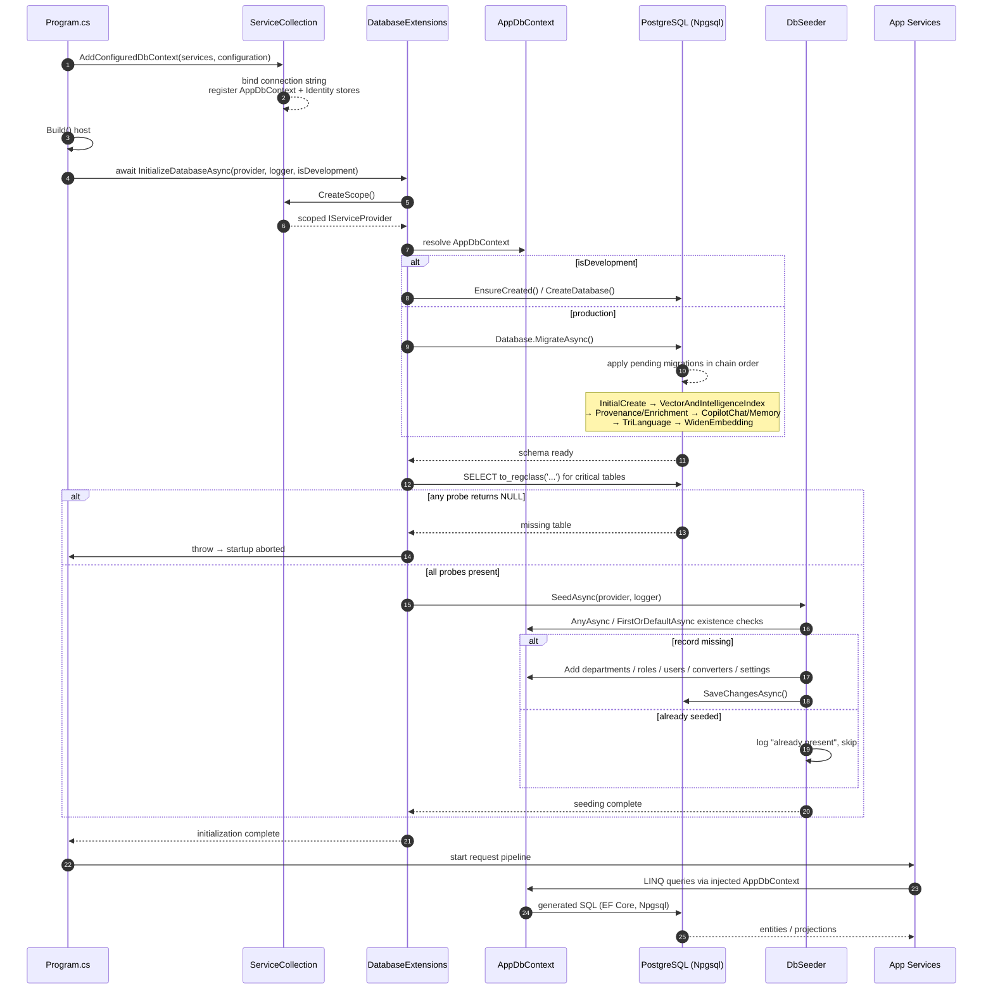

# Persistence and Data Schema

**EConverter Platform — Infrastructure Domain Documentation**

---

## 1. Overview

The **Persistence and Data Schema** domain is the single storage boundary of the EConverter platform. Every repository, application service, background worker, and Copilot component ultimately dereferences a `DbSet` on one sealed `AppDbContext` instance. There is no second context, no secondary database, and no per-module data boundary — a deliberate architectural decision with substantial consequences for both coherence and change blast radius.

Technically, the domain implements a conventional **DbContext + `IEntityTypeConfiguration` fan-out + linear migration chain + startup provisioning** pattern, executed across four cooperating layers:

| Layer | Artifact | Responsibility |
|---|---|---|
| **Model aggregation** | `AppDbContext.cs` | Declares `DbSet`s across six bounded namespaces; merges ASP.NET Core Identity at the type level |
| **Configuration fan-out** | `Configurations/*.cs` (5 classes, 21 configurations) | Table mappings, keys, indexes, JSON value conversions, relationship and cascade rules |
| **Schema lifecycle** | `Migrations/*.cs` (6 migrations + 7 designer files + snapshot) | Strictly append-only, linear evolution of the physical PostgreSQL schema |
| **Startup provisioning** | `DatabaseExtensions.cs`, `DbSeeder.cs` | Migration application, provider-specific catalog verification, idempotent reference-data seeding |

The result is a **provider-aware, restart-safe, authoritative** persistence unit. Npgsql-specific catalog probes are gated behind provider detection, seeding is idempotent by construction, and removing or reordering a migration breaks startup by design — the chain is treated as an immutable ledger rather than a mutable script collection.

Architecturally, this domain is the **highest fan-in target in the entire system**. Four business domains depend on it at coupling strengths between 8.8 and 9.2:

| Consumer Domain | Coupling | Dependency Nature |
|---|---|---|
| Document Lifecycle Management | **9.2** | Documents, folders, versions — schema authority target |
| Job Orchestration and Processing | **9.0** | Jobs, attempts, inputs/outputs, batches |
| Document Intelligence and AI | **8.8** | Vector chunks, intelligence indices, Copilot sessions |
| Platform Composition and Hosting | **8.8** | Provider selection and startup provisioning |

That concentration is expected in a single-`DbContext` design, but it carries a direct operational corollary: **every schema migration is a system-wide blast radius event.**

---

## 2. Architectural Position

### 2.1 Placement in the Layered Architecture

Persistence sits in the **Infrastructure layer** and is consumed by every layer above it through constructor injection. It depends on `Domain` (entity types), `Application` (contract shapes), and `BuildingBlocks.Security` (security primitives referenced by audit entities). It is depended upon by all four business domains and by both composition roots — the web host and the standalone worker.



### 2.2 Role as Single Source of Truth

The domain occupies four distinct roles simultaneously, and confusing them is the primary source of operational error:

1. **Data-access interface** — strongly typed `DbSet<T>` properties are the exclusive LINQ surface for all application data access. No raw SQL path exists in application code; only `to_regclass` catalog probes bypass EF Core, and those are read-only existence checks.
2. **Schema authority** — the migration chain and `AppDbContextModelSnapshot.cs` are the canonical definition of the physical database. There is no separate DDL repository, no hand-maintained schema document, and no out-of-band table creation.
3. **Cross-domain contract** — a change to a configuration class is an API change to the Documents, Processing, AI, and Security domains. This is not a metaphor: the vector chunk shape (`Embedding` width, `Language`, `EnrichmentMetadataJson`) is consumed directly by the intelligence retrieval pipeline, and altering it silently invalidates the in-process HNSW index assumptions.
4. **Startup gate** — `InitializeDatabaseAsync` either completes fully (schema at latest migration, seed data present, catalog checks passed) or throws, aborting startup. Failures surface at boot rather than at first query under load.

### 2.3 Boundary and Exclusions

Within the system boundary: the `AppDbContext`, its configurations, the migration chain, the model snapshot, the seeding logic, and the startup provisioning extensions.

Outside the boundary: the **PostgreSQL server itself** (operator-managed infrastructure), the physical storage volume, connection pooling at the network layer, and backup/replication topology. The domain owns the *schema*, not the *server*.

---

## 3. DbContext and Entity Configurations

### 3.1 AppDbContext — Sealed Aggregation Root

```csharp
public sealed class AppDbContext : IdentityDbContext<ApplicationUser, ApplicationRole, Guid>
{
    public AppDbContext(DbContextOptions<AppDbContext> options) : base(options) { }

    protected override void OnModelCreating(ModelBuilder modelBuilder)
    {
        base.OnModelCreating(modelBuilder);
        modelBuilder.ApplyConfigurationsFromAssembly(typeof(AppDbContext).Assembly);
    }

    // DbSets: Documents, DocumentVersions, DocumentVectorChunks,
    // DocumentIntelligenceIndices, Folders, Converters, ConversionJobs,
    // JobAttempts, JobInputs, JobOutputs, BatchJobs, CopilotChatSessions,
    // CopilotMessages, CopilotMemoryItems, CopilotUserSettings, Departments,
    // ApplicationUsers, ApplicationRoles, AuditEvents, SystemSettings
}
```

Four design decisions carry disproportionate weight:

| Decision | Rationale | Consequence |
|---|---|---|
| **Identity merged at the type level** — inherits `IdentityDbContext<ApplicationUser, ApplicationRole, Guid>` | Identity tables and domain tables share one physical database and one context; no distributed transaction or cross-context join needed | Identity schema is provider-managed (upstream), so Identity table names and shapes are not editable without forking |
| **`sealed`** | Prevents proxy/subclass model drift, where a derived context silently diverges from the migration snapshot | No mocking via subclassing; tests must use in-memory or containerized providers |
| **`ApplyConfigurationsFromAssembly`** | Configurations are discovered, not enumerated; adding a configuration class requires no edit to the context | Configuration classes are invisible at the call site — an unreferenced `IEntityTypeConfiguration<T>` silently takes effect |
| **Explicit `ToTable()` in every configuration** | Schema naming is intentional, never left to EF pluralization conventions | Renaming a table is a breaking change requiring a migration, not a convention tweak |

The `Guid` key type is itself a security-relevant choice: identity and domain entities use non-sequential identifiers, removing the enumeration surface that integer keys would introduce in `/api/documents/{id}` style routes.

### 3.2 Configuration Fan-Out — Five Classes, Twenty-One Configurations



All five classes are `sealed` and stateless, implementing `IEntityTypeConfiguration<T>` only. They have **no runtime callers other than EF itself** — they are pure metadata.

#### Configuration Patterns in Use

| Pattern | Implementation | Applies To |
|---|---|---|
| **Explicit table mapping** | `ToTable("<PluralName>", schema)` | All 21 entities |
| **Composite keys** | `HasKey(x => new { x.UserId, x.RoleId })` | User-role join, `BatchJobItem` |
| **Unique indexes** | `HasIndex(...).IsUnique()` | Document version uniqueness, vector chunk identity, user email |
| **Value conversion (JSON)** | `HasConversion<string>()` or custom converter with `System.Text.Json` | `JobInputJson`, `JobOutputJson`, `EnrichmentMetadataJson` |
| **Explicit delete behavior** | `DeleteBehavior.Cascade / Restrict / SetNull` | Where cascades would otherwise be ambiguous |
| **Self-referencing relationship** | Parent navigation on `Department` | Department hierarchy |
| **Binary columns** | `byte[]` → `bytea` | `DocumentVectorChunk.Embedding` |

#### Relationship Chains

```
Job ──→ Document        (input/output document references)
Job ──→ Converter       (converter identity and limits)
Job ──→ JobAttempt      (retry history, 1:N)
Document ──→ DocumentVersion          (version history, 1:N)
Document ──→ DocumentVectorChunk ──→ DocumentIntelligenceIndex
CopilotChatSession ──→ CopilotMessage (conversation transcript)
Department ──→ Department             (parent/child hierarchy)
Department ──→ ApplicationUser        (ownership link)
```

#### JSON Payload Semantics

`JobInputJson` and `JobOutputJson` are stored as `text` with custom converters round-tripping through `JsonSerializerOptions`. This is a deliberate trade-off:

- **Advantage:** the job payload shape can evolve without a migration, since the column is opaque to PostgreSQL.
- **Cost:** the payload is unqueryable and unconstrainable at the database level. Validation must occur in application code at deserialization time, and a malformed payload produces a runtime failure rather than an insert-time rejection.

The **`EnrichmentMetadataJson`** column on `DocumentVectorChunks` follows the same pattern for MarkItDown enrichment metadata — deliberately schema-free because the enrichment pipeline is still evolving.

### 3.3 Cross-Domain Contract Surface

Because every configuration is effectively an API contract for a downstream consumer, changes propagate as follows:

| Configuration Change | Consumer Impact | Required Companion Work |
|---|---|---|
| `DocumentVectorChunk.Embedding` width | HNSW index dimension assumptions; retrieval correctness | Migration + re-indexing strategy + benchmark rerun |
| `DocumentVectorChunk.Language` | Multilingual chunk routing in RAG | Migration + backfill for existing chunks |
| `DocumentVectorChunk.EnrichmentMetadataJson` | MarkItDown enrichment read path | Migration + null-handling in reader |
| `ConversionJob` columns | Lease state machine, worker query semantics | Migration + `ProcessingJobLifecycle` review |
| Anything on `AspNet*` tables | Identity store configuration | Upstream Identity constraint — generally not editable |

**Rule:** any edit to a class under `Persistence/Configurations/` must be paired with a migration and a downstream consumer review. Treating configurations as pure metadata is correct at runtime and dangerous at change-management time.

---

## 4. Schema Lifecycle — The Migration Chain

### 4.1 Chain Structure

The migration chain is **strictly linear and append-only**. Six migrations define the complete physical schema:


| # | Migration | Schema Delta | Risk |
|---|---|---|---|
| 0 | `InitialCreate` | `EnsureSchema("identity")` + full baseline DDL: identity tables, document tables, FKs, indexes | Structural baseline |
| 1 | `AddPersistentVectorAndIntelligenceIndex` | Adds `DocumentIntelligenceIndices` + supporting indexes | Additive, safe |
| 2 | `AddVectorProvenanceAndMarkItDownEnrichment` | `AddColumn<string>("EnrichmentMetadataJson", "DocumentVectorChunks")` | Additive, safe |
| 3 | `AddCopilotChatAndMemoryPersistence` | `CopilotChatSessions`, `CopilotMessages`, `CopilotMemoryItems`, `CopilotUserSettings` | Additive, safe |
| 4 | `AddTriLanguageChunkSupport` | `AddColumn<string>("Language", "DocumentVectorChunks")` | Additive; requires backfill for existing chunks |
| 5 | `WidenDocumentVectorChunkEmbedding` | `AlterColumn<byte[]>("Embedding", "DocumentVectorChunks", type: "bytea")` | **Destructive `Down` path** |

### 4.2 Migration Anatomy

Every migration is a `public partial class X : Migration` with two overrides:

```csharp
protected override void Up(MigrationBuilder migrationBuilder)
{
    // InitialCreate: EnsureSchema("identity") then CreateTable / CreateIndex / AddForeignKey
    // Later migrations: AddColumn / AlterColumn / CreateTable — scoped to one concern
}

protected override void Down(MigrationBuilder migrationBuilder)
{
    // Strict reverse order. For migration 5 this path is DESTRUCTIVE.
}
```

### 4.3 The Designer Files and Model Snapshot

Each migration carries a matched **`*.Designer.cs`** file:

```csharp
[DbContext(typeof(AppDbContext))]
[Migration("20261006101055_InitialCreate")]
partial class InitialCreate
{
    protected override void BuildTargetModel(ModelBuilder modelBuilder) { /* ... */ }
}
```

The designer captures the **complete model as it existed at that migration's timestamp** — every property, index, key, and conversion. `AppDbContextModelSnapshot.cs` (~1,480 generated lines) holds the *current* truth and is the file EF diffs against on `dotnet ef migrations add`.



**Operational consequence:** the snapshot is generated, never hand-edited. Manual edits to `AppDbContextModelSnapshot.cs` desynchronize the diff basis and cause the next generated migration to contain spurious or missing operations. If the snapshot is suspected corrupt, the correct recovery is to regenerate from the configuration classes and compare against the last designer file.

### 4.4 Append-Only Discipline

Three rules govern the chain, and violating any of them produces startup failure or silent divergence:

1. **No migration may be edited after release.** Once a migration has run against a shared database, its checksum is effectively a contract. Editing it means environments at different chain states apply different DDL from the same migration identifier — divergence that EF Core cannot detect.
2. **New columns require migration + designer + snapshot.** All three artifacts are generated by a single `dotnet ef migrations add` invocation. Hand-writing a migration without regenerating the snapshot leaves the next diff incorrect.
3. **Migration 5's `Down` is destructive and must be treated as irreversible in production.** The `AlterColumn<byte[]>` widening from a smaller embedding dimension to a larger one cannot be reversed without truncating vector data — and truncated embeddings silently corrupt retrieval rather than raising an error. Rollback plans for migration 5 should be *restore from backup*, not `database update <previous>`.

### 4.5 Development and Production Paths Diverge

```csharp
if (isDevelopment)
    await context.Database.EnsureCreatedAsync();   // Dev: schema from model, no migration history
else
    await context.Database.MigrateAsync();          // Prod: apply pending migrations in order
```

This divergence is intentional in development (fast iteration, no migration overhead) and hazardous in transition:

> A database provisioned by `EnsureCreated` has **no `__EFMigrationsHistory` table**. Switching that same database to the production path will attempt to apply `InitialCreate` against existing tables and fail. A developer-provisioned database **must be dropped and re-provisioned through the migration chain** before any environment promotion.

---

## 5. Startup Provisioning

### 5.1 DI Registration Surface

```csharp
// Called from Program.cs during host building
services.AddConfiguredDbContext(configuration);
```

`AddConfiguredDbContext(IServiceCollection, IConfiguration)` is the **single choke point** for persistence wiring. It owns:

- Connection string binding from configuration
- `AddDbContext<AppDbContext>(...)` registration
- Identity store registration (`AddIdentityCore` / `AddDefaultIdentity` plumbing via `Infrastructure.Identity`)
- Conditional Npgsql retry policy and `SensitiveDataLogging` gated on environment

Downstream services — repositories, handlers, background workers, Copilot services — **never construct a `DbContext`**. They receive `AppDbContext` or an abstraction over it by constructor injection. This makes the extension the only place where provider selection, connection topology, and retry behavior are controlled.

### 5.2 Initialization Sequence



### 5.3 The `to_regclass` Verification Gate

After migration application, the initializer executes PostgreSQL-specific existence probes:

```sql
SELECT to_regclass('public."Documents"');
SELECT to_regclass('public."DocumentVectorChunks"');
SELECT to_regclass('identity."AspNetUsers"');
-- ...
```

`to_regclass` returns `NULL` when the relation does not exist, rather than raising an error — making it the correct primitive for a *verification* gate rather than a *failure* gate. Each probe is logged; any `NULL` result aborts startup.

This gate exists because a successful `MigrateAsync()` does **not** prove schema correctness. A partially applied migration, a manually dropped table, or a schema-qualified table created in the wrong schema all leave the migration history intact while the physical schema is wrong. The catalog probe catches that class of drift before the request pipeline accepts traffic.

These probes are **gated behind provider detection** — on a non-Npgsql provider, the catalog check is skipped rather than emitting invalid SQL.

### 5.4 Seeding — Idempotency by Construction

`DbSeeder` (~406 lines, branching complexity ~19) provides two entry points:

| Scope | Seeded Content |
|---|---|
| **Identity** | Default department hierarchy, roles, seed users with hashed passwords (via `UserManager` / `RoleManager`) |
| **System / Processing** | Default converters, processing categories, `SystemSetting` rows |

Every insert path follows the same guarded pattern:

```csharp
if (!await context.SystemSettings.AnyAsync(s => s.Key == key))
{
    context.SystemSettings.Add(new SystemSetting { Key = key, Value = value });
    logger.LogInformation("Seeded system setting {Key}", key);
}
else
{
    logger.LogDebug("System setting {Key} already present", key);
}
```

Two properties follow from this discipline:

- **Restart-safe.** Re-running startup after a successful seed performs existence checks and inserts nothing.
- **Observation-friendly.** Every decision is logged as either "seeded" or "already present", making seed-state diagnosable from startup logs alone.

**Passwords are supplied through configuration, never hard-coded literals in source.** Seed users exist to bootstrap administrator access in a fresh deployment; their credentials are an operator responsibility.

### 5.5 Concurrency Caveat

`InitializeDatabaseAsync` is idempotent and safe across restarts, but **true horizontal safety is not guaranteed by this method alone**. Two container replicas starting simultaneously rely on:

1. `MigrateAsync`'s internal PostgreSQL advisory locking — which serializes migration application.
2. The seeder's existence checks — which are read-then-write and therefore racy under simultaneous execution.

> **Deployment guidance:** for multi-replica production deployments, run migration and seeding as an **external pre-deployment job** and start replicas only after it completes. The in-process initializer is a convenience for single-instance and development deployments, not a substitute for orchestrated schema promotion.

---

## 6. Schema Topology — Table Inventory

The physical schema is organized into five functional groups across two PostgreSQL schemas.

```mermaid
graph TB
    subgraph Identity["schema: identity"]
        AU["AspNetUsers"]
        AR["AspNetRoles"]
        AUR["AspNetUserRoles"]
        ARC["AspNetRoleClaims"]
        DEP["Departments"]
    end

    subgraph DocT["public — Documents"]
        DOC["Documents"]
        DV["DocumentVersions"]
        FLD["Folders"]
        DVC["DocumentVectorChunks"]
        DII["DocumentIntelligenceIndices"]
    end

    subgraph ProcT["public — Processing"]
        CNV["Converters"]
        JOB["ConversionJobs"]
        ATT["JobAttempts"]
        JIN["JobInputs"]
        JOUT["JobOutputs"]
        BAT["BatchJobs"]
    end

    subgraph AIT["public — AI / Copilot"]
        CS["CopilotChatSessions"]
        CM["CopilotMessages"]
        MI["CopilotMemoryItems"]
        US["CopilotUserSettings"]
    end

    subgraph SysT["public — System"]
        AE["AuditEvents"]
        SS["SystemSettings"]
    end

    DOC --> DV
    DOC --> DVC
    DVC --> DII
    JOB --> ATT
    JOB --> JIN
    JOB --> JOUT
    JOB --> CNV
    BAT --> JOB
    CS --> CM
    AU --> AUR
    AR --> AUR
    DEP --> AU

    style Identity fill:#b71c1c,stroke:#7f0000,color:#fff
    style DocT fill:#0d47a1,stroke:#002171,color:#fff
    style ProcT fill:#e65100,stroke:#bf360c,color:#fff
    style AIT fill:#4a148c,stroke:#311b92,color:#fff
    style SysT fill:#37474f,stroke:#263238,color:#fff
```



| Group | Tables | Owner Domain | Migration Introduced |
|---|---|---|---|
| **Identity** (`identity` schema) | `AspNetUsers`, `AspNetRoles`, `AspNetUserRoles`, `AspNetRoleClaims`, `Departments` | Security, Identity and Audit | InitialCreate |
| **Documents** | `Documents`, `DocumentVersions`, `Folders` | Document Lifecycle Management | InitialCreate |
| **Vector / Intelligence** | `DocumentVectorChunks`, `DocumentIntelligenceIndices` | Document Intelligence and AI | InitialCreate → M1 → M2 → M4 → M5 |
| **Processing** | `Converters`, `ConversionJobs`, `JobAttempts`, `JobInputs`, `JobOutputs`, `BatchJobs`, `BatchJobItems` | Job Orchestration and Processing | InitialCreate |
| **AI / Copilot** | `CopilotChatSessions`, `CopilotMessages`, `CopilotMemoryItems`, `CopilotUserSettings` | Document Intelligence and AI | M3 |
| **System** | `AuditEvents`, `SystemSettings` | Security / Platform Administration | InitialCreate |

**Column type conventions:**

| EF Type | PostgreSQL Type | Usage |
|---|---|---|
| `Guid` | `uuid` | All primary keys — non-sequential, non-enumerable |
| `byte[]` | `bytea` | `DocumentVectorChunk.Embedding` |
| JSON via converter | `text` | `JobInputJson`, `JobOutputJson`, `EnrichmentMetadataJson` |
| `DateTimeOffset` | `timestamptz` | Audit and lifecycle timestamps |
| `string` | `text` / `varchar(n)` | Names, keys, statuses, language codes |

---

## 7. Interaction Contracts

### 7.1 DI Registration Surface

```
DatabaseExtensions.AddConfiguredDbContext(IServiceCollection, IConfiguration) → IServiceCollection
```

- **Invoked from:** `Program.cs` during host building.
- **Owns:** `AppDbContext` registration, connection string binding, Identity store registration.
- **Contract:** downstream services receive `AppDbContext` by constructor injection and never construct one. This extension is the sole persistence wiring choke point.

### 7.2 Startup Surface

```
DatabaseExtensions.InitializeDatabaseAsync(IServiceProvider, ILogger, bool isDevelopment) → Task
```

- **Invoked from:** `Program.cs` after `Build()`, before `Run()`, inside a startup scope.
- **Contract:** either completes successfully (schema at latest migration, seed data present, catalog checks passed) **or throws** — aborting startup. There is no partial-success mode.
- **Idempotent:** safe across restarts. Safe across concurrent replicas only insofar as advisory locking and seeder existence checks allow — see §5.5.

### 7.3 Model Surface

The `AppDbContext` exposes strongly typed `DbSet<T>` properties. LINQ against these sets is the **exclusive data-access interface** for all application code. Configurations are pure metadata with no runtime callers other than EF Core itself.

### 7.4 Database Surface

| Operation | Mechanism |
|---|---|
| Schema migration | `Database.MigrateAsync()` at startup, or `dotnet ef database update` via CLI/CI |
| Dev provisioning | `EnsureCreated()` / `CreateDatabase()` |
| Catalog verification | `SELECT to_regclass('...')` probes |
| New migration generation | `dotnet ef migrations add <Name>` — diffs against `AppDbContextModelSnapshot.cs` |

### 7.5 Cross-Domain Contracts

| Consumer | Contract Shape | Breaking Change Trigger |
|---|---|---|
| Documents | `Documents`, `DocumentVersions`, `Folders`, chunk/index shape | Vector column changes, folder relationship changes |
| Processing | Job/attempt/input/output tables, JSON conversion semantics | Job column changes, payload schema changes |
| AI / Copilot | Chat/memory table shapes, vector chunk shape | Session/message schema, chunk dimension |
| Security | Identity table names being provider-managed | Identity store configuration change |
| System | `AuditEvents` / `SystemSettings` conventions | Column additions to audit records |

Note that related presentation-layer files in the broader insight set — invoice chat dialogs, the PDF.js Apache-2.0 license notice — are **outside this domain's implementation** and consume data only indirectly through services. They impose no schema obligation.

---

## 8. Design Invariants

Six invariants hold across the domain. Violating any of them is a defect, not a trade-off.

| # | Invariant | Enforcement |
|---|---|---|
| **1** | **Single context, single database.** No second `DbContext`, no secondary store. | Type-level Identity merge; one connection string binding point |
| **2** | **Append-only migration chain.** Released migrations are immutable. | Migration checksums; chain breakage surfaces as startup failure |
| **3** | **Configurations are metadata, never logic.** They carry no behavior beyond mapping. | All five classes `sealed`, stateless, `IEntityTypeConfiguration<T>` only |
| **4** | **Initialization is atomic at boot.** Full success or startup abort. | `InitializeDatabaseAsync` throws on any failure; no degraded-start path |
| **5** | **Seeding is idempotent.** Every insert is guarded by an existence check. | `AnyAsync` / `FirstOrDefaultAsync` before every `Add` |
| **6** | **Snapshots are generated, never edited.** | `AppDbContextModelSnapshot.cs` and `*.Designer.cs` are `dotnet ef` output |

**Invariant 4 deserves emphasis.** In most systems, a database initialization failure degrades functionality. Here it aborts the process. That is deliberate: a platform whose entire authorization model, ownership enforcement, and audit trail live in a single persistence unit cannot serve traffic against a schema it has not verified. Failing at boot is the only safe posture.

---

## 9. Risks and Architectural Tensions

### 9.1 Coupling Concentration — High Severity, Structural

Persistence is the system's highest fan-in target at 8.8–9.2 across four domains. Every schema change is a cross-domain event.

**Concrete exposure:** the vector chunk shape is simultaneously (a) a physical column definition, (b) an input to the HNSW index dimension assumption, and (c) a contract consumed by the RAG retrieval path. Changing `Embedding` width requires migration, re-indexing strategy, and retrieval-quality rerun — a change that looks like a column widening but is architecturally a retrieval-pipeline change.

**Mitigation direction:** no structural fix is available without fragmenting the persistence unit, which would violate Invariant 1. The practical mitigation is **change discipline**: any configuration edit must be reviewed against the three-consumer impact matrix in §3.3.

### 9.2 Destructive Rollback Path — High Severity, Migration 5

`WidenDocumentVectorChunkEmbedding.Down` truncates vector data. Truncated embeddings do not raise errors — they silently degrade retrieval relevance, which propagates to Copilot answer quality and benchmark regression without a clear causal signal.

**Mitigation:** document migration 5 as irreversible in production. Rollback authority is backup restoration, not `dotnet ef database update`.

### 9.3 Development and Production Provisioning Divergence — Medium Severity

`EnsureCreated` and `MigrateAsync` produce structurally similar but **provenance-different** databases. A dev-provisioned database lacks `__EFMigrationsHistory` and cannot be promoted.

**Mitigation:** enforce environment promotion through the migration chain only. Treat any `EnsureCreated` database as disposable by policy, not by intent.

### 9.4 Concurrent Replica Initialization — Medium Severity

Seeding race conditions under simultaneous startup depend on read-then-write guards that are not transactional across replicas.

**Mitigation:** external pre-deployment migration and seeding job for multi-replica topologies (§5.5).

### 9.5 JSON Column Opacity — Medium Severity, Accepted

`JobInputJson`, `JobOutputJson`, and `EnrichmentMetadataJson` are unqueryable and unconstrainable at the database level. Malformed payloads fail at deserialization rather than at insert.

**Assessment:** accepted trade-off. The alternative — normalized payload tables — would couple the job schema to every converter's input shape and require a migration per converter addition. The opacity is the feature.

### 9.6 No Distributed Coordination for Batch Aggregation — Medium Severity, Cross-Domain

`CheckBatchCompletionAsync` reads and writes shared batch state at every job termination. Multiple workers finishing the final jobs of one batch can race on the batch-completion transition. There is **no distributed lock** protecting this transition.

This risk originates in the Processing domain but is *only representable* because batch state lives in shared persistence. It is noted here as a persistence-concurrency concern.

---

## 10. Operating the Schema

| Task | Procedure | Notes |
|---|---|---|
| **Add an entity** | Create `IEntityTypeConfiguration<T>` + `DbSet<T>` → `dotnet ef migrations add Name` → review `Up`/`Down` | Never hand-write the migration |
| **Add a column** | Edit configuration → `dotnet ef migrations add Name` → verify designer + snapshot updated | Three artifacts, one invocation |
| **Apply to an environment** | `InitializeDatabaseAsync` at startup, or `dotnet ef database update` in CI | Prefer external job for multi-replica |
| **Verify schema health** | Startup `to_regclass` probes; check logs for missing-table throws | Probes catch drift that migration history misses |
| **Recover from a bad migration** | Restore from backup; do not roll back migration 5 | Truncation is silent |
| **Promote a dev database** | Drop and re-provision through the migration chain | `EnsureCreated` databases are non-promotable |
| **Reset local development** | Drop database; `EnsureCreated` on next boot | Fast path, no migration history |

---

## 11. Verification Checklist

Before any change to this domain ships, every item must hold:

- [ ] Configuration edit is paired with a migration, a designer file, and a snapshot update
- [ ] `Down` path reviewed for destructiveness — data loss flagged explicitly
- [ ] Consumer impact assessed against Documents, Processing, AI/Copilot, and System domains
- [ ] Vector-column changes include a re-indexing strategy and a benchmark rerun plan
- [ ] Seeding paths remain guarded by existence checks; no unguarded `Add`
- [ ] No hard-coded credentials in seeding source
- [ ] Startup `to_regclass` probe list updated if a critical new table is added
- [ ] Migration reviewed for multi-replica deployment safety (external job required?)
- [ ] No released migration was edited

---

## 12. Summary

The Persistence and Data Schema domain is a **single, sealed EF Core unit over PostgreSQL** that merges ASP.NET Core Identity with the EConverter domain model, evolves through a strictly append-only migration chain, and provisions itself at startup with provider-specific catalog verification and idempotent seeding.

Its design is coherent and disciplined: explicit table mappings throughout, metadata-only configurations, generated snapshots, atomic initialization, and existence-guarded seeding. That discipline is what keeps a system-wide fan-in of 8.8–9.2 manageable.

Its risks are equally clear and all traceable to the same root: **concentration**. One context means one blast radius. A schema change is a cross-domain event. A destructive `Down` path is a system-wide retrieval-quality hazard. Concurrent initialization is a seeding race. The correct response is not to fragment the persistence unit — that would trade a manageable concentration for an unmanageable coordination cost — but to hold the change discipline this document specifies: every configuration edit reviewed against consumers, every migration paired with a rollback assessment, every schema promotion routed through external orchestration, and rollback authority reserved for backup restoration rather than schema reversal.

**The schema is a ledger, not a workspace.** It records what happened; it does not get edited after the fact.