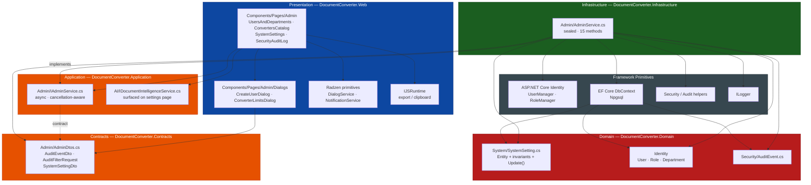
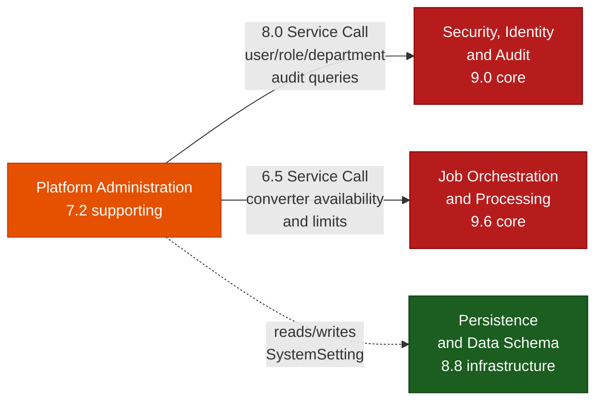
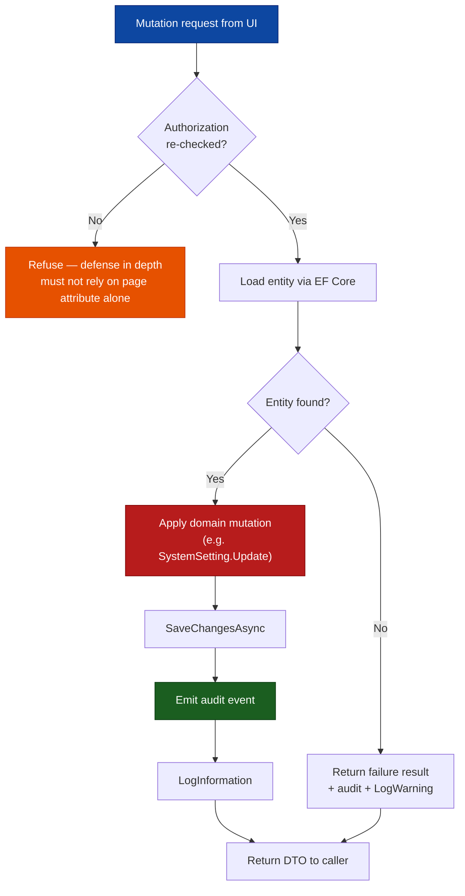
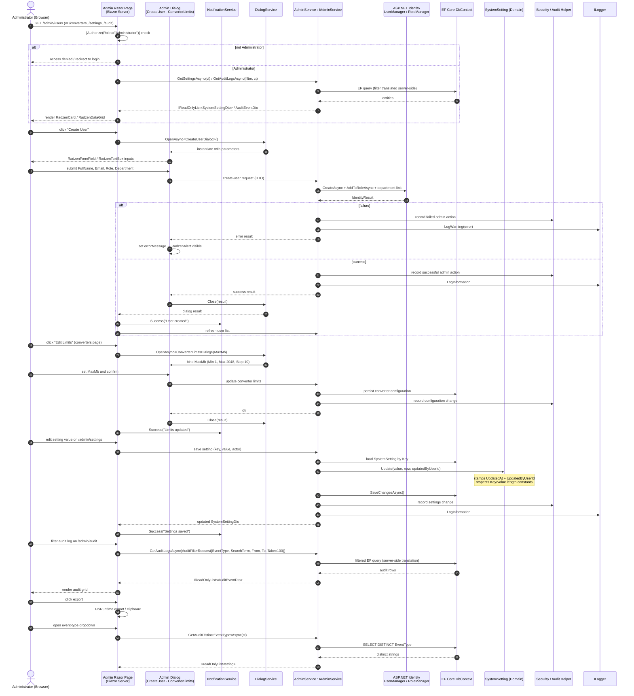
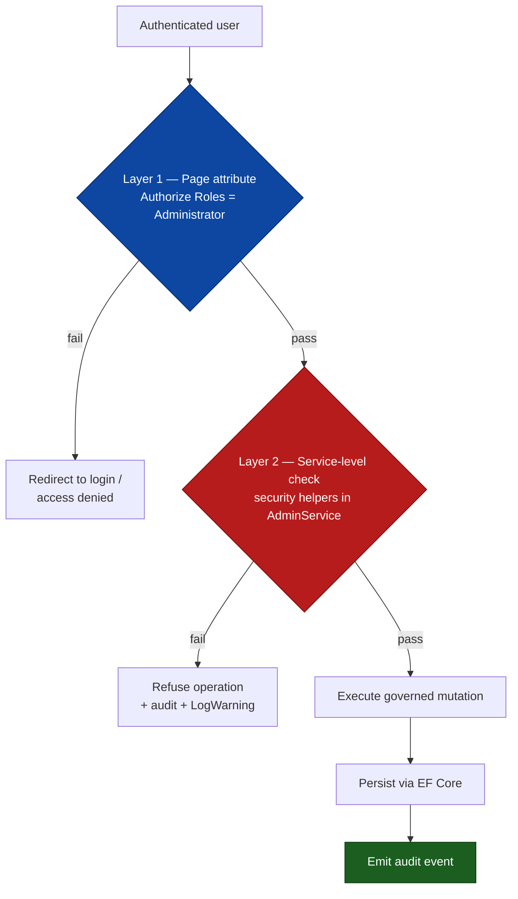
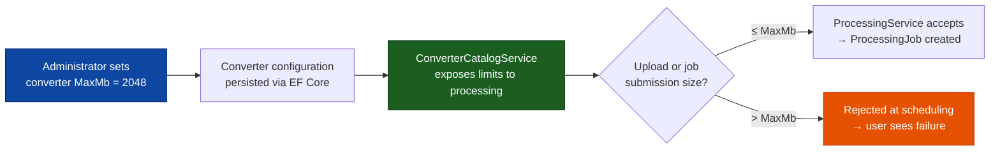

# Platform Administration — EConverter

**Document type:** Domain module documentation
**Scope:** Operational governance of the running EConverter platform — user and identity administration, converter catalog and limit tuning, system settings, and security audit review
**Domain type:** Supporting Business Domain · Importance 7.2/10 · Complexity 5.5/10
**Primary projects:** `DocumentConverter.Web`, `DocumentConverter.Infrastructure`, `DocumentConverter.Application`, `DocumentConverter.Contracts`, `DocumentConverter.Domain`

---

## 1. Executive Summary

Platform Administration is the operational control plane of EConverter. It is the domain through which an administrator governs *who* may use the platform, *what* the platform is permitted to do on their behalf, and *how* that usage is attested afterward. Everything else in EConverter — document lifecycle, conversion, OCR, intelligence, editing — operates on documents; Platform Administration operates on the platform itself.

The domain is deliberately narrower in scope and lower in complexity (5.5/10) than the five core business domains, and this is an architectural virtue rather than a weakness. Its responsibilities are largely CRUD and configuration layered on top of mature framework primitives — ASP.NET Core Identity for the identity store, EF Core for persistence, Radzen for the presentation surface. The engineering subtleties are therefore not in the business logic but in three places where correctness is genuinely hard:

1. **Authorization enforcement** — administrative surface must be unreachable by non-administrators, and that guarantee must hold at more than one layer.
2. **Audit completeness** — every governance mutation must produce a durable, queryable audit record, because the audit trail *is* the product of this domain.
3. **Constraint coherence** — configuration limits expressed in the UI must be identical to the limits enforced at persistence and honoured by downstream scheduling.

The domain is composed of two cooperating submodules:

| Submodule | Importance | Responsibility |
|---|---|---|
| **Administration Service** | 7.2 / 10 | Backing service executing user, role, department, converter and settings operations; queries the audit trail |
| **Administration Console** | 6.8 / 10 | Blazor Server + Radzen pages and dialogs presenting those operations, guarded by role-based authorization |

Its position in the wider architecture is as a **governance layer over the Security, Identity and Audit domain**: it does not define identity semantics itself, it composes them. Platform Administration also holds a soft dependency on Job Orchestration — converter catalog and limit configuration constrain what the processing domain may schedule — making administrative changes propagate algorithmically into job acceptance behaviour.

---

## 2. Position Within the Architecture

### 2.1 Layered placement

Platform Administration spans all four layers of the Clean Architecture stack, and the distribution of responsibility across those layers is what keeps it maintainable.



The dependency direction is strictly downward: presentation depends on the application contract, the implementation depends on domain and framework primitives, and the domain depends on nothing outside `DocumentConverter.Domain.Common`. Notably, `IAdminService` lives in Application with **no reference to EF Core or ASP.NET Identity**, which is what allows the contract to remain stable if the persistence or identity mechanism is ever replaced.

### 2.2 Position among domain modules

Platform Administration sits in the *supporting* tier and has exactly two outgoing structural relationships:



Three properties of this graph matter operationally:

- **The dependency on Security, Identity and Audit is strong (8.0)** and one-directional. Administration creates users, assigns roles and departments, and reads audit events — but it never defines authentication, ownership enforcement, or claim transformation. Those remain the exclusive authority of the security domain. An administrator cannot, through this module, weaken a domain-level ownership invariant.
- **The dependency on Job Orchestration is soft (6.5)**. Converter catalog state and `MaxMb` limits constrain what `ProcessingService` will accept, but the coupling is through configuration data rather than direct calls. The practical consequence: a mis-set limit manifests as rejected job submissions, not as a failure inside the processing pipeline.
- **Persistence is consumed indirectly** through `IAdminService`'s backing implementation, not by the presentation layer. The UI never sees an EF entity.

The critical architectural inversion to understand: **Platform Administration is high-privilege but low-centrality.** It has low fan-in (no other domain calls it) and moderate fan-out. A defect here does not break document processing directly — it breaks the *governance* of document processing, which is a slower, quieter, and often more consequential failure mode.

---

## 3. Submodule: Administration Service

### 3.1 Responsibility

`AdminService` (fully qualified `DocumentConverter.Infrastructure.Admin.AdminService`) is a `sealed` class implementing `IAdminService` with **15 methods**. It is the single executable authority for governance mutations on a running platform. Its duties decompose into four families:

| Family | Operations |
|---|---|
| **Identity governance** | Create users, assign roles, manage department membership, look up users/roles/departments |
| **Converter governance** | Enumerate the converter catalog, toggle availability, adjust per-converter limits |
| **System configuration** | Read and write `SystemSetting` values with audit stamping |
| **Audit querying** | Filtered audit event retrieval, distinct event-type enumeration |

### 3.2 Collaborators

The service orchestrates five distinct collaborators, each with a narrow role:

- **ASP.NET Core Identity** (`UserManager`, `RoleManager`) — authoritative for credential storage, password policy, role existence and membership. Administration never writes identity tables directly.
- **EF Core `AppDbContext`** — the persistence boundary. All queries for audit events, settings and converter configuration compose through LINQ and translate server-side.
- **`SystemSetting` domain entity** — the only permitted path for mutating a setting value.
- **Security / audit helpers** — the emission mechanism that records administrative actions into the audit trail that `GetAuditLogsAsync` later reads. This closes the loop between action and compliance review.
- **`ILogger`** — diagnostic logging, distinct from the audit trail. Logging is operational telemetry; auditing is compliance evidence. The two must not be conflated.

### 3.3 Contract surface

`IAdminService` is declared with asynchronous, cancellation-aware signatures throughout, which is a Blazor Server necessity rather than a stylistic preference — every synchronous call blocks the server-side circuit and degrades responsiveness for every user on that circuit.

```csharp
// DocumentConverter.Application/Admin/IAdminService.cs — shape of the contract
Task<IReadOnlyList<AuditEventDto>> GetAuditLogsAsync(
    AuditFilterRequest request, CancellationToken ct = default);

Task<IReadOnlyList<string>> GetAuditDistinctEventTypesAsync(
    CancellationToken ct = default);

Task<IReadOnlyList<SystemSettingDto>> GetSettingsAsync(
    CancellationToken ct = default);

// plus user / role / department CRUD and converter configuration operations
// (15 methods total in the AdminService implementation)
```

Three design properties are worth stating explicitly:

1. **`Task`-returning everywhere.** No method blocks the circuit.
2. **`CancellationToken ct = default` on every method.** A cancelled navigation or closed browser tab propagates cancellation into the database query rather than completing work no one will read.
3. **Contract-level DTOs only.** The service returns `AuditEventDto`, `SystemSettingDto`, `IReadOnlyList<string>`. It never returns an EF entity or a domain aggregate. This prevents persistence-model leakage into the UI and decouples the presentation surface from schema evolution.

### 3.4 Implementation discipline

`AdminService` implements a consistent pattern for every mutation:



The ordering is not incidental: **audit is emitted after persistence succeeds, and logging is emitted after audit.** This guarantees that the compliance record reflects state that actually committed, while the operational log reflects the outcome of the audit write.

---

## 4. Domain Layer: `SystemSetting`

`SystemSetting` (`src/DocumentConverter.Domain/System/SystemSetting.cs`) is the domain's only first-class entity, and it is a textbook example of an anaemic-looking type that is deliberately not anaemic.

### 4.1 Structure

```csharp
// Shape of DocumentConverter.Domain/System/SystemSetting.cs
public sealed class SystemSetting : Entity
{
    public const int KeyMaxLength         = 100;
    public const int ValueMaxLength       = 2000;
    public const int DescriptionMaxLength = 500;

    public string  Key         { get; private set; } = default!;
    public string  Value       { get; private set; } = default!;
    public string? Description { get; private set; }
    public DateTime UpdatedAt  { get; private set; }
    public Guid?    UpdatedByUserId { get; private set; }

    private SystemSetting() { }                    // EF materialization only
    public  SystemSetting(Guid id) { /* ... */ }   // creation path

    public void Update(string value, DateTime now, Guid? updatedByUserId)
    {
        // guarded write: refresh value + audit stamp atomically
    }
}
```

### 4.2 Invariants and why they matter

| Property | Design decision | Consequence |
|---|---|---|
| `sealed class : Entity` | Identity comes from the shared `Entity` base | Consistent key strategy across the whole model |
| `Key` has `private set` | Immutable after construction | A setting cannot be "renamed" — it must be deleted and recreated, preserving an honest audit history |
| Published `const` length limits | Single source of truth for EF configuration *and* DTO validation | UI validation and database constraints cannot drift |
| `private` parameterless constructor | Reserved for EF materialization | Prevents the ORM from being used as a bypass around the guarded write path |
| `Update(value, now, updatedByUserId)` | Only mutation entry point | Audit columns (`UpdatedAt`, `UpdatedByUserId`) are always stamped; they cannot be skipped |
| No dependencies beyond `Common` | Domain purity | The entity is unit-testable without adapters, database, or Identity |

The `Update` signature deserves emphasis because it is a small piece of design with disproportionate value: by requiring the caller to pass `now` and `updatedByUserId`, the domain makes it *impossible* to persist a changed value without an accurate audit stamp. There is no overload that mutates `Value` in isolation. This is the difference between an audit trail that is trustworthy and one that is merely present.

### 4.3 Constraint propagation

The three length constants propagate to two consumers:

1. **EF Core configuration** — `HasMaxLength(SystemSetting.KeyMaxLength)` etc., generating the corresponding column width in PostgreSQL.
2. **DTO validation and UI input limits** — the settings page can bind `maxlength` and validate before submitting.

Because both consume the same constant, a change to the limit is a single-line change with no possibility of the UI permitting a value the database rejects (or vice versa). This is a small illustration of the coherence discipline the whole domain depends on.

---

## 5. Submodule: Administration Console

### 5.1 Page inventory

Four Blazor Server pages, all protected by `[Authorize(Roles = "Administrator")]`:

| Route | Component | Function |
|---|---|---|
| `/admin/users` | `UsersAndDepartments.razor` | User creation, role assignment, department management |
| `/admin/converters` | `ConvertersCatalog.razor` | Converter catalog grid, availability toggles, per-converter limits |
| `/admin/settings` | `SystemSettings.razor` | Read/write system settings; also surfaces AI configuration via `IDocumentIntelligenceService` |
| `/admin/audit` | `SecurityAuditLog.razor` | Read-only audit viewer with filtering and export |

Each page follows an identical composition pattern: inject `IAdminService`, inject Radzen `NotificationService` for toast feedback, inject Radzen `DialogService` for modal orchestration, set `PageTitle`, and lay out content with `RadzenStack` / `RadzenCard`. Consistency here is deliberate — an administrator moving between pages encounters no variation in feedback semantics or modal behaviour.

### 5.2 Dialog components

Dialogs follow a uniform parameter-in / result-out contract:

- **`CreateUserDialog.razor`** — collects `FullName`, `Email`, `Role`, `Department` via `RadzenFormField` / `RadzenTextBox`. On failure, binds a conditional `RadzenAlert` to an `errorMessage` field so the error is rendered *inside* the dialog without closing it — the administrator retains their input and can correct it. On success, calls `DialogService.Close(result)`.
- **`ConverterLimitsDialog.razor`** — binds `MaxMb` to a `RadzenNumeric` with **Min 1, Max 2048, Step 10**, and carries a caption explaining the rejection behaviour that results from the chosen limit. The caption is not decoration: it tells the operator the downstream consequence of the value they are about to set.

The parameter-in / result-out pattern (`[Parameter]` inbound, `EventCallback` or `DialogService.Close(result)` outbound) keeps dialogs stateless with respect to the parent grid. The parent page owns the refresh; the dialog owns only its own transaction.

### 5.3 Client-side capabilities

`SecurityAuditLog.razor` additionally injects `IJSRuntime` for export and clipboard operations. This is the correct placement for such functionality — export is a client interaction concern, not a governance mutation, and it does not belong in `AdminService`.

### 5.4 The settings page and its second dependency

`SystemSettings.razor` is the only admin page with a dependency outside the administration contract: it also consumes `IDocumentIntelligenceService` to surface AI configuration. This is worth flagging as a **mild boundary observation**: the settings page reaches into the intelligence application contract to read and present AI options. It is not a layering violation — `IDocumentIntelligenceService` is an Application-layer contract and the page is a composition surface — but it does mean the AI configuration surface and the generic settings surface share a page while living in different domains. Operationally this is fine; architecturally it is a point to watch if AI configuration later requires its own authorization granularity.

---

## 6. Data Transfer Contracts

Three immutable DTOs in `DocumentConverter.Contracts/Admin/AdminDtos.cs`, all declared as `public sealed record` positional records.

### 6.1 `AuditEventDto`

The only shape the audit UI ever sees. Carries audit identity, actor, event type, resource, client IP address, metadata, and timestamp. Because it is a `record`, value equality is structural, which makes it straightforward to test filtering behaviour without database round-trips.

### 6.2 `AuditFilterRequest`

The query contract bound directly to the audit page's filter controls:

| Field | Semantics |
|---|---|
| `EventType` | Optional exact match against the event-type taxonomy |
| `SearchTerm` | Optional free-text search across audit content |
| `From` / `To` | Optional date range bounds |
| `Take` | **Defaults to 100** — a hard cap on response size |

The `Take = 100` default is a deliberate safety property rather than an arbitrary default. An unfiltered audit query against a mature deployment could return hundreds of thousands of rows; forcing an explicit `Take` change to exceed the cap prevents an accidental circuit-blocking query. This is the kind of default that looks like a convenience and functions as a guard.

All optional fields are nullable with sensible defaults, so a caller can construct `new AuditFilterRequest()` and receive a bounded, unfiltered recent slice — an ergonomic default that is also the safe one.

### 6.3 `SystemSettingDto`

The read/write projection for the settings page. Write flows pass the value and the acting user identifier through to `SystemSetting.Update`, which performs the stamping.

---

## 7. End-to-End Interaction Sequence

The following sequence covers all four administrative surfaces in one narrative, including the failure branches that matter most for correctness.



### 7.1 Sequence observations

**The runtime is in-process, not RPC.** Blazor Server executes page logic on the server circuit; `AdminService` is resolved through DI within the same process. There is no HTTP hop between the page and the service, which means the administrative surface has no additional network trust boundary of its own — its security derives entirely from the page authorization attribute and the service's own checks.

**Failure preserves input.** The failed-create branch does not close the dialog. The administrator's input survives the error, `RadzenAlert` renders the message in place, and the audit trail and warning log both record the attempt. This is the correct handling for a governance surface: a rejected action is still an event worth attesting.

**Distinct event types are queried, not hard-coded.** `GetAuditDistinctEventTypesAsync` performs a `SELECT DISTINCT EventType` so the filter dropdown always reflects what is actually in the audit table. This resists drift between the event taxonomy and the filter UI — a subtle but real maintainability win.

**Export is client-side only.** `IJSRuntime` handles export and clipboard. No server round-trip, no additional endpoint, no additional attack surface.

---

## 8. Security Architecture of the Administrative Surface

### 8.1 Two-layer authorization



The page attribute is the primary gate and it is necessary but not sufficient. If the service relies solely on the caller having passed the attribute check, then any future consumer of `IAdminService` — a new endpoint, a background service, an integration test harness — inherits unchecked administrative authority. Defence in depth requires the service to re-verify. This is stated in the module design as the intended posture, and it is the single most important correctness property of the domain.

### 8.2 Why the authorization model is stable

Administration composes the identity model rather than defining it. Recall the security domain's two anchoring decisions:

1. **Authorization is keyed on the stable internal entity ID**, not the identity-provider subject claim.
2. **Ownership is enforced in the `Document` aggregate**, not the service layer.

Both work in Administration's favour. When an administrator creates a user or assigns a role, the operation targets the internal `User` aggregate's stable identifier. When EntraId re-provisions a subject or a tenant migrates, the administrative records remain valid because they never referenced the external subject in the first place. And no administrative action can weaken document ownership, because that invariant lives in the aggregate — not in a policy the admin surface could mutate.

### 8.3 Audit as the domain's security product

The audit trail is not a side effect of administration; it is the *deliverable*. Three properties make it trustworthy:

| Property | Mechanism | Failure mode it prevents |
|---|---|---|
| **Unskippable stamping** | `SystemSetting.Update` requires `now` + `updatedByUserId`; no nullable-free overload exists | Settings changed without attribution |
| **Failure is also recorded** | Both success and failure branches emit audit events | Attack attempts invisible in the record |
| **Actor-scoped querying** | `AuditEventDto` carries actor, IP, resource, timestamp, metadata | Inability to reconstruct who did what, from where |

The distinction between the audit trail and `ILogger` output is operationally critical. Logs rotate, are lossy, and live in the observability platform. Audit events persist in PostgreSQL alongside the domain schema, are queryable through the application, and are exportable by an administrator for compliance review. Conflating them — treating log retention as audit retention — is the most common mistake this domain is designed to prevent.

---

## 9. Cross-Cutting Concerns

| Concern | Mechanism | Placement rationale |
|---|---|---|
| **UX feedback** | Radzen `NotificationService` toasts | Presentation-only; no domain knowledge |
| **Modal orchestration** | Radzen `DialogService` with typed results | Parent page owns refresh; dialog owns its transaction |
| **Export / clipboard** | `IJSRuntime` on the audit page | Client interaction, not governance mutation |
| **Diagnostics** | `ILogger` in `AdminService` | Operational telemetry, distinct from compliance audit |
| **Compliance evidence** | Security / audit helpers → `AuditEvent` | Durable, queryable, exportable |
| **Configuration coherence** | `SystemSetting` length constants shared by EF config and DTO validation | Single source of truth; UI cannot exceed DB |

---

## 10. Downstream Constraint Propagation

Administration's soft dependency on Job Orchestration (6.5) deserves concrete treatment because it is where an administrative mistake becomes a user-facing failure.



Two operational consequences follow:

- **Converters can be disabled via the catalog.** An administrator can remove a converter from availability; the catalog service then declines to schedule those jobs. This is the platform's supported mechanism for withdrawing a converter that is misbehaving or has a compliance concern — without redeployment.
- **Limits are enforced at scheduling, not mid-conversion.** A `MaxMb` reduction does not abort in-flight jobs; it prevents new ones from entering the pipeline. Operators planning a limit reduction during a large batch should expect existing jobs to complete under the old limits.

The `ConverterLimitsDialog`'s caption explaining rejection behaviour exists precisely to make this consequence visible *before* the operator commits the value.

---

## 11. Engineering Assessment

### 11.1 Strengths

| Strength | Evidence | Why it matters |
|---|---|---|
| **Clear contract boundary** | `IAdminService` in Application with no EF/Identity references | Persistence or identity mechanism can be replaced without touching the UI |
| **Enforced audit stamping** | `SystemSetting.Update(value, now, updatedByUserId)` as sole mutation path | An audit trail that cannot be silently bypassed |
| **Shared constraint constants** | `KeyMaxLength` / `ValueMaxLength` / `DescriptionMaxLength` consumed by EF config and DTOs | UI validation and database limits structurally cannot drift |
| **Bounded query default** | `AuditFilterRequest.Take = 100` | Prevents accidental circuit-blocking queries against mature deployments |
| **Immutable DTO surface** | `public sealed record` positional records | No accidental mutation of transport objects; structural equality for testing |
| **Dynamic filter taxonomy** | `SELECT DISTINCT EventType` feeds the filter dropdown | Filter UI cannot drift from actual audit content |
| **Cancellation throughout** | `CancellationToken ct = default` on every method | Closed tabs abandon database work instead of completing it |
| **Two-layer authorization by design** | Page attribute plus service-level re-verification | Future consumers of `IAdminService` do not inherit unchecked authority |

### 11.2 Structural tensions and honest gaps

The following are genuine observations, stated without inflation. None is a defect in current behaviour; all are maintenance risks.

| Observation | Assessment | Consequence if left unaddressed |
|---|---|---|
| **`AdminService` sits in Infrastructure, not Application** | Consistent with a pattern the domain research report flags across the system — orchestration living in the adapter layer while Application holds interfaces | Administrative logic cannot be unit-tested without the full adapter stack. This is a system-wide architectural drift, not a Platform Administration-specific flaw, but this domain inherits it |
| **Two dependency sources on the settings page** | `SystemSettings.razor` consumes both `IAdminService` and `IDocumentIntelligenceService` | If AI configuration later requires distinct authorization granularity, the page must be split |
| **Converter configuration and catalog state are undifferentiated in the module description** | The materials describe "converter configuration" as a service responsibility without separating catalog records from limit records | A future converter schema change may require reconciling two concepts held in one method family |
| **No documented audit retention or archival policy** | Audit events persist in PostgreSQL with no described lifecycle | Unbounded audit table growth; export becomes operationally important before archival does |
| **Authorization re-verification is stated as intended posture** | The design specifies defense in depth "ideally again in the service layer" | The word "ideally" means it may exist inconsistently across the 15 methods — worth auditing method-by-method in source |
| **`GetAuditDistinctEventTypesAsync` cost scales with audit volume** | `SELECT DISTINCT` over a growing table | On a mature deployment this becomes the slowest call on the audit page; a cached or indexed enumeration would be appropriate |
| **No documented concurrent-administration conflict handling** | Two administrators editing the same `SystemSetting` — last write wins via `Update` | Silent overwrite of a concurrent change, recorded in audit but not surfaced to the losing administrator |

### 11.3 Recommended hardening, ordered by impact × effort

| # | Action | Effort | Impact |
|---|---|---|---|
| 1 | **Audit every one of the 15 `AdminService` methods for service-level authorization.** Confirm none relies solely on the page attribute. | Low | High — closes the only plausible privilege-escalation path in the domain |
| 2 | **Add optimistic concurrency to `SystemSetting`.** Introduce a version or `UpdatedAt` concurrency token so a stale write is rejected rather than silently overwriting. | Low | High — prevents silent configuration loss under concurrent administration |
| 3 | **Extract an `IAdminAuthorizationGuard` applied uniformly** rather than repeating inline checks. Makes defense in depth structural rather than conventional. | Medium | High — a new method cannot forget the check |
| 4 | **Cache the distinct event-type enumeration** with invalidation on audit write, or derive it from a small reference table. | Low | Medium — protects the audit page's responsiveness at scale |
| 5 | **Define and document an audit retention policy** — partition by month, or archive to cold storage with an export contract. | Medium | Medium — governance debt that compounds |
| 6 | **Move administrative orchestration toward the Application layer** where feasible, consistent with the system-wide drift finding. | High | Medium — improves testability; large mechanical change |
| 7 | **Export admin audit events to the same OpenTelemetry pipeline as the rest of the system** in addition to PostgreSQL persistence. | Medium | Low–Medium — improves correlation with operational telemetry without weakening the compliance record |

---

## 12. Operational Guidance

### 12.1 Deployment checklist for a new administrator

1. **Verify the `Administrator` role exists** in the Identity store before provisioning users — `AdminService` depends on `RoleManager` for role resolution.
2. **Confirm all four routes are reachable and all four reject a non-admin session.** Route-level verification is the primary gate; verify it, do not assume it.
3. **Seed baseline `SystemSetting` values** — the settings page renders whatever rows exist; absent settings surface as missing configuration rather than defaults.
4. **Set converter `MaxMb` deliberately.** The default dialog range is 1–2048 with step 10. The value chosen constrains job acceptance downstream.
5. **Confirm audit emission by performing one successful and one failed mutation**, then locating both in `/admin/audit`. A governance surface that records only successes is not auditable.
6. **Confirm distinct event types populate the filter dropdown** — an empty dropdown indicates either no audit events or a query problem, and the two are indistinguishable to the operator without checking the table.

### 12.2 Change management

- **Settings changes are audit-stamped with the acting user and timestamp.** When investigating a behaviour change, filter `/admin/audit` by date range and search term before examining anything else — the configuration change will be there.
- **Converter limit reductions apply to new jobs only.** Plan around in-flight batches.
- **Converter availability toggles are the supported withdrawal mechanism.** Disabling a converter is preferable to redeployment when a converter must be taken out of service.
- **Audit export is client-side.** Exported data leaves through the administrator's browser; treat the export as a data-handling event subject to the same governance as the platform itself.

### 12.3 Troubleshooting matrix

| Symptom | Likely cause | Verification |
|---|---|---|
| Administrator sees access denied | Role membership not applied; claims not yet refreshed | Re-authenticate; verify role in `/admin/users` |
| Created user cannot log in | Identity creation succeeded but role/department link failed, or provider mismatch (`Local` vs `EntraId`) | Check audit trail for the failure event; verify `AuthenticationType` |
| Settings page renders empty | No `SystemSetting` rows seeded | Query the settings table; run seeder |
| Setting save rejected | Value exceeds `ValueMaxLength` (2000) or key exceeds `KeyMaxLength` (100) | Check the value length against the published constants |
| Converter unavailable, no error surfaced | Converter disabled in catalog, or job exceeds `MaxMb` | Check `/admin/converters` state and limit value |
| Audit filter dropdown empty | No audit events recorded, or distinct query failing | Query the audit table directly; check `GetAuditDistinctEventTypesAsync` |
| Audit page slow | `SELECT DISTINCT` over large audit table with no supporting index | Profile the query; consider the caching recommendation in §11.3 |

---

## 13. Summary

Platform Administration governs the running platform through a deliberately small, cleanly layered domain. Its value is not in algorithmic sophistication — complexity 5.5/10 — but in the discipline of its boundaries: an immutable contract in Application, invariants and unskippable audit stamping in the domain, framework primitives used rather than reimplemented in Infrastructure, and a presentation surface that provides feedback and export without acquiring governance logic of its own.

Three properties define the domain's quality, and they are the three to monitor over time:

- **The authorization gate holds at more than one layer.** Verify this in source per method, not per page.
- **The audit trail records failures as well as successes, with actor and timestamp.** This is verified by the `SystemSetting.Update` signature and the dual audit branches in the sequence; it should be verified for all 15 methods.
- **Configuration limits are coherent across UI, validation and persistence** via shared constants, and their downstream consequence on job acceptance is made visible to the operator before they commit a value.

Everything else in the domain is supporting machinery. These three are the reasons the domain exists.