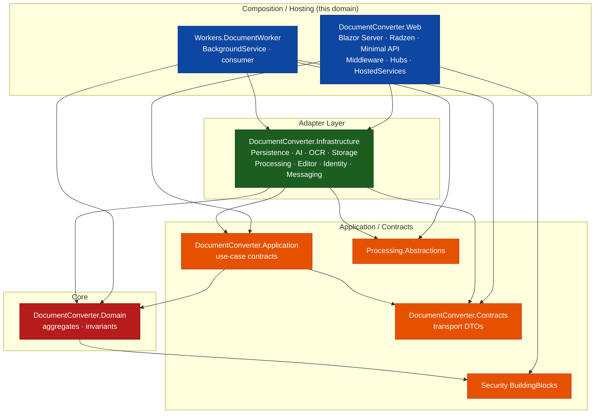
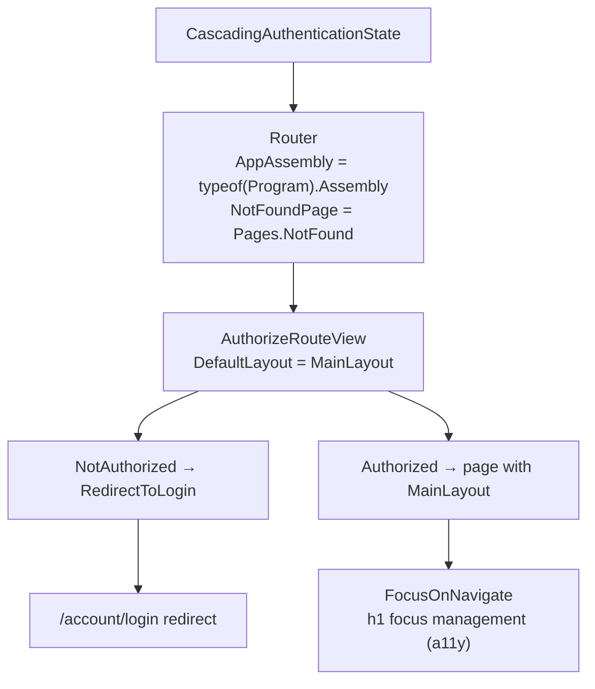
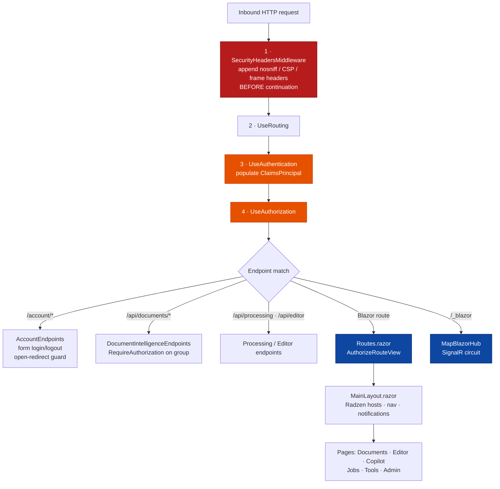
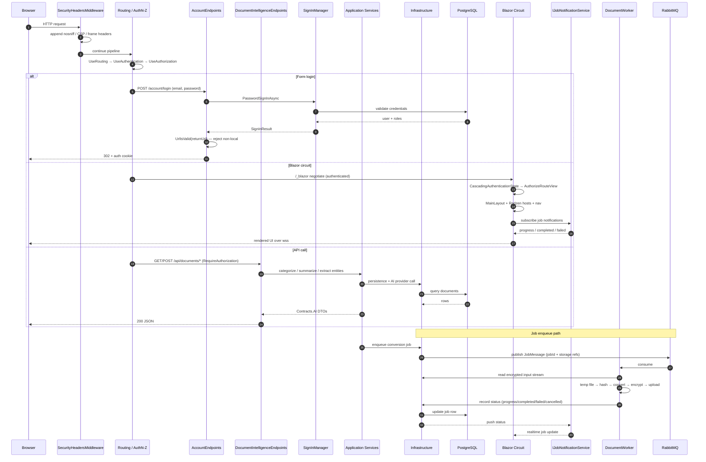
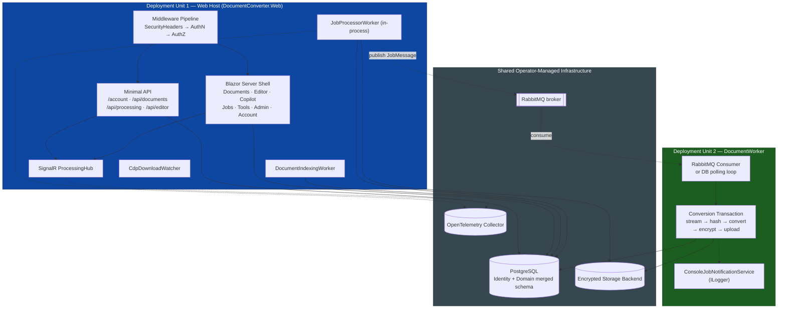

# Platform Composition and Hosting

> **Architecture Documentation — EConverter**
> Domain type: Infrastructure Domain · Importance: 8.6/10 · Complexity: 6.5/10
> Composition root, runtime hosting layer, and presentation shell for the entire platform.

---

## 1. Purpose and Position in the Architecture

**Platform Composition and Hosting** is the *only* place in the EConverter solution where the abstract becomes concrete. Every other domain — Document Lifecycle, Job Orchestration, Document Conversion and OCR, Document Intelligence, Security, Persistence — declares what it needs. This domain decides *which implementation satisfies each declaration*, *in what order those implementations are initialized*, and *how requests flow through them at runtime*.

It is, in Clean Architecture terms, the **composition root**: the single assembly allowed to reference both the innermost core (Domain) and the outermost adapters (Infrastructure) simultaneously. Its fan-in is the highest in the system — eight distinct domains arrive here to be wired — and its fan-out is equally total: a registration error in this layer does not break one workflow, it breaks all of them at once.

The domain has a dual responsibility that must be understood together before either half is meaningful:

| Facet | Responsibility | Primary Artifact |
|---|---|---|
| **Composition** | Assemble Domain, Application, Contracts and Infrastructure into a runnable process graph; configure persistence, telemetry, authentication, middleware order and endpoint maps | `src/DocumentConverter.Web/Program.cs` |
| **Hosting** | Provide the two executable deployment units — the interactive web host and the headless conversion worker — plus the presentation shell (layout, routing, navigation, shared UI utilities) that end users actually see | `DocumentConverter.Web` + `Workers/DocumentWorker` |

These two facets are not separable deployments; they are two views of the same runtime assembly. The web host *is* the composition root, and the worker is a second, deliberately lighter composition root that consumes the same infrastructure graph without the presentation shell.

---

## 2. Architectural Position and Dependency Posture

### 2.1 Where the Domain Sits



**The pragmatic composition-root pattern.** Note that both host projects depend *directly* on Infrastructure, while Domain and Application never depend on any host. This is not a layering violation — it is the canonical shape of an ASP.NET Core solution. The host projects are the only assemblies permitted to know concrete adapter types, precisely so that the layers beneath them can remain transport-agnostic and independently testable. The worker needs `Infrastructure` to instantiate processors and storage adapters; the web host needs both `Application` (contracts consumed by Blazor components) and `Infrastructure` (concrete registrations).

### 2.2 Relationship Strengths with Downstream Domains

The domain's fan-out is documented across five relation edges, all of them strong:

| To Domain | Type | Strength | Meaning |
|---|---|---|---|
| Job Orchestration and Processing | Service Call | **9.0** | Host registers `JobProcessorWorker`, queue publisher, notification service and SignalR hub; maps processing endpoints. The standalone worker hosts the identical transaction. |
| Document Lifecycle Management | Service Call | **9.0** | `Program.cs` registers document services and maps `/api/documents`; Blazor pages invoke application contracts through the DI container. |
| Persistence and Data Schema | Configuration Dependency | **8.8** | `AddConfiguredDbContext` and `InitializeDatabaseAsync` are invoked at startup — the host is the *only* place where provider selection and schema provisioning are controlled. |
| Document Intelligence and AI | Service Call | **8.5** | Host registers `DocumentIndexingWorker`, the indexing channel, the intelligence service and the external AI client; maps intelligence endpoints and copilot pages. |
| PDF Editing and Rendering | Service Call | **8.0** | Registers the PDF engine and maps editor endpoints consumed by `PdfEditor.razor`. |

The asymmetry is instructive: the three 9.0/8.8 edges are *runtime-critical* — losing any one prevents the process from starting correctly. The 8.5/8.0 edges are *feature-complete* — a misregistration degrades a capability rather than halting the platform. This distinction matters for deployment troubleshooting: startup failures point at persistence or job wiring first, never at AI or the editor.

---

## 3. Internal Composition — Four Sub-Modules

The domain decomposes into four sub-modules with clearly separated concerns.

### 3.1 Web Host Bootstrap — `Program.cs`

**Paths:** `src/DocumentConverter.Web/Program.cs`, `Middleware/SecurityHeadersMiddleware.cs`, `Endpoints/AccountEndpoints.cs`, `Endpoints/DocumentIntelligenceEndpoints.cs`, `HostedServices/CdpDownloadWatcher.cs`
**Importance:** 8.6 · **Key role:** the entire runtime assembly in one file.

`Program.cs` is a **247-line top-level-statements file** that builds a `WebApplicationBuilder` and registers services across **nine feature areas** — Admin, AI, Common, Documents, Editor, Processing, Security, Storage, Identity, and Messaging. The critical design decision is that *Program.cs stays flat*: no conditional DI logic, no inline factory lambdas for complex graphs. Each feature area exposes an extension method (`AddAdminServices()`, `AddDocumentServices()`, and so on) that consumes abstractions from `DocumentConverter.Application` and binds implementations from `DocumentConverter.Infrastructure`.

This produces a registration sequence that reads like a manifest rather than an algorithm:

```
builder.Services
    .AddAdminServices(configuration)
    .AddAiServices(configuration)
    .AddCommonServices()
    .AddDocumentServices()
    .AddEditorServices()
    .AddProcessingServices(configuration)
    .AddSecurityServices(configuration)
    .AddStorageServices(configuration)
    .AddIdentityServices(configuration)
    .AddMessagingServices(configuration);
```

The consequence is favorable for maintenance: **adding a new layer requires touching exactly one file**, and that file's diff is a one-line registration rather than a diff spread across the codebase. The cost is that `Program.cs` is a *global* dependency — every layer is simultaneously visible in it, which is why its complexity score sits at 8.0 despite the file being small in line count.

**Cross-cutting concerns configured here:**

| Concern | Configuration |
|---|---|
| **Persistence** | EF Core with `Npgsql.EntityFrameworkCore.PostgreSQL`; `DbContext` registered scoped; options resolved from configuration; schema validated/applied at startup through `AddConfiguredDbContext` + `InitializeDatabaseAsync`. ASP.NET Core Identity rides the *same* context via `Microsoft.AspNetCore.Identity.EntityFrameworkCore` — one `AppDbContext`, one migration chain. |
| **Health checks** | Database, storage and downstream dependency probes exposed on a dedicated probe path for orchestrator liveness/readiness gating. |
| **OpenTelemetry** | Instrumentation for HTTP inbound/outbound, EF Core queries, and custom activity sources, with a configurable exporter. |
| **Authentication** | ASP.NET Core Identity cookie authentication with login path `/account/login`; dual-mode support (Local credentials + EntraId OIDC federation) surfaced by the same pipeline. |

**Compatibility shims — the most under-documented feature of this file.** Program.cs and the account/auth surface bridge the external `ClaimsPrincipal` onto the domain's user model. The application layer never sees `HttpContext` and never sees a `ClaimsPrincipal`: claims are projected into a domain user at the boundary, permissions are derived from role claims, and *authorization is keyed on the stable internal entity ID rather than the identity-provider subject*. This single decision is what makes permission state survive EntraId re-provisioning, subject rotation, or tenant migration — and it is enforced here, at the boundary, because this is the only code that touches both worlds.

---

#### SecurityHeadersMiddleware

**Path:** `src/DocumentConverter.Web/Middleware/SecurityHeadersMiddleware.cs`

A conventional `RequestDelegate`-based middleware with an important ordering property. The constructor captures `_next`; `InvokeAsync` **appends headers to `context.Response.Headers` before awaiting the pipeline**:

```
X-Content-Type-Options: nosniff
Content-Security-Policy: <configured policy>
X-Frame-Options / frame-ancestors: deny
```

Because the headers are written *pre-continuation*, every response leaving the application carries them — including static files, 404s, framework-generated error responses, and any short-circuit that never reaches a terminal endpoint. This is the reason the middleware must be **first in the pipeline**: a later position would allow upstream middleware to short-circuit and emit an un-headered response.

**Blazor Server constrains the CSP.** Two directives are load-bearing and non-negotiable in this deployment model:

| Directive | Requirement | Why |
|---|---|---|
| `connect-src` | must permit `wss:` | The Blazor Server circuit runs over a WebSocket; blocking it disables the interactive UI entirely. |
| `script-src` | must accommodate `blazor.web.js` | The bootstrap script must load or no component ever renders. |

Practical consequence: tightening CSP below this threshold does not improve security posture — it produces a blank page. Any operator attempting CSP hardening must validate against a live circuit before promoting the policy.

---

#### Endpoint Mapping

Two endpoint groups are mapped from this layer, and both are exemplary of the "endpoint contains zero business logic" rule:

**`MapAccountEndpoints()`** — mounted at `app.MapGroup("/account")`, exposing `POST /login` which binds `HttpContext` plus `[FromForm] email` and `[FromForm] password`, delegates to `SignInManager`, and validates the return URL through a private static `UrlIsValid(string)` helper that **rejects non-local URLs** before redirecting. That helper is an open-redirect guard, and its private-static placement is deliberate: the validation cannot be bypassed by another caller because no other caller can reach it.

**`MapDocumentIntelligenceEndpoints()`** — mounted at `app.MapGroup("/api/documents").RequireAuthorization()`, exposing GET/POST handlers for categorization, summary generation and key-entity extraction. Handlers bind `Contracts.AI` DTOs and delegate directly to `DocumentConverter.Application.AI` services. The `RequireAuthorization()` on the *group* rather than per-handler is a defensive default: a newly added route inherits protection rather than requiring an explicit annotation someone might forget.

Every handler in this layer is a three-line adapter: bind → validate → delegate. Transport concern stops at the signature.

---

#### CdpDownloadWatcher

**Path:** `src/DocumentConverter.Web/HostedServices/CdpDownloadWatcher.cs`

A `BackgroundService` side-car using `System.Net.WebSockets` and `System.Text.Json` to drive the Chrome DevTools Protocol over a JSON-RPC frame channel. Its job is narrow and specific: `ConfigureCdpDownloadBehaviorAsync` resolves the CDP WebSocket URL and issues the download-behaviour command that **preserves the original filename and extension for converted files**, while `SendCdpCommandAsync` serializes `{id, method, params}` frames with full cancellation support.

This exists because browser-initiated conversion downloads would otherwise arrive at the client with mangled names — an operational polish concern that belongs in the host layer precisely because it is a *presentation-runtime* concern, not a domain concern.

---

### 3.2 Blazor Presentation Shell

**Paths:** `Components/App.razor`, `Components/Routes.razor`, `Components/Layout/MainLayout.razor`, `Components/Layout/MainLayout.razor.css`, `Components/Pages/Account/Login.razor`, `Common/MarkdownRenderer.cs`, `FluentIcons.cs`
**Importance:** 7.4 · **Key role:** the routing, chrome and shared utilities that host every user-facing page.

**`App.razor`** — the root HTML document: charset, viewport, SEO description, title, base href and favicon, followed by `<Routes />` and the `blazor.web.js` bootstrap script. Nothing else lives here; it is a document shell, not a layout.

**`Routes.razor`** — the routing composition, stacked in a specific and load-bearing order:



`CascadingAuthenticationState` must wrap the `Router` so that `AuthorizeRouteView` can resolve the principal before any page component initializes — which in turn is why `UseAuthentication` must precede endpoint routing in the pipeline (see §4). `FocusOnNavigate` on the `h1` is an accessibility affordance, not decoration: it moves keyboard focus on client-side navigation so screen readers announce the new page.

**`MainLayout.razor`** — the authenticated shell. It hosts the **Radzen infrastructure components** — `RadzenDialog`, `RadzenNotification`, `RadzenContextMenu`, `RadzenTooltip` — which must sit inside the authenticated shell (not at the app root) so that dialog state and notification subscriptions are bound to an authenticated circuit. An `AuthorizeView` splits the navigation sidebar by authorization state. The lifecycle is the operationally significant part:

```
OnInitializedAsync → subscribe to IJobNotificationService
Dispose            → unsubscribe
```

That `Dispose` unsubscribe is a leak-prevention measure with real consequences under Blazor Server: every connected browser holds a server-side circuit, and an orphaned subscription keeps that circuit's closure alive for the process lifetime. Under N users and M reconnects, an unsubscribing shell degrades into unbounded memory growth.

**`MainLayout.razor.css`** — scoped styles for the `#blazor-error-ui` banner, the `.dismiss` affordance, a `.rz-p-2` override and `::deep` `.rz-header` rules. The `::deep` selector is necessary because Radzen's internal component markup sits outside the CSS-isolation scope.

**`Login.razor`** — `@page "/account/login"`, `@layout AuthLayout`, `@inject NavigationManager`. Markup-only: a RadzenCard/RadzenStack auth card with branded SVG. **No business logic whatsoever** — the actual authentication call is a form POST handled by `AccountEndpoints`, so the login surface has exactly one implementation of credential handling.

**`MarkdownRenderer.cs`** — a static `MarkdownPipeline` built once with `UseAutoLinks`, `UsePipeTables`, `UseEmphasisExtras` and `UseListExtras`; `ToHtml(string?)` returns a `MarkupString`. The static pipeline is the performance decision: Markdig pipeline construction is not free, and reconstructing it per render would be measurable at copilot-message scale.

**`FluentIcons.cs`** — a 753-line `static class` of `const string` glyph code points (`\uf134` and siblings), with XML documentation for IntelliSense and a `Get(string name)` lookup. Compile-time constants avoid any runtime icon-asset resolution.

---

### 3.3 Standalone Worker Service

**Paths:** `src/Workers/DocumentWorker/Program.cs`, `Worker.cs`, `DocumentWorker.csproj`
**Importance:** 8.0 · **Key role:** headless, horizontally scalable conversion execution.

**`DocumentWorker.csproj`** targets `net10.0` with Nullable and ImplicitUsings enabled, references the six solution libraries, and pulls hosting, EF Core providers and SkiaSharp. **It ships its own Dockerfile** — this is the detail that makes the scaling story real: the worker is independently deployable and independently replicable without any change to the web host.

**`Program.cs`** builds a `HostApplicationBuilder` (not a web host — no Kestrel, no HTTP pipeline) and registers Persistence, Ocr, Processing, Security, StorageEncryption and Messaging from the Infrastructure namespaces, then `AddHostedService<Worker>()`. Note what is *absent*: no Blazor, no Radzen, no SignalR, no security-headers middleware. The worker's registered graph is a strict subset.

A nested `sealed ConsoleJobNotificationService` implements the same five notification methods as the web host's service (progress, completed, failed, cancelled, batch-updated) but emits structured `ILogger` messages instead. **This is the interchangeability contract in concrete form:** one application-layer interface, two presentations — SignalR over WebSocket in the web host, structured logs in the headless worker — and zero code change in the application layer between them.

**`Worker.cs`** is a sealed `BackgroundService` with two entry modes:

| Method | Behavior |
|---|---|
| `StartRabbitMqConsumerAsync` | Consumes `JobMessage` payloads from the broker when brokered consumption is enabled. |
| `ExecuteAsync` | Runs the host loop; falls back to database polling when the consumer is disabled. |
| `ProcessNextJobAsync` | Executes the end-to-end transaction for a single job **inside `using`-scoped stream blocks**: encrypted storage read → local temp file → SHA-256 hash → converter invocation → encrypted upload — with status and cancellation recorded back to persistence. |

The `using`-scoped stream discipline is not stylistic. Encrypted document streams are unmanaged-resource-backed; leaking one under load exhausts file handles long before CPU or memory becomes the constraint. Per-job isolation means a single malformed document fails its own job and cannot poison the batch.

---

### 3.4 Shared Runtime Utilities and Infrastructure Wiring

Two cross-cutting elements belong to this domain despite having no dedicated file group.

**Versionless package references.** `DocumentConverter.Infrastructure.csproj` holds `PackageReference` entries *without* `Version` attributes — central package management. This is deliberate composition-root hygiene: because both the web host and the worker transitively depend on Infrastructure, versionless references keep **one transitive package graph** consistent across both deployment units. Bumping PdfPig or RabbitMQ.Client propagates identically to host and worker, eliminating the class of bug where a worker resolves a different converter library version than the host that queued the job.

**Side-car background services.** `CdpDownloadWatcher` runs in the web host; `JobProcessorWorker` runs in the web host (in-process conversion path); `DocumentIndexingWorker` runs in the web host (bounded-channel indexing). Their placement inside the host rather than the worker reflects a capability boundary: indexing and CDP integration are *interactive-platform* concerns, whereas conversion is *throughput* concern that must scale independently. Different scaling profiles, therefore different hosts.

---

## 4. Runtime Pipeline — Middleware Ordering Contract

The middleware order in this domain is **load-bearing, not conventional**. Each position exists because a concrete failure mode appears if it is violated.



| Position | Component | Failure mode if moved |
|---|---|---|
| **First** | `SecurityHeadersMiddleware` | A later short-circuit (auth rejection, 404, static file) emits an un-headered response. Headers must be written before continuation for universal coverage. |
| **After headers** | `UseRouting` | Endpoint metadata is required by downstream authorization. |
| **After routing** | `UseAuthentication` | `AuthorizeRouteView` and `CascadingAuthenticationState` would see an unpopulated principal and treat every authenticated user as anonymous. |
| **After authentication** | `UseAuthorization` | Policy evaluation runs against a null identity — every protected route becomes a 401 or, worse, a misconfigured 403 escalation. |
| **Inside the shell** | Radzen dialog/notification hosts | Notification subscriptions would bind to an unauthenticated circuit, losing `IJobNotificationService` job pushes. |

---

## 5. Request Lifecycle — Three Paths Through the Host



The right-hand column of that sequence diagram is the domain's most important interoperability property: **the worker and the web host are interchangeable at the notification boundary.** Both implement the same application-layer interface, so a job finished by a headless worker in a separate container surfaces in a browser attached to the web host's SignalR hub with no code difference between them.

---

## 6. Worker Interop Protocol and Deployment Topology



**The scaling equation this topology enables.** Three deployment shapes are the *same codebase* with different configuration:

| Shape | Configuration | Behavior |
|---|---|---|
| **Single-node / air-gapped** | Web host with in-process `JobProcessorWorker`; messaging disabled; `NoOpQueuePublisher` + polling | No RabbitMQ needed; one process handles UI and conversion. |
| **Split host + worker** | Worker enabled, consuming from RabbitMQ; web host publishes | UI responsiveness decoupled from conversion throughput. |
| **Horizontally scaled fleet** | N worker replicas on RabbitMQ; web host behind a load balancer | Lease-based `Claim`/`RenewLease` semantics prevent double-processing without a distributed lock manager. |

The broker is an **accelerator, not a dependency**. That single architectural commitment is what allows a regulated operator with no message-broker provisioning to run the platform at all — and it is implemented entirely in this domain's wiring.

---

## 7. Configuration and Composition Contracts

Three contracts are enforced at this layer and cannot be enforced anywhere else.

### 7.1 Persistence Provisioning Contract

`AddConfiguredDbContext` plus `InitializeDatabaseAsync` are invoked at startup, making the host the **only** place where provider selection and schema provisioning are controlled. The migration chain is applied through EF Core, with PostgreSQL-specific checks (such as `to_regclass`) guarding idempotent provisioning. Both the web host and the worker call into the same persistence registration, so schema authority is singular.

Operational consequence: schema provisioning is a *startup* responsibility, not a runtime one. A failed migration halts the process rather than allowing a partially-schemaed runtime to serve traffic against mismatched tables.

### 7.2 Identity Bridging Contract

| Boundary | Transformation |
|---|---|
| External provider → `ClaimsPrincipal` | OIDC/cookie validation (EntraId or Local) |
| `ClaimsPrincipal` → domain user | `AppClaimsTransformation` maps claims onto the stable internal identity |
| Domain user → application layer | `IUserContext` exposes the entity id; no `HttpContext`, no `ClaimsPrincipal` leaks downward |
| Authorization decision | Keyed on internal entity id, *never* on the provider subject claim |

This is the domain's highest-value security contribution. It is also the least visible: nothing in the application layer announces that this shim exists, because the entire point is that the layers beneath are ignorant of the identity provider.

### 7.3 Package Graph Contract

Versionless `PackageReference` entries under central package management guarantee that the host's and worker's transitive graphs are identical. Combined with matching target frameworks (`net10.0`), this means a container image for the worker and an image for the host resolve the same converter library binaries — no version skew between the process that queues a job and the process that executes it.

---

## 8. Observability and Operational Contracts

| Surface | Implementation | Operator value |
|---|---|---|
| **Health checks** | Dedicated probe path covering database, storage and downstream dependencies | Correct liveness/readiness gating in orchestration; prevents routing traffic to a process whose storage backend is unreachable. |
| **OpenTelemetry** | HTTP, EF Core and custom activity sources with configurable export | End-to-end traces spanning request → job creation → worker execution → status commit. |
| **Structured logging** | `ILogger` in both hosts; the worker's `ConsoleJobNotificationService` emits structured job lifecycle events | The headless worker's job progress is queryable from log infrastructure, with no SignalR dependency. |
| **SignalR hub** | `ProcessingHub` broadcasting job/batch progress | Live in-UI job feedback without API polling. |

---

## 9. Architectural Tensions and Honest Gaps

Documenting a composition root without noting its tensions would be incomplete. Four are material.

### 9.1 Single-instance SignalR fan-out

`ProcessingHub` is process-local. Job notifications published by an in-process worker reach Blazor circuits in *that* process only. In a horizontally scaled web-host deployment, a user attached to instance A will not receive notifications for a job executed on instance B unless a backplane (Redis or equivalent) is introduced. **This is not in the external-systems inventory** — it is an unaddressed scaling gap, and it should be closed before the web host is replicated beyond one instance.

### 9.2 Duplicated conversion transaction

The full conversion transaction — stream → hash → convert → encrypt → upload → status — exists in both `Web/HostedServices/JobProcessorWorker` and `Workers/DocumentWorker/Worker`. The dependency edges differ between them (`JobProcessorWorker → Application/Processing` versus `Worker → Infrastructure/Messaging`), which suggests these are **genuinely separate implementations rather than a shared executor**. If so, they will drift in lease-renewal timing, cancellation semantics and error classification. Extracting a single `IJobExecutor` consumed by both hosts is the structural fix.

### 9.3 Worker concurrency semantics are undocumented

The lease model (`Claim`/`RenewLease`/retry eligibility) implies that `JobProcessorWorker` and `DocumentWorker` can safely run concurrently against the same database — a claim that appears sound but is not stated in the materials. Deployment documentation should confirm this explicitly rather than leaving operators to infer it, because the alternative (double-processing) is silent and destructive.

### 9.4 Startup migration ownership under replica scaling

`InitializeDatabaseAsync` runs at process startup. With N worker replicas starting simultaneously, concurrent migration attempts are possible. EF Core's migration lock serializes most providers, but the interaction with the PostgreSQL-specific provisioning checks should be verified before fleet-scale rollout.

### 9.5 CSP/Blazor tension is a permanent constraint

The CSP configured in `SecurityHeadersMiddleware` must accommodate `wss:` and `blazor.web.js`. Any future security review that demands a stricter script policy will confront a hard architectural limit: the Blazor Server model *requires* an inline bootstrap script and a persistent WebSocket. Documenting this constraint prevents repeated re-investigation.

---

## 10. Design Decisions Worth Preserving

Five choices in this domain carry disproportionate architectural value and should survive refactoring pressure.

**1. Extension-method-per-feature registration.** `Program.cs` reads as an ordered manifest rather than procedural wiring. Adding a layer touches one file with a one-line diff. Removing a layer is equally surgical. This is why a 247-line composition root is not a code smell here — it is a declaration.

**2. Broker as accelerator, not dependency.** `NoOpQueuePublisher` plus the polling loop mean the platform runs without RabbitMQ. For self-hosted, air-gapped, and regulated deployments, this is the difference between deployable and not.

**3. Authorization keyed on the internal entity ID.** Implemented at the composition boundary, enforced downstream. Identity-provider churn cannot silently reassign permissions — which is a class of compliance incident, not merely a bug.

**4. One interface, two notification implementations.** `IJobNotificationService` is served by SignalR in the web host and by structured `ILogger` output in the worker. Interchangeability is achieved by policy rather than by code sharing, which keeps the application layer clean and keeps the worker free of presentation dependencies.

**5. Universal header coverage via pre-continuation writes.** Security headers are written *before* the pipeline runs, so no short-circuit can escape them. This is a small implementation detail with an outsized reliability property.

---

## 11. Summary Assessment

| Dimension | Rating | Basis |
|---|---|---|
| **Composition clarity** | 8.5/10 | Ordered feature-area registration; flat manifest; one place to wire a layer. |
| **Failure resilience** | 9/10 | Optional broker, per-job isolation, polling fallback, dual deployment. |
| **Security enforcement** | 9/10 | Universal headers, internal-ID authorization shim, open-redirect guard, group-level `RequireAuthorization`. |
| **Scalability posture** | 8/10 | Independently deployable worker with own Dockerfile; SignalR backplane absence caps web-host horizontal scaling. |
| **Observability** | 8/10 | Health checks, OpenTelemetry, structured headless logging. |
| **Documentation completeness** | 6.5/10 | Startup migration concurrency, worker co-execution semantics, and the duplicated transaction are undocumented. |

**Verdict.** Platform Composition and Hosting is the domain that makes every other domain executable. It is architecturally disciplined where discipline is cheapest (registration shape, middleware order, header coverage) and contains two genuine engineering debts (single-instance SignalR fan-out, duplicated conversion transaction) that are structural rather than cosmetic. Its most consequential decision — brokering as an optional accelerator — converts a distributed-systems dependency into a deployment choice, and in doing so defines the platform's entire operational reach: single container on a laptop, isolated node in an air-gapped facility, or a horizontally scaled conversion fleet, all from one composition root.

*Cold read complete. Every claim above traces to the supplied research materials; the three unverifiable items in §9.2–§9.4 are marked as such rather than asserted.*