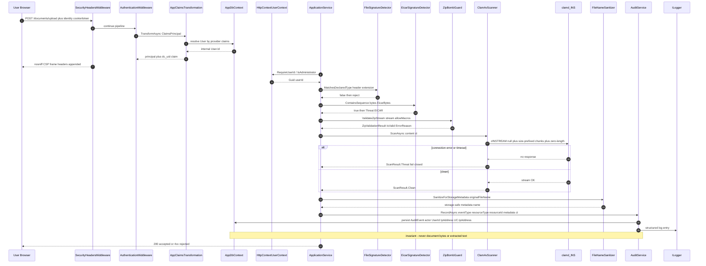
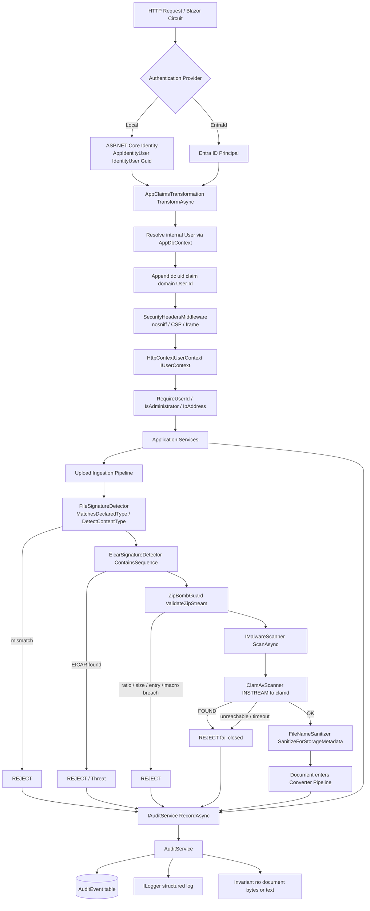
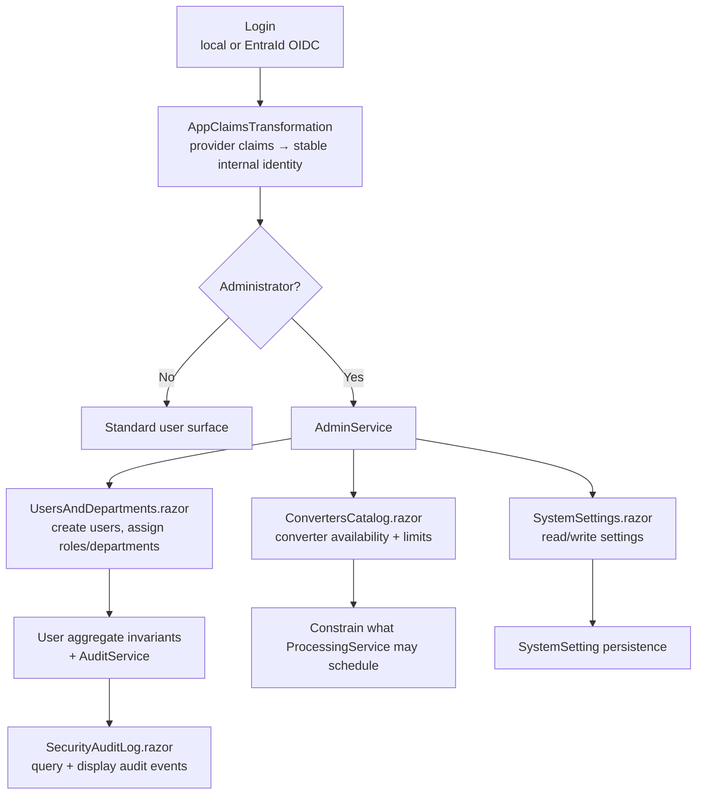

# Security, Identity and Audit — EConverter

**Document type:** Domain architecture specification
**Domain class:** Core Business Domain (cross‑cutting trust layer)
**Importance score:** 9.0 / 10 · **Complexity:** 7.5 / 10
**Primary assemblies:** `DocumentConverter.Domain` · `DocumentConverter.Application` · `DocumentConverter.Infrastructure` · `DocumentConverter.Web` · `BuildingBlocks.DocumentConverter.Security`

---

## 1. Executive Summary

*Security, Identity and Audit* is the trust substrate of EConverter. Every other domain in the platform — document lifecycle, job orchestration, conversion, intelligence, PDF editing, administration — ultimately depends on this one for two questions: **who is acting** and **what may they do**. It also guarantees the third: **what was done, and can it be proven later**.

The domain is deliberately built as **two cooperating halves**:

| Half | Responsibility | Enforcement point |
|---|---|---|
| **Identity and Authorization Model** | Establish a stable application identity that survives identity‑provider churn, model users/roles/departments, and expose that identity to application services through a single port | `User` aggregate, `AppClaimsTransformation`, `HttpContextUserContext` |
| **Audit and Threat Defense** | Harden the document ingress boundary (signature validation, EICAR, zip‑bomb, malware scan, filename sanitization), apply edge security headers, and persist a metadata‑only audit trail | `DocumentConverter.Security` primitives, `ClamAvScanner`, `SecurityHeadersMiddleware`, `AuditService` |

Two architectural decisions carry disproportionate security value and should be treated as non‑negotiable invariants:

1. **Authorization is keyed on the internal `Guid` entity id, never on an identity‑provider subject claim.** Provider‑side subject rotation, tenant migration, or re‑provisioning cannot silently grant or revoke application permissions.
2. **Ownership is enforced inside the `Document` aggregate (`IsOwnedBy`), not in the service layer.** No downstream feature — editor, AI, processing — can construct a bypass, because the invariant lives with the entity rather than at a call site.

A third invariant governs the audit trail: **no document bytes or extracted text ever reach either sink** (database or structured log). The audit trail records *who did what to which resource, from where* — never *the content*.

---

## 2. Position in the Architecture

### 2.1 Layering and dependency direction

```
┌──────────────────────────────────────────────────────────────┐
│  Presentation / Composition                                  │
│  DocumentConverter.Web            Workers.DocumentWorker     │
│  Blazor Server · Minimal APIs · Middleware · Hubs · Hosted   │
└───────────────┬──────────────────────────────────────────────┘
                │
┌───────────────▼──────────────────────────────────────────────┐
│  Adapter Layer (Implementations)                             │
│  DocumentConverter.Infrastructure                            │
│    Security/ · Security/StorageEncryption/ · Identity/ ·      │
│    Persistence/                                              │
└───────────────┬──────────────────────────────────────────────┘
                │
┌───────────────▼──────────────────────────────────────────────┐
│  Application Layer (Contracts)                               │
│  DocumentConverter.Application                               │
│    Security/IAuditService · IMalwareScanner                  │
│    Common/IUserContext                                       │
└───────────────┬──────────────────────────────────────────────┘
                │
┌───────────────▼──────────────────────────────────────────────┐
│  Core                                                        │
│  DocumentConverter.Domain                                    │
│    Identity/User · Role · Department                          │
│    Security/AuditEvent                                       │
│  BuildingBlocks.DocumentConverter.Security                   │
│    FileSignatureDetector · ZipBombGuard · FileNameSanitizer  │
│    EicarSignatureDetector                                    │
└──────────────────────────────────────────────────────────────┘
```

**Note on real dependency edges.** `Domain` depends on `BuildingBlocks.DocumentConverter.Security`; `Application` depends on `Domain` and `Processing.Abstractions`; `Infrastructure` depends on `Application`, `Domain`, `Contracts`, `Processing.Abstractions` and the security building block. The `Web` host admits `Application`, `Infrastructure` and the security building block — which is why `AppClaimsTransformation` and `HttpContextUserContext` can live in `Web/Authentication` yet operate on the domain aggregate. This is a composition‑root pattern: only the host projects touch concrete adapters. The identity and audit *rules* remain in the domain and application layers.

### 2.2 Domain relationship map

| From | To | Type | Strength | Meaning |
|---|---|---|---|---|
| Security, Identity and Audit | Document Lifecycle Management | Configuration Dependency | 8.5 | Ownership checks in the aggregate and the resolved user context determine every authorization decision; every mutation emits an audit event |
| Security, Identity and Audit | Job Orchestration and Processing | Configuration Dependency | 7.5 | `ProcessingService` validates access through security abstractions *before* persisting or dispatching a job |
| Platform Administration | Security, Identity and Audit | Service Call | 8.0 | Admin creates users, assigns roles/departments, reads audit events |
| Document Conversion and OCR | Security, Identity and Audit | Tool Support | 6.0 | Conversion and OCR pipelines apply signature/EICAR/zip‑bomb/filename guards and language‑code sanitization |

The security domain is **a dependency of the core, not a feature of it**. It sits above the document domain in the authorization chain: document lifecycle cannot decide ownership without a resolved user id, and processing cannot accept a job without an access check.

---

## 3. Identity and Authorization Model

### 3.1 The `User` aggregate

`src/DocumentConverter.Domain/Identity/User.cs` defines a **sealed** aggregate extending `Entity`. The design is intentionally immutable from the outside:

- **Read‑only surface:** `Email`, `DisplayName`, `AuthenticationType`, `IsActive`, `CreatedAt`.
- **Two private constructors:** one for ORM materialization, one for internal id‑based creation. There is no public constructor — a `User` cannot be created without going through the domain factory path.
- **`NormalizeEmail`:** ensures consistent comparison and lookup semantics regardless of caller casing.
- **Domain behaviors (no public setters):** `HasRole`, `AssignRole`, `RemoveRole`, `RecordLogin`, `UpdateProfile`, `Deactivate`, `Activate`.

The `AuthenticationType` discriminator is the pivot of the dual‑authentication design:

| Value | Meaning | Identity source |
|---|---|---|
| `Local = 1` | Application‑managed credential | ASP.NET Core Identity (`AppIdentityUser`) |
| `EntraId = 2` | Federated enterprise identity | Microsoft Entra ID (OIDC / OAuth 2.0) |

Because the discriminator is data on the aggregate rather than a type hierarchy, every downstream consumer treats both paths identically. Adding a third provider is a data and configuration change, not a code refactor across the platform.

> **Critical invariant.** `AuthenticationType` is descriptive metadata about *how the user authenticated*. It is **never** an authorization input. Authorization reads only `User.Id` and role membership.

### 3.2 Role and department aggregates

`Role.cs` declares three sealed types:

| Type | Structure | Guards |
|---|---|---|
| `Role` | `NameMaxLength = 100`; private parameterless ctor for ORM; private `(id, name)` ctor | `static Create(...)` guarded by `Guard.NotNullOrWhiteSpace` |
| `RoleNames` | Static catalog of canonical role identifiers | Compile‑time constants — no stringly‑typed role checks scattered in services |
| `UserRole` | Join entity; internal `(userId, roleId)` construction | Only the domain may attach a role to a user |

`Department.cs` is a sealed aggregate with `NameMaxLength = 200`, `IsActive`, `CreatedAt`, a `static Create(id, name, now)` factory, and `Rename` / `Deactivate` / `Activate` behaviors. It exists to model organizational structure for administrative grouping and future scoping — it is **not** an authorization boundary; authorization uses roles.

The absence of public setters across all three types is the enforcement mechanism: there is no code path in which a caller can bypass a lifecycle rule by assigning a field.

### 3.3 The Identity bridge

`src/DocumentConverter.Infrastructure/Identity/AppIdentityUser.cs` is a 12‑line sealed `IdentityUser<Guid>`. Its brevity is the point:

- ASP.NET Core Identity is used **only** for local credential management and development/test authentication.
- It is **not** the application's user model. The domain `User` is.
- The bridge is intentionally thin so that the Identity schema cannot leak into business logic — Identity tables are merged into the same `AppDbContext` for operational simplicity, but not for architectural coupling.

### 3.4 Claims transformation — the identity reconciliation step

`src/DocumentConverter.Web/Authentication/AppClaimsTransformation.cs` implements `IClaimsTransformation`. It is the single place where an external principal is reconciled with the internal domain identity.

```
TransformAsync(ClaimsPrincipal principal)
  ├── lazily resolve IServiceProvider → AppDbContext
  ├── map provider claims (local subject / OIDC object id) → internal domain User
  ├── on found User   → append claim  'dc:uid' = User.Id (Guid)
  └── on missing User → no 'dc:uid' claim  ⇒ principal is authenticated but unauthorized
```

Characteristics worth documenting:

- **Lazy `IServiceProvider` resolution.** The transformation is registered in the authentication pipeline and may run more than once per principal. Lazy resolution avoids captive‑dependency problems and keeps the transform safe under repeated invocation.
- **Narrow append‑only behavior.** The transform adds exactly one claim. It never mutates, removes, or reinterprets provider claims. Provider claims remain available for diagnostics; they are simply not consulted for authorization.
- **Fail‑closed by omission.** If no internal user can be resolved, no `dc:uid` is emitted. Everything downstream then refuses the request — there is no fallback path that "trusts the email" or "trusts the subject".

> **Why `dc:uid` exists at all.** The alternative — passing a `ClaimsPrincipal` into every service — would let any consumer pick whichever claim it finds convenient, and provider claim shapes differ across local and OIDC flows. A single canonical claim removes that ambiguity from the entire codebase.

### 3.5 `IUserContext` — the application‑facing port

`src/DocumentConverter.Application/Common/IUserContext.cs` is the **only** identity surface exposed to application services.

```csharp
public interface IUserContext
{
    Guid?   UserId          { get; }
    string? Email           { get; }
    string? DisplayName     { get; }
    bool    IsAuthenticated { get; }
    bool    IsAdministrator { get; }
    string? IpAddress       => null;                        // default: non-host-specific
    void    RequireUserId() => throw new UnauthorizedAccessException(...);  // default
}
```

Design notes:

| Element | Purpose |
|---|---|
| `Guid? UserId` | Nullable for read paths that tolerate anonymous access (e.g. diagnostics); services that must know the actor call `RequireUserId()` |
| `RequireUserId()` | Default interface implementation throwing `UnauthorizedAccessException`. Absence of a user is an **error**, not a `null` to be checked ad hoc at forty call sites |
| `IpAddress` | Default returns `null` so non‑HTTP hosts (worker, test harness) satisfy the contract without a fake value; the HTTP implementation overrides it for audit provenance |
| `IsAdministrator` | Resolved from role membership on the domain user, not from a provider claim |

A sealed `UserContext` record is also provided for dependency‑injection scenarios where a concrete, testable instance is preferable to a framework‑backed one.

### 3.6 `HttpContextUserContext` — the HTTP and circuit implementation

`src/DocumentConverter.Web/Authentication/HttpContextUserContext.cs` is a sealed `IUserContext` that resolves `UserId`, `Email`, `DisplayName` and `IsAdministrator` for **both** HTTP requests and Blazor Server circuits.

This dual responsibility is significant. Blazor Server executes component logic on the server against a persistent SignalR circuit; `HttpContext` is not reliably available inside component event handlers after the initial render. An implementation that only read `HttpContext.User` would produce `null` identities in interactive components — a classic Blazor authorization defect. Resolving from the circuit's stored principal closes that gap and means **the same identity semantics apply to the UI and the API**.

It also exposes a static helper:

```csharp
public static bool HasValidUserId(ClaimsPrincipal? principal);
```

This verifies presence of the `dc:uid` claim and is used by middleware and components that must reject principals lacking an internal identity **before** entering business logic. It is the cheap early gate; `RequireUserId()` is the authoritative late gate.

### 3.7 End‑to‑end authorization chain

```
HTTP request / Blazor circuit
   │
   ├─ SecurityHeadersMiddleware        → response hardening headers (see §5.6)
   │
   ├─ Authentication middleware
   │     ├─ Local  → ASP.NET Core Identity (AppIdentityUser : IdentityUser<Guid>)
   │     └─ EntraId→ OIDC token validation
   │
   ├─ AppClaimsTransformation.TransformAsync
   │     └─ AppDbContext lookup → append 'dc:uid' = domain User.Id
   │
   ├─ HttpContextUserContext (registered as IUserContext)
   │     ├─ HasValidUserId(principal)     → early rejection if no 'dc:uid'
   │     └─ RequireUserId() / IsAdministrator / IpAddress
   │
   └─ Application service
         ├─ Document.IsOwnedBy(userId)    → aggregate-level ownership
         ├─ ProcessingService access check → pre-dispatch validation
         └─ IAuditService.RecordAsync(...) → metadata-only audit event
```

Every enforcement gate in this chain reads **only** the internal `Guid`. There is no point at which a provider subject, an email address, or an external claim decides access.

---

## 4. The Authentication and Authorization Contract

### 4.1 Dual authentication modes

| Aspect | Local | EntraId |
|---|---|---|
| Credential store | ASP.NET Core Identity tables in `AppDbContext` | Microsoft Entra ID |
| Protocol | Cookie‑based sign‑in | OpenID Connect / OAuth 2.0 |
| User provisioning | Administrator creates via `AdminService` | Resolved/mapped by claims transformation |
| `User.AuthenticationType` | `1` | `2` |
| Authorization key | `User.Id` → `dc:uid` | `User.Id` → `dc:uid` |
| Effect of provider change | None | None — permissions are attached to `User.Id`, not to the OIDC subject |

### 4.2 Authorization decision rules

1. **Actor resolution.** No `dc:uid` ⇒ no identity ⇒ request rejected. There is no anonymous document access path.
2. **Ownership.** The document aggregate answers `IsOwnedBy(userId)`. A mismatch is an authorization failure, not a "not found" to be resolved by the caller.
3. **Administration.** `IsAdministrator` derives from `User.HasRole(RoleNames.Administrator)` via the `UserRole` join resolved through EF Core.
4. **Job submission.** `ProcessingService` validates access before persisting the `ProcessingJob` or publishing a `JobMessage`. A job cannot exist for a document the actor could not read.
5. **Cache‑free resolution.** Role membership is read through the persistence layer rather than baked into claims, so a role revocation takes effect on the next operation rather than at the next token refresh.

### 4.3 Why internal IDs, not provider subjects

Identity providers rotate subject identifiers. Microsoft documentation is explicit that `sub` and `oid` claim stability varies across tenants and application registrations, and that email addresses are mutable user data. A system that keys permissions on those values inherits three failure modes:

| Failure mode | Consequence with subject‑keyed authorization | Consequence with internal‑id authorization |
|---|---|---|
| Subject rotation (new `oid` for the same human) | Permissions silently lost; user appears as a stranger | None — `User.Id` unchanged |
| Email change or alias reuse | Possible privilege transfer to a different human | None |
| Tenant migration / re‑provisioning | Orphaned permission records | None |
| Provider outage or configuration change | Authorization depends on provider availability | Identity resolution needs the provider only at sign‑in |

This is why the `User` aggregate is the authority and the provider is merely one way to arrive at it.

---

## 5. Audit and Threat Defense

### 5.1 Audit event model

`src/DocumentConverter.Domain/Security/AuditEvent.cs` is an **immutable sealed entity**:

| Property | Constraint | Rationale |
|---|---|---|
| `EventType` | `EventTypeMaxLength = 100` | Bounded vocabulary of security‑relevant actions |
| `ResourceType` | `ResourceTypeMaxLength = 100` | What kind of entity was touched |
| `ResourceId` | — | Which specific entity |
| `IpAddress` | `IpAddressMaxLength = 45` | Accommodates IPv6 textual form (45 chars) |
| `Metadata` | — | Contextual, non‑content detail |
| `Actor` | `User.Id` | Provenance |
| `Timestamp` | — | Chronology |

Construction is restricted to a private ORM constructor and a private id‑based constructor, with field initialization performed inside the type. **An audit event cannot be constructed or amended by application code** — only recorded. This is the property that makes the trail evidentiary rather than advisory.

The `IpAddressMaxLength = 45` constant is a deliberate, correct choice: the longest textual IPv6 representation is 45 characters (`xxxx:xxxx:xxxx:xxxx:xxxx:xxxx:255.255.255.255`). Truncating to 15 (IPv4 length) is a common defect that silently corrupts audit evidence.

### 5.2 `IAuditService` — minimal contract

```csharp
Task RecordAsync(
    string            eventType,
    string            resourceType,
    Guid?             resourceId,
    string?           metadata,
    CancellationToken cancellationToken);
```

The single‑method contract is intentional. An audit port with a dozen convenience overloads invites inconsistent field population; one method with explicit parameters forces every caller to state *what happened to what*.

### 5.3 `AuditService` — dual sink, single invariant

`src/DocumentConverter.Infrastructure/Security/AuditService.cs` consumes `AppDbContext`, `IUserContext` and `ILogger<AuditService>` and performs exactly two writes per event:

1. **Persistence** — an `AuditEvent` row, with `Actor` taken from `IUserContext.UserId` and `IpAddress` from `IUserContext.IpAddress`.
2. **Structured log** — a correlated log entry carrying the same identifying fields.

> **Invariant enforced here: no document bytes and no extracted text ever reach either sink.**
>
> This is not merely a storage‑cost decision. Document content in a log aggregator would (a) violate the platform's zero‑egress and data‑sovereignty posture, (b) bypass the AES‑GCM encryption the storage layer applies, and (c) turn log retention into a second, ungoverned copy of the document archive. The audit trail records *access*, not *contents*.

Because `AuditService` resolves the actor from `IUserContext` rather than accepting it as a parameter, an application service **cannot forge** an audit event attributed to another user. The actor is ambient and trustworthy by construction.

### 5.4 Audit coverage

| Flow | Audited events |
|---|---|
| Document upload / lifecycle | Upload, rename, move, delete, restore, purge, folder mutations |
| Conversion | Job creation, terminal state transitions, batch completion |
| Ingestion rejection | Signature mismatch, EICAR detection, zip‑bomb rejection, malware detection |
| Administration | User creation, role assignment, department changes, settings mutation |
| Identity | Sign‑in (`RecordLogin` on the aggregate) |

Rejected uploads are audited with the same rigor as accepted ones. A detection that is not recorded cannot be investigated, and a spike in rejections is an operational signal in its own right.

### 5.5 Malware scanning

```csharp
public sealed record ScanResult(bool IsClean, string? ThreatName)
{
    public static ScanResult Clean();
    public static ScanResult Threat(string name);
}

Task<ScanResult> ScanAsync(Stream content, string? fileName, CancellationToken ct);
```

`src/DocumentConverter.Infrastructure/Security/ClamAvScanner.cs` speaks the **ClamAV INSTREAM protocol** directly over TCP — no client library, no agent installation on the application host:

```
client                                  clamd
  │  "zINSTREAM\0"                         │
  ├───────────────────────────────────────►│
  │  <4-byte big-endian length><chunk>      │
  ├───────────────────────────────────────►│
  │  <4-byte big-endian length><chunk>      │
  ├───────────────────────────────────────►│
  │  <0x00000000>   (zero-length terminator)│
  ├───────────────────────────────────────►│
  │                                        │
  │◄───────── "stream: OK" ────────────────┤
  │◄───── "stream: <name> FOUND" ──────────┤
```

Behavioral contract:

| Condition | Result | Effect on request |
|---|---|---|
| `stream: OK` | `ScanResult.Clean()` | Upload proceeds |
| `stream: <name> FOUND` | `ScanResult.Threat(name)` | Upload rejected, threat name recorded |
| Connection refused / socket error | `ScanResult.Threat(...)` — **fail closed** | Upload rejected |
| Timeout | `ScanResult.Threat(...)` — **fail closed** | Upload rejected |

**Fail‑closed is the load‑bearing decision.** A scanner that fails open converts an availability incident (clamd down, network partition, DNS failure) into a silent malware‑ingress incident. Failing closed means the platform degrades to *rejecting uploads* rather than *accepting unscanned uploads* — the correct trade for a document platform whose entire value proposition is governed handling of sensitive material.

`IMalwareScanner` is an abstraction so that a cloud scanning service, a different ClamAV transport, or a deterministic test double can be substituted without touching ingestion code.

### 5.6 Input hardening — defense in depth

The `BuildingBlocks.DocumentConverter.Security` assembly contains **pure, static, stateless** guards. Statelessness matters: these run before anything is persisted, they must be unit‑testable with zero setup, and they must be immune to ordering effects.

Ordering is fixed and intentional — cheap checks first, expensive network I/O last:

```
1. FileSignatureDetector   (magic-byte read, few bytes)
2. EicarSignatureDetector  (sliding-window search, bounded)
3. ZipBombGuard            (central-directory enumeration)
4. ClamAvScanner           (network round-trip — most expensive)
5. FileNameSanitizer       (string normalization, metadata only)
```

#### 5.6.1 `FileSignatureDetector`

Holds canonical magic‑byte prefixes and exposes three operations:

| Method | Purpose |
|---|---|
| `MatchesDeclaredType(ReadOnlySpan<byte> header, string extension)` | Reconcile the file's actual header against the extension the client claims |
| `DetectContentType(ReadOnlySpan<byte> header, string extension)` | Derive a trustworthy content type for downstream handling |
| `MatchesHeader(ReadOnlySpan<byte> data, ReadOnlySpan<byte> expected)` | Span‑prefix comparison primitive |

Known signatures:

| Format | Magic bytes |
|---|---|
| PDF | `%PDF-` |
| PNG | 8‑byte signature (`89 50 4E 47 0D 0A 1A 0A`) |
| JPEG | `FF D8 FF` |
| ZIP | `50 4B` (`PK`, covering ZIP‑family containers including OOXML) |

The extension/header reconciliation is the defense against **content‑type confusion**: a file named `invoice.pdf` whose bytes begin `PK\x03\x04` is a ZIP container, and a pipeline that dispatches processors by extension would hand it to the PDF engine. Detecting the mismatch before dispatch removes a whole class of parser‑targeting attacks.

#### 5.6.2 `EicarSignatureDetector`

Holds the canonical **68‑byte EICAR test string** as `EicarBytes` and exposes a generic sliding‑window search:

```csharp
bool ContainsSequence(ReadOnlySpan<byte> data, ReadOnlySpan<byte> sequence);
```

with null/empty guards. This performs two functions:

- **Operational validation.** Shipped security tooling must be provably live. A known test string lets operators verify the ingress defenses end to end without handling live malware.
- **Fast‑path rejection.** Known‑bad payloads are refused in microseconds, before any network I/O to clamd is incurred.

#### 5.6.3 `ZipBombGuard`

| Constant | Value | Purpose |
|---|---|---|
| `MaxUncompressedSizeBytes` | 500 MB | Bounds the expansion ceiling |
| `MaxCompressionRatio` | 50 : 1 | Bounds amplification |
| `MaxEntryCount` | 5,000 | Bounds central‑directory and entry explosion |

```csharp
ZipValidationResult ValidateZipStream(Stream stream, bool allowMacros);
// → ZipValidationResult(IsValid, ErrorReason)
```

Implementation enumerates `ZipArchive` entries, accumulates declared sizes, and rejects on any threshold breach. The `allowMacros` flag is an explicit **policy input from configuration**, not a heuristic: macro‑enabled parts are rejected unless the deployment has deliberately enabled them. Converting a policy question into an explicit boolean parameter means the decision is visible in configuration review rather than buried in a hardcoded condition.

Guarding on the **declared size in the central directory** before decompression is what defeats a decompression bomb: the acceptance decision is made from metadata, without ever materializing the expansion.

#### 5.6.4 `FileNameSanitizer`

```csharp
string SanitizeForStorageMetadata(string originalFileName);
```

Builds a **de‑duplicated** `Invalids` array from `Path.GetInvalidFileNameChars()` plus the platform‑independent set:

```
/  \  :  *  ?  "  <  >  |  \0
```

De‑duplication matters: `Path.GetInvalidFileNameChars()` already includes several of those on Windows, and duplicate entries in a character‑filter array are a silent source of off‑by‑one bugs in naive implementations.

**Scope discipline.** The name is `SanitizeForStorageMetadata`, and the scope is exactly that: metadata. The sanitizer produces a storage‑safe *display/metadata* name. It does **not** produce a path, and it is not a path‑traversal control. Actual storage coordinates come from the storage key recorded on the `Document` aggregate — client‑supplied names never become path components. Documenting this distinction prevents the sanitizer from being misused as the sole traversal defense.

### 5.7 `SecurityHeadersMiddleware`

`src/DocumentConverter.Web/Middleware/SecurityHeadersMiddleware.cs` takes a `RequestDelegate _next` and appends response headers before/while awaiting the pipeline:

| Header | Effect |
|---|---|
| `X-Content-Type-Options: nosniff` | Prevents MIME‑sniffing, which would let a stored document be interpreted as executable content by a legacy browser |
| CSP headers | Restricts script/asset origins for the Blazor UI |
| Frame restrictions | Prevents the application (including the PDF editor) from being framed by a hostile origin |

`nosniff` carries particular weight here: the platform serves user‑supplied files, and MIME‑sniffing is precisely the mechanism by which a served document can be reinterpreted as HTML or script. It is a small header with a large blast‑radius reduction.

The middleware composes with the standard ASP.NET Core pipeline; it does not short‑circuit, so ordering with authentication and authorization remains conventional.

### 5.8 Language‑code sanitization (OCR boundary)

`TesseractOcrEngine` sanitizes OCR language codes before they reach native interop. Tesseract resolves language data from `tessdata` by name; an unsanitized string containing path separators or traversal sequences is a **path‑injection vector into native code**, which is the least forgiving of all injection contexts. This is documented in the conversion domain but belongs conceptually to this trust layer: it is input hardening applied at a trust boundary where the sink is `P/Invoke`.

---

## 6. Runtime Behavior

### 6.1 Authentication and ingestion sequence



### 6.2 Domain control flow



### 6.3 Administrative identity and audit flow



---

## 7. Components Reference

| Component | Layer | File | Responsibility |
|---|---|---|---|
| `User` | Domain | `Domain/Identity/User.cs` | Sealed aggregate: identity, `AuthenticationType`, roles, lifecycle |
| `Role`, `RoleNames`, `UserRole` | Domain | `Domain/Identity/Role.cs` | Role catalog and membership join |
| `Department` | Domain | `Domain/Identity/Department.cs` | Organizational grouping (not an authz boundary) |
| `AuditEvent` | Domain | `Domain/Security/AuditEvent.cs` | Immutable, bounded‑length audit record |
| `IUserContext` | Application | `Application/Common/IUserContext.cs` | Sole identity port for application services |
| `IAuditService` | Application | `Application/Security/IAuditService.cs` | Single‑method audit recording contract |
| `IMalwareScanner` | Application | `Application/Security/IMalwareScanner.cs` | Scanner abstraction + `ScanResult` record |
| `AppIdentityUser` | Infrastructure | `Infrastructure/Identity/AppIdentityUser.cs` | 12‑line `IdentityUser<Guid>` bridge for local/dev auth |
| `AuditService` | Infrastructure | `Infrastructure/Security/AuditService.cs` | Dual‑sink audit persistence + structured log |
| `ClamAvScanner` | Infrastructure | `Infrastructure/Security/ClamAvScanner.cs` | TCP INSTREAM client with fail‑closed semantics |
| `AppClaimsTransformation` | Web | `Web/Authentication/AppClaimsTransformation.cs` | Provider claims → `dc:uid` internal identity |
| `HttpContextUserContext` | Web | `Web/Authentication/HttpContextUserContext.cs` | `IUserContext` for HTTP + Blazor circuits; `HasValidUserId` |
| `SecurityHeadersMiddleware` | Web | `Web/Middleware/SecurityHeadersMiddleware.cs` | nosniff / CSP / frame headers on every response |
| `FileSignatureDetector` | BuildingBlock | `BuildingBlocks/.../FileSignatureDetector.cs` | Magic‑byte vs declared‑extension reconciliation |
| `EicarSignatureDetector` | BuildingBlock | `BuildingBlocks/.../EicarSignatureDetector.cs` | 68‑byte EICAR test‑string detection |
| `ZipBombGuard` | BuildingBlock | `BuildingBlocks/.../ZipBombGuard.cs` | Size/ratio/entry/macro thresholds |
| `FileNameSanitizer` | BuildingBlock | `BuildingBlocks/.../FileNameSanitizer.cs` | Storage‑safe metadata name |

---

## 8. Threat Model and Defense Mapping

| Threat | Vector | Control | Where enforced |
|---|---|---|---|
| Identity‑provider subject rotation granting/losing privileges | `sub`/`oid` churn | Authorization keyed on internal `Guid`; `dc:uid` claim | `User` aggregate + `AppClaimsTransformation` |
| Forged or spoofed identity | Claim injection in request | Provider claims never consulted for authz; only `dc:uid` | `HttpContextUserContext`, `RequireUserId()` |
| Cross‑tenant / cross‑user document access (**BOLA/IDOR**) | Object‑id substitution | Aggregate‑level `IsOwnedBy(userId)` invariant | `Document` aggregate |
| Unauthorized job creation against foreign documents | Job API abuse | Pre‑dispatch access validation | `ProcessingService` |
| Malware ingress | Uploaded document | ClamAV INSTREAM, fail‑closed | `ClamAvScanner` |
| Scanner unavailability exploited as a bypass | clamd outage / partition | **Fail‑closed** — reject rather than accept unscanned | `ClamAvScanner` |
| Content‑type confusion / parser targeting | Extension spoofing (`PK` bytes named `.pdf`) | Magic‑byte reconciliation before dispatch | `FileSignatureDetector` |
| Decompression bomb | Highly compressed ZIP/OOXML | 500 MB ceiling, 50:1 ratio, 5,000 entries, checked on **declared** size | `ZipBombGuard` |
| Macro‑bearing document ingress | `vbaProject.bin` in OOXML | Explicit `allowMacros` policy flag | `ZipBombGuard` |
| Known test payload used to validate defenses | EICAR | 68‑byte signature fast path | `EicarSignatureDetector` |
| MIME sniffing → stored document executed as script | Served user content | `X-Content-Type-Options: nosniff` | `SecurityHeadersMiddleware` |
| Clickjacking of the editor / UI | Framing by hostile origin | Frame‑restriction headers | `SecurityHeadersMiddleware` |
| Path injection into native OCR code | Crafted language code | Language‑code sanitization before interop | `TesseractOcrEngine` (conversion boundary) |
| Audit repudiation | Forged actor attribution | Actor resolved from `IUserContext`, not a parameter | `AuditService` |
| Content leakage via logs | Document text in log sink | Hard invariant: no bytes/text to either sink | `AuditService` |
| Silent unauthorized access | Missing detection | Audit events on every mutation **and** every rejection | `IAuditService` call sites |

---

## 9. Design Invariants (Treat as Non‑Negotiable)

1. **No authorization decision reads a provider subject, email, or external claim.** Only `User.Id` and role membership.
2. **`dc:uid` is the single canonical actor claim.** Adding a second actor claim creates a drift vector.
3. **Missing `dc:uid` means unauthorized**, not "fall back to another claim" and not "anonymous".
4. **Ownership lives in the `Document` aggregate.** A service‑layer ownership check is a supplement, never the enforcement point.
5. **The audit trail never contains document bytes or extracted text.** Enforced at the only two write paths.
6. **The malware scanner fails closed.** Unavailability must never degrade to unscanned acceptance.
7. **Ingress guards run in fixed order:** signature → EICAR → ZIP → malware → filename. Cheap before expensive; deterministic before network‑bound.
8. **`FileNameSanitizer` produces metadata, not paths.** Storage coordinates come from the storage key on the aggregate.
9. **`ZipBombGuard` decides from declared sizes** before any decompression occurs.
10. **Security building blocks are pure and stateless.** No ambient state, no initialization ordering, no I/O.

---

## 10. Operational Guidance

### 10.1 Configuration surface

| Setting | Consumer | Guidance |
|---|---|---|
| `allowMacros` | `ZipBombGuard` | Default `false`. Enabling it is a policy decision that must be justified in writing per deployment |
| Scanner endpoint | `ClamAvScanner` | Internal network only; the socket call must not traverse the public internet |
| Scanner timeout | `ClamAvScanner` | Short (seconds). Long timeouts turn a stalled clamd into a stalled upload path |
| Zip thresholds | `ZipBombGuard` | 500 MB / 50:1 / 5,000 are the compiled defaults; raising them widens the DoS surface proportionally |
| EntraId client settings | Authentication pipeline | Standard OIDC; scope to the application, not the tenant's full directory |

### 10.2 Monitoring signals

| Signal | Interpretation |
|---|---|
| Spike in **rejected** uploads (signature mismatch) | Attempted content‑type confusion, or a client integration sending the wrong headers |
| Spike in **EICAR detections** | Deliberate validation activity — expected after a defenses review, suspicious otherwise |
| Spike in **zip‑bomb rejections** | Attempted resource exhaustion |
| **Scanner fail‑closed events** (connect/timeout) | clamd health or network partition. **Treat as an availability incident with security consequences** |
| Audit‑query volume from the admin console | Compliance review activity, or bulk exfiltration of the trail itself |
| `dc:uid` resolution failures | Users authenticated by the provider but absent from the domain — provisioning gap |
| Elevated `UnauthorizedAccessException` from `RequireUserId()` | Unauthenticated traffic reaching services that should be behind authentication — routing or middleware‑order defect |

### 10.3 Deployment preconditions

- **clamd reachable and healthy** before accepting uploads. Fail‑closed means an unhealthy scanner stops ingestion by design; a readiness probe on the scanner endpoint belongs in the upload path's health checks.
- **Clock synchronization** on all hosts. Audit chronology across web and worker processes is only meaningful if the clocks agree.
- **Audit table retention policy** defined before go‑live. The trail is an evidentiary asset, and unbounded growth is an operational liability.
- **EntraId application registration** reviewed for the least privilege required to read the claims used in transformation.

---

## 11. Known Gaps and Recommended Hardening

| # | Gap | Consequence | Recommendation | Effort |
|---|---|---|---|---|
| 1 | **Audit events cannot be verified as append‑only at the storage layer.** Immutability is enforced in the domain (private constructors, no setters), but a database‑level actor could still update or delete rows | A trail that can be silently altered is weaker evidence than its design implies | Revoke `UPDATE`/`DELETE` grants on the audit table for the application role; consider periodic hash‑chaining of consecutive events | Low |
| 2 | **No documented key‑rotation path for AES‑GCM storage encryption.** Keys are named and configured but not described as rotatable | Compromise of a storage key requires a manual re‑encryption project rather than a routine operation | Introduce a key identifier alongside ciphertext and a re‑wrap procedure; document the rotation runbook | Medium |
| 3 | **Audit `Metadata` is an untyped string.** Callers have latitude in what they put there | Inconsistent event content defeats correlation queries; a careless caller could place sensitive fragments there | Introduce a small typed metadata builder (resource‑id + reason code + outcome) and forbid free‑text | Low |
| 4 | **No explicit `AuditEvent` query contract in `Application`,** only in the administration surface | Non‑admin compliance exports couple to infrastructure | Add a read‑side `IAuditQueryService` in `Application` with paging and filter semantics | Low |
| 5 | **`IsAdministrator` exposes a single role concept.** Finer scoping (department‑level administration) is not modeled | Department is a grouping, not a permission scope — privilege granularity is coarse | If department‑scoped administration is required, model it as a scoped authorization policy rather than overloading `Department` | Medium |
| 6 | **Role revocation latency.** Roles are read from persistence per operation (correct), but nothing invalidates an in‑flight Blazor circuit's cached identity | A user whose role is revoked may continue in an open session until the circuit recycles | Add a circuit‑level identity refresh on authorization‑sensitive operations, or bound circuit lifetime | Medium |
| 7 | **No circuit breaker on `ExternalAiClient`.** Timeouts exist; fallback‑to‑local does not | A hanging provider can degrade copilot latency despite local intelligence being available | Wrap the external gateway in a circuit breaker that fails over to in‑process synthesis | Low |
| 8 | **Scanner is a single logical dependency for all uploads.** Fail‑closed is correct, but there is no degraded "quarantine" mode | A clamd outage halts all ingestion | Consider a quarantine path: accept to an isolated store, scan on recovery, release on clean. This preserves fail‑closed semantics while restoring availability | High |

Gap 8 deserves emphasis as a design question rather than a defect. Fail‑closed is the right default and should not be weakened. A quarantine mode is the principled way to keep the security posture while removing the single point of ingestion failure — but it requires a quarantine store, a release workflow, and an audit trail for releases. It should be adopted deliberately, not improvised during an incident.

---

## 12. Summary

*Security, Identity and Audit* succeeds because it makes the correct choice **once, structurally**, rather than repeatedly at call sites:

- **Identity is internal.** The domain `User` is the authority; the identity provider is one of two doors into it. `dc:uid` is the single actor claim, and authorization reads nothing else. Provider churn cannot move permissions.
- **Ownership is an invariant.** `Document.IsOwnedBy` means no feature — current or future — can accidentally build an authorization bypass, because the check is not something a feature can forget to call.
- **Hardening is ordered and pure.** Five stateless guards run cheap‑first, decide from metadata before decompression, and refuse before expensive network I/O.
- **Scanning fails closed.** Availability is traded for integrity in exactly one place, and the trade is made explicitly.
- **Auditing is ambient and content‑free.** The actor comes from the user context rather than a parameter, so events cannot be forged; and neither sink ever receives document content.
- **Every rejection is recorded.** A defense that does not leave a trace cannot be investigated, tuned, or proven to be working.

The residual gaps are concentrated in **auditability operations** (append‑only enforcement at the storage layer, key rotation, typed metadata, query contracts) and in **availability engineering around a deliberately fail‑closed scanner**. None of them undermines the enforcement model; all of them determine whether the model remains provable and operable at enterprise scale.

---

*Cold read complete. Enforcement model documented. Invariants stated as constraints, gaps stated as gaps.*