## Database Overview

### Summary

| Metric | Count |
|--------|-------|
| Database Projects | 0 |
| Tables | 23 |
| Views | 0 |
| Stored Procedures | 0 |
| Functions | 0 |
| Relationships | 32 |

### Tables

#### public.Documents

Core document aggregate root. Stores owner, original/stored filenames, content type, size, SHA-256 hash, encrypted storage key and provider, lifecycle status, soft-delete flag and deletion attempt tracking. Backs upload, rename, move, delete, restore and access checks.

**Source:** `.\src\DocumentConverter.Infrastructure\Persistence\Configurations\DocumentConfigurations.cs`

| Column | Type | Nullable | Identity |
|--------|------|----------|----------|
| Id | uuid | No | No |
| OwnerUserId | uuid | No | No |
| FolderId | uuid | Yes | No |
| OriginalFileName | character varying(255) | No | No |
| StoredFileName | character varying(255) | No | No |
| ContentType | character varying(255) | No | No |
| SizeBytes | bigint | No | No |
| Sha256Hash | character varying(64) | No | No |
| StorageKey | character varying(1024) | No | No |
| StorageProvider | character varying(32) | No | No |
| Status | integer | No | No |
| DeleteAttempts | integer | No | No |
| IsDeleted | boolean | No | No |
| CreatedAt | timestamp with time zone | No | No |
| UpdatedAt | timestamp with time zone | Yes | No |

**Primary Key:** Id

#### public.DocumentVersions

Immutable revision of a document's stored bytes. Preserves edit history: original upload is version 1, each subsequent edit adds a row; IsCurrent marks the active version. Unique index on (DocumentId, VersionNumber).

**Source:** `.\src\DocumentConverter.Infrastructure\Persistence\Configurations\DocumentConfigurations.cs`

| Column | Type | Nullable | Identity |
|--------|------|----------|----------|
| Id | uuid | No | No |
| DocumentId | uuid | No | No |
| VersionNumber | integer | No | No |
| StorageKey | character varying(1024) | No | No |
| SizeBytes | bigint | No | No |
| Sha256Hash | character varying(64) | No | No |
| CreatedByUserId | uuid | No | No |
| IsCurrent | boolean | No | No |
| CreatedAt | timestamp with time zone | No | No |

**Primary Key:** Id

#### public.Folders

Hierarchical folder tree owned per user. Self-referencing ParentFolderId enables nested folder structure rendered by the explorer UI.

**Source:** `.\src\DocumentConverter.Infrastructure\Persistence\Configurations\DocumentConfigurations.cs`

| Column | Type | Nullable | Identity |
|--------|------|----------|----------|
| Id | uuid | No | No |
| OwnerUserId | uuid | No | No |
| ParentFolderId | uuid | Yes | No |
| Name | character varying(255) | No | No |
| IsDeleted | boolean | No | No |
| CreatedAt | timestamp with time zone | No | No |
| UpdatedAt | timestamp with time zone | Yes | No |

**Primary Key:** Id

#### public.DocumentVectorChunks

Semantic chunk store for RAG. Holds per-document text chunks, bilingual (EN/ID) content projections, vector embeddings serialized as bytea (widened by migration WidenDocumentVectorChunkEmbedding), token counts, language tags and provenance metadata from MarkItDown enrichment.

**Source:** `.\src\DocumentConverter.Infrastructure\Persistence\Configurations\DocumentConfigurations.cs`

| Column | Type | Nullable | Identity |
|--------|------|----------|----------|
| Id | uuid | No | No |
| DocumentId | uuid | No | No |
| ChunkIndex | integer | No | No |
| Content | text | No | No |
| ContentTranslated | text | Yes | No |
| Embedding | bytea | Yes | No |
| EmbeddingTranslated | bytea | Yes | No |
| TokenCount | integer | No | No |
| Language | character varying(16) | No | No |
| SectionTitle | character varying(255) | Yes | No |
| EnrichmentSource | character varying(128) | Yes | No |
| CreatedAt | timestamp with time zone | No | No |

**Primary Key:** Id

#### public.DocumentIntelligenceIndexes

Derived document intelligence index: cached summary, automated classification category, extracted entities and key phrases, content fingerprint for change detection, and indexing timestamp. Populated by DocumentIntelligenceService analysis pipeline.

**Source:** `.\src\DocumentConverter.Infrastructure\Persistence\Configurations\DocumentConfigurations.cs`

| Column | Type | Nullable | Identity |
|--------|------|----------|----------|
| Id | uuid | No | No |
| DocumentId | uuid | No | No |
| Summary | text | Yes | No |
| Category | text | Yes | No |
| KeyEntities | jsonb | Yes | No |
| KeyPhrases | jsonb | Yes | No |
| ContentFingerprint | character varying(64) | Yes | No |
| IndexedAt | timestamp with time zone | No | No |

**Primary Key:** Id

#### identity.Users

Application user aggregate root merged with ASP.NET Core Identity (IdentityDbContext). Authorization is keyed on the internal Entity Id (surfaced as dc:uid claim) rather than provider subject. Supports Local and EntraId authentication types with a stable ID across both.

**Source:** `.\src\DocumentConverter.Infrastructure\Persistence\Configurations\IdentityConfigurations.cs`

| Column | Type | Nullable | Identity |
|--------|------|----------|----------|
| Id | uuid | No | No |
| DepartmentId | integer | Yes | No |
| Email | character varying(256) | No | No |
| NormalizedEmail | text | No | No |
| DisplayName | text | No | No |
| AuthenticationType | integer | No | No |
| IsActive | boolean | No | No |
| LastLoginAt | timestamp with time zone | Yes | No |
| CreatedAt | timestamp with time zone | No | No |
| UserName | character varying(256) | Yes | No |
| NormalizedUserName | character varying(256) | Yes | No |
| PasswordHash | text | Yes | No |
| ConcurrencyStamp | character varying(256) | Yes | No |
| EmailConfirmed | boolean | No | No |

**Primary Key:** Id

#### identity.Departments

Organizational unit grouping users. Seeded with a deterministic default department; users may be assigned to a department for scoping and reporting.

**Source:** `.\src\DocumentConverter.Infrastructure\Persistence\Configurations\IdentityConfigurations.cs`

| Column | Type | Nullable | Identity |
|--------|------|----------|----------|
| Id | integer | No | Yes |
| Name | character varying(255) | No | No |
| Description | text | Yes | No |
| IsActive | boolean | No | No |
| CreatedAt | timestamp with time zone | No | No |

**Primary Key:** Id

#### identity.Roles

Administrative role catalog (RoleNames). Roles scope administrative capability only — never document ownership — keeping authorization concerns separated.

**Source:** `.\src\DocumentConverter.Infrastructure\Persistence\Configurations\IdentityConfigurations.cs`

| Column | Type | Nullable | Identity |
|--------|------|----------|----------|
| Id | uuid | No | No |
| Name | character varying(100) | No | No |
| NormalizedName | character varying(256) | Yes | No |
| ConcurrencyStamp | character varying(256) | Yes | No |

**Primary Key:** Id

#### identity.UserRoles

Explicit many-to-many join between users and roles, materialized as a first-class persistence entity rather than an implicit EF collection.

**Source:** `.\src\DocumentConverter.Infrastructure\Persistence\Configurations\IdentityConfigurations.cs`

| Column | Type | Nullable | Identity |
|--------|------|----------|----------|
| UserId | uuid | No | No |
| RoleId | uuid | No | No |

**Primary Key:** UserId, RoleId

#### public.ProcessingJobs

Central processing job aggregate. Tracks lifecycle state (Pending/Processing/CancellationRequested/Completed/Failed/Cancelled), priority, progress, worker lease (LeaseOwner/LeaseExpiresAt), failure details and timestamps. All transitions gated by ProcessingJobLifecycle.

**Source:** `.\src\DocumentConverter.Infrastructure\Persistence\Configurations\ProcessingConfigurations.cs`

| Column | Type | Nullable | Identity |
|--------|------|----------|----------|
| Id | uuid | No | No |
| OwnerUserId | uuid | No | No |
| InputDocumentId | uuid | Yes | No |
| ConverterId | uuid | No | No |
| BatchJobId | uuid | Yes | No |
| Status | integer | No | No |
| Priority | integer | No | No |
| ProgressPercent | integer | No | No |
| OptionsJson | text | Yes | No |
| ErrorCode | character varying(64) | Yes | No |
| ErrorMessage | character varying(2000) | Yes | No |
| LeaseOwner | uuid | Yes | No |
| LeaseExpiresAt | timestamp with time zone | Yes | No |
| CreatedAt | timestamp with time zone | No | No |
| StartedAt | timestamp with time zone | Yes | No |
| CompletedAt | timestamp with time zone | Yes | No |

**Primary Key:** Id

#### public.ProcessingAttempts

Append-only retry history for a processing job. Each attempt captures status, error classification and timing for audit and retry analysis.

**Source:** `.\src\DocumentConverter.Infrastructure\Persistence\Configurations\ProcessingConfigurations.cs`

| Column | Type | Nullable | Identity |
|--------|------|----------|----------|
| Id | uuid | No | No |
| JobId | uuid | No | No |
| AttemptNumber | integer | No | No |
| Status | integer | No | No |
| ErrorCode | character varying(64) | Yes | No |
| ErrorMessage | character varying(2000) | Yes | No |
| StartedAt | timestamp with time zone | No | No |
| FinishedAt | timestamp with time zone | Yes | No |

**Primary Key:** Id

#### public.ProcessingJobInputs

Inputs associated with a processing job. Supports single and multi-input conversions (AcceptsMultipleInputs) with JSON metadata serialized via System.Text.Json value conversion.

**Source:** `.\src\DocumentConverter.Infrastructure\Persistence\Configurations\ProcessingConfigurations.cs`

| Column | Type | Nullable | Identity |
|--------|------|----------|----------|
| Id | uuid | No | No |
| JobId | uuid | No | No |
| DocumentId | uuid | Yes | No |
| DocumentVersionId | uuid | Yes | No |
| SourceFileName | character varying(255) | No | No |
| SourceFormat | character varying(32) | No | No |
| Metadata | jsonb | Yes | No |

**Primary Key:** Id

#### public.ProcessingJobOutputs

Output artifacts produced by a processing job, linked back to the resulting document/version and encrypted storage key. JSON metadata stored via value conversion.

**Source:** `.\src\DocumentConverter.Infrastructure\Persistence\Configurations\ProcessingConfigurations.cs`

| Column | Type | Nullable | Identity |
|--------|------|----------|----------|
| Id | uuid | No | No |
| JobId | uuid | No | No |
| DocumentId | uuid | Yes | No |
| DocumentVersionId | uuid | Yes | No |
| OutputFileName | character varying(255) | No | No |
| ContentType | character varying(255) | No | No |
| SizeBytes | bigint | No | No |
| StorageKey | character varying(1024) | No | No |
| Sha256Hash | character varying(64) | Yes | No |
| Metadata | jsonb | Yes | No |

**Primary Key:** Id

#### public.BatchJobs

Batch grouping of multiple processing jobs with aggregate counters. JobProcessorWorker.CheckBatchCompletionAsync finalizes batch state once all child jobs reach terminal status.

**Source:** `.\src\DocumentConverter.Infrastructure\Persistence\Configurations\ProcessingConfigurations.cs`

| Column | Type | Nullable | Identity |
|--------|------|----------|----------|
| Id | uuid | No | No |
| OwnerUserId | uuid | No | No |
| ConverterId | uuid | No | No |
| Status | integer | No | No |
| TotalJobs | integer | No | No |
| CompletedJobs | integer | No | No |
| FailedJobs | integer | No | No |
| OptionsJson | text | Yes | No |
| CreatedAt | timestamp with time zone | No | No |
| CompletedAt | timestamp with time zone | Yes | No |

**Primary Key:** Id

#### public.Converters

Converter catalog describing each supported conversion backend: routing (ProcessorId/QueueName), capabilities (batch, multi-input, max size), declared fidelity and pre-production validation status gating enablement.

**Source:** `.\src\DocumentConverter.Infrastructure\Persistence\Configurations\ProcessingConfigurations.cs`

| Column | Type | Nullable | Identity |
|--------|------|----------|----------|
| Id | uuid | No | No |
| Key | character varying(100) | No | No |
| Name | character varying(255) | No | No |
| Operation | character varying(64) | No | No |
| ProcessorId | character varying(128) | No | No |
| QueueName | character varying(128) | Yes | No |
| IsEnabled | boolean | No | No |
| Fidelity | integer | No | No |
| SupportsBatch | boolean | No | No |
| AcceptsMultipleInputs | boolean | No | No |
| MaxInputSizeBytes | bigint | No | No |
| ValidationStatus | integer | No | No |
| CreatedAt | timestamp with time zone | No | No |
| UpdatedAt | timestamp with time zone | Yes | No |

**Primary Key:** Id

#### public.AuditEvents

Security audit trail. Records actor, event type, affected entity and JSON details for security-relevant actions surfaced in the SecurityAuditLog admin page.

**Source:** `.\src\DocumentConverter.Infrastructure\Persistence\Configurations\SystemConfigurations.cs`

| Column | Type | Nullable | Identity |
|--------|------|----------|----------|
| Id | uuid | No | No |
| ActorUserId | uuid | Yes | No |
| EventType | character varying(64) | No | No |
| EntityType | character varying(64) | Yes | No |
| EntityId | uuid | Yes | No |
| Details | jsonb | Yes | No |
| ClientIp | character varying(64) | Yes | No |
| OccurredAt | timestamp with time zone | No | No |

**Primary Key:** Id

#### public.SystemSettings

Key/value system configuration store used by admin SystemSettings and seeded with processing reference defaults.

**Source:** `.\src\DocumentConverter.Infrastructure\Persistence\Configurations\SystemConfigurations.cs`

| Column | Type | Nullable | Identity |
|--------|------|----------|----------|
| Key | character varying(128) | No | No |
| Value | text | No | No |
| ValueType | character varying(64) | No | No |
| Description | text | Yes | No |
| UpdatedAt | timestamp with time zone | No | No |

**Primary Key:** Key

#### public.CopilotChatSessions

Persistent Copilot chat session metadata bound to a user and optional document/folder scope, including hybrid reasoning toggle. Created by migration AddCopilotChatAndMemoryPersistence.

**Source:** `.\src\DocumentConverter.Infrastructure\Persistence\Configurations\CopilotConfigurations.cs`

| Column | Type | Nullable | Identity |
|--------|------|----------|----------|
| Id | uuid | No | No |
| UserId | uuid | No | No |
| Title | character varying(255) | No | No |
| DocumentId | uuid | Yes | No |
| FolderId | uuid | Yes | No |
| AllowExternalReasoning | boolean | No | No |
| CreatedAt | timestamp with time zone | No | No |
| LastUpdatedAt | timestamp with time zone | No | No |

**Primary Key:** Id

#### public.CopilotChatMessages

Ordered chat messages per Copilot session, including assistant reasoning traces and RAG citations stored as JSON.

**Source:** `.\src\DocumentConverter.Infrastructure\Persistence\Configurations\CopilotConfigurations.cs`

| Column | Type | Nullable | Identity |
|--------|------|----------|----------|
| Id | uuid | No | No |
| SessionId | uuid | No | No |
| Role | character varying(32) | No | No |
| Content | text | No | No |
| ReasoningTrace | text | Yes | No |
| Citations | jsonb | Yes | No |
| CreatedAt | timestamp with time zone | No | No |

**Primary Key:** Id

#### public.CopilotMemoryItems

Per-user durable Copilot memory items used for long-term recall across sessions.

**Source:** `.\src\DocumentConverter.Infrastructure\Persistence\Configurations\CopilotConfigurations.cs`

| Column | Type | Nullable | Identity |
|--------|------|----------|----------|
| Id | uuid | No | No |
| UserId | uuid | No | No |
| MemoryKey | text | No | No |
| MemoryValue | text | No | No |
| Confidence | integer | No | No |
| CreatedAt | timestamp with time zone | No | No |
| LastAccessedAt | timestamp with time zone | Yes | No |

**Primary Key:** Id

#### public.CopilotUserSettings

Per-user Copilot preferences: hybrid/external reasoning toggle, preferred language and JSON preference bag.

**Source:** `.\src\DocumentConverter.Infrastructure\Persistence\Configurations\CopilotConfigurations.cs`

| Column | Type | Nullable | Identity |
|--------|------|----------|----------|
| UserId | uuid | No | No |
| AllowExternalReasoning | boolean | No | No |
| PreferredLanguage | character varying(16) | No | No |
| Preferences | jsonb | Yes | No |
| UpdatedAt | timestamp with time zone | No | No |

**Primary Key:** UserId

#### identity.RoleClaims

ASP.NET Core Identity role claims table created by the initial migration.

**Source:** `.\src\DocumentConverter.Infrastructure\Persistence\Migrations\20261006101055_InitialCreate.cs`

| Column | Type | Nullable | Identity |
|--------|------|----------|----------|
| Id | character varying(128) | No | No |
| Name | character varying(256) | No | No |
| NormalizedName | character varying(256) | Yes | No |
| ClaimType | text | Yes | No |
| ClaimValue | text | Yes | No |

**Primary Key:** Id

#### identity.UserClaims

ASP.NET Core Identity user claims table created by the initial migration.

**Source:** `.\src\DocumentConverter.Infrastructure\Persistence\Migrations\20261006101055_InitialCreate.cs`

| Column | Type | Nullable | Identity |
|--------|------|----------|----------|
| Id | integer | No | Yes |
| UserId | uuid | No | No |
| ClaimType | text | Yes | No |
| ClaimValue | text | Yes | No |

**Primary Key:** Id

### Table Relationships

```mermaid
erDiagram
    Documents }o--|| Users : "FK_Documents_Users_OwnerUserId"
    Documents }o--|| Folders : "FK_Documents_Folders_FolderId"
    DocumentVersions }o--|| Documents : "FK_DocumentVersions_Documents_DocumentId"
    DocumentVersions }o--|| Users : "FK_DocumentVersions_Users_CreatedByUserId"
    Folders }o--|| Users : "FK_Folders_Users_OwnerUserId"
    Folders }o--|| Folders : "FK_Folders_Folders_ParentFolderId"
    DocumentVectorChunks }o--|| Documents : "FK_DocumentVectorChunks_Documents_DocumentId"
    DocumentIntelligenceIndexes }o--|| Documents : "FK_DocumentIntelligenceIndexes_Documents_DocumentId"
    ProcessingJobs }o--|| Users : "FK_ProcessingJobs_Users_OwnerUserId"
    ProcessingJobs }o--|| Documents : "FK_ProcessingJobs_Documents_InputDocumentId"
    ProcessingJobs }o--|| Converters : "FK_ProcessingJobs_Converters_ConverterId"
    ProcessingJobs }o--|| BatchJobs : "FK_ProcessingJobs_BatchJobs_BatchJobId"
    ProcessingAttempts }o--|| ProcessingJobs : "FK_ProcessingJobAttempts_ProcessingJobs_JobId"
    ProcessingJobInputs }o--|| ProcessingJobs : "FK_ProcessingJobInputs_ProcessingJobs_JobId"
    ProcessingJobOutputs }o--|| ProcessingJobs : "FK_ProcessingJobOutputs_ProcessingJobs_JobId"
    ProcessingJobInputs }o--|| Documents : "FK_ProcessingJobInputs_Documents_DocumentId"
    ProcessingJobOutputs }o--|| Documents : "FK_ProcessingJobOutputs_Documents_DocumentId"
    ProcessingJobOutputs }o--|| DocumentVersions : "FK_ProcessingJobOutputs_DocumentVersions_DocumentVersionId"
    BatchJobs }o--|| Users : "FK_BatchJobs_Users_OwnerUserId"
    BatchJobs }o--|| Converters : "FK_BatchJobs_Converters_ConverterId"
    Users }o--|| Departments : "FK_Users_Departments_DepartmentId"
    UserRoles }o--|| Users : "FK_UserRoles_Users_UserId"
    UserRoles }o--|| Roles : "FK_UserRoles_Roles_RoleId"
    RoleClaims }o--|| Roles : "FK_RoleClaims_Roles_RoleId"
    UserClaims }o--|| Users : "FK_UserClaims_Users_UserId"
    AuditEvents }o--|| Users : "FK_AuditEvents_Users_ActorUserId"
    CopilotChatSessions }o--|| Users : "FK_CopilotChatSessions_Users_UserId"
    CopilotChatMessages }o--|| CopilotChatSessions : "FK_CopilotChatMessages_CopilotChatSessions_SessionId"
    CopilotUserSettings }o--|| Users : "FK_CopilotUserSettings_Users_UserId"
    CopilotMemoryItems }o--|| Users : "FK_CopilotMemoryItems_Users_UserId"
    Documents ||--o{ Documents : "references"
    ProcessingJobs ||--o{ Converters : "references"

```

| From Table | From Columns | To Table | To Columns | Type |
|------------|--------------|----------|------------|------|
| public.Documents | OwnerUserId | identity.Users | Id | ForeignKey |
| public.Documents | FolderId | public.Folders | Id | ForeignKey |
| public.DocumentVersions | DocumentId | public.Documents | Id | ForeignKey |
| public.DocumentVersions | CreatedByUserId | identity.Users | Id | ForeignKey |
| public.Folders | OwnerUserId | identity.Users | Id | ForeignKey |
| public.Folders | ParentFolderId | public.Folders | Id | ForeignKey |
| public.DocumentVectorChunks | DocumentId | public.Documents | Id | ForeignKey |
| public.DocumentIntelligenceIndexes | DocumentId | public.Documents | Id | ForeignKey |
| public.ProcessingJobs | OwnerUserId | identity.Users | Id | ForeignKey |
| public.ProcessingJobs | InputDocumentId | public.Documents | Id | ForeignKey |
| public.ProcessingJobs | ConverterId | public.Converters | Id | ForeignKey |
| public.ProcessingJobs | BatchJobId | public.BatchJobs | Id | ForeignKey |
| public.ProcessingAttempts | JobId | public.ProcessingJobs | Id | ForeignKey |
| public.ProcessingJobInputs | JobId | public.ProcessingJobs | Id | ForeignKey |
| public.ProcessingJobOutputs | JobId | public.ProcessingJobs | Id | ForeignKey |
| public.ProcessingJobInputs | DocumentId | public.Documents | Id | ForeignKey |
| public.ProcessingJobOutputs | DocumentId | public.Documents | Id | ForeignKey |
| public.ProcessingJobOutputs | DocumentVersionId | public.DocumentVersions | Id | ForeignKey |
| public.BatchJobs | OwnerUserId | identity.Users | Id | ForeignKey |
| public.BatchJobs | ConverterId | public.Converters | Id | ForeignKey |
| identity.Users | DepartmentId | identity.Departments | Id | ForeignKey |
| identity.UserRoles | UserId | identity.Users | Id | ForeignKey |
| identity.UserRoles | RoleId | identity.Roles | Id | ForeignKey |
| identity.RoleClaims | RoleId | identity.Roles | Id | ForeignKey |
| identity.UserClaims | UserId | identity.Users | Id | ForeignKey |
| public.AuditEvents | ActorUserId | identity.Users | Id | ForeignKey |
| public.CopilotChatSessions | UserId | identity.Users | Id | ForeignKey |
| public.CopilotChatMessages | SessionId | public.CopilotChatSessions | Id | ForeignKey |
| public.CopilotUserSettings | UserId | identity.Users | Id | ForeignKey |
| public.CopilotMemoryItems | UserId | identity.Users | Id | ForeignKey |
| public.Documents | OwnerUserId, DocumentId | identity.Users / public.Documents (service-level ownership + access checks) | Id | Implicit |
| public.ProcessingJobs | ConverterId | public.Converters (routing by converter Key/ProcessorId at dispatch time) | Key | Implicit |

### Data Flows

#### Uploaded document bytes persisted and versioned

- **Source:** FileSystemDocumentStorage / DocumentService
- **Destination:** document_versions (DocumentVersions)
- **Operations:** INSERT

#### Document analysis produces embeddings and chunk records

- **Source:** DocumentIntelligenceService / DocumentIndexingChannel
- **Destination:** document_vector_chunks (DocumentVectorChunks)
- **Operations:** INSERT, UPDATE

#### Derived intelligence index upsert after analysis

- **Source:** DocumentIntelligenceService.EnsureDocumentIndexedInternalAsync
- **Destination:** DocumentIntelligenceIndexes
- **Operations:** INSERT, UPDATE

#### Conversion job created by API and persisted before queueing

- **Source:** ProcessingService.CreateJobAsync
- **Destination:** processing_jobs (ProcessingJobs)
- **Operations:** INSERT

#### Job message dispatched to worker after persistence

- **Source:** IJobQueuePublisher.PublishJobAsync
- **Destination:** RabbitMQ / in-memory queue
- **Operations:** INSERT

#### Conversion output registered and stored in encrypted storage

- **Source:** Worker.ProcessNextJobAsync
- **Destination:** processing_job_outputs (ProcessingJobOutputs)
- **Operations:** INSERT

#### Job lifecycle advancement (Claim, Progress, Completed, Failed)

- **Source:** ProcessingJob.Claim / UpdateProgress / MarkCompleted / MarkFailed
- **Destination:** processing_jobs (ProcessingJobs)
- **Operations:** UPDATE

#### Batch completion aggregation after all child jobs finish

- **Source:** JobProcessorWorker.CheckBatchCompletionAsync
- **Destination:** batch_jobs (BatchJobs)
- **Operations:** UPDATE

#### Per-attempt history appended for retry auditing

- **Source:** ProcessingJob.MarkFailed/Attempt tracking
- **Destination:** processing_attempts (ProcessingAttempts)
- **Operations:** INSERT

#### Security-relevant actions recorded to audit trail

- **Source:** AuditService
- **Destination:** audit_events (AuditEvents)
- **Operations:** INSERT

#### Chat session and message persistence for AI copilot

- **Source:** EnterpriseAiChatService / IConversationStore
- **Destination:** copilot_chat_sessions / copilot_chat_messages
- **Operations:** INSERT, UPDATE

#### Copilot memory recall items persisted

- **Source:** CopilotMemoryItem domain persistence
- **Destination:** copilot_memory_items
- **Operations:** INSERT, DELETE

#### Administrative configuration read at startup and updated from admin UI

- **Source:** DbSeeder / AdminService
- **Destination:** system_settings (SystemSettings)
- **Operations:** INSERT, UPDATE, SELECT

#### Soft-delete and restore state transitions (IsDeleted / status)

- **Source:** DocumentService.DeleteAsync / RestoreAsync / EmptyRecycleBinAsync
- **Destination:** documents (Documents)
- **Operations:** UPDATE

