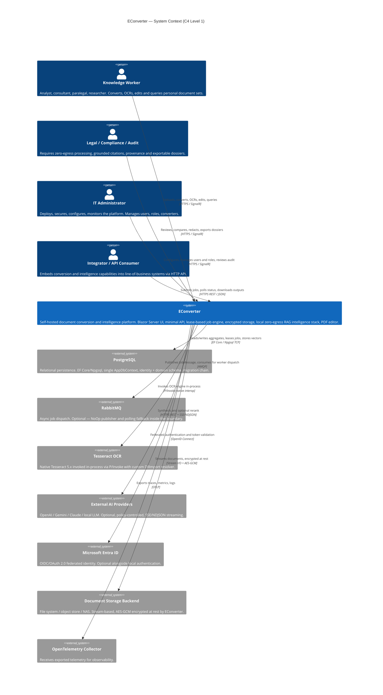
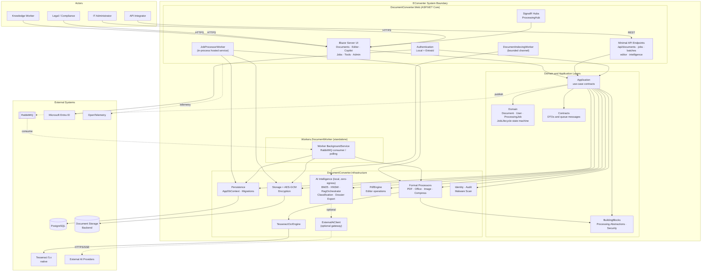
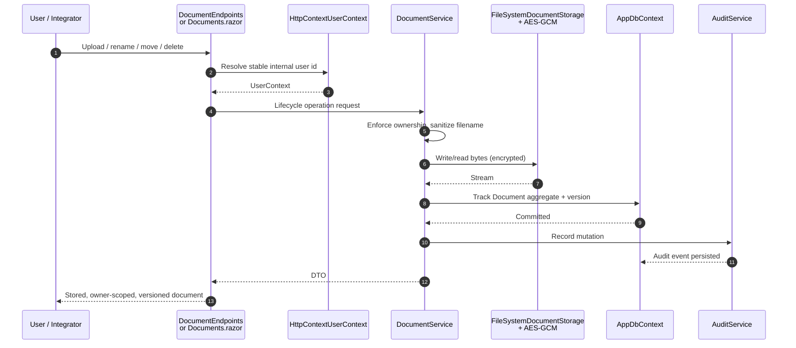
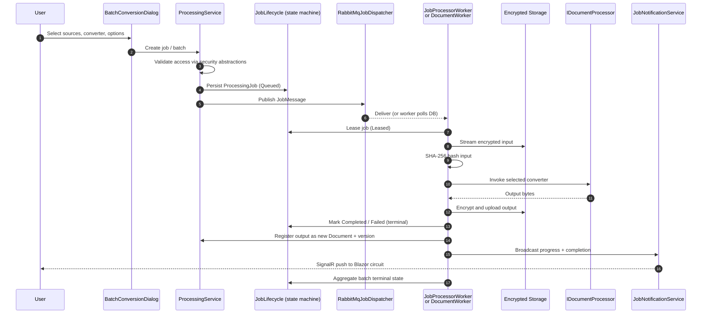
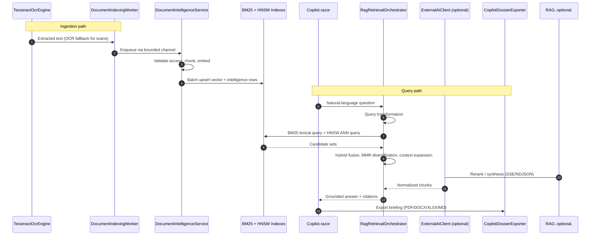
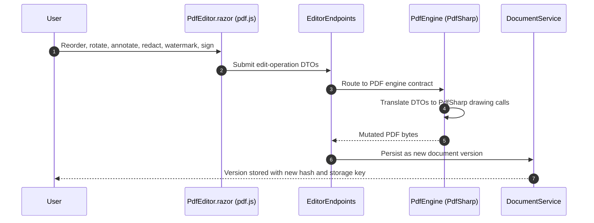
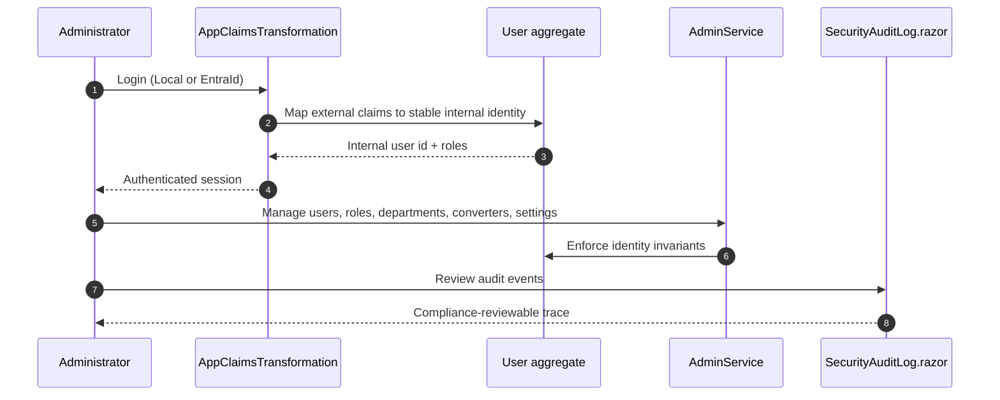

# EConverter — C4 System Context Architecture Document

**Document Level:** C4 Model — Level 1 (System Context)
**System Under Description:** EConverter — Self-Hosted Document Conversion and Intelligence Platform
**Document Status:** Authoritative architecture baseline
**Confidence Basis:** System context research (0.93) and domain module analysis (9.0/10) — 10 domain modules, 21 domain relations, 5 primary business flows

---

## 1. Project Introduction

### 1.1 Project Name and Description

**EConverter** is an enterprise-grade, self-hosted document conversion and intelligence platform built on ASP.NET Core (Blazor Server with Radzen UI components).

At its surface, EConverter performs format conversion. In practice it is a **complete governed document lifecycle platform**: it ingests documents, stores them encrypted, versions and hashes them for provenance, converts and OCRs them asynchronously through a leased job engine, indexes them into a local hybrid retrieval stack, answers natural-language questions over them with grounded citations, and exports publication-ready dossiers — all without a mandatory dependency on any cloud service.

The platform implements **Clean Architecture / Domain-Driven Design** across seven projects: Domain, Contracts, Application, two shared building blocks (Processing.Abstractions, Security), Infrastructure, the Web composition root, and a standalone DocumentWorker microservice.

### 1.2 Core Functionality

| Capability Cluster | What It Delivers |
|---|---|
| **Document Lifecycle Management** | Upload, folder organization, rename, move, soft-delete, restore, purge, versioning, SHA-256 provenance, domain-enforced ownership |
| **Asynchronous Processing** | Single and batch conversion jobs, lease-based ProcessingJob state machine, RabbitMQ dispatch with polling fallback, progress notification over SignalR |
| **Conversion and OCR** | PDF ↔ DOCX, Office (DOCX/XLSX/PPTX/Markdown/EPUB) → PDF, image conversion, PDF/image compression, Tesseract 5.x OCR with cross-platform native loading and scanned-PDF detection |
| **Document Intelligence** | Local zero-egress chunking and embeddings, BM25 lexical index, HNSW vector index, hybrid RAG retrieval with MMR diversification and reranking, auto-classification, copilot chat with persistent sessions and memory |
| **PDF Editing** | Page structure manipulation, annotation, form fields, redaction, watermark, ink and signature, document merge, page extraction, digital signatures |
| **Administration and Governance** | Users, roles, departments, converter catalog and limits, system settings, security audit log |
| **Optional External AI Gateway** | Provider-agnostic outbound client for OpenAI, Gemini, Claude, or local LLM endpoints with streaming SSE/NDJSON normalization |

### 1.3 Business Value Proposition

EConverter consolidates the fragmented, high-friction document workflow that most organizations run across a dozen disconnected tools — converters, OCR utilities, PDF editors, and now AI document assistants — into **one governed, self-hostable platform**.

The value proposition runs on four axes:

1. **Data sovereignty and compliance** — sovereign document AI without SaaS dependency. Regulated and privacy-sensitive sectors (legal, healthcare, finance, public sector) can adopt AI assistance without documents containing confidential material ever leaving the operator's infrastructure. This is the dominant blocker for AI adoption in these sectors, and EConverter removes it by design: the intelligence layer executes locally, in-process, with zero mandatory egress.
2. **Operational consolidation** — conversion, OCR, editing, retrieval, and briefing generation under one identity, one audit surface, and one storage model.
3. **Scalability** — asynchronous leased jobs with batch semantics and horizontally scalable workers absorb large conversion backlogs without blocking interactive users. Because RabbitMQ is an accelerator rather than a hard dependency, the platform degrades gracefully (NoOpQueuePublisher in the web host, polling loop in the worker) instead of failing.
4. **Accelerated knowledge work** — RAG-grounded Q&A, cross-document comparison, clause finding, and one-click executive dossiers turn an archive of static files into queryable institutional knowledge.

The pluggable external AI gateway preserves the freedom to use frontier models **where policy permits**, without re-architecting the platform.

### 1.4 Technical Characteristics

| Characteristic | Implementation Reality |
|---|---|
| **Presentation** | Blazor Server interactive UI with Radzen components, delivered over a persistent SignalR circuit; client-side PDF rendering via bundled pdf.js |
| **Persistence** | Single EF Core / Npgsql `AppDbContext` merging ASP.NET Core Identity tables with the domain schema; linear migration chain from `InitialCreate` baseline; PostgreSQL-specific startup checks (`to_regclass`) |
| **Messaging** | RabbitMQ pub/sub for job dispatch; NoOpQueuePublisher and database polling as graceful fallbacks |
| **Native interop** | Tesseract 5.x invoked in-process via P/Invoke with a custom `DllImportResolver` and platform-specific native symlink creation (.so/.dylib/.dll) |
| **Retrieval** | In-process BM25 inverted index + HNSW approximate nearest-neighbor graph; RAG orchestration with query transformation, hybrid fusion, MMR diversification, optional rerank |
| **Security posture** | Dual authentication (Local + Microsoft Entra ID); authorization keyed on stable internal entity ID rather than external subject claim; AES-GCM encryption at rest; domain-level ownership enforcement; malware scanning, zip-bomb guarding, file-signature and EICAR detection, filename sanitization, tessdata language-code hardening |
| **Observability** | Health checks and OpenTelemetry telemetry export |

---

## 2. Target Users

EConverter serves four distinct actor groups. Each interacts with the system through a different surface and carries a materially different expectation of the platform.

### 2.1 Knowledge Workers and Business Professionals

**Description.** Individual contributors who handle documents daily — analysts, consultants, paralegals, administrators, researchers — and need format conversion, OCR of scanned material, and quick answers drawn from large personal or team document sets.

**Primary scenarios.**
- Converting a DOCX proposal to a pixel-faithful PDF for external distribution.
- Running OCR over a scanned, image-only contract to make it searchable.
- Asking the Copilot "what did we commit to on payment terms?" across a project folder.
- Redacting a client name across a 40-page agreement before sharing.

**Requirements.**

| Need | Platform Response |
|---|---|
| Reliable, layout-preserving conversion between DOCX, PDF and other Office formats | Format Converter family built on PdfPig extraction, OpenXML construction and PdfSharp rendering |
| OCR of scanned or image-only PDFs into structured text | Tesseract OCR Pipeline with scanned-PDF detection and word-level bounding boxes |
| Semantic search and natural-language Q&A over a personal library | Hybrid BM25 + HNSW retrieval surfaced through the Copilot UI |
| Direct PDF editing — annotate, redact, reorder pages, sign, watermark | PDF Rendering Engine with full editor dialog suite |
| Visibility into long-running conversion progress | SignalR job notification plus a Jobs page driven by the loan state machine |

### 2.2 Legal, Compliance and Audit Teams

**Description.** Professionals in regulated functions who must keep sensitive documents on-premises while still benefiting from AI-assisted review, clause discovery, and evidence-grade reporting.

**Primary scenarios.**
- Comparing two versions of a master services agreement for changed liability caps.
- Locating every clause referencing a specific regulation across a document corpus, with verifiable citations.
- Producing an executive briefing dossier in DOCX for an audit committee.
- Demonstrating to an auditor that a document was never processed outside the organization's infrastructure.

**Requirements.**

| Need | Platform Response |
|---|---|
| Guaranteed zero-egress local processing of confidential documents | DocumentIntelligenceService contract mandates local execution of core analysis, vector search, classification and RAG; external AI is optional and policy-controlled |
| Cross-document comparison and clause finding with grounded, citable sources | RagRetrievalOrchestrator returns traceable sources; Copilot synthesizes with citations |
| Exportable, publication-ready dossiers (PDF/DOCX/XLSX) | CopilotDossierExporter renders to four formats including XLSX financial graph export |
| Immutable provenance — hashing, version history, ownership enforcement | SHA-256 content hash on the Document aggregate; DocumentVersion chain; `IsOwnedBy` invariant in the domain |
| Redaction and watermarking within the same governed platform | PDF engine redaction, watermark and stamp primitives; audited through the same audit surface |

### 2.3 Enterprise IT Administrators and Platform Operators

**Description.** Operations staff who deploy, configure, secure and monitor the platform, manage users and roles, tune AI providers and storage, and keep the processing fleet healthy.

**Primary scenarios.**
- Onboarding a department and assigning role-based access.
- Enabling SSO through Microsoft Entra ID for the whole organization while retaining break-glass local accounts.
- Scaling out DocumentWorker instances when the conversion backlog grows.
- Reviewing the security audit log after a suspicious upload.

**Requirements.**

| Need | Platform Response |
|---|---|
| Central administration of users, roles, converters and system configuration | Administration Service plus Blazor admin console (UsersAndDepartments, ConvertersCatalog, SystemSettings) |
| Dual authentication integrated with existing identity | Local accounts and EntraId federation side by side, mapped to one stable internal identity |
| Health checks, OpenTelemetry telemetry, observable job/worker state | Health-check endpoints, OTel export, Jobs page reading the lease state machine |
| Configurable storage backends and encryption-at-rest control | `IDocumentStorage` abstraction with AES-GCM wrapping and configurable `StorageEncryptionOptions` |
| Scalable worker deployment with queue-based or polling consumption | Standalone DocumentWorker with its own Dockerfile; RabbitMQ consumer or polling loop |

### 2.4 Software Integrators and API Consumers

**Description.** Internal development teams and automation engineers who embed conversion and intelligence capabilities into other line-of-business systems via the HTTP API.

**Primary scenarios.**
- A line-of-business application submitting a nightly batch of invoices for conversion.
- An automation script polling job status and downloading completed outputs.
- An internal portal querying the intelligence endpoint for grounded answers.

**Requirements.**

| Need | Platform Response |
|---|---|
| Stable, strongly-typed minimal-API contracts | Contracts layer (`DocumentDtos`, `Processing`, `AI`, `Editor`) decoupled from transport |
| Programmatic submission, status polling and cancellation | `/api/documents` and the job/batch endpoints on the minimal-API surface |
| Predictable authentication and authorization semantics | `Authorization` keyed on stable internal user ID; consistent middleware order |
| Separation of transport from processing logic | Processing.Abstractions shared by the web host and standalone worker |

---

## 3. System Boundaries

### 3.1 Scope Definition

The EConverter system boundary at C4 Level 1 encompasses **the entire self-hosted document conversion and intelligence platform**:

- The ASP.NET Core web host — Blazor Server UI, minimal API endpoints, SignalR hubs, hosted background job processor, authentication and middleware pipeline.
- The DocumentWorker service — RabbitMQ consumer / polling worker executing the conversion transaction as a BackgroundService.
- The domain and application layers that own business rules and use-case orchestration (document lifecycle, processing jobs and batches, AI intelligence, editor operations, security and storage).
- The Contracts layer defining the API/DTO surface.
- Reusable building blocks — processing abstractions and security primitives.
- Infrastructure adapters binding all of the above to PostgreSQL, RabbitMQ, the storage layer, native OCR, and optional external AI providers.
- The **process-local AI intelligence stack** (BM25, HNSW, RAG orchestration, dossier export) — included inside the boundary precisely because it executes in-process without external egress.

Everything crossing the boundary is either a human actor or an external system. External systems are represented as dependencies, never as internal components.

### 3.2 Included Core Components

| Component | Responsibility Inside the Boundary |
|---|---|
| **DocumentConverter.Web** | Composition root, HTTP/Blazor pipeline, middleware, authentication, SignalR hubs, minimal API endpoints |
| **DocumentConverter.Web.HostedServices** | `JobProcessorWorker` and related background services driving the in-process conversion pipeline and batch completion |
| **DocumentConverter.Web.Components** | Blazor/Radzen UI pages for Documents, Editor, Copilot, Jobs, Tools, Admin, Account |
| **DocumentConverter.Application** | Use-case layer: AI, Admin, Documents, Editor, Processing, Security, Storage service contracts and orchestration |
| **DocumentConverter.Domain** | Aggregates and invariants: Document, User, ProcessingJob, JobLifecycle state machine, AI/Processing/Security/System models |
| **DocumentConverter.Contracts** | Transport DTOs and messages across AI, Admin, Documents, Editor, Messages, Processing |
| **DocumentConverter.Infrastructure** | Adapters for persistence (EF Core/Npgsql + migrations), AI (ExternalAiClient, DocumentIntelligenceService, BM25, HNSW, RagRetrievalOrchestrator, CopilotDossierExporter, RagBenchmarkRunner), OCR (TesseractOcrEngine), Office processing (OfficeDocumentProcessor), editor rendering (PdfEngine), Identity, Messaging, Security/StorageEncryption, Storage |
| **BuildingBlocks.DocumentConverter.Processing.Abstractions** | Converter/processor contracts shared by host and worker |
| **BuildingBlocks.DocumentConverter.Security** | Authorization and security primitives used across layers |
| **Workers.DocumentWorker** | Standalone BackgroundService microservice consuming queued jobs, streaming and hashing documents, encrypting and uploading outputs |

### 3.3 Excluded External Dependencies

The following are explicitly **outside** the boundary. They are operator-managed infrastructure, third-party libraries, or client-side assets — not project code and not the system's responsibility.

| Excluded Element | Rationale for Exclusion |
|---|---|
| **PostgreSQL database server** | External infrastructure managed by the operator |
| **RabbitMQ broker** | External infrastructure; optional, with NoOpQueuePublisher and polling fallbacks inside the boundary |
| **Microsoft Entra ID / any external identity provider** | Outside the boundary; consumed via OpenID Connect |
| **OpenAI, Gemini, Claude and third-party LLM/embedding APIs** | Optional external services, not required for core intelligence |
| **Underlying file system, object store or NAS hosting the storage backend** | Operator-managed infrastructure |
| **Tesseract native binaries, tessdata language packs, other native libraries** | Vendored third-party dependencies, not project code |
| **Radzen, PdfPig, PdfSharp, OpenXml, SkiaSharp and other NuGet libraries** | Third-party runtime dependencies |
| **pdf.js browser assets** | Third-party front-end library served to clients |
| **OpenTelemetry backend / observability collector** | External monitoring platform receiving exported telemetry |
| **End-user browsers, operating systems and client devices** | Client-side environment |
| **Reverse proxies, TLS terminators, load balancers, container orchestration** | Hosting infrastructure around the application |

### 3.4 Boundary Rationale

Three boundary decisions are architecturally significant and worth stating explicitly:

1. **The AI intelligence stack is *inside* the boundary.** BM25, HNSW, RAG orchestration, classification and dossier export execute as in-process .NET code against the same PostgreSQL instance. They are not a satellite microservice and they emit no network traffic. This is what makes the zero-egress claim verifiable rather than aspirational.

2. **The message broker is *outside* but *optional*.** RabbitMQ accelerates job dispatch; it does not gate it. The deliberate fallback chain (publish → NoOpQueuePublisher → database polling loop) is a design commitment that the platform remains fully operational on a single-node deployment with no broker at all.

3. **The standalone worker is *inside* the boundary.** DocumentWorker is not a third-party consumer — it is a deployable unit of EConverter that shares the same domain assemblies, the same contracts, and the same persistence schema. It is drawn inside the system boundary and deployed separately.

---

## 4. External System Interactions

### 4.1 External System Inventory

| # | External System | Interaction Type | Sync/Async | Criticality |
|---|---|---|---|---|
| ES-01 | PostgreSQL Database | EF Core ORM over Npgsql TCP; schema managed by migrations on startup | Synchronous | **Hard dependency** |
| ES-02 | RabbitMQ Message Broker | Publish/subscribe for job dispatch and worker consumption | Asynchronous | Optional accelerator |
| ES-03 | Tesseract OCR Engine (native) | In-process P/Invoke with custom assembly resolver | In-process native interop | Hard for OCR features |
| ES-04 | External AI Providers (OpenAI / Gemini / Claude / Local LLM) | REST with SSE/NDJSON chunked responses via ExternalAiClient | Synchronous and streaming | Optional |
| ES-05 | Microsoft Entra ID (Azure AD) | OpenID Connect / OAuth 2.0 federated authentication and token validation | Synchronous | Optional (dual-mode) |
| ES-06 | Document Storage Backend | Stream-based read/write through storage abstraction with AES-GCM encryption | Synchronous | **Hard dependency** |
| ES-07 | Blazor Server Clients (Browsers) | SignalR/WebSocket circuit plus HTTP for static assets | Bidirectional | **Primary UI** |
| ES-08 | API Clients and Integrators | HTTP/HTTPS REST with JSON payloads | Synchronous | Integration surface |

### 4.2 Interaction Descriptions

#### ES-01 — PostgreSQL Database

**Role.** Primary relational persistence for the entire application, accessed via EF Core/Npgsql with a single `AppDbContext` that merges ASP.NET Core Identity tables with the domain schema.

**Interaction mechanics.**
- Schema provisioning at startup performs PostgreSQL-specific checks such as `to_regclass` and applies the EF Core migration chain from the `InitialCreate` baseline through vector, provenance, copilot, tri-language and embedding-widening migrations.
- All aggregates — Document, DocumentVersion, Folder, ProcessingJob, BatchJob, User, Role, Department, AuditEvent, DocumentVectorChunk, DocumentIntelligenceIndex, CopilotChatSession — resolve through this single unit of work.
- No repository-per-aggregate sprawl: one context, fluent configurations, one transaction boundary.

**Dependency analysis.** This is a **hard dependency**. Nothing in EConverter functions without it. Deployment must provision PostgreSQL before first start; startup `InitializeDatabaseAsync` will fail fast otherwise. The single-context design keeps schema authority centralized but makes the database a single point of failure — mitigated by standard PostgreSQL HA practices at the operator layer, which sit outside this boundary.

#### ES-02 — RabbitMQ Message Broker

**Role.** Queue transport used to dispatch `JobMessage` payloads from the application layer to conversion workers.

**Interaction mechanics.**
- `ProcessingService` publishes `JobMessage` payloads after persisting `ProcessingJob` entities.
- `RabbitMqJobDispatcher` (backed by `RabbitMqOptions`) publishes to the broker.
- The web host falls back to `NoOpQueuePublisher` when messaging is disabled.
- The `DocumentWorker` service degrades to a polling loop when the consumer is disabled.

**Dependency analysis.** This is a **scaling and responsiveness accelerator rather than a hard dependency**. The fallback chain is a first-class architectural decision, not an afterthought:

| Condition | Consequence | Behavior |
|---|---|---|
| Broker available, consumer enabled | Optimal dispatch latency | Message-driven conversion dispatch |
| Broker unavailable, web host only | Slight dispatch latency increase | `NoOpQueuePublisher` no-ops; `JobProcessorWorker` leases from DB |
| Broker unavailable, worker deployed | Polling overhead | `DocumentWorker` polls the job table on an interval |

The lease-based `ProcessingJob` state machine is what makes this graceful degradation safe: regardless of who wakes up to do the work, the lease semantics prevent double-execution.

#### ES-03 — Tesseract OCR Engine (Native Library)

**Role.** Local native OCR dependency (Tesseract 5.x) invoked in-process by `TesseractOcrEngine`.

**Interaction mechanics.**
- `TesseractOcrEngine` resolves tessdata paths and creates platform-specific native symlinks (`.so` / `.dylib` / `.dll`).
- A custom `DllImportResolver` is installed for cross-platform loading — deliberately allowing one deployment artifact to run on Linux, macOS and Windows without recompilation.
- Language codes are sanitized to prevent tessdata traversal or language injection.
- `ScannedPdfDetector` decides whether OCR is required before invoking the engine, avoiding needless native work on text-native PDFs.
- Output aggregates word-level bounding boxes, confidence and page dimensions.

**Dependency analysis.** **Hard dependency for OCR capabilities**, satisfiable inside the boundary. Because Tesseract is a native library rather than a network service, it carries no egress risk, but it does carry a deployment burden: tessdata language packs must be present in the container image. The dependency is included in the boundary as a vendored runtime dependency while the binary itself is excluded from project code.

#### ES-04 — External AI Providers

**Role.** Optional outbound LLM and embedding services reached through `ExternalAiClient`, which builds provider-specific requests and normalizes streaming SSE/NDJSON responses into a single provider-agnostic chunk model.

**Interaction mechanics.**
- Supported targets: OpenAI, Google Gemini, Anthropic Claude, or local LLM endpoints.
- Provider-specific request shapes and headers are built inside `ExternalAiClient`; the rest of the system sees one normalized streaming model.
- Connectivity pings and timeout management are part of the adapter.
- The `DocumentIntelligenceService` contract **mandates local, zero-egress execution of core analysis, vector search, classification and RAG**.

**Dependency analysis.** **Strictly optional.** This is the most important boundary decision in the platform's security posture. Because core intelligence runs locally, the platform is fully functional with zero AI provider configuration. When providers *are* configured, they are used for synthesis and optional reranking — not for the retrieval or storage of document content. The adapter pattern means provider substitution is a configuration change, not an architectural one.

#### ES-05 — Microsoft Entra ID (Azure AD) Identity Provider

**Role.** External identity provider supported **alongside** local authentication.

**Interaction mechanics.**
- `User` aggregate records an `AuthenticationType` (`Local` or `EntraId`).
- `AppClaimsTransformation` maps provider claims onto the stable internal identity during the OIDC flow.
- **Critical design decision:** authorization is keyed on the internal stable entity ID — *not* on the external subject claim. Provider-side identity churn (email changes, subject re-issuance, tenant migration) cannot silently transfer or revoke application permissions.

**Dependency analysis.** **Optional — dual-mode by design.** Organizations can run entirely on local accounts, entirely on SSO, or both (the recommended operational pattern, with local accounts retained as break-glass access). Because authorization is decoupled from the subject claim, an Entra ID outage degrades login for SSO users but does not corrupt or invalidate existing authorization state.

#### ES-06 — Document Storage Backend

**Role.** Pluggable storage abstraction (storage provider + storage key recorded on the `Document` aggregate) backed by an encrypted storage layer.

**Interaction mechanics.**
- `IDocumentStorage` exposes stream-based open-read / open-write by storage key, plus delete and enumerate.
- `FileSystemDocumentStorage` is the reference implementation; operators can substitute object stores or NAS without touching callers.
- `AesGcmStorageEncryptionService` wraps every read and write transparently, configured through `StorageEncryptionOptions`.
- Workers stream documents in and out of this layer, hashing inputs with SHA-256 and encrypting outputs before upload.

**Dependency analysis.** **Hard dependency and single enforcement point** for confidentiality of stored content. Every document byte entering or leaving the system passes through this domain — which is exactly why the encryption wrapper lives at this seam rather than scattered across callers. The underlying file system is excluded from the boundary as operator-managed infrastructure.

#### ES-07 — Blazor Server Clients (Browsers)

**Role.** End users access the platform through the Blazor Server interactive UI with Radzen components, delivered over a persistent SignalR circuit.

**Interaction mechanics.**
- Bidirectional SignalR/WebSocket circuit for interactive UI (component state, job progress, copilot streaming).
- HTTP for static assets, including bundled pdf.js resources in `wwwroot`.
- `ProcessingHub` broadcasts job and batch progress to subscribed circuits so the UI reflects live state without polling.

**Dependency analysis.** **Primary UI surface.** The persistent circuit is a deliberate choice with known trade-offs: server-side state keeps the client thin and the deployment simple, but makes network quality and connection resilience first-class operational concerns (hence the reconnect flow in `App.razor`). Stateless API integrators are served separately and are unaffected by circuit behavior.

#### ES-08 — API Clients and Integrators

**Role.** External or internal systems consuming the minimal-API surface (`/api/documents` and the job/batch endpoints) for programmatic document management and conversion submission.

**Interaction mechanics.**
- Synchronous HTTP/HTTPS REST with JSON payloads.
- Contracts layer DTOs (`DocumentDtos`, `Processing*`, `DocumentIntelligence*`, `PdfEditor*`) define the wire shape independent of domain types.
- Job submission returns identifiers that can be polled or observed through the notification surface.

**Dependency analysis.** **Integration surface, not a runtime dependency.** API clients impose no availability requirement on the platform beyond what the platform provides for itself. Their existence does, however, raise the importance of contract stability — which is why DTOs live in a dedicated `Contracts` project rather than leaking domain entities.

### 4.3 Dependency Relationship Analysis

**Criticality tiers:**

| Tier | Systems | Failure Consequence | Mitigation Inside Boundary |
|---|---|---|---|
| **Tier 1 — Hard** | PostgreSQL (ES-01), Storage (ES-06) | Total platform unavailability | Operator-level HA outside boundary |
| **Tier 2 — Feature-critical** | Tesseract (ES-03) | OCR features unavailable; text-native conversion unaffected | Scanned-PDF detection avoids unnecessary invocation |
| **Tier 3 — Optional (degrades gracefully)** | RabbitMQ (ES-02), Entra ID (ES-05), External AI (ES-04) | Feature degradation, not outage | NoOp publisher + polling; local auth; local intelligence stack |

**Coupling characteristics:**

- **ES-01 is the schema authority.** Ten domain modules depend on it; the migration chain is the single source of truth for structure. This is the tightest coupling in the system and the correct place for it.
- **ES-06 is the confidentiality authority.** Every document read and write is encrypted at this seam. `Document Lifecycle Management` → `Document Storage and Encryption` is measured as the strongest infrastructural coupling (9.0/10) in the domain analysis.
- **ES-02's coupling is intentionally loose.** `Job Orchestration and Processing` → broker is a publish-and-forget relationship bounded by the state machine.
- **ES-04 is the only egress channel.** By contract, it is optional and never used for retrieval, storage, or classification of document content. This concentrates all data-egress risk into one auditable adapter.

**Direction of control:** In every case, EConverter initiates the interaction. No external system calls *into* the boundary except browsers and API clients over the public HTTP/SignalR surface. There are no inbound webhooks, no reverse callbacks, no externally triggered state changes — a materially simpler security surface than most enterprise platforms.

---

## 5. System Context Diagram

### 5.1 C4 Level 1 System Context

### 5.2 Container-Level Detail Within the Boundary

The following diagram sits one level deeper than strict System Context. It is included because two independently deployable units exist inside the boundary — the web host and DocumentWorker — and the intelligence stack's in-process nature must be visually unambiguous.

### 5.3 Key Interaction Flows

#### Flow 1 — Document Upload and Lifecycle Management

**Outcome:** a stored, owner-scoped, versioned document that appears in the user's explorer. Five domains participate; ownership is enforced before any storage or persistence side effect.

#### Flow 2 — Asynchronous Conversion Job Processing

**Outcome:** a converted, stored, owner-scoped output document plus a terminal job state. Six domains participate. The lease prevents double-execution regardless of whether the message path or the polling path woke the worker.

#### Flow 3 — Document Intelligence Indexing and RAG Question Answering

**Outcome:** a grounded answer with traceable sources and, optionally, an exportable briefing. Note that the external gateway is drawn with dashed lines throughout — the entire retrieval path completes locally.

#### Flow 4 — PDF Editing and Annotation

**Outcome:** a mutated PDF persisted as a new document version with operations applied deterministically. The editor never mutates in place — every edit produces a new version, preserving provenance.

#### Flow 5 — Administration, Identity and Audit

**Outcome:** governed configuration and identity state plus a reviewable audit trail.

### 5.4 Architecture Decision Descriptions

| ADR | Decision | Rationale | Consequence |
|---|---|---|---|
| **ADR-01** | Local, in-process AI intelligence stack (BM25 + HNSW + RAG) is the *primary* capability; external AI is optional | Zero-egress is the dominant blocker-remover for regulated sectors. Making local the default and cloud the exception is the only way the sovereignty claim is verifiable. | Higher in-process resource footprint; retrieval quality tuned locally rather than inherited from a frontier reranker |
| **ADR-02** | Authorization keyed on stable internal entity ID, never on the identity-provider subject claim | Provider-side identity churn must not silently transfer or revoke application permissions | Requires an explicit identity bridge (`AppClaimsTransformation`, `AppIdentityUser`); Entra ID is a login mechanism, not an authorization source |
| **ADR-03** | Single `AppDbContext` merging Identity and domain schema over Npgsql | One unit of work, one transaction boundary, one migration chain; avoids distributed consistency problems in a platform with heavy cross-aggregate flows | Database is a single point of failure and a schema-evolution chokepoint; mitigated at operator level |
| **ADR-04** | Lease-based `ProcessingJob` state machine as the execution authority; RabbitMQ as an accelerator | Exactly-once execution semantics must hold whether the worker is message-driven or poll-driven | `ProcessingJobLifecycle` becomes a critical invariant holder; message delivery can be at-least-once without duplicating work |
| **ADR-05** | Standalone `DocumentWorker` as a separate deployable sharing the same domain assemblies | Horizontal scaling of conversion capacity without scaling the UI tier | Two deployment units to operate; contract compatibility across host and worker becomes a release discipline |
| **ADR-06** | AES-GCM encryption wrapped at the `IDocumentStorage` seam rather than at call sites | Single enforcement point for confidentiality of stored content; impossible to bypass by adding a new caller | Encryption is transparent to all ten domain modules; key management becomes an operator responsibility (`StorageEncryptionOptions`) |
| **ADR-07** | Clean Architecture with `Contracts` isolated from `Domain` | API surface stays stable while the domain model evolves; workers and integrators bind to DTOs, not entities | Mapping layer overhead; `Application` orchestration occasionally leaks into `Infrastructure` where high-value orchestrators (RAG, PDF engine, external AI) live |
| **ADR-08** | Blazor Server with SignalR circuit rather than a stateless SPA | Thin client, server-held state, direct DI access to application contracts, live job progress without polling infrastructure | Persistent circuit is an operational concern; reconnect handling is mandatory; does not serve integrators (separate REST path) |

---

## 6. Technical Architecture Overview

### 6.1 Main Technology Stack

| Layer | Technology | Purpose |
|---|---|---|
| **Presentation** | Blazor Server, Radzen components, SignalR, pdf.js | Interactive UI, live job progress, in-browser PDF rendering |
| **API** | ASP.NET Core Minimal API | `/api/documents`, job/batch endpoints, editor endpoints, intelligence endpoints |
| **Application** | C# interface contracts (`IDocumentService`, `IProcessingService`, `IDocumentIntelligenceService`, `IExternalAiClient`, `IPdfEngine`, `IAdminService`, `IAuditService`, `IMalwareScanner`, `IDocumentStorage`) | Use-case orchestration, transport-agnostic |
| **Domain** | C# aggregates and invariants (`Document`, `User`, `ProcessingJob`, `BatchJob`, `CopilotChatSession`, `AuditEvent`) | Business rules, state machines, ownership enforcement |
| **Contracts** | DTO records and queue messages | Wire-shape stability across host, worker and integrators |
| **Persistence** | EF Core, Npgsql, PostgreSQL | Single `AppDbContext`, fluent configurations, linear migration chain |
| **Messaging** | RabbitMQ (`RabbitMqJobDispatcher`, `RabbitMqOptions`) with `NoOpQueuePublisher` fallback | Async job dispatch |
| **Document processing** | PdfPig (extraction), PdfSharp (rendering), OpenXML SDK (Office construction), SkiaSharp (imaging) | Format conversion, editor operations |
| **OCR** | Tesseract 5.x via P/Invoke with custom `DllImportResolver` | Scanned document text extraction |
| **Retrieval** | In-process BM25 inverted index + HNSW graph, RAG orchestration with MMR | Hybrid lexical + vector search |
| **Security** | ASP.NET Core Identity, OIDC (Entra ID), AES-GCM, ClamAV scanner abstraction | Authentication, encryption at rest, malware defense |
| **Observability** | Health checks, OpenTelemetry | Runtime visibility |

### 6.2 Architecture Patterns

**Clean Architecture / DDD layering.** Dependencies point inward: Web → Application → Domain, with Infrastructure implementing Application contracts and Contracts providing the transport boundary. The domain layer holds no infrastructure references.

**Aggregate-root ownership enforcement.** The `Document` aggregate exposes `IsOwnedBy` and gates every mutation through lifecycle rules. This means *no downstream feature — conversion, indexing, editing, export — can bypass authorization*, because they all operate on a document that already carries its ownership invariant. This is the platform's strongest structural security property.

**Lease-based job state machine.** `ProcessingJobLifecycle` is the single authority on legal transitions, terminal states and retry eligibility. Workers lease, renew and update progress through it. Because leases are persisted, the state machine is what lets RabbitMQ and DB-polling coexist safely as interchangeable wake-up mechanisms.

**Ports and adapters at storage and messaging.** `IDocumentStorage` and the queue publisher are contracts with swappable implementations; AES-GCM wrapping sits at the port so any future adapter inherits encryption automatically.

**Bounded-channel background ingestion.** `DocumentIndexingWorker` consumes indexing work through a bounded channel, providing backpressure against unbounded memory growth during bulk ingestion while decoupling request latency from indexing cost.

**Provider-normalizing AI gateway.** `ExternalAiClient` absorbs per-provider request shapes and streaming formats (SSE vs NDJSON) behind one normalized chunk model, so provider substitution is configuration, not re-architecture.

**Defense in depth at the input boundary.** Filename sanitization, file-signature detection, EICAR signature detection, zip-bomb guarding and ClamAV scan all execute before a document enters the pipeline; OCR additionally sanitizes language codes against tessdata path injection.

### 6.3 Key Design Decisions and Their Consequences

**The zero-egress commitment is architectural, not configurational.** Because the intelligence stack executes in-process against the same PostgreSQL instance, an operator can prove — by inspecting configuration and network policy — that no document content reaches a third party. The optional external gateway is a single, separately auditable adapter. This is why the domain analysis identifies only one egress channel in the entire system.

**Authorization survives identity-provider churn.** Keying on the stable internal entity ID means a user who is renamed, re-provisioned, or whose Entra ID subject changes retains the correct application permissions. The trade-off is an explicit identity bridge that must be maintained — but the alternative (subject-claim-keyed authorization) produces silent permission corruption at exactly the moment an organization is doing an identity migration.

**Graceful degradation is designed, not incidental.** Three fallback chains preserve operation under adverse conditions: RabbitMQ → NoOp publisher → polling loop; Entra ID → local accounts; external AI → local intelligence stack. The platform's minimum viable deployment is a single web host + PostgreSQL + storage, with no broker, no SSO, no AI provider — and it still converts, OCRs, edits, indexes and answers questions.

**The structural tension worth flagging.** Several high-value orchestrators — `RagRetrievalOrchestrator`, `PdfEngine`, `ExternalAiClient`, `DocumentIntelligenceService` — live in Infrastructure rather than Application, and one minimal-API endpoint file (`DocumentEndpoints.cs`) mixes transport concerns with inline document conversion logic. This is a known layering debt. It does not compromise the boundary described here, but it means the Application layer's contract surface is a partial map of orchestration logic: anyone extending the platform must read Infrastructure to understand where retrieval, rendering and provider behavior actually live. The context boundary itself is unaffected — the System Context is defined by *what the system is responsible for*, and that responsibility set is stable regardless of where internal orchestration is filed.

**Blazor Server is a deliberate operational trade.** Server-held circuit state simplifies the client and gives direct DI access to application contracts, at the cost of persistent-connection sensitivity. The parallel REST surface exists precisely so integrators — who need statelessness — are never forced through the circuit.

---

## 7. Summary

EConverter's system context is defined by a single, coherent architectural thesis: **sovereign document intelligence**. Everything at the boundary follows from it.

| Context Dimension | Characterization |
|---|---|
| **Actors** | Four groups — knowledge workers, regulated reviewers, platform operators, integrators — unified on one governed surface |
| **Boundary** | Includes the web host, standalone worker, and the in-process zero-egress intelligence stack; excludes operator-managed infrastructure, third-party libraries and client environments |
| **External dependencies** | Two Tier-1 hard dependencies (PostgreSQL, storage), one Tier-2 native dependency (Tesseract), three Tier-3 optional systems with designed fallbacks (RabbitMQ, Entra ID, external AI) |
| **Egress surface** | Exactly one optional channel (`ExternalAiClient`); core retrieval, storage, classification and analysis never leave the boundary |
| **Execution model** | Lease-based state machine as the authority; message broker and polling loop as interchangeable accelerators |
| **Security spine** | Stable internal identity, domain-enforced ownership, AES-GCM at the storage seam, input hardening before the pipeline |

An operator deploying EConverter can state, and verify, three properties that most document AI platforms cannot: *confidential documents never leave my infrastructure by default*; *my users' permissions survive identity-provider change*; and *my conversion backlog scales without my UI degrading*. Those three properties are the context boundary's justification, and every external interaction in this document either serves them or is explicitly optional to them.